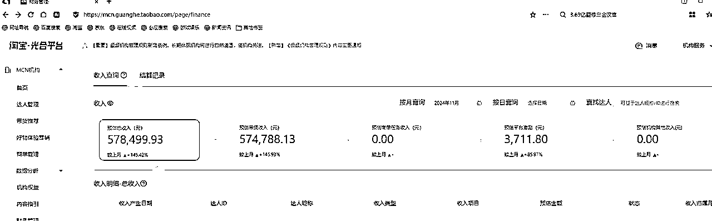

# 逛逛带货常见问题，一次性讲清楚
作者：龙哥

前段时间和大家拆解了逛逛带货的完整流程，后来陆续收到不少私信，大家集中问到视频审核、账号违规、提现、矩阵管理以及收益等问题。今天统一整理出来，方便大家参考。

## 一、为什么视频容易审核不过？

目前最常见的问题，不是内容本身，而是视频重复度太高。

发布时要注意增加模板、标识或水印，并且不能长期一成不变，过一段时间就要调整。尤其是批量搬运时，很容易出现同一个素材以前已经发布过的情况，自己也未必能及时察觉。

剪辑方面，用 CR 完成基础处理就够了，不必一开始就投入大量时间，用剪映逐条精修。现阶段重点是提高效率，还没必要过早进入精细化运营。

## 二、账号违规情况严重吗？

一般来说，能够达到带货等级的账号，违规概率并不高，除非主动触碰平台红线。

比较典型的风险包括外部平台水印，视频里有可能违规，标题中出现相关信息也可能导致问题。新账号的审核和管理会更严格，有时即使发布正常内容，也可能遇到违规提示。

因此，我们通常会先把账号做到带货等级，再正式开展内容发布，尽量绕开新号阶段的限制。

即便出现违规，也不是完全没有处理空间，通常只是会损失部分佣金，没必要因此过度焦虑。

## 三、提现有哪些需要注意的地方？

提现主要看两个方面。

### 1. 矩阵账号的提现限制

逛逛账号在认证数量上，一个人可以进行多次认证，但提现时需要绑定支付宝。个人支付宝目前大约有三个绑定名额，企业主体通常会有更多额度。

具体能绑定多少，要根据实际主体情况确认。我们目前采用的是 MCN 统一管理模式，个人提现这一块还没有做完整测试，大家可以自行验证。

### 2. 提现会产生手续费

个人提现采用分级收费机制，账号经营表现越好，扣除比例可能越高，最高甚至能达到30%，这个比例相对偏高。

如果通过机构操作，通常不采用这种高比例扣点，而是按照正常税点处理，成本会更合理一些。

## 四、矩阵账号怎么管理才不会乱？

账号数量一多，最怕的不是注册，而是后续管理失控。

我们目前采用“表格统一登记+工具集中管理”的方式。比如一个营业执照对应哪些账号、账号由谁认证、逛逛号是多少、绑定了哪个手机号，都要一项项记录清楚。

这一步非常重要。刚开始只有几个账号时可能感觉没必要，但数量上来之后，没有完整台账，很快就会出现账号找不到、手机号对不上、认证关系混乱等问题。

登录、查看数据、处理评论等操作，我们内部使用统一的软件集中完成，每天登录一个管理端即可，不需要频繁切换大量账号，从而提高整体效率。

不过这套软件目前只供内部团队使用，并未对外提供，大家不用反复询问。

## 五、单账号到底能产生多少收益？

之前分享时，单个账号月均产值大约在500元左右；经过持续调整，目前平均水平已经提升到800—1000元。

与此同时，单人整体产值也比此前有所增长，最高时可以做到5万元。

收益提升的关键，依旧是两个方面：选品和选视频。

我们会持续调整选品逻辑，定期复盘数据，再把有效经验进行整理分享。除此之外，淘宝经常会推出各种活动，也会出现阶段性的热门词。熟悉淘系玩法的人都知道，发布内容时结合正在流行的关键词，流量表现往往会明显优于普通内容。

矩阵模式的优势就在于，它不要求每个账号都爆发，而是通过数量摊平平均表现，同时等待其中少数账号跑出更高数据。

所以，只做一两个账号，往往很难充分发挥矩阵的价值，也容易让前期投入的时间得不到回报。

## 六、平台规则最近有什么变化？

本月平台发布了新的调整通知，原本的 G 等级划分改成了 L 等级，同时，开通带货权限的相关政策也出现变化。

目前并不是所有账号都同步调整，只有部分账号受到了影响。现阶段核心判断依旧与播放量有关，解决起来并没有想象中复杂。

至于平台何时完成全面调整，目前还没有明确时间，因此没必要一直停留在观望状态。按照正常节奏推进即可，遇到具体问题再针对性处理。

## 七、机构到底有没有必要？

目前我们采用的是 MCN 运营模式，主要是为了处理提现、手续费比例等问题。

另一方面，我们也在推进团队合作，希望通过更深层次的协作，把一线的新玩法及时同步给合作方，并以管道分佣的方式进行长期合作。

至于个人能否自行申请机构，虽然官方平台目前还保留着提交入口，但实际已经处于基本不审核的状态。市面上很多所谓的申请渠道，大家需要自行判断，不能盲目相信。

## 最后说几句实际情况

和我们做的其他项目相比，逛逛带货并不是那种单人产出特别高的模式，本质上更偏向于通过规模化账号提升整体效率，玩法相对直接。

但如果你具备一定的选品能力，或者愿意持续研究商品和内容，收益空间还是会被明显拉高。

对于小型工作室或小团队来说，这个项目比较容易启动，也相对适合批量推进。

个人当然也可以做，只是需要投入更多时间。它可能比普通上班更有弹性，但不可能像固定工作一样稳定。任何项目都有周期，平台也会逐步提高要求、增加门槛，这是长期趋势。

如果一直担心未来会不会变化，始终停留在观察阶段，那么机会来了也很难真正参与进去。更现实的做法，是先测算清楚投入、产出和人效，再决定是否开始。

最后再给大家看一下前几次分享过的数据：

9月，收入1万多；

10月，做到23万；

本月还没有结束，目前已经接近60万。

所以，先行动起来再说！