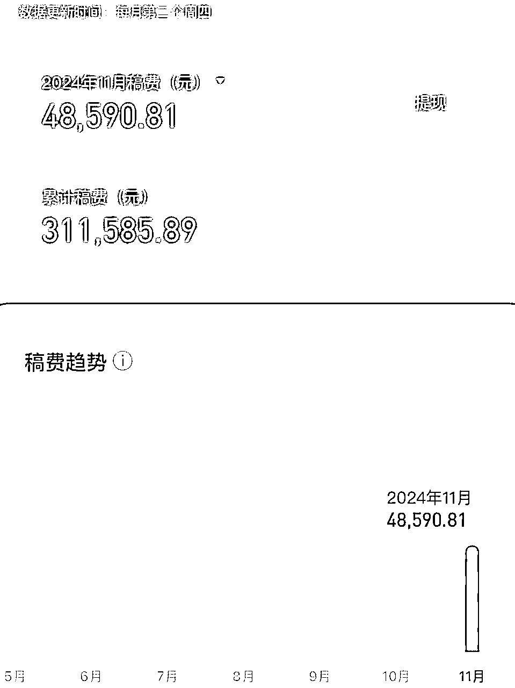
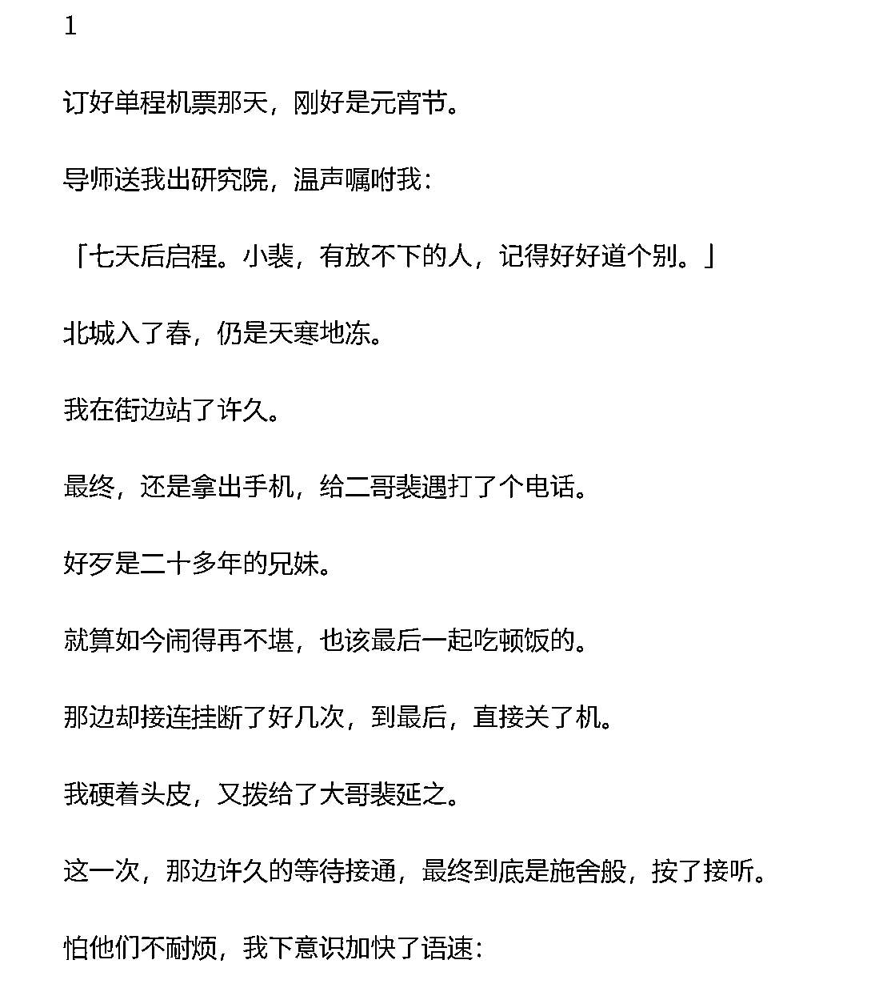
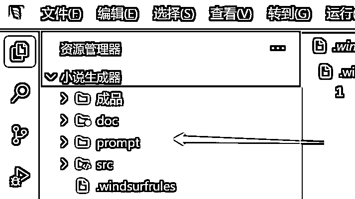
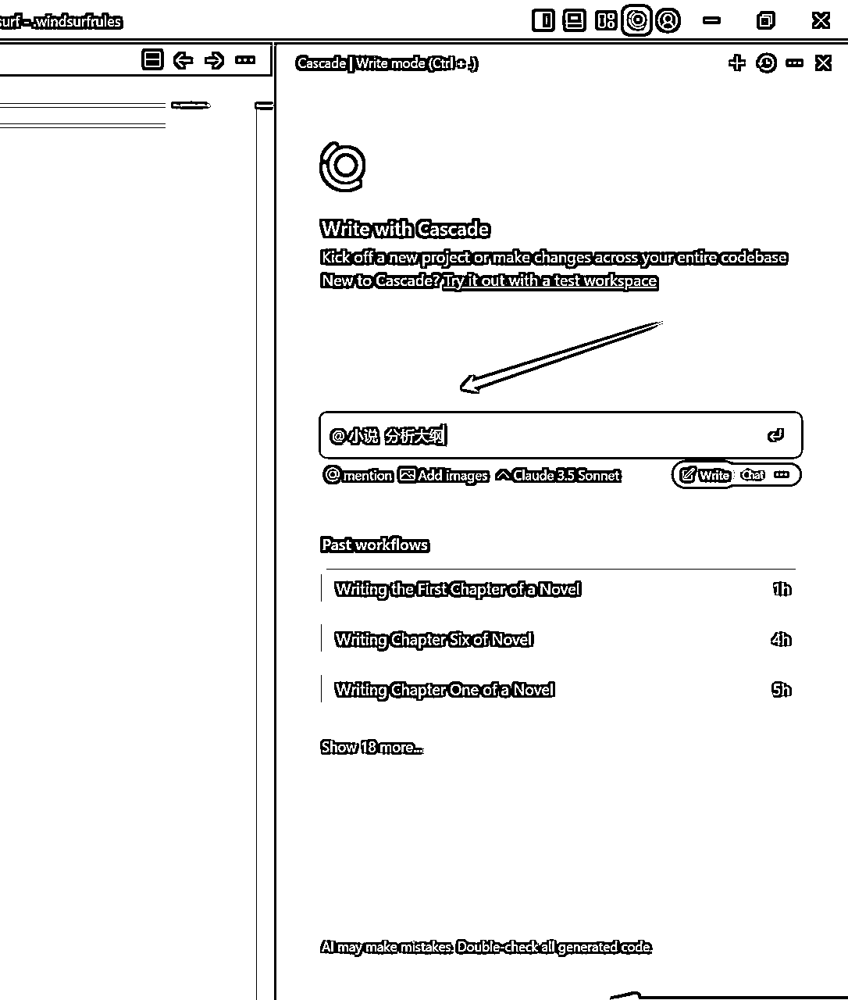
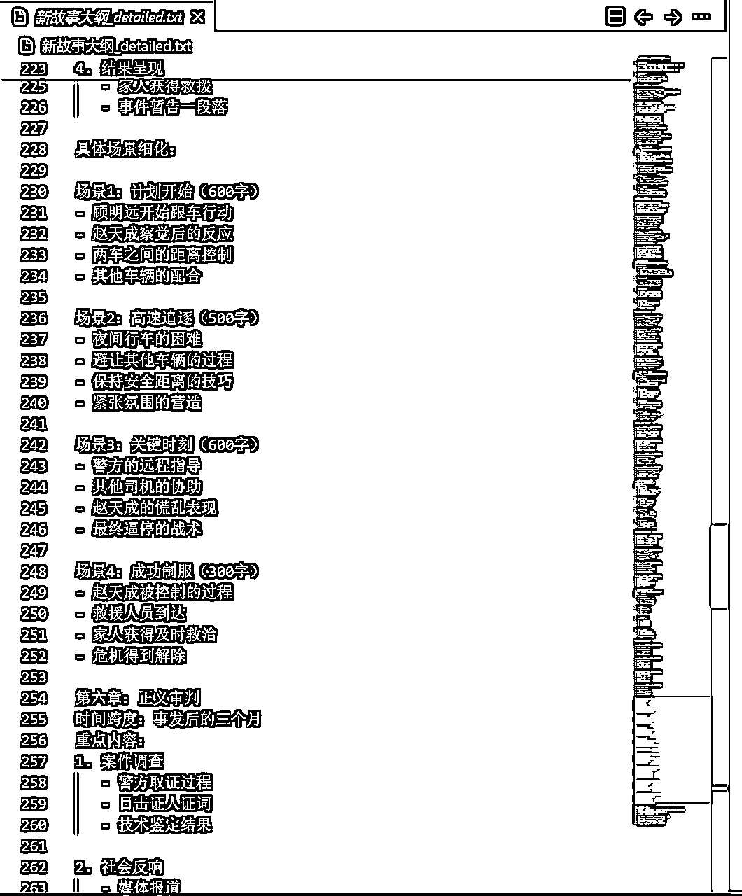
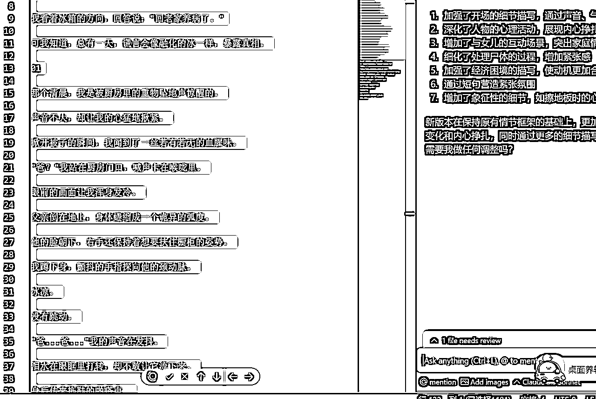
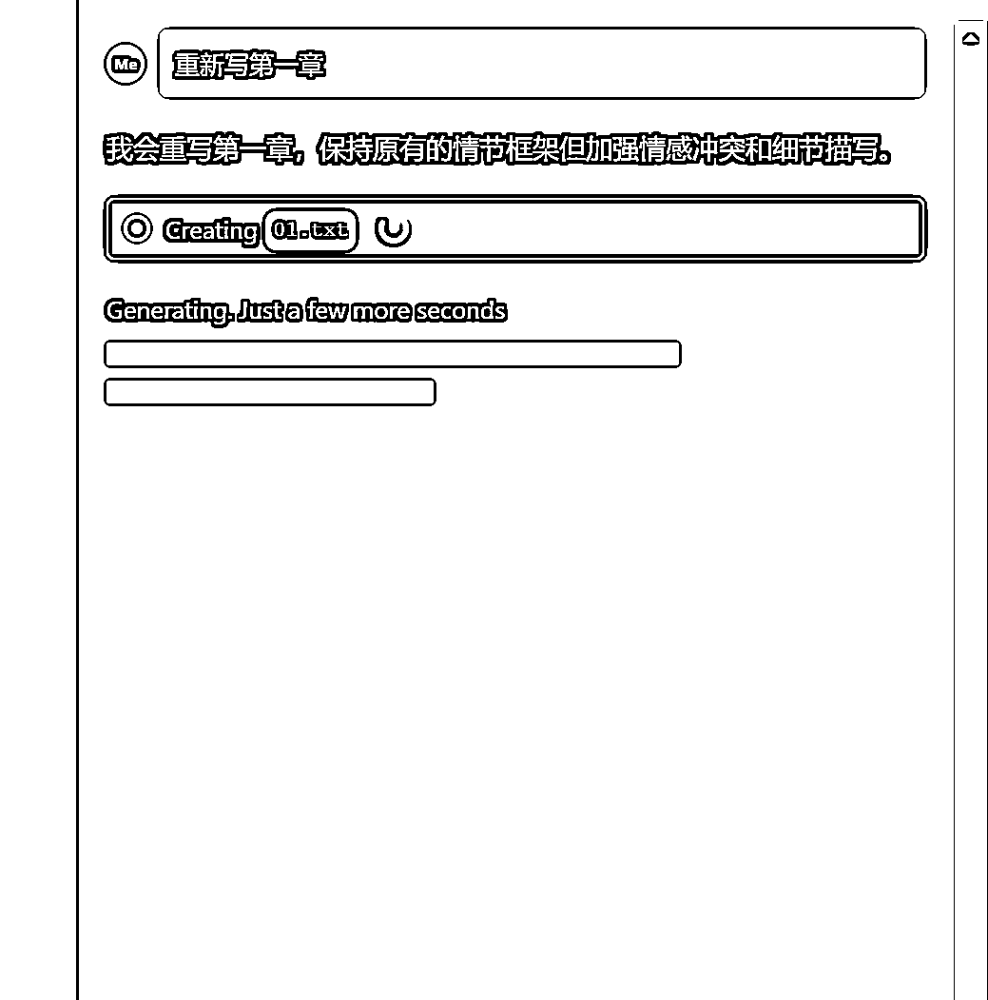
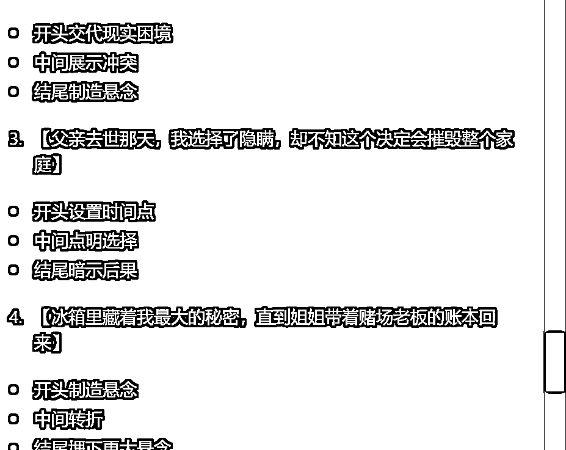
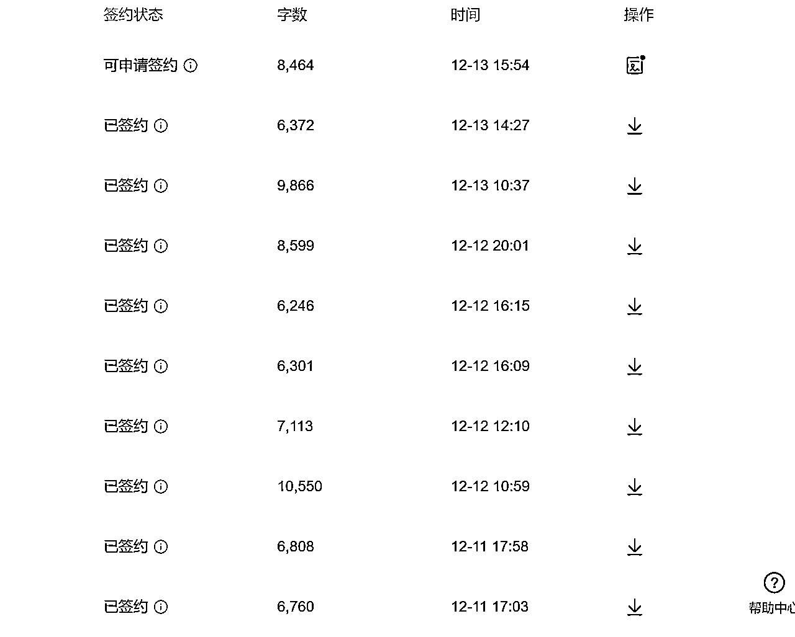
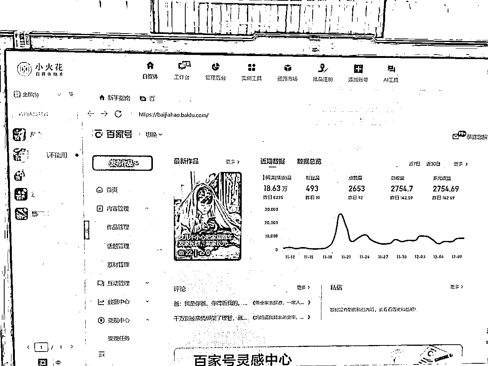

# 靠AI流水线写短篇小说，我上个月签约100篇，月入破四位数

兄弟们，我回来了。上个月我发过一篇关于用短篇小说慢慢做副业的实操帖，当时很多朋友私信我问百家号付费订阅怎么玩，我都有回复。

只是这半个月我实在太忙，每天都在跑一个新项目的测试，消息都堆到第二天才有空回，实在抱歉。今天就把这段时间验证好的成果和流程，一次性给大家同步一下。

先上硬指标，短篇小说稿费流水。

成品读起来干净自然，压根不像AI写的，普通责编审稿完全能过，签约没问题。

下面直接把我的AI写作打法拆开讲。

第一步，去知乎小说平台找爆款对标，挑点击量高的热点题材，然后把原文扒下来存着。

第二步，打开我最近在用的工具Windsurf，新建一个项目文件夹，把源文档、提示词库、最终成稿分别归类放好。

第三步，调出右侧的AI助手，让它先拆解你下载的小说结构，再基于这个结构帮你重构一个新大纲。

第四步，大纲生成后别直接用，稍微上手改一下，塞点更抓人的冲突和反转。

第五步，让AI按章节大纲把全文一口气写出来。

第六步，逐章挑问题反复优化，哪里太平就让AI补刀，哪里拖沓就让它精简，直到自己挑不出毛病为止。

第七步，文章成型后，让AI再拟一个符合平台调性的标题。

第八步，复制到小说后台一键发布就行。

整套打法从找灵感到发布都能半自动化，基本就是点几个指令然后等着结果出来，喝杯咖啡的功夫一章就好了。

是不是很爽？

现在百家号又新批了一批账号，我继续开干。
