都说“写作是普通人改变命运最低成本的方式”，但很多人卡在“没灵感、没时间、写不完”。今天，我以90后AI变现玩家的身份，跟你聊聊：如何借助AI，把写长篇小说变成一条稳扎稳打的赚钱路。

最近我观察到一个惊人的平台数据：截至2024年10月，超过50万写作者在某个小说平台拿到了真金白银的回报。其中，年收入破3万的有9374人，年收入超10万的达到3228人。要知道，这些数据背后，并不全是科班出身的大神，很多就是像你我一样的普通人。

我还混进了一些长篇网文作者的交流群。群里不算顶流作家，但很多人稳定日入200+。这说明什么？写作这件事，什么时候入场都不晚，而且AI成了最好的放大器——它能把创作效率提升百倍，把门槛降到几乎为零。

先看两位群友晒出的实际收益截图：

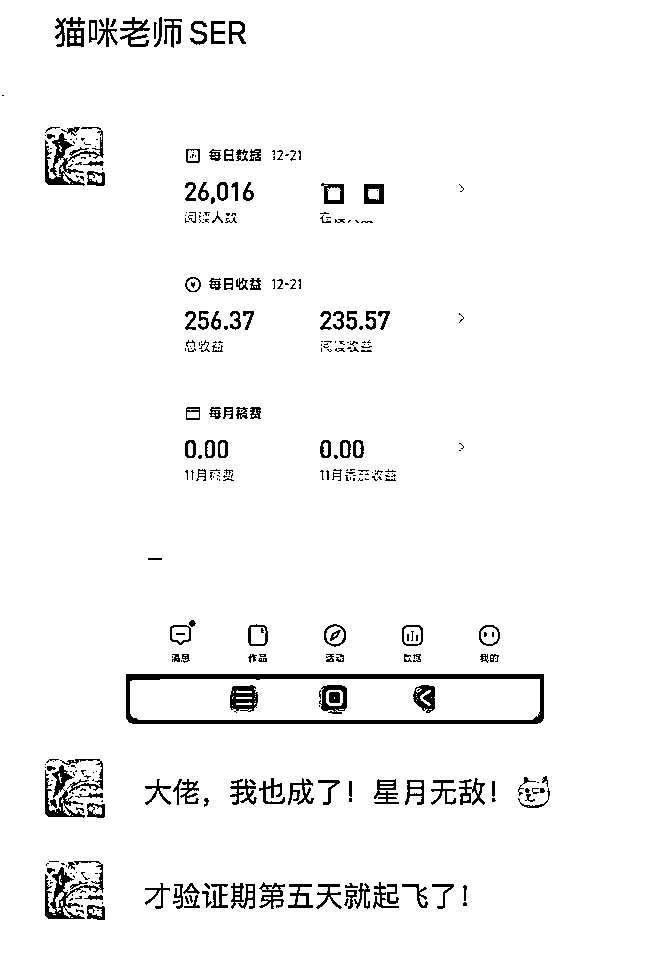

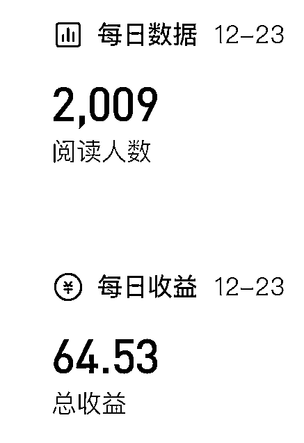

说回我自己的经历。两三年前，我硬生生用三个月手敲了40万字的小说，那是我码字的极限了。每个字都是一下下敲出来的，累是真累，爽也是真爽，稿子也顺利签约了，但最后几乎没赚到钱。那时候我真觉得，写小说就是个投入产出严重失衡的苦差事。

然而现在，AI彻底改变了游戏规则。只要你会用工具，别说日更一万字，一口气生成一整本书都不在话下。

不卖关子了，直接上干货，看看我是怎么用AI写长篇小说的。

第一步，打开一个专业的小说创作平台。现在市面上已经有不少基于大模型开发的写作网站，新手友好到什么程度？提示词都给你备好了，拿来就用。

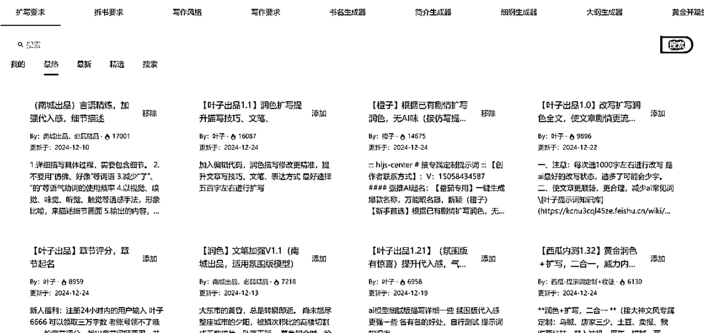

第二步，登录平台后，你可以新建作品，也可以直接导入一本对标小说作为参考。

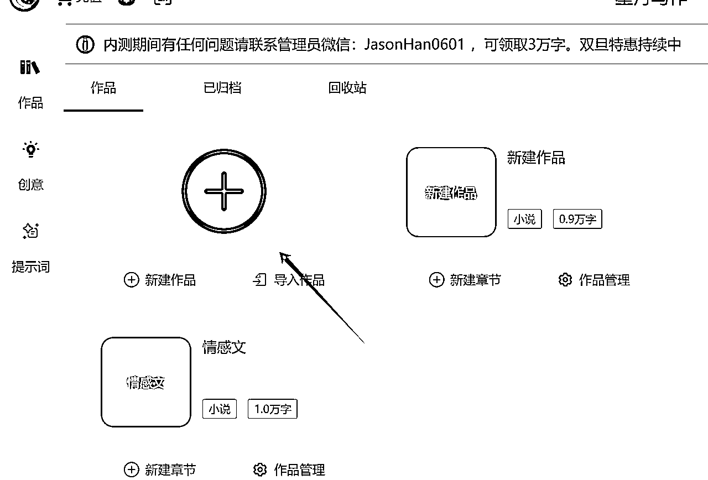

第三步，我用AI拆书功能重新梳理了一份小说大纲，把它粘贴到作品页面里。

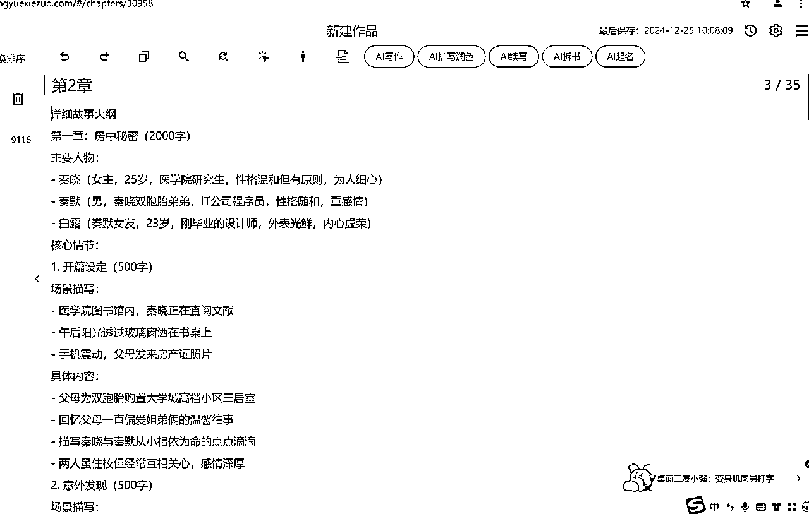

第四步，调用平台上的“AI扩写润色”功能，把每一章内容丰满起来。

先复制第一章的内容，然后点击“AI扩写润色”。

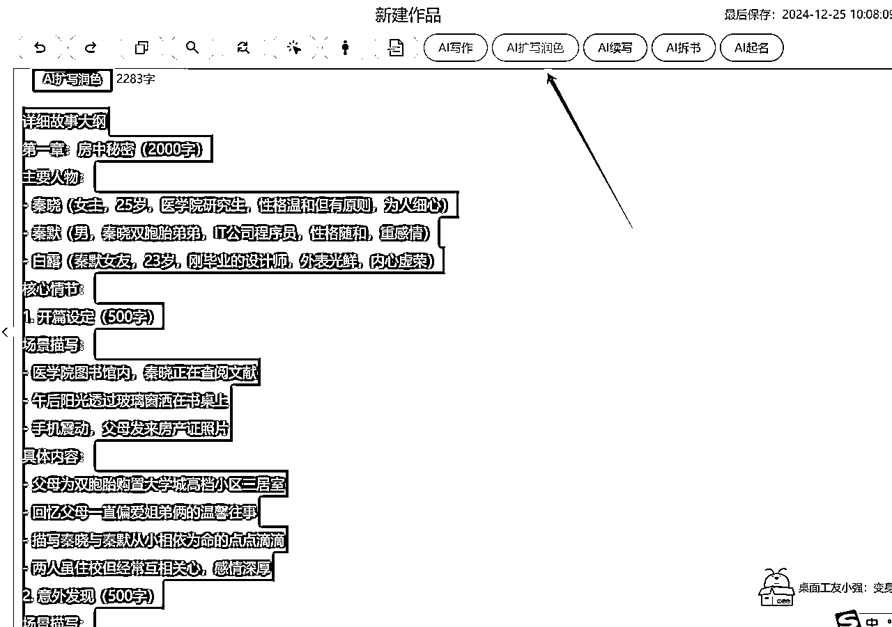

在右侧选择AI模型。这个平台提供了三个选项：Claude、GPT-4o，还有谷歌的模型。

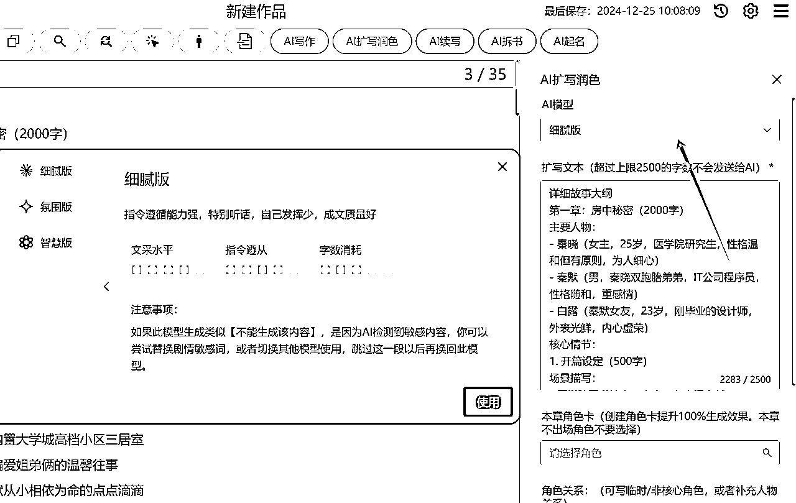

再按你作品的具体情况填写信息，AI生成的内容会更贴合你的设定。

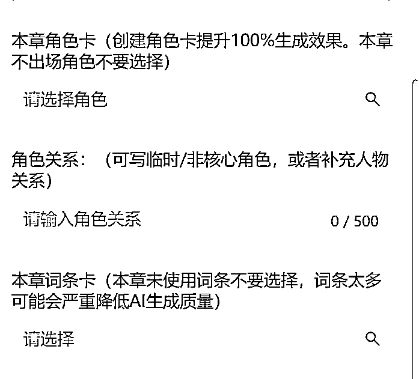

点击“扩写要求”，里面有一大堆大佬写好的提示词模板，挑一个心动风格，AI就会按大纲帮你展开正文。

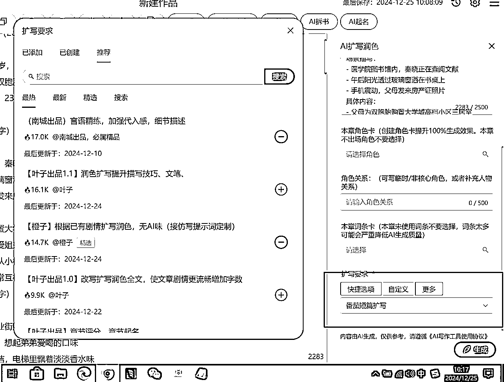

比如我会选自己存的“短篇扩写”专用提示词。

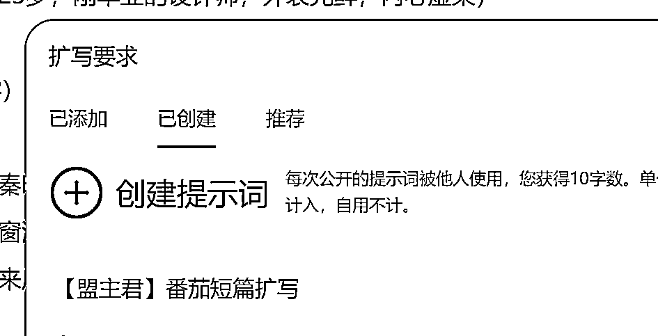

最后点击“生成”。

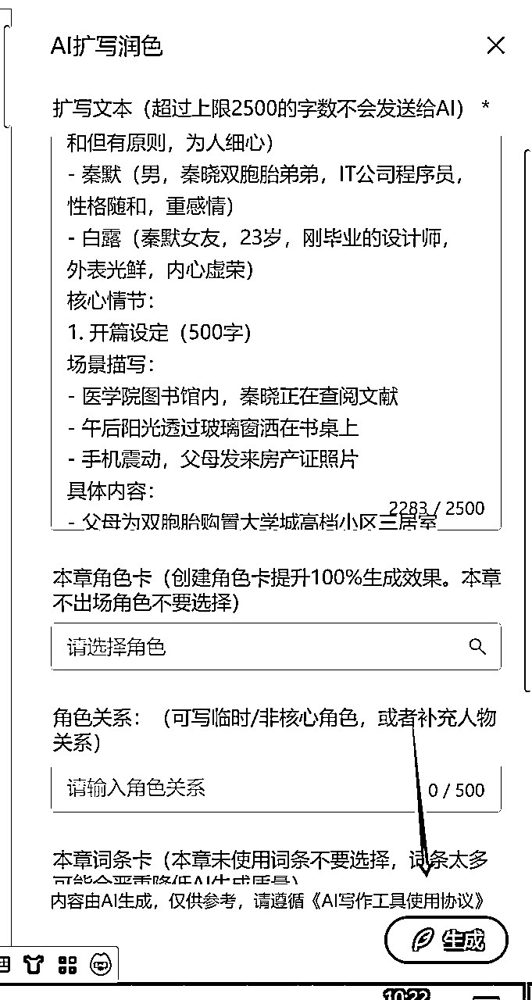

神奇的事情发生了——AI会按照大纲把整章甚至整本书的内容全部生成出来。

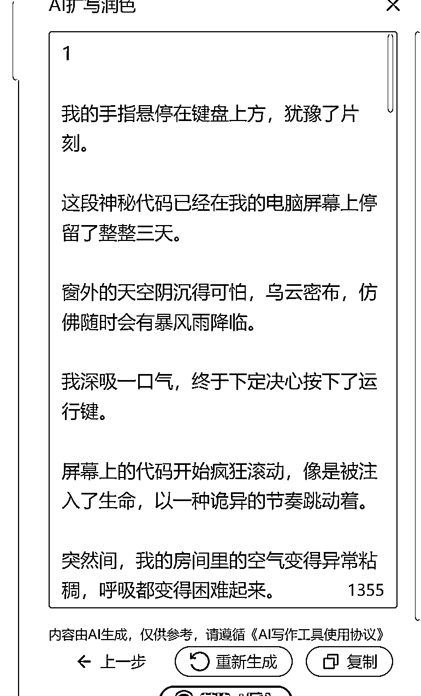

如果你对结果满意，直接替换进正文；不满意就再调参数，循环操作，直到整本小说都搞定。

等等，你说连大纲都不会写？那也简单，交给AI。

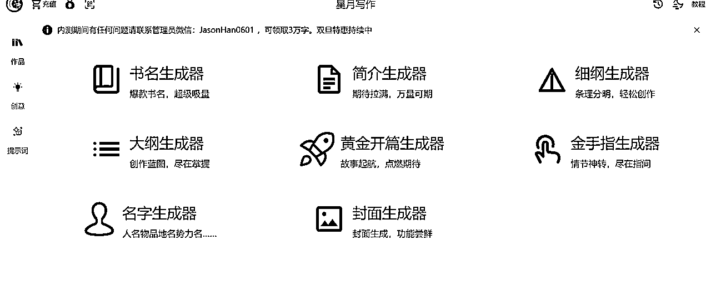

点击“创意”板块，你会发现各种生成器应有尽有——只有你想不到，没有AI做不到。我试过把最近超火的《十日终焉》喂给AI，它居然写出了风格神似、但内容全新的章节，而且完全AI味。

最后说句掏心窝的话：写作从来不是一蹴而就的事，它孤独、枯燥，极少有人第一本就爆火。但如果你能坚持写完十本，大概率会有一本被市场看见。

AI时代，每天都有新项目冒出来，但别贪多。选定一件值得的事，反复打磨，深耕下去，时间一定会给你回报。

共勉。等你们的好消息。