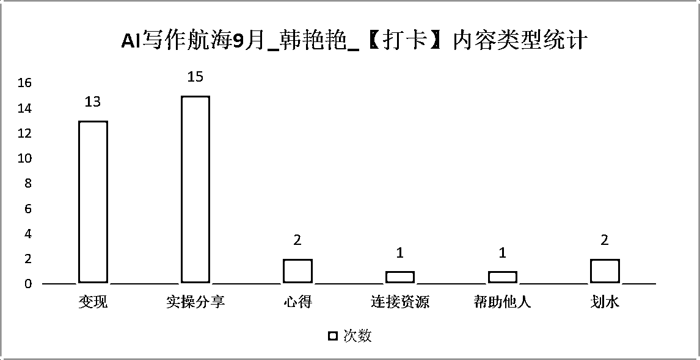

# 打卡心路变化_AI写作航海9月_航海分享_韩艳艳

白天搬砖，晚上码字，赶在报名通道关闭的前一刻，我总算挤进了9月AI写作航海这艘大船。这也是我第一次参加航海。

其实这趟船跟我挺对味：近半年我基本保持每周至少一次的AI写作练习，最近两个月更是直接日更。上船时，我在心里给自己下了任务：每天打卡，目标冲S级，保底也要拿“好事”。

21天下来，战果如下：
- 全勤达成，一天不落；
- S级拿过8次，“好事”收获11次；
- 打卡内容里，有15次偏重实操细节分享，有13次是拿收益说话。

如果要说这场航行中，我的心路经历了什么，其实还挺典型——

刚开始是跃跃欲试，为了冲“好事”和“S级”，话里话外总想往变现上靠；
走到中段，我发现那些冷冰冰的变现数字其实很容易带偏节奏：对小白来说，满屏的爆单晒图会让人误以为钱很好赚，反而放大焦虑。于是我开始转向实操分享，也加入心得、帮别人答疑，让内容更落地；
到了尾声，航海快结束的那几天，我反而开始“划水”打卡。我理解的“划水”，不是敷衍，而是终于明白：先把事情做完，往往比追求完美更重要。

说回晒收益这件事，我的态度越来越审慎。我能感受到教练在审核打卡时，对变现数据把控得很严格；我也和几位比我晚入行AI写作的前同事聊过——密集又高价的收益截图，特别容易给人造成“so easy”的错觉。可现实是，期望一旦被抬得太高，新手遇到一两次退单、坏单，抗挫力就容易被击穿。

但我要强调：我晒的数字都真实，只是视角片面。写手背后的退单、坏单，旁观者根本看不到；那些只有真正扎进这行才懂的规则，也不是一张截图能说明白的。

说回AI写作本身，我非常推荐去学。它不只是未来职业技能的必修项，更像一处试炼场，不断打磨你的输出能力和逻辑能力。而AI写作变现，也确实是一条能走通的路：客单价能冲得很高，而且达到那个高度并不算难事；门槛低得感人，只要行动力拉满，不管什么年龄都能分到一杯羹。

如果要对看我打卡的新手朋友说几句掏心窝的话，我想说：我当初也是一张白纸，多亏航海手册先给我搭好了方法论骨架；但实操时，我更渴望有人拿笔尖戳着屏幕告诉我——ChatGPT做的表格，不能直接点“复制”图标，要先把表格选中粘贴到Excel，再从Excel复制进Word，格式才不会乱；而Claude生成的表格，恰恰只能靠“复制”图标才能粘到Word里。这些别人眼里不值一提的细节，恰好就是新手最容易卡住的地方。

希望我关于变现的打卡分享，没有把哪个新手绕得更晕。未来那个更优秀的你，一定会感谢现在这个韧性满满的自己。

也希望我的实战分享，能帮到正在实操的AI写作小白——这条路，你并不孤单。

最后，想对赚钱说几句真心话：
我去过杭州总部三次。那里养着猫，半夜进门能看到员工在打台球，也常常把场地开放给圈友办线下活动。原以为只是见识了办公室长什么样，后来才意识到，所谓赚钱文化，其实早就长成了办公室的模样。
线下聚会我参加过四场，因此认识了不少同路人。赚钱的规则一边约束着圈友，一边也在保护着圈友。这点，必须点赞。

P.S. 如果我的分享还算及格，能不能赏我一个赚钱大鼠标垫？如果觉得相当不错，十个也行，我拿去跟小伙伴好好显摆。不用快递，🛰️吱一声，我自己跑过去拿！

12月的flag：把这次航行攒下的实战经验好好沉淀，争取做一套体系化输出。