# 第二周进入分化期，船员打卡率怎么稳住？
作者：龙哥

## 航海进入中期，状态开始两极化

航海走到第七天左右，船员对课程内容已有了初步认知，实操也慢慢展开。

这个节点上，分化特别明显。每个人来时的背景、经验和理解深度都不一样。

有一类船员是自驱型，根本不用催，卡一到点就自己完成了。

有一种是钉子户，怎么提醒都纹丝不动，仿佛进入隐身模式。

还有一类是间歇型，松一点就不动，紧一点又能交作业。

面对这么多花样，志愿者很容易焦虑、疲惫。

其实这很正常。大项目动辄上千人报名，甚至有人报了两个航次，再加上工作、家庭等各种现实阻力，卡在中间的人多也情有可原。

## 从志愿者视角看，分化是必然的

先把分配机制搞清楚，就能心态稳住。

船员是按顺序随机分到各组，单个志愿者服务人数到30人左右时，样本就趋于稳定。拿到手的人群结构基本是公平的。

每一组里，围观型、宝藏型、失联型、需要频繁关心的船员，都会按比例存在。

理解了这个规律，就会明白各组的工作量和工作性质是差不多的。

真正拉开差距的，是面对不同类型船员时，你的应对策略是否清晰。

这时候就需要一套分层运营的逻辑，对症下药，才能把打卡效率真正提上来。

## 先把人理清楚，运营才有抓手

把组里的30人左右先粗略拆成三类，前中期的初步判断即可：

1. 积极型船员
* 对项目充满热情，提问、实操都走在前面。
* 目标感强，行动快，反馈也快。

2. 观望型船员
* 经历一周航行后，已有基本认知，但执行力不足，行动迟缓。
* 需要更多温和的推动和具体的指引。

3. 消极型船员
* 因个人原因或资源限制，基本已放弃打卡。
* 许多人只是来蹭最新信息，时间精力都放在本职业务上。

思路厘清后，就能配合之前的分层帮带方法，对船员做 A/B/C/D 四组运营。

### A组：积极型船员

打卡5-8次的这批人，核心是【夸】。

用📕式的夸法保持热度，哪怕没打卡也要夸。保持情绪正反馈，他们会更上头。

📕商单船员运营思路：以【夸夸】为主，emoji记得带上

示例一：

这是什么神仙队友

航海三天打卡三次

如此这样 拿下商单简直指日可待

我夜观天象

你指定就是下一颗📕的新星

示例二：

做事有目标

学习有结果

每天抽出几分钟

复盘今日内容

为努力的自己点个赞

📚加个油：:https://scys.com......

示例三：

想不到哇 我还没提醒你就把卡打了

这样下去 我的志愿者工作还要做吗

棒棒的XXX

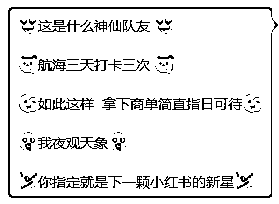

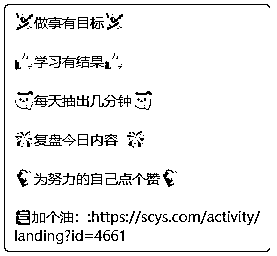

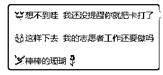

### B组：观望型船员

打卡次数偏少的，思路一样，用“剩余打卡次数”“可休天数”做温柔唤醒，措辞偏鼓励，核心是别让他们放弃。

📕商单船员运营思路：以【鼓励】为主，适度用“保证金”、“打卡次数”来引导

示例一：

XXX，航海经过了三天，已经开启了打卡。

开始行动了千万不要停下

经济下行，199也很重要，

来，一起保护保证金，记录下今天的收获

📚《12月航海｜打卡链接》:https://scys.com......

示例二：

XXX~

只打卡2 天，还可休息 5 天

马上199的保证金就拿不回来啦 ~

手机不方便可以语音识别打卡 效率很高 两分钟搞定

“偷懒”正在拿走你的保证金，快来拯救你的钱钱:

https://scys.com/.......

示例三：

8点多 我来啦

昨天关于【如何寻找对标账号】的内容有没有听哇

记得把收获和灵感及时写上，已打卡 【3】 天啦，一定要坚持住

别放弃啊

https://scys.com/.......

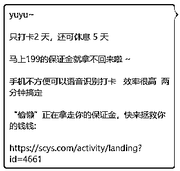

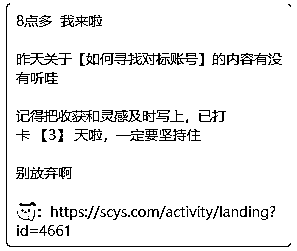

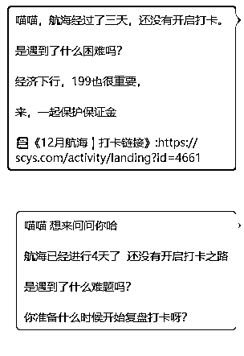

### C组：消极型船员

用航行天数、已打卡天数、保证金金额制造紧迫感。消息他们基本都看得到，前两天用紧迫感去敲一敲，也能把一两个唤醒加入打卡行列。对零打卡的船员，措辞可以更直接，用“偷懒”“流失”等词刺激紧迫感。

📕商单船员运营思路：以【鞭策】为主，以“紧迫感”、“丢失保证金”引导

示例一：

XXX，航海经过了三天，还没有开启打卡。

是遇到了什么困难吗？

📚《12月航海｜打卡链接》:https://scys.com........

示例二：

XXX 想来问问你哈

航海已经进行4天了 还没有开启打卡之路

是遇到了什么难题吗？

你准备什么时候开始复盘打卡呀？

示例三：

XXX：

至今为止你还没有参与打卡，航海期间只能有 3 天不打卡了

199的保证金马上要离你而去 ~

“偷懒”正在拿走你的保证金，快来拯救你的钱钱:

https://scys.com/.......

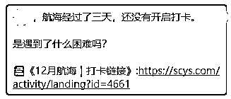

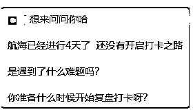

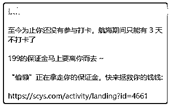

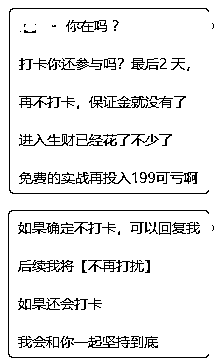

### D组：明确放弃打卡及注定无法完成保证金船员

D组主要是围观党、已明确不打的、以及后续会因打不完而损失保证金的人。

别小看这批人，里面很可能藏着行业大佬。服务依旧要到位。

📕商单船员运营思路：以【陪伴】为主，即使不用打卡，保证金没了，也是我们的船员。

不催卡的前提下，课程提醒、加餐提醒、优质内容转发一样不能少。

思路理顺之后，服务效率会大幅提升。

按这个节奏，每天花一小时左右就能把全组巡一遍、排一遍，重点的单独沟通，整体情况心里有底，其余时间该干嘛干嘛。

能在一小时内完成的关键就是分好组。

同组情况相似，一段话术通用，编辑好后一次发9个人，分批转发又快又准。最后根据反馈再做个案沟通即可。

这样系统化操作下来，打卡人数会持续走高，船员的好事数也在稳步增长，数据不是下滑而是向上走。

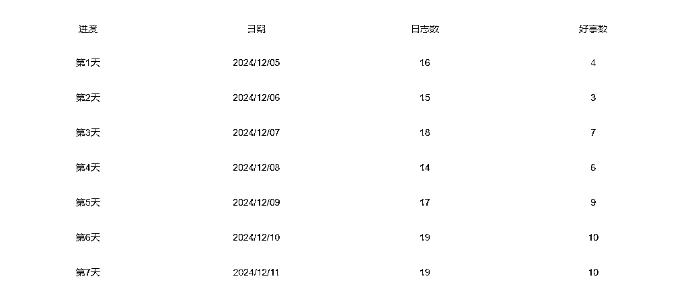

## 最后说一句

打卡成绩的好坏，不是志愿者一个人的功劳。

是船员自己在努力，我们用分层组合拳去推波助澜，最终才有了结果。

就像游戏里，船员是主C，我们志愿者是辅助，负责上资源、加血、补状态、递信息。

主C重要吗？重要。辅助重要吗？也重要。缺了谁都不行。

船员也是朋友，赚钱的缘分让我们相遇。

我进入赚钱快五年了，🛰️里近一半的朋友都源于志愿者时认识的。他们拓宽了我的视野，提升了我的认知，让我受益很多。

所以我一直没停下做志愿者。

希望我们能一路同行，在服务中遇见更好的自己。