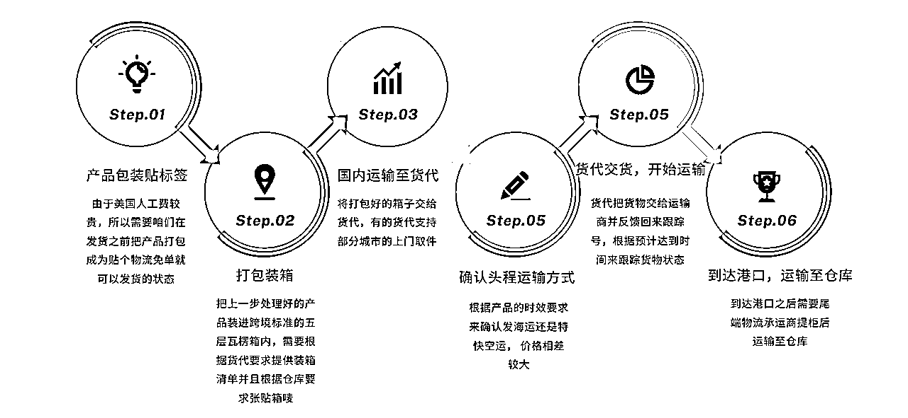

# Temu美区半托管：头程这关，我踩过能让你直接退场的坑
作者：龙哥

赚钱的朋友们好，我是龙哥。

从5月开始我就把重心挪到了Temu美区半托管，到现在也做了半年多，订单量和回款都渐入佳境。但这半年里，头程环节让我摔过的跟头太多，有几个坑直接能把人干趴下。今天先把头程避坑的实操经验拆开讲，后面再聊海外仓的坑。

先用一张图给大家过一下海外备货的大致链路，方便后面对照。

图中第一步【产品包装及贴标签】，其实完全是跟着海外仓的SOP来做的。

### 坑一：选货代别只看低价

货代就是帮你把货从国内送到海外指定仓库的代理。现在货代扎堆，有自营头程的，也有纯撮合的。真正拉货的几家航运公司也就那么几家，比如美森、UPS、FedEx，大部分货代本质上都是把单子转给他们。选货代要盯住这几件事：

**1. 价格和时效要一起看**
海运基本都是美森在跑，分正班和加班，船开了之后到港时间几乎一样，所以重点比的是同渠道的报价。敏感品的附加费一定要问清，比如液体、带磁等。时效上，广州、深圳、义乌的截单时间不一样，美森的发船时间是固定的，截单越早对你越友好，留给国内拖车的缓冲时间就越多。

**2. 额外服务别被账单吓到**
用货代的增值服务前先问价，常见的有换标、换箱、清点。账单很容易就上去了。账期也是个考量点，部分货代支持到货签收后付、次月结款，能帮你缓解资金压力。

**3. 别信“全自营”的噱头**
很多商家宣传头程、海外仓、尾程全自营，现实里能真正全自营的很少。大多数是头程自营+海外仓外包，或反过来。货一旦交出去就失控了，所以一定要多家比对，别被话术带走。

### 坑二：装箱不是简单封箱

很多人觉得装箱就是塞进去封好就行。但货要经手海运、清关、海外分拣，最后到美国消费者手里，标准完全不一样。

**箱规要守死**
最长边≤100CM，第二边≤76CM，周长≤260CM，周长=长+2×(宽+高)。单件别超22KG。UPS计费有门槛，单箱不足12KG按12KG算，整票不足21KG按21KG算，空箱费很伤。

**清关渠道要匹配品类**
不同渠道的禁限物品清单不一样，液体、手铐之类的很容易中招。发货前一定要和货代确认好渠道，避免被查验。轻则退回，重则货代账号被封。

**SKU种类要对齐仓库要求**
不同海外仓对一个箱子里能放几种SKU要求不一样，有的只允许1个SKU，有的允许3个、5个。发货前必须和仓库确认清楚，不然上不了架白跑一趟。

**纸箱和称重必须上心**
一定要用超硬的加厚纸箱，海运暴力操作很常见，纸箱一烂就丢件。箱内数量、重量、件数都要自己记录并和货代、仓库三方对齐，丢件了才有据可查。

### 坑三：头程渠道怎么选，讲的是性价比

核心就两点：时间成本和运费成本。

海运基本就是美森，正班和加班的区别只是发船频率。到港时间大致是美东25-30天，美西17-22天，会有浮动。空运一般3-5天，清关口岸不同时效也会差。

以12月8号为例，海运约17元/kg，空运特快UPS约73元/kg。空运快很多，但运费经常比货值还贵，不适合重货或低价品。

头程部分就先说到这里，下篇我会讲海外仓的选择。爆仓丢货、强制移仓、仓库园区着火封仓一周发不出货……这些更致命的坑，我们下文细聊。

我是七喜，一起龙哥盟！