# 去香港办一张外币卡，究竟值不值得？我的完整实测攻略
作者：龙哥

这次办香港汇丰账户，过程并没有想象中顺利。

第一次线上递交资料，页面提示身份信息无法完成核验。那一刻确实有点泄气，毕竟前期准备了不少东西，原本以为提交后就能顺利通过。

后来发现，系统允许再次发起流程。我和同行同事反复尝试了几轮，最后终于成功拿到了汇丰香港账户。

为什么现在越来越多人开始关注港卡？

一方面，新加坡 OCBC 已经不再向内地客户开放相关资格，过去办下来的账户后续使用也可能受到影响；另一方面，香港金融机构对内地客户进入国际金融体系的审核正在逐渐严格。

从这个趋势来看，能够接收境外款项、支持多种货币的账户，价值只会越来越明显。如果确实有跨境收款、出境消费或海外资产安排的需求，能早点准备就尽量别拖。

这篇文章会把从证件准备、出行方式，到 App 网申的全过程整理出来，供大家参考。具体政策和费用请以银行及相关部门最新公告为准。

# 先判断：你是否真的用得上？

## 哪些场景适合准备香港账户？

如果你有以下需求，香港储蓄账户通常会比较实用。

### 1. 有境外收入的人

比如来自海外平台、客户或公司的款项，可以通过支持外币结算的账户进行管理。出国旅游时，也能用账户里的对应币种支付酒店、交通、餐饮等费用，减少多次兑换的麻烦。

### 2. 做跨境电商的人

跨境交易往往涉及美元、港币、欧元等不同货币。拥有香港账户后，接收海外买家或平台结算款会更方便，日常资金归集也更清楚。

### 3. 进行海外投资的人

有些人会用香港账户作为境外券商账户的资金中转工具，用于安排美股、港股、基金或债券等投资资金。

但要特别说明：储蓄账户不等于证券账户。想买股票，仍然要另外向券商提交资料开户；当前相关审核趋严，不能把两者混为一谈。

此外，多币种账户也方便有换汇需求的人根据市场情况进行币种转换。

### 4. YouTube 等平台的内容作者

视频广告、会员、直播打赏等收益可能来自不同国家和地区。对于数字内容创作者而言，一个能够承接国际平台结算的账户，会让收款链路更顺畅。

### 5. 出海做产品的开发者

如果你开发的应用面向海外市场，App 内购、软件订阅、游戏道具或广告分成，都可能产生境外收入。香港账户可以作为接收 App Store、Google Play 以及广告平台款项的工具之一。

说到底，一个能承接境外资金的账户，往往是搭建跨境支付安排时比较基础的一环。

## 香港账户与内地银行卡有什么不同？

主要体现在两个方面：

- **海外使用范围更广**：在境外商户、线上服务以及 ATM 场景中，使用便利性通常更高，旅行或出差时不必携带太多现金。
- **支持多种结算币别**：常见的港币、人民币、美元、日元、欧元、英镑等可以按需要管理，跨币种消费时更灵活。

# 办理难度到底如何？

以这次线上办理经历来看，核心条件并不复杂：

- 有效居民身份证；
- 有效往来港澳证件；
- 提交资料时本人正在香港。

## 证件方面

银行会利用上述证件核实客户身份、建立非本地居民档案，并完成必要的合规检查。不同银行、不同时间的要求可能变化，出发前最好查看官方最新说明。

## 地理位置方面

人在香港是重要前提。金融机构需要确认客户实际身处当地，并按照监管要求完成身份及风险核验。

## 网申方面

线上渠道对收入及存款余额的要求相对宽松，比较适合刚开始做跨境业务、希望增加境外资金管理方式的人。

如果第一次没有通过，也可以重新提交。不过重新操作前，建议先检查资料逻辑、工作状态和资金来源填写是否前后一致。

## 汇丰需要注意的地方

汇丰已经取消内地直接办理香港账户的路径。仅仅修改网络环境，并不能替代本人赴港和真实身份核验。

# 批准后，使用体验怎么样？

这次使用的是汇丰账户，个人感受整体不错。

## 手机银行

App 的账户、卡片和安全功能分区比较清楚，遇到问题时也容易找到对应入口。日常查余额、看交易记录、管理卡片，基本都能自行完成。

## 客服支持

线上咨询和电话服务的反馈速度较快，转接人工的步骤也不算繁琐。客服沟通时会根据需要提供粤语、英语或普通话服务，交流起来比较方便。

# 第一部分：出发前要准备什么？

## 1. 先办理往来港澳证件

### 需要带什么？

- 有效居民身份证；未成年人在部分情况下可以使用户口簿；
- 身份证复印件：有些地区现场可以复印，是否需要自带以当地要求为准；
- 证件照通常在现场采集。

拍照时建议穿深色上衣。现场一般会准备可临时套上的衣物，不必专门准备。可以化妆，但不宜过浓；不要佩戴美瞳，拍摄时要露出耳朵。

如果照片审核没有通过，工作人员通常会提示重新拍摄，并将补拍信息关联到申请资料中，避免因为照片问题再次往返。

由于证件有效时间较长，如果对照片比较在意，可以在现场确认效果。人不多时，也可以询问工作人员是否能够重拍。

### 先确认办证地点的工作安排

前往户籍所在地或符合条件的出入境受理机构前，建议先查看办公时间。

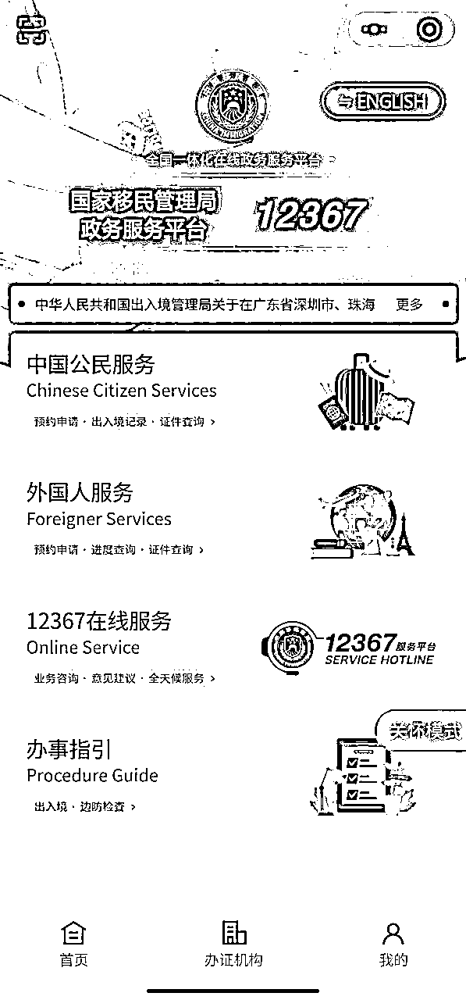

🛰️、支付宝里都能搜索相关的出入境服务入口。预约不一定是硬性要求，但可以用来确认当天是否办公，最终仍以现场安排为准。

#### 🛰️入口

#小程序://移民局12367/dmhGTMAyXvciFml

#### 支付宝入口

https://ur.alipay.com/_5HzSdDsLSo4oc0HOBHhgS1

进入“中国公民服务”。

### 到现场后大致怎么走？

1.  先取号，并按照提示填写申请表；
2.  首次办理通常先完成拍照，再到窗口递交资料；
3.  按工作人员要求采集或核验指纹，通常涉及左右手拇指；
4.  未满 16 周岁的申请者是否留存指纹，按照监护人意见及当地规定执行；
5.  工作人员完成材料初核后，会出具缴款凭证并说明后续步骤。

如果是短期内再次办理，或属于部分特殊户籍情况，表格内容可能会多一些。遇到不确定的地方，先问清楚再填写。

### 费用参考

拿到缴费凭证后，到指定窗口完成支付。

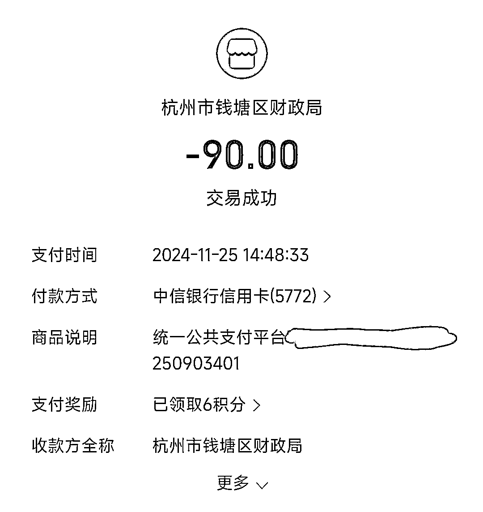

我这次实际支付的是：补领证件 60 元，加上港澳签注合计 30 元，共 90 元。

常见收费项目如下：

- 首次申领往来港澳证件：80 元/本；
- 补领：60 元/本；
- 一次有效签注：15 元/件；
- 两次有效签注：30 元/件；
- 一年以内多次签注：80 元/件；
- 一年以上、两年以内多次签注：120 元/件；
- 两年以上、三年以内多次签注：160 元/件；
- 三年以上多次签注：240 元/件。

### 如何领取？

- **现场领取**：收到领取通知后，按照当地要求携带缴费凭证及本人有效证件前往受理机构取件。部分地区对材料组合有不同要求，代领时也要提前确认。
- **快递寄送**：办理时填写收件地址，支付配送费用，证件制成后由相关部门寄出。

各城市的细节可能不完全一致。以杭州为例，现场通常有引导人员，遇到不清楚的地方可以礼貌咨询。

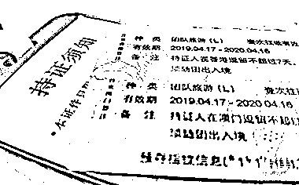

## 2. 准备银行网申资料

### 如果走柜台路线

线下办理时，银行可能要求提供：

- 身份证明；
- 少量港币，用于可能发生的小额费用；
- 地址证明，例如水电账单、银行账单或租赁协议；
- 在职证明；
- 工资单、税务资料等收入证明。

不同机构的要求存在差别，最好在出发前向目标银行确认。

### 如果想省掉复杂材料

这次我们的思路是优先尝试线上提交，因此重点准备以下内容：

- 居民身份证；
- 往来港澳证件；
- 提交时本人在香港。

线上渠道通常不会把收入或存款作为硬性门槛，但资料填写必须真实、完整且前后一致。

## 3. 提前处理手机银行 App

网络条件允许的话，到香港之后再安装也可以。

安卓手机可以提前准备官方安装文件，抵港后也能通过当地应用渠道获取；苹果手机在内地下载时，可能需要切换到香港地区的账户或商店环境，到了当地一般可以直接搜索。

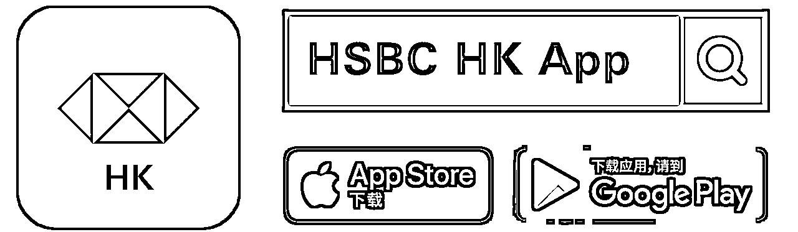

确认相关证件已经办妥后，可以选择高速铁路或深圳地铁前往香港。

# 第二部分：抵港交通怎么选？

## 1. 查询跨境路线

可以在支付宝里进入出境服务，再查看跨境交通选项。

链接：https://ur.alipay.com/_1mCM352EVT9EGVrT83wtpS

页面通常会覆盖内地前往香港、深圳前往香港以及澳门前往香港的路线。

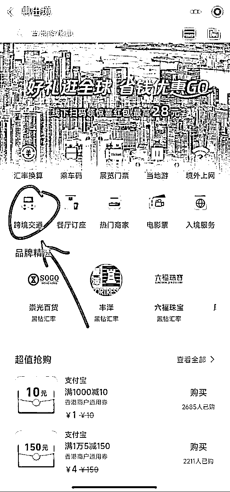

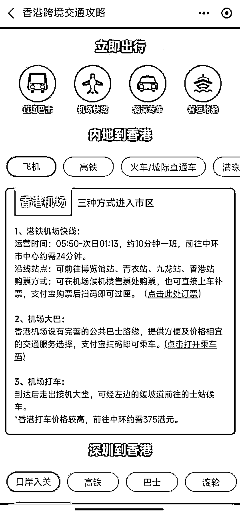

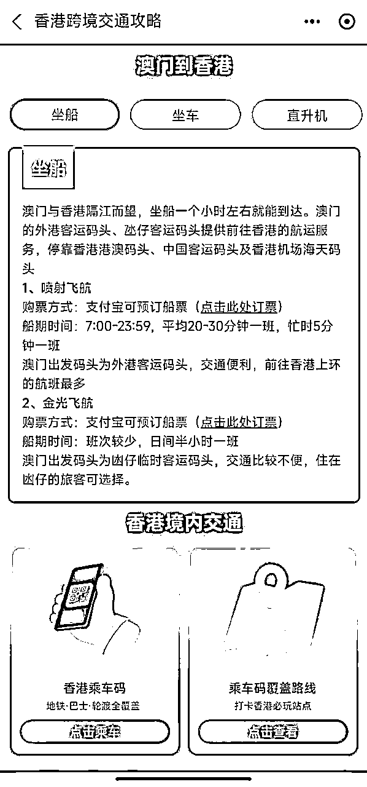

我两种方式都体验过，简单说就是：高铁更省心，地铁更省钱。

## 乘高速铁路

### 基本流程

1.  抵达香港西九龙站后下车；
2.  根据指示前往指定楼层；
3.  先完成内地一侧查验，再完成香港一侧手续；
4.  可根据现场情况选择自助或人工通道；
5.  完成手续后即可离开车站进入市区。

### 优势

- 到站位置靠近市中心，前往维港、旺角等区域比较方便；
- 多数情况下可以使用自助通道；
- 西九龙采用“一地两检”安排，出入境手续集中在同一座旅检设施内，通常比需要分开前往两个地点的路线节省时间；
- 出站后可以衔接香港铁路，前往其他区域。

### 需要留意

- 费用高于深圳地铁；
- 普通二等座大约 68 至 75 元，往返票价通常相同；
- 如果证件是在较短时间内补领的，或儿童同行，可能需要走人工查验通道。

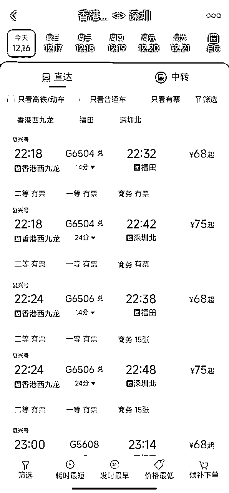

## 乘深圳地铁转港铁

### 常见路线

- 前往罗湖口岸：乘深圳地铁 1 号线；
- 前往福田口岸：乘深圳地铁 4 号线或相关线路。

抵达口岸后，跟随现场指示完成两边查验，再转乘香港铁路进入市区。

### 费用与时间

从深圳前往尖沙咀，使用八达通通常约 43.2 港币，购买单程票约 45 港币，全程大致需要 50 多分钟，具体会受排队和换乘影响。

### 优点

- 花费相对低；
- 对预算有限的人更友好；
- 熟悉电子凭证和自助流程后，通行速度通常不错。

### 不足

- 整体耗时可能比高铁长；
- 需要处理电子资料、路线及换乘，对不熟悉手机操作的人不太友好。

### 罗湖口岸补充

罗湖是历史较久、客流量较大的跨境口岸。完成手续后，可以接驳港铁东铁线，前往上水、粉岭、沙田、九龙塘、尖沙咀等地。

一般开放时间为每天 06:30 至 24:00，个别节假日可能延长至次日凌晨，出发前建议再次查看最新安排。

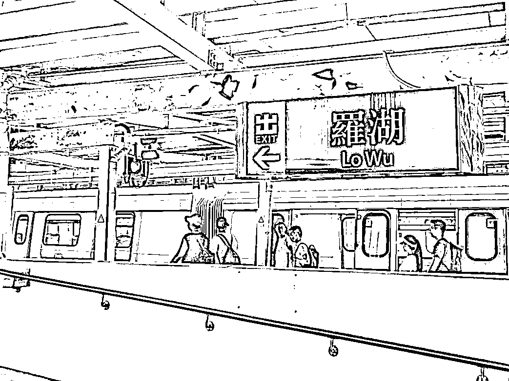

# 第三部分：手机网络怎么解决？

## 方案一：开通国际数据服务

各大通信运营商通常都有境外上网套餐。部分安卓机支持 eSIM 或虚拟通信方案，以小米手机为例，可以在系统里的“全球上网”功能中开通，到港后切换对应线路。

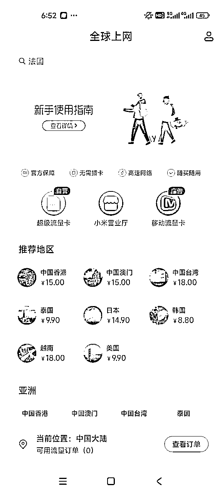

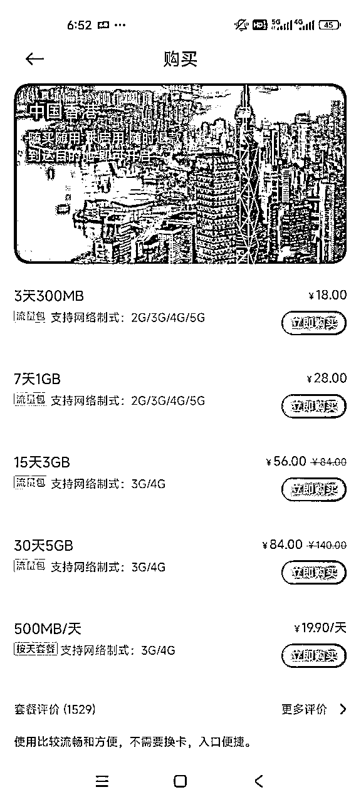

## 方案二：购买当地预付卡

如果觉得内地运营商的漫游套餐偏贵，可以到 7-Eleven 购买临时通信卡。

我当时买的是 33 港币左右的套餐，包含约 30GB 数据和一定通话额度，价格及内容以门店实际销售为准。

这类号码回到内地后通常仍能接收短信，之后也可以用于部分海外服务的注册。为了避免影响常用号码，重要账户最好绑定长期使用的邮箱及手机号。

激活时可能需要上传证件正面照片。建议提前拍一张没有反光、四角完整的照片，别等到了车站或门店再临时取景。

# 第四部分：汇丰线上开户步骤

## 1. 获取官方 App

进入香港后，安卓手机可以在当地应用商店搜索“香港汇丰流动理财”；苹果用户切换到香港地区后再搜索。

下载时要确认开发者和官方标识，避免误装第三方软件。

部分安卓应用商店也提供下载入口。

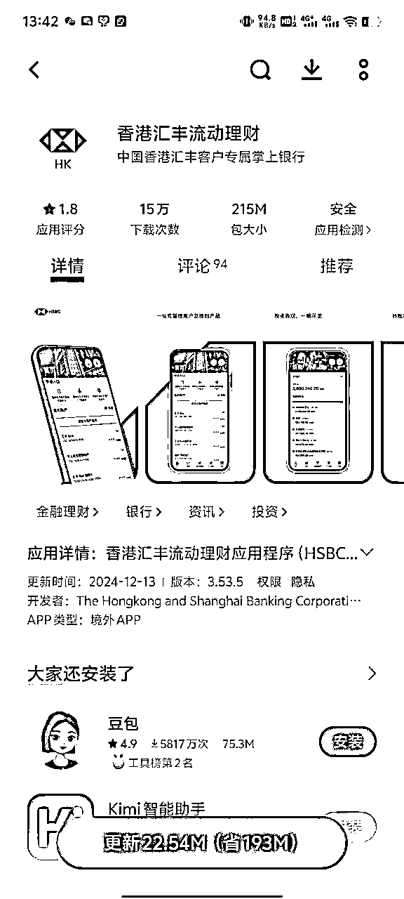

如果应用市场无法获取，也可以查看汇丰官方网站提供的安装方式。

## 2. 填写手机号码

可以填刚购买的香港号码，也可以使用能够正常接收验证码的内地号码。

建议选择自己会长期保留、日后方便接收银行通知的号码，不要为了临时操作随意填写。

## 3. 进入账户开立流程

### 身份与地区

打开 App 后，选择非香港居民，并按实际国籍或地区填写。证件类型选择往来港澳证件，按照页面提示完成验证。

### 申请用途

我当时选择了“留学”作为用途。不同年龄、职业和申请背景可能对应不同选项，务必按照真实情况填写，不要照搬他人的答案。

### 工作及资金来源

系统会询问工作状态、月收入以及资金主要来源。

我第一次提交时，选择了非全职，并填写资金来源不是以工资为主，结果没有通过。

之后重新提交，将每月约 5000 港币的工资填写为主要资金来源，最终审核通过。

从这次经历看，银行未必要求很高的收入，但会关注职业状态、收入来源和整套资料之间是否自洽。填写时不要夸大，也不要让不同页面出现互相矛盾的信息。

### 税务资料

后续可能要求填写个人税务识别信息。如果前面的工作和收入资料真实、完整且逻辑合理，部分情况下可以根据页面提示暂缓填写，但是否能够留空要以系统实际要求为准。

### 地址信息

地址需要按页面要求使用英文填写。

线上审核通过后，实体卡寄送可能受地址格式、邮寄范围等因素影响。即使实体卡暂时未收到，也不代表账户功能一定无法使用；部分功能可能可以先通过账户号码或 App 操作。

以上是我这次从证件、交通、网络到线上开户的完整记录。政策、费用、可申请资格和银行审核标准都可能调整，真正操作前一定要以官方渠道公布的信息为准。

最近把 HSBC 的 HK 户口在线开户流程完整走了一遍。整体并不复杂，资料提前备好，按页面要求逐项填写，就能顺利办好。开户后若有疑问，在线客服和电话客服都挺及时，态度也在线，问题基本能当场解决。

## 境外电汇到 HSBC 户口
如果要从海外银行电汇资金进来，需要把以下信息交给汇出行：

- SWIFT code：HSBCHKHHHKH
- 银行全称：The Hongkong and Shanghai Banking Corporation Limited
- 银行所在地：Head Office 1 Queen's Road Central, Hong Kong
- 收款户口号码：10 位或 12 位数字
- 收款人姓名：以月结单、通知书或存折上的登记姓名为准

建议汇出行按 SWIFT MT103 格式发出汇款指示，并完整填写汇款资料与偿付说明。想进一步了解接收汇入款的要求，可查看官方 PDF 参考文件。

我第一次打开这份参考文件时全是乱码，客服教的办法如下：

1. 在网页上找到该文件
2. 右键点击文件链接，选择“下载/另存”
3. 把文件保存到电脑本地
4. 在文件夹里右键文件，选择“属性”
5. 点“更改”
6. 把打开程序改为 Adobe Acrobat Reader DC
7. 点“应用”

## 户口能收哪些货币
线上申请的综合户口支持 12 种货币：HKD、AUD、CAD、CHF、CNY（利率 1%）、EUR、GBP、JPY、NZD、SGD、THB、USD。

想用这个户口接收上述币种的汇款，可提供尾号 833 或 888 的综合户口号码。一般情况下，入账时不会自动换汇。

## 转账与取现额度
目前网银向第三方户口划转有 4 档额度。

- 转给未登记收款方：单日最高 400,000 HKD 或等值外币，需要 Security Key 或 Mobile Security Code 验证；小额转账上限为单日 10,000 HKD 或等值外币，可在网银和银行手机 App 操作。
- 转给已登记收款方：每个已登记户口单日最高 3,000,000 HKD 或等值外币，网银操作不需要 Security Key 或 Mobile Security Code。
- 跨境环球汇款：通过网银或银行手机 App 操作，单日跨境总额上限为 3,000,000 HKD 或等值外币。

如果汇往海外，最终可用金额取“对应转账额度”和“每日跨境总额上限”两者中的较低值。

初始状态下，以上额度都是 0，需要登录网银或 App 自行调整。官方 PDF：https://cdn.hsbc.com.hk/content/dam/hsbc/hk/sc/docs/transfer-payments/master-limits-for-transfers-and-payments.pdf

消费方面，12 位卡号的 ATM 卡只用于提现。本地每日取现上限 80,000 HKD；海外取现额度可在本地额度的 0%、50% 或 100% 之间选择。实际能取多少，取决于你在银行后台设置的限额。

# 交通与出行贴士

## HK 公共交通
MTR 是本地最快捷的公交系统之一，覆盖 Hong Kong Island、Kowloon、New Territories，主要路线包括荃湾线、观塘线、港岛线、东涌线等。

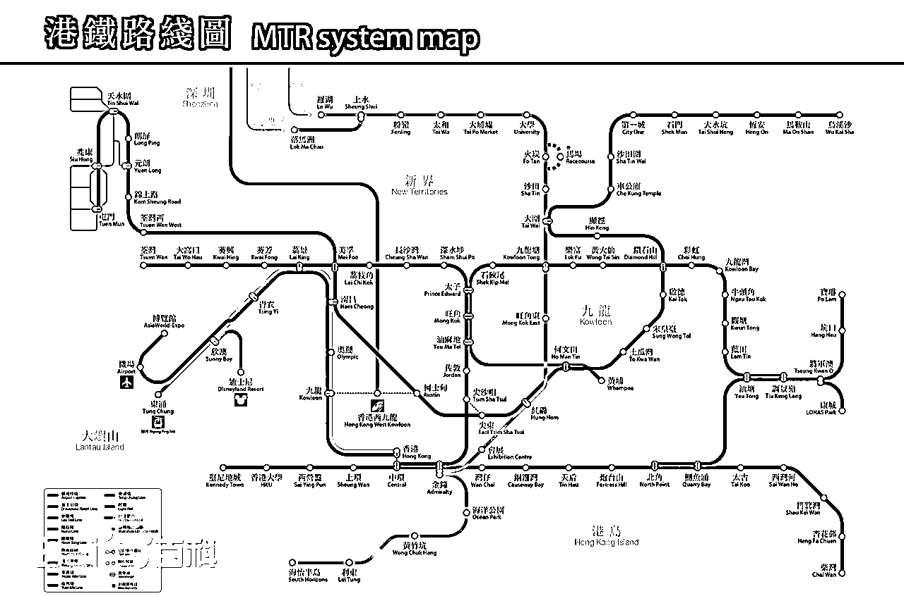

### MTR 24 小时通行证怎么买
- 车站售票处：所有 MTR 站都能买到，首次入闸起 24 小时内有效。
- Alipay：在 Alipay 首页搜索“惠出境”，进入后往下拉，点击中部右侧“春节出行礼遇”广告，找到 88 元香港出行全日通，点“马上抢”，再点“立即抢购”即可。

### 用 Alipay 乘 MTR

1. 打开 Alipay，点首页“出行”
2. 右上角把地区切成 Hong Kong，按提示领取
3. 勾选同意条款并领卡，验证支付密码后取得乘车二维码
4. 入闸时在扫码口扫二维码

MTR 不用安检，这一点很方便。

### 叮叮
港岛还有一种老字号路面电车，大家叫它“叮叮”。运行路线主要在港岛东西之间，属于低成本观光方式。官方路线与时刻表：Hong Kong Tramways — 时间表及车费

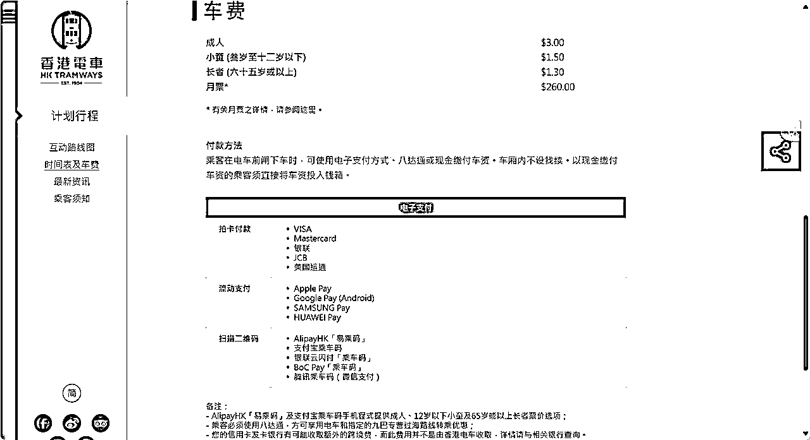

叮叮的发车间隔比 MTR 久，但坐起来很有味道。车虽然是双层，速度却相当快；我在上层基本没精力看街景，只偶尔瞄到巴士站顶，也是蛮新鲜的体验。

### Taxi
HK taxi 分三类：红色的市区车、绿色的新界车、蓝色的 Lantau 车，各自在不同区域接客。由于 taxi 收费较贵，我至今没有实际坐过。

如果景点之间不远，用 City Walk 的方式走很合适；我上次就从 Mong Kok 一路走到了 West Kowloon。

不同颜色 taxi 起表价如下：

- 市区（红）：22–27 HKD 起表，含前 2 公里；之后每 200 米 1.6–1.9 HKD；隧道/桥梁附加费 10–50 HKD。
- 新界（绿）：18.5–23.5 HKD 起表，前 2 公里起步；之后每 200 米 1.4–1.7 HKD；隧道/桥梁费同样由乘客支付。
- Lantau（蓝）：22 HKD 起表，前 2 公里起步；之后每 200 米 1.7 HKD。

每件行李另收 5 HKD，轮椅和拐杖免费。

叫车可用 Uber、HKTaxi、85 飞的 Taxi 等 App。

## 交通省钱方法
如果当天去的地方多，可以提前在 Taobao 买 MTR Day Pass，整体更划算；如果只是少量出行，用 Alipay 扫码搭 MTR 就够。

Alipay 乘 MTR 的方法和上面一致，操作截图见下方：

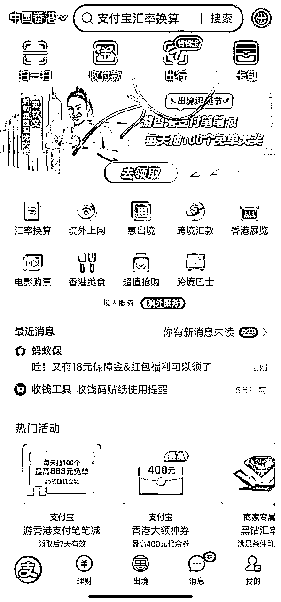

## 换 HKD 的几种途径
提醒：不少街边小吃只收现金，比如📕常提到的 8 HKD 菠萝包。

- 国内银行：若已开通网银，登录后搜“结售汇”等功能入口，选 HKD、填金额和用途并确认，即可完成换汇；也可预约柜台取现。
- 本地银行：在 HK 本地银行分行换钱最稳妥，但通常需要持有银行户口。按 Bank of China (Hong Kong) 的说法，通过 VISA/PLUS 网络从户口扣款会加收 1.95%，通过 MasterCard/Cirrus 网络会加收 1%。
- 换汇小店：Tsim Sha Tsui、Mong Kok、Causeway Bay 等游客区有很多，汇率和费用各异。部分店如小女孩、永恒、多福、惠捷等可免手续费。普遍来说，这类店铺汇率不如 Lo Wu 关口，建议过关前先换好。
- 机场柜台：方便，但汇率一般不如市区，且可能有附加费。
- 酒店：也能换，但费用通常不友好。
- ATM：取现要手续费，曾有用户取 100 HKD 被扣 20 HKD。
- Credit Card：CMB VISA 在 HK 消费按笔收 1.5% 外汇兑换费；UnionPay 卡走 UnionPay network 免 1%–2% 的货币转换费。
- 电子钱包：WeChat Pay 和 Alipay 在 HK 消费免手续费，按 RMB 结算；实付满 6 笔后汇率更优。
- 自动换钱机：部分商场和交通枢纽有设，可以快速取得 HKD。

## Octopus 是什么
Octopus 是 HK 通用电子支付工具。多数情况下要用现金买卡，少量 7-11 支持线上付款，但我没碰到过。

它是一张内置芯片的卡，乘车时可以拍卡：MTR、bus、ferry、Peak Tram 都行；便利店、超市、餐厅、商场、vending machine、car park 等消费场景也能用。

常见只有两种：

- 普通版/租用版成人卡：200 HKD 办理，内含 50 HKD 押金和 150 HKD 余额；退卡可退回押金。
- 游客版/旅客版实体卡：39 HKD 购卡，无押金，不能退卡，需另行充值。

办理方式：

- MTR 客务中心：可办个人销售版、租用版、旅客版；只需现金，不用证件。
- 关口：Lo Wu、Lok Ma Chau 等口岸有售，现金购买。
- 便利店：7-11 等有售，部分只收现金。
- Octopus App：可办个人销售版，也可加入 iPhone 或 Apple Watch；Android 用户在 App 中选“新增”，输入充值金额和付款方式，付款后打开 NFC 即可使用。
- MTR Mobile 或 MTR 官网：学生可申请学生 Octopus，填表并上传学生证、照片，缴费后等审批领取实体卡。

## Mainland 银行卡怎么转钱到 HK 户口
以 ICBC 工行转 HSBC 或 Bank of China (Hong Kong) 为例。

RMB 不能直接汇到境外，所以要先在 ICBC App、网银或柜台办理换汇，把 RMB 换成 HKD 或其他外币，再进行跨境汇款。

收款资料要提前备好：收款人姓名（和 HK 户口开户姓名一致，一般是拼音或英文名）、收款账号、收款银行名称、银行地址、SWIFT code 等。HSBC 网上开户的收款信息统一如下：

- SWIFT code：HSBCHKHHHKH
- 银行全称：The Hongkong and Shanghai Banking Corporation Limited
- 银行所在地：Head Office 1 Queen's Road Central, Hong Kong
- 收款户口号码：10 或 12 位数字（App 首页可见）
- 收款人姓名：以月结单、通知书或存折登记为准

ICBC App 操作流程：

1. 打开 ICBC App，在顶部搜索框输入“结售汇”或“外币兑换”
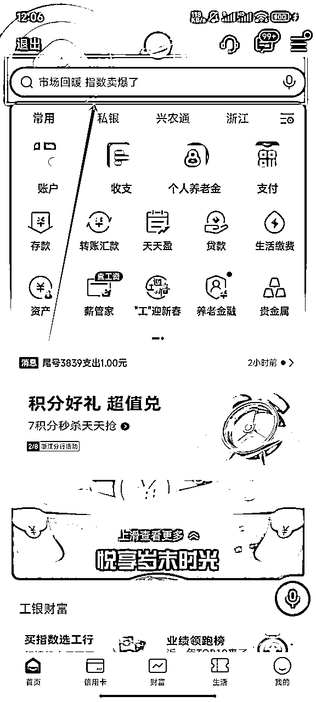
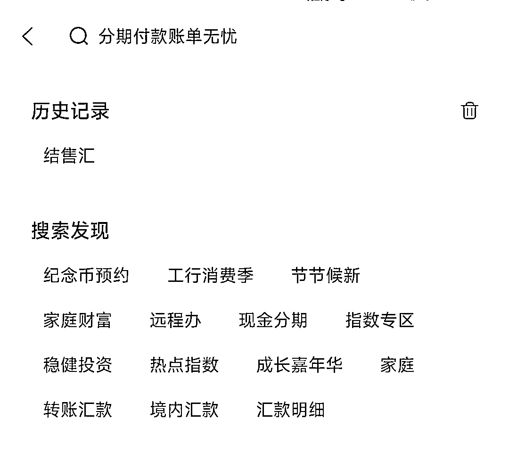

2. 选 HKD
3. 选“不取现”

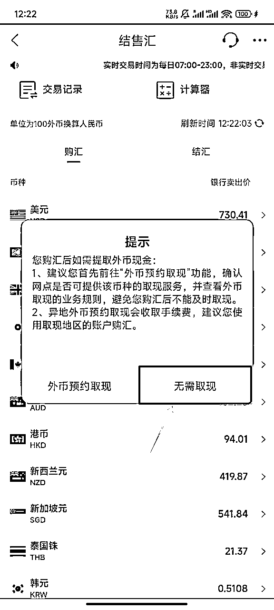

4. 输入金额
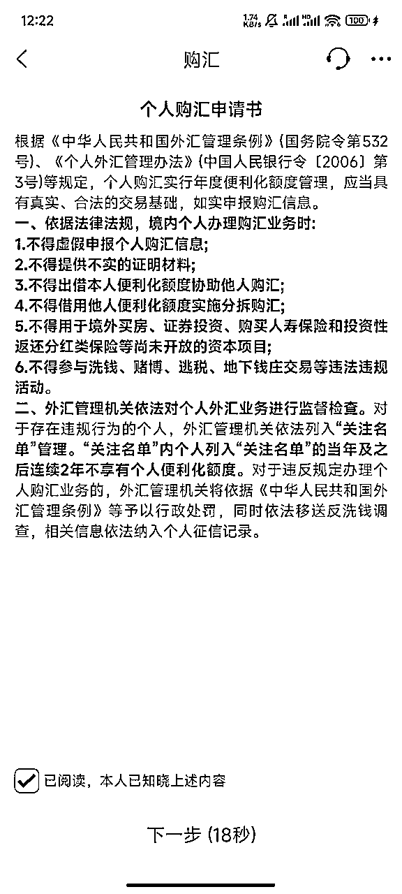
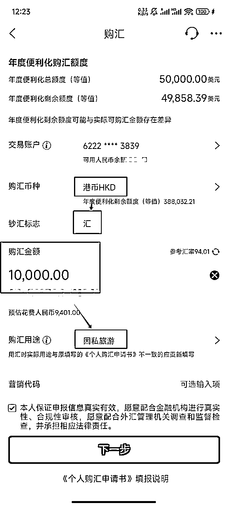

这里最关键的是选【汇】而不是【钞】；【汇】指不取出纸钞，可直接通过划转进入 HK 户口。换汇和汇款费用按单笔收取。

5. 核对信息并确认
（如果近期不去 HK，可以拿 JPY 作演示）
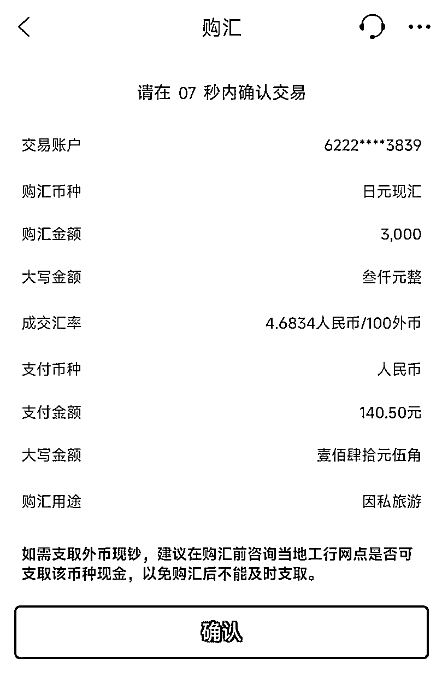

以上就是本次分享的全部内容，有问题欢迎在评论区聊～