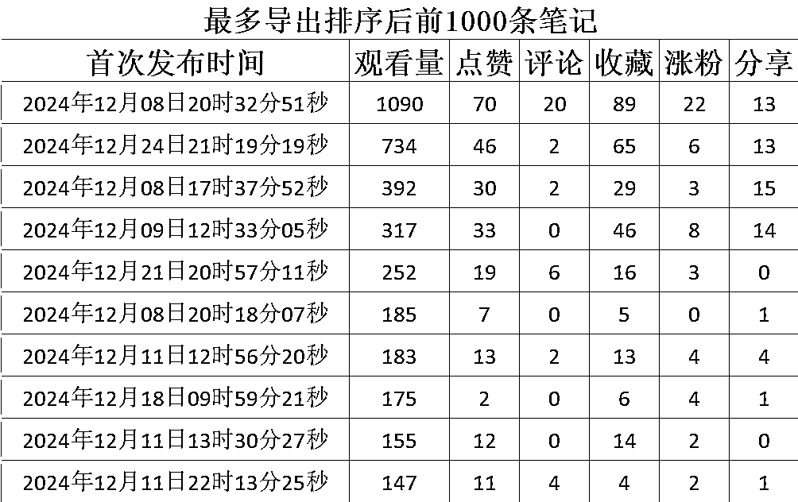
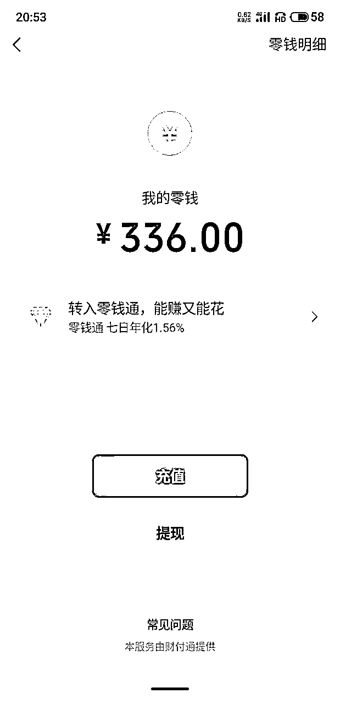

# 📕虚拟资料从0到1：一个化工人的21天实战复盘

大家好，我是龙哥。11月刚加入龙哥盟，之前一直在四川做化工技术方面的工作。今年因为个人原因裸辞，开始了一段全新的探索。这次航海我选了“📕虚拟资料”项目，虽然没有做出多亮眼的成绩（GMV只有300+），但这一路踩坑、重启、复盘下来，收获的东西远比数字本身更有价值。这篇内容写给同样刚起步的小白朋友，希望能给你们一些参考。

## 第一次起步：很努力，也很受挫

10月我第一次接触这个项目，连养号都没搞明白就冲了进去。从10月22日开始发笔记，主攻小学虚拟资料，后来又开了第二个号。结果很扎心：累计发了167篇，只有5篇浏览量过百，最高一篇1900；引流成功仅5人，成交是零。

那时候我整天怀疑自己：是不是我做的内容不行？为什么别人的能爆，我的没人看？我真的能做这个吗？满脑子都是自我否定。

## 重新出发：注销账号，从零再来

12月航海正式启动后，我在群里跟教练求助。希平教练说了一句“严重的付出收获不对等”，建议我注销账号重新开始。虽然很不舍得，但想了下确实是消耗太多、产出太少，继续硬扛意义不大。

于是我把旧号清了，从头开始养号。这次“归零”反而让我彻底放下了之前那些包袱。之后我同时运营了3个号，到航海结束一共发了143篇笔记。说实话浏览量依然不算出彩，但引流27人，完成交付12人，GMV300+。虽然不算大成绩，但总算跑通了0到1。

## 小白必看：我总结的6条实战经验

### 1. 别想太多，先动手发第一篇笔记

刚开始接触一个新项目时，谁都会紧张：怕号养不好，怕内容没人看，怕交付搞不定，怕这怕那。后来我发现，这些问题靠想解决不了，只能靠行动去撞。

先按手册发第一条笔记，边做边调整；账号不行就换，每次失败都是积累；遇到问题再看直播、翻加餐、学群里的分享。没有完美的开始，动手做你才会知道真正卡在哪里。

### 2. 航海实战的价值，在于帮你快速纠偏

手册什么时候都能看，但为什么一定要参加实战？因为实战里有教练点拨，有同行的真实反馈，一个人闷头摸索太慢太容易走偏。

比如教练提醒我注销账号止损，比如大家分享的选题方向和建议，这些都是手册上偏理论的内容，但实战中能直接改变下一步动作。多问、多看、多借力，远比一个人闭门造车高效。

### 3. 别被“爆款焦虑”绑架，单篇数据说明不了什么

我以前发完笔记就反复刷新，看有没有点赞、收藏、评论，数据一不好就焦虑。后来我调整了策略：对单篇笔记不再抱有不切实际的期待，把重心放在作品打磨上；主账号认真研究文案和内容，其他号大胆测试封面、标题、形式。单篇爆不爆不重要，整体的量变到质变才是关键。

### 4. 抓住需求旺季，别只用低价去卷

期末那段时间，家长焦虑得很，着急买资料帮孩子提分。但来找你的家长不一定只想要那一个资料包。

我学会了做捆绑：下学期资料和期末复习资料打包一起卖，客单价自然上去了；如果客户明确说只买其中一份，也灵活拆分成交，别硬推，错过订单。风口来了要懂得借势，别把时间浪费在低级的价格战中。

### 5. 把“推销”变成“聊天”，转化率更高

引流到私域后，怎么开口决定了是否成交。我的经验是：多问少说，先了解对方的孩子年级、薄弱的科目、想要什么；对话简洁，不发大段大段的小作文，把重点说清楚就够；适当给点“小便宜”，比如期末买下学期资料送复习资料，让客户觉得划算。用解决需求的心态去聊天，信任建立起来了，成交就顺了。

### 6. 对标模仿≠抄袭，它是新手最快的成长路径

说实话，一开始我很排斥对标模仿，觉得那不就是抄吗？后来打脸了，真香。模仿不是照搬内容，而是学别人的选题角度、封面元素、表达方式、结构逻辑。站在别人的肩膀上，你能更快判断什么样的内容受欢迎。模仿多了，自己的风格和网感也会慢慢长出来。

## 下一步，我想继续走下去

这次航海让我最大的收获不是那300多GMV，而是我学会了怎么调整心态，怎么在混乱中找到方向。虽然现在还没有跑出真正的爆款，但我相信只要持续做下去，一定会有回报。

感谢赚钱这个平台给我试错的机会，也感谢21天来所有教练、领队、志愿者和伙伴们的陪伴。希望新的一年，我能继续保持好奇、保持学习，深耕下去，2025找到那个值得全力以赴的方向。

一步步走，每一步都算数。祝大家都能龙哥盟，稳稳赚钱！