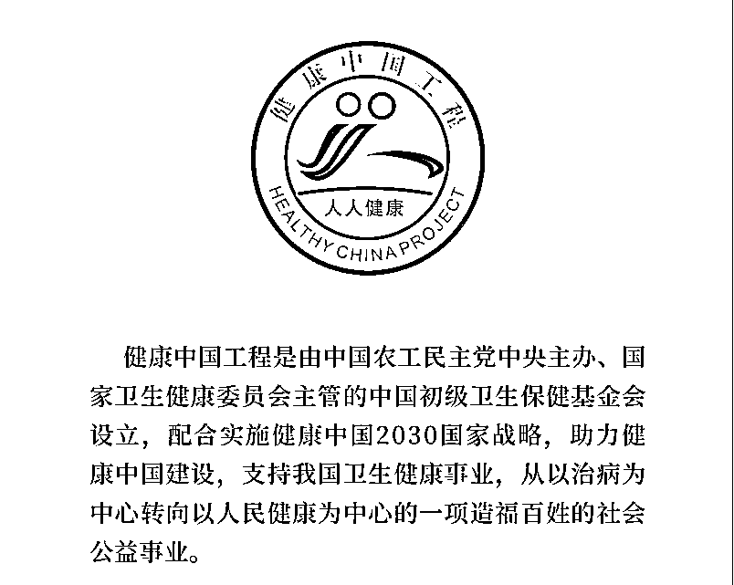
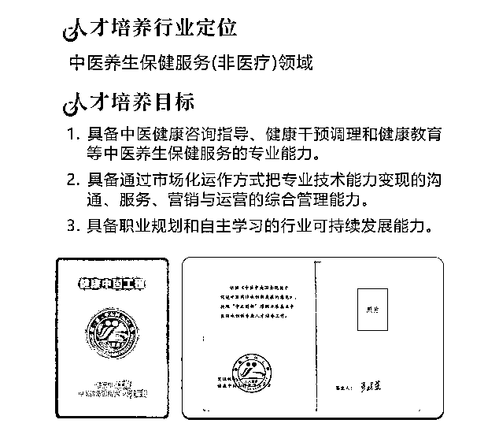
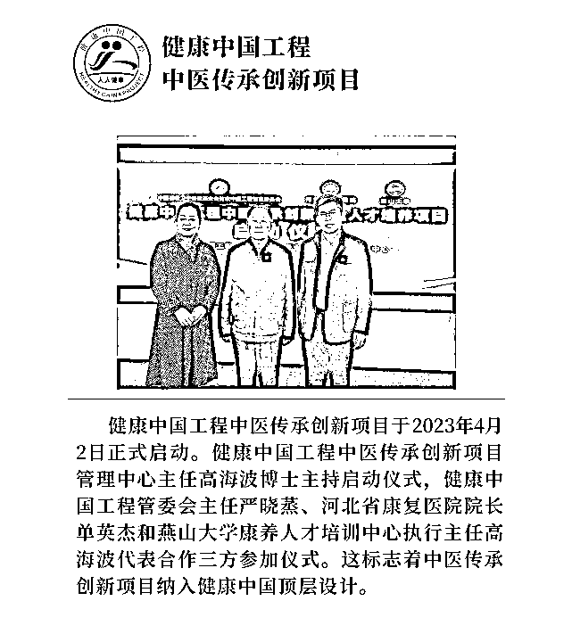
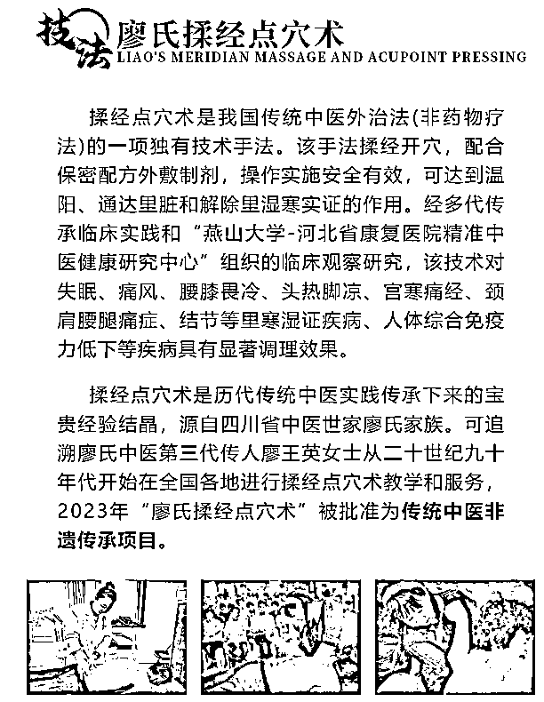
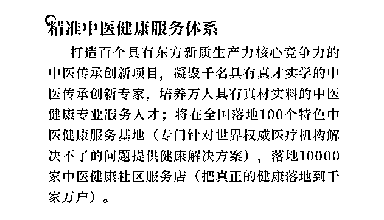
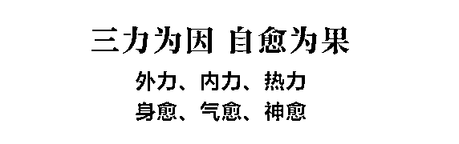

# 告别运营商，他转身押注“实效型中医健康”，一条被低估的黄金赛道

如果你在运营商赛道里摸爬滚打多年，会发现一个尴尬的现实：传统代理商们守着一亩三分地，营销手法几十年如一日，利润看得比命还重。我当初就是靠一套“大额分钱、及时兑现”的机制，迅速撬动了本地市场，还顺手布局了📕企业号，十个账号每天稳定进客，佣金最高能拿到套餐金额的十几倍。看似风光无限，可当三大运营商收紧携转政策，优惠力度一降再降，业务量断崖式下滑，我才意识到——这行太吃政策饭，风口一过，再努力也白搭。

## 为什么偏偏是大健康？

说实话，在赚钱圈子里看多了做大健康拿到结果的案例：养生茶、养生书、头疗、线上健康处方，说不心动是假的。但因为没有纯线上运营经验，一直没敢动手。中间也接触过别的项目，始终提不起劲，直到想起龙哥那句“百看不如一练”——越看越焦虑，越看越耗心力。正巧，我所在的河北秦皇岛被定位成“中医传承创新示范市”，燕山大学牵头组织，我还认识课题组里的老师，手里有现成的科研成果，就差市场化。2024年5月，我决定all in。

## 这个项目到底做什么？

简单来说：**大健康行业 → 中医领域 → 强实效型中医健康服务**。聚焦三大人群——疼痛、失眠、痛风，全国加起来超过5亿潜在客户，天花板足够高，又是刚需、高频、海量。

和燕山大学教授一拍即合后，我们迅速组队，从品牌、产品技术、渠道、服务四个维度重新梳理了整个项目。

**品牌方面，底气十足：**
- 项目属于“健康中国中医传承创新项目”，跟希望工程平级的国家级工程，由新农合提出者、民工党主席严部长牵头推动；

- 燕山大学康养产业技术研究院负责科研、临床和孵化；
- 燕山大学康养产业人才培训中心负责人才培训，颁发全国通用的中医传承创新人才证书；

- 河北省康复医院承接技术和产品的临床测试；

- 非遗传承技术：揉经点穴术；

- 燕山大学国家科技园负责项目落地孵化。

品牌背书已经够硬了，我们又把民间中医技术做了标准化、产品化、临床化，最终效果有效率超过95%，远超预期。这个项目的根基，稳了。

**产品与技术，靠效果说话：**
核心产品是“里阳霜”——中医外治法里的绿色疗法，依据“木佐金使，逆阳破卫”原理，是古阳灸的现代传承。无色、无味、无烟，涂抹就能用，融合了中医六艺中的“药”和“灸”。针对深层寒湿、疼痛、失眠、痛风、月子病、手脚冰凉、腰腿痛都有明显改善，尤其对刚扭伤挫伤的人，一次见效，口碑自然传播。

技术方面，来自民间中医廖老师多代传承的“揉经点穴术”，最早可追溯到清代。我们把它标准化后，效率大幅提升：传统理疗店的技术师傅不再被体力劳动绑死，随调随走，用到了中医六艺里的“针（以指代针）、按跷、导引”。关节1分钟调理，肩颈3分钟，后背10分钟，随调随走。1分钟出体感，12小时持久有效，效果是传统艾灸、按摩、经络的10倍以上。培训由燕山大学康养产业人才培训中心负责，打造人才供应链，3天就能学会。项目能不能放大，就看能不能标准化复制——我们做到了。所以我们的使命是：**为一亿家庭解决疼痛和失眠问题**。

## 渠道怎么打？

我们筛选出三类人最适合做这个项目：
1. 想让自己和家人更健康的；
2. 想学一门安身立命的手艺，一双手就是一家调理馆，不用复杂设备，随时能帮人祛除疼痛；
3. 想找项目放大运作，以利润为中心、追求稳定收益的。

渠道也做了细分：
- **代理渠道**：以空间和地盘为核心；
- **店中店渠道**：在传统理疗店、月子会所、美容院增设“能解决问题的调理项目”；
- **社区店板块**：以社区为中心，成本低、客群广。店型模型很清晰：1家店、2个人、3张床、40平米、5大赋能、60天回本；
- **农村乡镇点**：市场下沉，农村包围城市。我们去试点考察时，一个农村店一天能调理30-40人；
- **大的渠道合作**：面向原有微商和各类团队。

## 服务上，我们提供陪跑。

目前项目还在摸索放大阶段，已经落地了几名代理和10家门店。虽然速度不算快，但看到客户调理后的惊喜反馈，那种成就感是过去做运营商完全体会不到的——真的能和客户产生深度链接。

我知道，放大这件事单靠我还不够，所以特别希望得到各位圈友的帮助：
1. 新媒体合作；
2. 渠道合作；
3. 运营合作。

真心期待大家多提宝贵意见，把“真中医、真技术、真产品、真效果、真口碑”的好项目，带给更多需要它的人。