# 抖音冷门赛道实操拆解：9.9一份的毛选资料包，单号日入百元级玩法全解析

> 来源：[https://o0yvn3o31a.feishu.cn/docx/CL7Ldi0mEo6Wl9xcU0Kcy5Z5nog](https://o0yvn3o31a.feishu.cn/docx/CL7Ldi0mEo6Wl9xcU0Kcy5Z5nog)

大家好，我是黄岛主。

今天带大家看一个目前在抖音上还相对少人做的虚拟资料变现方向，就是用毛选电子资料做私域导流成交。赛道目前属于冷门蓝海，除了毛选之外，类似的爱国向资料还有不少可以延展。

为什么这个方向能跑？结合当下的内容生态来看，大量用户对正能量、爱国主题的内容接受度很高，毛选类资料正好匹配这批人群，需求面不小。我们实测过一个账号，上线两天就开始有咨询并出单，验证了可行性。

整体打法很轻量：做一条3-5分钟的短视频，用微信聊天记录截图或简单二创的形式，把核心文案和封面做好就能发。引流到微信后直接成交。非常适合新手、宝妈、副业玩家，投入1-2小时就能批量操作多号。

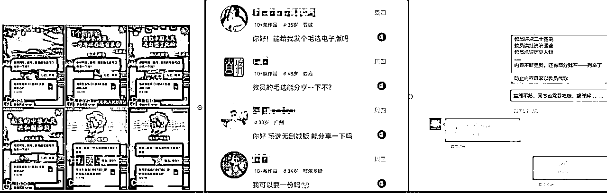

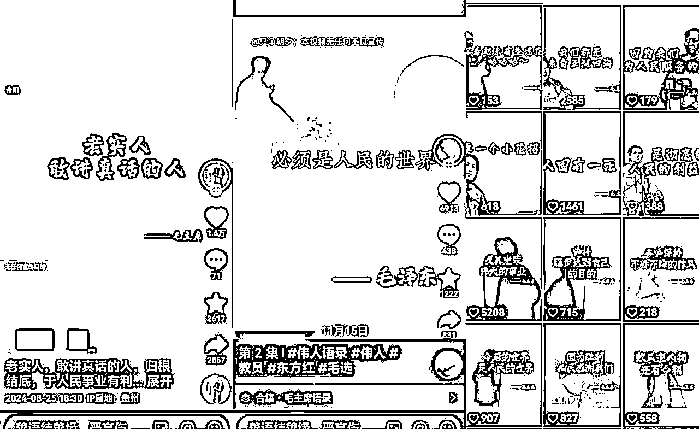

定价方面，毛选资料单本定价9.9元，全套打包可以做19.9到29.9区间浮动，具体看客户接受度。9.9是锚点价，19.9、29.9可以根据沟通灵活调整，也可以先测价。

做账号有一个关键点：风格要统一。选了聊天记录路线，后续就全用聊天记录；选了二创路线，就一直二创。账号调性稳定了，权重才容易起来。

下面把我这套复盘的完整SOP整理出来，覆盖定位、起号、制作、变现全流程，想做的直接照着跑。

# 1、账号起号

起号越干净越好。

注册建议：优先用新号操作，抖音对新号的扶持更友好。老号建议注销重来，实名不是必须的。注意注销别太频繁，最多控制在5次以内，避免影响数据。

设备建议：准备2台以上苹果或安卓手机即可，不要用太旧的机型卡顿会限流。自己已有设备可小批量测试，二手手机买来建议先刷机，安卓恢复出厂即可，苹果用爱思助手深度刷机。

号码建议：用三大运营商的新号或抖音专用的流量卡，拒绝物联网卡、解码卡、虚拟号。套餐3-5G比较合适，通话无所谓可直接选纯流量卡。

注册细节：严格一机一卡一号，用4G/5G移动数据注册，不要用Wi-Fi。多号同网大概率被判定营销。注册时系统可能会要通讯录权限，提前在通讯录里加10个以上联系人。

养号流程：注册后第1-7天循序渐进养权重，每天早中晚各30-60分钟刷同类内容。

第1天：正常刷推荐，不刻意互动。
第2-3天：搜“毛选”关键词，看下拉相关作品和对标号，适度关注、点赞、评论、收藏，模拟真实用户。
第4天：看推荐池是否已出现同领域内容，若有则开始完善资料，若无则继续养。

养号结束完善资料：昵称走红色爱国风格，比如某某同志+【领取资料】，如红色基因、毛选分享、毛选分享员、毛选讲解员等，让人一眼知道定位。头像用明亮正能量的红色系人物或元素，与昵称呼应。简介可写红色宣言或领袖名言，末尾加一句内容仅供学习交流，无宣传意图。

# 2、内容制作流程

1、素材收集

主题锁定红色爱国向。背景图可以去淘宝买，几毛几块一套。素材渠道多，抖音、快手、小红书都能找。重点素材：毛选书籍封面图、教员素描/铅笔稿/铜像照，要求无水印；带“评论领取”文案的图也可以用。

在抖音搜毛选，筛选图文类，带电子资料获取口播的作品、聊天记录形式的作品都能拿来参考。

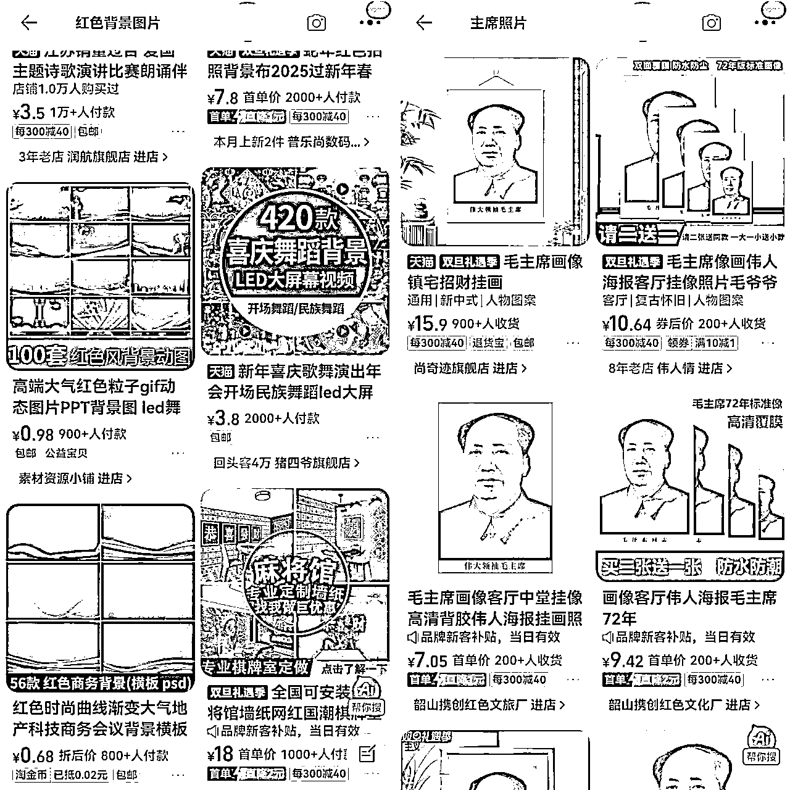

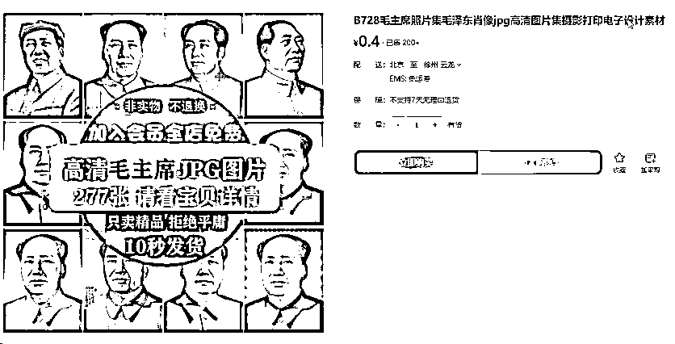

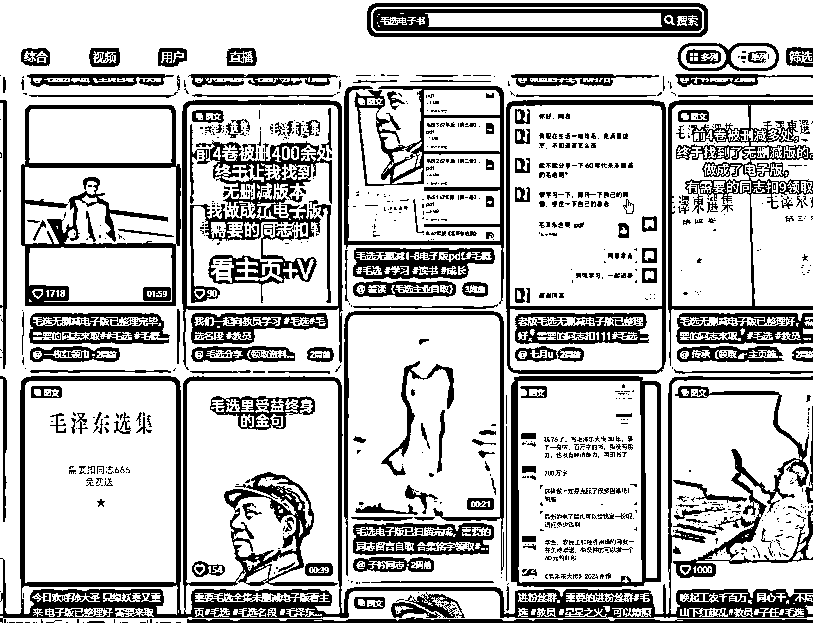

找到目标作品后，点右下角复制链接，用皮皮去水印、轻抖去水印、配音神器Pro等小程序提取文案和无水印图。视频也能同样提取。素材下载后分类归档，后期调用更顺手。

为提升原创度，建议把教员图片和书籍图抠出来，换到不同的爱国风景或红色背景上使用。

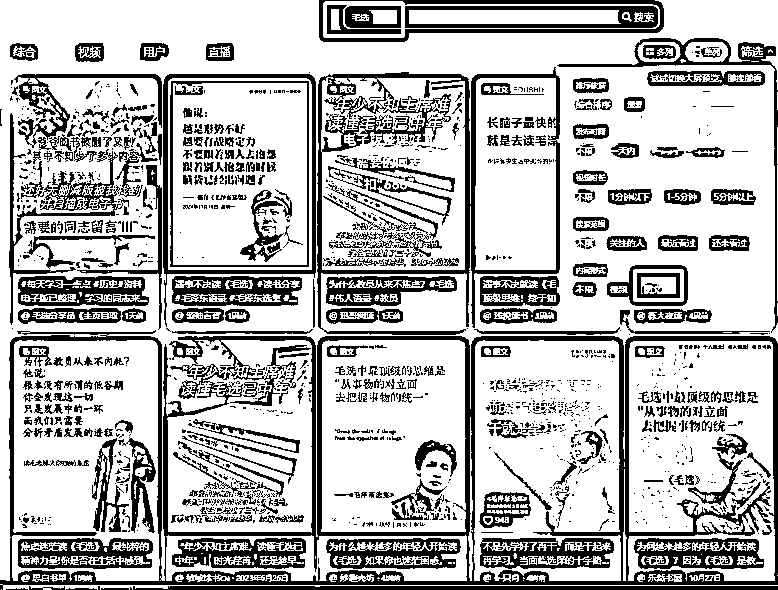

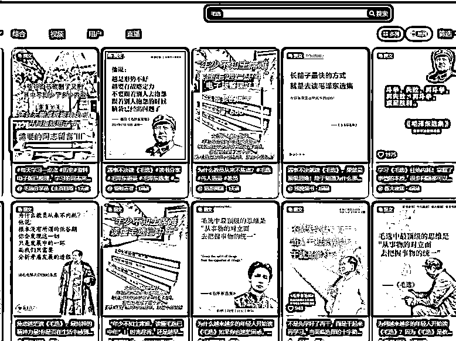

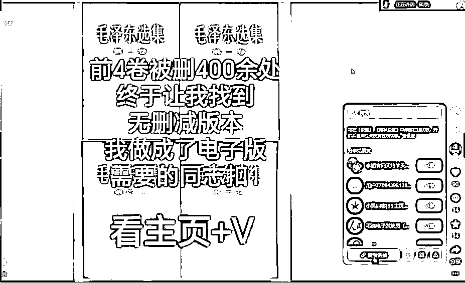

2、抠图处理

可以用美图秀秀，也可以用专业的抠图工具，批量抠好保存备用。

3、图片合成

单图模式：毛选书籍+人物图、微信聊天记录。打开美图秀秀选爱国背景，尺寸调成1080*1920，插入抠好的图即可。

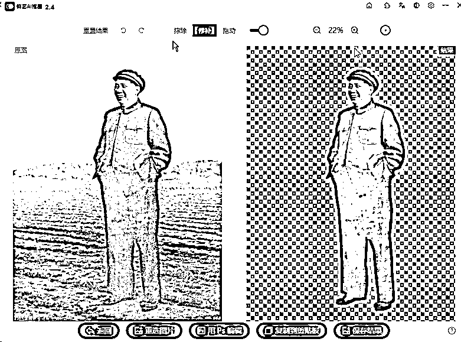

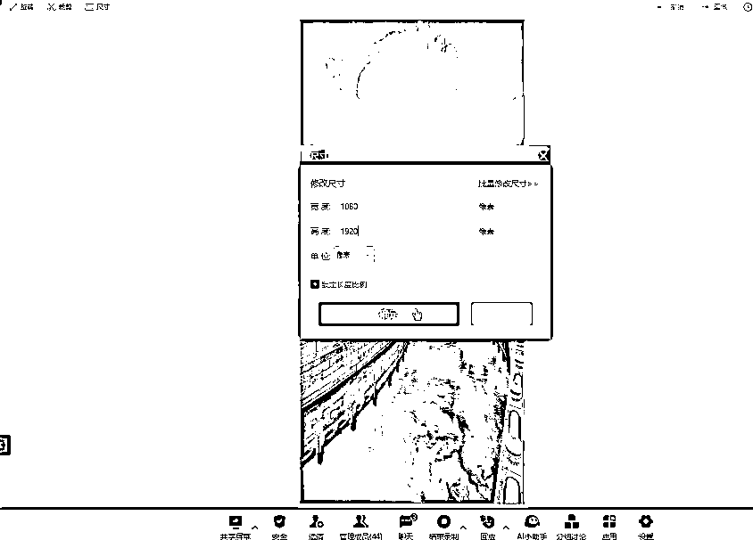

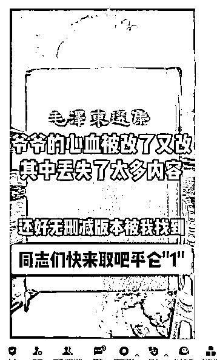

微信聊天记录玩法：用两个微信号互聊，截图后抠背景，放到美图秀秀的背景上合成。

多图拼接：美图秀秀拼图功能，智能拼图，左侧放爱国背景，右侧放带评论的图和聊天记录图。也可以把爱国图、教员图、聊天记录做成三张图，加背景音乐导出成视频。

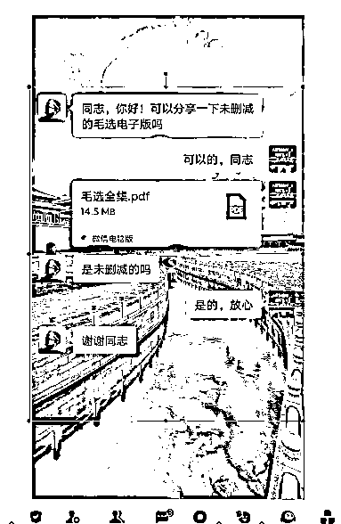

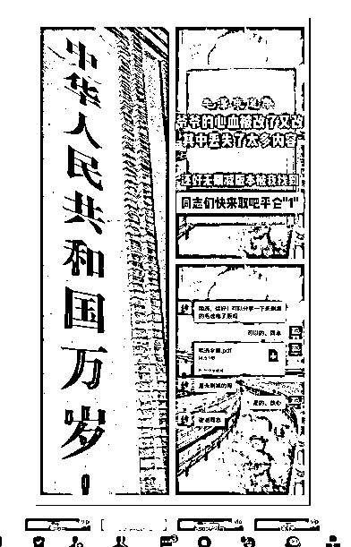

4、视频制作

把单图或三图导入剪映。背景铺满，比例建议3:4或9:16，3:4为例，先把背景图放大铺满，再叠加毛选图、教员图或聊天记录，均需提前抠图。

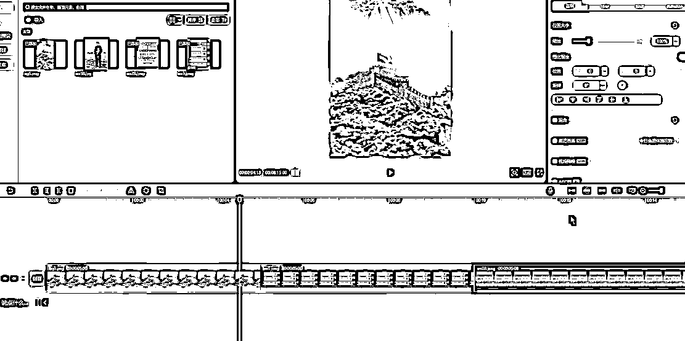

加背景音乐，建议复制同行热门视频的原声到剪映解析，音频时长控制在7-10秒。给图片加简单转场，拉入图片做三图流视频，无需复杂技巧，导出即用。

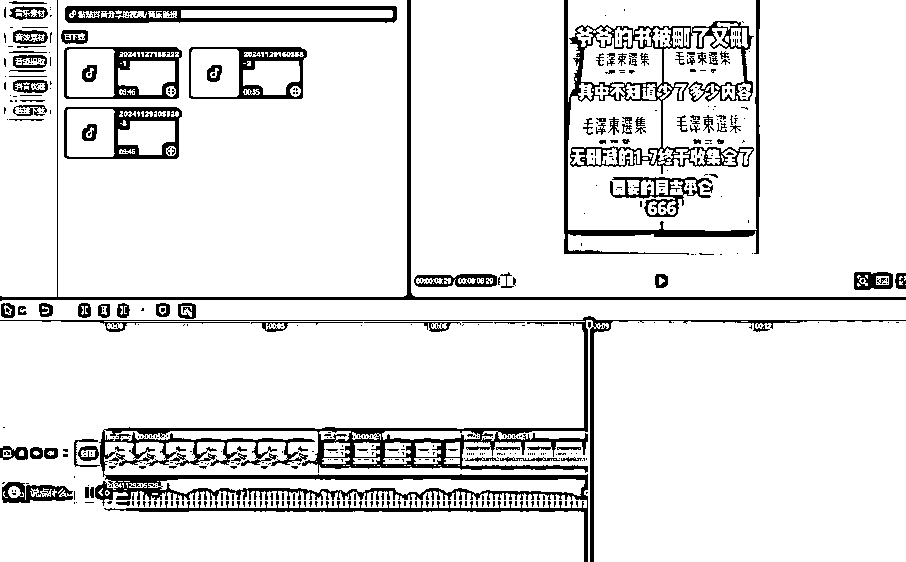

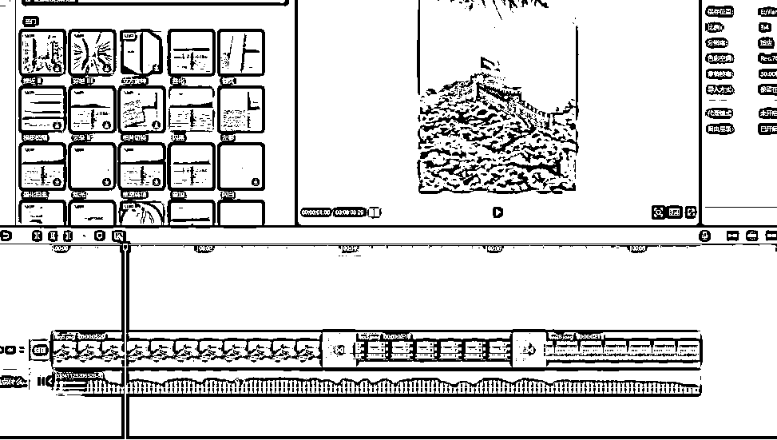

二创模式：

采集同行视频+抠图素材+换背景做组合。素材下载同图文方法，用去水印小程序即可。

剪映里先加竖版爱国背景铺满，再把采集的视频叠在上方。下方可加微信聊天记录或白底抠图形成色彩冲击。把水印遮挡住，用教员抠图素材盖住。

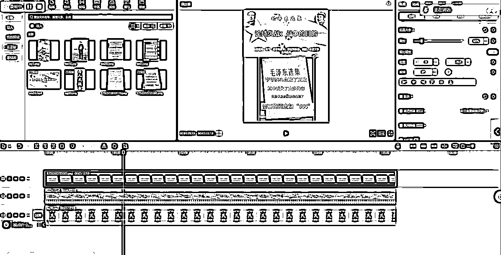

音频处理：如果是纯音乐，用分离功能；有人声则分离人声后叠加背景音乐。也可直接用同行的热门BGM。按需加特效，使画面与视频时长对齐。

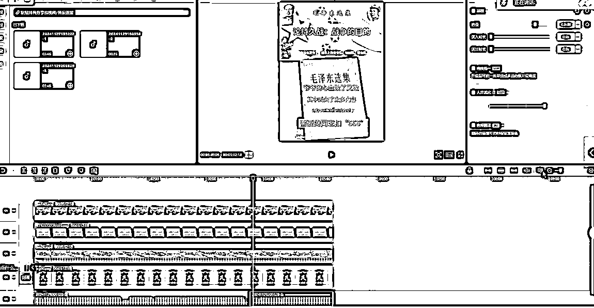

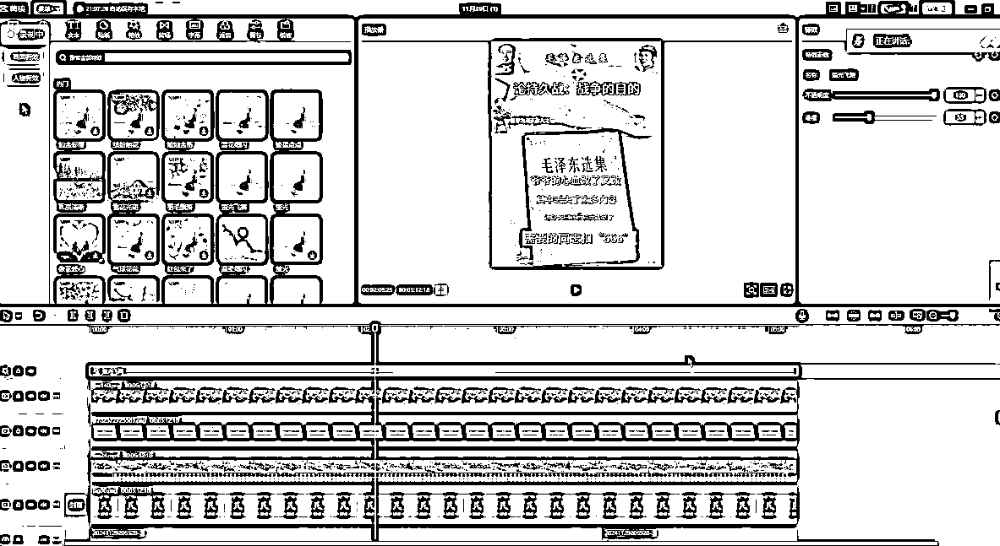

可做轻微动效：给视频打关键帧，全程约5分钟，开头缩放105%，2分钟时110%并轻微旋转3度，3分半时115%，结尾回100%，形成自然漂浮感。

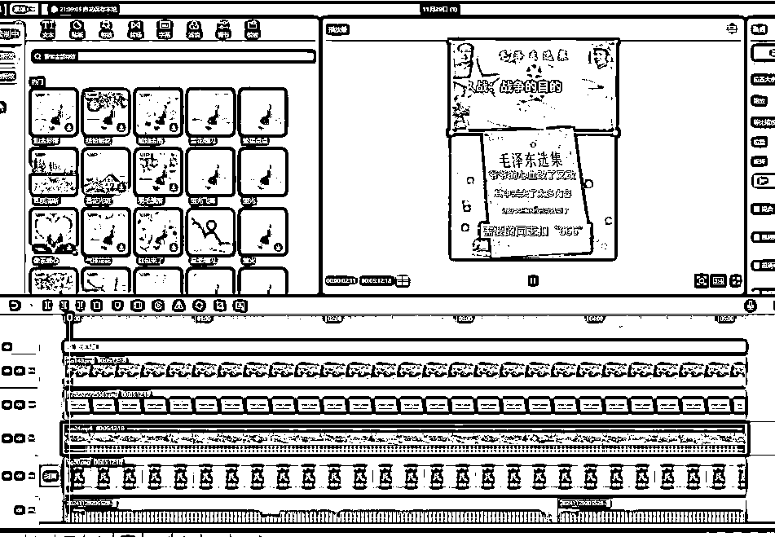

# 3、发布节奏

直接在抖音发布作品，配文案可参考同行话术，比如“无删减资料已整理完毕，一起学习”之类的引导词，复制同行即可。加3-5个话题，毛选、读书力量、读书分享、精选语录等均可。

发布技巧：选在用户活跃时段发，早上7-9点、中午11-14点、晚上18-20点为佳。账号前期保证日更，每天2-3条，稳定后可降至1条，保持活跃度和内容质量。

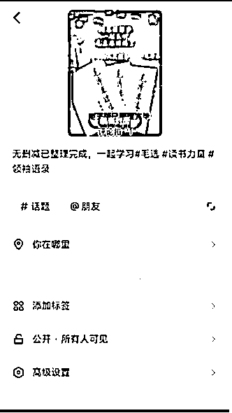

# 4、引流与成交

简介引流：简介里用谐音字写微信号，或@引导至引流小号。视频里写“看主页加V”字样。

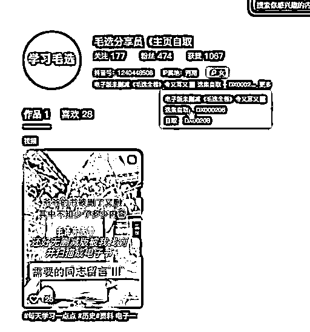

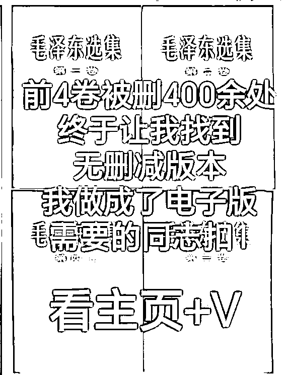

标记引流：在背景图里直接标注微信号+“电子版”字样，指向小号。

评论区引导：视频本身带引导，鼓励用户评论。用户评论想要资料时，回复“看简介/看主页”。引流时用谐音替换敏感词，避免被限。回复要控制频率，不要一条视频全回，挑一条置顶即可。只回复与引流相关的问题。

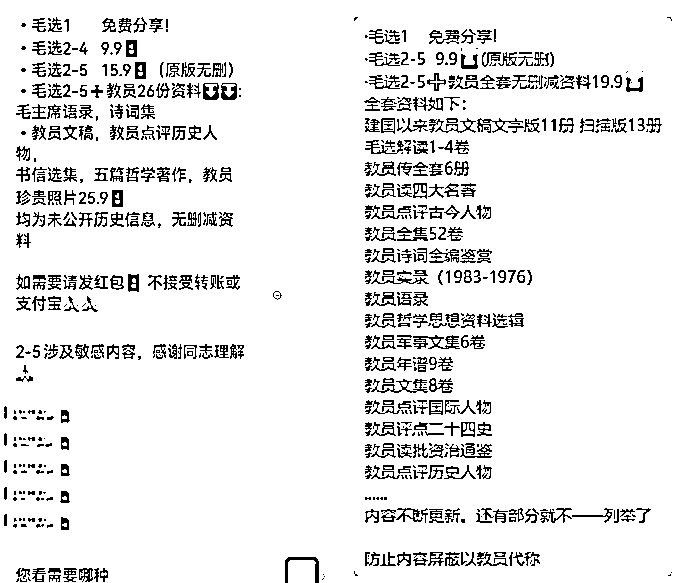

资料交付注意：市面上毛选常见为五卷，但第五卷受限较多，不便分享。建议先转存到自己网盘再下载本地备份。

话术：可先免费赠送第一卷做信任，再推2-5卷付费；或直接报全套价。客户常问是否未删减、是否还有其他资料。首次成交单本后，可低价推整套教员资料。加微信后做好标签区分成交与未成交，未成交可定期推送免费文稿片段做二次转化。

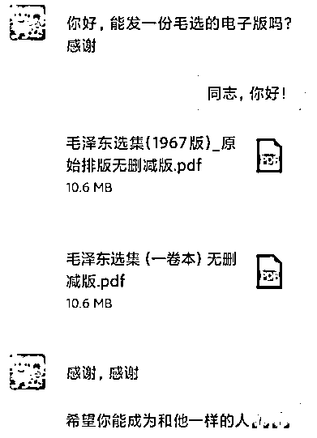

# 5、朋友圈人设

朋友圈要呈现真实人设+产品展示+成交反馈，增强信任。小号可以搬运大号的朋友圈内容。产品定位初期为毛选五卷9.9/本，全套打包19.9-29.9，测试下来19.9转化最好。可根据客户反应灵活报价：犹豫就先报19.9，果断可试29.9。收款走微信、支付宝，坚持先付款后发资料，防止白嫖。

写在最后：

以上就是完整的操作SOP，从起号到成交闭环。按这个流程实操，基本能跑通。做出效果欢迎来反馈交流。

注意：未经授权，禁止转载到各大平台，需要授权，找黄岛主即可！