# 从济南报社记者到全国旅居的自由工作者：不上班第7年，我的两张底牌

各位朋友，我是张老板。在互联网领域独立工作已经7年，今天把经验整理成一篇长文，给想尝试自由职业、自己做项目，或者准备认真经营个人品牌的朋友一些参考。

全文约8000字，先看目录：

一、我如何实现边旅居边工作：两个阶段  
1. 上班期间偷偷做副业，赚到第一笔钱  
2. 项目和IP双线推进，收入真正稳定下来  

二、第一张底牌：给IP装一个“壶把”，死磕同一件事1000天  

三、第二张底牌：小项目迭代四轮赚到100万，1克拉才最值钱  
1. 自己先跑通，赚小钱  
2. 带全家人一起干，打通细分品类  
3. 用IP放大，做陪跑营，招募500人  
4. 组建闲鱼IP团队，把赛道做深  

先放张近照，和新老朋友认识一下：

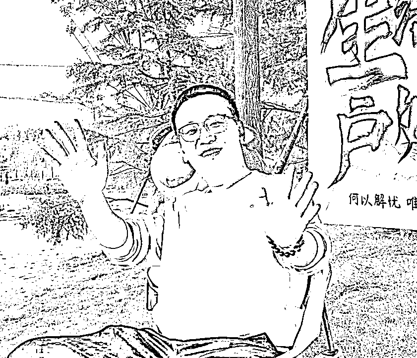

下面进入正文。

## 一、我如何实现边旅居边工作：两个阶段

为了讲清后面的两张底牌，先简单回顾我这几年的轨迹，大体分两步。

### 第一步：上班时偷做副业，拿到自媒体的第一桶金

我没辞职前，跟多数人一样每天打卡。当时我在济南一家报社工作，自己赚到的第一桶金，就是在上班路上和办公室空档里“挤”出来的。

我住济南东边，单位离得远，单程约十几公里。为了避开早高峰，我习惯提前出门。车里不放音乐，也不听广播，只打开一个东北电台节目——《叶文有话说》。这档节目里全是真人真事，情感故事一个比一个狗血。

从家开去单位的路上，我刚好听完一两集。到了办公室，同事还没来，我就把刚听过的故事用自己的语言写成文章，花20到30分钟，起好标题，发到企鹅号、今日头条、大鱼号等平台。一个早晨能更新两篇。

内容不变，动作也不变：路上听、到岗写。就靠这个“笨办法”，我额外赚了8万多元。这是那个账号当时的收益证明：

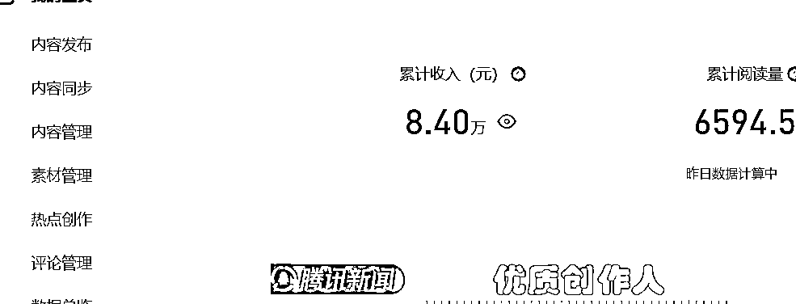

那段时间，这个账号每天能稳定给我带来大约600元副业收入，算下来一个月过万。后来报社发生变动，加上副业收入稳定，我干脆没再投简历，直接开始全职自媒体。

时间自由以后，我尝试了很多新方向，不再只写情感故事，还跑进了国际内容赛道，一度做到头部。企鹅、头条、一点等平台的官方作者群，我都在里面，日常有专人对接。腾讯还在故宫紫禁书院办过一次自媒体作者大会，我有幸参加。这是现场照片，你们找找哪个是我：

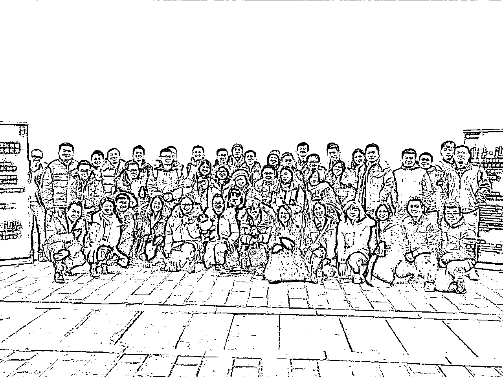

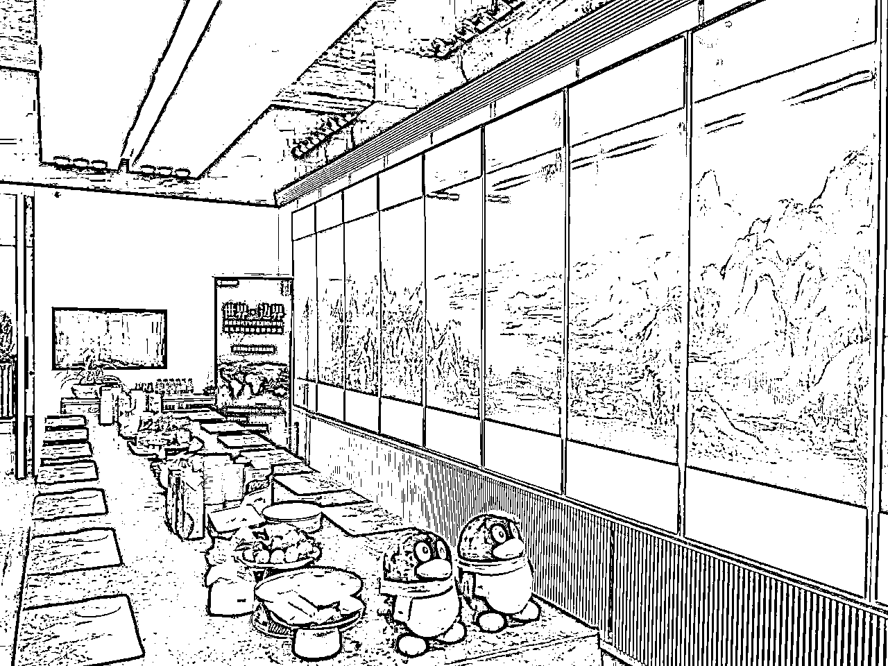

再晒一个账号的后台数据，收益已经到百万级别：

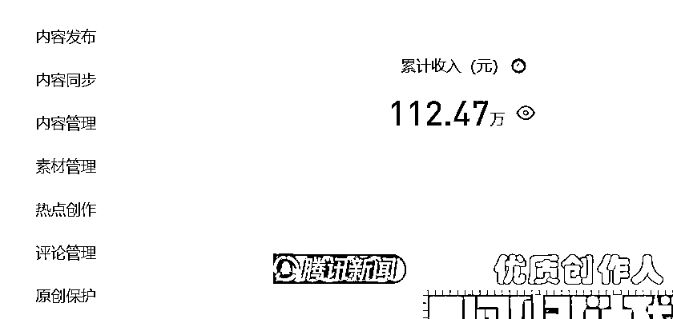

但麻烦也来了。

图文自媒体正红火时，一天几千甚至上万的收入并不少见，我也很舒服，除了做项目就是到处玩，比如去海南旅居，文昌、博鳌、三亚都住过一段。当时漏算了一笔账：流量是平台的，不是我的。平台给流量，日子就好过；平台不给，马上难受。短视频起来后，我们这批图文作者最先被冲击，流量和收入肉眼可见地往下掉。

失控感和焦虑感立刻冒出来，因为你不知道明天还能不能赚到钱。

我醒悟过来：只依赖平台型流量项目，没有自己的沉淀、没有话语权，根本没法持续。于是做了两个调整。  
第一，多测几个项目，稳住收入来源。反正不用坐班，我试过闲鱼电商、拼多多电商、知乎好物推荐、抖音教辅带货、Web3项目、线下白酒代理等方向。  
第二，从2021年前后开始经营“张老板”这个个人IP。

正是这两步，把我推进了第二阶段。

### 第二步：项目和IP并线，收入终于稳了

“张老板”这个IP起盘，靠的是我自己跑通的闲鱼项目。随后经历多轮迭代：

一开始我一个人做闲鱼；后来拉全家六口人一起做；再后来带着几百位学员做；现在我带出了一批闲鱼IP和闲鱼老师，在细分赛道里一起深耕。

只算闲鱼这个小项目，通过“项目+IP”的打法，累计收益已超过100万，而且还在持续增加。它成了我IP的基本盘之一。

项目加IP，让我的日常动作开始有积累：先把事做成、把结果拿出来，再复盘、输出、分享，顺带沉淀私域；自营产品加分销CPS一起上。经验、人脉、收入一圈圈变大，我自己对“不上班、只工作”的状态也越来越有信心。

## 二、第一张底牌：给IP装一个“壶把”，死磕同一件事1000天

第一个问题：怎么让别人记住你、信任你？

我的答案是“壶把法则”。这套说法是我原创的，灵感来自报社时代的老领导邵珠富。邵总当年爱做策划，常跟我讲营销里的“壶把论”：一壶滚水，直接上手端肯定被烫，但如果壶上有个把手，就能轻松提起来；营销，就是找到这个把手。

他还举过一个例子。我们一起去济南一家专做鹅的馆子吃炖大鹅，席间他问我：“你知道鹅的‘把儿’是什么吗？”然后自己回答：鹅是全世界唯一不得癌症的动物。这个知识点我记到现在。

后来自己做IP，我发现这套逻辑同样成立：你得给自己设计一个记忆点，设计一个让用户一提你就想起的事件。我的事件，就是每天早上公开写复盘日记，目标是连续写10年。口号也早就定好了：每天一篇写10年，写完退休去云南。

罗振宇的“把儿”是每天60秒语音，做了10年；我的“把儿”就是清晨的这一篇复盘。到今天，我已经连续写了1172天，一天都没断。第一篇发布于2021年9月24日：

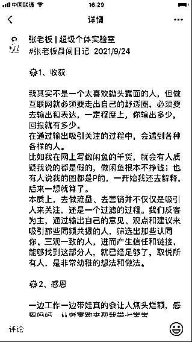

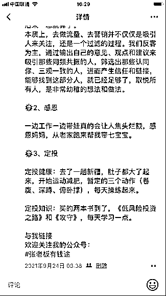

为什么选晨间日记？一方面，我是模仿了一位币圈大佬的做法；另一方面，是受《晨间日记的奇迹》这本书的启发。书我拍给大家看：

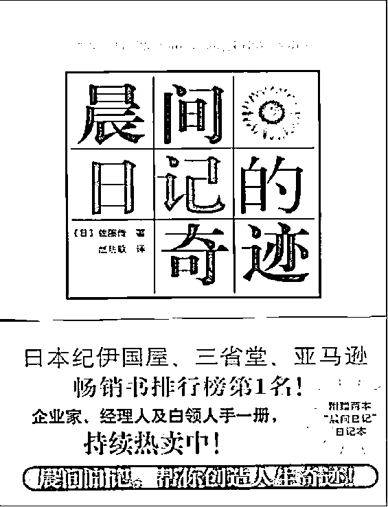

坚持公开写1000多天后，我总结出9个好处：

1. 养成了“早起先做正事”的习惯，几乎戒掉了拖延；
2. 每天等于比别人多出两小时；
3. 写着写着，写作力、素材库、个人品牌影响力都涨了；
4. 慢慢攒下自己的数字资产和生产资料；
5. 积累了一千多位付费读者，也立住了个人IP的里程碑；
6. 顺手带动了产品转化和收入；
7. 心力和信心都更强，做别的事也更容易成；
8. 链接到更多资源和贵人，运气肉眼可见变好；
9. 每天向内看自己，情绪更稳，还给自己充了电。

开头确实难熬。我把目标公开到朋友圈和社群，专门建了“张老板10年围观群”，每天早晨在群里打卡。我猜当时很多人不信，觉得我顶多坚持几周。但我心里就想：目标既然公开了，就一定要写完；自己和自己较劲，每一天都比昨天好一点就够了。

最初几乎没人看。我🛰️好友没几个，👸号订户也少得可怜，免费开放，进群的人依然不多。

坚持到几百天时，群里已经有了几百位读者，每天定时等更新。这时候我顺势把群改成付费：早期随缘赞赏就能进，后来门槛涨到99元。因为IP影响力起来了，愿意付费的人依然不少。

现在我的晨间复盘已经沉淀出4个付费群，1400多位读者每天雷打不动阅读，很多人说早就看习惯了：

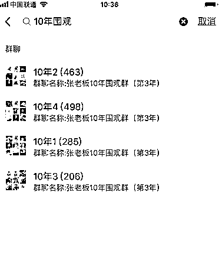

这些年积累下60万字，我把它整理成了专属电子书：

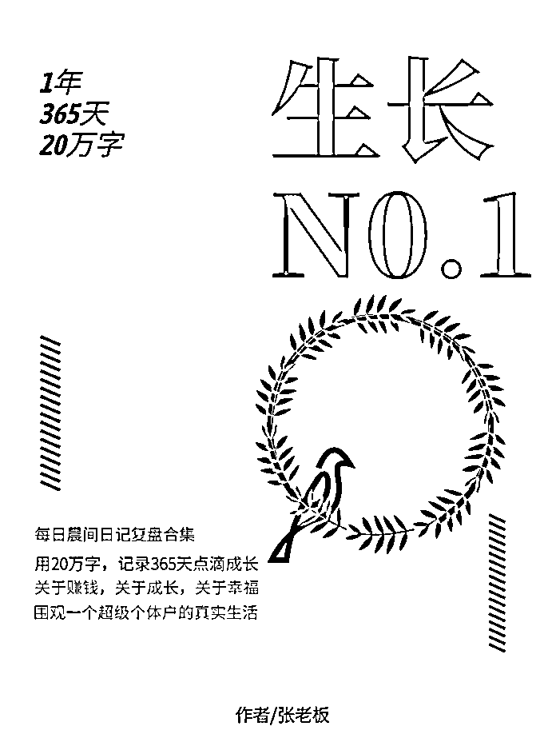

越来越多的人先是每天看到我出现，然后了解我、信任我，最后变成我的付费用户。

一句话总结：我没有流量颜值，靠的是日久生情。

再送个福利，把复盘模板拆给大家看。以最近几天的文章为例：

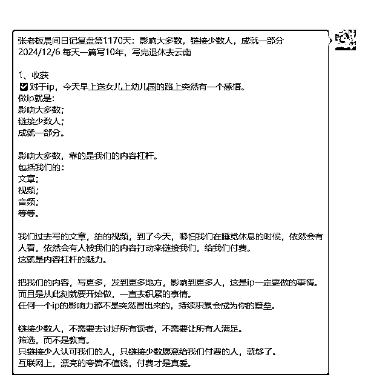

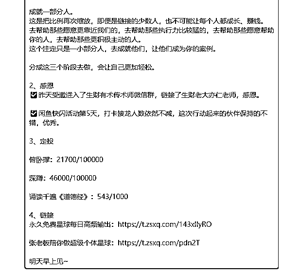

模板一共分五块：

第一块，标题。我会写清今天的第几天、当日主题、日期和一句固定的slogan。

第二块，收获。这是主体，用来复盘昨天发生的事，提炼经验教训，再落到今天的行动上。注意，这块不能只写给自己看，也要让读者读完有收获；公开和利他，才是它持续吸引人的原因。

第三块，感恩。每天公开感谢一些人、一些事，你会发现自己慢慢被正能量填满，心态更平和，赚钱更快乐。

第四块，定投。这个词来自金融，意思是长期、固定地投入。我给自己安排的运动和心理建设，也用这个思路：先定终点，再每天积累，以终为始。

第五块，链接。主要服务做个人IP的朋友：把公开渠道和联系方式放在这里，方便别人认识你、找到你。

这套模板是1000天里反复迭代出来的。有了它，我每天写复盘可以控制在15分钟内。时间短，才容易坚持；如果每天要花一两个小时，大概率撑不下来。

## 三、第二张底牌：小项目迭代四轮，赚到100万，1克拉才最值钱

第二个问题：怎样在细分领域里赚到更多钱？

我一直记得靠谱老师的一句话：“两个50分的钻石加起来，也没有一个1克拉的值钱；十个10分的钻石，同样比不上一个1克拉。”你要做的，就是找到自己那颗1克拉的钻石。它可以是一项技能、一个爱好，哪怕是一个不起眼的小生意。

然后，在这“1克拉”上花比常人多几倍的力气，收益自然会突破。

我选的1克拉，就是闲鱼。这生意真的小，很多大V看不上，但普通人没有门槛，能长期做，收益天花板虽然不高，对新手却很友好。关键在于我用了四轮迭代，把它越做越深。

### 第一轮：自己先跑通闭环

刚接触闲鱼时，我闷头把整个流程走了一遍。翻开记录，2020年底我就已经跑通了，当时还写过文章记录这件事。

这一轮拼的就是执行力。只要有效工作量够，基本能测出结果。但要提醒：有效工作量必须量化。别只说“我今天花了很多时间”“我上了很多品”，而要说“我今天花了2小时”“我上了10个链接”。能被量化，才算标准。

### 第二轮：带全家六口人一起干

跑通之后，我不想只自己赚，还想验证这套方法能不能复制给别人。于是找来家里人当“实验对象”。前提是对方自己感兴趣、愿意主动执行，否则谁也带不动。

我老婆、我姐、我姑姑、已经退休的丈母娘都参与了，后来表妹也加入。结果比预期好，基本每个人都有亮点成绩，我之前专门晒过：

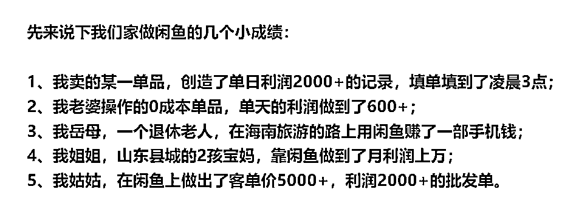

家里人里，我大姐做得最出色。到现在，她每年还能保持10万左右的纯利。她自己的记账本里，还留着几个月的闲鱼收入记录：

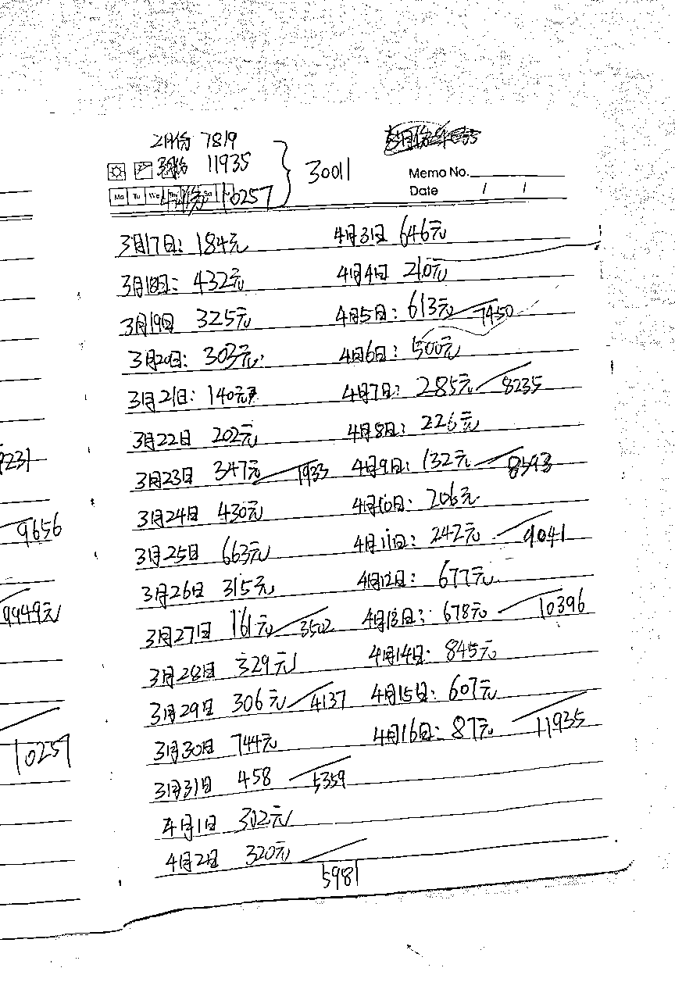

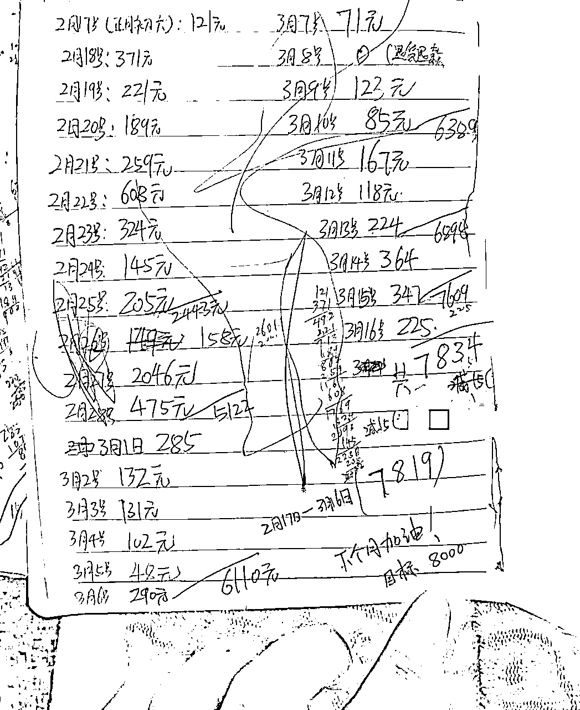

这个阶段还有个意外收获：我们在大量测品、铺店的过程中，挖到了一个细分品类，之后大部分店铺都集中打这个品，闲鱼上这个赛道里的大部分流量都被我们接住了。

我又顺势以它为核心延伸出淘宝店和私域电商，把闲鱼客户引到🛰️，慢慢养、反复卖。这些渠道到今天还在持续出单。比如下面截图里的老客户，最近又在我的私域复购，算下来这一个人一年就能贡献小几千的利润：

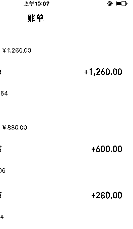

所以，很多产品定位不是坐在家里想出来的，是实战里试出来的。自己先跑通，再小范围复制，持续拿结果；遇到机会，马上抓住，往深里做。

### 第三轮：结合IP做陪跑服务，招募500人，放大整体收益

项目和IP并行之后，我一直在找能跟IP结合的项目。手里可调用的资源和成绩不少，小范围测试一圈，最后还是回到闲鱼，因为它的正反馈最快。

起步阶段，我重点做的是2件事：

很多人问，一个看似不起眼的闲鱼小项目，到底能做出多大的成绩？今天我想跟你分享的，是我们从零到百万体量的完整路径，希望给你带来不一样的启发。

一切的起点，其实很朴素：先集中火力打透一个流量入口。我当时选择的是知乎。回想起来，那段日子就是在知乎上疯狂回答关于闲鱼的问题，前前后后累计写了几百条回复，硬是把工作量堆了上去。结果呢？知乎涨粉一万。别小看这一万，知乎用户的含金量相当高，我创业早期的第一波种子用户，几乎都是从知乎引流过来的。

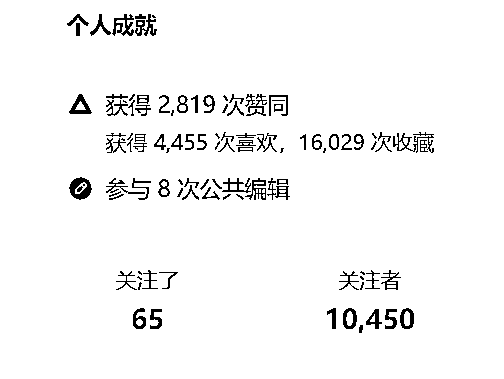

有了用户，产品就得跟上。课程前后打磨了无数次，价格也随阶段反复调整，最终定在980元——不算高，也不算低，刚刚好。后来我还专门建了闲鱼星球，除了最早期的一批用户没被邀请，后面报名的学员基本都进了星球。到现在，这个星球已经聚集了500多人。

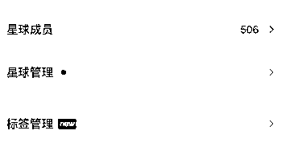

这里不算卖货的收益，光是IP端的知识付费，这个小小的闲鱼项目，就为张老板这个IP积累了数十万的收入。

走到这一步，我最大的体会有两点：第一，项目是有生命周期的，但IP可以穿越周期；第二，IP和项目之间是互相成就的。你踏踏实实做出结果，说话自然有分量，内容输出也会既接地气又不会枯竭，想把自己产品化，就会变得格外轻松。所以我也特别想对做项目的朋友说：IP一定要尽早同步做起来，越早开始，越能吃到长期商业化的复利。等机会来临时，你已经有足够的积累可以抓住它。

### 从个人作战到团队作战

通常来说，基于项目的IP路径走到前三个阶段，就已经很好了。持续深耕，完全可以把一个小项目做到百万体量。但我没有停在这里，而是往前走了一步，进入了第四阶段——把“带自己做项目”升级成“带别人做IP”，组建起一支闲鱼IP核心团队。不再是单打独斗，而是用团队去攻打一个细分赛道，目标是成为这个赛道的头部。

你可能也发现了，很多细分市场看着不大，实际规模远超想象。一个人的精力终究有限，能吃掉的市场份额就那么点。想要做大做强、吃到赛道最大的红利，就必须团队化作战。而且客户的需求五花八门，有人想做闲鱼，有人想做👸号，还有人想做📕，你一个人根本忙不过来。团队化，就能最大程度满足不同客户的需求，帮他们提供真正有价值的解决方案。

具体怎么做呢？在前面三阶段的积累中，很多学得好的老学员，已经拿到了非常不错的成绩。于是他们加入了IP合伙人计划，我们一起组建了闲鱼IP团队。这个团队要孵化一批独立的IP，每个人都能独当一面，同时又能互相协作，抱团取暖。我们会配备足够的实战陪跑老师，一对一陪着学员往前走，让他们在闲鱼项目上更大概率拿到结果。而我们能服务的学员数量，也一下子放大了许多。

更重要的是，当一部分学员跑通了赚钱闭环，他们也想像我们一样用IP放大收益时，我们已经有了完整的可复制的路径，能直接帮到他们。今年6月，我给核心团队定了一个小目标：一年100万。

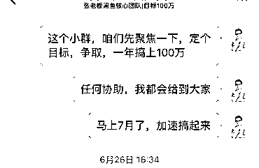

IP真的是有长期复利的。在闲鱼这个小赛道上，我们这群IP会越来越强，拿下更大的市场。我们不会因为项目利润变薄就离开，而是会持续扎下去，把项目从有利润到没利润的整个周期，完整吃到嘴里。

所以说，任何一个不起眼的小项目，任何一个看似窄小的细分领域，都有机会做到百万体量。没有不赚钱的项目，只有不赚钱的人。这四阶段的模式，对我们想做项目、想做IP，或者想左手项目右手IP、把一件事做深吃透的朋友来说，参考价值真的很大。

好了，以上就是我今天的全部分享。感谢你的阅读，希望能对你有启发。