# YouTube创作工具箱全览

## 写在前面

我是龙哥，第一次发长帖，大家多包涵。目前大三，计算机专业，没事就喜欢逛网站、试软件、刷资源，碰上AI工具更容易上头。

那天早晨还没完全睡醒，老彭的消息就来了。他对之前那条风向标挺感兴趣，问我里面有没有什么特别的门道。我迷迷糊糊回了句：“真没什么特别的。”结果聊着聊着，话题就跑到了YouTube工具合集上，老彭直接来了一句：“你做个大合集吧。”于是我就这么开启了两天的整理模式。

那两天翻了100多个网站，最终筛出30多个实用工具，整理到后面，我觉得自己都快被工具“腌入味”了。希望这份清单能实打实帮到你。要是你手里还有其他好用的YouTube工具，评论区别藏着，我们一起让它更完整。

这次按用途分：爆款选题挖掘、频道对标挖掘、关键词与SEO、频道分析、收益分析、内容创作、下载工具。先从常用的几个板块开讲。

## 一、挖爆款选题，先看这五个入口

### 01 piped

**piped**
这是开源的第三方YouTube客户端，它的Trending板块相当于一个干净的热榜窗口，没有广告插进来。想做内容的人可以把它当轻量级趋势雷达，快速感知平台正在流行什么。

传送门：https://piped.kavin.rocks/trending

几个典型用法：
- 随手刷当前热视频，找灵感或者判断观众注意力在哪里；
- 根据热门内容调整自己的视频主题，蹭上流量节奏；
- 看看同领域创作者哪些视频火了，研究他们的标题、标签和策略。

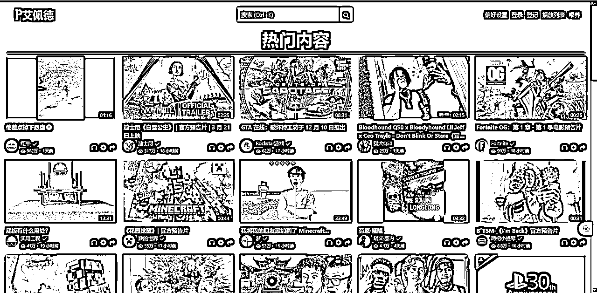

### 02 YewTube Trending

**YewTube Trending**
同样走开源和隐私友好路线，它把美国区的热榜单独放出来，而且观看过程无广告。对创作者来说，这块页面适合快速掌握美区内容风向。

访问：https://yewtu.be/feed/trending?type=Default&region=US

可以这样用：
- 直接看美国区当前热门视频，给创作找参考；
- 逐个拆解爆款标题、封面和内容结构，反推什么样的设计更抓人；
- 通过不同领域的热门内容，发现观众感兴趣的方向，再做系列规划。

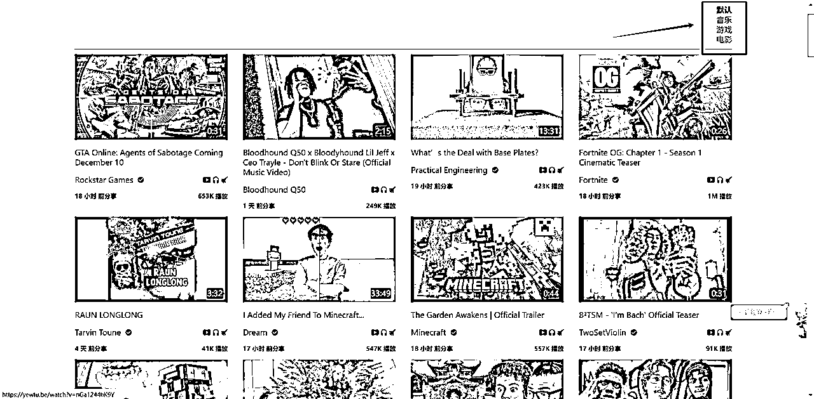

### 03 Tubefilter

**Tubefilter**
一个专注数字视频行业和内容创作者生态的媒体站，覆盖YouTube及其他社交平台的消息、分析和资源。适合想看行业变化、找成功案例、学变现方法的人。

链接：https://www.tubefilter.com/

常用方式：
- 第一时间跟踪YouTube算法调整、平台政策之类的大新闻；
- 从头部创作者的故事和趋势报道里找选题灵感；
- 学习广告、品牌合作、内容变现的新玩法；
- 偶尔还能发现新的创作者工具，提高制作和运营效率。

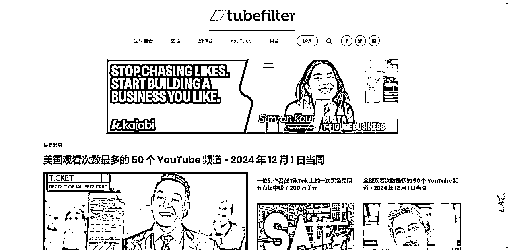

### 04 Exploding Topics

**Exploding Topics**
它的“Top YouTube Searches”页面会直接列出当下最火、涨得最快的YouTube搜索词和话题。想做SEO或者追热点，这里能给出很具体的方向。

入口：https://explodingtopics.com/blog/top-youtube-searches

作用到实战中：
- 围绕搜索量大的关键词拍内容，吸引精准观众；
- 把热门关键词塞进标题、简介和标签，提升搜索曝光；
- 抓住正在爆发的趋势，抢占早鸟流量；
- 对比不同品类的关键词，反推用户的搜索习惯；
- 拿关键词数据对标竞品，优化自己的内容打法。

出处：https://scys.com/articleDetail/xq_topic/2858454458255211

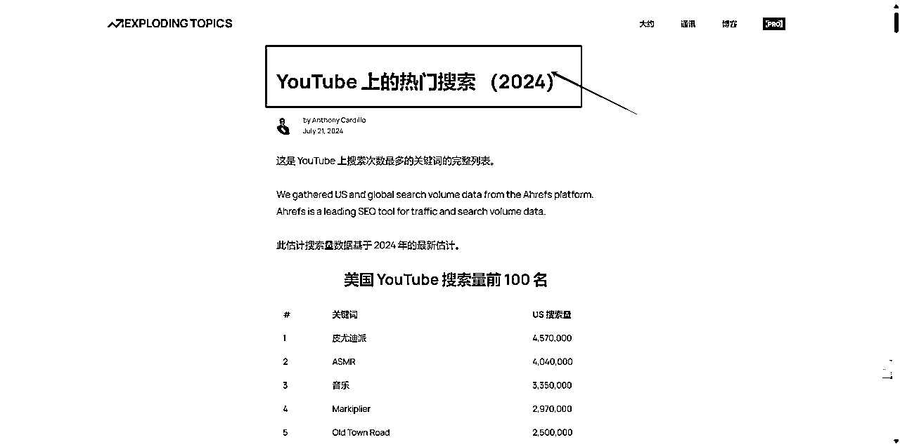

### 05 TASTYEUTTS

**TASTYEUTTS**
这个页面用CPM来排“2024年最能赚钱的15个YouTube赛道”，目前排在前三的是在线赚钱策略、数字营销和个人财务投资。选赛道这件事，基本决定了频道的成长空间，也会直接影响受众构成和品牌合作资源。当然，能赚多少不是单一因素决定的，还跟变现方式、粉丝活跃度、内容质量和视频长度有关。

直达：https://www.tastyedits.com/most-profitable-youtube-niches/

出处：https://scys.com/articleDetail/xq_topic/2858454458255211

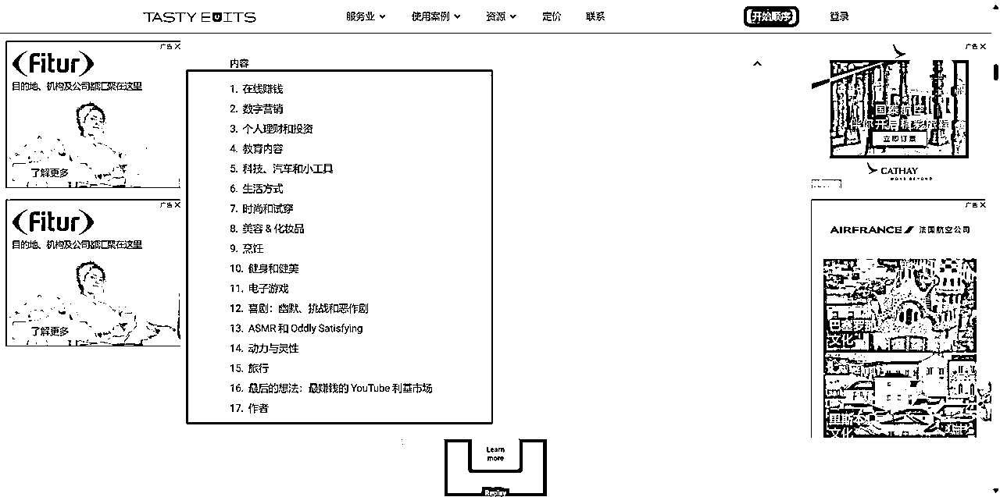

## 二、锁定对标频道，从这些平台开始

### 01 FindAChannel

**FindAChannel**
好评度：⭐⭐⭐⭐⭐
属性：YouTube频道发现、网红营销、SEO工具、创作者资源
入口：https://www.findachannel.net/

它收录了超过198,000个YouTube频道，订阅数、视频总量、总播放量都能查，还能对频道的潜在收入做估算。另外内置了不少SEO小工具，像频道创意生成器、视频标题生成器、4000小时观看时长计算器，都是冲着帮创作者提升曝光去的。

实际用起来：
- 找潜在合作方或竞争对手，摸清某个细分赛道的真实水平；
- 用SEO工具优化自己的频道内容，让账号更容易被看到；
- 靠网红搜索功能找到适合推广产品/服务的影响者，让合作落地。

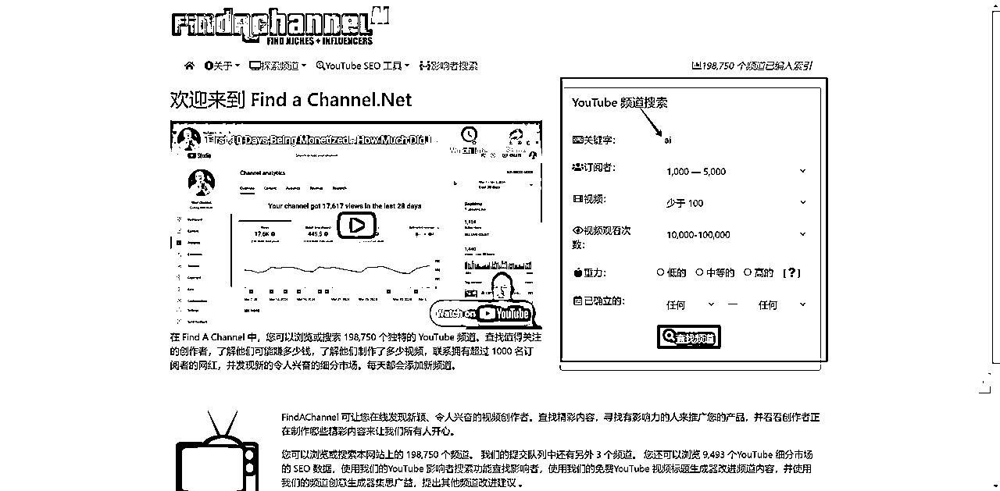

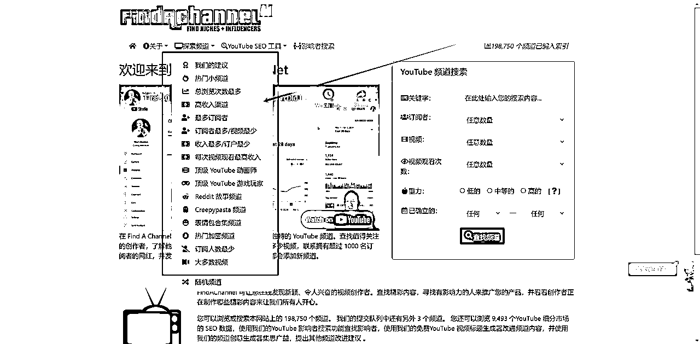

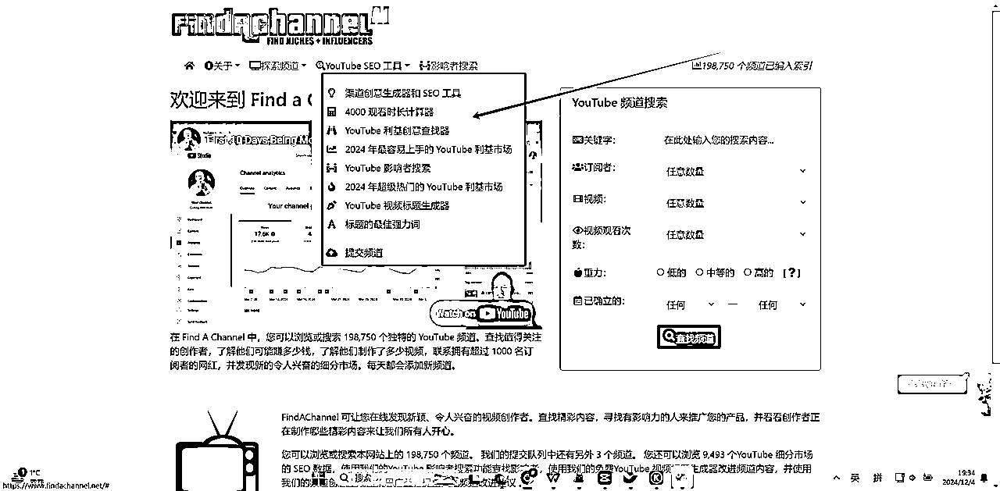

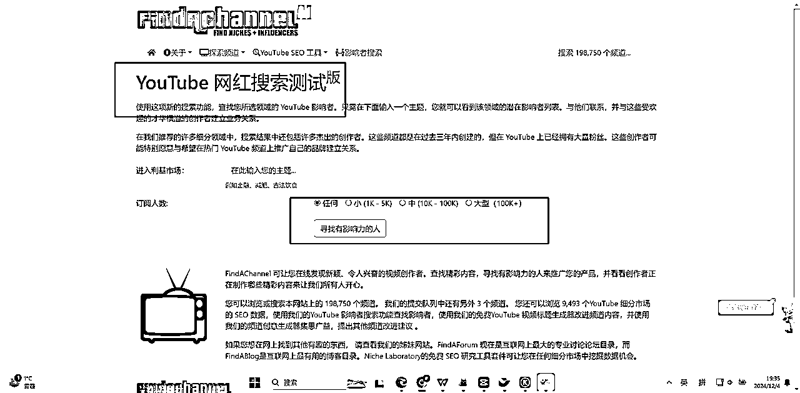

### 02 SimilarChannels

**SimilarChannels**
主打“相似频道推荐”。输入一个频道，它会帮你找出内容风格接近的其他频道，适合做横向对比和扩展关注列表。

访问：https://similarchannels.com/

常见用法：
- 研究竞争对手或合作关系；
- 找到和自己兴趣、业务方向一致的频道，获取灵感或谈互推。

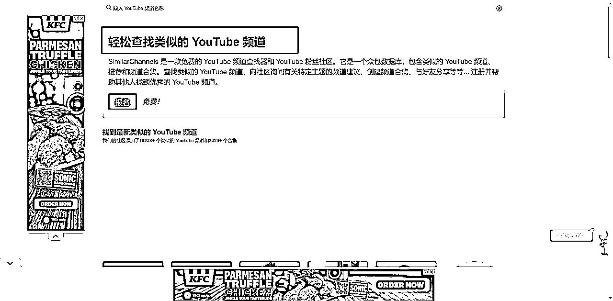

### 03 Favoree

**Favoree**
这里可以按主题、类型、情绪、评分、平均视频长度等条件筛选频道，还能打分和写评论。它就像一个由观众共同维护的频道推荐社区。

链接：https://www.favoree.io/

怎么用：
- 按具体需求发现新频道，寻找合作或竞争参照；
- 看别人的评价和评分，快速判断一个频道值不值得关注；
- 分享自己的观看体验，帮其他人做筛选。

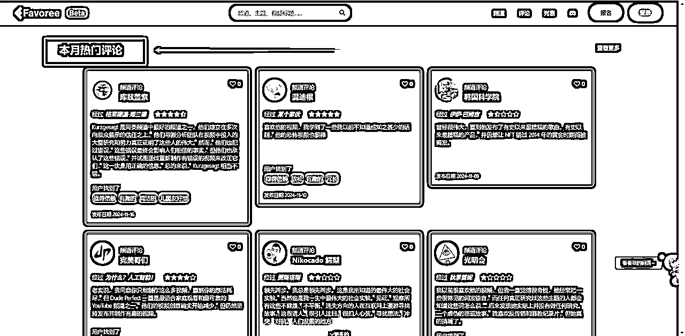

### 04 YouTubeLearn

**YouTubeLearn**
面向YouTube创作者的集散式学习平台，视频创作、频道运营、营销策略都有教程。想系统提升内容能力和收入水平，可以从这里找路径。

传送门：https://youtubelearn.softr.app/

典型用途：
- 学剪辑、拍摄、布光、音效等制作硬技能；
- 搞懂选题方向、SEO优化和观众互动方法；
- 掌握广告收益、品牌合作、推广变现的手段；
- 新手上路阶段，用它可以快速搭起自己的内容体系；
- 也能用来找学习/教育类目的对标账号。

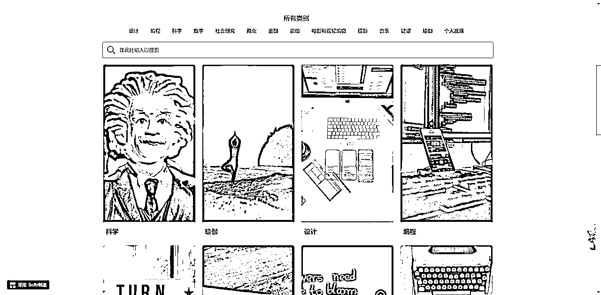

### 05 EduTube

**EduTube**
把优质教育类视频聚合到一起的站点，内容覆盖数学、计算机科学、神经科学等学科。想自学某个领域，又不想在找资源上耗时间，可以来这里。

直达：https://www.edutube.app/

适合谁：
- 想自学新技能的创作者；
- 需要垂直领域知识输入的人；
- 想把学习效率拉满、减少筛选成本的人。

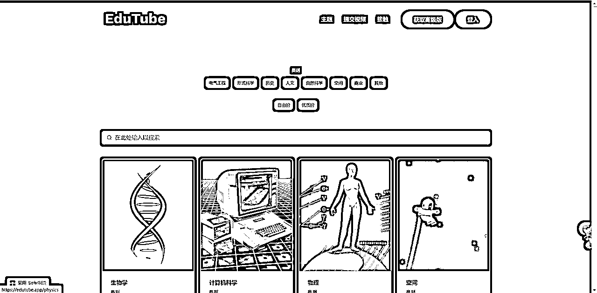

## 三、做关键词与SEO，这些工具别错过

### 01 TubeBuddy

**TubeBuddy**
专门为YouTube创作者做的浏览器插件/移动应用，相当于给频道配了一个管理后台。它最核心的是关键词浏览器，能看搜索量、竞争程度和相关性，帮你把标题、描述、标签一并优化到位。同时还支持批量修改视频元数据、批量加卡片和片尾，能省下大把重复劳动。竞品研究方面，也能直接看对手的标签、描述和绩效。

扩展页：https://chromewebstore.google.com/detail/tubebuddy-for-youtube/mhkhmbddkmdggbhaaaodilponhnccicb?hl=en-US

适合数据驱动型创作者，用来找出高表现视频的共性，再复制成功模式，把频道影响力和收益往上推。

同类参考：https://vidiq.com/

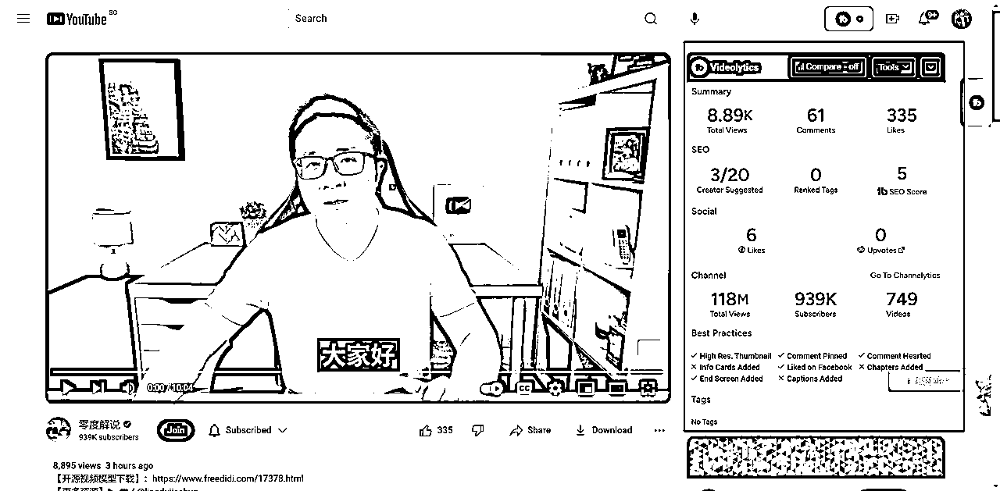

### 02 Google Trends

**Google Trends**
谷歌出的免费趋势分析工具，能看某个词在全球或本地的热度变化。用它来指导YouTube选题和标题优化，效率会高很多。

入口：https://trends.google.com/trends/

常见玩法：
- 查当前流行话题，顺势产出视频；
- 找YouTube上热度高的搜索词，做标题和标签优化；
- 判断目标观众的兴趣偏好，调整内容方向；
- 看同行或相关领域的热度走势，决定自己要不要跟进；
- 追踪某类话题的长期热度，预判接下来的内容机会。

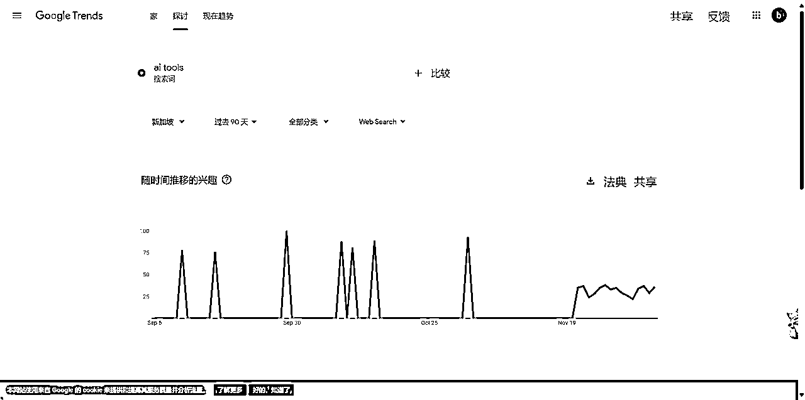

### 03 Answer The Public

**Answer The Public**
基于搜索引擎的“问题发现”工具，会把人们反复搜索的问题和短语可视化地列出来。用它来挖掘观众真正关心什么，比凭空想选题靠谱得多。

地址：https://answerthepublic.com/

可用的方向：
- 找出观众的高频疑问，做针对性解答型内容；
- 选常见问题里的关键词，优化标题、描述、标签；
- 按搜索意图规划系列视频，把目标受众一步步养起来；
- 看竞品在哪些关键词上表现好，再打造自己的差异点；
- 把自己变成答疑型创作者，评论区自然会活跃，粉丝也会更留得住。

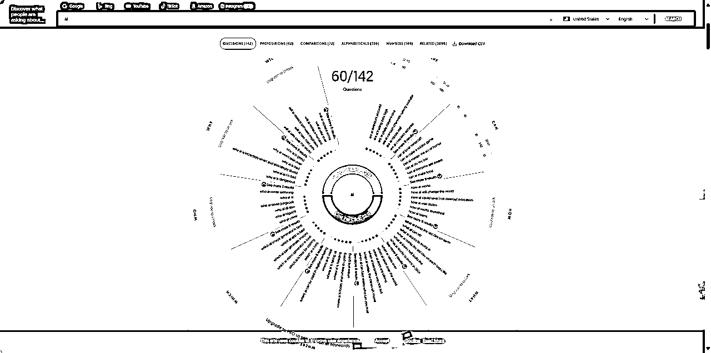

### 04 Keyword Tool

**Keyword Tool**
利用Google Autocomplete生成关键词建议，免费版每个词最多能拉出750个长尾词，而且不用注册。支持192个Google域名和83种语言，面向全球内容创作者都很够用。

访问：https://keywordtool.io/

适合用来做SEO内容：把流行搜索词自然嵌入文章，提升在Google搜索结果里的排名。同时它也覆盖YouTube、Bing、Amazon等平台，想跨平台优化关键词，这一个工具就能打通。

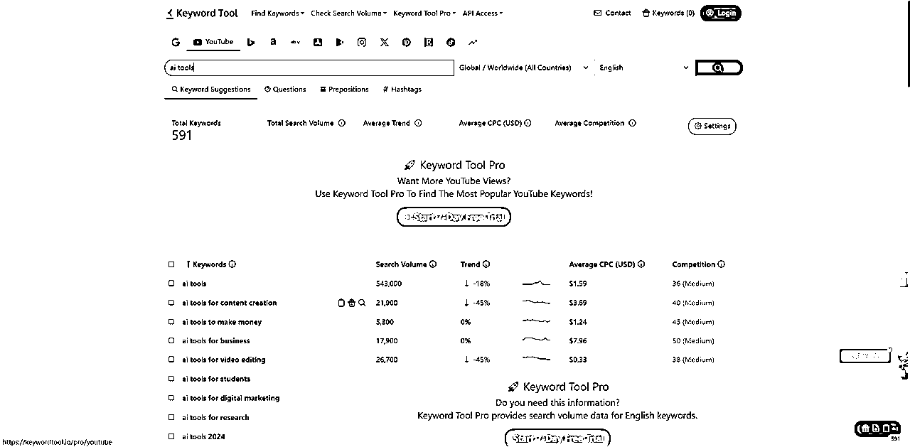

## 四、频道数据诊断，这几款够用

### 01 ViewStats

**ViewStats**
把频道的观看统计、观众来源、视频表现和趋势都摊开给你看，适合从数据里找优化方向，提升互动和涨粉速度。

直达：https://www.viewstats.com/

实战场景：
- 查单个视频的观看、互动、观看时长，反推内容怎么调整；
- 盯频道的增长曲线和订阅变化，制定阶段性计划；
- 了解观众地域、性别、年龄，做更精准的定位；
- 对比竞品的视频表现和走势，找到自己的差距；
- 根据数据改标题、标签和描述，提高搜索曝光和互动率。

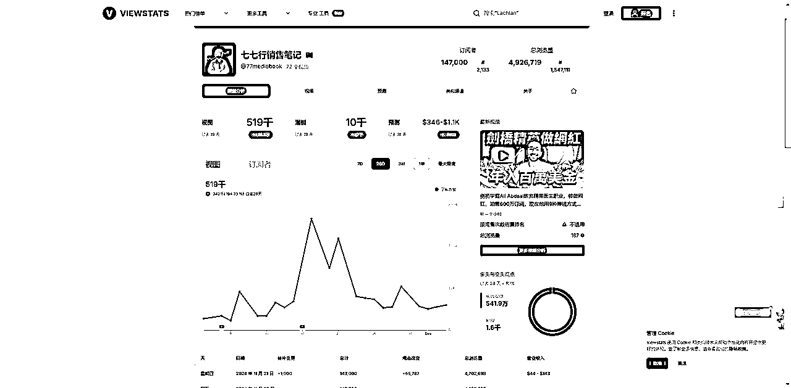

### 02 YouTube Studio

**YouTube Studio**
YouTube官方给创作者配的总控台，视频发布、数据查看、收入跟踪、频道装修都能在这里完成。想系统经营频道，这是绕不开的阵地。

入口：https://studio.youtube.com/channel/UC_P-cci1HhXL7eh309FEKfQ

常用操作：
- 上传/删除/编辑视频，顺手完善分类、标签和简介；
- 把观看时长、流量从哪来、用户怎么互动、观众怎么反馈都看清楚；
- 跟踪广告及其他收入来源，优化变现模式；
- 调整频道设置和缩略图，保持主页视觉统一；
- 管理评论区，回复粉丝留言，维持社区活跃度。

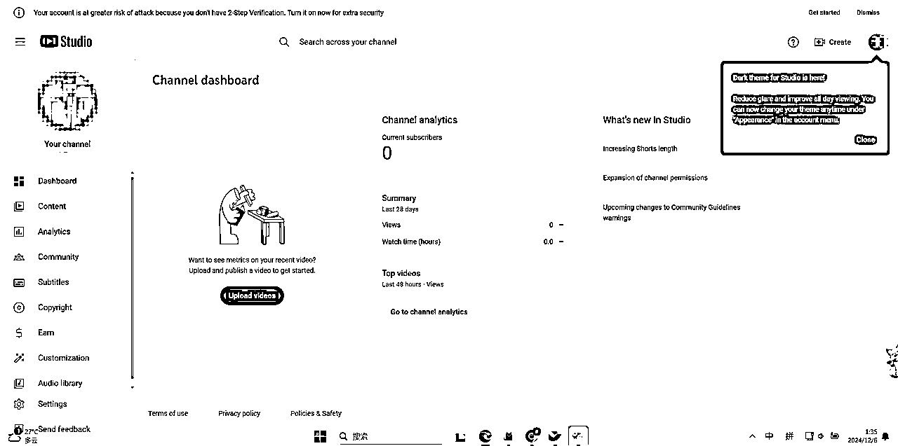

### 03 NoxInfluencer

**NoxInfluencer**
定位海外网红营销和KOL数据分析，也覆盖社交媒体推广与跨境电商场景。

直达：https://cn.noxinfluencer.com/

很多做内容的朋友都遇到过这种困境：想找同类账号不知道从哪里入手，看别人赚了多少没头绪，配乐封面素材东拼西凑还怕踩版权坑。这篇文章把从找网红、查收益、做视觉、找配乐到抓素材的整套站点串了一遍，每一样都标了去处和用法，建议先收藏再慢慢试。

先从最前面的环节说起：怎么把目标网红和竞品账号看透。

NoxInfluencer 能横跨油管、Ins 这些平台做数据扫描。你想对某个网红或频道做背景调查，它能摆出订阅规模、播放体量、综合声量以及粉丝活跃程度，合作前用来评估对方值不值得投，或者判断自己的内容在同类账号里处在什么位置。

几个典型的操作路径：想做品牌投放，就先用它圈定一批垂类账号，横向比声量、看粉丝画像，找出最匹配的人选；想知道同行怎么玩，可以扒对手频道结构和内容套路，顺着数据看行业风向；想优化自己的片子，就盯着完播率、观众来自哪些地区这类指标，反推选题和剪辑方向；发布环节也能用数据说话，把标题怎么拟、标签怎么挂、什么时候更新都做一轮对照测试，让播放和互动往上走。

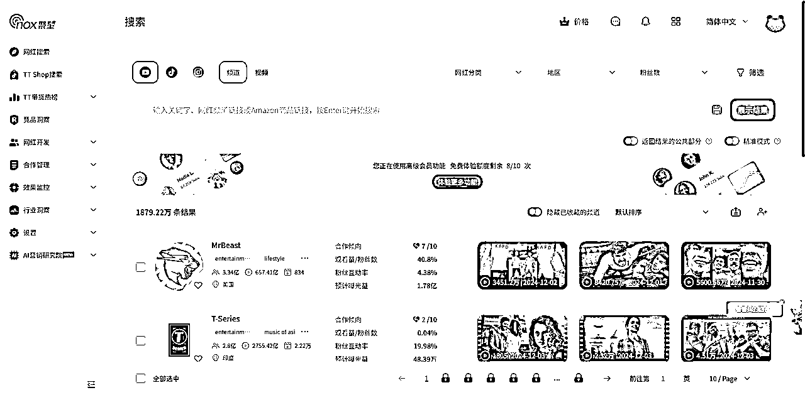

接下来进入收益侧，看看一个账号到底能变现多少。

Social Blade
链接：https://socialblade.com/

这是一家老牌数据站，覆盖面从油管延伸到 Twitch、Instagram。打开任何账号，都能看到订阅曲线、总播放时长的走势，还能看到收入预估区间。用它做横向对比特别好用：把自己的账号和同类目对手摆在一起，差距和机会一目了然。

实际怎么用？比如你每隔一段时间记录自己的涨粉数据和单条内容收入，来判断内容思路是否奏效；或者去拆解竞品的涨粉节点，找出它的爆款规律；再比如你想对自己的账号值多少钱心里有数，就看它的收入区间，做规划时多一个参照；翻不同账号的数据曲线，也能看出哪类内容在持续吸量。顺带提醒：访问它时别用太脏的代理节点，否则可能被对方拦在门外。

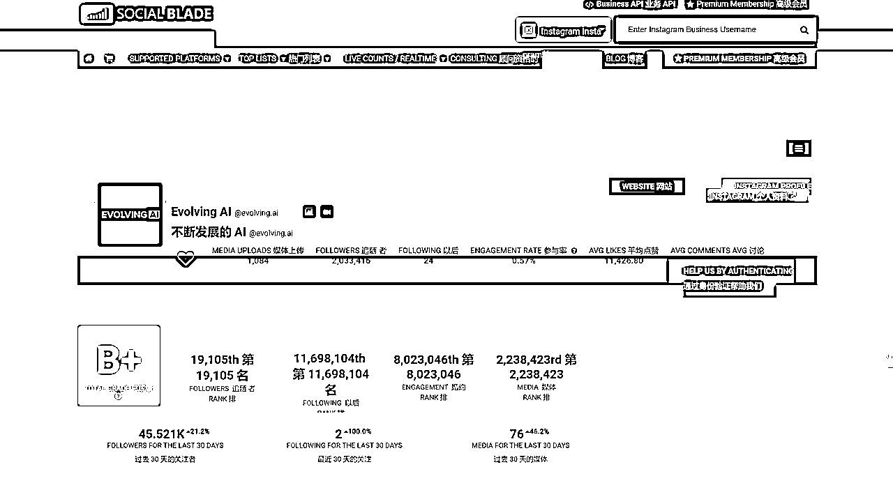

YouTube Monetization Checker
链接：https://ytlarge.com/youtube/monetization-checker/

想知道某个账号有没有开变现、能有多少进账，用它查一下就行。输入链接，它会告诉你这条内容挂没挂广告，顺带把订阅体量、播放次数、账号真伪这些背景信息一并列出来，最后再给一个收入区间的参考。对刚入场的新人来说，用它判断自己的号离变现门槛还差多远最直接；也可以拿它去查竞品账号的盈利情况，帮自己做市场判断。

信息出处：https://scys.com/articleDetail/xq_topic/1525488448514852

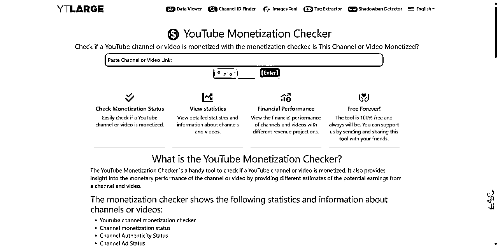

Check Monetization
链接：https://chromewebstore.google.com/detail/check-monetization/hcpbkgmihdmgecabghhddmppipjnkdje

如果嫌一个个贴链接麻烦，这个插件更省事。装上之后，在油管页面里就能直接看到当前账号的变现开关状态。什么时候该关心它？新视频发出去，不确定是不是真的挂上了广告，瞄一眼就明白；多账号运营的人，可以实时盯每个账号的收益波动；内容没能正常变现时，也能第一时间发现，及时排查原因。省掉来回切后台的时间，效率明显更高。

信息出处：刀姐牛马项目调研工具

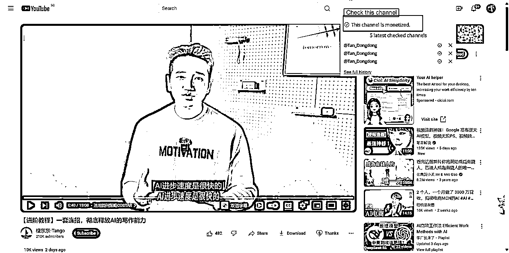

YTLarge
链接：https://ytlarge.com/

这个站点像一个综合工具箱，里面有一项很实用的功能：输入任意油管链接，能查出对方是否开通了变现。除此之外，还能拉出内容精确到秒的发布时间、基础数据、所属分类、挂的标签、封面小样、变现状态和收益预估，连同账号 ID、简介以及头像资料都逃不过。做竞品调研时等于多了一双透视眼。

信息出处：https://scys.com/articleDetail/xq_topic/4848514514558288

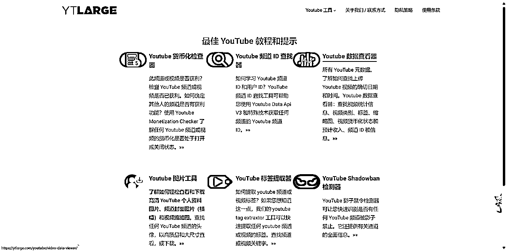

内容制作环节，先从封面开始。

Canva
链接：https://www.canva.cn/

做封面、做推广图、做视频里的花字素材，Canva 基本能一站式搞定。模板库很庞大，即使没有设计基础，拖拖拽拽也能排出挺专业的画面。它的用处不限于封面：社交平台上的推广横幅可以用它做；账号的 Logo、配色、字体也能用它统一起来，让品牌感更突出；视频剪辑时想配上字幕、转场、小动效，它也能顶上；做图表、插画背景这类画面元素同样在行。有消息说它的付费会员在二手交易平台上能以极低价格入手，预算有限的话可以留意。

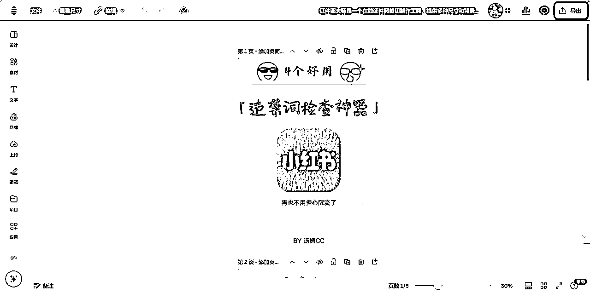

Ostendo
链接：https://chromewebstore.google.com/detail/ostendo-%...

抓图利器，装进 Chrome 之后，看到什么就截什么，还带基础的标注和编辑能力。用它可以快速存下别人的封面，然后放大一点点拆解构图、配色和文字排布，从中找灵感；做教程演示操作步骤时，用它截图配说明也很方便。

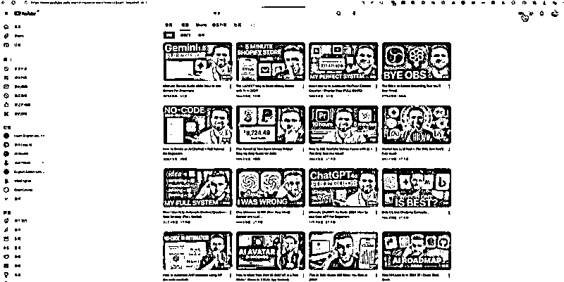

配乐这一块，用好下面两个库基本就不愁了。

TuneTank
链接：https://tunetank.com/

曲库更新勤快，质量在同类站点里算相当能打。所有曲子都带着正规授权，放进片子不用担心被版权方找麻烦。选配乐时按情绪、风格、时长筛一遍就行；品牌宣传片想要更有质感的音轨，也能在这里淘到；教育类、解说类内容适合轻松耐听的调子，它的分类标签能帮你快速锁定。简单说，配乐这件事交给它，放心。

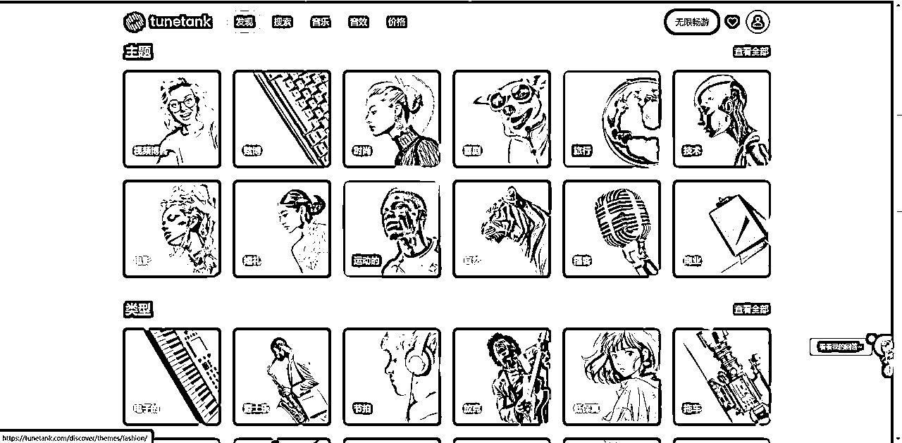

NCS
链接：https://ncs.io/

电子乐爱好者的福利站，曲风偏燃、偏动感，适合游戏录屏、混剪、卡点视频这类画面感强的内容。所有曲子都能免费拿来做视频用，包括直播场景，几乎不设限制。做短片发到抖音、Ins上，也可以直接从它的曲库里挑。

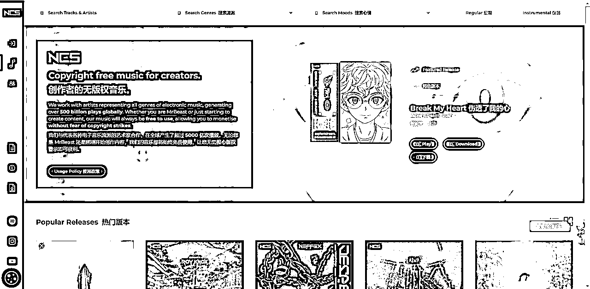

同类还有这几个站点可以逛：
https://www.chosic.com/free-music/all/
https://stocktune.com/
如果以上曲库都找不到合适的，也可以直接用 Suno 这类 AI 生成配乐。

图片和视频素材也有对应的零成本图库——

Pexels
链接：https://www.pexels.com/zh-cn/

图库里有大量风景、人像、科技类素材，照片和视频都能商用无压力。视频开场的空镜，可以用它找；封面的底图，可以用它挑；发在 Ins、Twitter 上的宣传物料，也能从这里抓图。关键是授权干净、不用署名，用起来没有后顾之忧。

Pixabay
链接：https://pixabay.com/

和上一个类似，但内容形态更丰富：除了照片和视频，还有插画和矢量素材。拿来补画面细节层次很顺手，想要一张有质感的封面也能在这里找到合适的。做多渠道分发时，需要配不同尺寸的推广图，它的素材库也足够撑起来。

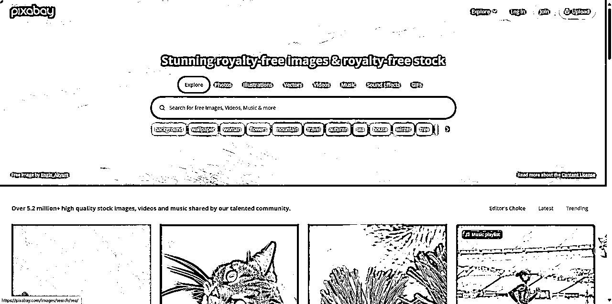

同类型站点还有：
https://free-stock.video/
https://stockcake.com/
要是找不到合适的画面，也可以借助生成式 AI 直接画素材。

最后说两个很实用的视频保存工具。

Y2mate
链接：https://www.y2mate.com/en949

在线就能把视频抓下来，支持油管、脸书、Vimeo、优酷这些站点，能存成 MP4 或 MP3。把链接贴进去，选好清晰度就能保存，速度也不慢，还不限次数、不用注册。有人专门靠帮人存视频赚服务费，对刚入门的玩家来说，用它拿参考片做拆解再合适不过。它的站内搜索还会自动补全相近词条，体验和油管搜索几乎一样。

同类站点：
https://save4k.su/
https://en.loader.to/4/
https://notube.net/en/youtube-app-46

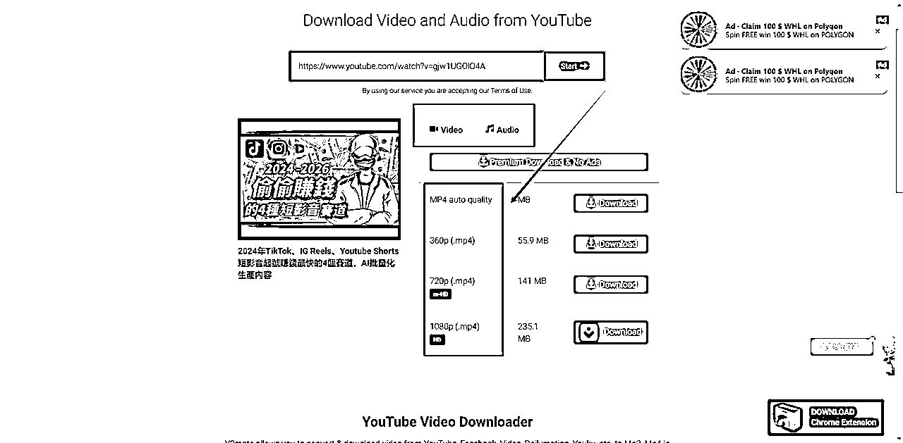

downsub
链接：https://downsub.com/

专门解决一个问题：把油管视频里的字幕文件提取出来。想给视频做翻译、做字幕参考，或者整理竞品内容的文案逐字稿，用它就很顺手。

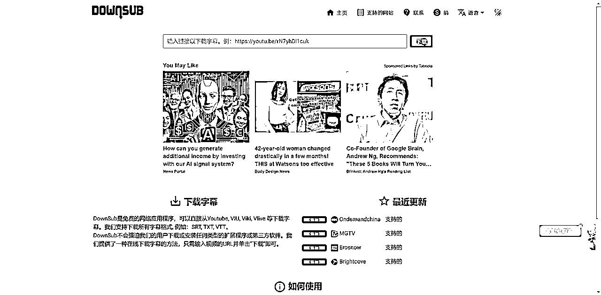