# 一条视频，可能救活一家店：我把十几年的网络营销经验全盘托出

问你个问题：如果你开了一家店，产品不错、地段也行，但就是没什么客人进门，你会怎么办？

换以前，答案无非是发传单、搞促销、等商圈自然流量。但现在，很多人已经靠短视频把生意重新做了一遍。

这篇文章，不是教你什么“三天起号”“一夜爆粉”的魔法。它是把我这些年踩过的坑、验证过的路、想明白的事，扎扎实实梳理了一遍。不管你是传统生意的老板，还是刚入行的运营，又或者是打算自己创业的人，只要你跟线上的生意沾边，这篇内容就值得你花点时间看完。

我把它分成三个层次：

先讲讲我自己从线下门店折腾到线上引流的真实经历；再聊聊那些普遍存在的、听起来像常识却害了不少人的认知偏差；最后说说我对互联网这件事情的底层理解，以及它在你生意里到底站在什么位置。

---

## 一、一次“顺手回答”，让我见识了线上的威力

时间拉回十年前。

那时候我在山西一家内衣连锁企业做市场负责人，主管运营。有一天闲着没事，在百度知道上搜我们品牌名字，看到一个提问：怎么加盟这家内衣品牌？我顺手答了两句，留了个联系方式——那时候平台还没那么多限制。

结果令我很意外：接下来几天，陆续有人打电话来咨询加盟。

我从这里得到启发，开始琢磨搜索引擎到底怎么把内容呈现给用户。搞明白规则以后，我自己注册了多个账号，互相配合着提问、回答，把品牌相关的关键词铺开。那会儿同行绝大部分人还根本不知道网上可以做文章，我算是抢了个先。

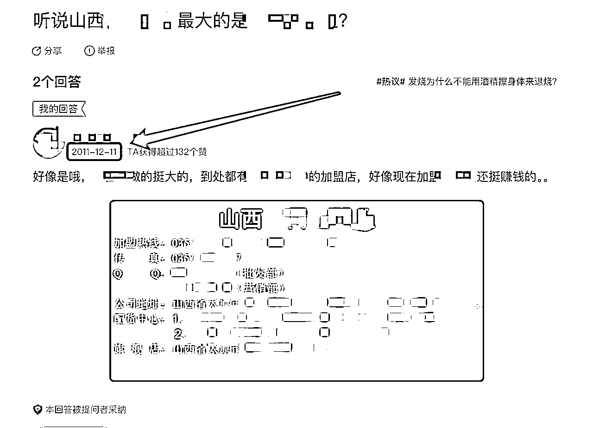

当时在网上铺的这些内容，现在看挺粗糙，但也见证了自己最早的一波尝试。

后面的事情发展得很顺：加盟店陆续开出来，速度越来越快，最猛的时候一年能新增三十多家。我记得有一年，整体业绩比上一年涨了近七成，而市场费用大约只有同行的十分之一。很快，品牌在本地内衣市场站住了脚，很多客户不用发愁去哪里找，自己就找过来了。

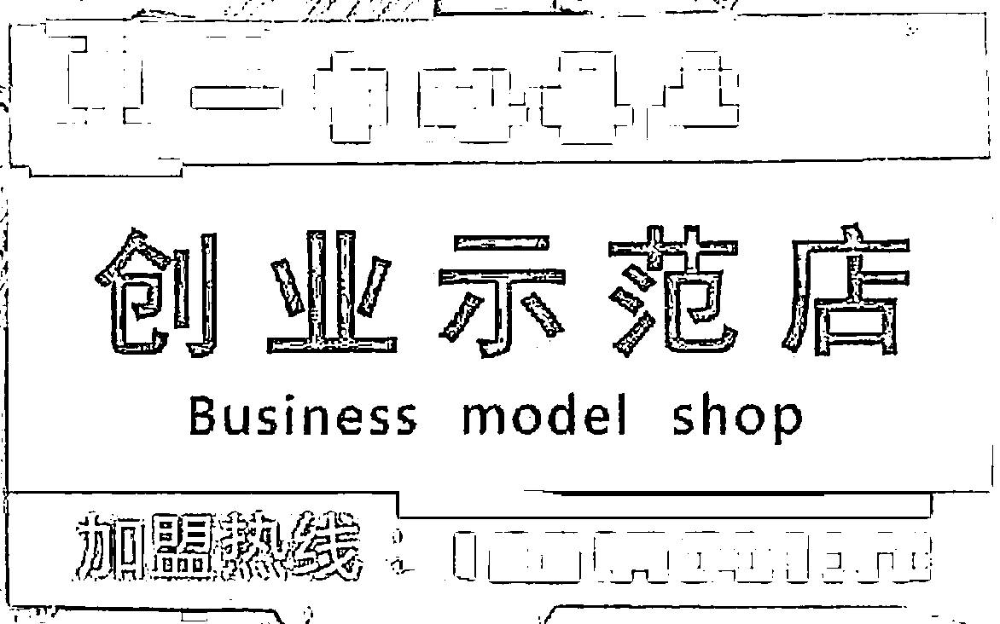

有个小策略我印象很深：我们不叫加盟店，叫“示范店”。店主觉得有面子，愿意把标牌挂在显眼位置；我们得到了免费宣传，两边都舒服。

从那时候起，我开始认真关注“视频”这种内容形态。当时主流平台还是优酷、酷6那些老牌网站。我用DV拍了条片子，用会声会影剪完发上去，后来又陆续拍了差不多五集，都是讲内衣店怎么选址、怎么陈列、怎么做活动，每一集里都夹带点“品牌推荐”的私货。效果出奇地好。

那段经历让我确信了一个判断：网络营销的核心逻辑，到今天并没有变化。我把它总结成一条链路：

**明确业务目标，设计对应的搜索词 → 创作有引导力的内容，把关键词自然埋进去 → 把内容投放到流量集中的平台 → 依靠平台的匹配机制触达目标人群 → 把流量接下来，完成成交**

对比一下，从当年的百度到今天的抖音，变的只是平台和载体；不变的，是这条流水线的逻辑。系统自动打标签、个性化推荐这些功能，本质上只是把路修得更宽了。

---

## 二、七年互联网从业路，我看到了两种常见偏差

在传统生意里尝到甜头后，我一度过得挺顺。但后来经历了一些个人生活上的冲击，也意识到自己需要换个节奏。于是在2015年，我放下原有的一切，彻底转行，扎进了互联网行业。

这一扎就是七年。我做过一线业务岗，后来做到运营经理，再后来做到产品总监。待过上市公司、区域头部企业、创业型小团队。也是从那时候开始，我对互联网的认识逐渐完整。但和大量传统行业老板打交道的过程中，我也观察到两种很普遍的认知偏差，值得说一说。

**偏差一：我是做实体的，互联网跟我没关系**

我当年从互联网公司出来以后，曾经拿着一个完整的线上分销方案，回头去找之前服务过的那家内衣公司。对方面对这份方案的态度很平淡，毕竟那时候微商城刚刚兴起。老板的原话是：我们是传统生意，搞不了这个。

两年以后，这家公司主动找到我，想把当年那个方案重新捡起来。但风口已经过去了，我没有接。现在这家公司自己也做起了直播、拍起了短视频，做得还挺起劲。

这件事让我明白一个道理：互联网根本不是哪个行业专属的东西，它是这个时代所有行业都要使用的基础设施。不存在“互联网行业”和“传统行业”的清晰边界，只存在“跟上时代的”和“被时代落下的”。

你看看那些例子：苏宁做了线上商城，和京东有多大区别？京东自己搞了物流体系，和顺丰有什么本质不同？邮政现在都在直播间里卖货了，你还能说它是纯粹的物流公司吗？边界越来越模糊了，因为底层都是同一套效率工具在支撑。

**偏差二：互联网等于赚快钱**

这些年我见过太多传统行业的老板，抱着“只要轻轻一点就能财源滚滚”的幻想一头扎进互联网，最后亏得血本无归。我所在的山西，很多煤老板转行做互联网，结果并不好。有句玩笑话，说他们“从流氓变成了文盲”，话虽刻薄，道理却不假。

这种幻想哪来的？一方面是对互联网不了解，另一方面是网上充斥着大量刻意渲染一夜暴富的内容，让很多人误以为“上了网就等于捡钱”。

到今天，这个幻觉也没消失。依然有人以为学会剪辑、开了直播就能坐等钱进账，于是不停地买课、追风口，成了别人的韭菜。

我想说的是：互联网本身不生产财富，财富来自你把生意做成了一套**能持续运转的系统**。互联网只是这个系统的管道之一，它的作用是加速流通、降低摩擦，而不是无中生有地变出钱来。那些真正赚钱的人，不是靠某个平台或某个技巧，而是靠把产品、内容、流量、服务一系列环节组合起来，才把生意做成了一门持续盈利的事。

所以面对互联网，正确的姿势不是扑上去赌一把，而是平和地把它当成工具箱里的新家伙什，踏踏实实地用起来，让它帮你把现有的事做得更快、更省、更好。

---

## 三、把互联网装进生意里，而不是把生意丢进互联网

说了这么多，我想把结论摆到桌面上：

**互联网的本质不是风口，不是赛道，也不是财富密码，而是一件提高效率的工具。**

它之所以能改变那么多行业，不是因为它让事情变成了另一件事，而是因为同样一件事，由它来做，更快、更省、覆盖面更广、灵活度更高。

但要注意，工具永远是依附于系统的。你首先得有一个“能赚钱的生意系统”，这个工具才有发挥的地方。

拿服装零售举个例子，一个正常的生意系统至少要有四个环节：

*   商品货源——你得有东西可卖；
*   展示阵地——你得有地方让人看见；
*   销售能力——你得有人能把东西讲明白、把交易完成；
*   客户来源——你得知道客人在哪、怎么让人来。

这四个环节缺一个，剩下三个都会失去意义。有货没地方放，等于白进货；装修得再漂亮没有货摆，没人进店；销售再厉害没店可待，也留不住人；商圈人流再大，人家进不了你的门，等于没有客流。

把四个环节串到一起，一台能赚钱的机器才算完整。

那么互联网这个工具，是怎么给这台机器提速的？我们再拿服装店做一个对比：

传统开法，你得租铺子、搞装修、招店员、等自然客流。启动资金几十万，筹备周期少说三个月，而且客源被锁定在门店周边，遇上修路、天气不好、商场活动冲突，生意就可能受影响。

而用短视频平台来搭这套系统，货源可以从精选联盟拿，不需要囤货；展示靠视频内容完成，只需支付样品和拍摄成本；销售由视频里的口播来承接；客源则由算法推荐来供给。同样一套体系，启动资金被压缩到原来的十分之一左右，筹备时间缩短到一周上下，流量池却从商圈扩大到全国。

差距是不是很直观？互联网工具真正的价值，就是让开店的成本大幅下降、试错的代价大幅降低，同时让可能性大幅上升。

但有一点必须说透：

**所有工具、技巧、方法，只有在“系统”里才有意义。**

如果你现在的生意本身还是一团乱麻，或者你连一套基本的商业闭环都没想清楚，就去追求某个涨粉技巧、某个爆款公式、某个“老师”的独门秘籍，那得到的只会是一堆漂亮的碎片。它们拼不成一艘能下水的船，只会让你在茫茫大海上漂得更远。

这就是为什么很多项目明明资源不差，最后却什么也没做出来。根子不在技巧不够多，而是底层的“系统”没搭起来，看得见的问题太多，看不见的根基没人管。

---

## 四、写在末尾

写到这里，其实也是我给自己的一段清算。

这几年，我经历了家庭的变动，也经历了很长一段独处的日子。有一阵子状态很差，整个人几乎在家里躺了两个月，身体无法支撑，精神也接近谷底。那段时间我做不了什么，每天都待在床上，唯一能做的，就是把过去的路翻来覆去地想。

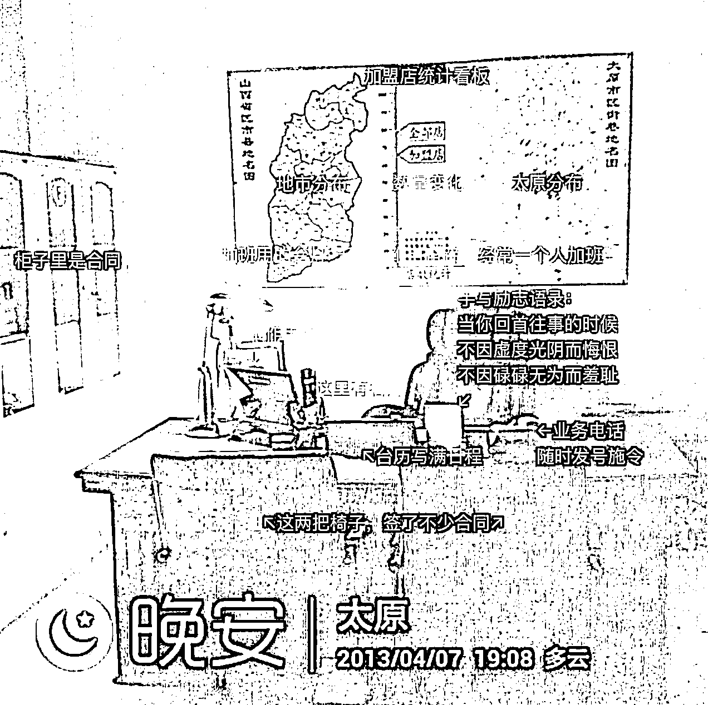

那时候的工作记录，回头看看，一个人最需要的不是外部认可，而是自己想明白自己要做什么。

也是在那些夜里，我把这些年的经历、经验、失败和复盘，一页一页地在脑海里重写了一遍。写下来的初衷很简单：也许某个正在观望的传统老板，正在犹豫要不要动手做短视频；也许某个运营新人，正被各路“经验帖”搞得晕头转向；也许某个准备创业的朋友，正站在岔路口不知往哪走。如果这些文字能成为他们手里的一张地图，哪怕只有一小段路能用上，我就觉得特别值。

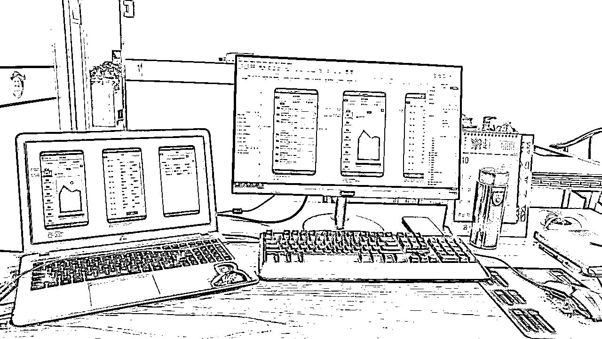

当时做产品原型时的笔记。设计功能架构这件事，本质上还是在梳理业务逻辑，只是多了一层技术外壳。

那些日子拍的片子，记录了我的另一种状态。

短视频这条路，真的没有捷径可走。它不是什么风口上的猪，它更像是一个显微镜，把你的产品、你的内容、你的服务水平、你对用户的理解，全部拉到阳光下照个遍。你用心，它放大的就是你的用心；你敷衍，它也会毫不犹豫地把你的敷衍展示给别人看。

如果你愿意，下一次我们可以具体聊一聊，一个传统生意从零开始入局短视频，第一步到底该做哪几件事。先把认知的底子打牢，再谈动手，才不会白费力气。

希望这篇长文，能成为你路上的一盏小灯。我们下一回再见。

先说我身上发生过的一段真事。

腰椎曲度消失、椎板撕脱性骨折、椎管狭窄、坐骨神经被卡压。那阵子，我几乎成了一个废人。下床是奢望，躺平是折磨，连吃饭都得趴在床沿上。怎么能疼成那样呢？就像有人把我的腿筋活生生抽走了。好不容易治到能下地，走路又成了瘸的，前前后后又练了一年，才算回到正常人的状态。现在提起那场病，骨头缝里还直冒凉气。

说这些不是卖惨，是想拿自己给大家提个醒：奋斗可以，但千万别拿身体去换。命都没了半条，谈什么以后？

后来，是我最好的朋友张集慧，硬把我从泥坑里拽了出来。他那段时间一直陪着我、开导我，让我慢慢想通了一件事：母亲病重那些年，我身上像拴着一根看不见的铁链，天天守着病床、四处张罗治疗费。她走了，链子也就断了。我不必再把自己关在病房和账单里，时间和精力第一次完全属于我自己。终于可以不用顾虑什么，去做点以前想都不敢想的事了。

就在那种状态下，我一边养身体，一边跟着张集慧学短视频带货。

我记得特别清楚，第一次赚钱是2400块，那天是2022年2月13日。那一笔钱让我彻底清醒过来：短视频这东西，是互联网给普通人的一个新入口，甚至是翻身的机会。我再没犹豫，干脆全职干起了这行。也是那年，张集慧把我带进了生财有术。刚进去那会儿，我就是个最不起眼的小透明，不发言、不写帖，偶尔翻翻别人的帖子，然后闷头搞自己的项目。

必须承认，那个圈子确实不一样，信息密度和实战价值都极高。靠着里面的信息，我专注做中医养生赛道，实操了一年，赚到了短视频带货的第一桶金。但比钱更值钱的，是这一年攒下来的经验、手感，还有一套自己跑通的方法论。

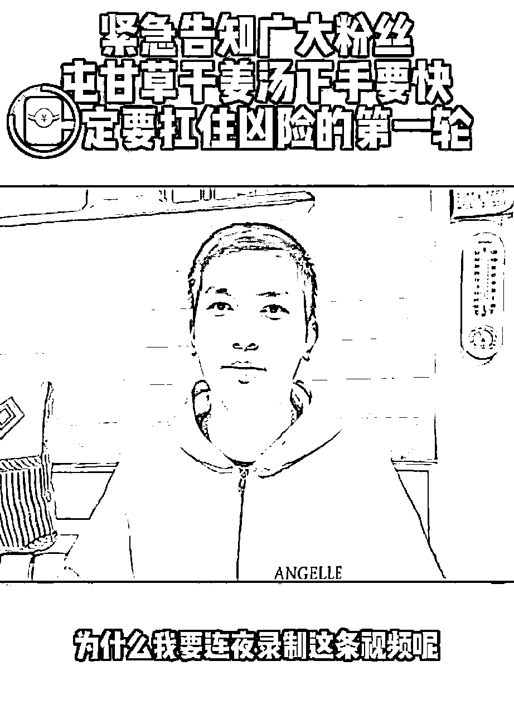

我所有作品里被搬运次数最多的，就是这条。

（生财的风向标板块里有甘草干姜汤的线索，我照着信息录了出来。单这一条，就带来了2.6万佣金。后来同行们逮着这条视频使劲混剪、搬运，差点把我“捧”成了养生网红。直到今天，视频里那句开场白，还是很多博主抄袭的模板。）

有了这些积累和教训，我对新手怎么入局短视频，也算有了自己的一套判断。这里想重点强调两件事：一件事是入门时最容易被忽略的——那些看起来不起眼、实际很关键的概念和术语；另一件事是实操时大家普遍不重视的——什么才是真正的核心。

* * *

重点一：先把专业术语搞明白

想做好一个领域，先得听懂这个领域的人在说什么。短视频也不例外。基本概念都不清楚，后面连交流都费劲，理解也会跑偏，更别说做出成绩了。大概率你已经懂了一些，但可能还有一部分刚接触新媒体的人，对这些都是懵的。我就在这帮你把这些地基概念简单过一遍：

- 内容：你对外发布的每一样东西，文章、视频、图片，都算。
- 平台：内容发布的地方，抖音、快手、视频号、小红书这类。
- 赛道：内容专注的领域，好物、养生、书单、美食、亲子，各占一席。
- 形式：内容的呈现方式，文字、影像、图片，都属于。
- 流量：你的内容有多少人看到，播放量、浏览量、阅读量，都是它的别名。
- 粉丝：关注了你账号的人，抖音粉丝、快手粉丝、视频号粉丝，各平台独立统计。
- 制作：内容从无到有的过程，剪辑、拍图、写稿，都在其中。
- 运营：账号日常经营的那些事，看数据、选品、做评论引导，都是运营动作。
- 转化：经营到最后真正带来的收益，视频能转化，直播能转化，私域也能转化。
- 伪知识：专门用来忽悠不懂行的人的说法。比如“流量不好是发布方式不对”“同一个WiFi下不能挂多个账号”，全是这类。
- 规则：平台的边界线，什么能碰什么不能碰。原创、正能量、有版权的内容，能发；涉政、涉军、医疗、迷信等敏感内容，不能碰。

这些东西看着简单，但它们是整个信息交流和内容创作的地基。地基不打，上面全白搭。

* * *

重点二：把劲用对地方

很多人做短视频，不是闭眼横冲直撞，就是把力气花在莫名其妙的地方。有人死磕画面要多精致，有人研究特效要多炫，有人琢磨内容要多有吸引力。我必须泼一盆冷水：这些方向，全都偏了。

举几个我亲历的例子：

山西一家本地挺出名的养生茶公司，跑来找我们聊思路。聊到最后，老板的总结是：不够有逼格。然后就没有然后了。两年过去了，还是没动静。估计那位老板，至今还卡在“怎么显得有逼格”这一步。

一个做阿胶的大品牌，实力相当雄厚。为了上央视宣传，几个亿砸下去，在厂里建了一处拍摄基地，亭台楼阁、金锅银铲、博物陈列，排面拉满。新媒体团队高薪招的全是科班出身，拍出来的视频安静、唯美、高级感十足。可他们为什么来找我们？因为画面全做完之后，下一步不知道干什么了。

还有一个地市的移动公司，做了一段时间发现流量不行，画风直接来了个180度大转弯——长腿、黑丝、穿制服的漂亮姑娘。流量倒是蹭蹭涨，但我特别想问一句：然后呢？除了好看的数据，他们还打算做什么？

我之前还碰过一个客户，剪辑时追求极致的完美，气口要全部切掉，音效特效一个比一个花哨，为了这些细节，团队反复讨论、反复改。我几次暗示他们：时间和精力都砸在这儿了，真正该搞明白的事，搞明白了吗？

你心里可能会嘀咕：这些东西难道不重要吗？真不是不重要，而是它们统统排在另外四个字之后——你的业务。

记住：业务！业务！业务！画面再高端、特效再酷炫、播放量再吓人，只要带不来业务，那就是自嗨，毫无意义。很多视频看起来土得掉渣，播放量也不高，可人家就是闷声赚钱，你能说啥？网上有段挺扎心的对话，大概意思是：

你说：我比你有格调。
他说：我赚钱了。

你说：我画面比你好。
他说：我赚钱了。

你说：我模特比你漂亮。
他说：我赚钱了。

你说：我播放量比你高。
他说：我赚钱了。

你说：我剪辑比你细腻。
他说：我赚钱了。

你低头看了看自己账号后台，孤零零一个数字：250。那一刻，世界观碎了一地。

几乎每个下场的人都会踩这个坑，我也一样。所以我才想把这句话喊得再响一点：所有精力都要放在“业务链路”上，所有动作都围绕“业务”来展开。当你忙得晕头转向的时候，一定要抬头问自己一句：这件事，能带来业务吗？如果不能，赶紧停。

* * *

### 2023年：教学、答疑，和“学废”的问题

那时候大家认识我，基本都是因为一套方法——我拿产品经理的老底子反复打磨出来的“单人日产200条批量混剪教程”。发到生财后，反响出乎意料地热烈，我也因此被许多人记住了。后来那阵热度实在太猛，我不得不刻意隐身了很长一段时间，让自己的生活重新安静下来，恢复独立思考。

内心其实也有一个小小的愿望：看到别人能在圈子里留下点东西，我也想在生财这片土壤上留下自己的痕迹。不是想搞什么声望，只是想证明自己来过。当时讲项目、晒成绩的帖子已经很多，但讲技术的帖子凤毛麟角。我一琢磨，不如把自己摸索出来的混剪方法写成操作教程，发出去。

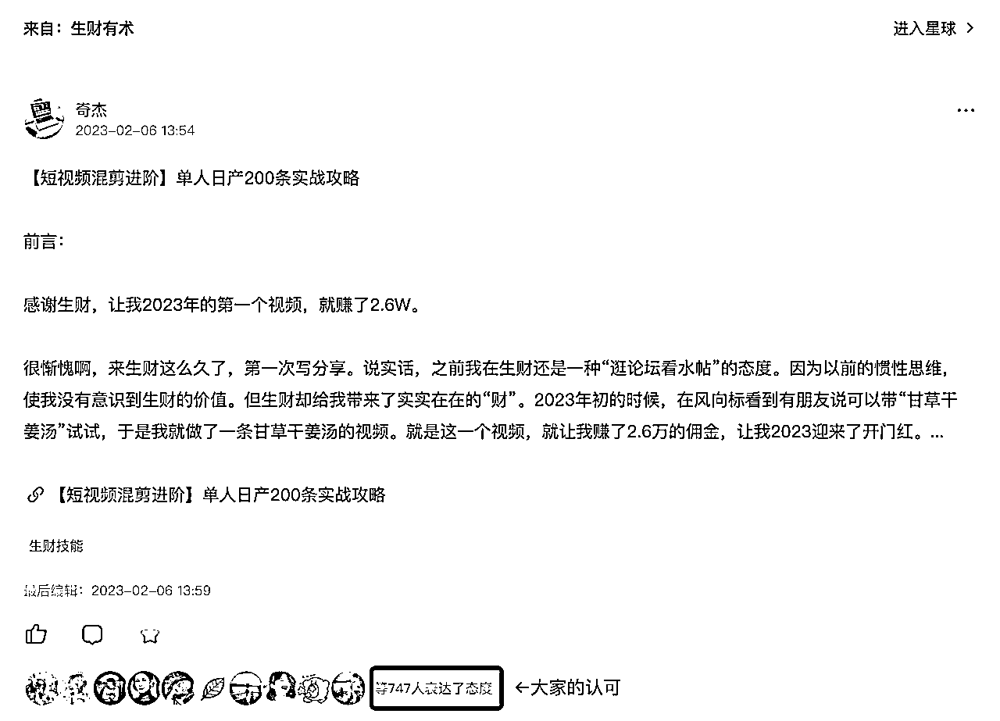

这就是那篇让我“一战成名”的原帖。它让我和无数圈友结了缘，也让我一脚踏上了教练这条路。原帖链接：https://t.zsxq.com/19tz08QHB

图文教程到底不像视频那么直观，不少圈友希望看到一个更立体的演示版本。亦仁老师在了解情况后，邀请我作为生财有术第一个视频内容的创作者，把思路录成了课程，由他代发布在圈内。

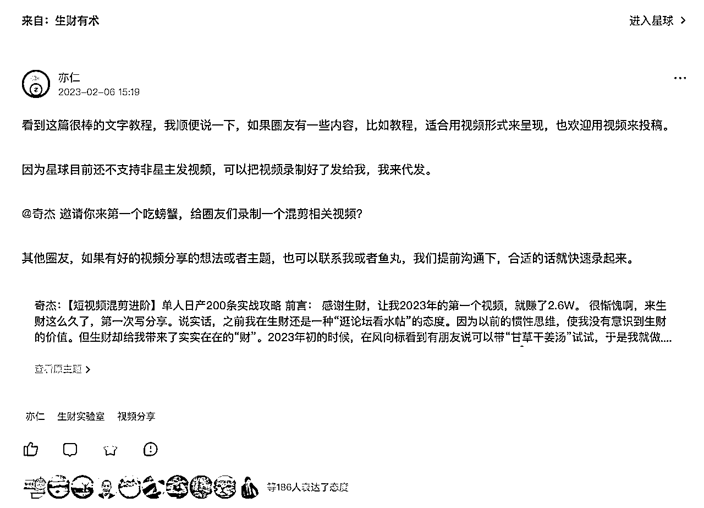

这就是亦仁老师当时发给我的邀约。原帖链接：https://t.zsxq.com/p4z4H

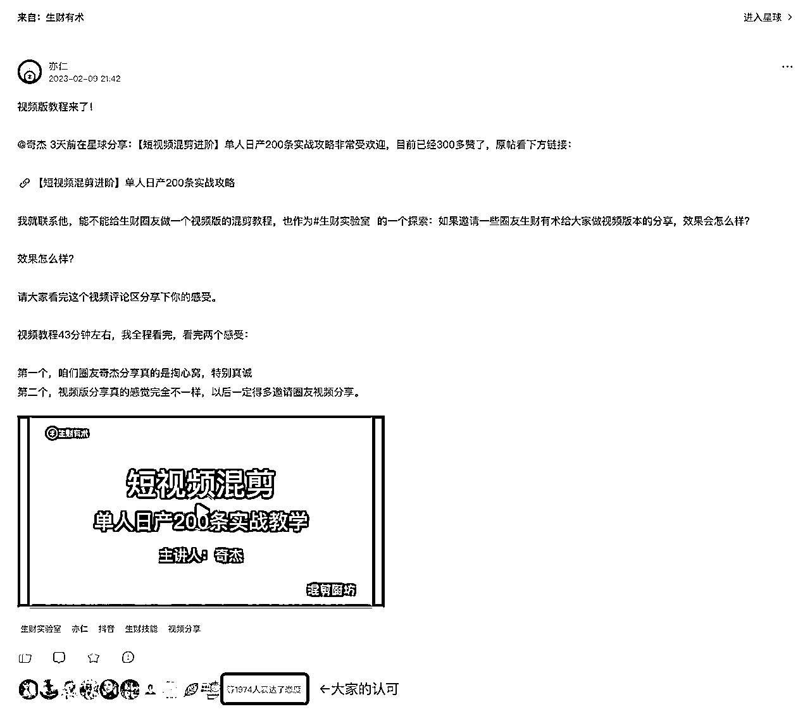

亦仁老师替我发布的那期教程，就是这个。原帖链接：https://t.zsxq.com/19wMfZGc4

那一下，圈友们的学习热情直接被点着了。一波接一波的人跑来问我技术细节，官方干脆协调我进入各个短视频航海项目，担任剪辑教练。我以为这就是全部了，结果那年3月，全国线下见面会上，主办方直接邀我上台当分享嘉宾。我在杭州的千人大会上讲了一下午，因为讲起来没收住，严重超时，给自己打分只打了60分。但这完全没影响圈友们的热情，线上线下的人追着问问题，交流多到把我淹到头晕。可我心里是真的高兴，那种被人认可、能创造价值的感觉，千金不换。

后来，生财官方正式推出了“剪辑特训”航海，专教短视频剪辑。我配合官方老师一起写航海手册、录教学视频、把流程和细节捋顺，顺理成章当了主教练。

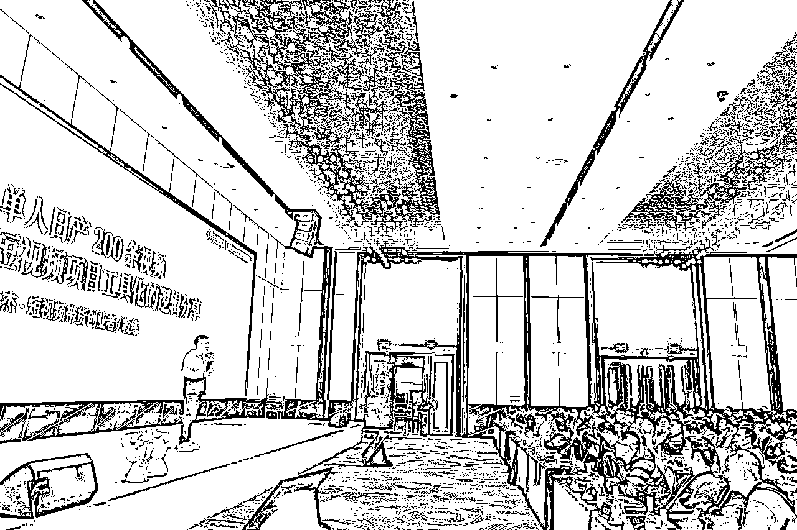

在杭州千人大会的现场，我站在台上做分享。

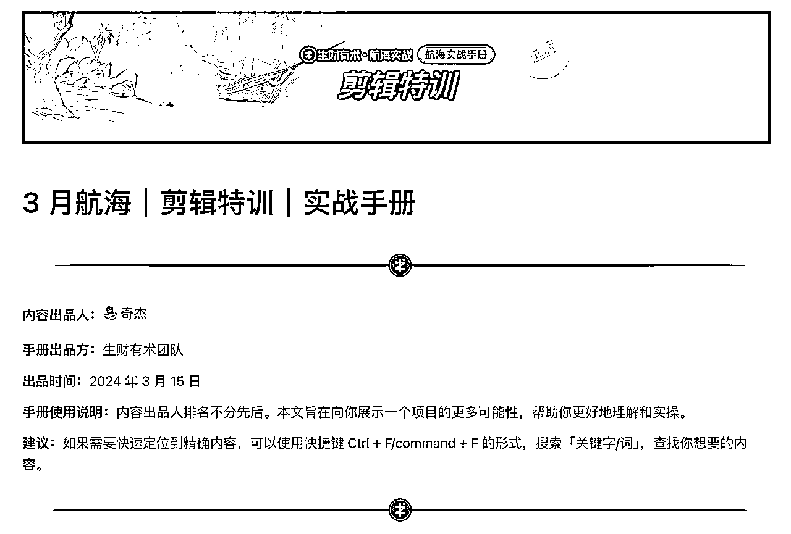

这套手册就是“剪辑特训”航海的教材。手册链接：https://scys.com/view/docx/IeBrdyLmso2KHIxBb1Sc0fI9nwc

几千人次教下来，问题也暴露得越来越明显。太多同学上课上着上着就“学废”了，不是不努力，而是努力用错了地方。我把这些情况总结成四类，每一类都值得大家认真看看。

* * *

第一类问题：钻营取巧

很多人对“效率”“技巧”“工具”三个词有着超乎寻常的热衷。要找绝招、要抄近道、要省事神器，一天到晚淘换“秘诀”。这种狂热情绪又反过来把一堆鼓吹者招来了，大家一起吹，越吹越热。

比如我讲批量混剪时反复强调过：效率的前提是充分的准备，素材库要花掉六成精力。结果话还没凉，就有人问“怎么才能快速批量搞素材？”接着就冒出一堆人吹捧某个神器多牛多好用，然后真有人信了，后面的事你自己想。

又有人发现批量混剪还是太苦，开始琢磨有没有不用动手就能自动剪完的软件。于是自动剪辑软件被吹上天，买过的朋友应该都懂后续。

还有人发现自动剪辑好像也挺麻烦，那就再简单点。数字人横空出世，AI被吹得天花乱坠，当然也有人信了，后面的事大家也都看到了。

说句公道话，工具本身没什么错，功能强也是事实。但再好的武器，也得有个会使的人。自己不练基本功，好工具到了手里也是块废铁。不是工具的问题，是人的心态出了问题。

我经常在教学中说“遇到问题绕过去”，本质上是教大家多一个思考的角度。在踏实做事的人那里，这句话能启发他们找到更聪明的方案；在不爱下功夫的人那里，就成了投机取巧的借口。正所谓：正人用邪法，邪法亦正；邪人用正法，正法亦邪。

买错工具、踩几个坑，损失其实有限。最可怕的是养成一种习惯——以后不管遇到什么问题，第一反应不是学，而是钻空子。这种思维习惯才是真正的无底洞，带来的损耗无法估量。希望大家牢记一句话：“巧”是从“笨”里长出来的。别人能巧，是因为暗地里下了大量笨功夫。你连一层都懒得盖，凭什么直接住二楼？

* * *

第二类问题：毫无章法

还有一类人，学习的时候不动脑子，只管埋头瞎干。教的时候强调过的重点一概不往心里去，做完一摊事，回头问做了啥，啥也说不清。

举个例子：我讲批量混剪，拿“人物抠像”当教学案例。我特地说明过，为什么用人物抠像——因为它涵盖的知识点够全面，方便大家理解，大家实际做的时候，要看项目需要来定。可偏偏有人不管三七二十一，画面里明明不需要出现任何一个人，就硬是去找个人像放上去，费了半天劲，效果一塌糊涂。

我还讲过去重素材的重要性，因为很多类型视频都能用风景素材，结果一堆人到处找风景素材，再一张张修图、处理。明明拿起手机出门就能拍一大把，比例自定，拍完直接用，非要舍近求远、舍易求难。

做的好物视频需要产品素材，有人满世界找不到，就跑去别人视频里一帧帧抠，画质渣到没法看。我就纳闷了：那东西拼夕夕九块九还包邮，买一个回家，想怎么拍怎么拍、想拍多少拍多少，为什么要拿大把时间换最差的效果？

还有一个做木质置物架的老板，视频十来秒，一个镜头，几句人声介绍，一天要十几条，跑来问我怎么批量剪辑。我说这不就一个镜头几句话说清楚的事，直接拿手机拍十几条不就行了吗？他说人声怎么办？你就边拍边说呗。他说车间太乱，你换个干净地方拍。他说背景需要几个包装箱，你把箱子搬过去不就得了。就这么简单的事，他非要把它想成多复杂的工程。

“遇到问题绕过去”，意思是别一头扎进死胡同里。低头干活前，先抬头看看有没有更优解。

低品质的勤奋毫无意义。勤于思而敏于行，手、脑、心三个都要在线。动手之前先动脑，动脑之前先用心。

* * *

第三类问题：无脑盲从

网络时代最不缺的就是信息。可很多人面对信息时，既不关心自己用不用得上，也不去鉴别真假，别人传什么就信什么，什么火就追什么。大把时间全花在追风口上，到头来什么都试过，却没有一样做成，学到的那点东西也串不起来，白白耗光了自己的精力。

听说视频号是风口，就冲进视频号，问题是想不明白自己该做什么赛道。看AI小和尚火了，转手去研究AI小和尚，做了几天发现流量也就那样。发现短视频没那么好做，又琢磨起直播带货，结果发现自己直播不了。再听人说无人直播有机会，赶紧又入局无人直播……

网络就像一个巨大的自由市场，大家都在卖自己的东西，顺便把自己的说法吹大一点，这都正常。但你如果不加筛选，这也好、那也不错，最后大概率会变成掰玉米的狗熊——掰一个扔一个，两手空空。

小贴士很简单：先想清楚自己的需要，先选定自己的方向。然后才能在海量信息里保持清醒，准确筛出对你有用的部分，去深耕，去死磕，才能拿到结果。

* * *

第四类问题：为人处事

想在社会上做事，先得学会做人，这是常识。可现在的氛围太急功近利，很多人满脑子只剩下怎么得实惠、怎么一夜暴富，把做人的基本功全丢了。我见过太多人被这几个字害得不浅：

玻璃心：一碰就碎，遇到一点问题就原地崩溃。没问题时提心吊胆，有问题时惊慌失措。你见过哪个成事的人不是从摔打里滚过来的？

大宝贝：永远长不大，遇事不会自己解决，张嘴等着别人喂饭，稍不满足就闹情绪。解决问题，难道不是做事业的基本功？

甲方爹：总是一副甲方心态，觉得谁帮自己都是应该的，没有感恩，没有礼貌。你觉得谁愿意跟一个摆臭脸的人长期合作？

急发财：没有任何积累的耐心，张嘴闭嘴都是“什么时候暴富”“带带我行不行”。一分耕耘一分收获的道理，怎么到他们这就失灵了？

抱怨狂：牢骚比谁都多，一点不顺就怨天尤人。从不反思自己，只怪环境、怪别人。可做事的过程，不就是处理问题、解决麻烦的过程吗？

假谦虚：嘴上客套，实则内心谁也不服，别人说啥都听不进去，客客气气地拒绝一切建议，骨子里傲慢得很。尺有所短，寸有所长，没有空杯心态，怎么装得进新东西？

算计王：事事精于算计，只算自己的账，不算别人的感受。凡事只占便宜不吃亏，恨不得把周围人的价值榨干。请问，一个只想占便宜的人，凭什么让资源向他汇聚？

可能有人会觉得我上纲上线，但我真见过太多人就是这样把自己的路走窄了的。他们可能只是太年轻，或者说太想把事情做成，于是整个人变得异常敏感和焦躁。可“欲速则不达”是句老话，事物发展的规律不会因为谁着急就改变。放平心态，慢慢来，把身边的关系处好，你会得到更多人的帮助；把自己心里的杂念清理干净，静下心做事，所有结果都会水到渠成。

赚钱的前提是成事，成事的前提是做人。对自己的修养不重视，事情怎么能凭空做成？钱又从哪儿来？

* * *

### 2024年：一整年的沉淀，和一套逐渐清晰的体系

2023年让我这个喜欢清静的人心力交瘁。最初发个帖，不过是想小小炫耀一下自己的技术，结果一发不可收拾，糊里糊涂就成了别人嘴里的“大佬”，然后在教练这条路上越走越远。粗略算了一下：线上线下直接带着训练的人，已经超过了8600人；真要算上那些照着我的教程野生学习的，上万肯定是有了。那阵子忙到脚不沾地，日子过得很充实，但也让我没时间停下来想一想，只能深一脚浅一脚地往前走。

那阵子我心里清楚，这是我实打实的功勋和荣誉。

我确实帮到了不少人，很多朋友专门跑来感谢，那种感动是真实的。但与此同时，我也看到很多朋友因为对短视频的理解不够全面，在学习和实操中走进误区。我明明早就发现了那些拦路的问题，也反复强调过，可大家学习的热度实在太高，真正静下来听进去的人并不多。我也忙，忙到没有完整的时间把这些经验系统梳理出来，碎片化的提醒，根本掀不起大家的警惕。于是眼睁睁看着一些朋友，在热情高涨中越学越偏、越学越乱，再加上到处鼓吹的“速成技巧”，场面一度相当混乱。

这条路，我知道并不容易。但真正的问题，从来不是一个人笨，而是他在热闹里迷了路。希望这篇东西，能让你早一点醒过来。

当我察觉到自己的教学已经偏离了正确的指引方向时，我就明白技术本身也失去了意义。看着眼前的种种乱象，内心不断响起一个声音：该停下来了。于是我开始有意收声，渐渐淡出大家的视线，慢慢放下教学这件事。抽离出那股热情的漩涡，回到一种安静自持的状态，去复盘、梳理、沉淀。

我把所有想学的请求都挡了回去，几乎不参加任何聚会，让自己尽量什么也不做，安静地独处放松。正因如此，这段时间才一直没有更新。

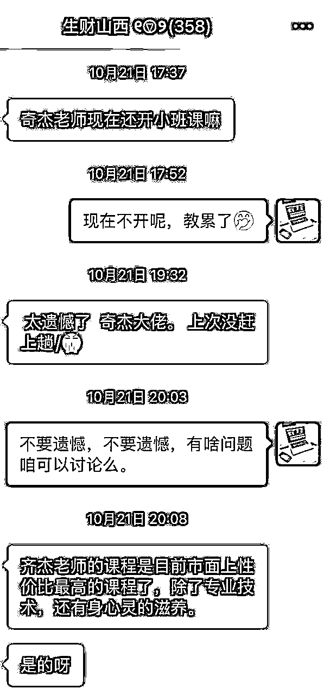

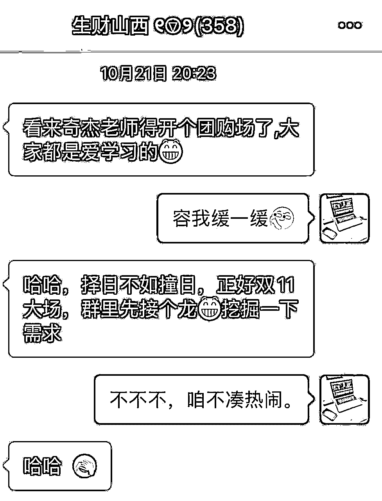

把大家的热情婉拒了

第一，我意识到延续原有的教学方式，对大家的帮助很有限，很容易把人带偏。第二，我还没有把新的思路理清楚，贸然开课是对大家不负责。第三，我想把今年剩下的时间留给自己做沉淀，也要让自己先成长起来。

一年多的放空之后，我终于把脑子放空了，心绪也沉下来了，再回头看过去发生的那些事和暴露出的问题。我想明白了，根源其实有三点。

问题一：被动推进，导致中心错位
当初我的批量混剪很受欢迎，教学于是被大家推着走。因为我之前只讲了剪辑，剪辑就成了默认的教学主题，所有东西都围着教剪辑转，学剪辑、问剪辑、再讲剪辑。剪辑几乎成了做短视频的全部核心。
忙于教学的我，以为自己只是给知识体系做补充，结果却成了很多人学习的重心。大家一门心思钻研剪辑，这无形中给不少人造成了误导。停下来后才恍然大悟，真的说不清理得。

问题二：框架缺失，造成理解偏差
剪辑只是系统里很小的一环，我以为大家别的都懂了，只差剪辑，所以把重点都放在理清剪辑上。实际是，很多朋友不是剪辑不会，而是只会了剪辑。就这样，我越讲剪辑，大家越觉得剪辑是核心，而我点到为止或零散提及的其他部分，大家就自动忽略了。
我以为你懂了，你也以为你懂了，可我们各自的“懂了”压根不是一个意思。这种尴尬差点误人子弟，幸亏及时刹车，梳理后才弄明白。

问题三：需求不清，盲目求救
他想靠短视频做生意，却不会，于是想学。他以为学会剪辑就能搞定，于是来学剪辑。学完发现还是不行，以为是自己学得太少，其实是没系统，于是又想继续学。学什么？学那些看着高大上听着很牛的东西，然后就开始乱学。
最后钱花了，时间花了，精力也花了，还是不会。还被“奇杰”在帖子里说成“钻营取巧、毫无章法、无脑盲从”。冤不冤？真是无处诉说，哭笑不得。

小贴士：
做短视频生意，就像糊花灯。先得扎好骨架，再往上贴纸裱花。没骨架的时候，去学裁纸剪花意义不大。先有框架才知道要裁多大纸、剪多大的花，围绕框架的学习才算有用，否则就是消磨时间。

* * *

理清问题后，我闭关整整两个月，把之前观察到的现象和发现的问题全部复盘。系统梳理了短视频营销的SOP，希望能帮大家走出误区。不要再只是学一套剪辑，或是东拼西凑地研究所谓的运营技巧和工具。而是要整体系统地理解短视频营销，建立一套合理可行、实用高效的营销方案。

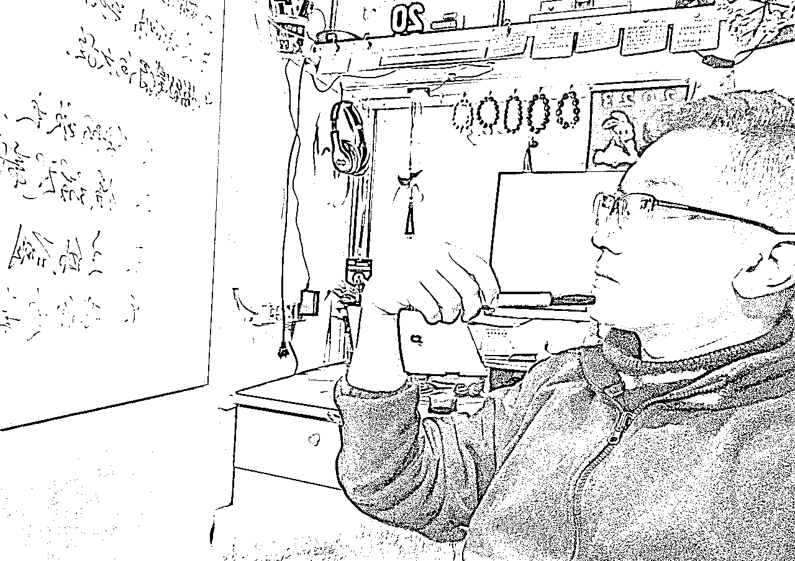

就这样一个人关起门来梳理沉思

你们现在看到的，就是我这一年多思考的结晶。

第一部分，我用自己的经历把问题捋清楚，给大家普及认知。明白了这些基础，实操时就能少走很多弯路。
第二部分，是我梳理的“制定短视频营销解决方案”的系统框架。搞懂这个框架，学习和实操就有了抓手，不再盲目消耗精力时间。

2024年快结束了，我想用这篇文章把朋友们的思路拉回到正轨，重新审视方法策略，为2025年的发展提前打基础。希望后面的内容能对大家有帮助。

* * *

第二部分：短视频营销方案架构

方案的本质就是：该怎么做。短视频营销方案怎么搭？就是找到关键问题并给出答案，再据此制定计划并在执行中不断优化，形成闭环，搭建成自己的赚钱系统，或融入现有的系统中。

还没开始做短视频项目的，先别急着学剪辑、研究工具、挖创意、听技巧。已经在做的，建议先暂停，先把这些关键问题厘清，再回头看自己的操作合不合理。

这一步很关键。想不明白，你的忙碌就毫无章法，不但没成效，还容易陷入自我感动的陷阱。即便有点小成果，也是昙花一现，很快又会迷失、踩坑、自我怀疑，进而内耗。记住：内耗就是自我消耗。

* * *

第一块：业务三问

视频图文只是内容的外在载体，发什么？为什么发？有什么作用？这些没想清，发视频有什么意义？要想清楚，就得先把业务想明白。上面说了，业务才是核心。如果连业务都理不清，短视频方案就是空中楼阁。

小贴士：
平台上看到的都是成品内容，但请记住：脱离业务的内容制作，只能算玩耍。

业务一问：你的产品是什么？

情况一：
有些朋友连个能做的业务都没有，就先研究怎么拍视频、怎么搞创意、怎么运营号。这不是本末倒置吗？连女朋友都没有就先买玫瑰干嘛？如果你是这种情况，先收藏本文，去找一个适合自己的业务，有了再回来。

小贴士：
找业务记住两点：自己能干的 + 能赚钱的。

原则一：自己能干的
重点：看到的项目再好，你做不了就别浪费感情。
案例一：实力不够。项目要一百万启动资金，你拿不出就别碰。想借钱做，说明扛不住风险，还是别冒险。做生意有风险，创业就是在赌。
案例二：能力不够。项目需要很强的文案功底，你连常用字都写不利索就别硬上。别说什么边学边干，要做生意不是去上学。才开始学怎么跟成手竞争？有基础需要梳理加强另说。

小贴士：
做不了就别硬撑，别当倔驴。去找一个能轻松驾驭的项目，不是更香吗？不知道怎么找业务？生财有大量项目，筛选总能找到。别让我推荐，你自己最了解自己能干什么。

原则二：赚钱的
重点：再熟悉再喜欢，如果现在和未来都不赚钱，就没必要投入。
你之前做的生意因为业态变了，市场很小了，已经无法盈利，那就不该再做。继续只是在纠结和自我折磨。做生意是为了让生活更好，别为难自己。
你只考虑兴趣爱好，项目本身不盈利也没未来，那也不能做。情怀等有财力再说，公益也需要捐赠款运转。做生意靠眼光智慧，不靠天真执念。

小贴士：
现在没业务就先收藏，去找业务。找到适合的，别瞎干，再回来接着看。

情况二：
还有一批朋友，连业务是什么都说不清，就开始瞎研究瞎折腾。
比如你是个英语老师，只会发视频展示英语水平，那你的业务是什么？很多人只能说：教英语，这太笼统。要用什么形式教？产品是卖资料、卖课程还是卖服务？必须搞清，不然后面全是乱折腾。

小贴士：
构思业务有两个原则：用户需求 + 自身优势。

原则一：用户需求
重点：再厉害没人需要就没意义。做得再好卖不出去有什么用？胶卷再好，数码时代也没人要。
比如你口语很好就想做翻译业务，普通人有几个需要翻译？需要的人会找你吗？教育市场这么火，是不是该考虑这个方向？

小贴士：
做生意必须看用户需求。不看需求就是自嗨。看不懂需求就去看同行在做什么。

原则二：自身优势
重点：市场再大，自己没优势就没胜算。看到什么火就扎进去，结果就是头破血流。赛道不是为你一个人准备的，只有把用户需求对接到自己的能力上才能分到市场。
比如你唱歌不错，不代表能做音乐博主。生活圈里唱得好和专业歌手没法比，粉丝凭什么关注你？但如果你颜值高，做颜值主播就有市场。

小贴士：
在自己有优势的领域找市场需求点。顺序不能反：先找有限的优势，再在无限的需求里找契合点。先培养优势再找市场，等你学会了市场早变了。用句粗的话：吃屎都赶不上热的。

业务二问：销售特性是什么？
业务想好后就要考虑怎么卖。不同产品性质价位不同，销售特性也不同。用对方法才有转化，用错全是瞎忙。

重点：按用户决策成本和成交链路，大致分四类。
1. 展示销售：决策成本低链路短，展示特点价格即可。如小用品、消耗品、儿童礼物。
2. 互动销售：链路短但决策成本高，需多了解。如电子产品、家电、珠宝文玩。
3. 跟踪销售：决策成本不高但链路长，需持续跟进。如奶粉、宠物粮、美容美发。
4. 考察销售：决策成本高链路也长，需实地看谈。如房产、装修、大型设备。

举例：卖房子只展示户型装修价格，不邀请客户实地考察感受环境舒适度、便利性，再加优惠和人格魅力，有多大成交可能？

小贴士：
先搞清销售特性再研究下一步，营销环环相扣。

业务三问：承接方式是什么？
业务和销售特性清晰后，要考虑怎么承接流量。承接方式不是固定也不是单一的，要结合实际情况设计组合并动态调整。

重点：常见承接方式分四大类。
1. 链接：商品链接、下载链接、团购链接、客资链接、地址链接。
2. 直播间：卖才艺、卖商品、卖服务、卖品牌。
3. 私域：粉丝群、微信号、公众号、网站、软件。
4. 线下：商店、市场、城市、地区、景点、位置。

举例：觉得直播好，但自己没直播能力团队也没条件，就不适合。挂链接可能更合适。商品需表述功效或需跟踪，又不能在公域说，那就适合私域。

小贴士：
没有绝对最好的承接方式，只有最适合自己的才有效。

* * *

第二块：内容三问
业务三问跑通后，就可以构思内容。内容也要想清三件事：流量支点、表现形式、制作手法。

内容一问：流量支点是什么？
流量问题是重点，内容要有支点可撬。没有支点作品没流量，内容作用就打了折。流量支点就是情绪。记住：流量的密码是情绪。

情绪可大致分为：
愤怒、感动、欢乐、诱惑、认可、恐慌、亢奋、共情、猎奇、狗血。

流量支点要围绕业务设计。

小贴士：
脱离业务的流量是虚假繁荣。变不成业务的流量，除了玩耍还有什么用？

重点：找到很重要，找对更重要。
举例：律师账号做普法，正确的支点是展示专业带来认可。可有些账号用性感美女出镜，带来的情绪是诱惑，吸引来的都是色粉，能带来法律咨询吗？这就是支点找错了。

切记：流量的目的是带来业务。设计对的支点，才能带来对的流量，对的流量才有机会变成对的业务。

内容二问：表现形式是什么？
形式要结合多方面确定。

目前形式主要有：视频、图文、文章、音频。

构思时考虑五个因素：
行业习惯、团队优势、内容特性、平台规则、链路适配。

小贴士：
形式不一定单一，要随业务需要和情况变化调整。别硬抄别人，你的勉强模仿打不过别人的得心应手。

内容三问：制作手法是什么？
形式定好后要考虑怎么做。

重点知识：

很多朋友在做内容时，容易一上来就急着动手，结果做到一半才发现，前期的“制作手法”压根没想明白。

到底该怎么定手法？说白了，就是要盘好四件事：

第一，你对成品的要求有多高。如果本身就是公众人物，作品一亮相就代表个人品牌，那对原创度和质感的要求自然就高，容不得半点敷衍。

第二，手上的技术有没有。你能搞定拍摄、剪辑、出镜这些技术环节吗？如果还没有，能不能在短期内学会？或者找到能把技术补齐的人？

第三，预算撑不撑得住。这笔投入是否在自己能承受的范围内？如果超了，是砍掉部分效果，还是追加预算？

第四，时间够不够用。你计划投入多少时间？如果制作周期拖得比预期长，你是愿意舍弃一些效果，还是把时间线拉长？

这几个变量，没有统一答案。每一个团队的真实情况都不一样，别人能走通的路，换个环境未必走得通。不是谁火就照谁抄，拍脑袋跟风是行不通的。更麻烦的是，有人总想着效果拉满、成本最低、时间最短、难度最小全都要——那不是做项目，那是折磨团队，最后所有人都跟着受罪。

打个比方。拍实景视频，李子柒的质感确实很不错，但懂行的人都知道，她背后是强大的拍摄条件、充裕的预算、专业的后期技术和足够长的制作周期。如果我们也想玩实景，却既没有她的技法，又没有她的预算和时间，那就别硬拿她的标准来要求自己。除非你能接受“没有金刚钻还揽瓷器活”的后果。要是既想要她的质感，又不愿意研究技术、掏钱、花时间，那团队只能集体崩溃，谁也接不住这种需求。

说到这儿，并不是要劝大家放弃做农村题材的实景内容。题材本身没问题，问题只在于制作路径。只要愿意转换思路，就能找到符合自己条件的做法——比如康仔农人，同样是乡村内容，人家可实现的制作门槛就低了很多。

顺带说一句，举康仔和李子柒的案例，纯粹是因为大家都认识，拿来聊制作思路方便，不是在拆解他们账号，更不是说必须照搬他们的路子。别杠“俩人不是一个赛道”或者“康仔的条件一点也不简单”，这些不在讨论范围内。重点永远在于：构思制作手法时，要看自己兜里有什么牌，而不是盯着别人的牌桌。

这里特别想提醒：市面上的短视频方法论多如牛毛，很多同学也学过不少，但千万不要逮着啥就学啥、信啥。知识说到底是一把双刃剑——不是知识本身有问题，而是如果你没搞清楚使用的底层逻辑，反而容易跑偏。

比如“找对标”这事儿。方法没错，很多人都会。但找谁对标？怎么对标？这就是战略问题了。如果不懂底层逻辑，也不切合自己的实际情况，胡乱逮着一个同行就对标，那就是把团队往沟里带。

常言道：“方向不对，努力白费。”可方向错了，就不光是白费力气那么简单。往错的方向走得越狠，离目标就越远，还不如原地不动。

我讲的这些，本质上都是比较底层的思考框架。把这些东西吃透了，心里就有了底，再去看别的知识和技巧，就不容易被带偏。技术上的问题再复杂，大多都能优化调整；可方向一旦错了，那才是致命的。所以，知识越多越好，但方向越聚焦越好。

关于制作，再聊三个关键问题。

很多人在做内容这件事上，最爱干的事就是疯狂学技能。这是一种认知误区。没有经过系统思辨的学习，多半是白费工夫，甚至是无限消耗自己的精力。

**第一问：你该学什么技术？**

内容方向一旦定下来，技术就该围着它转。学技术时，留意三点。

其一，不必穷尽所有技能，只需要学自己的方案用得上的。别看见什么火就想学什么。做内容涉及的技能实在太多了——脚本、文案、图、拍、剪、出镜、配音、直播、AI、数字人……哪个不是要花时间去磨的？全学一遍，项目就永远开不了工。所以，只挑自己方案里刚需的技术去学，才是正解。

其二，学习的目的，是补齐或者升级，而不是从零开荒一个全新领域。举个例子，你方案里要出镜口播，但普通话说得不太标准，去练普通话，这叫提升技能。你的拍摄素材需要有后期处理能力，去学剪辑，这叫系统补充。这些方向都是对的。可如果你一面对镜头就打结巴，普通话说得乱七八糟，连电脑的操作都是萌新状态，那就不该再往口播这条路上死磕。等你把这些都学会，风口怕是早就过了。这时候真正该做的，不是补技术，而是改方案：口播做不了就换场景叙事，普通话不行就用AI配音，剪辑搞不定就外包……路多的是。

其三，想清楚自己需要学到什么深度。学习本身没有尽头，但我们学东西是为了用。能解决眼前问题的技能，就足够了。比如剪辑这事儿，有人非要学成专家水准才肯罢休，其实大可不必。我曾担任过剪辑训练营的主教练，但并不是所有剪辑效果我都能做。我的目标很简单——满足自己短视频项目的日常需要，够了。我又不需要去剪院线大片，何必钻研一堆根本用不上的后期特效？有那个时间，不如研究研究内容生态，或者给大伙儿写点分享。厚积薄发当然值得提倡，但执念与误区，才是学习的最大敌人。适可而止，量力而学，也是一种智慧。

**第二问：你该用什么工具？**

市面上的工具多得能让人眼花缭乱，年年还有新产品出现，没人能把它们全摸一遍。方案定好了，挑刚好顺手的几件，然后把它用熟，这就够了。

但很多人掉进了“工具依赖症”。不管遇到什么难题，第一反应就是——是不是该找个工具解决？就像我当年分享“单人日产200条批量混剪”的经验，有人跑来问我是怎么开发的工具，或者问问用的是哪款神秘神器。其实哪有什么秘密武器，我用的不过就是剪映而已。

再举个例子，有人要风景素材，第一反应就是找批量下载工具，再研究它的用法，再去搜各种素材资源……这纯属被“工具思维”拖住了。想弄点风景素材，出门走一趟公园，一上午就能拍大把，何必绕这么大弯子？工具本该是拿来提效的，反而变成了拖累。

所以，别让工具迷了眼。选几件匹配方案的就够了，攒一堆撑场面，反而是负担。

**第三问：你该整合什么资源？**

很多人容易走两个极端。

一是大包大揽，什么都想自己干。明明花点小钱就能解决的问题，非要亲力亲为，学一堆技能把自己累个半死。也不要因为自己不会某项技能，就眼睁睁把潜力项目扼杀在摇篮里。现在做内容的服务生态已经很成熟：拍摄有人，直播有人，剪辑有人，文案有人，连出谋划策也有专门的团队。自己忙不过来的，就外包出去，找合作，组智囊，都不是难事。关键是项目本身要成立，剩下的事都是执行问题。老板的核心任务，是搭好一套能赚钱的系统，然后保证它正常运转。创业的关键是拼决策，不是拼手艺。短视频早就产业化了，别用旧时代的小作坊思维去套现在的玩法。也不要动不动就被小问题卡住。舍不得那点外包费用，最后卡住的是整个项目的进度。真正该想的，是怎么让项目先跑起来、赚到钱。

二是逮到资源就想整合。资源的数量，不等于质量。很多人在招聘、合作上也是这样，不看自己的方案需不需要，不看项目的长期走向，更不管双方段位是否匹配，凭着一腔热血就开始谈合作。哪怕八字还没一撇，就撸起袖子折腾起来了。要知道：资源放那儿又跑不了，不必急于一时。人际关系很微妙，商业行为很严肃，在动任何合作念头之前，都得先仔细掂量。草率整合，不仅糟蹋资源，也浪费彼此精力。这一点，还得有点敬畏心。

说到底，理论和实操都只是冰山一角。理论是最容易的部分，网上到处都有，学一学就有了，但光会理论解决不了问题——很多人谈起事情来头头是道，一上手就垮了。

实操技术也没那么高深。有了框架和链路，剩下的就是不断试炼、持续优化。能做到这部分的人，就已经能拿到一些结果了。但做得可能比较辛苦，而且不够稳定。

真正难的是思考决策。这需要阅历，需要认知，还需要一点悟性。有些东西，确实不是光靠努力就能得到的，跟天赋和际遇也有关联。而能做到这一层的人，往往走得更远更稳。

这里说的“不错”，不是单指赚了多少钱，而是指对现实生活的掌控感。很多人觉得自己过得不好，是因为没钱。但“没钱”不过是表象的代罪羊。真正让人生活失控的，是对现实缺乏掌控感。创业也好，生活也好，教育也好，做人也罢，如果现实世界都是失控的，又怎么可能好得起来？

“没钱”甚至是一种错觉。你问一个人有钱吗？一种回答是“我没钱”，另一种是“我很有钱”。接着问：你有多少钱？有趣的现象就出现了。前者说：“我只有10万块，穷死了，啥都不敢干。”后者说：“我有10万块，在手里，啥都不愁。”是不是这么回事？所以有没有钱，往往只是心态的差异罢了。

我自己也说不上多有水平，但一直在修行的路上，尽量向有水平的状态靠近。接下来这段话，谈不上指点，只当是探讨。不求给大家拨云见日，但愿能够做个简单的清扫。希望每个人都有机会在创业这条路上，做出真正符合自己意愿的判断，拿回生活的掌控感。

我们常常只顾赶路，却忘了为什么而出发。印第安有句谚语说得好：别走太快，等一等灵魂。不要变成赚钱路上嗜血的丧尸，而要做个虔诚笃行的行脚僧——心明步稳，清除障蔽，一路向前。

这些年，我喜欢上了国学，不再像以前那样漫无目的地乱读书了。不是不再爱阅读，而是发现，错综复杂的知识学多了，不见得认知会更全面，反而可能更混乱。而且，每一本书、每一个理念的问世，背后都有各自的立场和意图。我们可能是智慧的学生，也可能不小心成了思想的韭菜。潮流总是来来去去，时代追捧的东西也并非都能持久。只有经过漫长时间洗礼，仍然闪闪发光的，才是真智慧。于是现在，我更愿意追本溯源，在经典里找答案。古人的文字虽然略显晦涩，但只要用心体会，总能获得一种明亮感，遇到难处时，给到心灵相应的启迪。

这种成长，你可以叫顿悟，可以叫智慧，也可以叫“明道”。它让我看事情更接近本质，理解事物更贴近真相。这几年下来，我明显比以前通透了：做事不拧巴，状态舒适了，内心自由了，生活里也常常涌出幸福感。

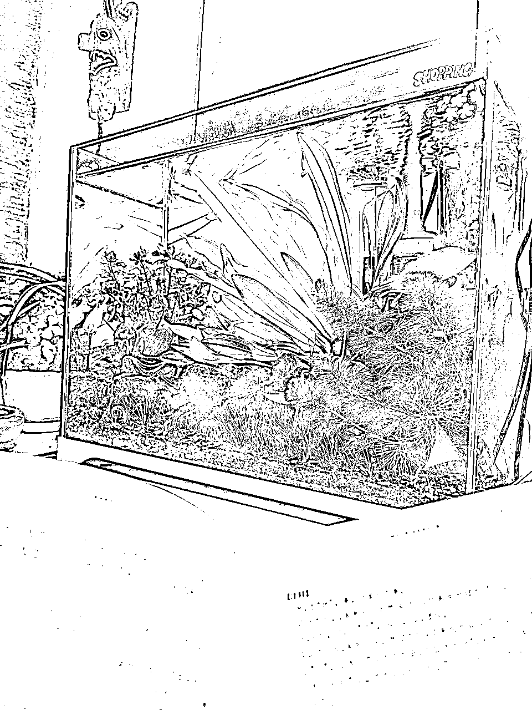

分享一张我的日常生活状态

（人想通透了，做事就不拧巴，状态也自然松弛。这种内心的自由感，哪怕只是安静地坐着，也有一种满足。我猜，这就是所说的现实掌控感吧。）

这种难以名状的体悟，我找不到一个特别精准的词来描述，只能说它“只可意会”。大概就是老子讲的：“道可道也非恒道也；名可名也非恒名也。”翻译成大白话：那个被称为“道”的事物是可以论述的，但语言本身有边界，一旦说出口，就脱离了它原本的样子。它的名字和特征可以被描述，但描述出来的，也不再是完全的本真。

语言有局限，认知有偏差，这些是客观事实。所以这些形而上的思考，我说我的，你听你的，对错没有标准答案，每个人只能各自体悟。

想明白你到底要赚什么

身边曾有一些朋友，是赚过几百万几千万的选手。不管靠的是能力还是运气，他们的成绩是肉眼可见的。但就是这批人，如今各有各的烦恼：有的在焦虑中打转，有的深陷官司，有的身体垮了，有的背一身债，还有的甚至失去自由。

我常常在想一个假设：如果他们当年没赚到这些钱，还会不会有现在的烦恼？答案没人知道，但值得每个人想一想。

做事业，我们到底在赚什么？你可能会说：废话，当然是赚钱。

那钱是什么？拿在手里的现金？不过是一沓质量好一点的印刷品。躺在银行卡里的存款？也就是数据库里的一组数字。

那我们想要的，是这些印刷品和数字吗？恐怕不是。

我们真正想要的，其实是拿钱换来的具体东西——车、房、服务、体验等等。而拥有这些，是为了达成一种理想的生活状态。钱的本质，只是一个计量单位罢了。我们在意的不是那个数字的大小，而是它背后映射的生活方式。这么一说，应该没人反对吧。

那你到底想赚哪种生活状态？是身不由己、百病缠身、债台高筑？还是锦衣玉食、纸醉金迷？又或者是心安理得、恬淡舒适、自由洒脱？

不管你的事业现在走到哪一步了，都应该把“自己到底想赚哪种生活状态”这个问题想清楚。因为这是你做任何决策的核心参照。缺少这个参照，你做的每个判断都只盯着眼前，那么失控的隐患就埋下了。

能量是守恒的。每一种选择都有代价。如果那个代价你无所谓，那决策就是成功的；如果那代价让你无法承受，你就是被反噬了。没有人愿意被反噬，所以要提前想好自己想赚的状态。做决策时拿它当衡量标尺：方向一致，就去落实；背道而驰，就换个方案。

人各有志，选择无分对错。有人偏钱，有人偏闲，有人偏进攻，有人偏防守。追求自己真正想要的，这才是我建议的。别等到陷入困境时再捶胸顿足，说“早知道当初……”，这种话既没意义，还反复伤害自己。提前规划，选了就坦然认，不后悔、不内耗。记住：内耗就是自我凌迟。

之前我在人气比较旺的时候，总有人问我：为什么不趁热组建团队，把业绩做上去？我的回答很简单：不必赚那么多。

很多人不理解。别人都在拼命搞钱，你却说要适可而止。

逻辑很简单：我想要的，是一种恬淡从容、自由洒脱的生活状态。代价就是赚不到那么多钱，而这一点，我坦然接受。拥有的多，被占有的也多。业务多了要交付，团队大了要管理，规模上来之后，风险也随之而来。我不想当欲望的奴隶，也不想把自己耗尽在带团队和搞管理上。而且我懒，懒得为养活一群人把自己搞得筋疲力尽。我喜欢安静，喜欢独来独往，人多会让我有一种明显的消耗感。

我希望成为一个自由的人，不被任何事情绑架。所有做的事，都是我自己的选择。我想把时间留给家人和自己——用来学习、锻炼、修心、陪伴。在这些平凡的事里，安安静静地体会长久的快乐。

说得好听点，我想做一个数字游民，就是《每周工作四小时》作者蒂莫西·费里斯所说的“新贵”——不是拥有多少让别人羡慕的东西，而是拥有一种自由的生活状态。做点自己真正感兴趣的事，比如读书、研究、思考、写作。

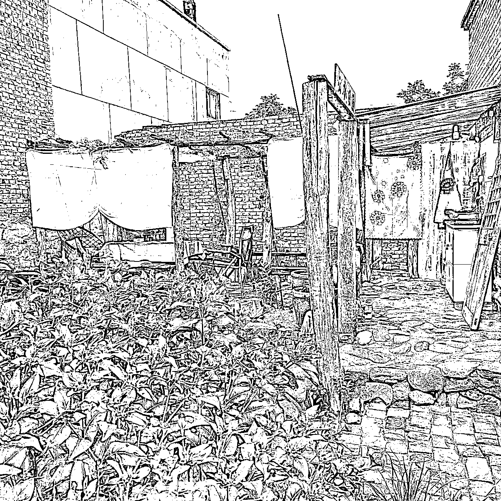

我用自由时间打造的山间小院

（上图是夏天小院周围的风景，下图是小院的布置。天气暖和时，只要有空就带家人来小院住一阵，看烟雨彩虹，看落日黄昏。不被打扰，不被消耗，不计较钱财多寡，随性自在地做事——这就是我追求的生活。）

曾经有个圈友找我合作剪辑，一个月差不多10万费用。我试了试，发现沟通很费劲，真要继续做下去，自己会被严重消耗，就没有接受。对方一再挽留，我还是选择不被消耗。不是我不想赚这个钱，只是它不符合我的价值观。我要赚的是“恬淡舒适、自由洒脱的生活”，而那种合作状态，很明显和我的方向相反。

很多人对赚到的结果并不享受，但已经骑虎难下。与其到最后纠结怎么从虎背上下来，不如最初就想清楚：到底要不要上这头虎。

想清楚你靠什么去赚

当下的迷茫，多数不是因为找不到赚钱的路子，而是因为赚钱的路子太多。也有人不同意，说赚钱明明很难——但说这种话的人，可能不是想赚钱，而是想暴富。

找创业方向，就像找对象，“选无可选”和“太多选择”一样让人头疼。所谓“乱花渐欲迷人眼”，能在满地繁花里找到想要的那一朵，本身就是一种本事。

那到底靠什么赚？这是值得反复拷问自己的问题。

是靠着幻想？靠自嗨？这样的人并不少。如果正中现状，记得停下来自省。

是押注机会和运气？碰到好的机遇固然是加持，但这不在人为可控的范围内。

是靠双手、靠技术、靠巧智、靠信息差、靠资源、还是靠价值？你总得做一个选择。

想靠双手吃饭，就去找门槛极低的项目，比如研究那些只需要执行力的领域。

想靠技术赚钱，就挑一门感兴趣的手艺往下钻，比如剪辑，然后接外包打怪升级。

想靠巧智赚钱，那就先去当一回“韭菜”，学会别人是怎么运作的，再回头也做收割者。别瞧不起镰刀——当镰刀也需要有两把刷子，不是谁想当就能当的。

想靠信息差赚钱，就去研究如何发现信息差。以前的无货源模式，本质上吃的是信息差的红利。不过，信息差早晚会被抹平，要不断寻找新的洼地。

想靠资源赚钱，第一件事是盘点自己手上有哪些稀缺资源，把它产品化、商业化、再打磨，反复滚动起来。

想靠价值赚钱，那就想想自己到底能给什么人提供什么价值，把这个优势放大，做成对应的产品或服务，持续迭代。

如何摆脱迷茫？很简单：停止幻想，停止自嗨，把运气和机会先放一边。选一种适合自己的模式，把它当作自己的行动路线图。沿着这张地图去思考方案，做决策时就不会动不动迷茫。

同一件事，不同的人有不同的赚法。大家的认知、心态、处境都不同，没有绝对的对错，只有选择是否适合自己。选择自己发自内心认同的路，就好。

我的答案很简单：我就靠价值，靠能沉淀下来的价值。这是我从亦仁那里悟到的，也是我自己亲身尝过甜头的。

我可没有想把自己说得多高尚。谈到赚钱，我不想掺太多人品道德的评判，人性本就复杂，我更愿意用纯粹的逻辑来聊。

因为前面我已经说过，我想要的是恬淡安稳、自由自在的一种生活状态。正因如此，我才去选择做长久的价值。价值才可能让我心里安宁，生活舒服。

能徒手就干完的事我会觉得无聊，技术活又太耗精力，我又玩不转脑力类操作，信息差我觉得耗不起，资源这块我也拿不出像样的筹码。综合下来，靠价值是当下最合适的路径。

做一件真正有价值的事，让别人持续受益。既不必拼命劳累，又能得到内心的踏实，这跟我的性格和追求是契合的。

前段时间看到亦仁在一次线下聚会上的发言稿，他聊到德不配位会招致反噬。他说生财现已出现苗头，所以他把品质管控抬到前面，暂时不去追社群的热度，把重心放回价值建设上。读到那段话我很有共鸣，于是即兴写下这篇小文，把我对价值建设的理解整理出来，和大家分享。

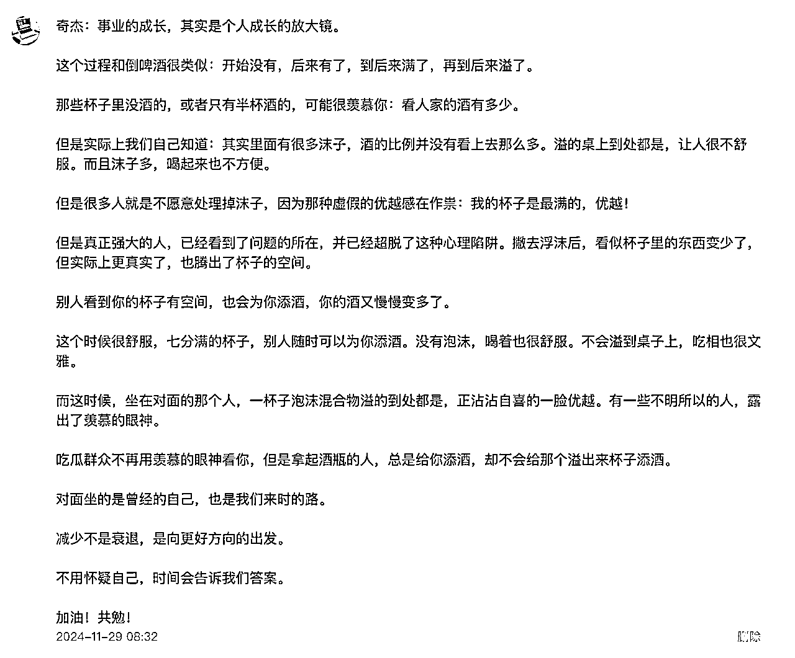

我的小作文：满招损谦受益

（我为何会有感触？说到底从前我何尝不是如此。因为经验不足，热度压过了价值，明显地德不配位了。好在船小好调头，我及时察觉，在被反噬之前就选择急流勇退，让自己淡出视线，用一年时间沉淀反思。这篇小作文最初是写给自己的，现在大家看到的，正是我正在践行的价值建设。原帖链接：https://wx.zsxq.com/group/1824528822/topic/2858454885855451）

小贴士：

每一种选择都有对应的结果，选之前把后果想清楚，就不会被困住。

* * *

### 古圣先贤的成功学

每个人都想成功，也都在摸索的路上乱撞。成功到底有没有方法论？我看腻了鸡血文和毒鸡汤，最后在儒家经典里找到了线索。

《大学》给出的路径是：格物、致知、诚意、正心、修身、齐家、治国、平天下。这八个步骤，就是儒家讲的成功之道。

原文：
古之欲明明德于天下者，先治其国；欲治其国者，先齐其家；欲齐其家者，先修其身；欲修其身者，先正其心；欲正其心者，先诚其意；欲诚其意者，先致其知；致知在格物。
物格而后知至，知至而后意诚，意诚而后心正，心正而后身修，身修而后家齐，家齐而后国治，国治而后天下平。
自天子以至于庶人，壹是皆以修身为本。其本乱而末治者，否矣。其所厚者薄，而其所薄者厚，未之有也。

大白话翻译：
自古想在天下成事的人，先把自己的国家治理好；想治国，先把家庭团队理顺；想理顺家庭团队，先修自身；想修自身，先把心端正；想端正心，先让意念真诚；想真诚，先让自己通透明白；通透明白靠格物去除杂念。

去掉杂念就通透了，通透了就明白真诚是力量，明白真诚心就正了，心正了才注重修为，修为好了团队才稳，团队稳了国家才顺，国家顺了天下才归。

从帝王到平民，都以修身为根本。根没修好还想见效，是不可能的。舍本逐末终究行不通。

心得分享：

「这跟创业有什么关系？」

很多人只想着赚钱，却不问自己凭什么赚。大佬们反复说的长期主义、日拱一卒、真诚才是力量，这些词我听过很多遍，可大部分人听不进去。因为没有格物，所以致知不到位。心里杂念太多，看不清本质，问题就想不透。

答案其实一直都在：格物、致知、诚意、正心、修身、齐家、治国、平天下。

我们都想齐家治国平天下，却忘了修身是根。修身靠格物致知诚意正心。去掉杂念才心明，心明才真诚，真诚才会被认可，被认可才有市场，有市场才有成交。这才是赚钱的底层逻辑，也是老祖宗留下的精神财富。把本该重视的修为放一边，却过度追求变现，做事怎会有好结果。

我常帮人咨询问题，很无力。因为你说什么他都接不住，心像抹了油一样油盐不进。满脑子欲望私心，心不明所以无知，金句对他无效，言行飘忽急躁，根本聊不到一块。这大概就是《儒林外史》说的“良言难劝该死鬼，慈悲不度自绝人”吧。

小贴士：

赚钱是水到渠成的事。越想赚越赚不到，不想赚的反而来了。所以“但行好事，莫问前程”是有道理的。先放下赚钱的执念，把精力放在提升修为上。排除杂念把事做好，做好了钱自然来。栽好梧桐树，凤凰自会来。共勉。

* * *

### 明确的方向和动力

阳明先生在《教条示龙场诸生》中说：“志不立，天下无可成之事，虽百工技艺，未有不本于志者。志不立，如无舵之舟，无衔之马，漂荡奔逸，终亦何所底乎？”

大白话：
没有立志，天下就没有可成之事。即便工匠技艺，也无不以志为本。不立志，就像无舵之舟、脱缰之马，乱漂乱跑，最后能到哪？

志向是灯，是方向。没有它就只能随波逐流。今天这个赚钱就去做，明天那个有红利就追，我称这类人是“互联网流民”，没有贬义，只是形容没有根基的方向感。

问一个人志向是什么，十个里九个答赚钱。那是欲望，不是志向。志向、目标、欲望很多人分不清。

心得分享：

「厘清志向、目标、欲望」

志向：想在哪方面做出些事，理论上不可能完全实现，它是方向。

目标：阶段性的追求，像路上的石头。有了志向石头才连成路，没有就只是散石。

欲望：内心的渴求。有志向欲望就是动力，没有志向欲望就是躁动。

比如亦仁，过去跑过很多项目都赚钱，但他不满足于做项目赚钱，他想带更多人学会赚钱，于是做了生财有术。多年经营到今天的规模。

想帮助更多人学会赚钱，这是志向；过程里阶段性的追求，是目标；赚不赚钱是结果，对亦仁是结果，对眼红的人是欲望。

怎么深耕？就是想清楚志向，并持续往一个方向走。东一榔头西一棒槌不如选一件能为他人创造价值、自己擅长的事，长期积累，复利自然发生，有了价值买单的人自然来。

如果暂时想不清志向，不妨先清心。正心知明，杂念减少，志向自然慢慢显现。

不必急，这是个过程。人生很长，用点时间沉思很值。老子说：有之以为利，无之以为用。想要以后有，不如现在先空。适度留白不做事，更利于想清楚要做什么。功利心本身就是杂念，排除杂念时别再功利。

清心可以明志

（附上一张我在林中打坐的照片。今年打坐频率很高，通过静观内在，感受念头的起伏，剔除杂念、心明如镜，成长肉眼可见，强烈推荐大家试试。）

小贴士：

去掉私心杂念，从利己转向利他，想想能为别人提供什么价值。静下心找到志向，让欲望化为动力，把散乱的石头铺成道路。路修好了，自己走得通，别人也能走，赚钱自然水到渠成。

* * *

### 如何复盘才有力量

有方向有目标有动力，还需要力量。复盘到底复什么？只复成效和技术就太浅了。看看圣贤怎么复盘。

原文：
曾子曰：“吾日三省吾身：为人谋而不忠乎？与朋友交而不信乎？传不习乎？”

白话：
曾子说我每天自省三件事：替人办事是否尽忠？与朋友交往是否诚信？师长的教导是否温习？

心得分享：

「每日复盘积蓄力量」

别人求助时，你是一心帮他把事做好，还是在想怎么套路？

跟人交往时，你是诚信以待，还是偷奸耍滑？

是否坚持学习，提升专业和服务能力？

我们和圣贤的区别在于，圣贤复盘的是自己够不够好、是否给他人创造了价值。而我们往往复盘的是套路灵不灵、利益抓没抓够。差距由此拉开。

小贴士：

真诚才是力量。学圣贤的复盘法。小胜靠智，大胜靠德。用小聪明赚钱是竭泽而渔，用大智慧赚钱是细水长流。

* * *

### 害怕质疑万事不成

以上是小宇宙的运转，创业还需处理好与大宇宙的关系，防备外部干扰破坏我们的小宇宙。

做事时常因别人的质疑而动摇。其实不必。想清楚、控好风险就去做。每一次成长，恰恰来自做了大多数人没做的事。看不懂你的人不会认可你，不需要他们的认可，只需做给看懂的人看。

质疑你的人看不懂才对，看懂了你就没机会了。一件事被所有人看懂就能做的人都进场了，还怎么玩？老子都被质疑，何况凡人。

原文：
上士闻道，勤而行之；中士闻道，若存若亡；下士闻道，大笑之。不笑不足以为道。
故建言有之：明道若昧，进道若退，夷道若纇。

白话：
高手听到大道立刻去行，中等的人半信半疑，下等的人会嘲笑。不被嘲笑不足为道。
古语说：真道理看起来暗昧，前进像后退，平坦的路看起来崎岖。

心得分享：

周围总有人“好心”提建议，别轻易全收。真正厉害的人不主动说，说话慎重。征求建议要问结果导向的人，不能因年龄亲近就觉得对。跟错身边人吃亏的例子太多。

一句话：哪怕你的决定是坨屎，也是当下认知下的最好选择。别人的好决策跟你无关。你只能在自己的认知范围内决策。就算糟糕，那也是最好的糟糕。

多做多错，不做就是最大的错。经历错才知道对。做事是试错纠错过程，错的被筛掉剩下的就是对的。我常说做对难，做错不难，所以放手去试。

秉持“做错”的心态去实践，就不会胆怯。做了就走上纠错之路，不做只会停在原地。别人质疑不会负责，说完就走，路还是你走。别瞎拐，不用解释，按自己的路走，试错纠错才是成长。

放弃内衣行业的高薪时，一堆人说我脑子坏了。从互联网基层起步时收入入不敷出，很多人劝我回去，我咬牙没回，才有了今天的缘分。就像打CS，地雷扔来后退必死，只有往前冲才活。

小贴士：

坑要自己踩，南墙要自己撞。对错成败都是赚的，要么赚到钱，要么赚到经验。别人的建议只是参考，真正属于你的经验，必须自己踩坑撞墙来得。

* * *

### 收起廉价的菩萨心

成事后，质疑会消失，取而代之的是恭维、攀附、染指。我本不想写这个，太敏感。但为了那些善良的年轻人不被伤到，还是写出来。

现实里多少例子：你爬坡时没人推你，成了后一堆人来问候。要帮忙的、介绍资源的、想合作的、想学习的。一个个热情良善，要么显能力，要么拉关系，要么诉苦。目的只有一个：能捞点好处。这对应《增广贤文》：贫居闹市无人问，富在深山有远亲。不信看筵中酒，杯杯先劝有钱人。

别急着说我阴暗。天下熙熙皆为利来，天下攘攘皆为利往。这不是我的偏见，是世界的运行规律。你看这篇文章也是想学点东西，这不就是图利逻辑吗？

心得分享：

世界上有两种东西不能直视，一个是太阳，一个是人心。落魄时才能看出人品。取得一点成绩，世界就虚幻了。人人都眼清心诚，困难的、需要帮助的纷纷出现，警惕。

我不是否定善，也不是说自己高尚。人性复杂，善时真善，恶时真恶。善恶同体。不要怀疑别人的善，要防止别人的善变成自己的恶。

不管对方善恶、可怜可悲，那都是你的判断，肉眼凡胎未必是真相。世事有因果，非你我能左右。看清自己的位置，做好本分。我们只是凡人，略得命运垂青，做出一点小成绩让家人生活稍好。千万别觉得自己能拯救世界，收起菩萨心。

经营好事业，保护好成果，别做烂好人，别想拯救别人，别随意干涉他人因果，防止反噬。

我不是说要自私，只是说无条件的付出和妥协，不会帮助别人，只会培养贪嗔痴，反噬自己。真正帮助人，是有原则的因果交换。

原则是什么？“医不叩门，道不轻传，师不顺路，法不空出。”

比如孙悟空一个筋斗可达西天，为何还要历经磨难？如来为何不直接给真经？现在才懂，若直接送达，唐僧会珍惜吗？东土人会当宝吗？历经磨难得来的智慧，若轻易得来，还有尊严吗？

我做短视频有成果后，亲友问我怎么做。我建小群计划直播教他们。约定时到，我等了半小时只来一人。直播没成，小群解散。最终只一人学了，还常埋怨我讲不清。聊到剪素材，我说不会录屏吗？他说你没教过我录屏，我怎么知道。录屏是基本操作，至于专门教？

后来我研究出批量混剪，本想教他，对方却说你一天能剪那么多，我的号你也帮我更了吧。那一刻我无语，想直接把收入转给他。拒绝后他不高兴了，也没学。

注意：没有原则的免费善意，培养的是贪嗔痴，造成反噬。

后来做教练，直播答疑一律不开回放。想学就准点来，赶不上下次再来。学员觉得我不近人情。但开了回放谁还准点来？我一个人自言自语给谁听？回放又有几人看？最后学不会，是老师问题还是自己没用功？

所以别高估人性。没有霹雳手段莫行菩萨心肠。老子说大德若谷，大白若辱。真正的慈悲看起来像刻薄。

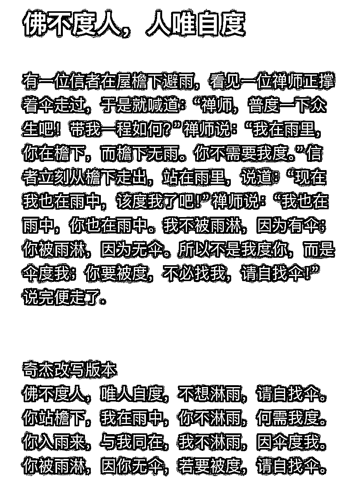

禅师拒绝贪嗔痴

（这是我很喜欢的小故事，我即兴改写过。信者想白嫖雨伞就道德绑架禅师，禅师若答应，看似帮了他，实则纵容了他的贪嗔痴，使他越走越偏。真正的度化，是让他养成正确的思维习惯。）

**把自己的心血当回事，别人才会当回事**

一个人最宝贵的东西，不是运气，而是那些靠时间、踩坑、死磕换来的手艺和经验。
所以，别动不动就把自己的东西看低了。
有人想跟你学，可以，但规则要先讲清楚：拿价值来换。
如果对方压根没把你当回事，你又何必把压箱底的东西掏给他？

**钱不是俗，是照妖镜**

嘴上的“真诚”最不值钱，真正能检验对方有没有诚意的，是你愿不愿意跟他谈钱。
别怕谈钱伤感情，钱能筛掉九成虚情假意。
你会发现，那些真正想做事的学员，从来不嫌学费贵，他会想办法把你教的东西成倍地赚回来；而那些嘴上抹蜜的人，就算你把方法论喂到他嘴边，他也懒得嚼，最后反而骂你的东西没用。

什么叫公平？不是谁占谁便宜，而是你的价值配得上你的价格。
唐僧要是只经历一难就取到真经，八成回来也是把经书锁进柜子里吃灰。太容易到手的东西，没人会真的当回事。
我自己就栽过这样的跟头：收费200，却做了2000块的交付。结果呢？课也不看，练也不练，出去还打着我的旗号乱接活，活儿做得稀烂，最后坏的是我的名声。
所以，别怕把门槛设高，更别怕把人拦在门外。人性这东西，没付出代价的东西，永远不被珍惜。

**不来白嫖的，也得筛**

有人想：只要不白嫖，给钱我就收，总行了吧？
不一定。有些人虽然付费，但依然会让你精疲力尽。
我们做事业，比的不是谁做得快，而是谁做得久。一旦被人、事、情绪、认知这些无底洞消耗，就跟千刀万剐似的，看着没流血，人已经空了。

消耗你的人长什么样？一起干活他就喊累，一起沟通他就抬杠，服务他一次你三天不想接单。
不管他是客户还是朋友，该退钱退钱，该疏远疏远。不是他为人有多差，是你们不合适。

消耗你的事也一样。一做就心烦，一想就头大，学起来就烦躁——再好的项目，跟你不搭就该果断砍掉。别人眼里的鸡汤，可能是你的毒药。

还有情绪。愤怒、悲伤、焦虑会偷走你的力气，狂喜和兴奋会拉低你的判断。
怎么破？外面烂人烂事远离，里面把内核练稳。内核稳了，情绪就是你的工具；内核不稳，你就是情绪的傀儡。

那些能滋养你的人，是带你进步的良师，是跟你合拍的搭档，是让你赚到钱还愿意处成朋友的客户。
滋养你的事，不需要你咬牙坚持，你做的时候时间是被偷走的，灵感狂冒，越做越上瘾。
最好的状态，是那种淡然、平静、理智的状态。在这种状态下，智商在线、精力充沛、决策精准，而且越用越多。

我写这篇长文，其实就是一个例子。
你以为我写这么久会累？说实话，我写得贼上头，灵感来了连饭都懒得吃。文章滋养了我，我也在滋养文章。
可如果换个人来写，可能写不了两段就痛苦到抓头发，每写一句都需要心理建设。那是文章在消耗他，也是他在消耗文章。

**最隐蔽的消耗，是认知**

外部的消耗，容易发现；内部的认知消耗，最可怕。
老子说，能看清别人是聪明，能看清自己才是智慧；能赢别人是有力气，能赢自己才叫强大。
樊登讲过，潜意识里那些你意识不到的东西，会反过来成为你的命运。
也就是说，你从没觉察过的底层想法，会在背后替你选择、替你决策，最终决定你往哪走。
超出认知的财富，你接不住；超出认知的决策，你也不可能做出来。
所以圈层才这么重要：换一个环境，慢慢就换了认知；换了认知，决策就不一样；决策不一样，命运就彻底掉头。

我见过最哭笑不得的操作，是有人把别人付费社群的内容偷出来，搞一个“共读”，再低价卖给不想买门票的人。
要说这操作，连团长看了都得喊一声：你可真是个人才！但你想过没有：你说是为了学赚钱，结果干的全是投机的事儿，这种认知怎么可能赚到钱？

同样是学习，高手用的是投资思维：买正版，进圈子，认识同频的人，在一次次交流里升级认知、攒人脉、长本事。
而有人用的是投机思维：偷资料，省门票，自以为捡了大便宜。可天底下哪有靠看盗版就能暴富的道理？那些盗版课程要是能造就富豪，为什么连门票钱都要抠？穷，都是有原因的。
一次两次占小便宜，看似精明，其实是把“投机算计”四个字刻进了底层认知。它会破坏信任、污染思维、搞垮决策，最后毁掉你的前程。
真正聪明的人看起来笨，自作聪明的人看起来精，到底谁高谁低，不用争论。
亦仁和那么多高手，都在生财圈子里面天天碰撞交流，你不去，偏要买一堆没有灵魂的盗版资料——这跟遇到了心动女生，不上去搭话、不创造相处机会，反而偷拍一张照片回家对着照片自己傻乐有什么区别？这样还想脱单，做梦吧。

以前我发过一条批量混剪的帖子，很快就被别人扒下来挂朋友圈卖9.9元，过了两天又有人挂8.8元。
我猜，他们肯定会买8.8的，毕竟能省一块钱嘛。省钱省到这个份上，我都忍不住想笑：慢慢算计吧，看看啥时候能算出一套豪宅来。
所以，如果你现在看的也是盗版，听我一句：财富是挣出来的，不是抠出来的。
你缺的不是那点资料，而是一个能让你持续向上走的组织和圈子。

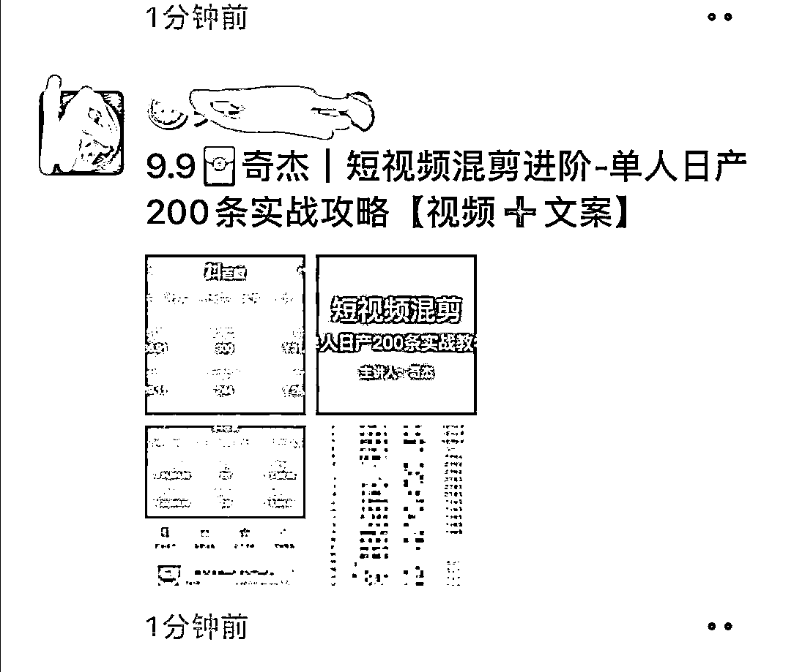

（朋友圈里那条盗版广告，到现在还存着。我反而有些感慨：生财里的老板们做事是真讲究，尊重原创、尊重价值，难怪人家能发财。这一课，是你们给我上的。）

**写在最后**

这篇文章，原本计划写一万字，结果一不留神写到了四万字。
这背后，是我一年多的反复思考，外加两个月的闭关，除了吃饭睡觉锻炼，其余时间全泡在文字里，整个人瘦了五斤。
但我一点都不累。这样的专注，也算是对这几年自我修行的交付吧。写出来最大的感受是：越是把东西分享出去，自己反而收获越大。

你能看到这里，说实话我很佩服。
这几万字不敢说句句有用，但只要有一句话能给你提个醒，这字就没白码。

聊个题外话。很多人说大环境不行，钱难赚。
可你去看短视频平台，天天爆单的照样一大把。环境再差，也有人赚钱；环境再好，也有人亏钱。
所以，纠结环境没意义。不管环境怎么变，我们该做的事只有一件：向前走。心学里讲“主一”，也就是专注一个天理。
事业的天理是什么？行情好，就跑市场；行情差，就修内功。所谓修内功，无非是沉淀、布局、学习、准备。
万事俱备，只欠东风。东风每年都会来几次，可你的“万事”准备好了吗？要是没有，东风来了，也只是一阵风。
接下来，我也会继续梳理新一年的业务，布局新的课程。累了就躺平休息，休息好了就起来接着干。
别内耗。内耗就是拿刀子割自己。

这篇文章，是年前送给你的礼物。
祝你稳稳地往前走，不管风云怎么变，你都是那个能接住机会的人。

看完若有什么想说的，去生财原帖评论区聊吧。

——奇杰，于太原