# 《七个“赚钱思路”，两个月打造50+人的优质团队》
作者：龙哥

圈里的朋友们，晚上好呀，我是龙哥。

一个写了十二年文字、拆了七年书的“老学长”。玩自媒体这一年多，我写出了上百篇10W+爆文，也产出了不少付费星球的精华内容，全网累计阅读量突破千万。现在，我既是理白老师实战营的主理人，也是理白老师的助理。

跟在白大身边这不到一年，他带着我一点点打磨，我陆陆续续写出了实战营全流程、教练分享手册、助教行动指南、志愿者培训手册、多个社群日常运营SOP、激励计划曝光策划等20多套知识库。

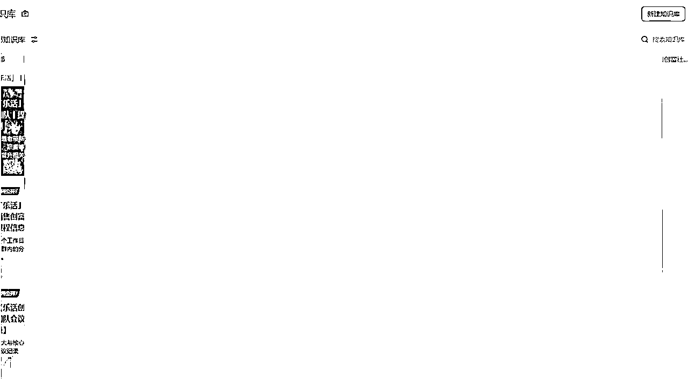

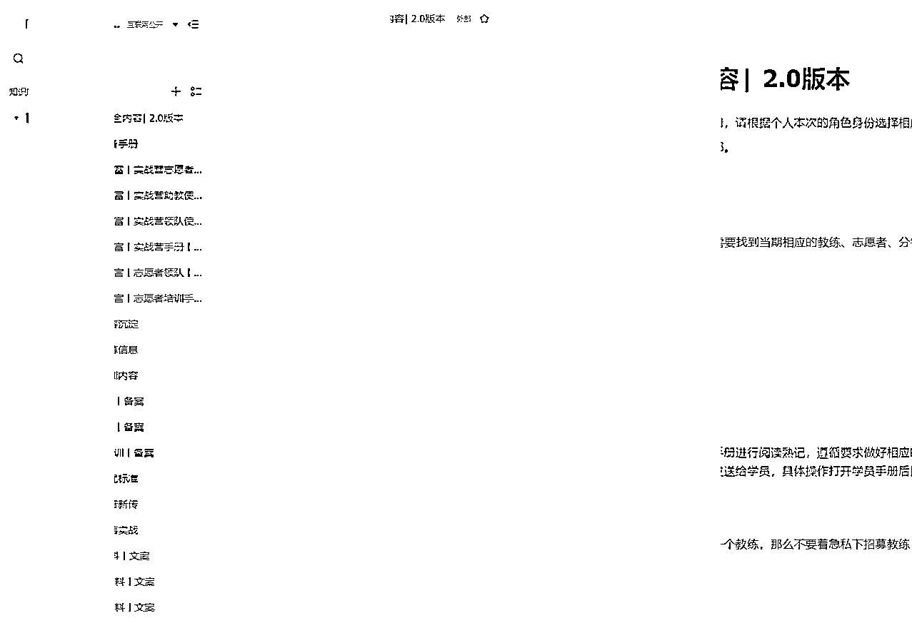

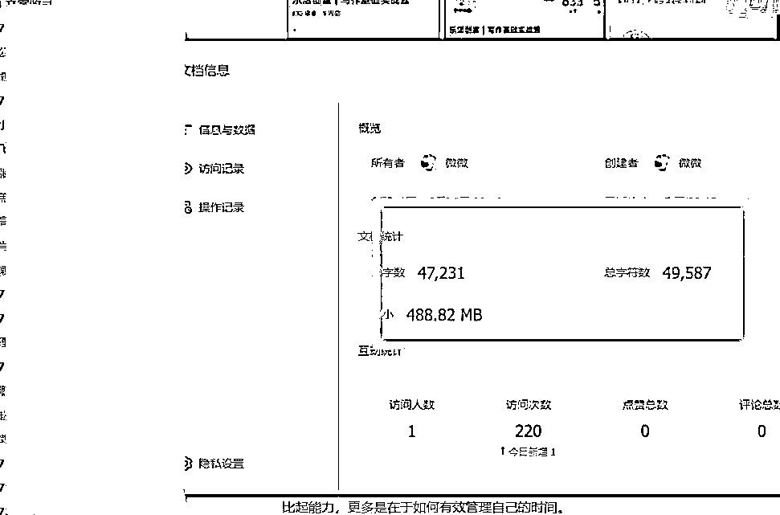

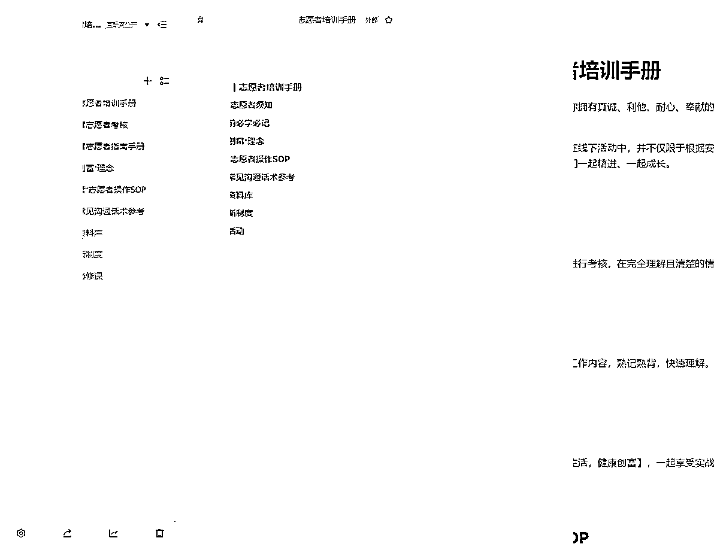

也是在不到两个月里，我们搭起了一支50多人的志愿者团队，支撑起30多个社群和实战营的“全人工自动化”运转。这支队伍粘性高、认同感强、配合度深，算得上是一支高价值的自媒体运营铁军。

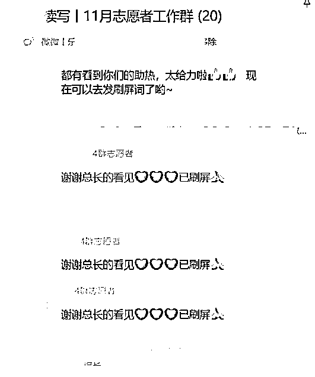

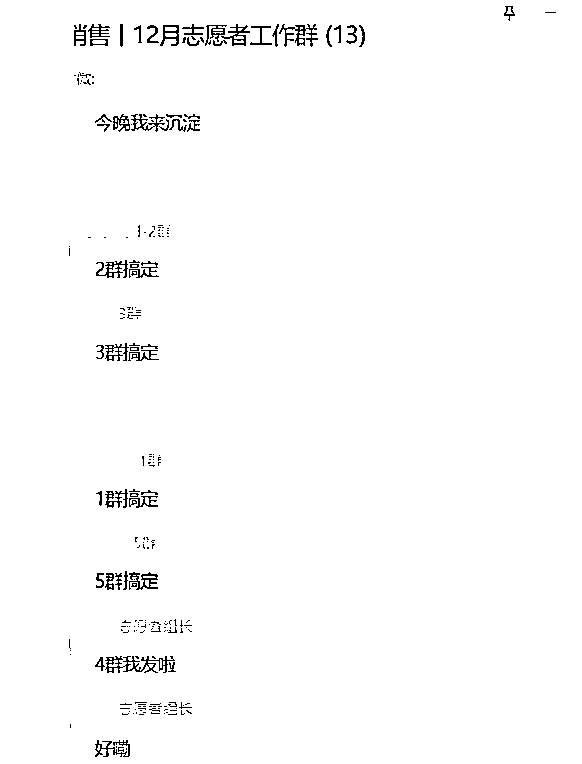

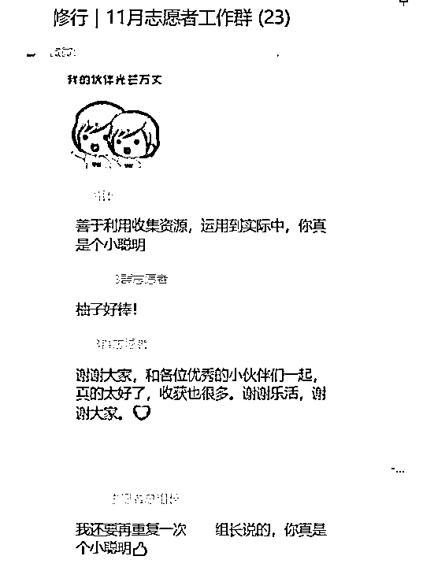

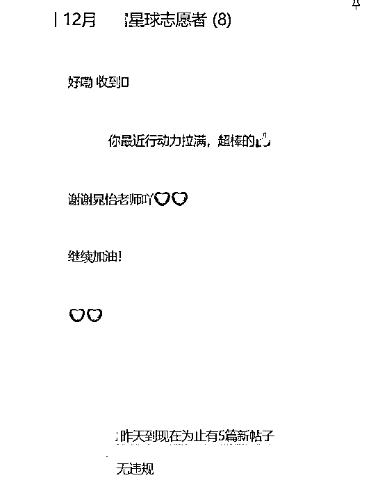

很多圈友问我：到底怎么从零搭团队？怎么让团队快速扩容？今天我就把这阵子踩过的坑、验证过的方法，拆开来和大家聊聊。

# 一、招人之前，先想清楚这几件事

不管你是从零起盘，还是给老团队扩招，第一步都不是急着发招募帖，而是先静下来摸清自己的家底。别人的模式再好，那是别人的；当下的需求是什么，只有你自己知道。

我特别认同一句话：因岗设人，而不是因人设岗。

要不要招人，不是看业务多不多、自己忙不忙，更不是看有多少人慕名想跟你干。真正要判断的是：这件事的效率是不是在下滑？压力是不是在变大？这件事能不能分出去？它有没有触及你的核心？

所以，在做招募决策前，请给自己留一段足够清醒、不被打扰的时间。我比较推荐在早上，理性最在线的时候，去图书馆这类安静又有正向气场的空间，认真盘一盘：

- 当前核心业务能承受多大的外部冲击？如果核心业务塌了，是不是全盘皆输？
- 未来三年，团队的重点项目有哪些类型？这些项目需要什么样的人？现在缺哪类人？有没有短期急需的？
- 手里有哪些招募渠道？这些渠道能不能自动过滤、精准筛选，省下判断成本？
- 你要的到底是能近距离接触你、了解你本性、懂你规划、几乎等同于你“分身”的私人助理？
- 还是能通过合作共创，帮你做曝光、引流、转化，推动新业务增长的短期合作者？
- 又或者只是需要分担重复性劳动、琐碎事务的普通助理/志愿者？

把这些捋明白了，我们再从三类角色分别说。

## （一）个人分身：私人助理

私人助理在我看来，不只是员工，更是至少五年起步的长期合伙人。薪酬、管理、沟通、利益分享，都要和一般员工拉开质的差距。

如果你想招私人助理，先要发自内心地承认：我确实需要“分身”。然后你要用找合伙人、找左右手、找长期战友的心态去招募，而不是招聘一个普通打工人。

因为一旦你只把对方当普通员工来用，那本质上你需要的就不是私人助理，而是志愿者。

私人助理的认知、情商、能力和学习天赋，至少要达到你的60%-70%，在及格线以上，但又不能太强势、不能喧宾夺主。

所以，自媒体小白、非本行业的跨界者、没有成绩和项目经验的同行、说得比做得好听的“行动矮子”，还有那些过于自我、控制欲极强的性格类型，都不适合纳入招募范围。

你要的是一个忠诚可靠的“分身”，不是给自己培养一个对手或白眼狼。

除此之外，还要看对方有没有管理、日常事务、社交礼仪、基础技能、情绪释放这些常用能力，三观上能不能长期和你同频。

想清楚这些后，你自然就能判断：你的“杂”到底只是重复性事务居多，还是涉及小决策、管理安排？如果是前者，找志愿者就够；如果是后者，才需要私人助理，或者“私人助理+志愿者”的搭配。

## （二）一般员工：志愿者

很多做自媒体的朋友容易掉进一个坑：不管大事小事，都想雇个员工或长期助理。其实没必要。

只要事情对核心项目没有决定性影响，就按“流水线”标准来。不需要动脑、创新、对标学习的活，就别花那份冤枉钱去雇正式员工。

那些重复性明显、只为了维护日常活跃和基础运营的工作，直接招志愿者完全能替代一般员工，性价比高得多。

再说透一点：除了私人助理，其他性质的员工基本都经不起时间考验。任职越久，对薪酬和额外利益的需求就越大，哪怕工作量从没变过。

别对人性抱有太高期待。人既有善良无私，也有自私贪婪。合作关系处久了都还需要情绪价值和实用价值的持续供给，更何况只靠利益捆绑的雇佣关系？

志愿者反而是很好的解法。他们不图钱、不图利、不图名，更看重个人成长、知识精进、经验积累。你可以用最低成本，把自己从重复劳动里彻底解放出来。

招志愿者不用太纠结粘性强不强，只要能力、技能、认知、情商跟得上就行。这样安排任务足够顺畅，遇到负面声音也能正常应对，不至于引发舆情。

但志愿者也是人，时间长了也可能倦怠，也难保不出现对利益的追求。所以我在招募志愿者时可以加一道“保险”：同一件事安排多个人来做，既能分担，也能互补。万一有人请假或掉线，其他人也能顶上，成本并不高，后面会细说。

## （三）各取所需：短期合作者

短期合作者，是当团队要开拓新业务、新支线时才需要考虑的。

这类人既能给你有效建议，也能提供内容价值。他可以是帮你干活的员工，也可以是带你看世界的共创者。

举个例子：

- 你不太擅长文案，但新业务偏偏需要文案策划、营销内容，那就可以找一个在写作上足够专业、其他方面不一定要全能的人来合作；
- 你要发售一个小产品、一门小课，不打算雇操盘手，那就可以找有分销能力的KOL谈合作，借短期联动做出裂变；
- 你开了个一两个月的训练营，预算不多，自己也交付不过来，那就邀请有能力的教练，用分成、佣金，或者曝光、内推、链接等福利来换对方加盟。

短期合作者，通常可以从同量级或低你1-2个量级、彼此熟悉可信的自媒体好友中去挖掘。

但如果目标是搭建长期稳定团队，或者扩招能持续创造价值的成员，短期合作者就不太适合作为主线了，这里就不再展开。

# 二、招人的底线思维

方向想清楚了，还要记住：不同类型的招募对象，从一开始就要有不同原则和底线，不能一概而论。基础打好了，团队才不会中途断层，也不会出内部乱子。

## 1. 私人助理：粘性 > 能力 > 认知 > 学习天赋

私人助理作为你的分身，技能要求确实高，要60%-70%，但它并不在最关键的位置。

最关键的是「粘性」。

真正认可你的人，不会轻易否定你的每一步，会不遗余力地给你打辅助。真心想帮你、拥你为王的人，话不多，但执行力惊人。

就拿我自己来说，我对白大是高度信任、发自真心认可的。所以在工作安排、执行配合、情绪沟通上，我都能保持高水平协同，效率自然就高。

反过来，哪怕一个人能力值100%，如果和你没有粘性，他更适合做短期战略合作，不适合放在你下面做事，否则容易翻车、不欢而散。

只有粘性强的人，才配进入原始门槛的检验。

能力排在粘性之后还有一层原因：粘性是能“看”出来的，能力却需要时间去验证，看看对方说的水平是不是真的。

再往后，要看认知。一个人能不能跳出低层次的思维局限，能不能摆脱“穷人目光”，能不能坚定内心信念，面对突发事件有没有成熟的看法，这些都影响长期协作。

认知跟不上会引发一连串问题：

- 稍有成长就开始质疑你的安排，心生不屑、不服；
- 既想又要，不明白跟在你身边已经是机会，开始追名逐利；
- 初心动摇，看到外界诱惑开始怀疑长期主义，甚至对你产生怨恨；
- 情绪失控，不能从团队全局出发，一点突发情况就破防。

所以学习天赋排在最后就很好理解了。一个人如果忠诚、能力强、认知高，哪怕学新东西慢一点，也完全值得你慢慢培养。

## 2. 志愿者：能力 > 认知 > 学习天赋 > 粘性

志愿者的招募逻辑和私人助理几乎反过来，只有第一点之后不同：能力 > 认知 > 学习天赋 > 粘性。

私人助理可遇不可求，志愿者却一抓一大把。所以粘性不占C位，能力匹配才是第一位的，这样才能保证日常运转稳定。

为什么能力排第一？因为志愿者容易更替、也容易招到，不需要你投入太多情绪价值或物质成本。只要能力足够，你只需提供一套细节到位的SOP——流程、步骤、注意事项、避坑指南全写清楚，再给志愿者做一场培训，大家照着执行就完了。

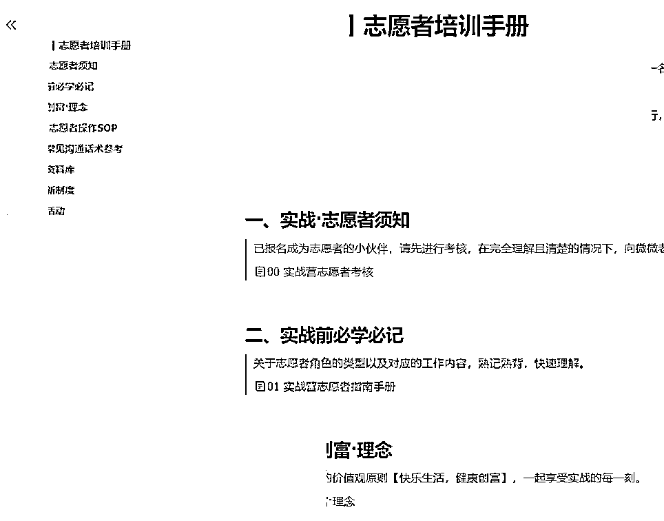

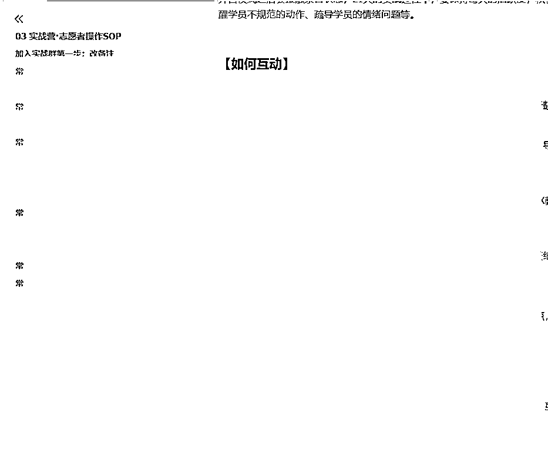

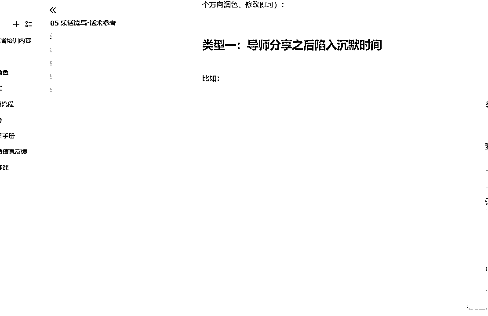

你可以把这件事从开始到结束的每个思考、每个动作、每个环节全部写下来，再往里填细节，补充志愿者实践后的反馈，回想过往掉过的坑。用不了一个月，一套丝滑完整的SOP就成型了。

## 3. 测量方式：先筛，再测，后试

有了思考和原则，也不代表第一次就能招到对的人。还要过下面几关：

私人助理的筛选路径：个人介绍的排版 → 提供某个领域/项目的成绩凭证 → 给出测试内容或即兴创作 → 暗示试用期。

拿我自己举例。我有多年写作、拆书经验，所以我做个人介绍时，会特意精简排版，突出优势、成绩和关键词：

【昵称】微微

【地区】深圳

【标签】

◆「龙哥盟」星球会员

◆ 拆书写作教练

◆ 90后职场学长

◆ 盖洛普前五：沟通、交往、个别、体谅、成就

【个人介绍】

① 通过「微拆写作法」，不到一年写出百篇10W+爆文，全网阅读量超1000W。

② 写作12年，拆书7年，理白实战营主理人，万粉👸号主。

③ 一年创作100+篇付费知识星球精华帖，副业变现六位数。

【我能提供】

① 一套提高写作思维、强化输出效率100%的写作方法。

② 知识付费、写作咨询，以及各类自媒体运营SOP方法论。

当对方发来的介绍中有你需要的自媒体技能时，就抓住最亮眼的一点，要求提供真实凭证。比如对方说写了百篇爆文，那就问是哪个平台，把文章发过来看看，挑几篇优秀的审核。

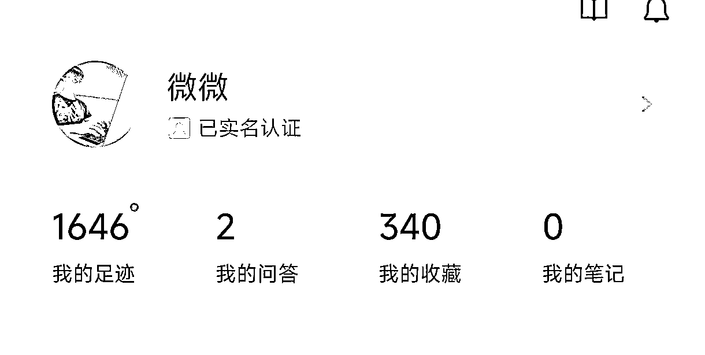

等真实经历验证过关，为了再确认能力和粘性，可以要求对方做测试，或即兴给一个话题，看看对方怎么创作。

一般来说，前三步过了，粘性和能力基本就有数了。之后再用“试用期时间长、责任大、配合难度高”等门槛，让对方先有压力和心里预设。

但不必明说具体多长时间。你先手把手带对方完整走一遍流程，如果三个月下来，对方还能保持高粘性、高效率、高配合、高反馈——

那就恭喜你，遇到了一匹千里马。长期下来，你会越来越轻松，大后方也能放心交给这个“分身”。

志愿者的筛选路径：个人介绍的排版 → 提供某个领域/项目的成绩 → 表达个人需求 → 培训后按SOP实操一个月。

前两步一样。到第三步，重点看对方为什么来，想得到什么，能带来什么。

可以参考这样一段话：

“XX你好，很高兴收到你的报名！你的履历很漂亮，了解到你在XX方面也有成熟的经验和能力，我们很期待和你一起把团队工作做好，一起发光发亮。

在正式加入前，想问你一个小问题：除了每月奖励，你来报名志愿者还有别的驱动力吗？比如想收获奖励以外的什么？希望这段旅程给双方带来怎样的价值或回忆？我们也很期待能让你在合适的位置发挥100%的实力呀。

不着急，认真想一想，这两天回复我就好，谢谢宝子！”

前三关通过后，第四关基本不用担心。只要培训时把细节讲透，SOP足够清晰明确，一个月下来，大多数人都会留下来。

# 三、把人留下来的“思量”

需求和门槛都搞清楚了，接下来就是怎么让人留下来、不轻易跑掉的问题。

物质条件确实是最硬核的吸引力，但只有“里子”没有“面子”，也扛不过时间的冲刷。一旦别人给出更好的福利，或者情绪稍微一波动，可能就散了。

我们先把“里子”说清楚，也就是薪酬标准。

## 1. 私人助理：愿景 + 薪资

私人助理是你的“分身”。前期跟你一起打天下，相比工资，他们更在乎的是愿景。

所以报酬上，给到的应该是：愿景 + 薪资。

愿景要在确定对方就是你要的人之后，尽早给到。比如：

- “从今天起三年内，我们共同把一个星球从0做到万人规模。”
- “别把自己当助理，2到4年内，我会带你赚到100万。”
- “相信你的潜力，在我身边多看、多学、多行动，你会比同龄人成长快N倍。”

愿景不是从你个人角度去画饼，而是以并肩作战的伙伴视角，描绘你们一起能做成什么样的壮举，以及这些年你能给对方带来什么确定性的变化和收获。

这个愿景一定是你们两个人的共同目标，而不只是近期工作方向。别用“紧急”去表达，眼光至少要放到一两年后。

要让对方真切地感受到：他参与的是你的未来，能在那个未来里承担重要角色、获得巨大成长。这些承诺，比当下多开两三千块工资更让人愿意死心塌地跟你干。

所以一开始就选三观一致、粘性极高的人，太重要了。

至于薪资，不低于市场价、有基础保障就够了。前期不用把薪资定得太高，可以按你临时分派的任务来划定。注意在任务难度较高时，不定期给一些奖金或福利。奖金好理解，福利可以是你的课程、产品、社群交付、资料，甚至是一对一咨询。

福利不一定要很贵，但千万不要给公域已经公开、随处都能搜到的内容——要给那种半公开、不透明的“私家货”。

## 2. 志愿者：外力的“激”

说完了里子，再讲外力的“激”。

志愿者本身不图钱不图利，他们更看重价值感、参与感和成长感。所以能用好“外激”，团队凝聚力会强很多。比如：

- 及时公开表扬每一次用心付出；
- 让他们看到自己的工作成果如何支撑起整个社群运转；
- 定期给予专属学习机会、内部资料、专属徽章等“身份感”福利；
- 营造一种被需要、被信任的氛围，让他们觉得“这里离不开我”。

当一个人在一支团队里既能得到成长、又感到被尊重、被看见，他自然愿意留得更久、做得更深。

大概就是这些啦。从想清楚“要不要招人”，到定好底线、测出人才，再到把人留住，每一步都需要耐心和真诚。希望我的经验，能帮你在搭团队这条路上少走点弯路。

晚安，圈友们。我们下次再聊。

很多人问我：做自媒体或创业，怎么从零搭出一支能打的小团队？我的答案是，先别急着发招募贴，先想清楚一件事——别人凭什么跟你干？

大多数人来做志愿者，根本不是冲薪水来的。他们更想要的是你的影响力背书、跟着你快速成长的机会，以及在其他任何地方都换不到的经验值。所以，招募时不要用“固定工资”当唯一诱饵，而应该把对方当成“实习生”来设计回报：课程、产品、项目交付、人脉资源、信息差，这些东西都可以变成等价奖励。我不太建议一开始就承诺“每月多少钱”，因为一旦给了固定酬劳，对方容易产生“这是我应得”的心理，哪天你停下来，反而会换来怨气。更好的做法是“奖金制”——金额不定，形式灵活：一个小小的红包、一份超高价值的加餐资料、一次30分钟的轻咨询，都可以。甚至可以用积分制：月度表现出色的志愿者得10个积分，表现一般得5个、8个，攒够一定数量就能兑换不同档位的福利。这样既有盼头，又不会让双方的关系变得太功利。

接下来是招募渠道。我的建议优先级是：付费用户兼铁粉＞潜在付费用户兼铁粉＞长久支持你的忠实粉丝＞平台公开发布信息。私人助理基本要从第一档里选，而且最好是中高客单价的付费用户。愿意花钱支持你的人，认可度已经拿到验证；再看他平时有没有积极反馈、是否在社群里活跃、是不是经常帮别人答疑、参加活动时表现如何——这些都是“铁粉”的试金石。最值得留下来的人，执行力一定大于情绪，能持续给你正向反馈。反之，那些偶尔冒个泡、天天水群却不贡献任何有效价值的人，一年半载后大概率会变成普通员工的状态。所以筛选期建议拉长到至少两个月，别急着拍板。

志愿者的话，渠道可以放宽到“潜在付费用户兼铁粉”。什么算潜在付费？不是那种天天喊“我早就想支持你了”却迟迟不掏钱的嘴强王者，而是买过你9.9元或百元以下产品的人、持续在朋友圈给你正反馈的人、积极参加线下活动、愿意和你见面的人。这些人用行动表达过心意，能力和积极性都有迹可循，某种程度上也是在向你发出信号：我想靠近你，想借你的光成长。如果是从👸号、低价社群这类公开渠道招来的人，在不熟悉对方的情况下，一开始就要把丑话说在前面：有服务期限，有劝退机制，不合适会及时调整。这里可以给大家参考一段我常用的模板：

“XX你好，我们认真看了你提交的信息，你的经历和积极态度非常打动人。恭喜你通过考核，加入我们的志愿者队伍。接下来你的日常安排是……每个月服务期满后可以优先续期，试用期不超过3个月，完成后还有隐藏福利。当然，如果磨合下来发现双方不合适，我们也会明确给出劝退结果。以上信息请阅读并确认理解。”

很多人觉得把人招进来就结束了，其实真正难的是进来之后的“经营”。人都是感性的群居动物，哪怕物质给得再足，也需要被激励、被关注。不过我不会把情绪价值平均分配给所有人——那太耗人了，毕竟要照顾不同人的状态和性格，需要投入大量心力。所以我通常只对私人助理释放情绪关怀，避免被太多价值不高的人占满时间。这种关怀不是谈心、谈理想、谈现状，而是定期开个会、不定期问问近况，把对方当作朋友或家人去关心。正向鼓励会让他状态稳定，做事更卖力，也不会被时间消耗掉热情，长期配合下来默契度自然越来越高。说到底，只要你没把对方当成随手抓来、用完就丢的棋子，他也会心甘情愿在你开疆拓土时替你守住后方，让你腾出精力做更重要的事。

但志愿者那边，逻辑就反过来了：实用价值才是刚需。大部分志愿者一开始就不指望有多少回报，所以你就算没给足情绪价值，他们也不会轻易离开——毕竟每个人都有自己的“目的”和诉求。这时候，反而可以给他们一点“紧张感”：好好干，咱们可以长期合作，你在这里能得到成长、回报、提升；要是浑水摸鱼，那就没有第二次机会。这种“既期待又怕失去”的感觉，会让他们持续保持热情。当然，不能只给巴掌不给糖，还得不定期制造“超预期价值”。参考胖东来和海底捞的做法：在他们表现好的时候，额外送几个积分，或者丢一份资料、打包一次高客单群里的加餐分享、透露一个信息差、送一个小课程、在志愿者群里发个红包。成本低，效果奇好，志愿者能一直维持高水平执行力。

再说培训思路。私人助理和志愿者的定位完全不同，所以投入的心力也要有明显差别。私人助理的画像大概是：非小白，对标创始人本人，付费用户兼铁粉，除了盖洛普里的“小橙人”特质之外，还得有超级大管家的属性。工作上是管理层，负责除大决策外的核心业务，包括管理团队、管理业务、产品内容升级优化等等。他需要具备社群运营、社交礼仪、操盘发售等经验，有自己特别擅长的自媒体技能，并且有过跑通一个自媒体项目的成绩。把他招进来之后，前期无论业务大小，都得手把手教一遍、过一遍；后面在实操中留意和引导，再逐步放手让他独立完成。每开辟一个新项目，就再带他走一整轮流程，然后再把重担交给他。等他熟悉了，可以建立业务群、管理群、工作群，让他以你“分身”的身份逐步接手核心业务，掌握不涉及大决策的决策权、调配权和管理权。

志愿者这边，可以请私人助理从中培养一个“有能力、认可你、有粘性”的人，让他担任类似“秘书/管理员”的角色，负责传达你的临时指令、处理琐碎事务。同时，他还帮你反馈其他志愿者的日常情报，这样你每月就不用再耗神思考留谁、用谁、清谁，私人助理也能腾出时间做更多事。但有一点必须明确：秘书/管理员绝对没有决策权。任何需要决策的事情，都要反馈给私人助理，由私人助理来定夺。他们只需要做到及时反馈、按计划执行。这样一来，你的管理框架就会非常清晰：创办人→私人助理→秘书/管理员→志愿者。等团队再壮大，还可以升级成：创办人→私人助理→领队→组长（编辑、设计员、助教等）→志愿者。组长岗位还能根据业务需要继续细分：负责审核嘉宾分享内容的编辑老师、辅助教练做交付的助教老师、负责证书和海报的设计员……这些所有岗位都让私人助理梳理出来，确保不重复、不遗漏，以后每次招募都能照着框架快速搭出团队。

招到人之后，创始人自己的状态也很关键。这一点我是从白大身上学到的：无论日常交流、分享还是遇到突发状况，他都能保持情绪稳定、冷静看待全局。不是纠结问题怎么来的，也不是追责，而是先想办法把事做成。这种成熟稳定会形成一种气场，让团队成员对你产生敬佩和向往，也更愿意死心塌地地跟着你往前走。所以你要有意识地在日常安排中，把自己的特质、成熟和稳定渗透给他们，让他们把注意力放在学习你、模仿你、看着你、跟着你、奔着你努力上。

如果你对某个人特别有想法，还可以为他专门设计一些“事件”。比如根据他的类型或者正在经历的事情，有针对性地写一篇文章、发一条朋友圈、分享某些内容。这既是试探，也是筛选：看他会不会主动反馈、有没有积极表现、会不会表达感谢；同时也能验证他是不是你想象中的那种人——有没有能力，值不值得花心思去吸引，能不能对你的暗示产生共鸣。有才干的人不难找，难找的是有才干又对你高度忠诚、百分百信任的“千里马”。所以在这一处花点心思非常值得。说不定你在写这些内容时，还会意外吸引来其他优质自媒体人，那就算是无心插柳柳成荫了。

最后，想聊聊搭建团队时的“避雷”意识。如果你想从一开始就建立一个能打、能说、能担责的团队，就绝不能因为感情用事而放过潜在危机。比如：就算对方再有积极性、再有动力，也不能无限给他试错机会，次数不能超过三次，再多粘性也要砍掉；情绪化的助理或志愿者不能留，不管是内耗、纠结、脾气大，还是自我意识过强，都要慎重；还有那些在管理决策上总是贸然提反对意见、不认可上级安排、甚至心存不满的人，也要小心。允许日常运营中犯错，但事不过三；允许情绪有波动，但只给一次原谅的机会；允许对制度有不满，但只能以提建议的姿态，而不是居高临下地否定和批评。一个人在日常运营中都无法服从安排、跟不上进度，关键时刻你也不能指望他扛事。与其留着，不如尽早断开，早点稳定。

一路走来，我特别感谢白大的教诲、指导和鼓励。在他的耳濡目染之下，团队才能在短时间内成型。除了上面提到的七点，还有一条最深的感触：只要把核心的“分身”选对了，管理和运营都会自动释放你的时间和精力，既能向外开拓新业务，又能让已经跑通的业务无人值守也能自己转。跟对人、走对路，找对人、做对事。不用找到每一个合适的人，只要找到几个忠诚的核心伙伴，你就永远可以放心地把后背交给他们。