# 如何做一个赚钱的📕蒲公英账号（纯纯接广版）
作者：龙哥

最近好多朋友跑来问我📕蒲公英账号怎么做，今天就专门写一篇，把接广那些门道一次说清楚。先说一句：市场一直都在，但平台对素人水下笔记和直发笔记的管控越来越狠，不少工作室都栽了，新手入坑前务必想清楚。

下面直接上干货。

## 一、蒲公英报备笔记是啥？

简单说，就是品牌通过📕官方平台“蒲公英”给你下单，双方在平台内完成合作的内容植入。这种形式合规，平台也不白干，会抽成：品牌方和博主各交10%。举个例子，你报价100，品牌实际要付110，你提现到手90。

报备笔记的好处明显：能挂商品链接、各种组件，还能投效果广告，也不用担心被限流或者被删。

怎么判断一篇笔记是不是报备的？记住这几点：

- 博主粉丝过千
- 图片里带品牌名
- 有带品牌名的搜索组件
- 评论区很多人聊到图里的产品

前两条基本是硬性条件，后两条看品牌方愿不愿意搞。

## 二、收入能有多少？

说实话，差距非常大。品牌方和PR看重的不是粉丝量，而是账号定位、赞藏评等互动数据、粉丝画像和粘性。

先强调一点：真人IP账号投入大、收益不稳，所以这里主要说个人/工作室批量起号的情况。账号稳定后，一天接一单没问题，单价150到250，按中间值200算，提现180，单号月收入就是180×30=5400。当然还有其他成本，后面细讲。

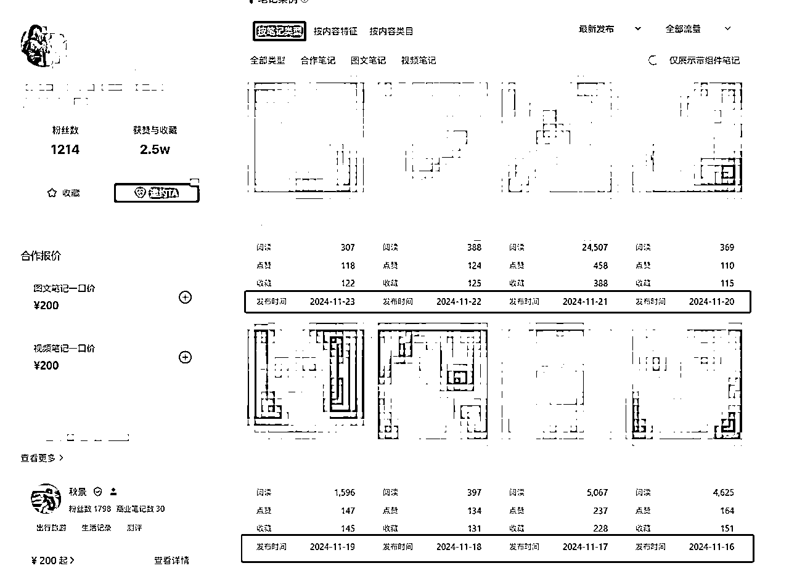

为爱发电的个人号、真人IP号就不一样了，接广不稳定，收入差距也吓人。看下面这三个账号：一个是母婴账号（真人露脸），一个是兴趣爱好/时尚号（纯静物摆拍），一个是兴趣爱好（真人露脸coser）。母婴号和coser号粉丝量差不多，但报价差了5倍不止，而且coser接广频率高得多。时尚号粉丝量少一半，互动数据却比母婴号高一大截，报价依然差了5倍还不止。具体数据后面再展开。

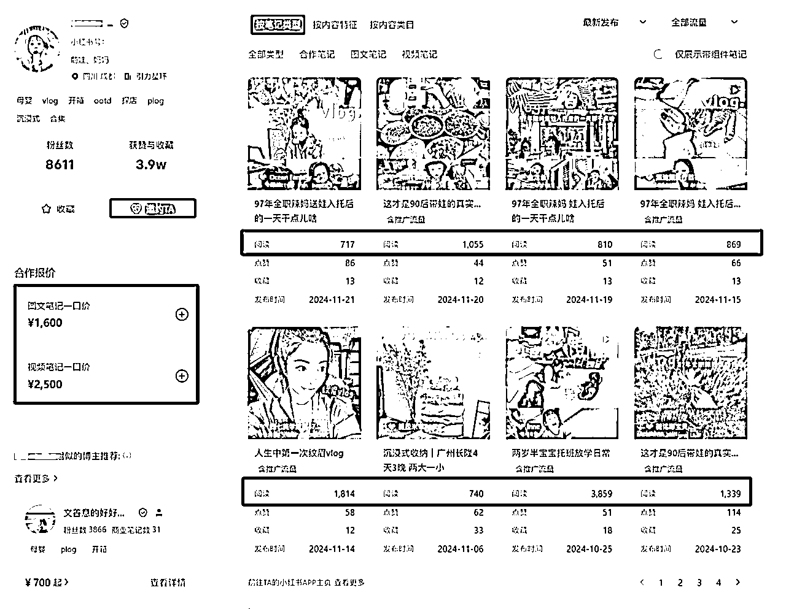

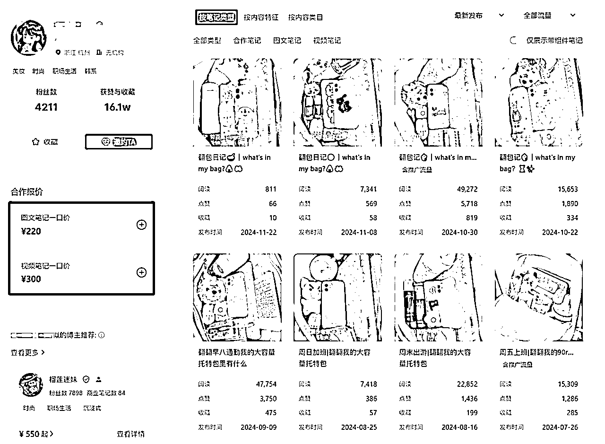

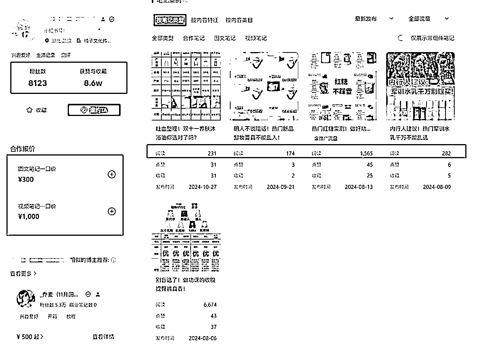

## 三、返点是什么？怎么返？

返点就是PR和博主私下说好退回的钱。比如那个母婴博主蒲公英报价1600，双方约定成交价1000，那蒲公英后台下单金额可以是1600×80=1280（平台允许上下浮动20%），博主就要把1280-1000=280返给PR。

为什么会有返点？一种可能是公司预算卡得死，必须砍价，但成交价超过了协议能浮动的范围，多付的部分就只能私下退回；另一种可能是PR给自己留的对接费用或利润。

工作室常说的是第一种，要返给公司。长期合作的直发品牌，流程就是：下单→发笔记→返点→完事。因为笔记已经发出去了，品牌方不可能取消订单，所以提前返点也没风险。你要是个人对接大品牌，基本是次月到账再返，具体可以商量。

## 四、怎么开通蒲公英接广？

1. 粉丝到1000，📕会通过蒲公英小助手私信你开通邀请。
2. 完善个人信息：点“我的”→“设置”→“个人资料”，把头像、昵称、性别、介绍、标签都填好。
3. 申请成为达人：在“设置”里找到“达人管理”→“申请成为达人”，填资料、传证件照、选擅长领域，提交后等审核就行。

通过之后，只要数据正常，后台会源源不断收到邀约。最开始可以挨个加，慢慢筛出那些品牌多、发文稳定的PR，以后做了新号还能直接找他们合作。

## 五、赛道怎么选？

直接说重点：目前工作室起号最快的是AI作品，图片配背景音乐做成简单视频，一个作品就出来了。具体类目可以是风景、建筑、宠物、美女、静物，只要画面好看，赞藏都不会差。也有工作室用实拍风景起号，同样跑得快。

相比之下，资料类、冷知识类、娱乐类、影视剪辑这些也有人做，但速度慢，还容易侵权违规，不是主流，新手没经验的话别碰。

另外，品牌方很介意营销号、正能量影视号这类账号，因为很难跑出精准人群。

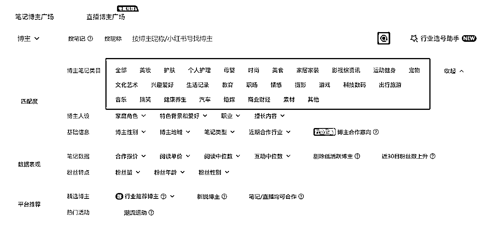

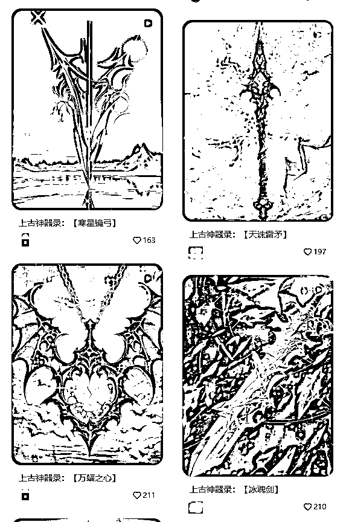

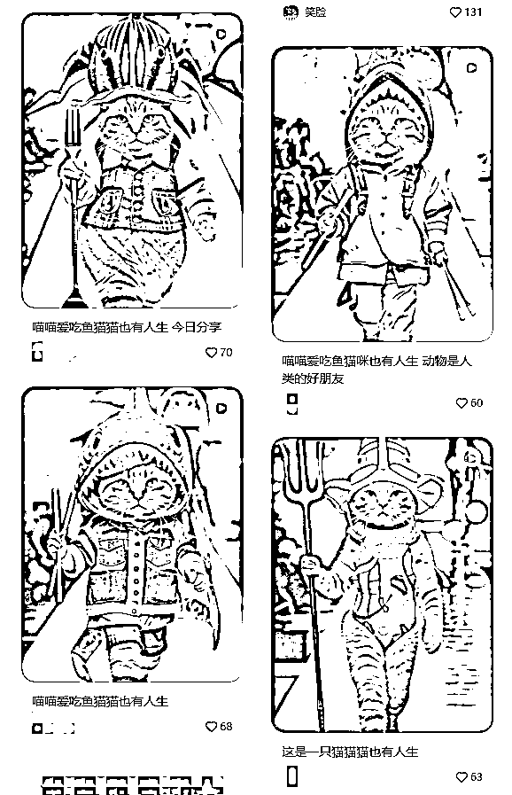

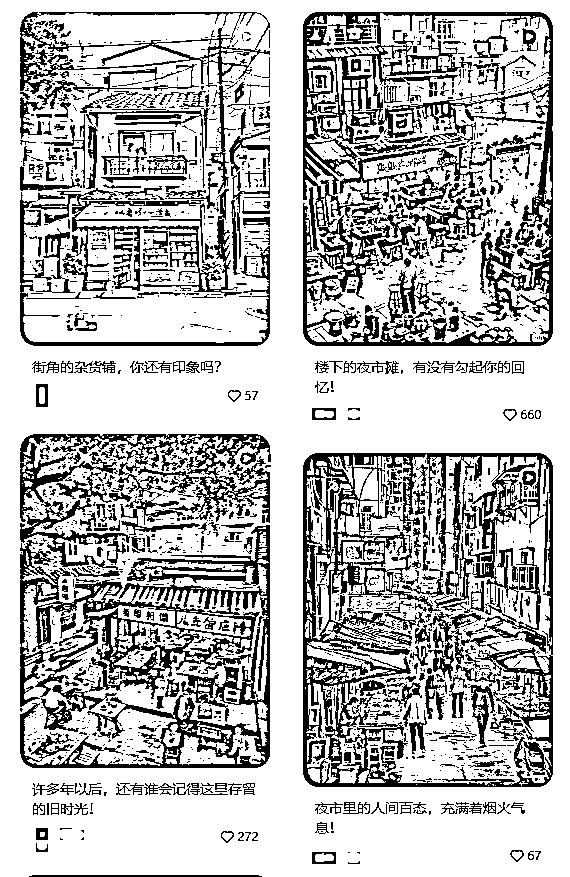

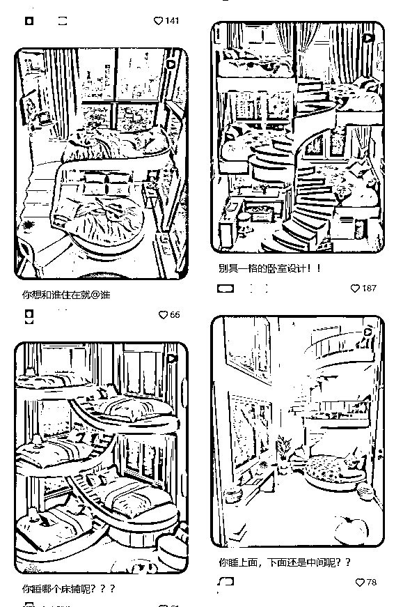

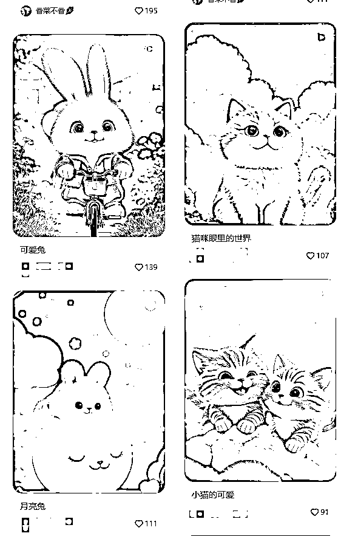

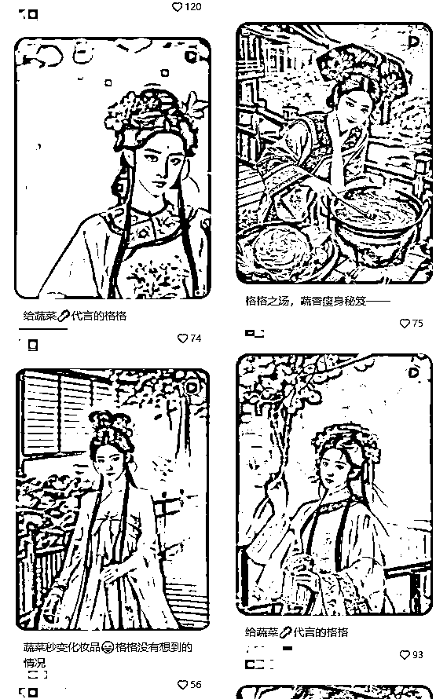

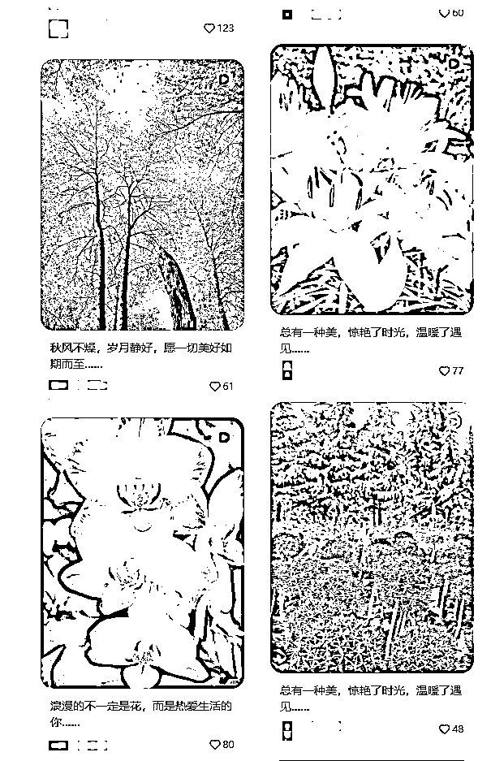

## 六、品牌方到底怎么选账号？（划重点）

篇幅有限，这里只讲直发笔记——这是市场最大、工作室对接最多的方向，大品牌定制笔记不算在内。

直发就是品牌方把图文内容全部准备好，只借你的账号发出去。等于你提供的是一个号+发布修改的时间，对双方来说效率都最高，所以品牌方对账号要求很严格。

### 6.1 笔记数据（划重点）

数据最重要，毕竟曝光上不去，产品推广就是白搭，几百阅读毫无意义。

看看下面两个账号的阅读、点赞、收藏，如果你是品牌方，选哪个一目了然？去年直发品牌的基础线基本是1000+阅读、20+赞藏，但近几个月📕整体流量下滑，阅读稳定在500+已经算及格，能时不时爆个几千阅读，就算很优秀的账号了。

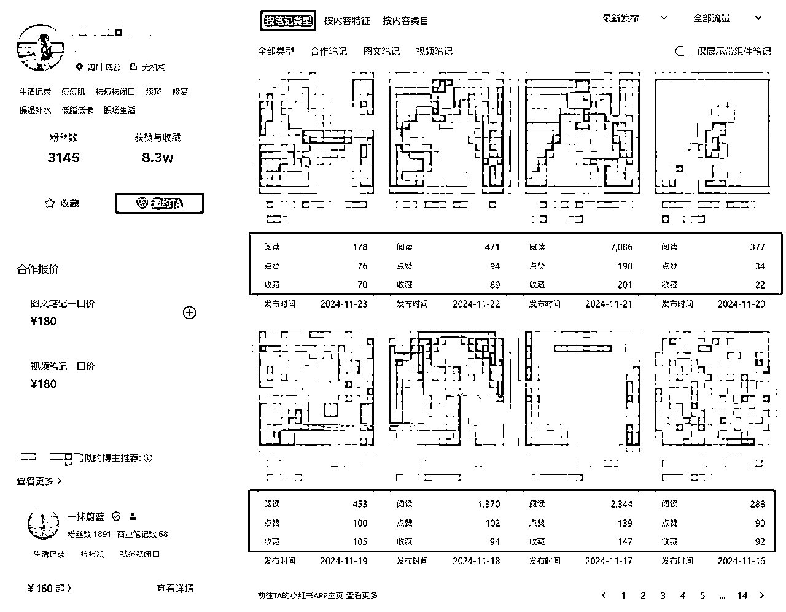

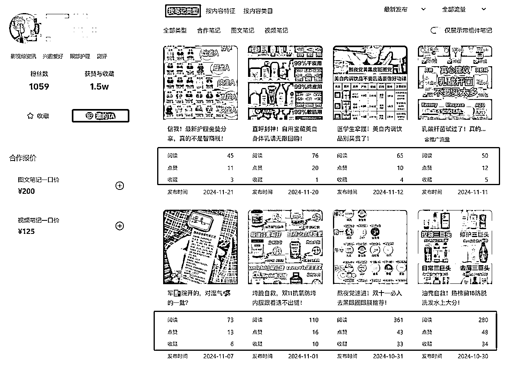

### 6.2 美化笔记数据

什么叫美化？以前千阅读对应20多个赞藏是正常比例，品牌方也认。但现在整体流量下滑，品牌方花钱发出去只有几十几百阅读，效果太拉胯。所以阅读量突破不了，博主就开始想办法把赞藏做上去，让品牌方看着满意。

正常情况下，互动量能到2%-5%已经很优秀了，除非笔记特别炸。但现在很多保数据的博主能做到百赞百藏，价格差不多的情况下，品牌方当然优先选他们。上面那两张图里就有一张是保数据的，你应该能判断出来吧？另外，我们大量测试过，渠道合规的情况下，做好基础赞藏不会影响后续自然推送。

基础赞藏怎么做？有博主互赞群，也有其他渠道。小眼睛也能人工提升，但意义不大，如果小眼睛实在低得离谱，这个号可能真没必要继续做了。

### 6.3 笔记流量来源

以前关注这块的品牌方不多，今年大家要求越来越高，也开始看流量来源了。发现页流量当然是越多越好，我们俗称“小蓝条”。

绿色的是博主个人页入口，粉色的是其他渠道入口，也就是人工刷出来的那种。所以小绿条和小粉条越少越好，不超过10%还能接受。如果你看到一个博主小粉条占比很高，那她的数据大概率是刷的，发出去很难跑出好效果。

### 6.4 粉丝画像

看粉丝画像的直发品牌不算多，但如果你粉丝里男性占比高、44岁以上占比高，也会影响PR的决策，很少有品牌愿意选这种人群。

地域方面，偏远地区一般不要，但影响不大。设备方面，苹果设备占比越高越好，这是大数据分析出来的，实际影响也不大。

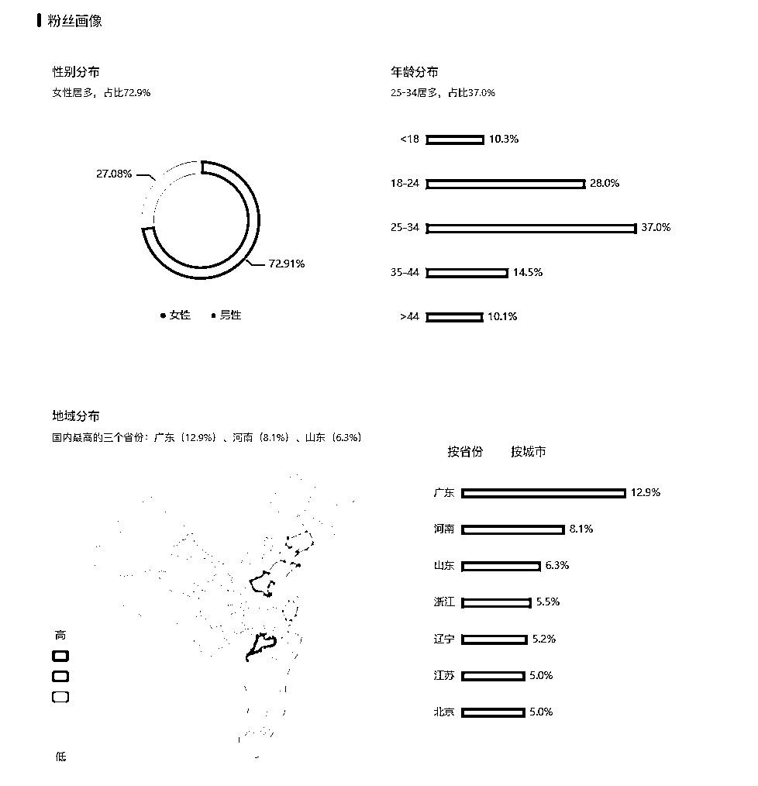

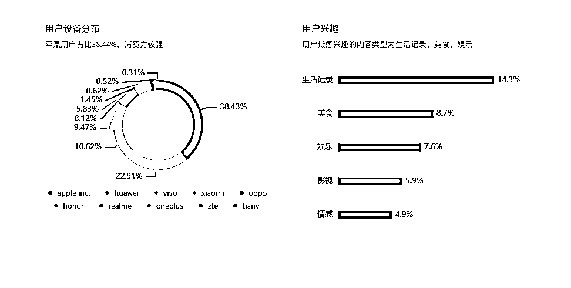

## 七、报备笔记还有发展空间吗？

虽然没有官方发布的确切数量，但从多方统计和增长趋势来看，📕商业笔记数量依然庞大，而且还在高速增长。

今年下半年，平台严查素人水下笔记，最近两个月对直发笔记的审核也越来越严，很多账号因为导流等问题被永久封禁。但这恰恰说明平台在认真整顿商业生态，要把大家拉回合规的报备笔记渠道上来。作为最符合官方规范、又没有门槛的合作形式，蒲公英报备笔记依然是品牌方的首选。