# 电商新手闯入SHEIN全托管：从几千块试错，到小众类目月毛利稳定5-6万
作者：龙哥

大家好，我是龙哥，赚钱四年圈友，也是一名赚钱航海家。

从2021年离职创业开始，我就长期在赚钱精华内容里学习。加入航海家之后，又听到了许多前辈真实、具体的经验，过去创业中不少想不明白的问题，也因此逐渐找到了答案。

这次受到秀儿邀请，担任本周航海家大会SHEIN专场的夜话官。恰好小善团队的SHEIN首期航海也正式启动，看到大家对希音全托管模式的关注和兴趣，我便把自己这一年多来的实操经历重新梳理了一遍，希望即使没有登上航海，也能通过这篇文章完成从了解平台到跑通第一单的过程。

本文内容比较长，既会介绍SHEIN的基本情况，也会分享我们如何持续被评为平台优质商家，以及选品、工具、开店和运营中的具体做法。

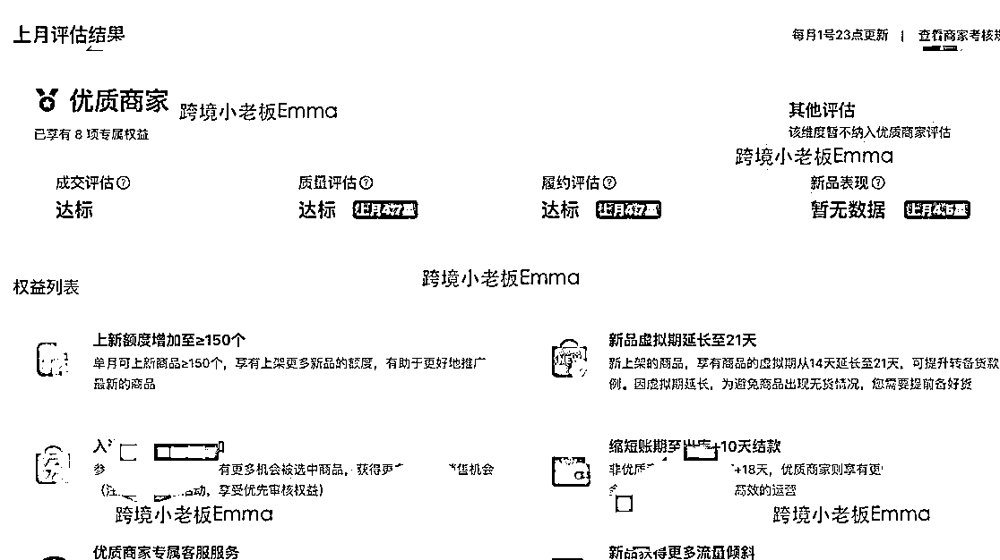

# 一、我曾经也是彻头彻尾的电商新人

先介绍一下我的经历，大家就能理解，我最开始做电商时究竟有多“门外汉”。

我出生于1990年，之前从事金融IT工作，也算是一名连续创业者。不过，我过去的创业方向和电商圈常见项目并不太一样。

2016年，我从国企辞职，开始做青年公益社群，主要帮助年轻人在工作之外参与公益活动。后来，随着互联网从业者健康问题频发，我又开了一家中式健康餐饮外卖店，之后因为一些企业客户的认可，逐步转型做团餐。

当时的我，创业更多是出于情怀：

- 做公益，是希望在帮助他人的过程中认识世界、找到自己；
- 做健康餐饮，是想为长期加班的互联网从业者提供更好的饮食。

相比商业逻辑，这些项目都带有比较明显的理想主义色彩。幸运的是，前两个项目没有让我遭受太大损失，团餐业务甚至取得了不错的盈利。

但2021年再次辞职创业后，情况就完全不同了。

2019年生下孩子后，因为宝宝湿疹、敏感，长期夜间睡不好，我经历了大约两年的产后抑郁。等到自己慢慢走出低谷，我便产生了一个强烈的想法：打造一个能够帮助新手妈妈改善睡眠的母婴品牌。

当时并不知道品牌创业究竟有多难，凭着一腔热情，我投入了几乎全部积蓄，也拿到了部分领导和同事的投资，独自进入母婴赛道。

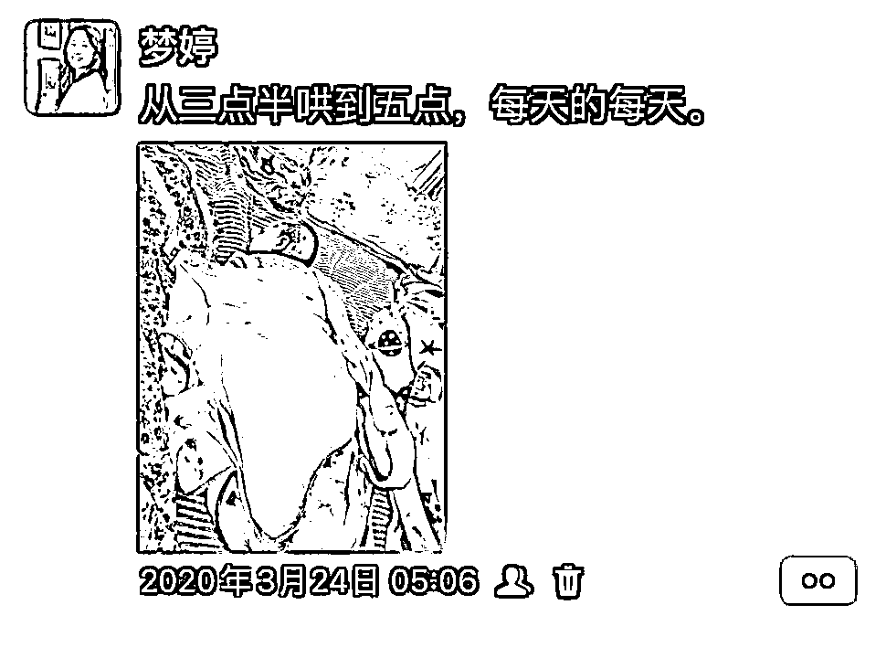

那时我对电商的理解，几乎停留在“有货—上架—等着卖”的阶段。

比如，我让工厂在双十一前完成生产，以为只要赶在大促前把商品放到淘宝，就可以自然获得销量。我不了解淘宝竞争的激烈程度，也不懂运营、广告投放，更不知道评价、转化率等环节的重要性。

现在回头看，那就是我对电商最初、也最稚嫩的认知。

品牌项目很快陷入困境。当我开始认真考虑是不是应该重新找工作时，手头只剩下几千元，于是决定再赌一次，报名参加一个母婴行业展会。

也正是在那次展会上，我拿到了SHEIN招商人员的名片。

可以说，SHEIN全托管成为了这次创业的转折点。后来，我不仅没有回去上班，还一步步活了下来，逐渐组建起一支由4名全职成员和多名兼职人员组成的小团队。

我们从2023年7月上架第一款商品开始，销量很快增长，之后进入相对稳定的阶段。早期毛利率大约在30%—40%之间，开店第二个月利润就超过1万元。直到现在，一年多过去，店铺每月毛利依然稳定在5万—6万元左右。

这个结果放在抖音、亚马逊等大平台的头部卖家面前，可能并不算惊艳。但这组数据背后，有两个地方非常值得普通人关注。

第一，SHEIN全托管对个人能力的要求确实不高。

我们不是经历了漫长摸索之后才出单，而是第一款商品上架后就有订单。在月利润达到5万元之前，基本都是我一个人兼职完成的，当时我仍然在经营自己的原创品牌。

等店铺表现稳定后，我才招聘第一名全职员工。这个员工是我之前做餐饮时认识的一位外卖小哥，刚开始连基础电脑操作都不熟悉，很多事情都是我现场教他完成的。

第二，小类目也可能跑出不错的结果。

我们经营的并不是女装、饰品、百货这类大类目，而是一个相对细分的小品类。和SHEIN整体盘子相比，这个类目的流量与销量都不算突出。

后来，一些学员按照我们的思路去复制到其他品类，增长速度甚至超过了我们自己的店铺。

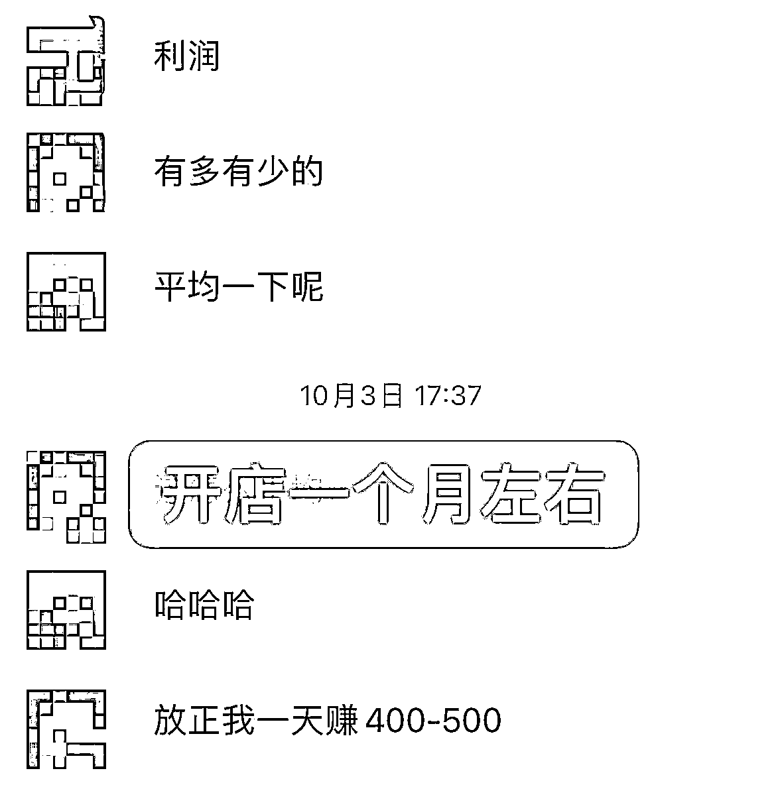

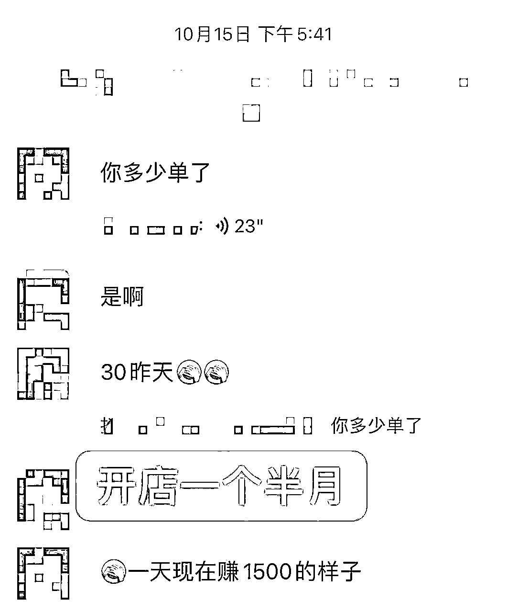

图一图二同一人

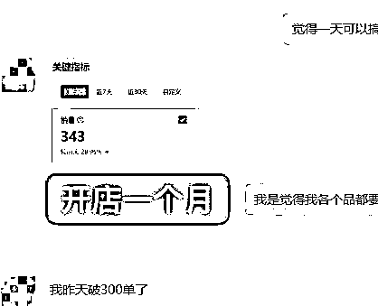

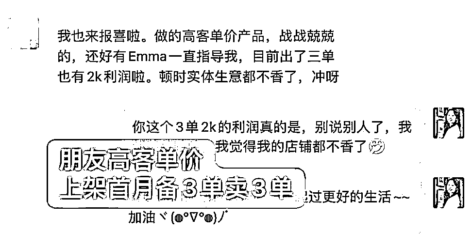

# 二、SHEIN到底是一家什么样的公司？

如果用一句话概括SHEIN，它是一家从快反女装起家、非常低调的跨境电商独角兽。

在2024年胡润全球独角兽榜单中，SHEIN排名第五，仅排在字节跳动、SpaceX、OpenAI和蚂蚁集团之后。

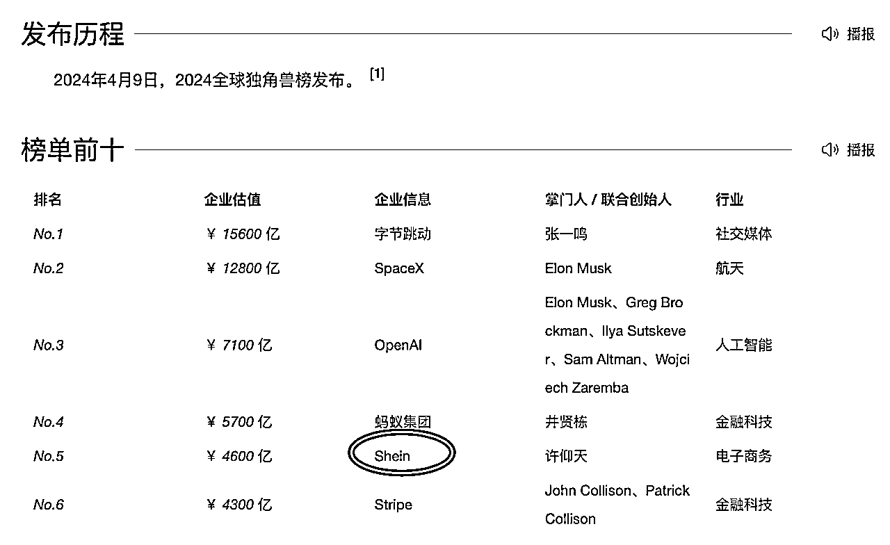

SHEIN与速卖通、Temu、TikTok Shop并称中国跨境电商“四小龙”。但无论是公司，还是创始人许仰天，整体风格都十分克制低调。

从抖音上的相关话题数量，以及赚钱内部关于SHEIN的讨论数量，也能明显感觉到这一点。

为什么SHEIN一直没有像Temu那样被广泛讨论？

一方面，公司本身在国内曝光较少，媒体采访和公开资料都不多；另一方面，SHEIN过去的入驻门槛相对较高。

Temu早期凭身份证就可能申请开店，而SHEIN此前通常要求申请者具备工厂资质或电商资质，最初甚至要求年流水达到300万元以上。

我当时之所以能够接触到SHEIN，也是因为参加了母婴展会，以展商身份参展，并且现场产品表现不错，才获得了招商人员的联系方式。因此，在前几年，普通人想进入SHEIN，并不是一件容易的事。

不过，随着Temu逐渐在海外市场对SHEIN形成竞争压力，SHEIN开始降低入驻门槛，并逐步扩大到全品类招商。这也给没有工厂、没有成熟电商团队的小卖家带来了机会。

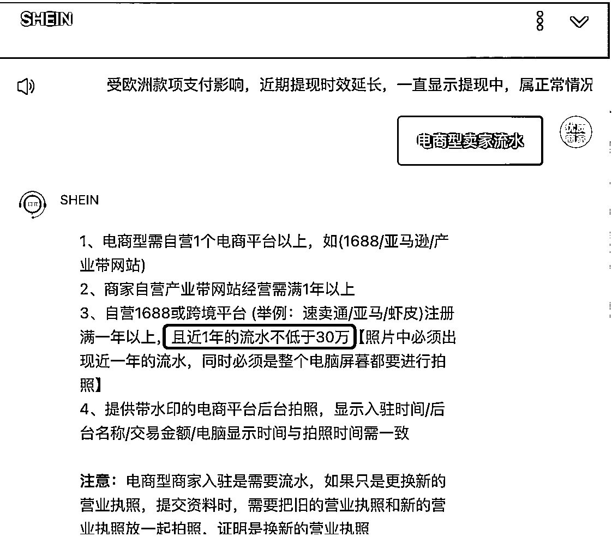

↑shein电商型卖家入驻要求已低至30万年流水

# 三、SHEIN的窗口期还能持续多久？

这是很多朋友都关心的问题。下面只是我结合自身观察得出的判断，也欢迎长期做其他平台的前辈补充和修正。

这里暂时不讨论整个跨境电商行业仍在增长这一大趋势，只观察SHEIN自身以及它最直接的竞争对手Temu。

## 1. 从SHEIN自身发展阶段来看

目前，SHEIN正在寻求在英国上市。按照kimi整理的上市进度，如果一切顺利，预计可能在2025年第三季度完成上市。

通常来说，在上市之前，公司会持续推动营收、用户、商家及业务规模增长。对于平台卖家而言，这段时期往往也能享受到平台扩张所带来的增量机会。

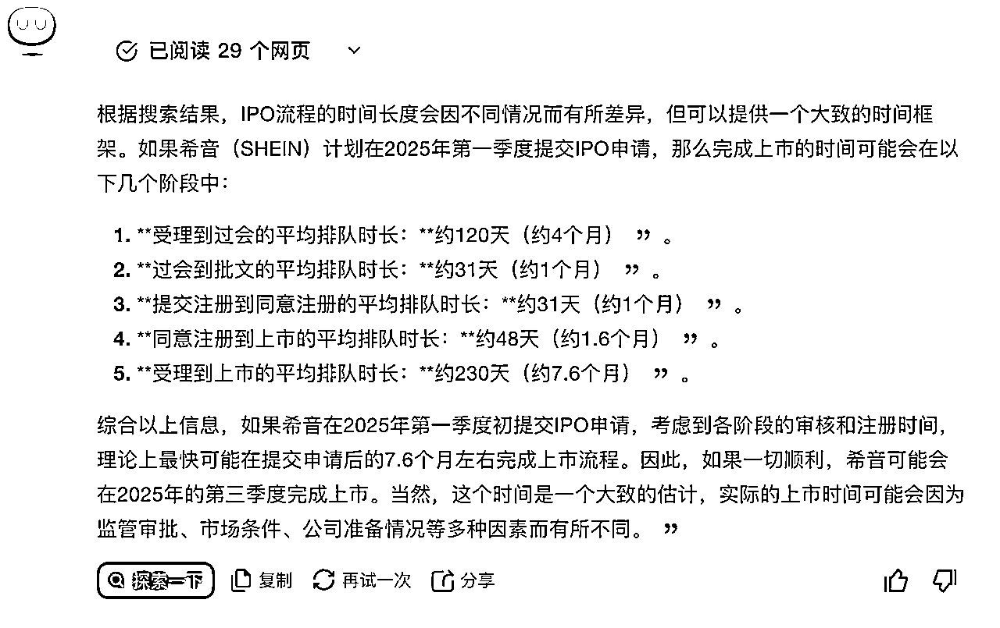

所以，至少在未来一年左右，SHEIN仍然释放出了比较明确的增长信号。

## 2. 从两个平台的卖家数量对比来看

如果观察抖音上SHEIN和Temu相关博主的数量，或者对比赚钱精华帖中两个平台的讨论量，会发现目前真正持续讨论SHEIN的人并不多。

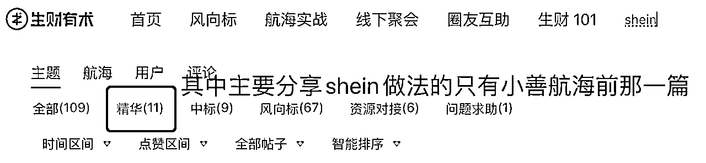

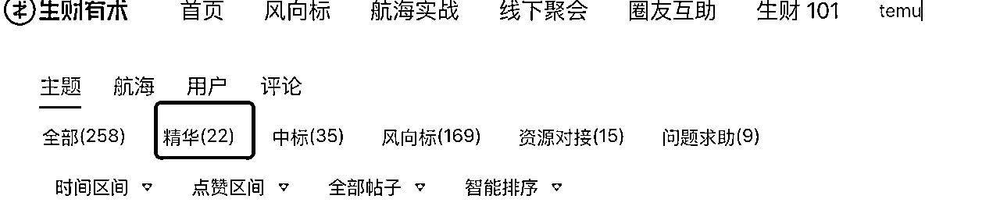

根据我身边的情况，目前SHEIN卖家与Temu卖家的数量，大致可能是1:30，甚至接近1:50。

这主要是因为SHEIN此前低调、门槛高，很多普通卖家根本没有机会接触。

数据方面，2023年第四季度，Temu流量约为11.9亿次，SHEIN约为6亿次，Temu当时的流量接近SHEIN的两倍。

但如果结合两个平台的商家规模差距来看，我认为SHEIN的红利不会简单随着流量增长就立刻消失。至少要等到两个平台的商家数量比例逐渐接近流量比例，也就是从现在的1:30、1:50，逐步靠近1:2，平台竞争才可能真正进入另一个阶段。

综合平台所处的发展阶段和当前卖家数量，我认为现在进入SHEIN，仍然是一个相对不错的时间点，普通人拿到正反馈的概率并不低。

# 四、SHEIN和Temu，为什么我更偏向前者？

SHEIN和Temu都提供全托管模式，面向的人群也比较接近，双方在不少政策上会互相参考，甚至有员工在两家公司之间流动。

但从我的实际体验来看，我更愿意长期做SHEIN，主要有以下几个原因。

## 1. 后台清晰，财务数据更完整

SHEIN后台的使用体验比较友好，尤其是财务部分。

每天有哪些商品出库、具体出库数量、出库时间以及销售价格，都能够比较直观地查看。

相比之下，很多Temu卖家都会遇到对账困难的问题，平台账务信息不够清晰，后期核算利润会比较麻烦。

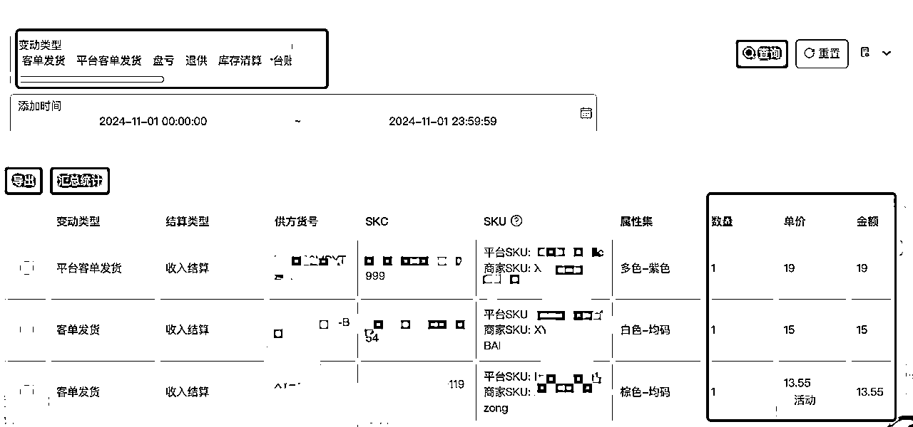

## 2. 客服和买手可以真正沟通

SHEIN的Q&A板块、学习中心和在线客服体系都比较完善。

新卖家进入平台后，可以通过学习中心自行了解规则和流程。在线客服的回复速度也比较快，我们作为优质商家，很多时候基本可以得到及时反馈。

此外，企业🛰️商户群通常也允许商家发言，不会像Temu的一些群那样长期处于禁言状态。

对新手来说，这一点非常重要。遇到问题时，至少知道去哪里查、向谁问、如何反馈，而不是完全摸黑操作。

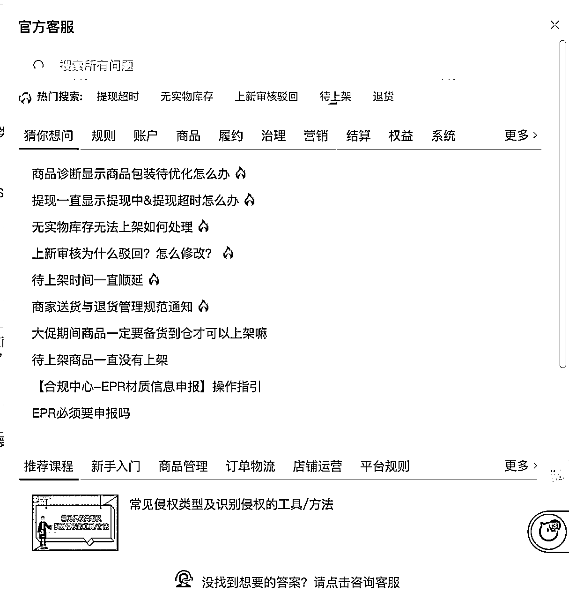

↑Q&A和人工客服板块

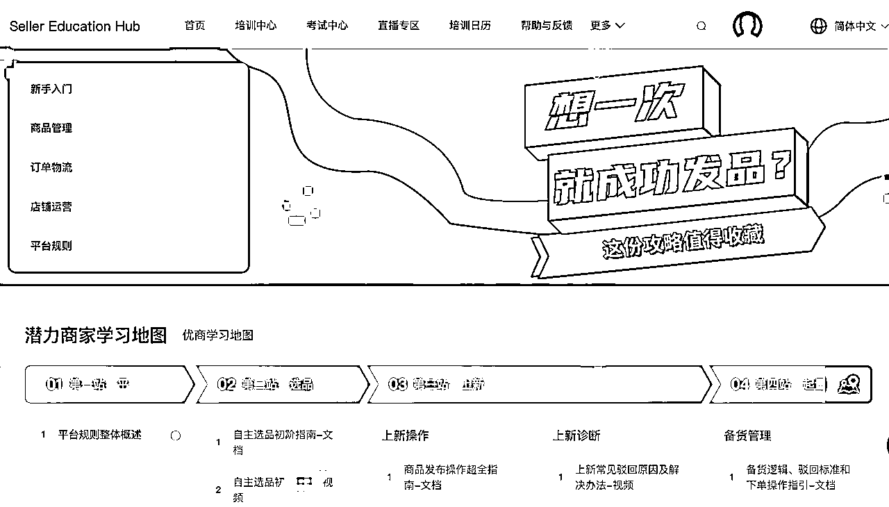

↑学习中心课程详尽有逻辑

## 3. 处理违规和客诉时，更强调证据和申诉

这是我最愿意推荐SHEIN的核心原因。

我曾经做过Temu半托管。当时卖出5件商品，就有1件遇到仅退款。需要说明的是，半托管商品的单件物流加商品成本通常在200—300元左右。

有一次，物流显示商品已经签收，但顾客表示没有收到货并发起仅退款。Temu只给了24小时申诉期，而平台首页和App都没有明显提醒，退款信息还隐藏在发货物流页面中。等我们接到平台电话，再去寻找退款记录时，平台已经完成退款了。

而在SHEIN，质检、稽查、客诉、违规等事项通常都会留下相对充分的申诉时间，首页也会明确显示待处理事项。

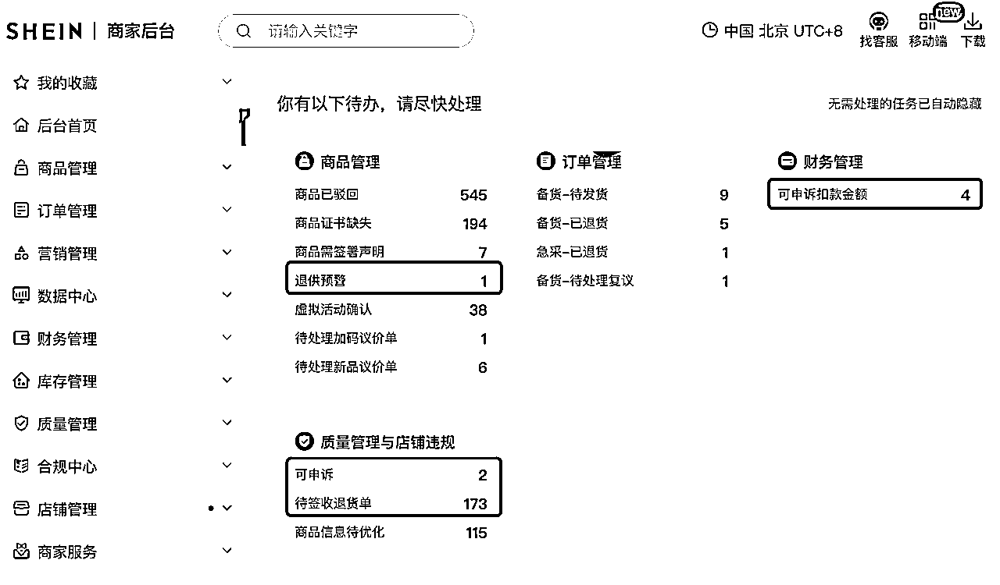

↑首页就有退供、质检、扣款待处理的明确提醒

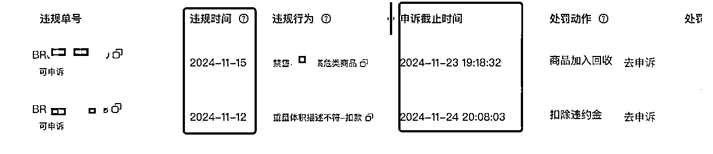

↑申述时间给的很足

我印象最深的一次发生在7月份。

有位顾客收货后重新测量，认为商品尺寸存在问题。按照当时平台规则，这类情况可能导致同批库存退回，同时产生至少1000元的质检处罚。

但买手先在群里联系了我们，并提供了顾客的投诉信息。我们解释了商品尺寸的实际情况后，买手认为我们的说明合理，最终没有发生退货，也没有产生罚款。

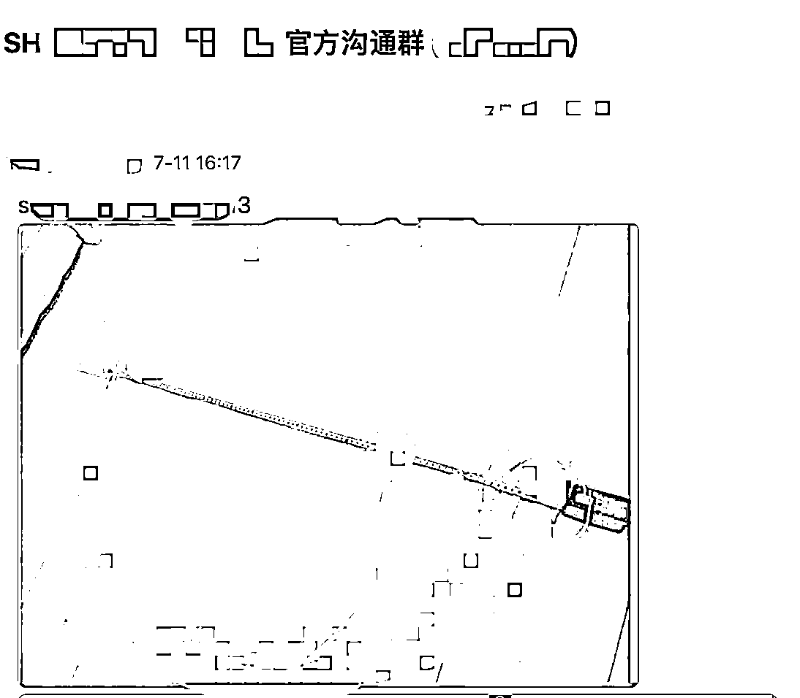

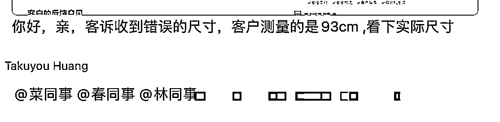

↑买手联系我，提供了顾客的投诉截图，让我们自查

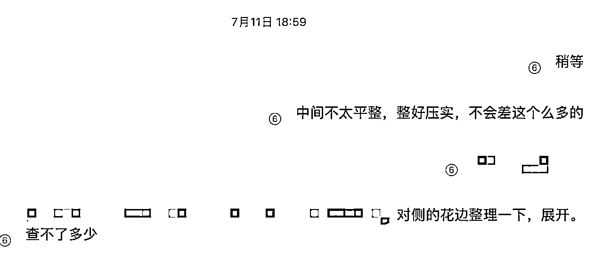

↑我们回复后，买手复核觉得有道理，后面没有退货和罚款

经历过两个平台后，我更加信任SHEIN的处理机制，也更愿意在这里长期经营。

# 五、哪些人适合尝试SHEIN全托管？

从我的经历来看，我确实是从电商小白一路做起来的，因此我认为大多数赚钱圈友都可以尝试SHEIN全托管。

我身边有70后的工厂老板、开美容院的年轻妈妈、经营实体店的老板娘，也有人只是把它当作副业。很多人实操一两个月后，都拿到了几千元的月毛利反馈。

如果一定要设定门槛，我认为主要有两个。

## 第一，会使用电脑

不需要精通复杂软件，但至少要能够完成后续提到的插件安装、网页操作和基础数据整理。

## 第二，前两个月每天至少投入1小时

SHEIN全托管并不要求你全天候盯盘，但前期需要持续找品、上架、跟进数据并熟悉平台规则。每天稳定投入一小时，通常比偶尔集中操作一次更有效。

接下来，我具体解释一下，为什么说它是新手进入跨境电商相对轻量的方式。

# 六、SHEIN全托管：把跨境电商的复杂环节交给平台

SHEIN全托管到底有多轻？

很多人甚至会觉得，这种模式不像传统意义上的跨境电商。

## 1. 卖家主要负责选品，其他环节由平台承接

在全托管模式下，卖家通常不需要自己处理：

- 多语言客服；
- 海外售后；
- 跨境物流；
- 海外仓管理；
- 复杂的英文后台。

平台后台本身也是中文的。除选品阶段可能需要借助工具查看海外网站之外，后续操作与国内电商相似，整体流程比较顺畅。

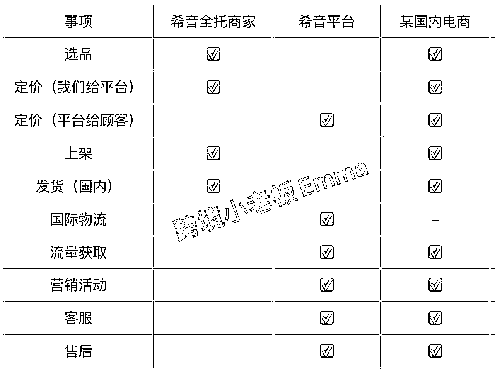

↑希音全托卖家和平台的分工

和国内的短视频电商、直播电商以及传统货架电商相比，SHEIN全托管也省去了很多重运营动作：

- 不用持续拍摄短视频获取流量；
- 不需要每天直播；
- 不必长时间在线回复客服；
- 不用自行处理大量售后；
- 不需要依赖投流；
- 也不需要通过刷评价来提升转化。

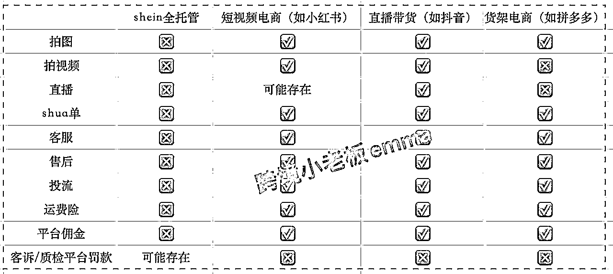

当然，全托管并不是完全没有风险。

和国内平台相比，SHEIN依然可能出现客诉、质检、稽查以及违规处罚。Temu全托管之所以频繁引发讨论，也和罚款、售后等问题有关。

但以我们店铺一年半左右的经营情况来看，因为客诉和质检产生的罚款累计没有超过2000元。后面我也会重点分享，我认为SHEIN和Temu全托管在处罚机制上的差异。

## 2. 不需要大量囤货，试错成本更低

做独立站、亚马逊或海外本土仓模式，通常都需要提前备货。

尤其是把货发往海外后，除了商品成本，还可能产生海外仓储费、美元结算费用，以及滞销后的库存处理费用。对没有经验的新手来说，开局投入很容易达到几万元甚至更高。

SHEIN全托管则不需要这样做。

商品上架后，你可以先从1688采购3—5件样品，再将商品发往SHEIN国内中转仓。具体投入取决于产品价格，最低时几元钱就能完成一次测试。

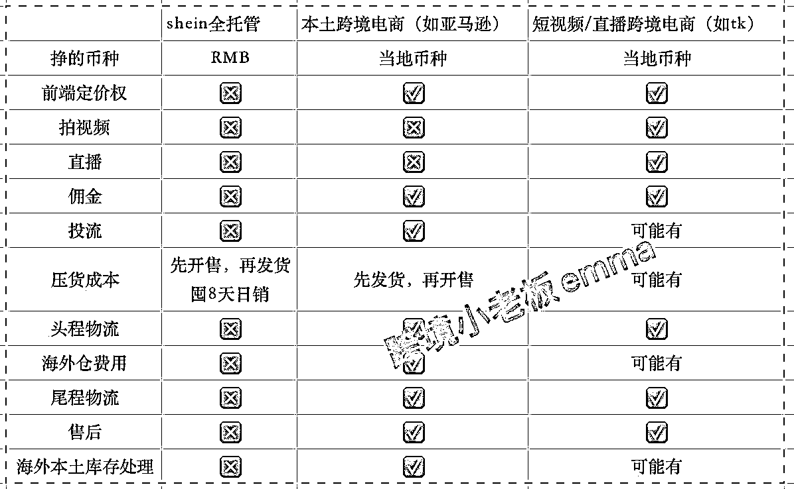

以上对比图来自我个人经验和与圈友的交流结果，也欢迎圈里的相关赛道的大佬补充指正。

# 七、从注册到第一单：SHEIN全托管实操流程

前面讲了这么多平台特点，下面进入实际操作部分。

这篇文章的目标很简单：希望你看完后，能够完成SHEIN全托管的注册、选品、上架，并赚到第一笔钱。

## 1. 注册与开店

### 自主申请入驻

如果你自己，或者亲朋好友拥有国内外电商店铺、工厂资质，就可以尝试自主申请开店。

自主入驻网址：

https://seller.sheincorp.cn/

需要提前准备的材料如下：

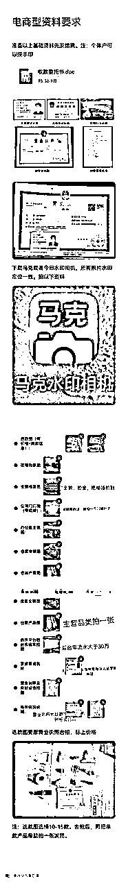

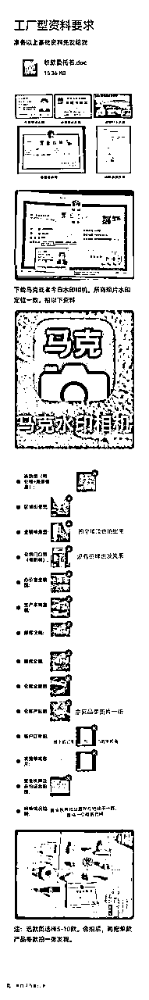

材料准备完成后，就可以进入官方申请流程。

打开入驻页面：

https://seller.sheincorp.cn/

入驻模式选择“代运营模式”，也就是全托管模式。

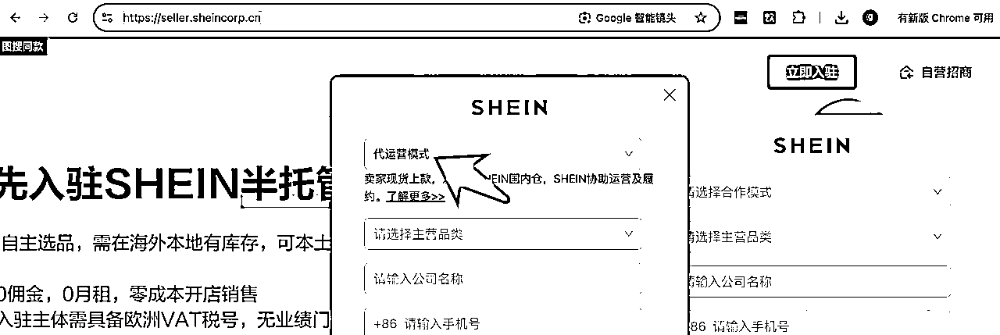

填写资料时，注意以下细节：

①带有“*”的项目必须填写，没有“*”的项目通常可以选择不填。

②主营品类建议填写自己最想做、最熟悉的类目。

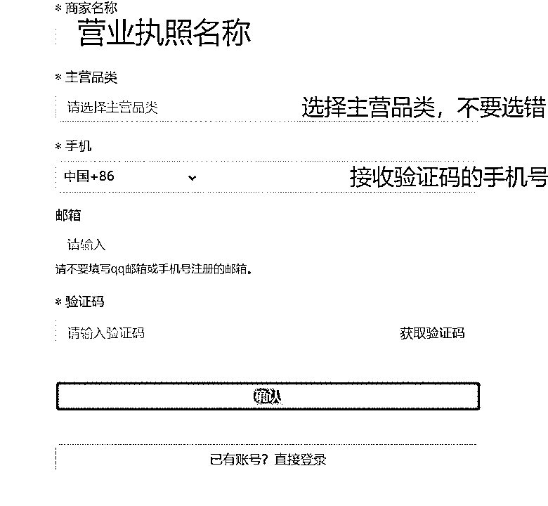

③经营地址必须与营业执照上的注册地址一致，否则可能被驳回。

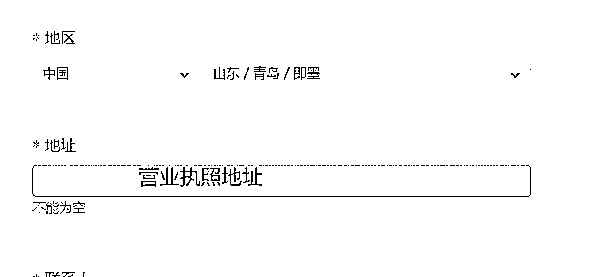

④邮箱建议使用163邮箱、谷歌邮箱等，🐧邮箱通常无法通过。

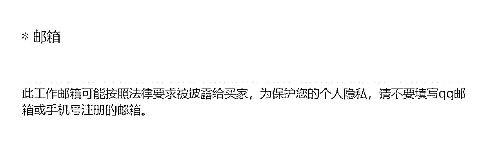

⑤推款清单就是产品报价表。需要按照模板上传至少20款主营产品或新品，供审核人员判断款式，同时附上产品图片和供货价格。

这里的供货价要填写不含税、不含运费的价格。如果报价过高，也可能导致审核不通过。

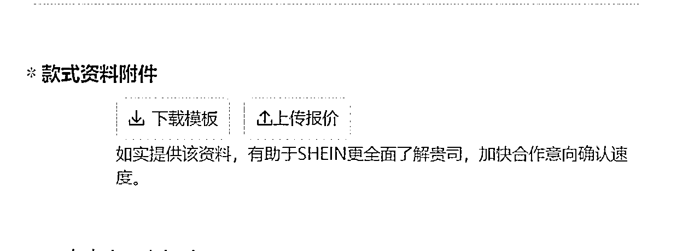

⑥电商经营经历：工厂类型营业执照通常可以不填，贸易类型营业执照则需要填写。

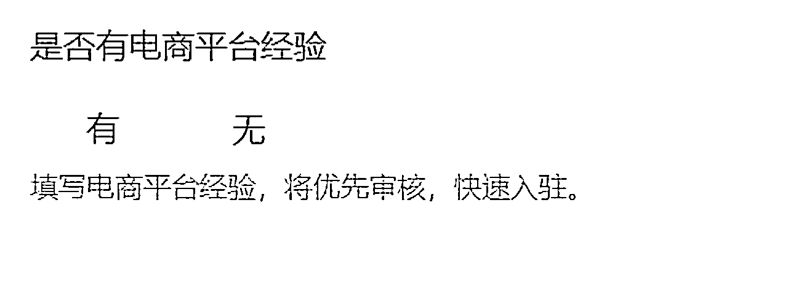

⑦销售额截图必须提供完整页面，尽量露出四周和店铺名称。若没有店铺名称，可能会被驳回；特殊平台可以拆成两张图上传。

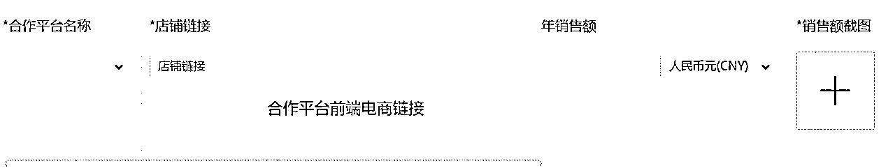

⑧场地照片需要使用带水印的相机拍摄，例如马克相机App。普通照片可能无法通过审核。

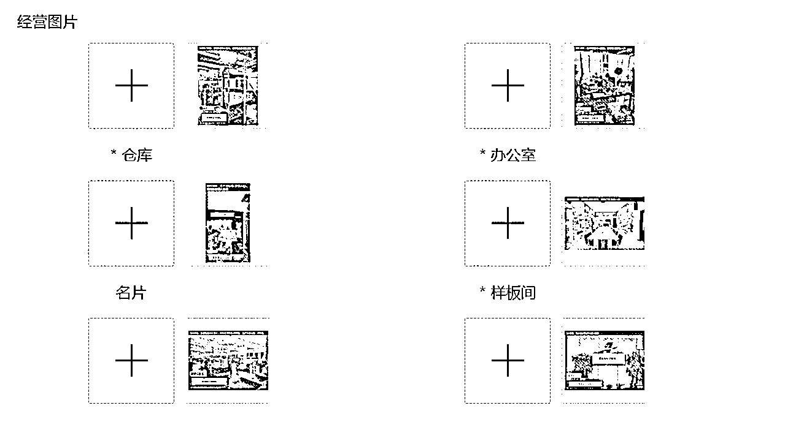

## 2. 如何选品？先从Temu寻找机会

SHEIN和Temu的主要用户群体比较接近，都以美国中产以下人群为主。

但Temu商家数量多、商品更新频率高，因此对新手来说，Temu可以作为非常重要的选品参考池。

我们的基本顺序是：

1. 优先研究Temu的热销商品；
2. 再观察其他海外电商平台；
3. 结合SHEIN站内情况判断是否存在同款和竞争。

### 工具一：极鲸云

极鲸云有免费功能，对于刚开始做全托管的新手来说已经够用。

网址：

https://www.geekbi.com/

我们主要使用它的浏览器插件，建议使用Google浏览器，同时安装SHEIN和Temu两个插件。

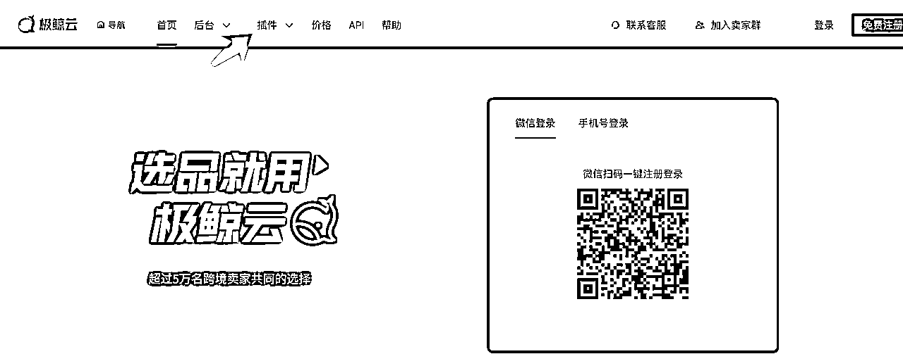

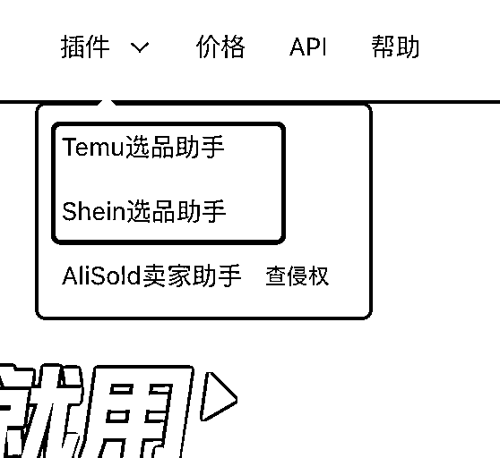

进入页面后直接点击安装即可。

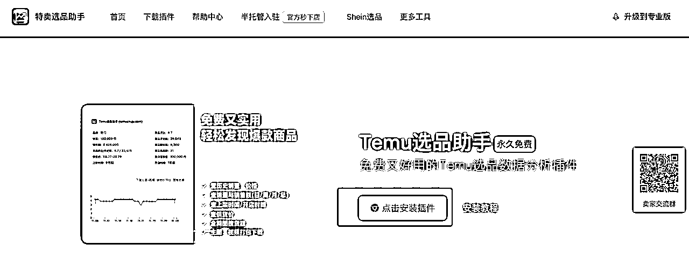

安装完成后，主要可以完成两类工作。

第一，利用图片搜索商品。

找到一个感兴趣的产品后，可以通过图片快速搜索1688供应商，也能查询SHEIN平台是否已经存在类似商品。

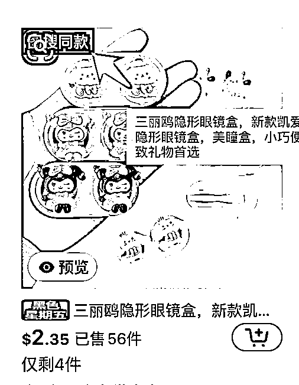

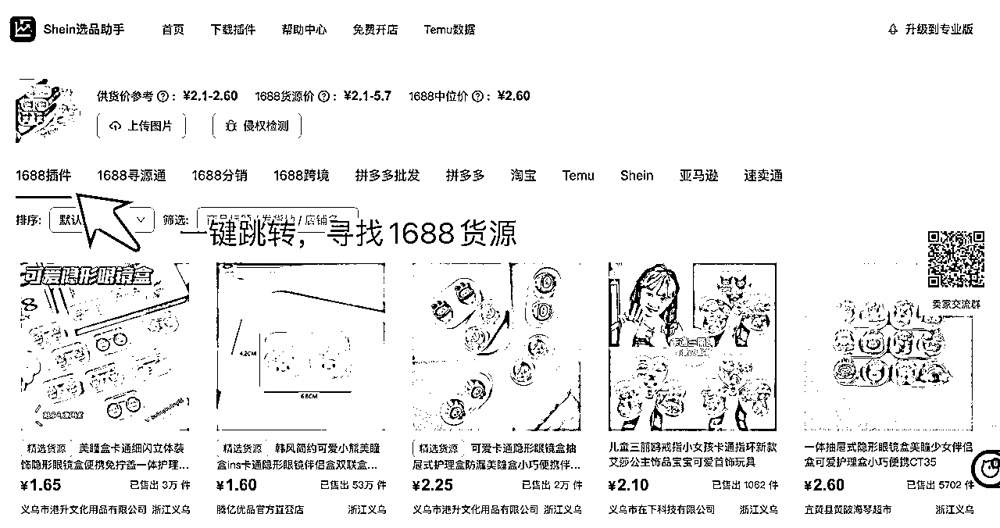

第二，查看商品的上架时间和销量。

在Temu或SHEIN商品页面中，插件通常会显示商品上线时间和销售数量，帮助我们判断产品是否属于近期增长款。

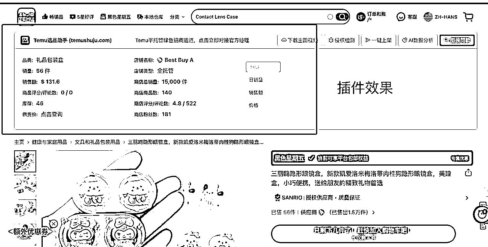

### 工具二：云启数据

云启数据属于付费工具，不过目前可以通过主播码领取一个月的免费使用期。

网址：

https://www.yunqishuju.com/?spid=850688

主播码：850688

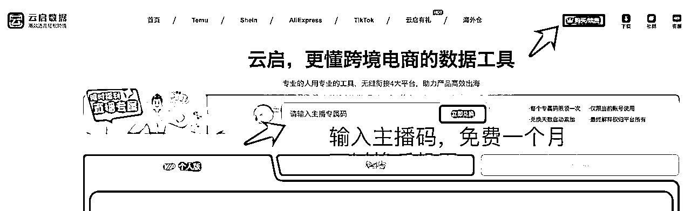

它的常见用法是先观察Temu，再根据左侧的商品库和店铺库进行筛选。

商品库中可以看到：

- 爆品榜；
- 热销榜；
- 新品榜。

选择对应榜单后，再筛选自己想做的类目，就能快速查看该品类下的商品表现和数据。

也可以通过店铺库研究某个店铺的选品逻辑，再结合极鲸云寻找对应的1688货源。

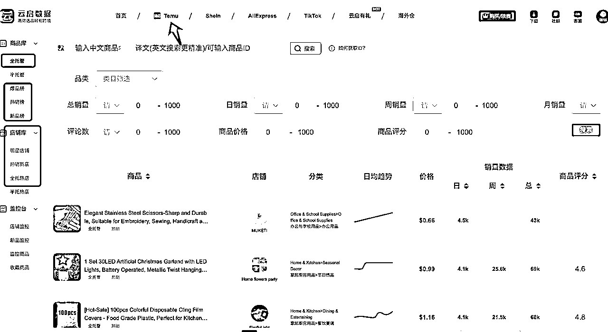

极鲸云更适合找同款、查供应商和看站内基础信息；云启数据则更适合做榜单筛选、类目分析和店铺研究。

两个工具搭配使用，能够让SHEIN全托管的选品过程更高效。

## 3. 找货源

每次有新手问我：希音全托管到底该从哪一步开始？我都会先泼一盆冷水——用极鲸云在1688里找同款供应商，真的不难；难的是同款找到一大把，价格却有高有低，不知道把订单交给谁。

这里分享两个笨但很实用的筛选思路。

第一个很简单，就是价格从低到高排序。谁家便宜，就先和谁聊，一目了然。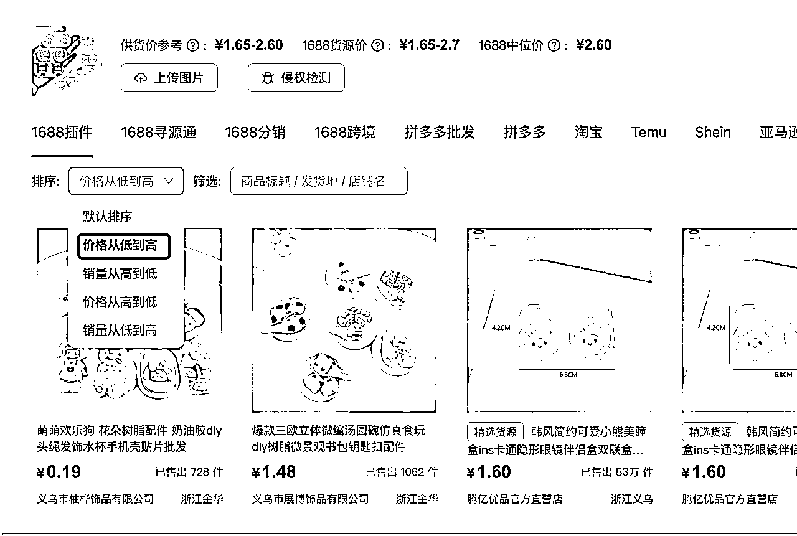

第二个更有意思：按销量从高到低排序。群众的眼光向来是雪亮的，如果有个链接价格不算最低，销量却冲到前面，那背后多半有文章。别急着划走，这种供应商反而更好谈，价格一般能聊下来不少。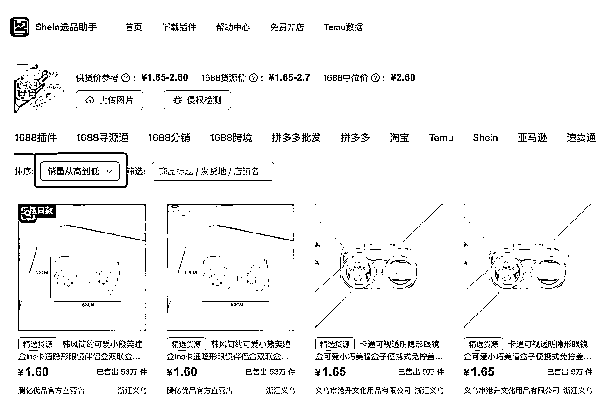

货源定下来以后，接下来就是图片处理和上架。先不用紧张，希音对图片的要求真的算友好——后台写着，主规格图是必填项，方图或者1340×1785px的长图都可以；详情页居然是非必填，也就是说头图够了就能过审。这对小白来说，省掉了太多麻烦。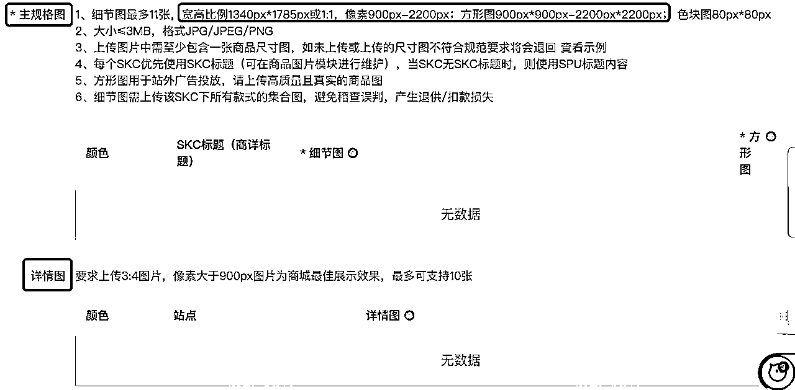

工具也不需要多专业，美图秀秀、创客贴这类基础软件就够了。我拿创客贴举例，带大家走一遍流程。

先点“创建设计”，因为1688的图大部分更适合做成方图，直接选择方图格式，把像素填到希音要求的2200px上限，然后就创建画布。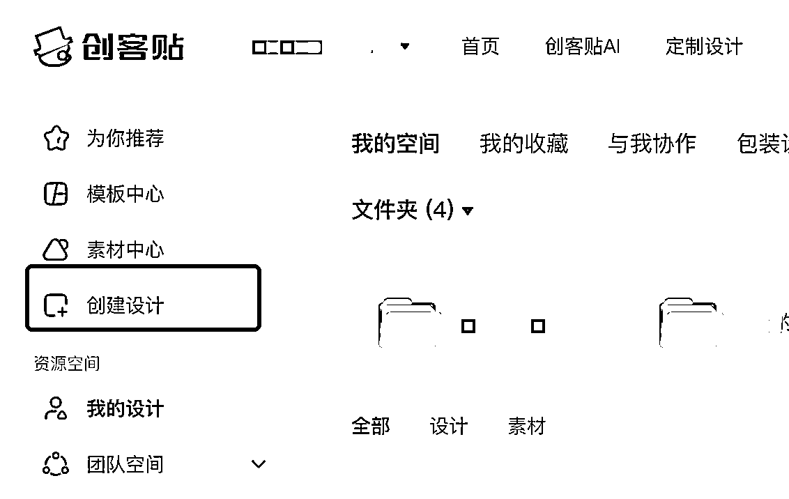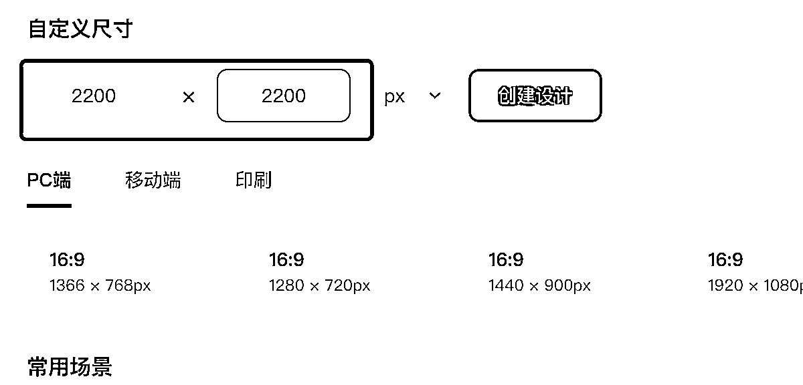

接下来把从1688下载或截图好的图片传上来。注意，希音每款商品最少需要5张图，里面必须有一张尺寸图，这个小细节千万别漏了。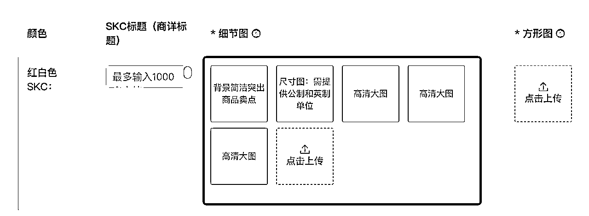

上传成功后，图片会出现在下方的素材栏里。把要用的图一张张拖到右侧的空白画布上，排好位置。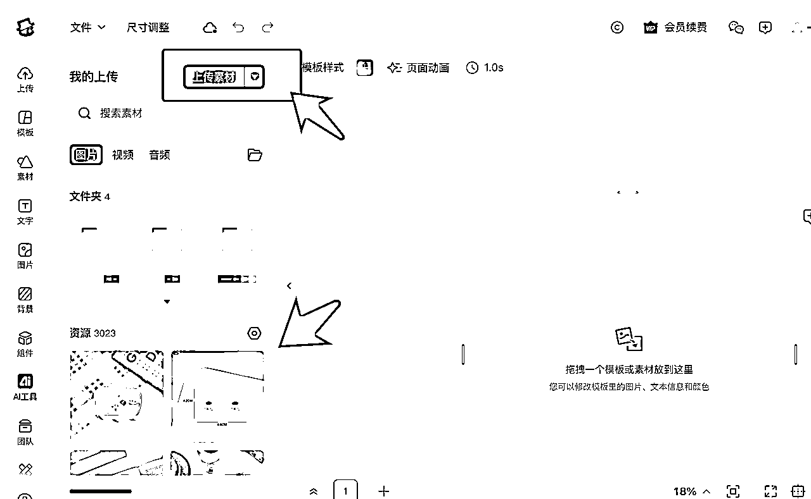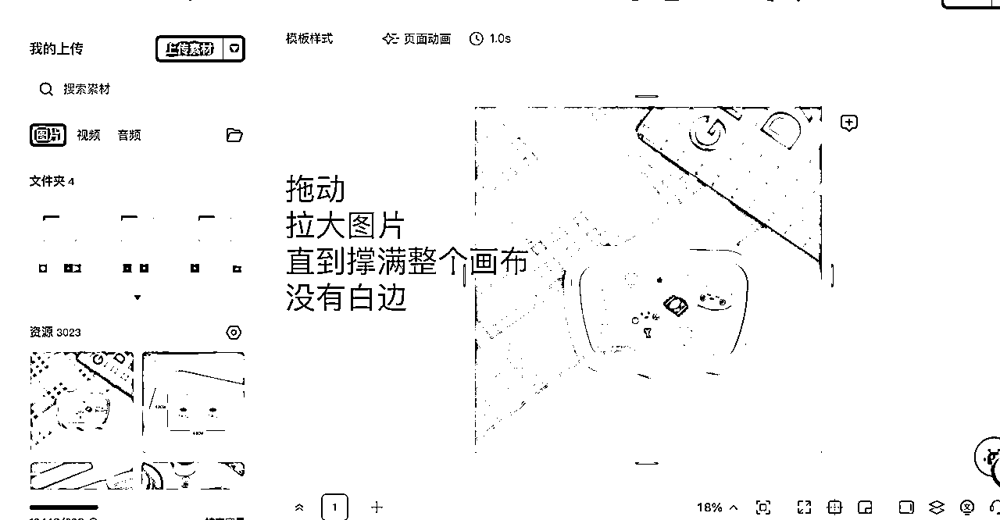

如果图片上带着中文，可以用贴纸盖掉，也可以插入一个有底色的文字框，输入英文之后把中文字遮住，看起来干净又合规。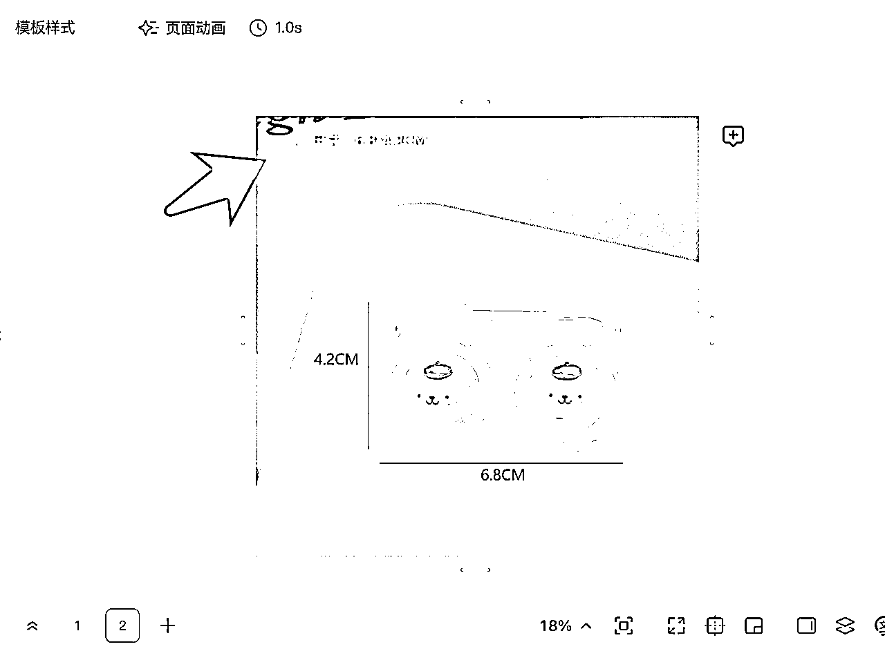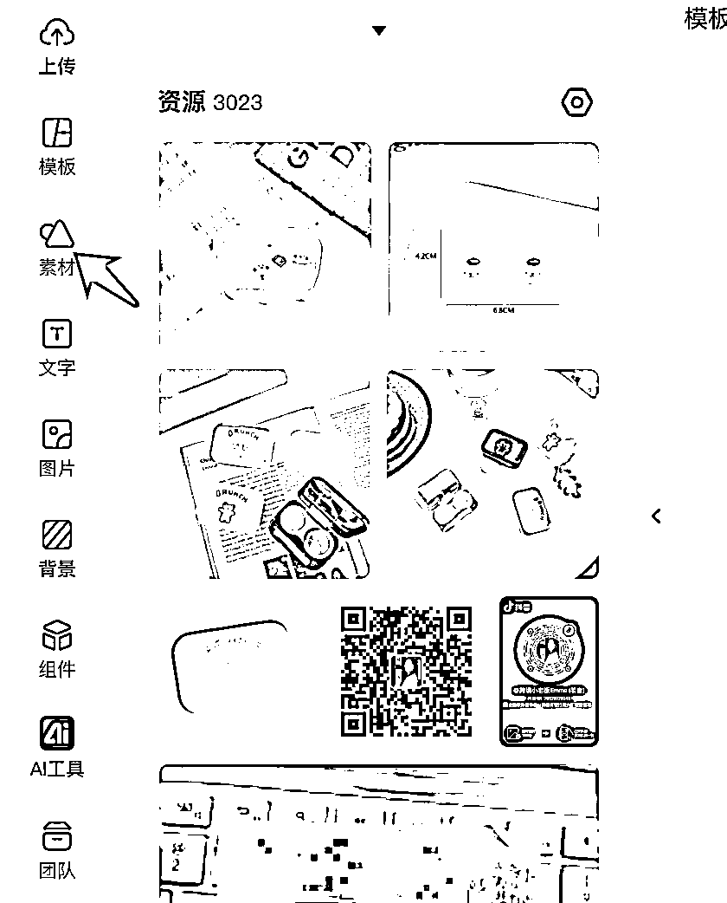

全部处理好以后，点右上角“下载”。这里有个小坑：希音限制单张图片必须小于3M，所以下载前要把图片大小和画质调整好，免得传图的时候报错。

图片准备完毕，就可以去希音后台创建商品、传图上架了。

审核环节上，希音会走几道流程，不同类目略有不同；只有部分类目、部分产品需要寄样、审版和核样，大部分常规品类直接线上审就能过去。

只要商品审核通过，它就会出现在后台的“待上架”列表里。

等到一切就绪，就该准备发货了。这里和国内电商有一个很大的区别，一定要留意。

希音的订单分两种：一种叫急采单，单号以J开头；另一种叫备货单，单号以B开头。

急采单主要出现在新品上架后的前14天：这期间商品可以先不上传到中转仓，直接在前端展示，等买家付款之后，你再安排快递把货发到希音国内的中转仓，后续国际物流由希音负责。国内这段运费，除新商家有大约30天的急采运费豁免期以外，其余商家都得自己承担。

备货单则是在新品上架14天之后出现——这时候希音要求国内中转仓里必须有货，否则商品在前端要么不展示，要么直接显示售罄。这类订单的国内快递费，除个别类目外，基本都由希音承担。

一旦来了订单，发货前要按要求打印和粘贴不干胶标签。最低限度要准备三种：

环保标和商品条码，这两张贴在商品的最小包装上；如果是纺织品或电器类产品，还要额外加印洗水标和电子电器类标签。最后还有一张面单，贴在包裹最外层。

后台预约好物流，接下来就是等快递小哥上门取件。

能走到这一步，恭喜你——希音全托管的第一单已经稳稳落地了。跨境电商从0到1，这条路你已经迈出了最关键的一步。

当然，能开始是好事，想走得更稳，还得避开两个大坑。

第一类是高合规类目：电子电器、珠宝、童包、童鞋、童腰带、婴儿安抚奶嘴与配件、婴儿餐具、婴儿辅食容器、婴儿奶瓶及奶嘴、儿童珠宝、儿童玩具。这些不是说完全不能做，只是对新手和没有自有货源的人来说风险太高。质检和抽检极其严格，就算你手里有证书，也躲不过后续平台的抽查；一旦抽检不合格，一次就是一万块的罚款，真赔不起。

第二类是低质量、容易有划痕压痕的塑料制品。仓库质检对这类东西要求高到离谱，几块钱的小玩意，不能有毛刺、不能有划痕。质检阶段倒是不直接罚款，但仓库退货概率极高，做起来纯属给自己添堵。

以上这些，都是我做希音之后整理出来的心得和避坑提醒。篇幅有限，暂时先说这么多，大家有任何问题欢迎在评论区聊。

国内电商确实越来越卷，但海外市场还有很大空间。希音全托管是最轻量级的出海模式，很适合新人练手。把这一单跑通，你赚到的不只是第一笔订单，更是把货卖向全球的底气。