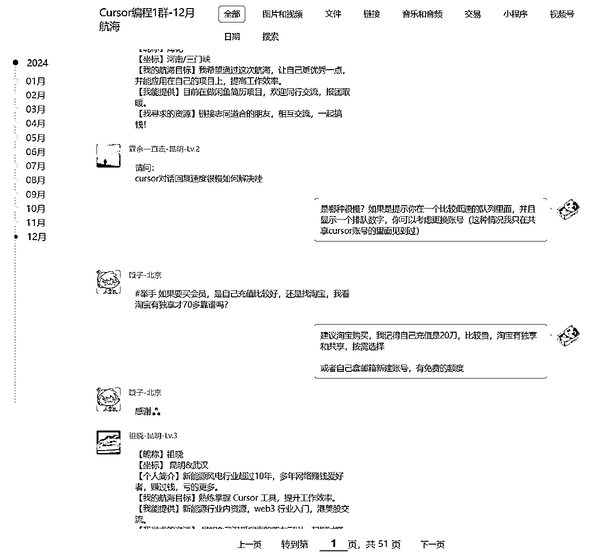

# 航海常见问答整理

## 一个更轻量、也更好用的版本

最近重新调整了一版代码，整体只有30行左右，但实际呈现效果比预想中更好。

相比传统表格，这个版本在阅读体验上更加清晰，内容展示也更完整。尤其是之前一直困扰大家的图片显示问题，也得到了解决：帖子原文中曾提到，导出到表格后，聊天里的图片无法正常呈现；而这次采用的新方式，不仅保留了相关内容，页面看起来也更加直观。

目前整理出的内容，主要是针对各类问题匹配对应的回答，方便后续查阅和使用。

如果要真正应用到航海项目中，还可以继续完善细节、优化展示效果。不过，30行代码能达到这样的效果，已经相当不错了。

# 相关输出文件说明

## 按关键词筛选出的提问记录

这部分内容是根据“举手”“提问”“请教”等关键词筛选得到的。

其中，字段名为 `StrContent` 的列，保存的就是具体问题文本。

## 问题与回答对应表

这里整理了提问内容及其对应回复，便于快速查看问答关系。

需要说明的是，回答中涉及代码的部分实际对应图片。由于使用的工具在导出表格时无法正常保留图片内容，因此表格中的相关区域可能无法完整显示。

经过测试，HTML格式对消息内容的还原效果更好，图片也能够更自然地展示。不过，它不如表格格式方便进行后续程序分析。具体文件可参考下方内容。

## 当前发现的优化方向

在整理过程中，也发现了几处值得改进的地方：

* “拍一拍”和“撤回消息”虽然不属于正常问答，但目前仍会被系统当作普通消息纳入统计，后续可以增加一层过滤逻辑，将这类内容排除。

* 当某条消息是对前文内容进行回复时，导出的表格里可能只显示空白，原始关联关系没有被完整保留下来，这部分也需要进一步优化。

## 全量聊天记录HTML版本

图片预览：

