# 10分钟上手土豆君头像代码，找到你的专属头像
作者：龙哥


大家好，我是龙哥。

昨天一整天都在忙，头像的事搁置了。今天一早起来，第一件事就是去翻圈友土豆君发的帖子。

看到群里还有不少伙伴不会用土豆君分享的代码，我就整理一份超简易版操作指南给大家。

活动入口在这里：https://t.zsxq.com/QrzhX
圈友原帖在这里：https://t.zsxq.com/pUGYs

下面开始实操。

## 第一步：搭建运行环境

首推一个工具 cursor，它本质上就是一个代码编辑器，有它就够用了。

### 安装 cursor

官方下载地址：https://www.cursor.com/ 进入后直接点下载。

安装教程可以参考圈友阿紫的帖子：https://t.zsxq.com/gdAAI，里面关于软件安装的步骤写得很细。

### 让 cursor 帮你配环境

安装好后可以直接和 cursor 开始聊天。因为原帖里用的是 python，我们可以直接问 cursor：python 环境怎么装。

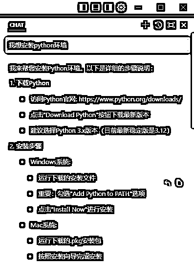

### 安装 Python

按照 cursor 给出的指引，去官网 https://www.python.org/downloads/ 下载 python 3.13 并完成安装。

### 安装所需依赖

环境装好后，就按帖子里的提示装依赖包。

把土豆君文中那段命令完整复制到命令行里执行。

```
pip install opencv-python numpy
```

#### 怎么打开命令行

第一步按快捷键打开运行窗口。
快捷键是【开始键 + R】，开始键就是键盘左下角 Ctrl 和 Alt 中间的 Windows 键。

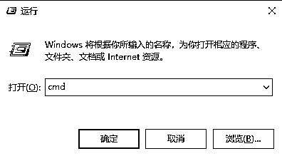

第二步在运行框里输入 cmd 回车。

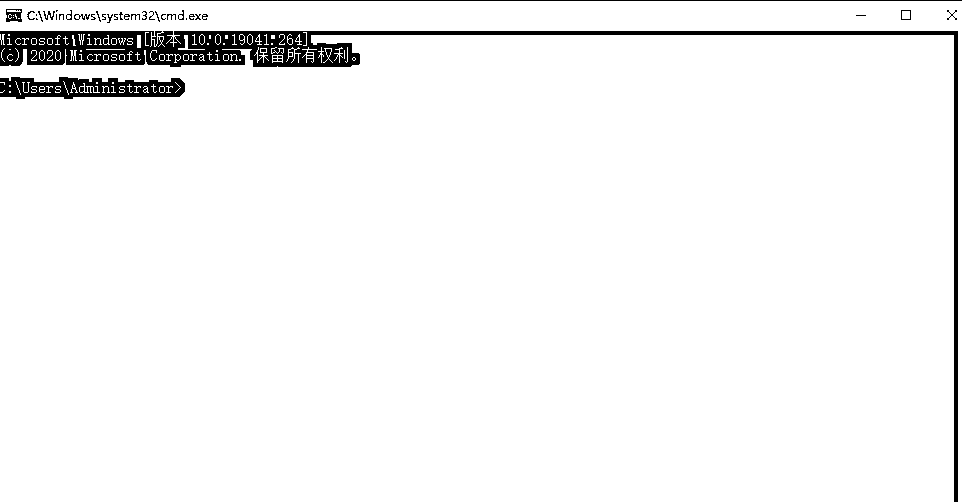

弹出黑底白字的窗口就算成功了。

#### 执行依赖安装命令

##### 1. 先确认 Python 是否可用

输入下面指令试试：

```
   python --version
```

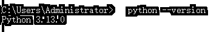

能正常显示版本号就代表安装成功。

如果没反应，说明之前安装时漏了路径配置。返回重新装 Python，记得勾选 Add python to PATH。

##### 2. 安装依赖包

输入土豆君帖子里的安装命令：

```
pip install opencv-python numpy
```

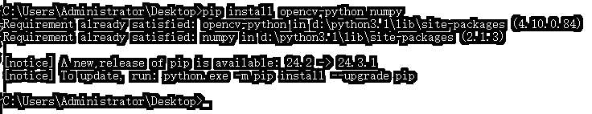

执行完成后就过了最难的一关，后面就很轻松了。

## 第二步：粘贴代码并执行

### 1. 准备代码文件

打开 cursor

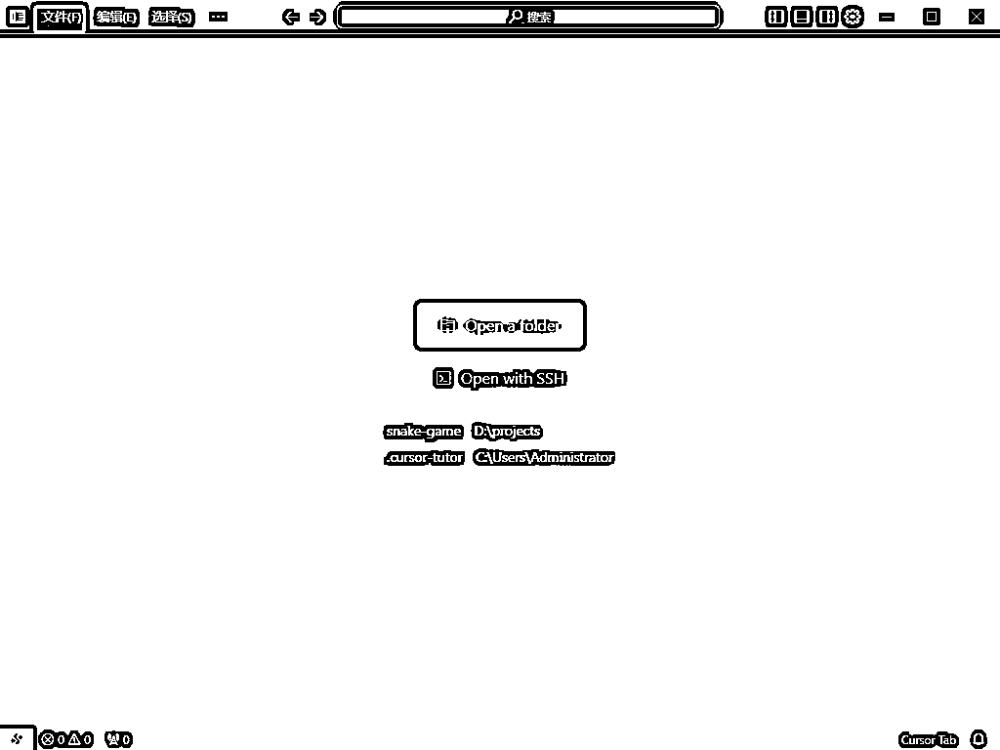

左上角菜单里选择【新建文件】。

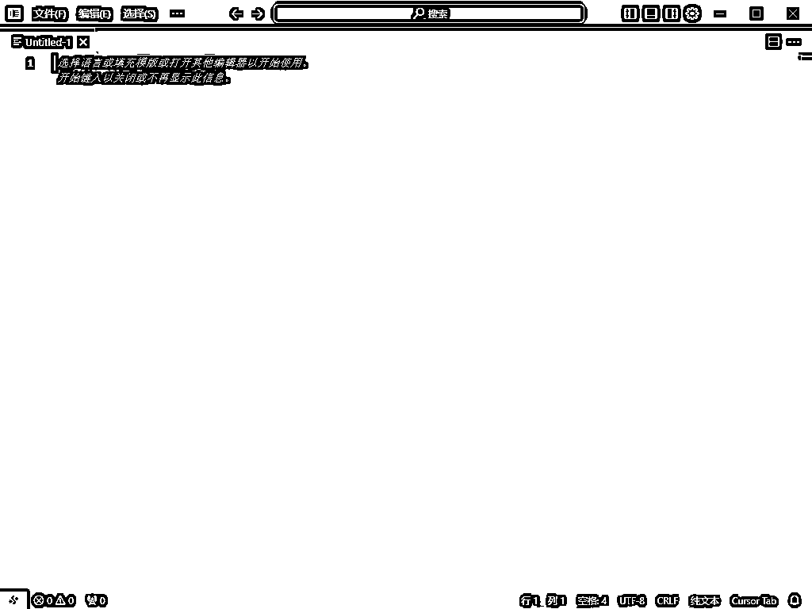

把土豆君的代码整体复制下来，粘贴进新建的文件里保存一下。

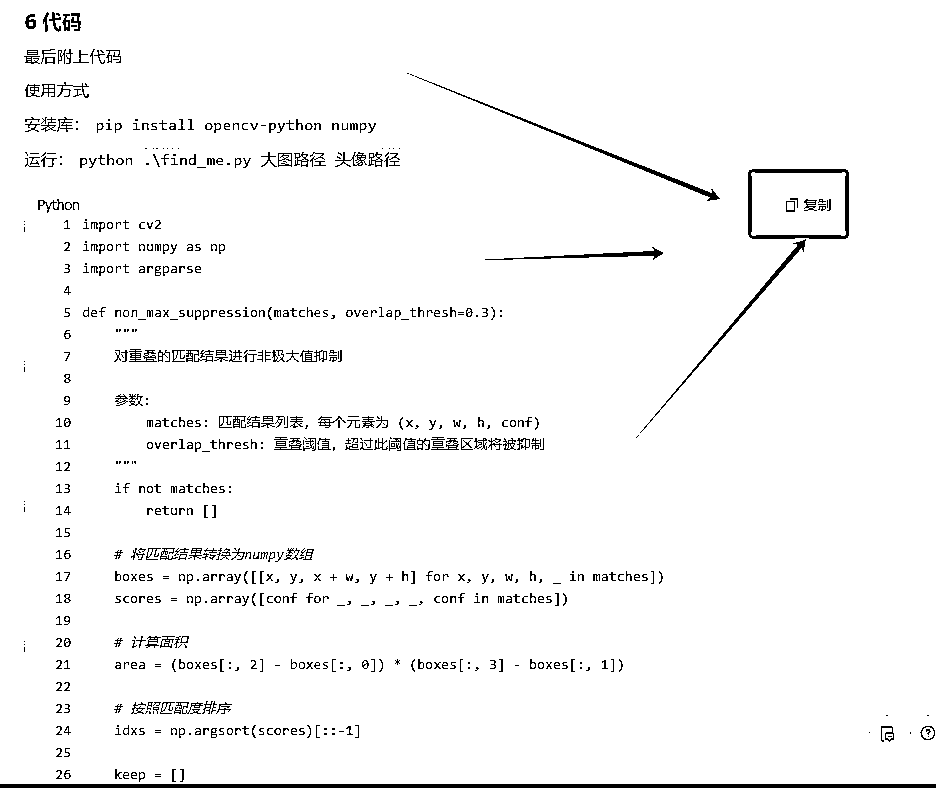

整段代码很大，应该一眼就能看到，看不清的把鼠标移上去放大看看。

复制完成后直接粘贴到 cursor 中间。

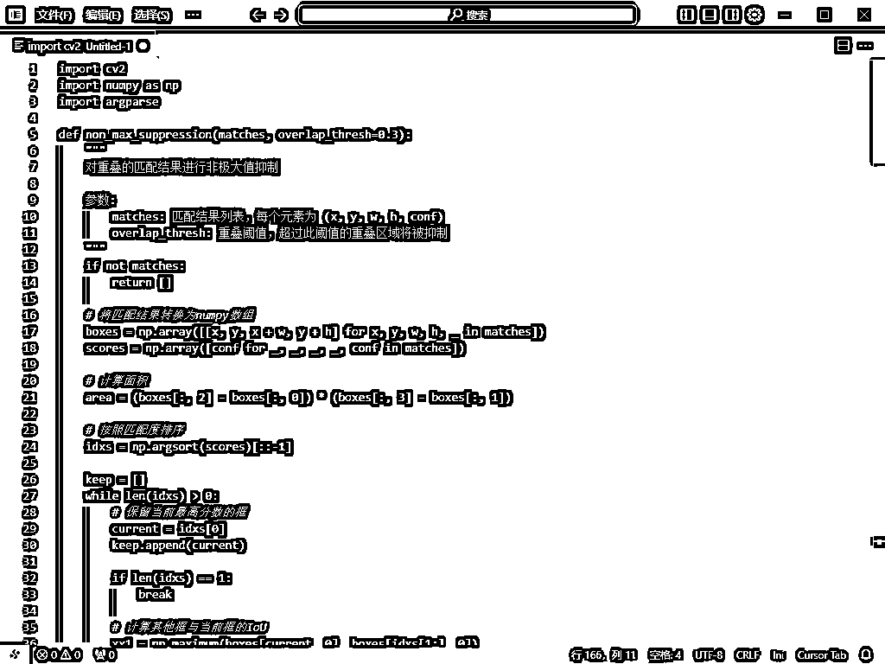

保存快捷键是 Ctrl + S，也可以在菜单栏 文件 -> 保存。

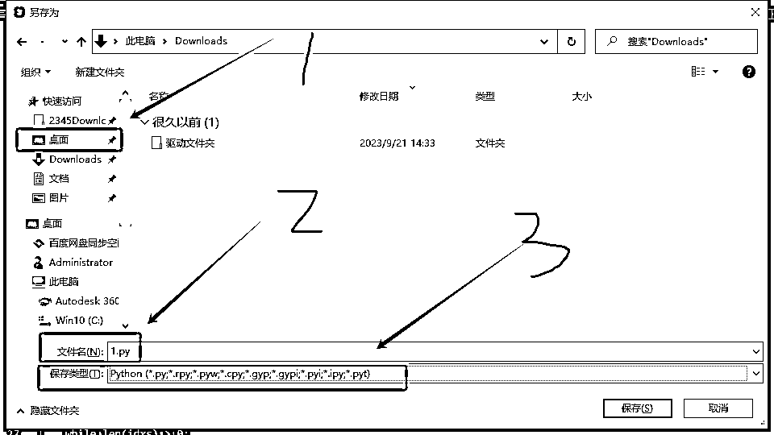

保存位置选个好找的地方，可以是新建文件夹也可以是桌面。文件名随便取，最后加上 【.py】后缀，保存类型选 Python 即可，确认后点保存。

2. 准备两张图片

去鱼丸活动帖 https://t.zsxq.com/QrzhX 里下载合照大图
再找到你之前保存的头像小图，各起一个好记的名字。

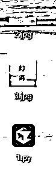

举例来说，我的代码文件叫 1.py，大图叫 2.jpg，头像叫 3.jpg。

### 2. 运行代码

代码和图片都齐了，就可以跑起来了。

再次打开命令行，开始键 + R 输入 cmd。

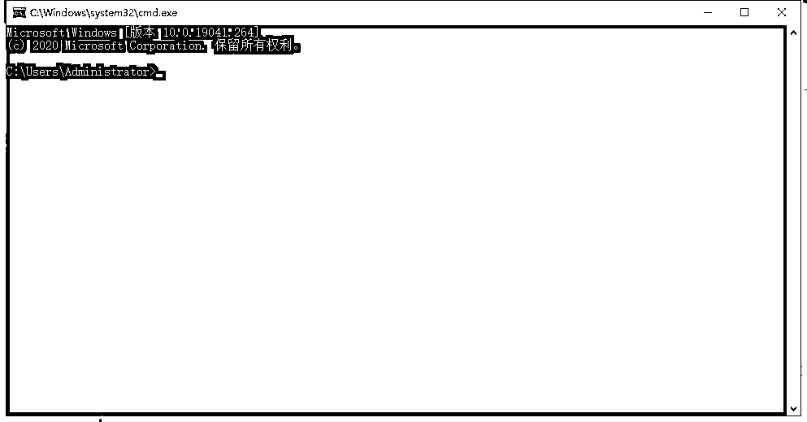

先把命令行定位到代码文件所在目录。可以右键点击文件属性查看路径。

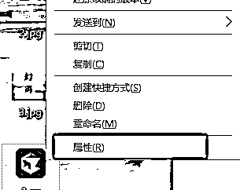

确认路径后

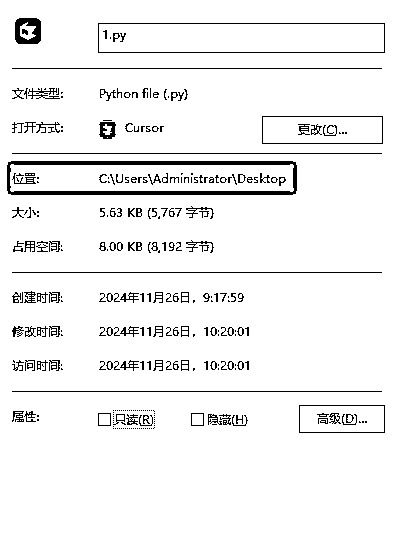

在命令行里输入进入该目录的命令：

```
cd 你的文件地址
```

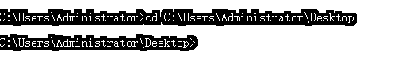

比如我的文件放在【C:\Users\Administrator\Desktop】，我就输入 【cd C:\Users\Administrator\Desktop】。

进入正确目录后，直接运行文件：

```
python 代码文件名字 大图名字 头像名字
```

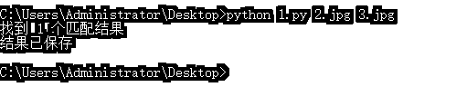

因为我们已经 cd 到同目录了，直接输入文件名就行。

最后就能看到生成结果了：


完成！