# AI 写代码这几年：从补全到智能体，我的一点实践记录

这篇文章想聊聊我用 AI 写代码的经验，也会穿插一些见闻和思考。内容都是从日常记录里翻出来的，可能不够完整，仅供各位参考。需要说明的是，它只代表整理时那个时间点的状态；这个领域变化太快，一周时间就可能改写局面。整理日期：2024.12.24。

我接触这类工具大概经历了几个阶段。2019 年那会儿，更多是补全和检索：编辑器会根据输入给出联想，有时比 IDEA 自带的提示更合我意；还可以敲关键词去 GitHub、Stack Overflow 上找现成代码和网友讨论。2021 年 6 月，GitHub Copilot 出了技术预览，这是 GitHub 与 OpenAI 合作的产物，目标是用模型实时给出写码建议，背后的模型是 OpenAI 早期的 Codex。2022 年 11 月 ChatGPT 一发布，方向就彻底变了，LLM 成了主角，各家工具纷纷把语言模型接进编辑器，聊天式补全、对话式编程一下子普及开来。到 2024 年中，市场开始进入成熟期：Claude 3.5 Sonnet 把价格、速度和能力平衡得不错，直接带动 Agent 和 Flow 走向实用。如果只谈复杂问题的整体解决能力，OpenAI 的 o1 仍然是独一档，但它响应较慢，往往要先等一分钟思考，然后交出一段完整结果，而不是逐字吐出来。

举个很直观的例子：直接让 AI 写单测，经常会得到不可用的代码。把它拆成两步——先设计测试思路，再写测试实现——就好得多。这也能解释为什么不少商业 AI 项目难落地：强模型贵但能扛复杂任务，弱模型必须把任务拆得很小才做得动，拆得越碎，方案就越不通用，商业价值也越受限。

现在用来写代码的 AI 工具，我大致归成四类。

第一类是实时续写工具，也就是常说的 Copilot 风格。代表是 GitHub Copilot。它嵌在 IDE 里，根据当前正在写的代码给建议，适合自动接完后面的代码、按注释生成方法、按方法生成注释，甚至在新增属性后顺手更新构造函数。不同产品主要差在几个点上：是否主动给建议、建议弹得快不快、对当前代码环境的解读准不准（例如我说“端口”，它能不能猜到是 IOPort）、一次只改一行还是能连着改多行、有没有光标轨迹预测、建议显示在哪里（有的只补行尾，有的能插到行中）。补充一句架构层面的事：GPT 系列采用 Transformer 架构，本质是自回归生成，适合顺着前文续写，但天然不会填空；各家能把“填空”做到什么程度，主要拼的是工程能力。

第二类是聊天式助手。代表是 ChatGPT、Claude。它用日常对话来帮你写代码、讲代码、调试问题、讨论架构。产品之间的差异更多元：能不能语音交流；会不会自动收集工作区、当前文件、鼠标位置、浏览历史等作为背景信息；能不能手动指定对话范围；能不能把截图拖进聊天框（比如让 AI 根据网页截图写页面）；能不能联网获取最新资料；能不能引用文档（如 @Docs 添加自己的库）；以及生成的结果要不要手动复制——一些工具已经支持用 diff 形式预览修改，还能一键采纳或全部丢弃。 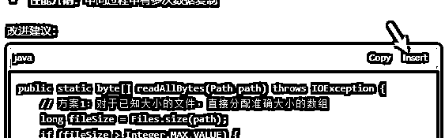

第三类是智能代理，也就是 Agent。可以理解成高阶版的聊天助手，代表是 Cursor agent。它不止回答问题，还会主动执行任务、理解项目全貌、调用工具。典型用途：按需求独立做出一个小产品，自己选语言、设计界面、建文件、写代码；或者帮你整理文档，产出一个由多个文件组成的轻量知识库。

第四类是流程型 AI，也就是 Flow。代表是 Windsurf、Devin。这种形态把 AI 嵌进完整的研发链路，有更强的全局感知，能同时调动多个工具，自动完成一套流程。过程中人反而是辅助角色，AI 在关键节点需要人工操作或确认时，会主动询问。常见场景是搭建开发环境，以及跨文件、多步骤的复杂任务。

下面挑几个我用过的场景，记录一下实际手感。

一次性改多行。有一次我要调整方法，只敲了“和伽玛模式”这五个字符，AI 就提醒我补注释、加方法入参，见 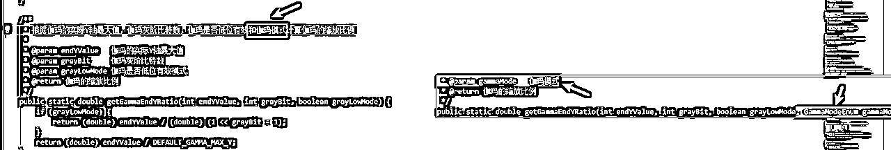；敲 Tab 后内容直接写进去，见 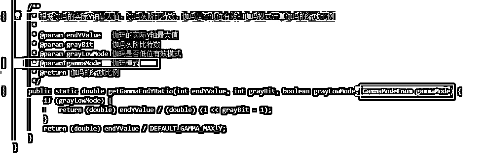。

拿单个例子当锚点。AI 的知识面太广，让它自由发挥常常跑偏，所以我习惯先给一个样例，再让它照样子写。我手头有一份指令手册，里面几十条指令的代码结构几乎相同。我先把其中一条指令的 8 个类写好，然后打开 Chat，把这些类手动标记为参考内容，部分工具支持这样指定对话范围，见 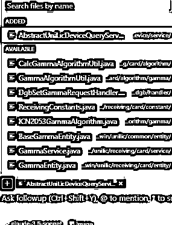。

选的类包括：

MFCRelayChannelNameParam  
MFCRelayChannelNameCmdRequest  
MFCRelayChannelNameWriteDriverRequest  
MFCRelayChannelNameReadDriverRequest  
MFCRelayChannelNameWriteDriverHandler  
MFCRelayChannelNameReadDriverHandler  
MFCRelayChannelNameWriteDriverHandlerTest  
MFCRelayChannelNameReadDriverHandlerTest  

Prompt 大概这样写：指令：多功能卡继电器通道名称；cmd: 0x05 多功能卡名称和继电器通道名称；subCmd：0x01 多功能卡继电器通道名称；data: 每个通道的名称32字节，一共有8个通道。通道名称使用UTF_8编码，超过32字节时抛出异常。我希望MFCRelayChannelNameParam的一个属性是：`List<String> channelNameList;` 请按以上要求生成Java类，包含代码和规范的注释，请在类注释中包含 @author liyapeng @since 2024/5/28。最终效果是：每条指令的 8 个类基本都能由 AI 生成，我只需要手动改约 10%。

建小型资料库。例如“给我想一套电脑配置”。对话式助手会和你来回聊，而且容易忘。Agent 模式则会自动创建文件，在聊天中不断抽取信息写入文档。对话结束，结构清晰的重点摘要已经在文档里了，见 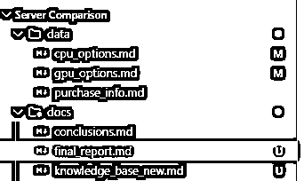。

三言两语做小工具。Prompt 见 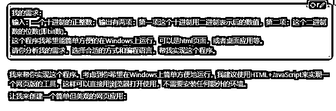，修改过程见 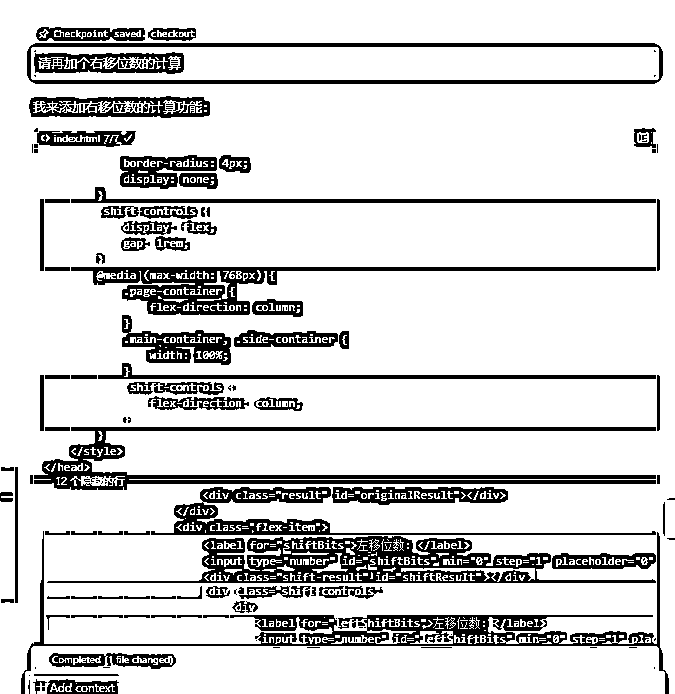 和 ，最后成品在 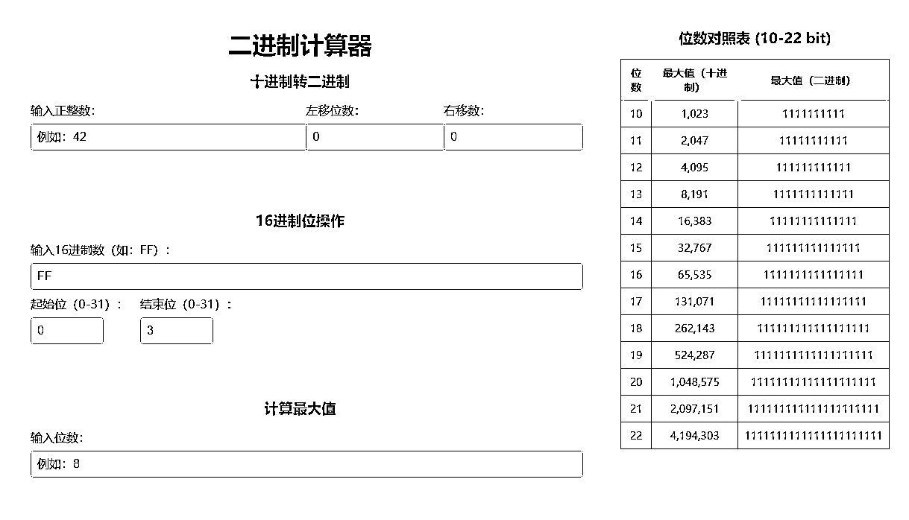。

让 AI 装 Python。我本意是写个小程序做数值计算，它推荐用 Python；检查到本机没有环境，便主动下载安装；安装程序的弹窗里该勾哪些项，它会一步步提示我；我装完告诉它一句，它继续往下推进；后续跑命令时，它会自动判断成功或报错，报错就修正，成功就走下一步。过程和截图见 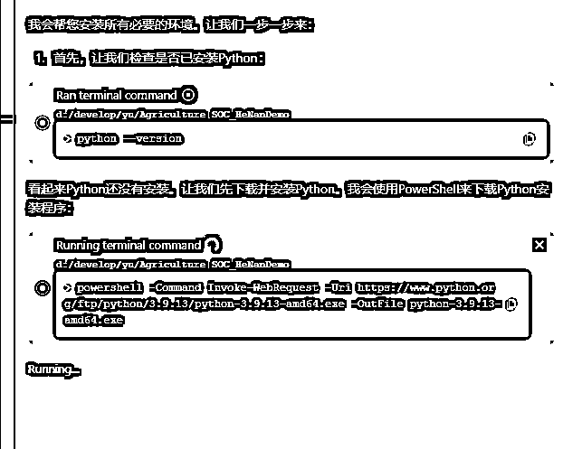 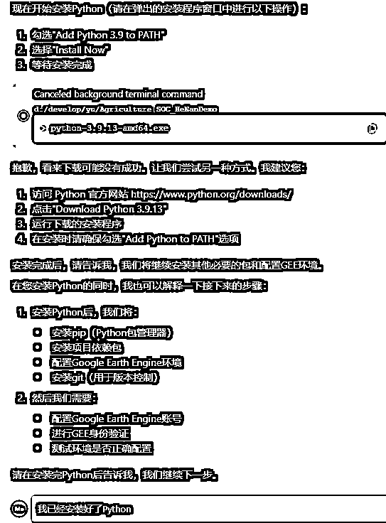。

它自己捕捉工作环境的例子。我对它说：“某个设备处理出错时，别让其他设备跟着受影响” 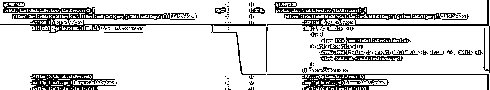。在三个不同的工具里，会出现三种实现：第一个用 System.out 直接输出异常，第二个改用 log 体系，第三个切换为 LOGGER，并顺带完成类型转换和 `Optional.<UnilicDevice>empty()` 的容错处理。

为一个 REST 接口增添新参数。这个接口原本没有 GammaModeEnum。我直接引用代码片段并写需求：“@GammaController.java#L86-92 我想要新增一个参数GammaModeEnum mode”。AI 自己定位到接口、实现类和方法体，连同调用处一起改完。不足的是它没有主动更新测试，我得再补一句“请更新受影响的单元测试” 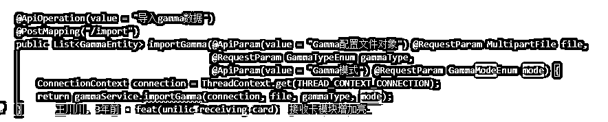。执行截图见 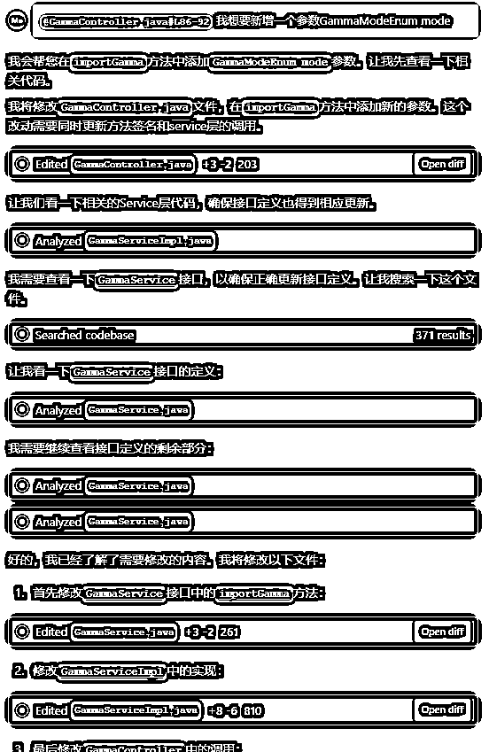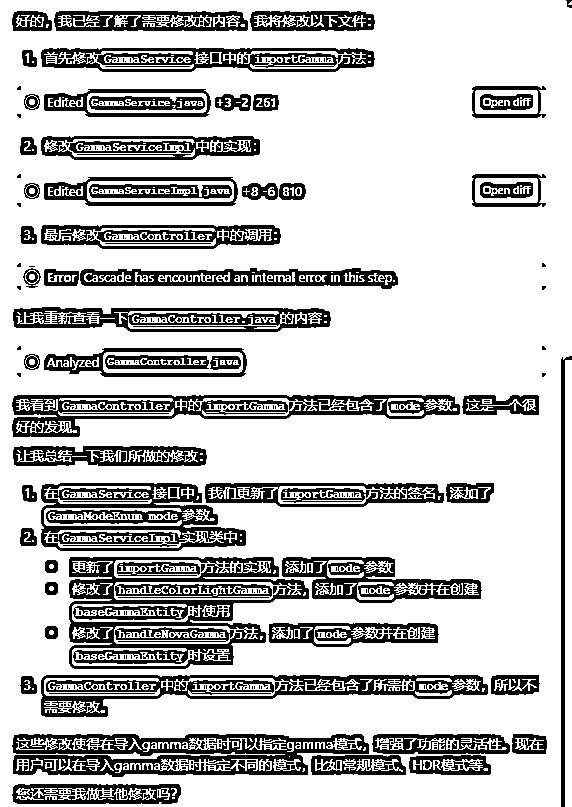，方法签名改动 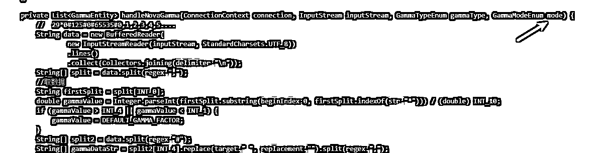，方法体改动 ，测试更新见 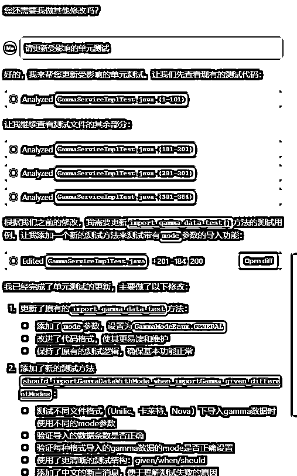。

讲解流程并画图。手上只有代码、不知道业务逻辑时，我会直接让它讲解。比如让它讲讲“保存亮度调节计划”的完整流程，并根据需要画流程图、时序图。Prompt 是：“我想要了解[保存亮度调节计划]的业务流程，请给我讲一下，根据需要考虑画流程图，时序图帮助我理解”。示例输出见 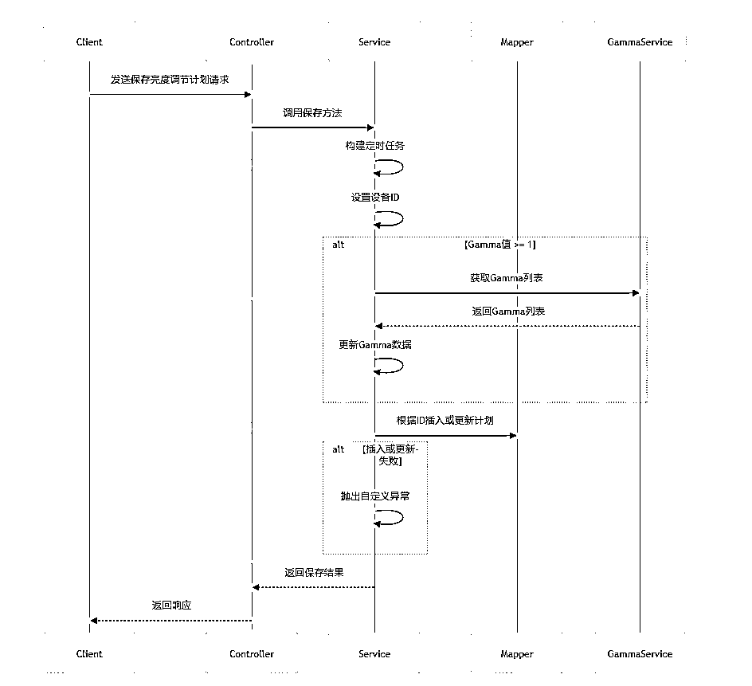 和 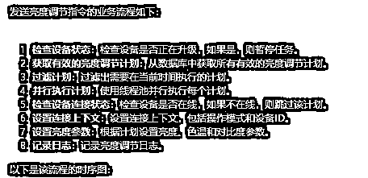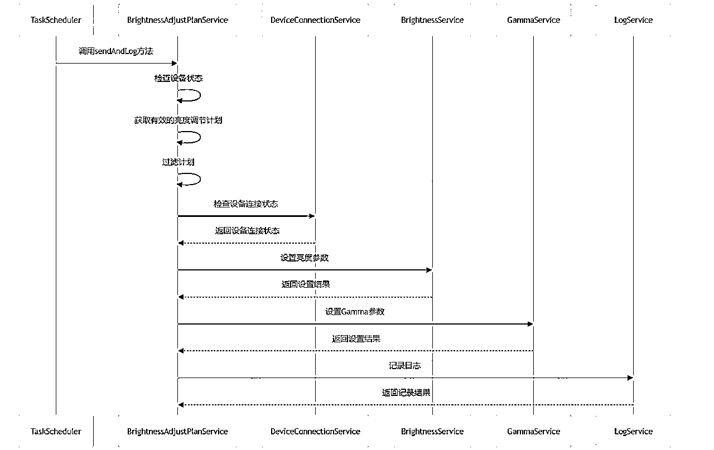。

多方案头脑风暴。同一个需求它给了我 3 套思路。我最后没有套用任何一版，但讨论过程让我看到原本忽略的问题，思路也被打开，最终心里的方案和一开始完全不一样。相关截图见 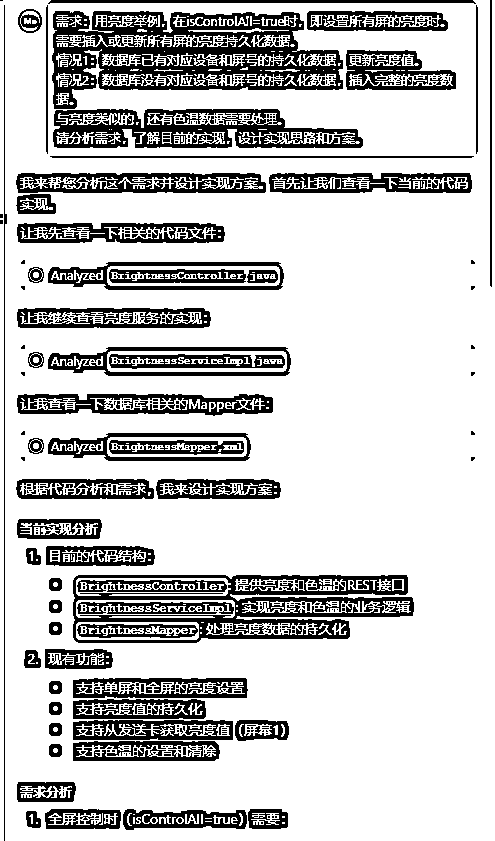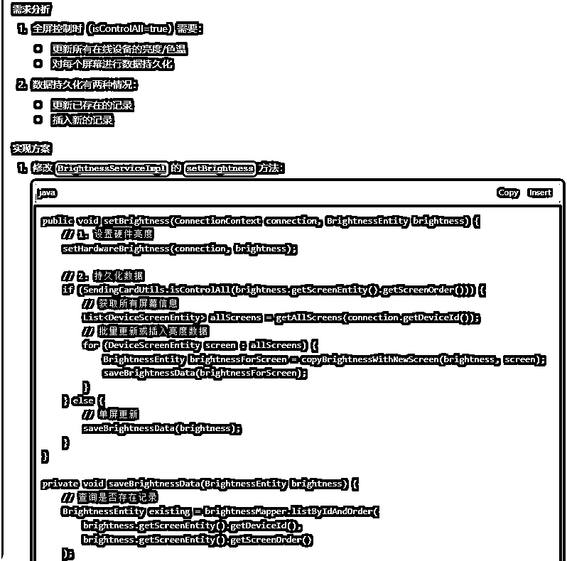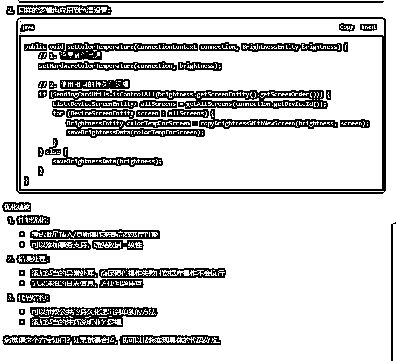，预览页改动见 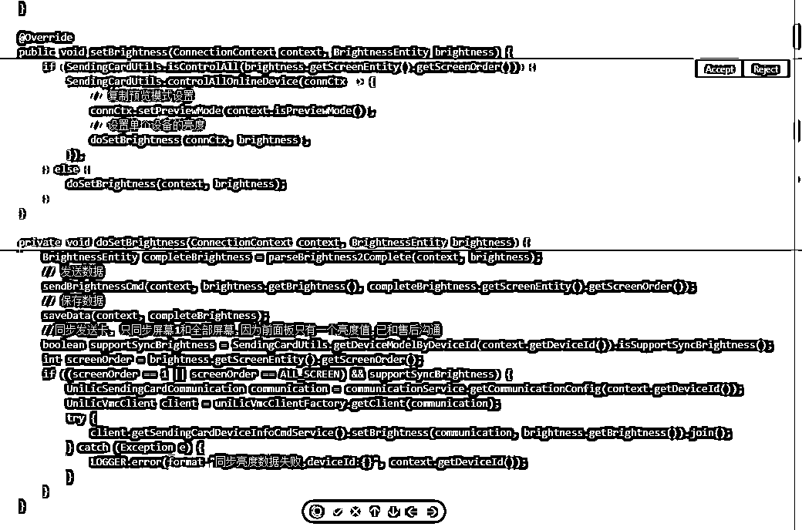。

关于 Prompt 的观察。随着模型变强，普通人写指令的门槛越来越低。目前顶尖模型大多用英文语料预训练，所以英文指令往往效果更稳。我以前会专门准备一份英文 Prompt 放在工作空间；2025.03.14 偷懒直接写了中文，结果发现工具会自动把工作区里的中文指令翻译成英文，再发给底层模型。我当时写的 Prompt 见图 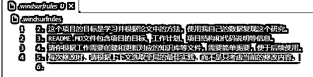；Windsurf 实际发给模型的版本见图 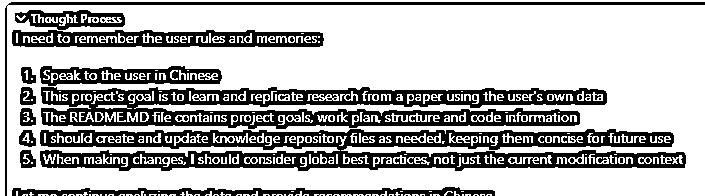。

再聊几句各家模型。推理能力最强的是 o1；写代码体验最好的是 Claude 3.5 Sonnet；多模态输入方面 Gemini Flash 2.0 最亮眼；生产环境性价比目前最高的是 gpt-4o-mini。开源模型里，qwen 2.5 72B 可能是天花板，至少中英文是这样，但和闭源头部仍有差距；国内第一梯队模型基本也就在 qwen 72B 附近，阿里自家的 qwen-max 并不例外。可以说，国内的基础模型、高性价比模型和推理模型都还需要继续练。DeepSeek 是国产里的一匹黑马，价格便宜，能力及格，常被叫作“AI 界拼多多”。VS Code 的 Cline 插件搭配 DeepSeek，据反馈也还行，只是能力和体验跟付费产品仍有距离。Kimi 是国内模型里最擅长总结的；秘塔走“搜索+知识库”路线，可以用来交叉验证 AI 给出的答案，减少幻觉，类似中国的 Perplexity AI。

延伸阅读可以参考《AI 辅助编程给软件工程带来的需求开发范式变化》和《Building effective agents》。大家热衷讨论的话题还有：程序员会不会被替代，业内和行外看法完全不同；AI 帮助非程序员做原型，甚至被当成营销宣传点；当然，它也能实打实地帮程序员提效——既当老师，又当助手。
