# 用Cursor从零搞定闲鱼卖家数据采集：我的实操全记录

> 最近闲鱼网页版终于开放了卖家全部宝贝的查看功能，这让我手里的选品效率直接翻倍。今天就把我用Cursor辅助开发采集工具的全过程分享出来，新手也能跟着做。

## 为什么我要做这个工具

做闲鱼虚拟三个月，我目前同时运营3个号，每天净收益稳定在200到500元（不封号的话还能更高）。能做出这个成绩，核心就一句话：靠数据找爆品，再把爆品搬到自己的店铺里。

我的选品思路很简单：

1. 每天盯着那些销量好的账号，找出单量超过50单的卖家。具体怎么看？闲鱼手机端点进宝贝页往下拉，能看到卖家累计卖出的总件数。我每天记录这个数字，两天一对比，就能算出单日销量，从而筛出优质账号。记录工具我用的是飞书表格，很顺手。

2. 找到这些账号后，再对他们的宝贝做二次筛选——主要看“想要数”增长快不快。方法一样，每天记一次想要数，做差值后倒序排列，增长最快的就是潜力爆品。

这周闲鱼网页版更新后，终于可以直接看到卖家的全部宝贝了，这意味着我们也能通过网页端批量采集数据。于是我就用Cursor写了这个采集程序，主要抓三个参数：想要数、价格、宝贝链接。其中想要数最重要。

做闲鱼虚拟的人都知道，每天大量时间都耗在选品上。有了这个工具，能批量拿到海量宝贝数据，快速筛出爆品，省时省力，店铺效果还能提升。

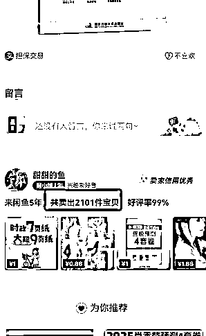

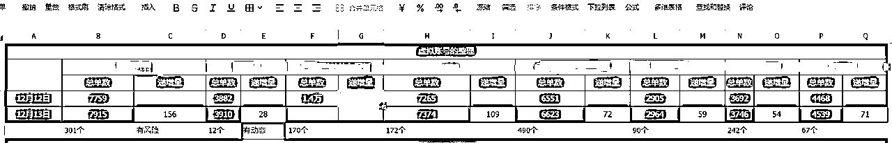

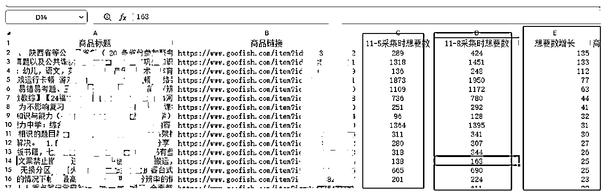

顺便提醒一句：展示“甜甜的鱼”这个账号是因为它明显违规，活不久了。我也因为类似宝贝被封过号，大家引以为戒。那个号卖了7000单，被封前每天还有50到100的利润，一年下来损失真不小。原因就是我卖了考研数学李林那本书的PDF扫描版，属于版权侵权，被投诉两次就封了。

目前闲鱼比较容易违规的品类有：网课类（比如粉笔网课，缩写fb也算）、动画视频类（地理八分钟、wow英语动画）、破解软件类、书籍扫描版PDF。关于违规分析的详细文章我还在写，写完会放链接。

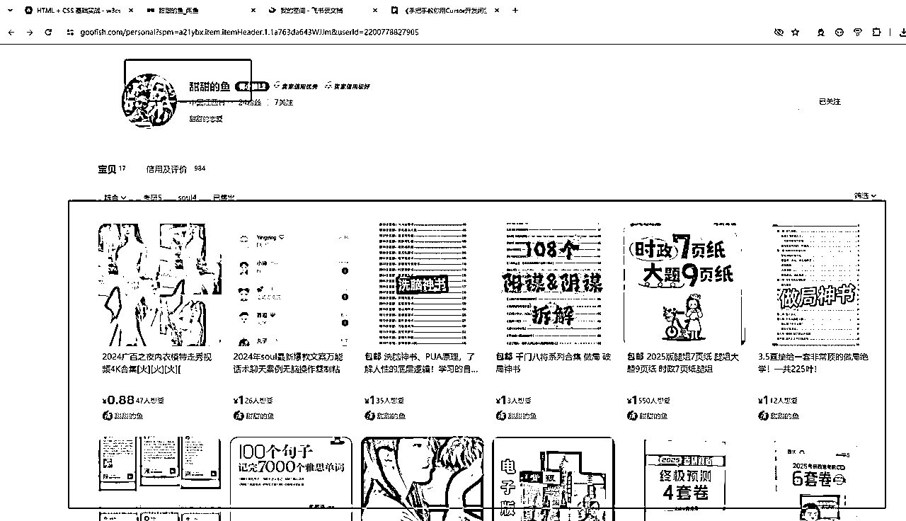

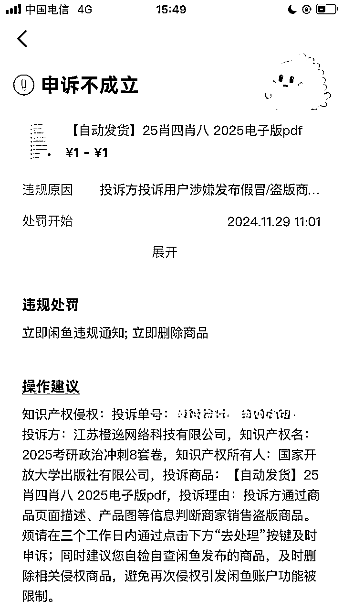

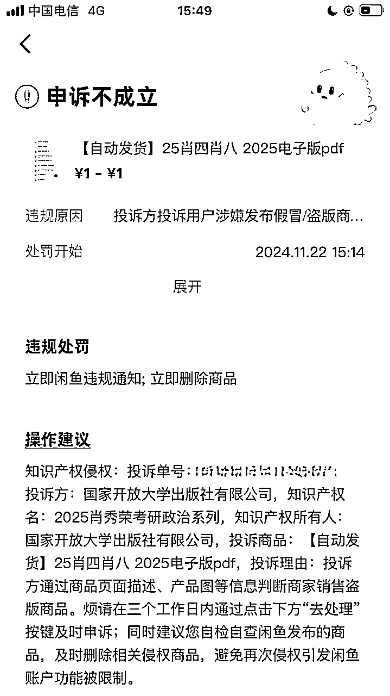

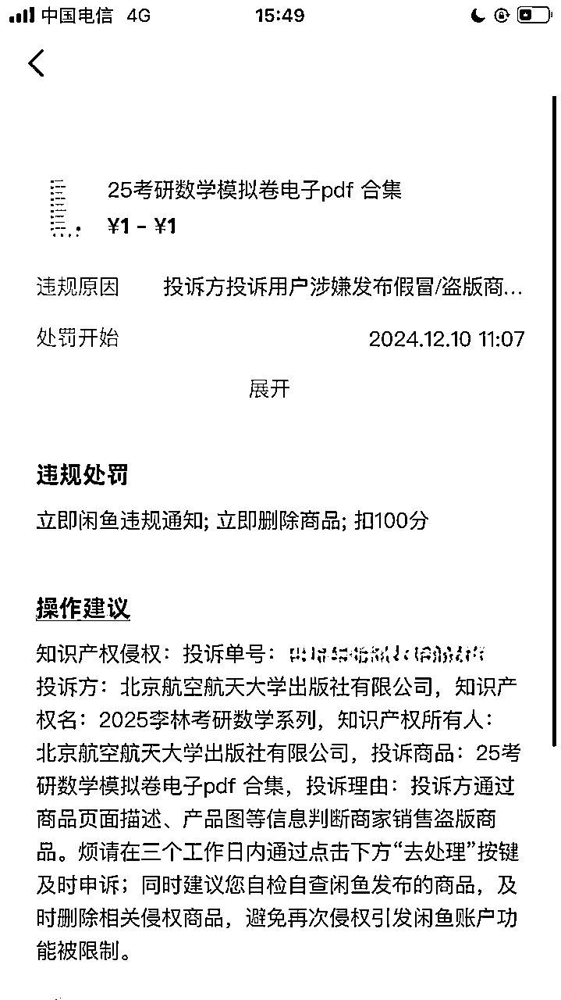

## 先交代下我的背景

2011年开始接触网赚，给淘宝客网站改代码，后来做淘宝客群，用易语言写过QQ加好友、网站App的私信程序。2016年转做自媒体，到2020年赚到第一桶金。疫情期间捣鼓视频号直播，卖年货最好时7天做到10万GMV，要不是过年还能更高。现在全职做闲鱼虚拟，日净收益200以上。其他经历可以翻我之前的文章。

## 开发过程全记录

视频教程在百度网盘，链接: https://pan.baidu.com/s/1DLlMeiHz4bUySThBG92n6A?pwd=t5du 提取码: t5du （复制后打开百度网盘App更方便）

### 1. 下载注册Cursor

官网：https://www.cursor.com/

### 2. HTML/CSS基础

想玩转网页采集，前端基础得补一补。推荐W3Cschool的基础教程：https://www.w3cschool.cn/codecamp/newList/basehtml 有时间完整过一遍最好。

### 3. 提示词怎么写

```
   帮我用python写一个采集闲鱼网页端卖家主页所有宝贝信息的小程序。  就是这个 https://www.goofish.com/personal?spm=a21ybx.item.itemHeader.1.2ed93da6H8Zhn4&userId=2200778827905

   通过 nick--sP8UifWP 获取卖家昵称
   通过 class  num--hPfR3ECA numSelected--lOjNwUrG  确定宝贝一共多少
   .cardWarp--dZodM57A 是单个宝贝的。一直往下滑动。每次滑动。检测 有多少个宝贝，如果采集够了总共宝贝数则停止
   一次性采集所有.cardWarp--dZodM57A的数据而不是一次只采集5个
   需要商品标题 价格 想要数 商品链接  卖家名字  卖家链接  这几项数据。
   数据不要有任何符号。只保留数字。
   程序执行完后浏览器不要关闭。即使按ctrl+c强制结束程序也不要关闭

   我的windows电脑上除了安装了Cursor代码编辑器外，也没有任何相关环境，请详细的一步一步的告诉我应该怎么做，我做完一步告诉你我做完了，你再告诉我下一步应该干什么。
```

解释一下：像“nick--sP8UifWP”这种是CSS的class选择器，我们把它给Cursor，是为了让它知道该采集页面上的哪些数据。

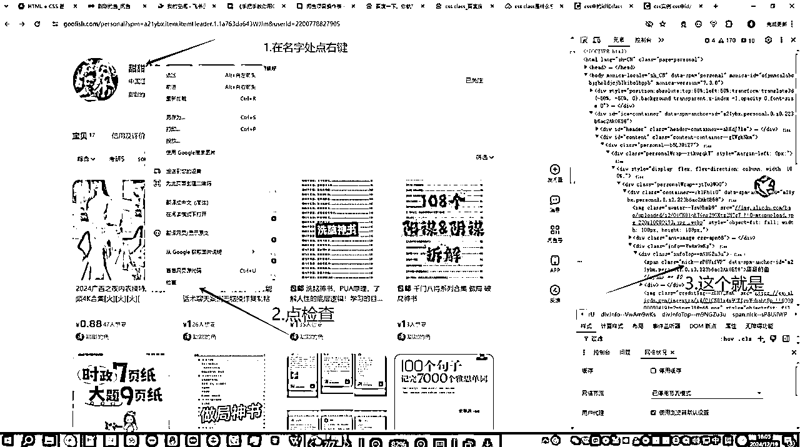

详细原理看视频，这里只说步骤。打开Cursor，找个目录建文件夹，用Cursor打开这个目录。

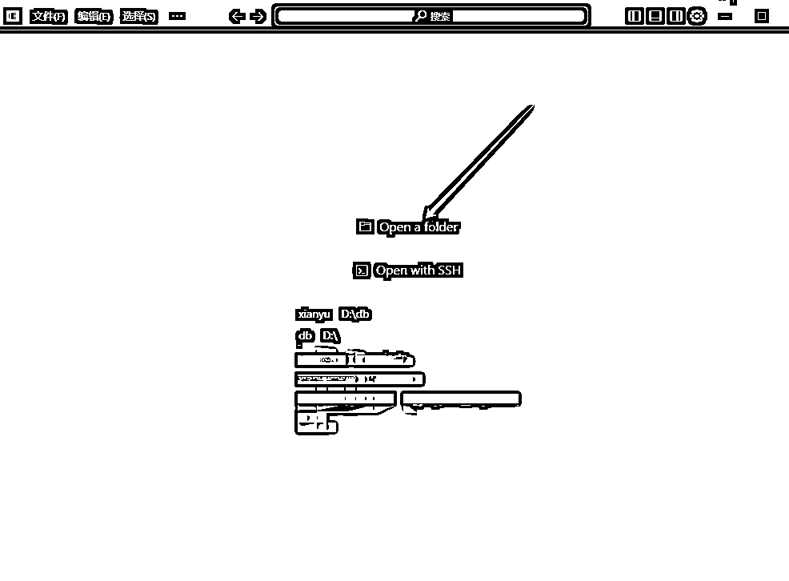

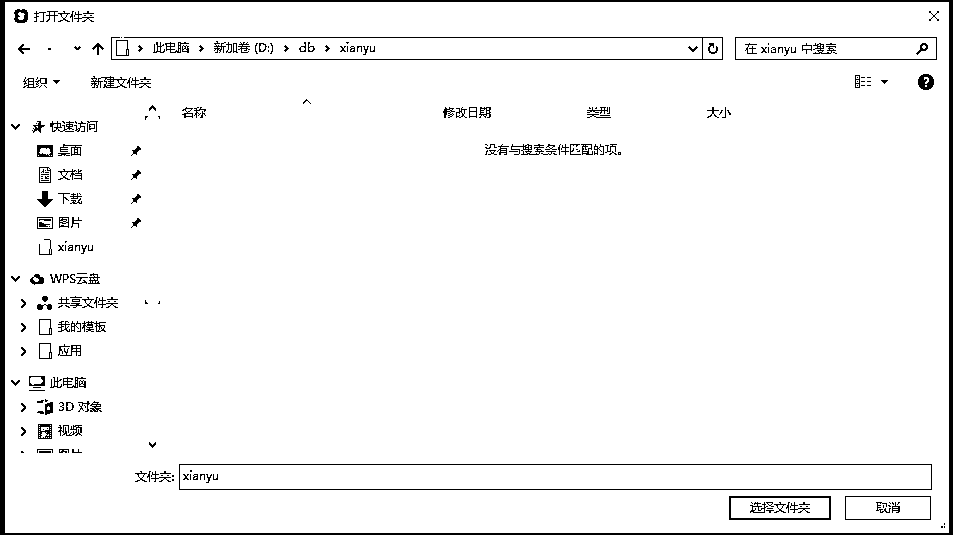

然后按图操作：先打开侧边栏，选Composer，粘贴提示词，回车。

### 4. 安装环境

**Python**：直接用Cursor推荐的下载地址就行。我装的是3.11版，千万别下3.13，新版很多模块不支持，装完还得卸了重装旧的。

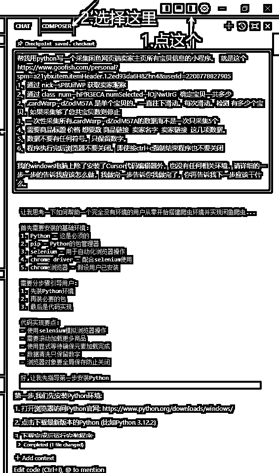

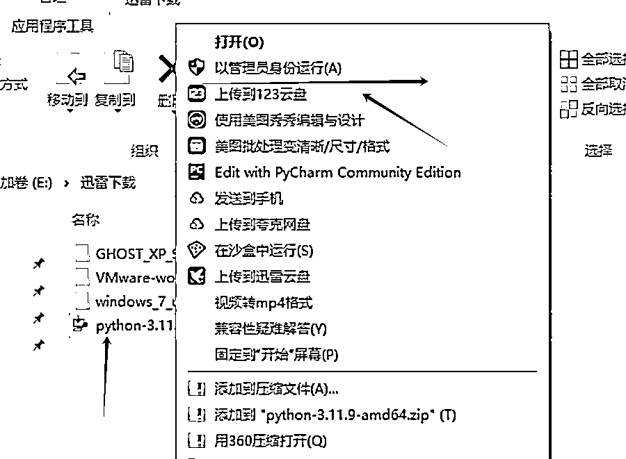

安装时右键“以管理员身份运行”，一定勾选“Add Python to PATH”，然后点“Install Now”。装完后按Win+R，输入cmd回车打开命令提示符，输入python验证：

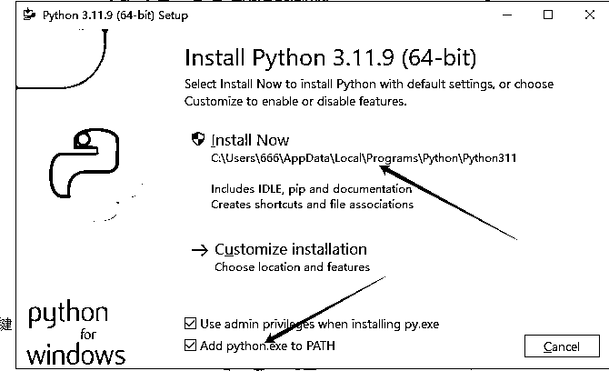

```
python --version
```

这样显示就对了。如果没成功，卸载后重装，把能选的选项都勾上。我就有一台电脑是这么解决的。

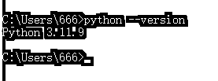


然后把你的Python版本发给Cursor，它会根据版本匹配方案和代码，避免环境不一致的坑。

**模块**：

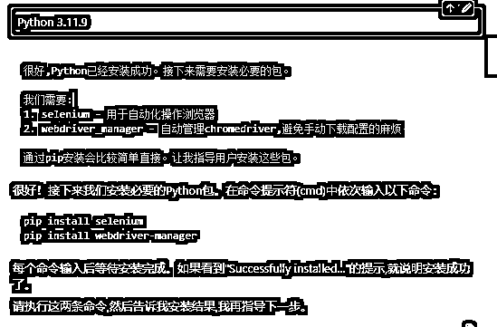

```
pip install selenium
```

依次安装这两个模块，用命令行或Cursor的终端都行：

```
pip install webdriver-manager
```

### 5. 正式写代码

把“Successfully installed”发给Cursor，它就开始写代码了。

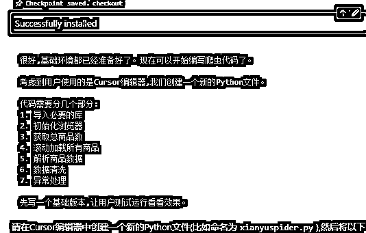

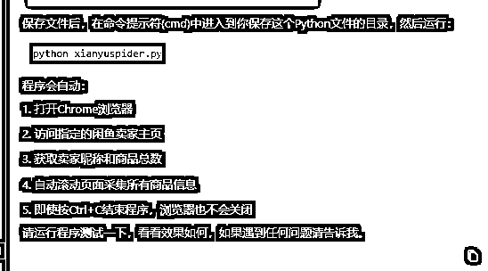

写完后点“Accept All”，然后运行（文件名以Cursor生成的为准，我的是xianyuspider.py，你的不一定一样）。

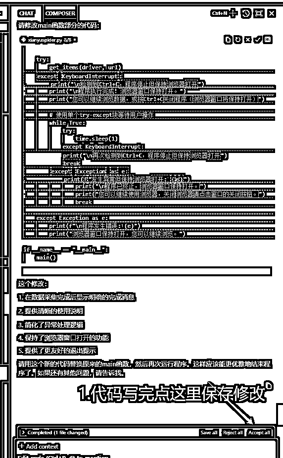

```
python xianyuspider.py
```

运行步骤：

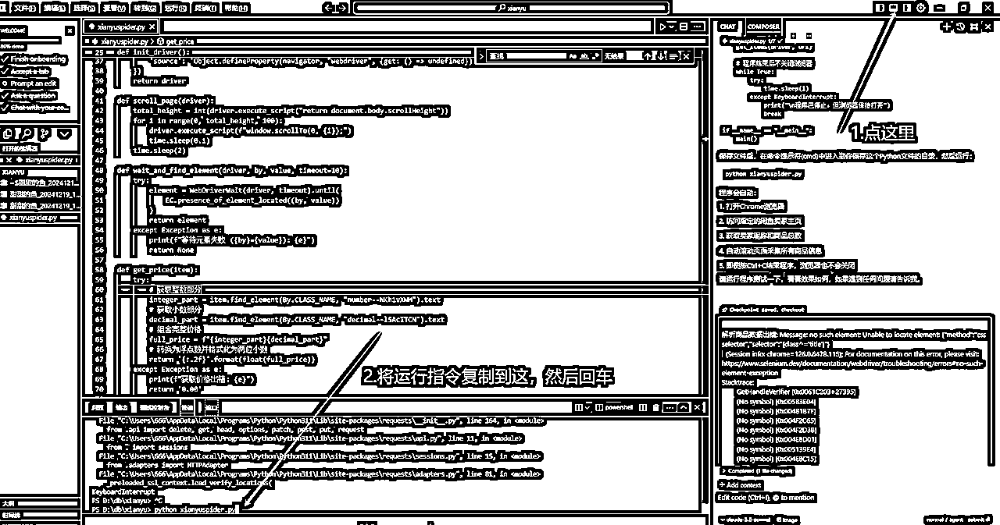

运行后肯定会报错，把错误信息复制下来发给Cursor：

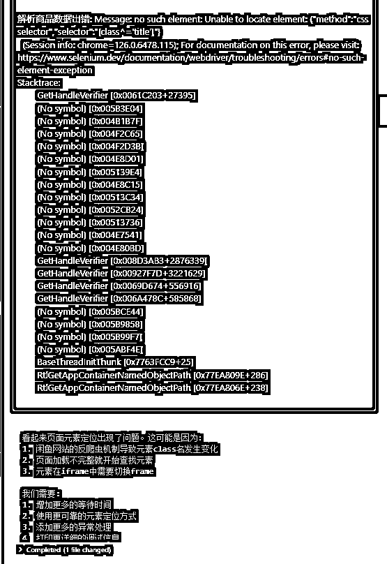

它会修改代码并说明改进了什么，继续点“Accept All”再运行。

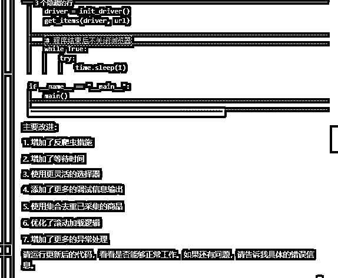

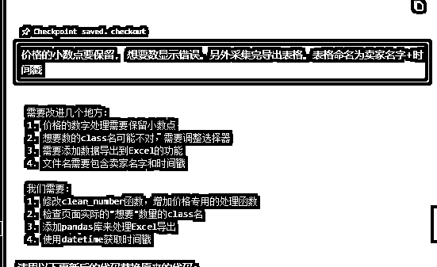

接着继续提交错误让它改。用命令行或终端运行安装库的代码：

```
价格的小数点要保留， 想要数显示错误。另外采集完导出表格。表格命名为卖家名字+时间戳
```

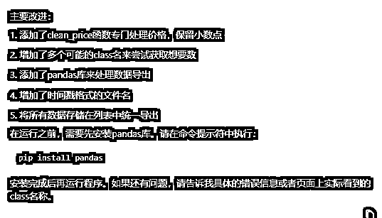

再继续提交错误，具体的错误提示不一样，这里就不给固定提示词了。

```
pip install pandas
```

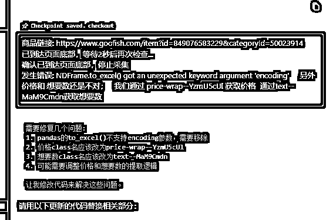

```
另外  价格和 想要数还是不对；   我们通过 price-wrap--YzmU5cUl 获取价格  通过text--MaM9Cmdn获取想要数
```

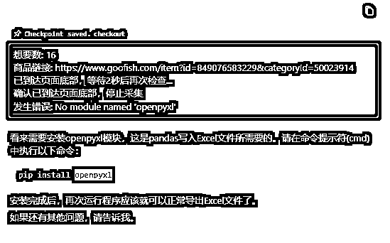

```
pip install openpyxl
```

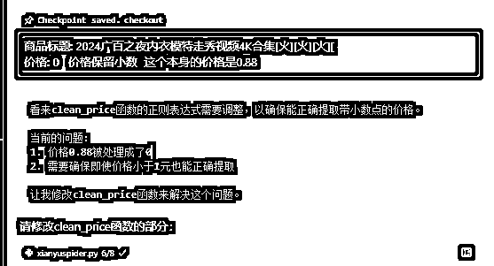

提交完这个还是报错。后来发现它没识别出整数和小数部分的选择器，我把整数部分和小数部分的具体class都给它，问题就解决了。

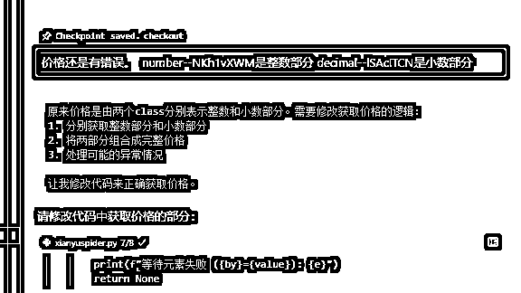

找一个带小数的价格，能清晰看到两部分是不同的class选择器：

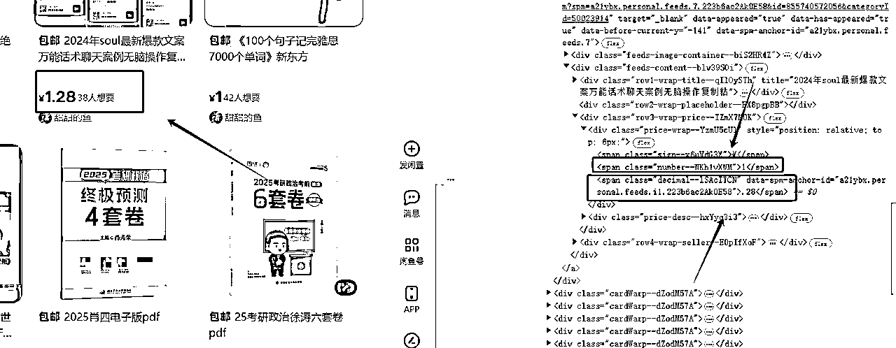

然后你的代码文件夹里就能看到采集到的数据了：

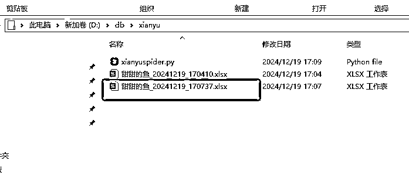

## 几个重要提醒

1. Cursor是AI编程，遇到跟你不一样的问题很正常。报什么错就把错误发给它，需求不满足就直接给修改建议，甚至可以跟它讨论让它出方案。

2. 软件只是加速效果的工具。做闲鱼虚拟的新手，建议先完整手工做一遍流程，有了真实手感再上软件。一上来就依赖工具，很难做出效果，因为你容易忽略项目里的很多细节。

3. 跟Cursor沟通也有坑。一是没反馈或一直转圈，重新来就行；二是它有时不自动改代码，只给代码但不点“Accept All”。这种情况就加一句“给我自动更新代码”，还不行就点代码右上角手动“Apply”。

## 还能扩展哪些功能

1. **用户操作界面**：现在靠命令行跑，加个界面后双击打开、鼠标操作体验会好很多，见下图：

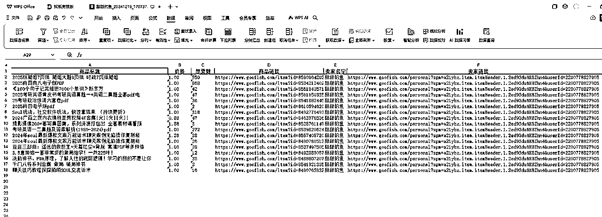

2. **批量导入卖家主页链接**：做一个TXT或Excel文件，存多个卖家主页链接，一次性把所有账号的数据全采完。

3. **计算想要数差值**：首次采集后隔一天再采一次，导入已采集的表格，自动算出想要数增长最快的宝贝——这就是爆品筛选的核心原理。

4. **数据库存储**：把数据存到SQLite或服务器数据库，更方便调取和分析。

以上这些都可以继续跟Cursor沟通，让它一步步完善程序。

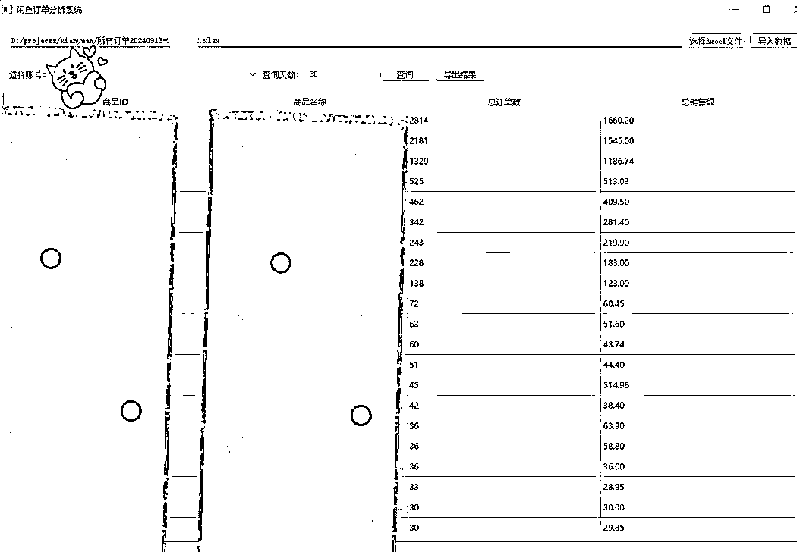

我用这套方法已经跑通了整个流程，希望也能帮到你。如果有什么问题，欢迎评论区交流。