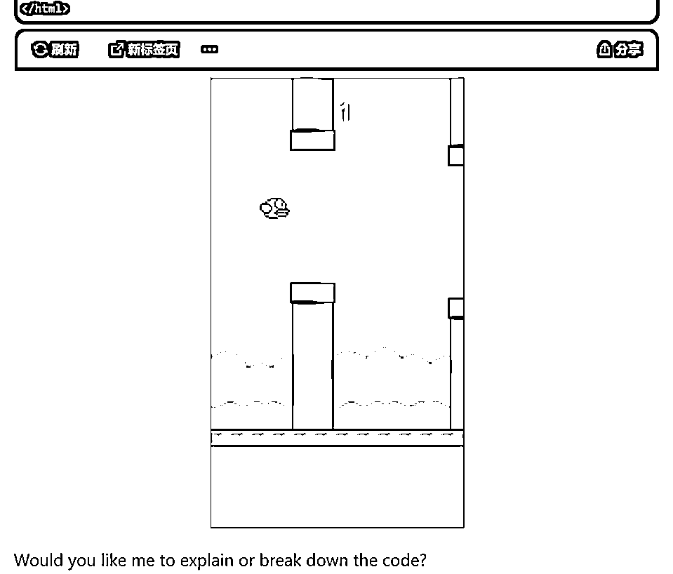
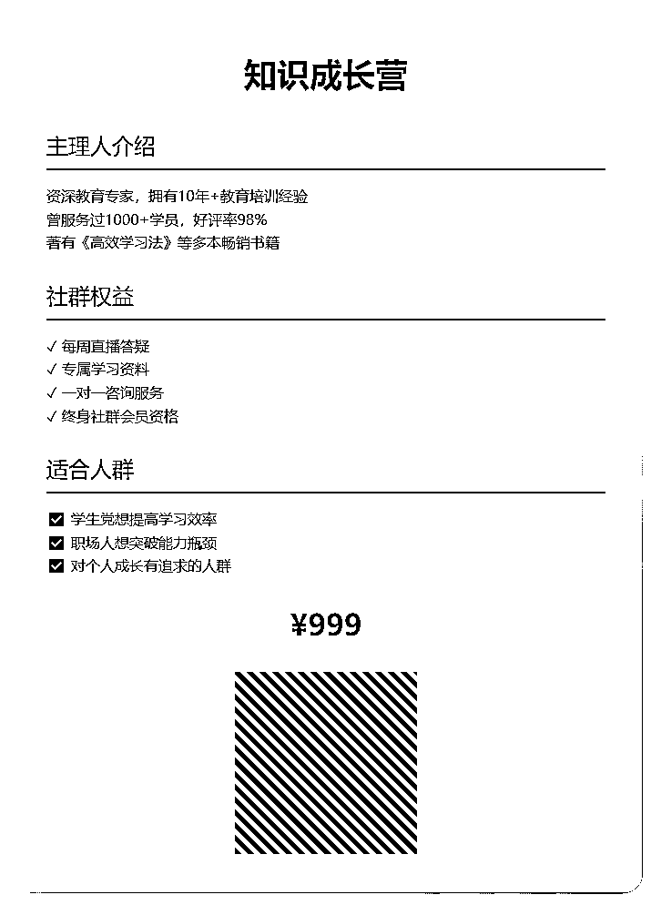
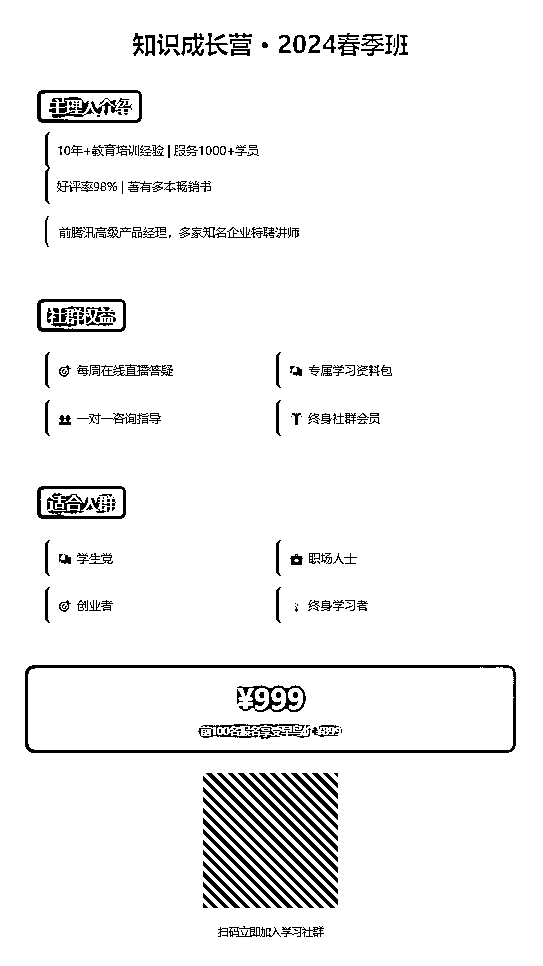
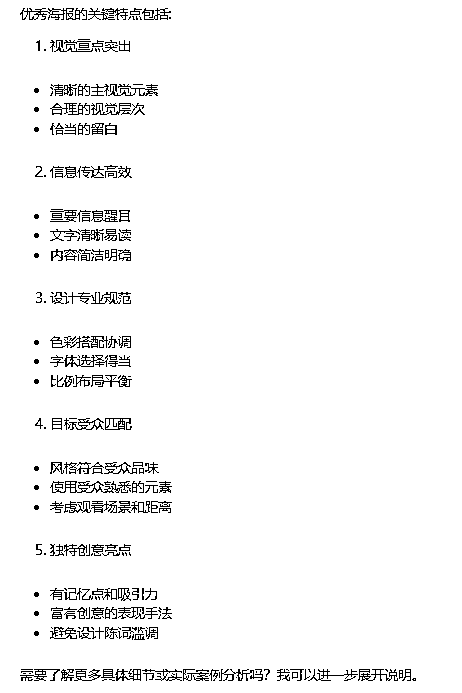
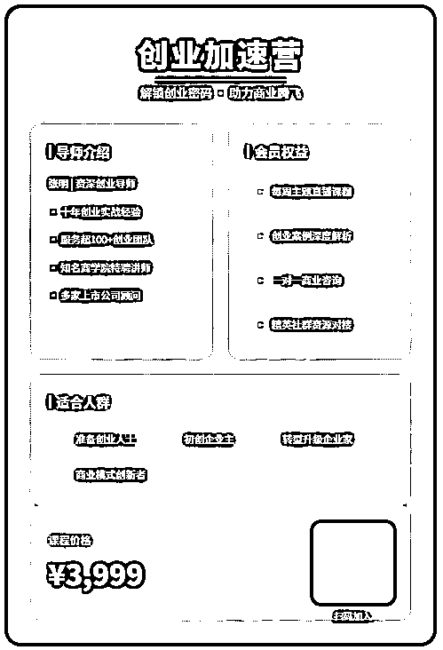
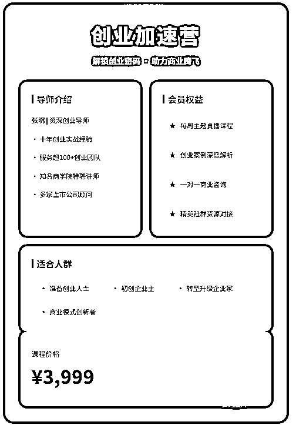
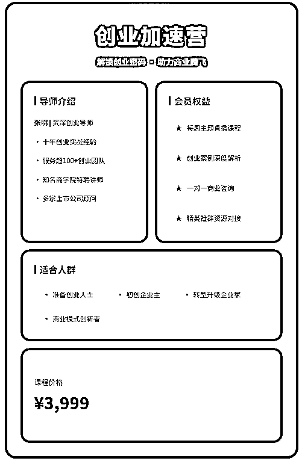
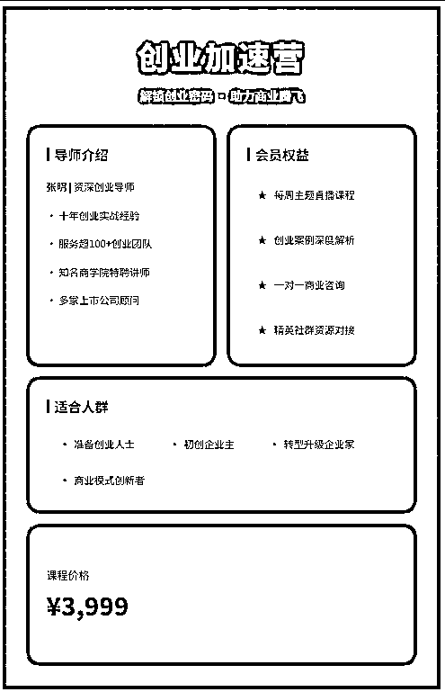
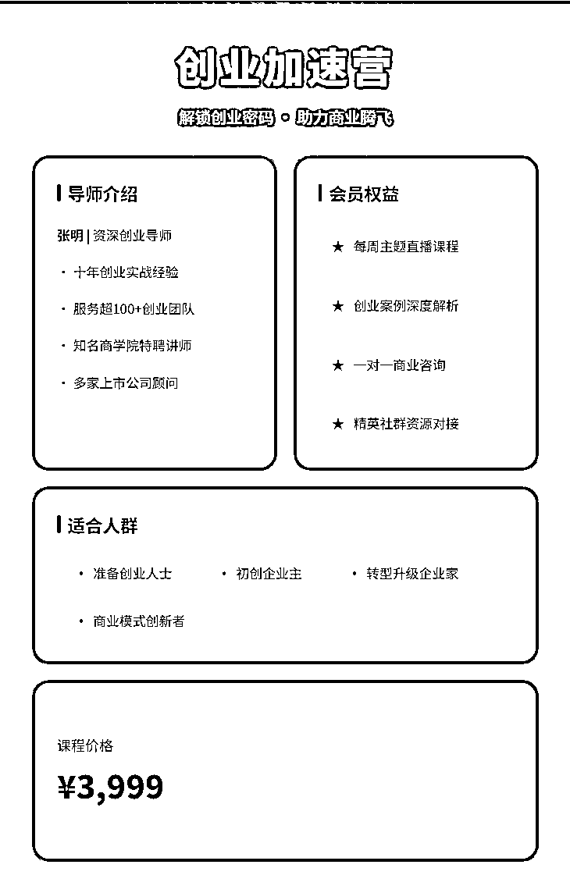
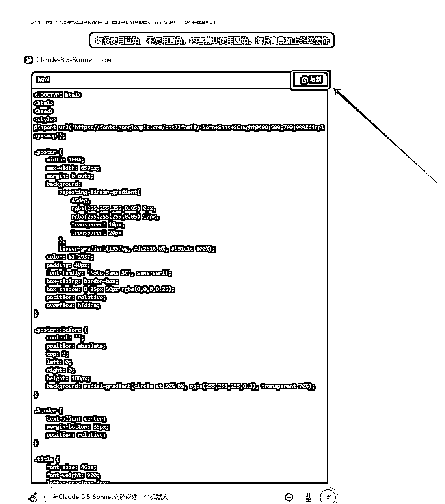

# 文本类AI做海报设计

做海报这件事，对毫无设计功底的人来说，简直是场噩梦。

没有审美基础，硬做出来的图，往往连自己这关都过不去。

可偏偏又绕不开它：公众号引流、社群拉新、课程上架，哪一样不需要一张像样的海报？

毕竟图片比纯文字更有诚意，也能更直观地把重点信息怼到用户眼前。

直到我看了两位大佬的玩法，才试着用AI来搞定海报，结果出乎意料地好。

一位是李继刚——就是那个被称作“提示词第一人”的家伙，他的Lisp风格提示词非常出名。很多人是从“汉语新解”那个prompt认识他的，也是那一刻才意识到：原来Claude对中文的理解能深到这种程度。他还用了SVG输出，一下点醒了我：文本类AI照样能产出图片。

另一位是涂津豪，一个17岁的高中生，他在GitHub上折腾的一个提示词拿下了8.2K star。从他那里我知道了“思维链”这个概念——当你把思考模式和推理步骤详细展示给AI，它的输出就会更接近人类。据说有人直接拿那段prompt写出了一个能玩的flappy bird。

这么一想，用AI做张海报，应该不算什么难事吧？

下面是我实际调试的过程（模型用的是claude-3.5 sonnet）：

第一步，先把自己的想法粗略丢给AI，看看它怎么理解。

Prompt：帮我做一张海报。包含标题，主理人介绍，社群权益，适合人群，价格，二维码

呃……问题很明显：留白太多，内容松散，颜色和样式都过于单调。我把这些毛病反馈给claude，让它重来一版。

这版好了一些，但离我想要的效果还差一口气。

第二步，让claude自己来定义“好海报”。

Prompt：一张优秀的海报需要具有哪些特点？

综合它说的要点，我重新组织了一版提示词：

Prompt：帮我做一张海报。
1、包含标题，主理人介绍，社群权益，适合人群，价格，二维码；
2、视觉重点突出 清晰的主视觉元素 合理的视觉层次 内容紧凑；
3、设计专业规范 色彩搭配协调 字体选择得当 比例布局平衡；
4、不同的信息选择合适的字体、大小等去表达；
5、海报背景带有主题样式，显得丰富，不要平淡；
6、内容部分使用相同的背景颜色，但是要与海报主题颜色区分开；

这下看起来有模有样了，不过还没到能直接发出去的水平。

第三步，按照自己的想法继续抠细节。

先是配色不和谐的问题。

Prompt：海报主体使用红色，内容部分使用奶白；

效果一下就出来了。

接着发现“课程价格”和“适合人群”两个板块挨得太近。

Prompt：课程价格板块与适合人群板块相隔太近了，需要分开一点

调整立竿见影。

再继续：

Prompt：海报使用直角，不使用圆角，内容模块使用圆角。海报背景加上条纹装饰

这已经是我想要的样子了，大家觉得怎么样？

第四步，改文字内容。

Claude会给出一个带代码的文件，里面能找到海报上的文字，直接换成你自己的就行。然后把这段代码发给它，要什么效果它都能给你改出来。

还有个更简单的方法：把代码复制到txt文件里，把扩展名改成html，用浏览器打开就能看到海报。

