# 闲鱼虚拟付费玩法——超级擦亮投放复盘

“超级擦亮”改版后，我见过不少人的操作：建一个5.9元的投放，预算烧完也没等到第一笔订单，就认定这东西没用；也有人连续投了十几次，销量却完全没动静。问题未必在功能本身，而在于怎么投、怎么选品、怎么及时停下来。这篇内容是我自己的完整复盘。

先说成绩。我做的方向是虚拟备考资料，覆盖考研、考公、各类资格考试的真题、笔记、PPT等。近期数据最好的店铺，擦亮投放花费40.22元，成交额287.41元，投产比直接到7；同时，免费流量还额外带来了653单。这个商品客单价约0.8元，所以总成交约500元，净赚超过460元。

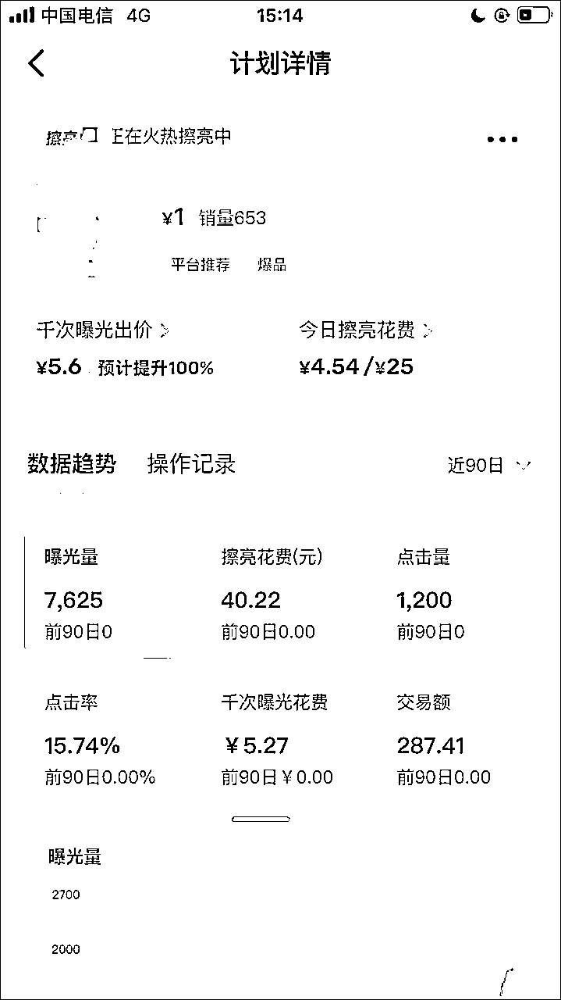

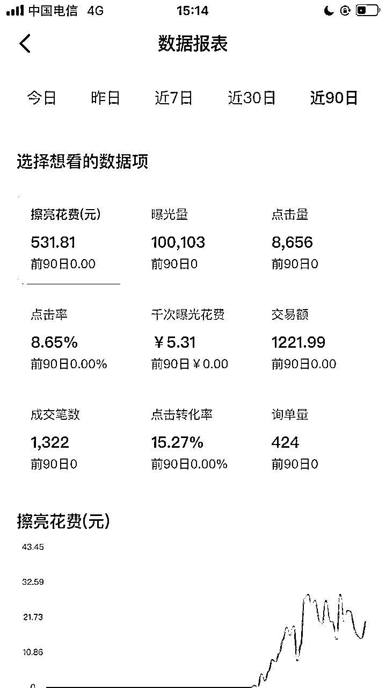

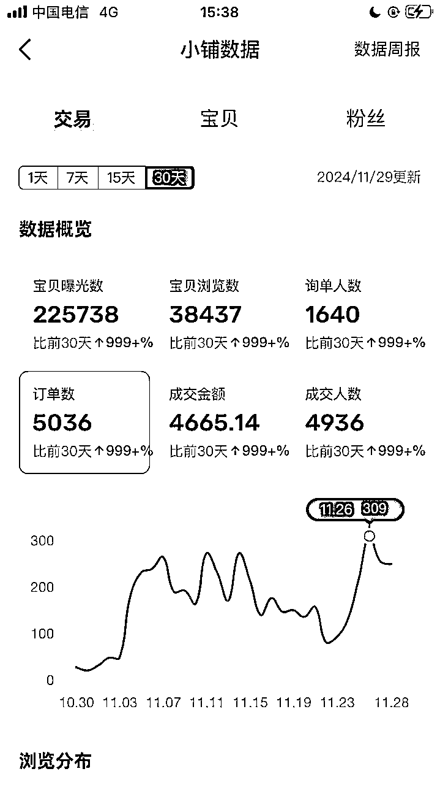

上面是表现最好店铺的整体数据。目前三个账号的近段净收益都在400元上下。
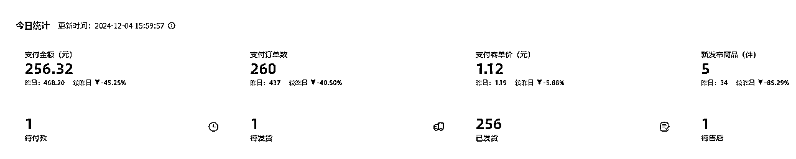

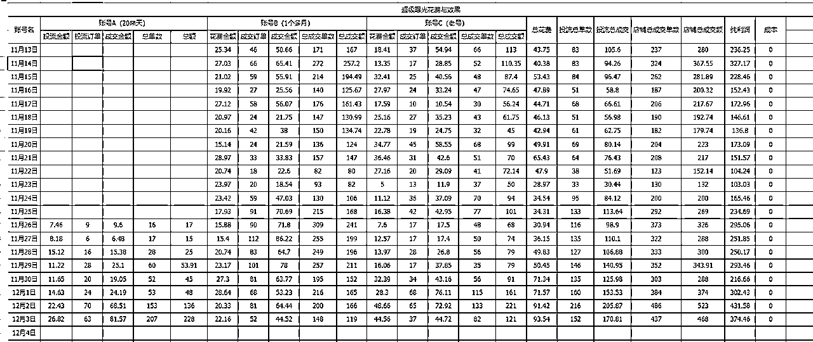

这几个账号的付费投放明细如下。

这个工具到底有什么用？一是买展示量，让更多买家看到商品；只要商品本身有竞争力，看到的人多了，成交概率自然跟着涨。二是牵动免费流量，尤其是投产为正的款，付费投放会带动整体自然订单。一个很常见的现象是：当某个爆款的广告预算耗尽、进入待结算状态，它的订单量会突然萎缩甚至归零；重新充值投放后，订单又立刻回来了。

简单交代背景。2011年我开始接触网赚，给淘宝客网站改过代码，做过淘客社群，还用易语言写过🐧加好友、网站和App私信等程序。2016年转入自媒体，2020年攒到第一桶金。疫情期间做视频号直播卖年货，最高纪录7天10万GMV。现在全职做闲鱼虚拟商品，日均净收益300元以上。

再讲玩法。所谓“超级擦亮”，就是闲鱼官方推出的付费推广工具，核心是用钱换曝光，相当于给商品买广告位。入口在“我的”页面：先打开鱼小铺工作台，接着往下滑动屏幕，找到“超级曝光”按钮点进去。

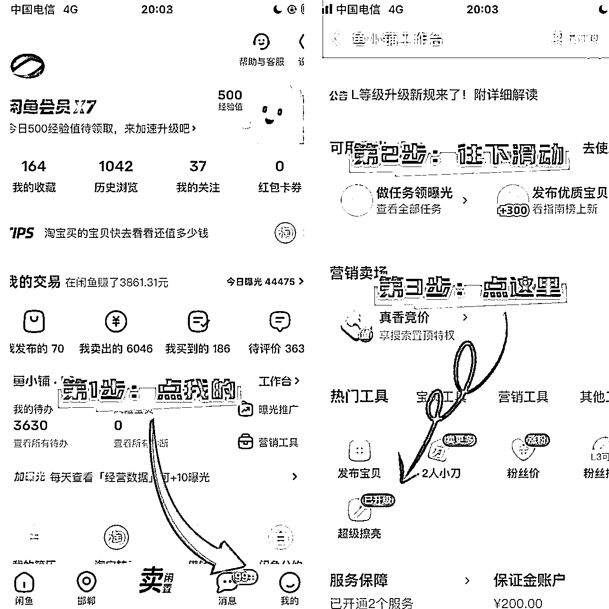

官方的功能说明直接看截图。

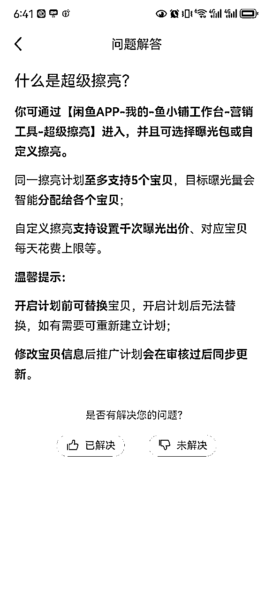

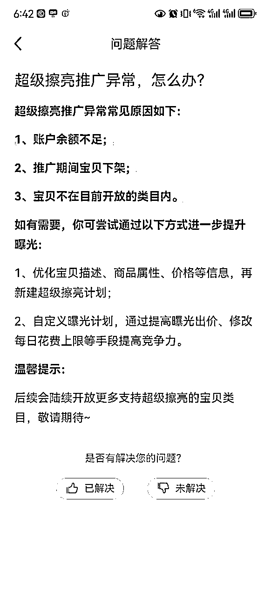

想用这个功能，得先开通鱼小铺。我的笨办法是：发布宝贝时全部选“电子资料”分类，每天挂1到5个，无论有没有自然成交都持续操作。我陆续开了三个全新账号：第一个成交30单，16到17天拿到开通资格；第二个仅成交4单，约20天也开了；第三个一单没出，20几天照样开通。

下面进入正题，拆两个账号的完整过程。

账号A大约11月15日启动。前期的准备动作只有一个：上架商品。图片只改MD5，描述偶尔加表情或换行，不做大改。一共挂了40个宝贝，前期每天3到10个，中间有几天太忙就停了。开通鱼小铺前，总共只成交4单。

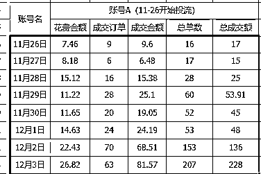

上图为开通后的投放效果，8天内做到单日最高207单。

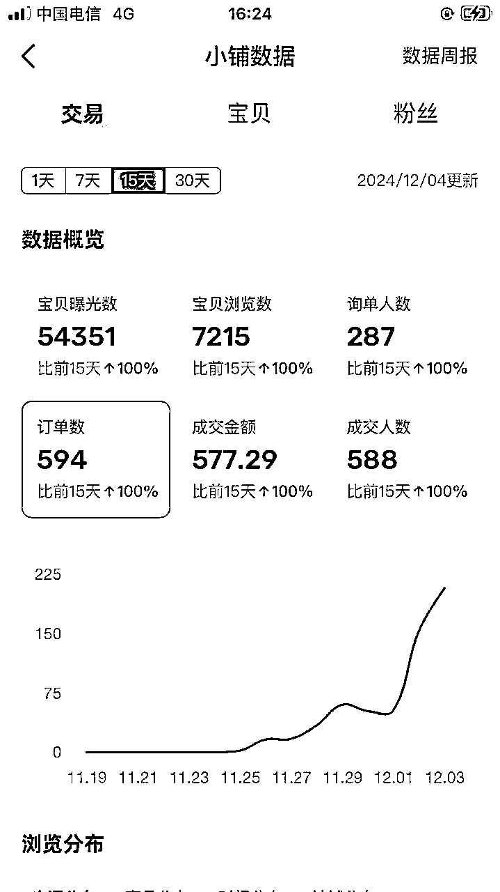

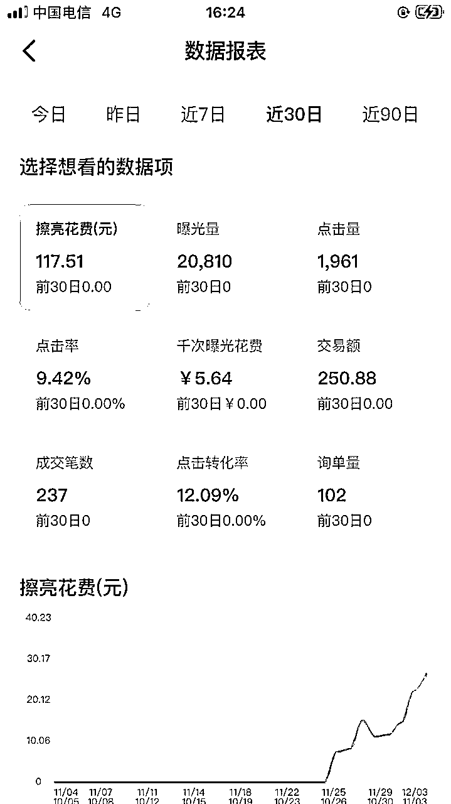

上面是该账号全部成交和付费数据。

选品有两种来源：一种是把老号当天有成交的商品直接搬到新号；另一种是用自研脚本每天抓取两日内“想要量”增长超过20的宝贝。脚本是我用影刀和MySQL写的，逻辑很简单：先采集当天“想要量”，次日再做差，按增幅降序排列。

开通鱼小铺当天，我先设置了“两人小刀”，并把能加入闲鱼币抵扣、公益宝贝的商品都加入，尽量多拿曝光。随后充值200元，开通“描述不符包退”和“24小时发货”，再让全店商品都纳入服务保障。最近平台还出了“10分钟发货”，有条件的可以开，但延误要赔钱，需谨慎。当日也上架了“小黄鱼”类商品，用来做互拍，补了5单。互拍的本质是同行之间互相买、互相评，借此拉高账号活跃度和流量权重。之后每天继续上新10个宝贝。

第二天开始正式投放。当时库存约70个宝贝，先挑30个出来跑，优先选有成交记录和系统推荐的款。投了两小时后检查数据，花费超过0.5元却零成交的，一律暂停，其余继续观察。点击率也有参考价值：一般投产正常的款点击率在10%以上，如果低于5%又不成交，建议直接拿掉。再等两三个小时，继续按这个逻辑筛选。当天还做了互评，上新10个。

互拍的方法有两种。第一种是搜索“小黄鱼”，主动联系同行，把宝贝改价成0.01元或1元，然后拍下、确认收货、给好评一条龙。需要提醒的是，有些人回评很慢，最好等对方先确认收货或先给好评，自己再跟上；同时留意对方差评，有人可能一直不评。主动找人的缺点是效率低，问好几个才有一个在线。第二种是自己挂“小黄鱼”商品，等同行主动来拍，省去沟通成本，对方来找你时，直接拍就行。

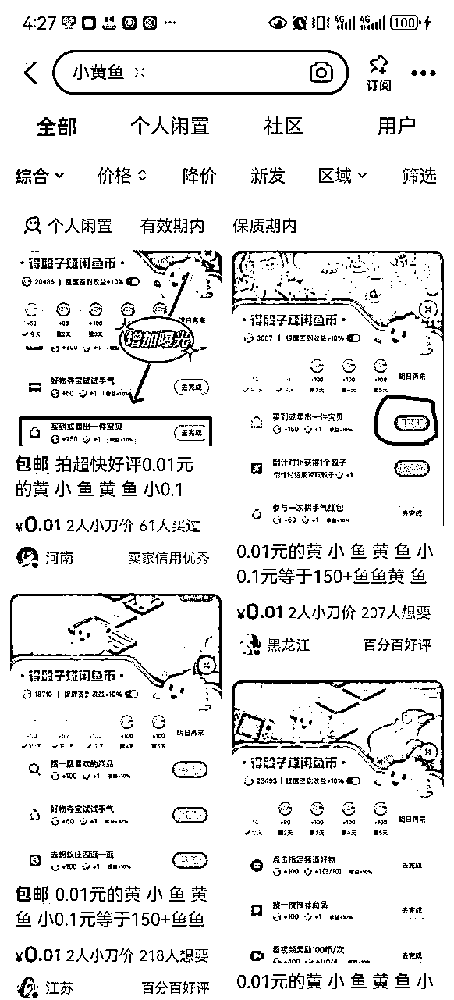

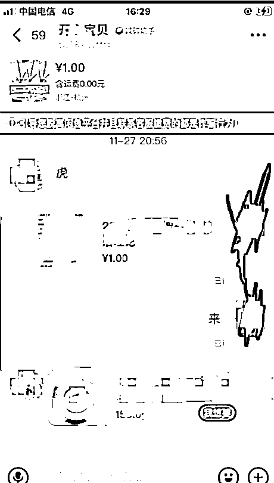

第三天，先把昨天表现差的关掉，又新增30多个宝贝进入投放池，基本等于全店覆盖。继续互拍，每天5到10单，连续操作3到6天；一旦发现成交明显上升，就不再做互拍，改成向买家要好评。同时删除7天以上“想要量”为零的商品。从这天起，我开始对已购买、已确认收货的买家索要好评，用来抬升账号权重。我的方法是送关联资料，比如对方买国考笔记，我就送真题；也可以返1元红包，但那个号是企业支付宝，没法转账，所以只能送资料。

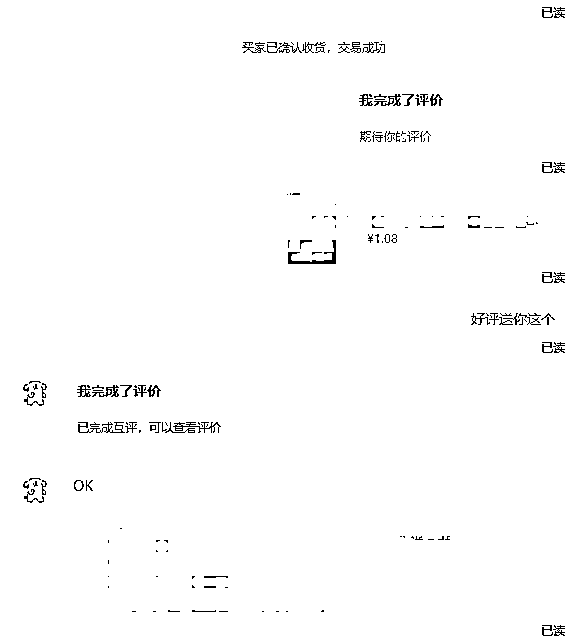

再往后几天，就是循环做三件事：互评、求好评、用擦亮投放测款。坚持到12月初，爆款自然跑了出来。

账号B大约10月12日启动，前面操作和账号A一致，不再重复。这里重点说怎么把日成交稳定在100单以上。

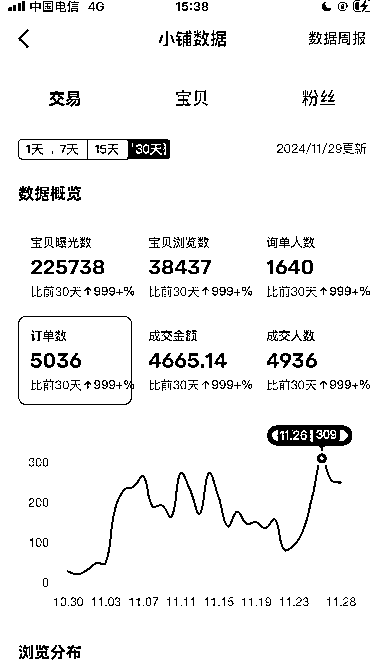

这个店平均每天成交192单以上，其中绝大部分来自一款爆品。爆品也不是一开始就能成：我先让它跑到600单，然后复制链接，结果复制款比原款跑得还快；但这款本身有风险，原链接到1000单后跑不动就删了。第二个链接接近1000单时也明显疲软。后来我自己作图挂了三款，又复制了一次，都没效果。最后直接搜关键词，把排名靠前的同行链接全部只改MD5传上去，再按照账号A的方法操作，总算又跑出一款。

总结三点：第一，爆款有生命周期，不能总靠一个链接吃饭，要不断新建链接，或微调，或参考对手。第二，没有风险的跑量款，值得在多个店铺重复布置，才能放大收益。第三，有风险的款千万不要铺太多店。我因为两个风险品，五个店各吃了至少两条“涉假”违规，还封掉一个店，非常不值。

再看投放心得。我目前8个店累计投过500多个商品，多数店铺保持10多个在投，暂停的有100个。

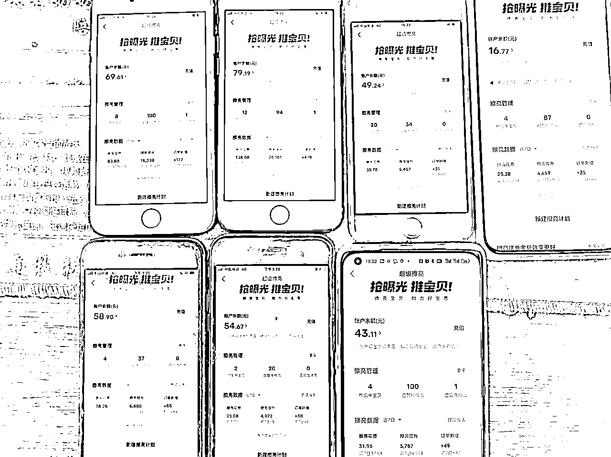

第一，多投、多看、及时停。新上架的宝贝都可以尝试投放，但每1到2小时要回来看一眼。低价商品（3元以下）如果花费超过0.5到1元，既没成交也没点击，就果断暂停；高价商品按利润空间自己衡量。有成交、点击率高的可以继续观察。通过大量开投、大量暂停，把投产1.1以上的款筛选出来。要注意，很多商品有免费流量，不能只看付费订单；如果某个款几乎没有自然单，纯靠投放且投产只在1附近，我通常直接关掉，因为很容易滑到零点几。我第一个做起来的账号累计开了130个投放，真正能持续7天以上且投产健康的只有2个款；有成交的30多个；剩下100个颗粒无收。所以一定要多试，但不能放着预算跑完，看到不行就马上停。

第二，短时间“想要量”激增的商品，投放效果往往最好。怎么找？我会用表格记录对标店铺的总销量，每天对比增量，先锁定卖得最猛的店。商品详情页下拉，能看到该店铺总销量，基本和后台数据同步；隔天对比，就能估算一天大概卖了多少。

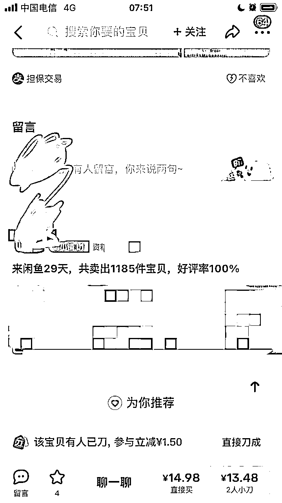

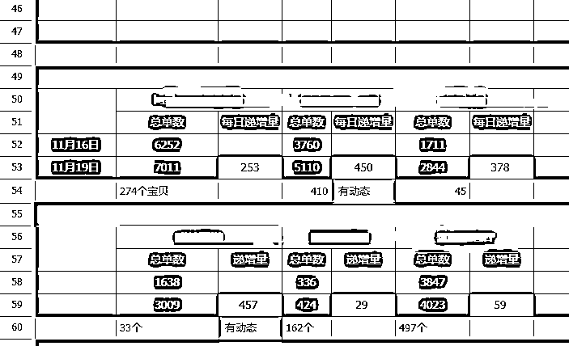

然后记录这些店铺的数据，我习惯三天看一次，算三天销量的平均值。像记录中的第二家和第四家，动态非常活跃，就去店铺主页看“动态”，判断哪款正在放量。

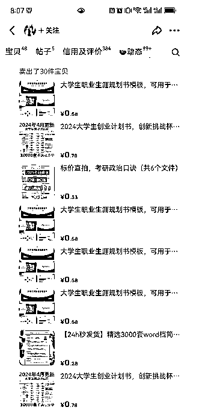

比如截图里的“创业计划书”“生涯规划书”明显在出单，那就直接拿过来参考：改图片MD5、在文案里加符号，设置两人小刀、公益宝贝、闲鱼币折扣，再开始投擦亮。

还有一种方法：手工记录觉得不错的宝贝链接，第二天再看“想要量”。比如表格里第十三个商品，11月20日到21日“想要量”增加了53个，说明至少卖出40件，这种就是典型潜力款；标红的链接已失效，记多了也能判断哪些商品容易出问题。

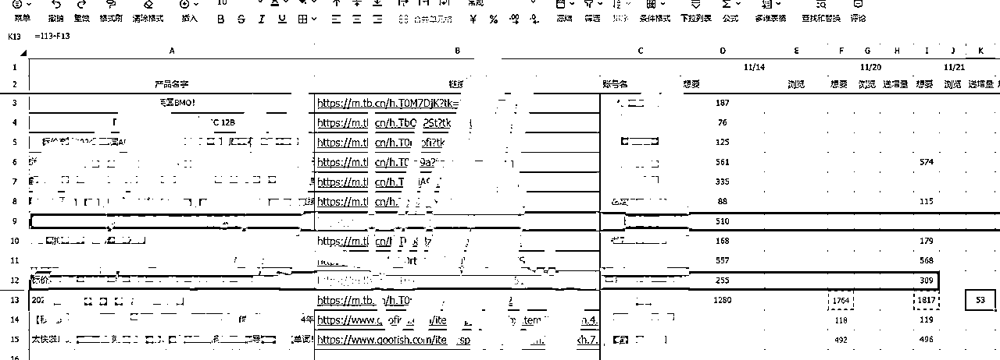

另外，点进宝贝详情，留意最新留言和评价的时间。如果7天内出现大量评论和评价，说明流量还在；如果1天内就有好几条评价和留言，基本可以确认是当下爆款。

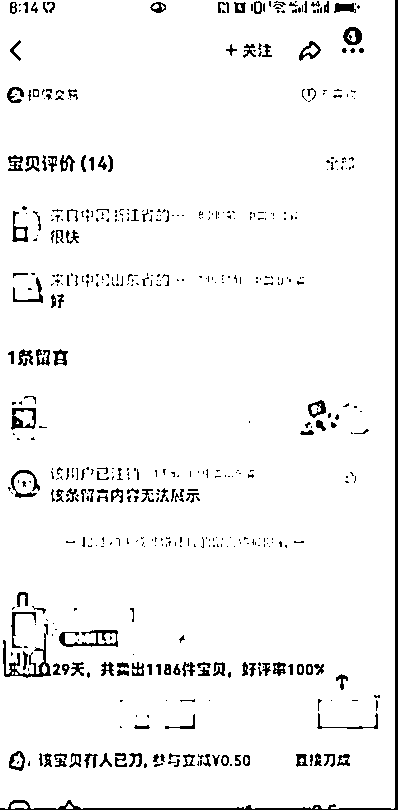

还可以看一眼店铺入驻时长。我记录过一个29天卖出1186件的店，相当于日均30多单，同样值得参考。但要小心，短期爆发的新店，选品未必安全；我观察过不少快速起量的新店，后来大部分因为风险品被举报封号。

第三，投产正的款也不能放松，要每天回看前一日的投放数据，一旦投产明显变差，就要关掉。大多数商品的投产会随时间慢慢下滑。比如某款一开始投产能到2以上，后来考试日期临近、需求减少，有一天花了20元只成交3单、总额4.67元，这种就不该继续投，或者删除计划重建。我之所以没及时止损，是因为免费订单还在，当天没察觉异常，第二天早上才发现。其实当天下午总成交已经有60元，擦亮消耗了40元，只是忙别的事忘了关。

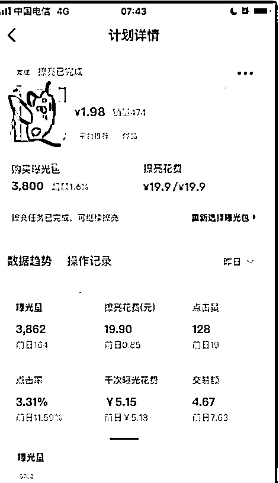

第四，原本投产不错、后来掉下来的款，可以考虑删除重建，同时等一天再观察。我之前有个靠投放跑到几百单的款，有时花10元一单都不出；休息一两天重新投，又能回到投产2以上。当然，这样的款要常盯，空跑的概率不低。

最后是几点提醒。

第一，账号余额最好留50到100元以上，免得钱花光后自动停投。我有个店曾忘记充值，0点到12点没做任何投放，只卖出20单；而12月1日同一时段是102单，差距相当大。

第二，投放花完后会进入待结算状态，第二天才能复投。其实可以直接删除旧计划、新建一个，不一定要等。新建后的效果是否和原来一样，我还没专门验证，之后有结论再补。

第三，互拍什么时候开始？建议等店铺有20到40个商品后再做。商品太少时，只能刷几个评价，很难刷出效果；商品多了，每款补1到3单，反而可能养出一个常成交的款。我的节奏是每天补3到10条，并且逐日增加。

以上就是这次擦亮投放的全部复盘。如果你也在摸索阶段，希望这些经验能帮你省掉一些试错成本。