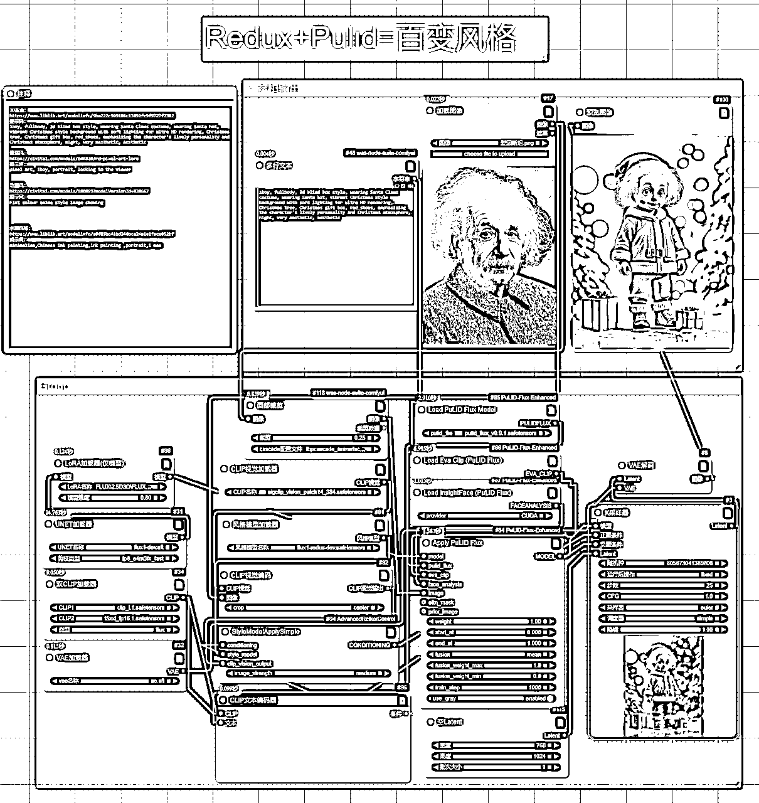
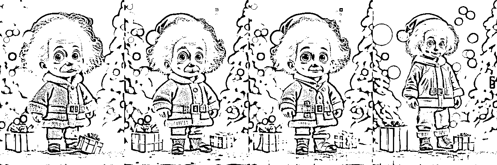
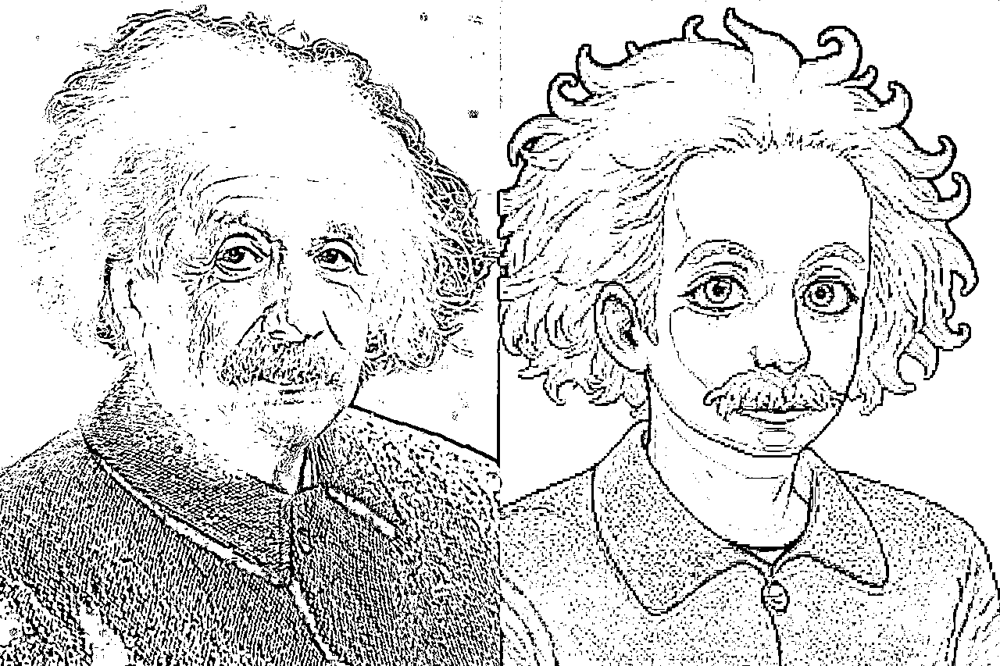
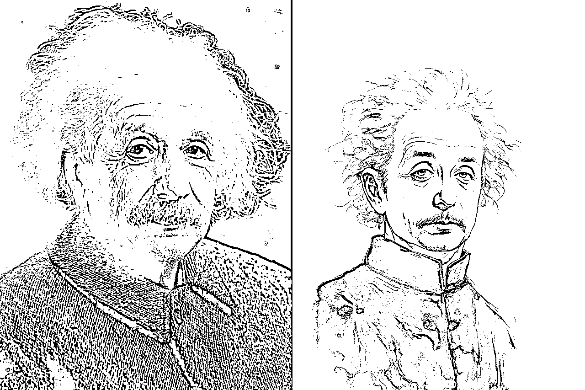
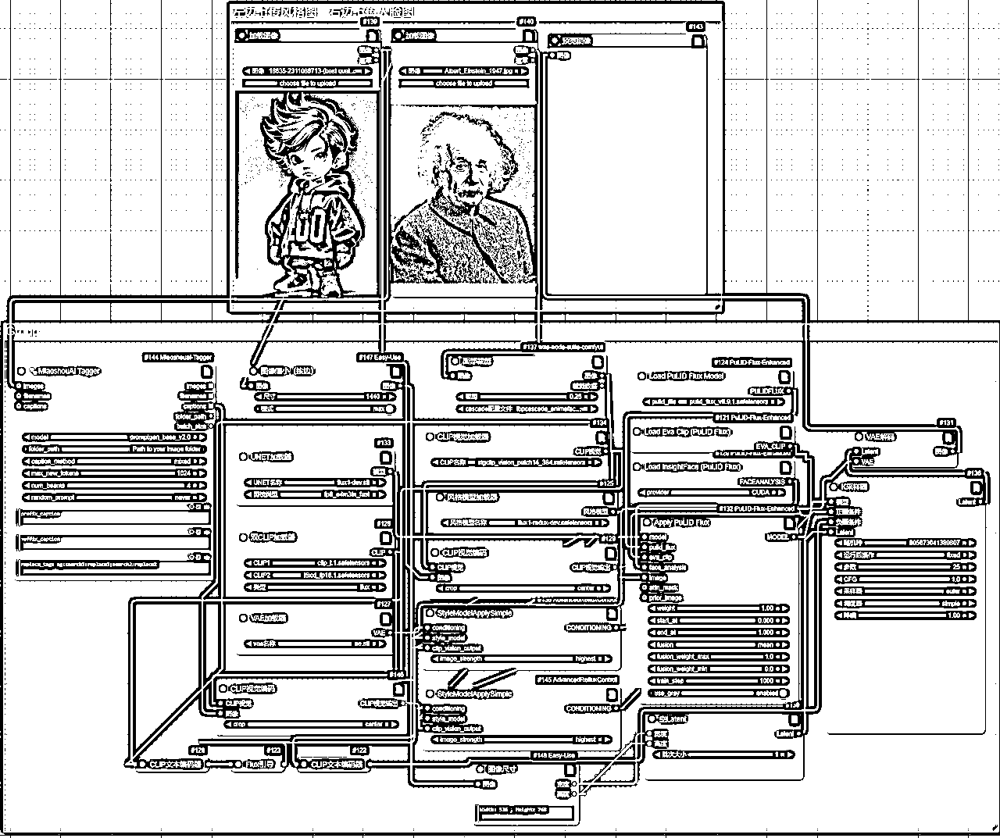
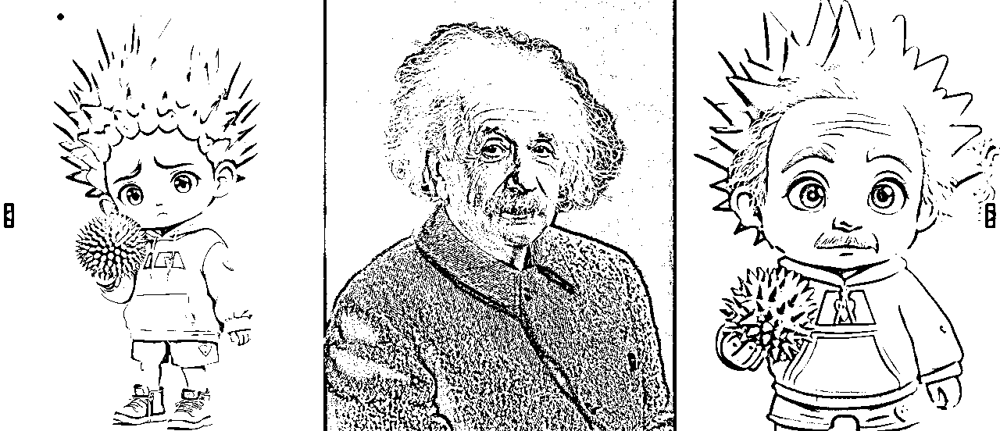
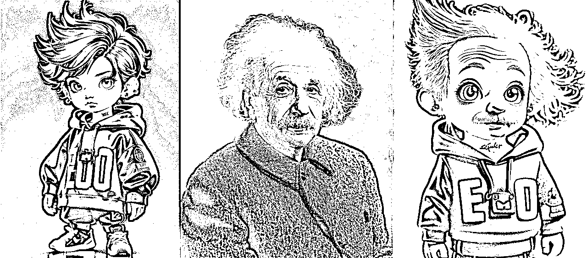

今天给大家带来的这套ComfyUI玩法，用好了真的可以当成一门副业来经营——实现“自定义头像自由”。核心靠的是Redux风格迁移 + PuLID换脸两大能力，一共两条使用路径，思路大致相似，但细节各有不同。

先简单说下整体逻辑。这套工作流是在Flux文生图基础上，额外挂载了Redux和PuLID两个模块。两条路径都能搞定换脸+风格化，区别在于风格来源的供给方式。

第一条路径：Lora风格 + Redux迁移 + PuLID换脸

老规矩，先看完整的工作流长什么样：

这个方案只需要提供一张想要换脸的照片，把这张图同时送给Redux和PuLID就行。Redux里有个参数很关键——权重值，它会直接影响最终画面的风格走向。

直接看一个实际案例。提示词大概是这样的：

“1boy, fullbody, 3d blind box style, wearing Santa Claus costume, wearing Santa hat, vibrant Christmas style background with soft lighting for ultra HD rendering, Christmas tree, Christmas gift box, red_shoes, emphasizing the character's lively personality and Christmas atmosphere, night, very aesthetic, aesthetic”

这次我们用人像图选用的是爱因斯坦：

接着对比了Redux权重在medium、low、lowest以及完全禁用这四种状态下的出图差异。就我个人审美来说，medium状态最舒服——既保留了参考人像的特征，又能跟提示词很好地融合在一起。

如果想换成别的风格，其实很简单，换一个Lora模型就行。下面也给到几个不同风格的示例，提示词不需要写很复杂。在Redux权重medium的影响下，提示词本身就能生效，你甚至可以完全不写提示词，只写触发Lora的词就足够了。

像素风Lora：
pixel art, 1man, portrait, looking to the viewer

卡通动漫风：
Flat colour anime style image showing

水墨风：
minimalism,Chinese ink painting,ink painting ,portrait,1 man

这背后的逻辑其实不复杂：Redux先从输入的人像里提取风格特征，再跟提示词结合，最后由PuLID完成换脸，最终产出的效果就能跟参考人像非常接近。

第二条路径：风格参考图 + Redux迁移 + PuLID换脸

这个方案连Lora和提示词都省了。你只需要找一张风格喜欢的图片作为参照，再配上一张人脸图，就能直接完成换脸。

而且这套流程我做了很多次微调，最后的出图效果可以说是相当能打。直接看结果吧——左边是风格参考图，中间是要换的人脸，右边就是最终生成的结果。

这个效果我觉得已经非常惊艳了，你们觉得呢？

最后总结一下：以上就是这套Redux+PuLID换脸风格工作流的全部内容。Redux相关的玩法还在持续开发中，后面还有更多值得期待的东西。

技术更新换代的速度实在太快，想走在前面就得多关注最新动态。欢迎关注我，后续会持续分享ComfyUI的前沿玩法。

Redux+PuLID百变风格工作流
网盘链接：https://pan.quark.cn/s/67c54cae3df3

海艺平台也上线了免费在线体验版，可以直接上手玩：
https://www.seaart.me/zhCN/workFlowAppDetail/cth342le878c73cr9jug