# 12月航海 | YouTube Shorts经验分享

一个零基础的化工技术员，入圈一个多月就做出了320万播放的爆款，还顺手把YPP初级创作者分成计划拿下。这条视频背后，是一次完整的YouTube Shorts实操复盘——我是六只猫，这是我这一个多月的全部经历，分享给同样想出海的圈友。

先说下背景。我11月才加入赚钱圈，之前完全没碰过内容出海。一次在超级标刷到Shorts项目，又赶上AI工具正好能派上用场，瞬间觉得机会到了：一方面内容方向有了着落，AI能帮我快速批量产出短视频；另一方面YouTube正在大力给Short流量倾斜，红利摆在明面上。于是直接跟着圈里的教学开始实操。

其实我的YouTube账号2019年就注册了，那时候还在上大学，纯粹是想看看“外面的世界”，但因为一直没找到想做的内容，号就扔在那里没动过。11月8日我重新登录，发现几年前还能顺利登入，省去了新号冷启动的麻烦，直接上手第一项目——AI猫猫故事。

这个赛道是当时圈里比较热的方向之一，同批看过的还有萌娃走秀、达人变身秀等，但我最终被猫咪内容吸引了。真正跑起来才发现，纯图片型的PPT故事有个硬伤：普遍过不了YPP的审核。我研究了一批同类账号后发现，哪怕数据很好的号，也很多没拿到开通资格。于是我把流程升级，加入了图生视频环节，转向故事感更强的叙事型内容，现在回头看这个调整很关键。

整个实操我是照着航海手册和圈友分享一步步走的。

对标研究，我专挑千万级播放的标杆视频下载，越爆越好，而且实践中发现一个规律：你对标的爆款热度越高，自己出的视频起量也往往越好。下面这个账号很多人应该刷到过，他第一条就连续跑出了多个高播放作品。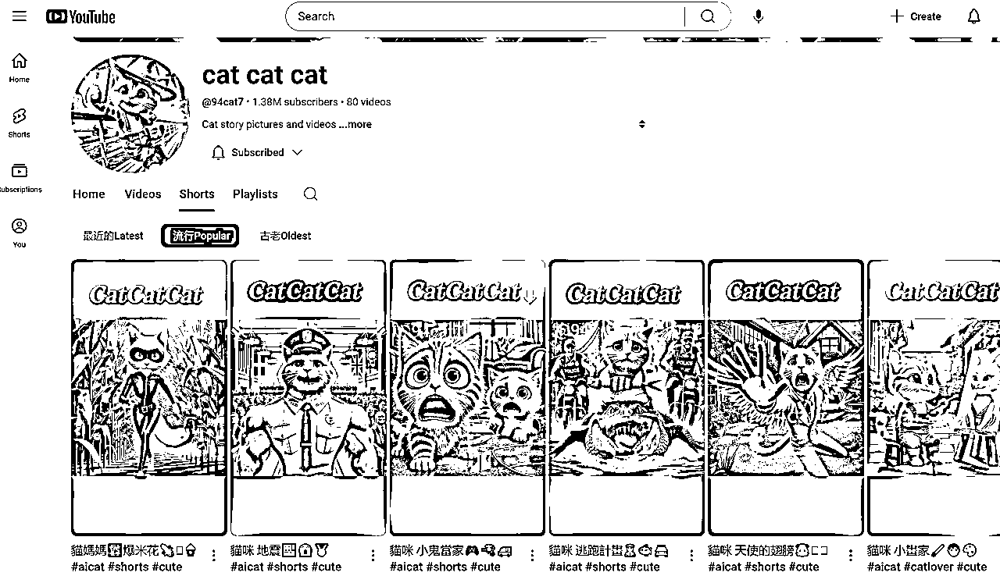

接下来是拆解画面。用老马分享的视频分割工具，把爆款视频转成图片序列，筛掉重复画面，只留下值得借鉴的镜头。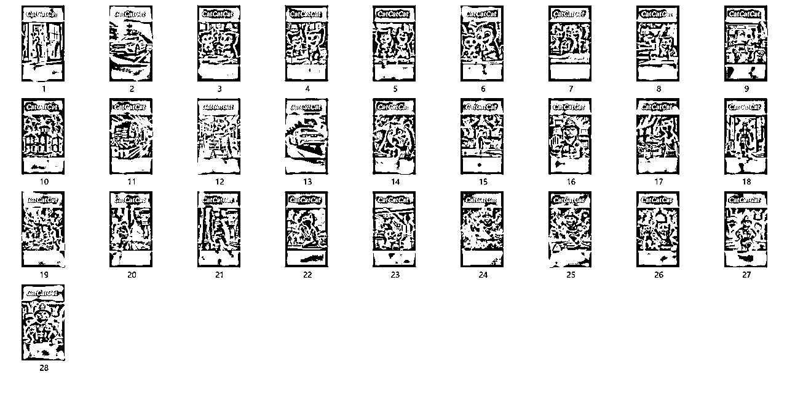

然后是让ChatGPT批量写画面描述，同时按我的需求调整设定。我习惯提前把角色固定下来，通过提示词保持形象的统一性。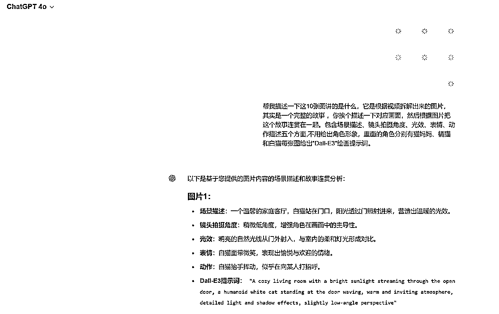

图片本身用ChatGPT文生图重绘，下面这些都是之前跑的案例，图暂时加载不出来，凑合看，主要说流程。其中一张我用了Gen_id加圈友分享的形象一致性提示词来控制。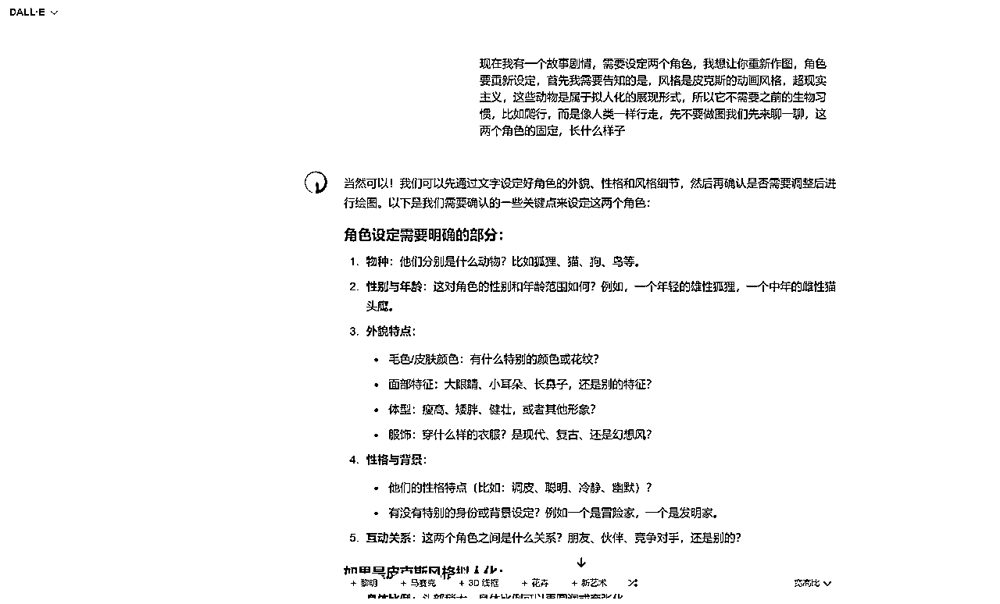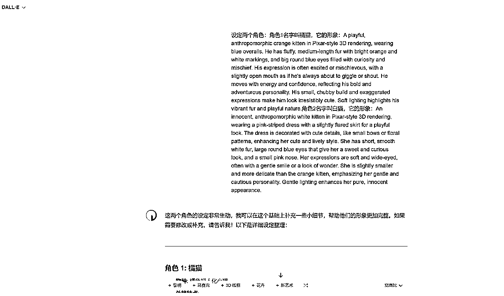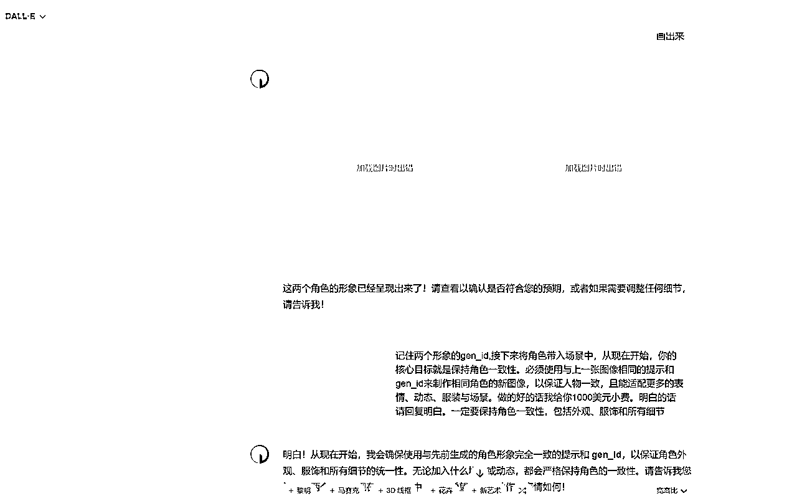

形象一致性这块说下我自己的体感：有人用Gen_id，有人用提示词，我试下来觉得提示词更省事，但运气成分也不小。顺利的时候一批图全过，不顺利的时候一张图改五六遍都很正常，只能慢慢磨。实在不行就把原图丢回去当垫图，让ChatGPT参照着重画，亲测有效。

图生视频用的是Runway，这个环节比我预想的快：我基本不写提示词，图片扔进去直接开turbo模式跑。当时预算有限买的是共享账号，现在不做了，截图只用来演示。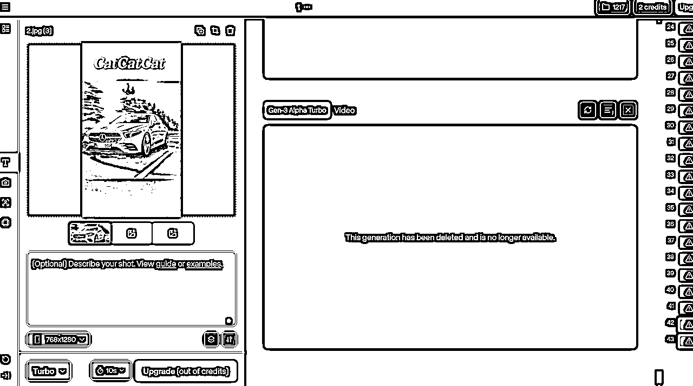

剪辑统一在剪映里完成：把生成的视频片段全部导入，配上字幕、转场和背景音乐。BGM我一般不去外面找，直接用剪映的音频分离把原视频的音频抠出来，想要的音效基本都有，版权问题也不大。原创度方面，我会把滤镜、特效、画面调整这类去重手段都用一遍。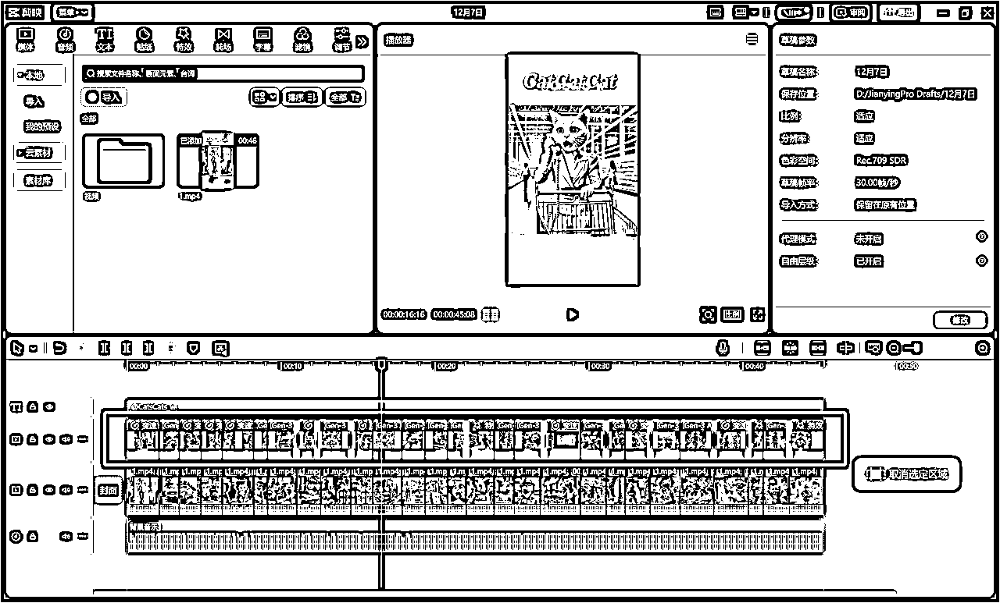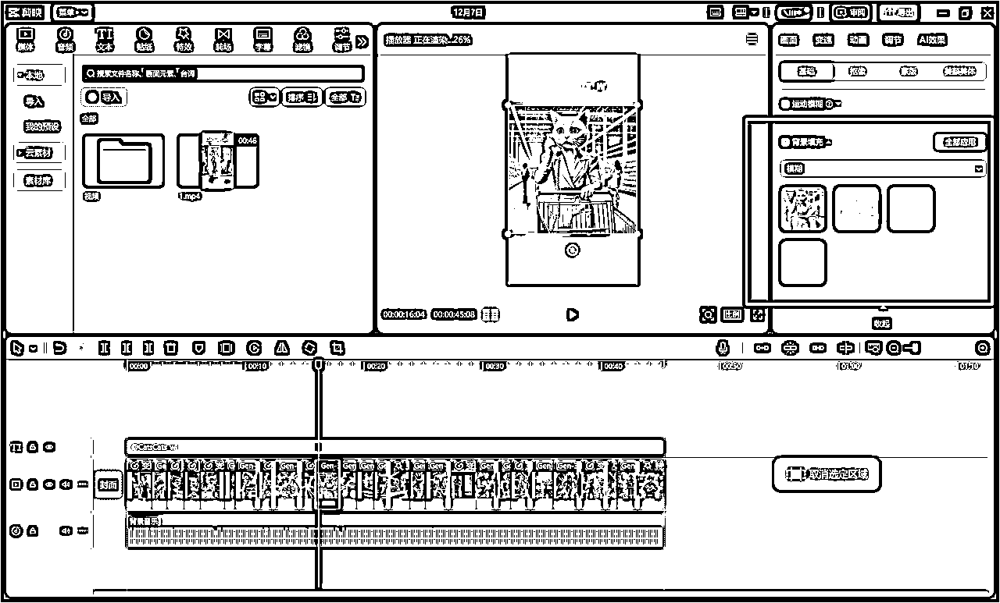

全部处理完，按4K 60帧导出上传，然后观察推流数据。

可能是老账号有加权，也可能是AI赛道本身流量好，我第一支视频就有2000多播放，第二支直接破万。接下来基本稳定在几千到几万。真正的高光时刻是11月24日，第16支视频推流明显变快，一路冲到320万播放，成为我的第一个大爆款。单单这一条就涨了2.24万粉丝，一个月前我完全不敢想这个速度。而且现在这支爆款还在继续带量，早期发的内容也跟着被翻出来。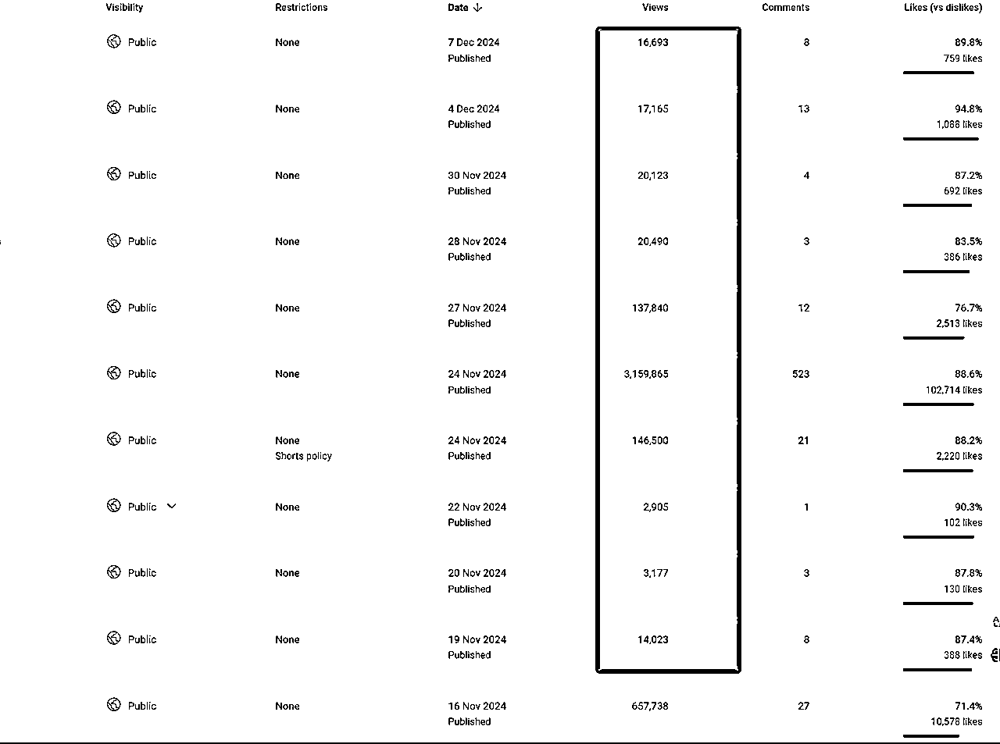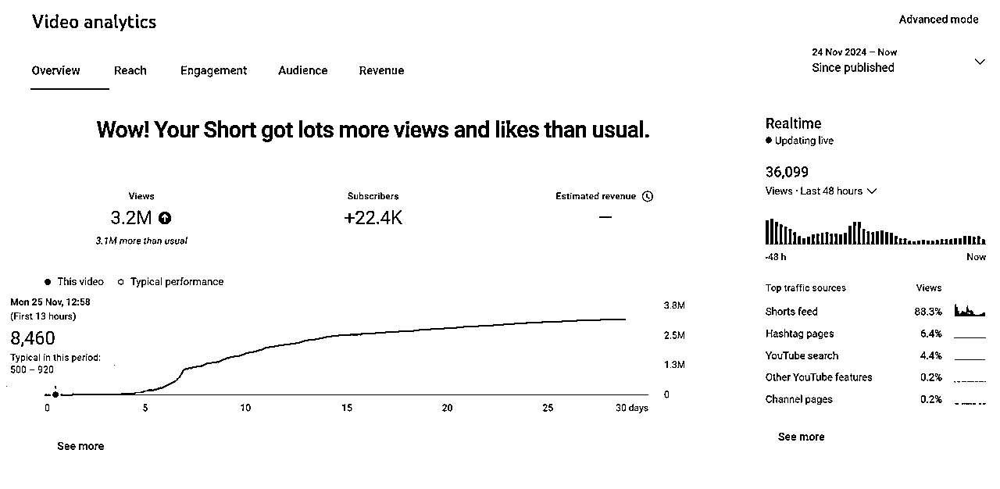

爆款把初级YPP的门槛直接踏平了——300万播放加1000订阅全部达标。接下来就是走申请流程。

先处理Adsense。我意外发现2019年注册YouTube的时候就顺手把Adsense账号开了，于是根据圈友分享和官方教程，把旧地址更新了一遍，特别补上了联系电话，听说之后收PIN码会方便不少。Adsense审核花了5天，通过的时候还是挺开心的。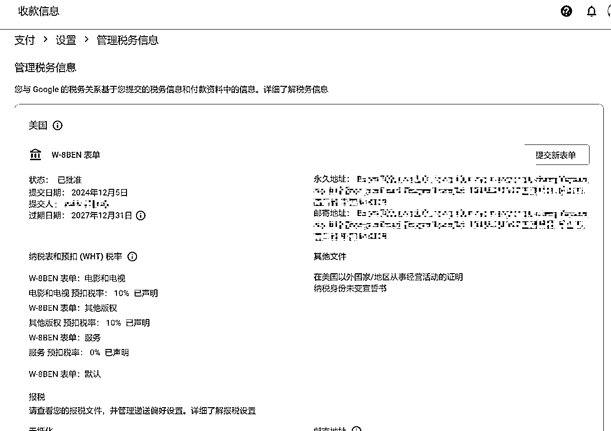

初级YPP申请入口就在手机上的YT Studio，条件满足后直接点申请就行。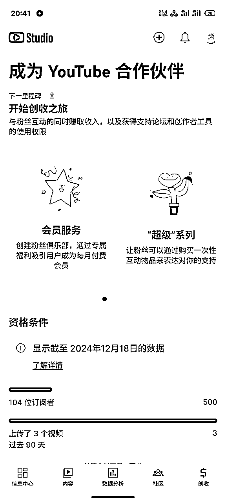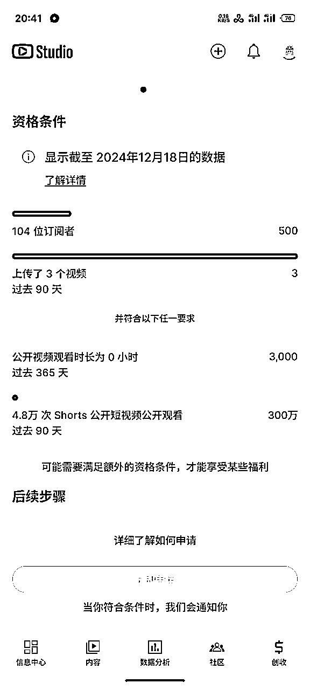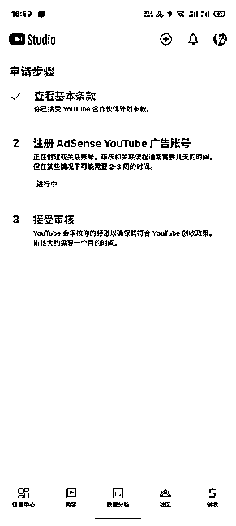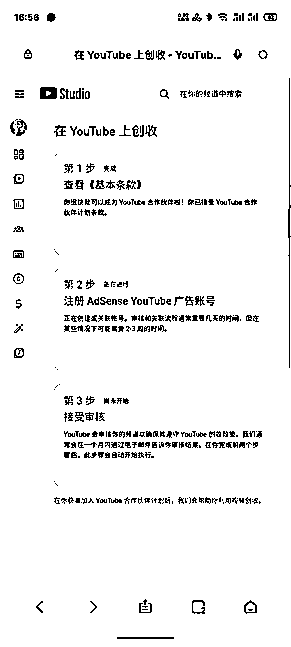第一步是同意协议，象征性看一眼就勾了。第二步因为我已有Adsense，直接做绑定审核，3-4小时后通过。最后一步是YPP审核，也是全场最紧张的一环。我晚上10点多提交的申请，然后上网看了些加速审核的偏方，不知道有用没用，但分享出来供参考：在网页版工作室左下角找“发送反馈”，用下面的模板留言。

```email
Email Template: Request to Expedite YouTube Partner Program Review

Subject: Request to Expedite YouTube Partner Program Review for @你的频道名

Dear YouTube Support Team,

I hope this message finds you well.

My name is 你的姓名, and I am the creator of the YouTube channel “@你的频道名”. I submitted my application to join the YouTube Partner Program (YPP) on December 13, 2024（你的申请日期）.

I have diligently worked to meet all the eligibility requirements, including reaching 20,000（你的订阅数） subscribers and 3,000,000（播放量） watch hours, while ensuring my content adheres to YouTube's community guidelines and policies. My channel primarily features engaging, inspiring, and growth-oriented stories, and I am committed to producing high-quality and captivating videos for my audience.

Joining the YPP is extremely important to me as it will enable me to monetize my content, invest in better equipment, expand my content variety, and further develop my presence on YouTube. I am eager to contribute positively to the YouTube community and grow my channel with the support that YPP provides.

I understand that the review process takes time, but I would greatly appreciate any assistance or information you can provide regarding the status of my application. Additionally, please let me know if there is anything else I can do to help expedite the review process. Thank you very much!

Thank you for your time and consideration. I look forward to your positive response.

Best regards,

你的名字
@你的频道名
2362758XXXmr.f@gmail.com（你的邮箱地址）
```

发送邮件的步骤还可以走官方通道：在YouTube帮助中心选对应类别提交请求，响应往往更快。等待审核期间别闲着，持续更新优质内容，把订阅和观看时长做上去，即使审核慢也能让频道更有竞争力。中文对照如下：

```email
尊敬的YouTube支持团队：

您好！

我叫xxxx，是YouTube频道 “@xxxx” 的创作者。我于2024年xx月xx日提交了加入YouTube合作伙伴计划的申请。

我一直努力满足所有资格要求，包括达到20000名订阅者和300万播放次数，并确保我的内容遵守YouTube的社区准则和政策。我的频道主要内容是讲述有趣、励志、成长的故事，我致力于为观众制作高质量且有吸引力的视频。

加入YPP对我来说非常重要，因为这将使我能够实现内容的货币化、投资更好的设备、扩展内容种类，并在YouTube上进一步发展。我渴望在YouTube社区中积极贡献，并在YPP的支持下进一步发展我的频道。

我理解审核过程需要时间，但如果您能提供有关我的申请状态的任何帮助或信息，我将不胜感激。也请告知是否还有其他我可以做的事情以协助审核过程，非常感谢！

非常感谢您的时间和考虑，期待您的积极回复。

此致，
xxx
@xxxx
23627xxxxxmr.f@gmail.com
```

这封邮件发出去之后，第二天下午就收到了YPP通过的通知。当时还是周末，我本来没指望官方会审核，没想到这么快。这个账号一共发了21个视频，拿到了2.3万订阅和420万总播放。虽然初级YPP还没有广告分成，但被平台认可的感觉真的很有成就感。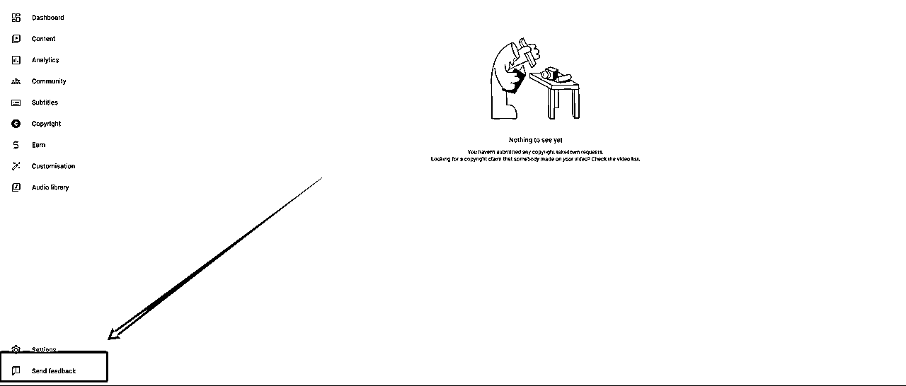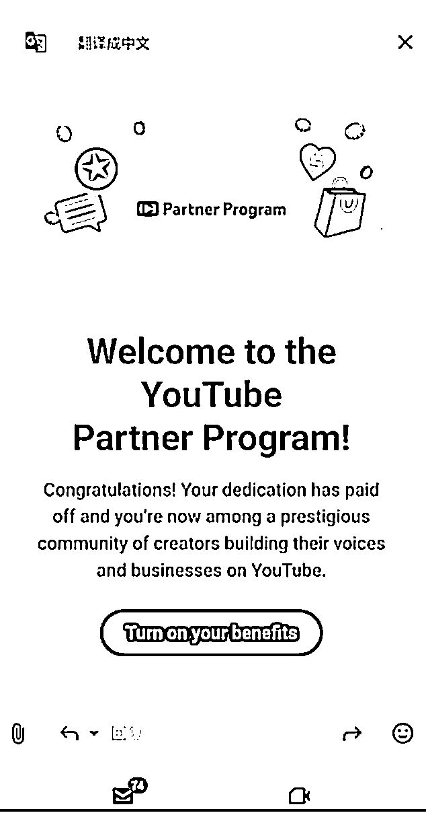

不过老实说，这个赛道的操作体验相当磨人。因为AI工具都是出于成本考量买的共享账号，ChatGPT文生图时不时提示“正在生成”，高峰期Runway排队能排到怀疑人生。两个人的效率全被拖住了，做一条视频要4-5个小时。前期靠新鲜感还能做到日更，后面我慢慢意识到这不是长久之计，于是把重心转向更省力、更高效的故事号。

故事号的打法要粗暴得多。一开始我没按老马教练说的“正练”来，直接“逆练”：去抄爆款故事文案，下载千万级播放的视频文案。工具用的是下面这个Shorts文案下载插件，它本质是个字幕下载器，但Shorts得手动复制链接进去获取，好用程度一般，但够用就行。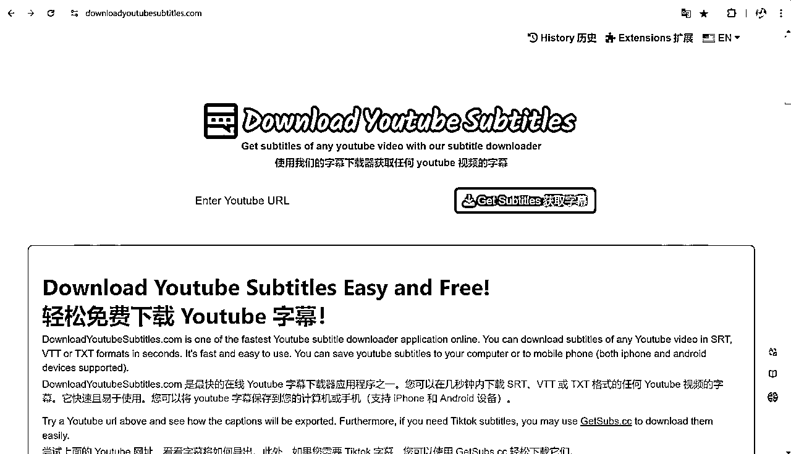

文案拿到手，接着交给ChatGPT改写。提示词是在航海手册基础上自己加了些规则：新文案字数控制在原文的1.1倍以内；结构上做到精华开篇、细节递进、转折再加点题；人称关系和核心事件不能变；每段最多重复两个关键词，尽量用新鲜比喻和动作描写替换常见表达；语言上保持简练、主干清晰。改写后字数尽量压在200字内，让人称视角和故事主题保持原样，同时把用词重复率控制在20%以下，最后输出中英文对照版本。实际跑下来，这样产出的文案配音时长基本都能控制在60秒以内。我还经常让ChatGPT帮我计算用词重复率，尽量降到最低。

配音交给ElevenLabs，这个航海里有详细教程我就不展开了，只分享一个实测经验：显示字数在1000以内，生成的音频时长基本都不超过60秒。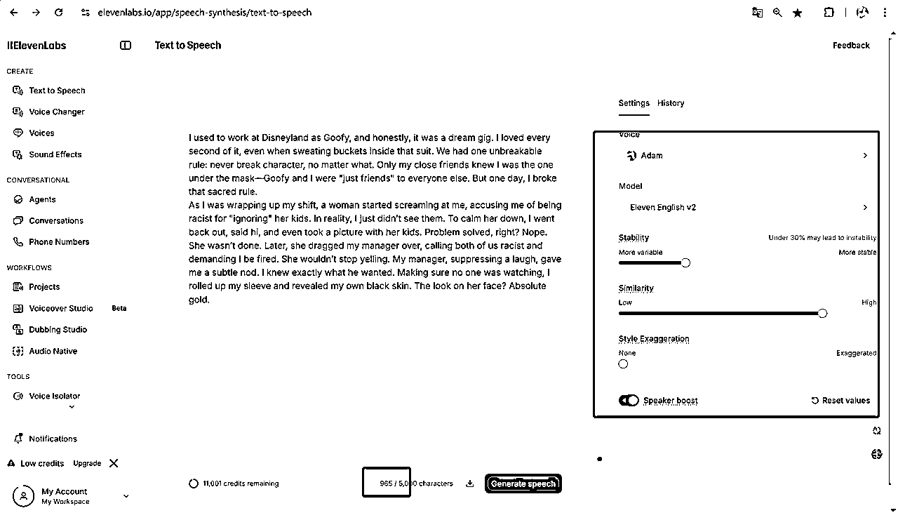

配音产出之后要处理气口和停顿语气。CapCut其实有智能剪口播功能，但我刚上手的时候怎么也找不到，只能纯手动剪，相当浪费时间。后来心血来潮翻了翻Cousor航海手册，一下子有了灵感，干脆用AI写了一个自动剪音频静音片段的小工具。我一个纯小白第一次用AI写程序，整个过程直接刷新认知。之前剪气口要磨蹭半天，现在一分钟搞定。工具是临时赶制的，很粗糙，但足够个人使用，我也没去雕琢它。

素材方面，故事号的视频全部是在Ins上攒的。我先从老马的对标账号库里关注了一批账号，每天像刷短视频一样刷素材，再配合老马给的关键词去搜索，平台越推越准，我的对标素材队列也越来越大。下载工具用的哼哼猫，支持批量拉取。下载完我会先用CRV做一轮预处理：微调画面、镜像翻转、抽帧。虽然老马说过YouTube对去重的要求远没国内平台那么严，但自己习惯这么操作了，你们可以参考着选择。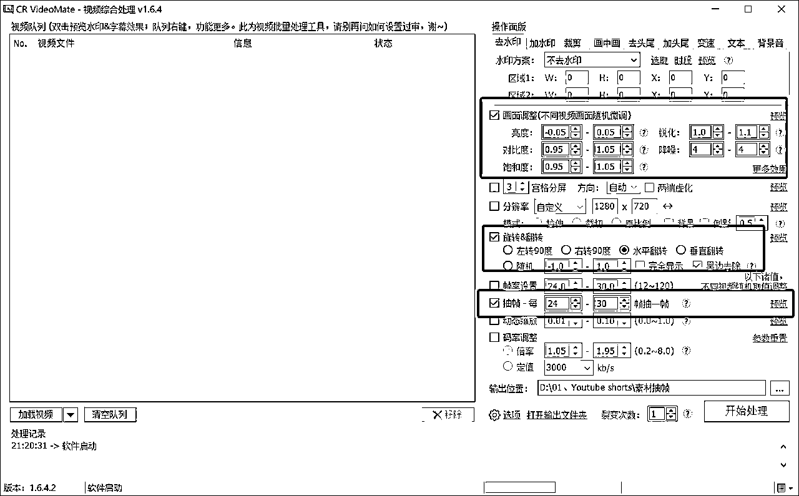

Reddit风格的开头卡片，直接用老马的Figma模板生成，换头像、换昵称、把文案第一句放进去，导出就结束了。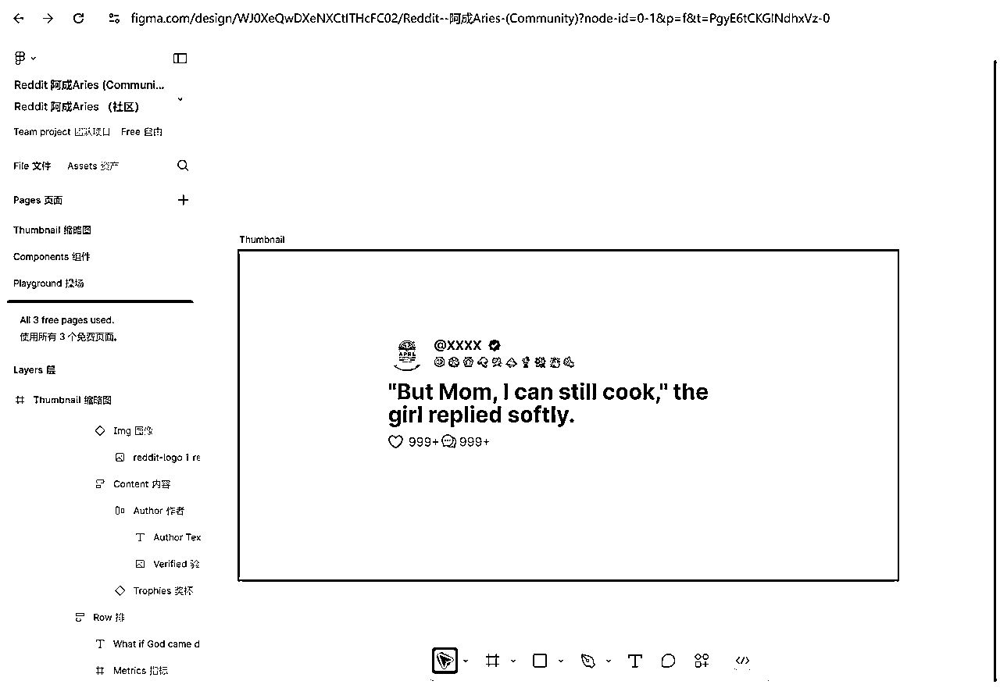

剪辑环节我换到了CapCut，必须说它的字幕功能确实强大。流程也很简单：把配音、Reddit开头卡、素材全部导进去，选一个故事号风格的字幕模板，再把Reddit卡片放进去，卡片时长和音频第一句对齐，加上出场动画。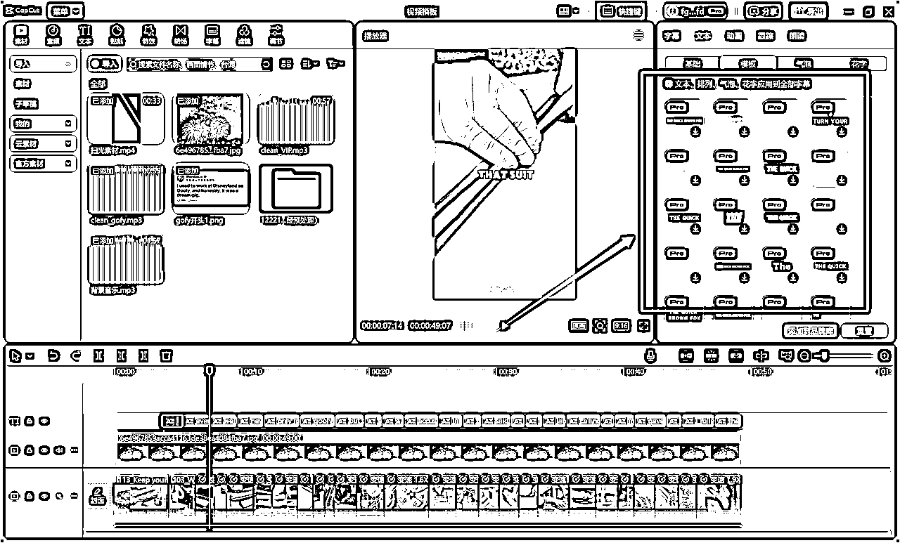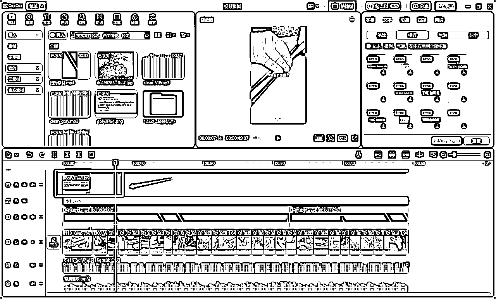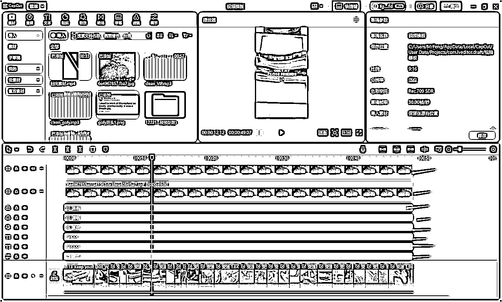

后面就是主轨素材的拼接了，这个步骤更依赖个人审美，我还在不断测不同解压素材的观感，毕竟新号刚起步。核心原则只有一个：素材总时长对齐音频就行。去重方面，虽然可能不用搞这么复杂，但我个人习惯把所有能用上的手段都塞进同一个模板里，之后只需替换主轨视频和音频，BGM直接采用对标账号的纯音乐，版权上不用担心。

我的去重模板包括两张自己实拍的照片、滤镜、特效、飘动文字、画面调整等，全部保存成预设。后面套模板的时候一键应用，又稳又省事。

至于输出，听了航海里高手们的分享后，我每次导出都固定选择4K、60帧。

故事号是我新开的账号，12月8日发了第1、2个视频，当时只有几百播放。到现在一共发了16支，从数据图上看虽然不算爆，但趋势在往好的方向走：已经出现了好几支大几千播放的视频，还有一支突破了万。这个正反馈对我来说已经足够，接下来就是继续保持更新频率。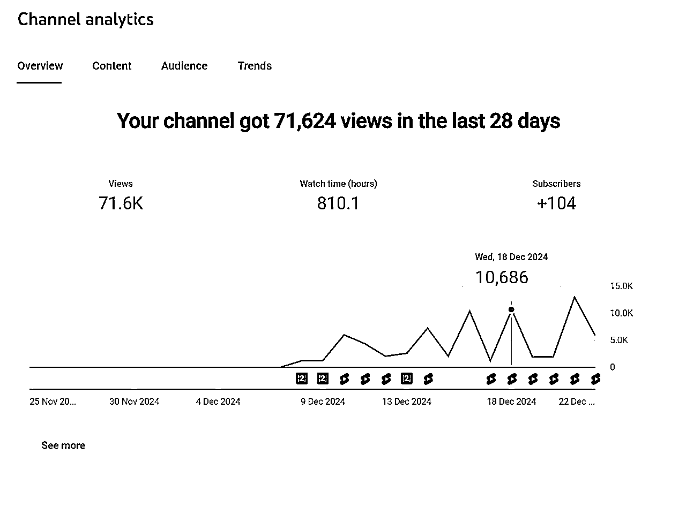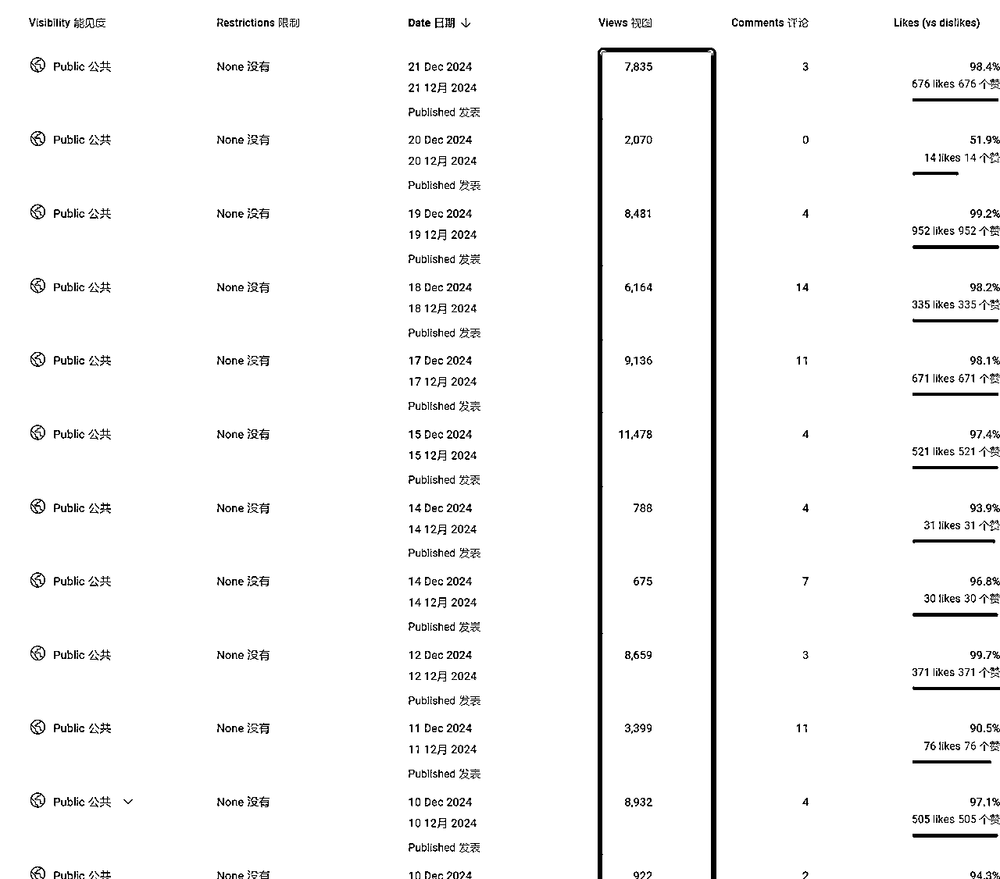

最后把两条赛道放在一起看：AI猫猫故事方向起量极快，粉丝涨速也远高于故事号；而故事号更像是长跑型选手，增长曲线平缓，粉丝积累也会慢一些。两种方式各有自己的节奏和收益模型，你可以根据自己的精力、预算和期待值来选。希望我的经历，能给正准备上路的你一点参考。关注我，下次继续聊出海实操。

这次YouTube Shorts航海，我同时运营了两个风格完全不同的账号，一个主打AI猫猫故事，另一个偏向成人向的故事内容。一路观察下来，两个号的观众画像、互动习惯和涨粉路径，差异着实不小。

先说受众。AI猫猫视频的评论区，基本被小朋友占领了——满屏都是表情包，偶尔冒出一句语法都还没理顺的短句，仔细看反而有种天然萌感。而故事号的评论区，发言的几乎都是成年人，留言基本是逻辑完整、甚至带着自己思考的句子。这种分野也直接决定了两边的涨粉思路：小朋友刷到可爱的画面，二话不说就点关注；成年人却得先在心里盘算一下“这东西对我有没有用”。所以故事号真想快速起量，内容得先经得起“价值审视”这一关。

再看观众分布。AI猫猫的内容，点进来的人大多来自印度、印尼这些地区；而从故事号后台的地理数据来看，目前吸引到的主力观众集中在美、英、加、澳几个英语国家，受众结构和前者有着明显区别。

说到推流，YouTube给我的体感相当“慢热”，但两个账号的推荐节奏都比较清晰。我自己习惯晚上上传视频，货拉好的第二天清晨五六点，往往等来第一波较大流量；一开始我以为是美国观众睡前刷视频带来的红利，但后来试过白天发，发现第一波大推流大概出现在发布后8小时左右。规律好像是跟着“上传那一刻”走的，不保证普适，权当自娱自乐的观察。

只要内容不拉胯，第一波推荐通常能跑到几千播放，之后就进入一个相对平静的区间。我猜测这是平台在第一阶段采集数据，掂量这条视频值不值得推给更多人；如果数据合格，才会给第二波流量。而后续推流的力度，大概率和点击比例、完播率高度绑定——表现越好的片子，拿到更多推荐的概率也越大。

剪片子的时候，遇到气口、语气停顿的处理，我临时用cursor写了个粗糙的小工具，分享给有需要的朋友。里面两个参数最关键：

第一个是静音阈值，单位是分贝（dB），一般设成负数。这里数值越小，判定越严格，比如-40dB就只认“非常安静”的声音为静音；数值越大，例如-20dB，则相对宽松，背景音稍大也会被当静音处理。日常用-30dB就差不多。

第二个是最小静音时长，单位是秒。调成0.2秒，几乎连词与词之间的停顿都能干掉；调到0.5秒，适合清理常规的句子间隔；而1.0秒则只动那种明显的长停顿。想删多少、留多少，就看你对节奏的偏好。

最后说点个人感受。这次航海最大的收获，是切身感受到AI工具的确高效，但比工具更重要的，还是日复一日的坚持和对内容的死磕。目前虽然还没见到广告分成，但方向对了，就不怕路远。特别感谢这次航海中所有教练、领队辛拉面，还有各位志愿者和赚钱圈友的陪伴。这些经验如果能给大家带来一点启发，那就再好不过了。期待未来能在这里遇到更多同频的人，一起把事做成，一起龙哥盟。