# YouTube Shorts解说账号全流程拆解：万物皆可讲，普通人也能做

## 一、什么是解说类账号？

所谓解说类账号，简单来说，就是在原始视频或多种素材的基础上，加入自己的旁白、观点和重新编排，最终制作成一条全新的短视频。

这类内容有一个非常鲜明的特点：必须“讲出来”。

节奏要快，开头要狠，最好在前三秒就让观众停下来；画面要有吸引力，内容则要尽可能延长用户的观看时间，让对方不知不觉看完几十秒，甚至继续刷下去。

解说赛道的范围非常广，常见方向包括：

- 科普解说
- 游戏攻略解说
- 热门视频解说
- 动物解说
- 动漫解说
- 电影解说

除此之外，还有不少更加细分的小众领域。

对于大多数普通创作者来说，电影、科普、热门视频以及动物解说，都是比较容易入门的方向。

如果你本身长期关注游戏、动漫或漫画内容，对这些领域有较深理解，却一直不知道怎样开始，也可以尝试寻找同领域的人一起合作。

因为游戏和动漫解说，依赖的不是固定模板，而是创作者对内容的理解、经验和表达能力，制作起来更费精力，也更难标准化。但正因为如此，这些方向也更适合真正热爱它们的人进行共创。

总的来说，解说账号虽然赛道众多，但底层逻辑并没有太大区别：

**先借助已有素材的吸引力，再通过二次解说、重新剪辑和内容重组，让原本火过的内容重新获得传播。**

对于想做匿名频道的人来说，解说是一个非常大的内容池。只要找到合适的素材，几乎任何主题都能重新包装成一条解说视频。

# 万物皆可解说

## 二、解说内容应该怎么做？

接下来重点拆解两个方向：

- 科普解说
- 热门视频解说

只要掌握这两类内容的制作方法，其他解说赛道也可以举一反三。

整个方法会分成“正向制作”和“反向制作”两条路径。

学完之后，你将掌握：

1. 解说视频的完整制作流程  
2. 如何利用AI优化和重写解说词  
3. 如何高效寻找素材  
4. 解说类视频的剪辑方法  

# 三、科普解说：本质上是拼接式解说

很多人听到“科普解说”，第一反应是科学知识、地理文化或历史人文。

但这里所说的科普解说，范围其实更宽泛。

可以把它理解成一个“十万个为什么”：

只要是观众没见过、不了解、觉得奇怪的物品、现象或事物，都可以成为解说对象。

从创作者角度看，我更愿意把这一类内容称为“拼接式解说”。

为什么这么叫？

因为它的制作过程通常是：

先确定一个主题，再围绕主题收集多个相关视频素材，然后将这些画面重新组合，通过旁白、转场、音效和节奏剪辑，形成一条完整视频。

举个例子。

假设画面里出现了一排座椅，观众可能第一眼只注意到其中几个，但当你通过剪辑和解说提示他们去数，就会发现画面中至少有六七个座位。

这类内容看起来并不复杂，却非常容易被大众理解。

而越是简单、直观、无需专业门槛的内容，越容易获得泛流量。

曾经就有类似视频发布到TikTok后，第一条内容直接达到300万播放。


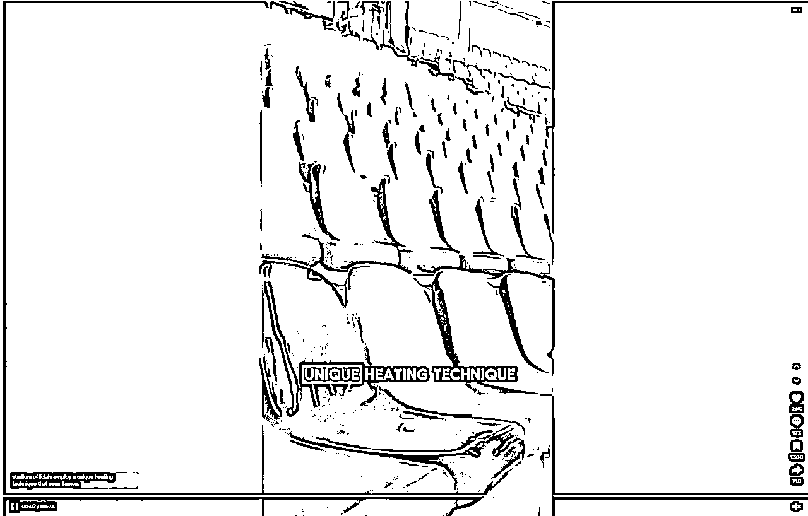

至于发布到YouTube Shorts后获得多少播放，已经记不清了，反正属于很久以前的内容，不值得专门记住。

但这也说明了一个现象：

想在TikTok上做出播放量，门槛相对低一些；而想在YouTube Shorts上持续做出高播放，难度明显更大。

拼接式解说的核心操作，就是围绕一个明确主题，寻找相关性强的画面，再利用剪辑、转场、音效和旁白，把它们重新组织成一个完整作品。

不过，不要马上急着动手。

因为拼接类解说还可以继续分成正向制作和反向制作，两种方式所需要的素材和流程并不一样。

## 四、拼接类解说的优势与局限

这类内容最大的优点，是播放表现相对稳定。

只要选题、素材质量、画面吸引力和文案没有明显问题，通常不太容易出现完全没有播放量的情况。

当制作流程被标准化以后，很多视频都能达到稳定的基础播放。

但它的问题也很明显：

它可能长期处在“稳定万播”的状态，很难经常出现大幅度爆发。

不过，视频也可能在发布几周甚至一个月后突然被重新推荐，迎来一轮新的增长。

与后面要讲的热门视频解说，也就是直接围绕爆款原视频进行再创作相比，拼接类解说的流量上限可能低一些，但稳定性更好。

接下来，科普解说会拆成三个部分：

- 正向制作
- 反向制作
- 剪辑方法

其中，正向和反向主要是文案与素材策略的区别；配音部分不在这里展开，因为此前已经单独讲过。

## 五、正向制作：从选题开始搭建内容

拼接类解说的正向流程，相对复杂一些。

你需要先确定主题，再围绕主题收集素材；之后写出初稿，利用AI进行二次改写，再完成配音和剪辑。

反向制作则更省事，通常是先找到一个已经存在的选题视频，再对文案进行重写，同时寻找不同的画面素材，最后重新剪辑。

下面先看正向制作如何进行。

### 1. 先确定选题

最简单的方法，就是先收集同领域的爆款内容，让AI分析其中的选题规律。

可以选取10到50条科普解说文案，交给Claude或其他AI工具，让它先判断这些内容分别属于什么主题、采用了什么叙事方式。

可以这样提问：

“请根据我提供的这些文案，详细分析每条内容对应的选题方向，并总结它们的共同特点。”

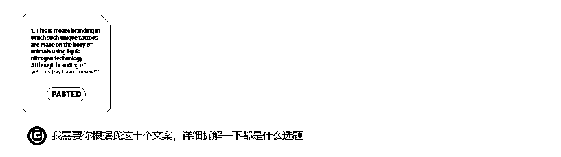

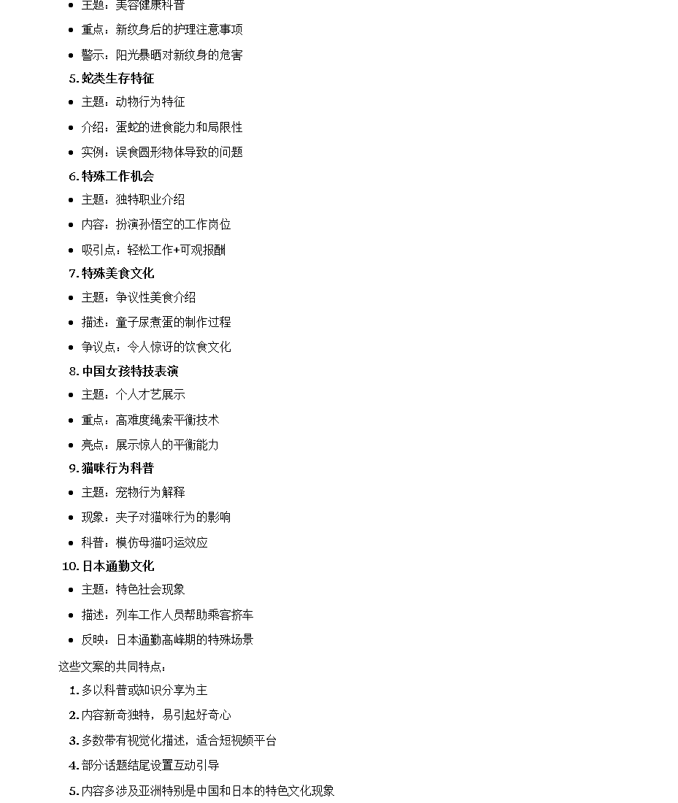

等AI理解了这一类内容的选题逻辑之后，再进一步要求它批量创作新选题，同时生成基础文案和素材搜索关键词。

### 2. 利用AI批量生成选题

提示词可以参考下面的结构：

请帮我创作【数量】个适合Shorts的视频选题，要求如下：

#### 内容结构

每个选题需要包含：

- 主题标题
- 完整分行文案  
  - 英文约150—200词
  - 中文约200—300字
- 5个中文素材搜索关键词
- 5个英文素材搜索关键词
- 选题类型说明，例如科普、文化、生活等

#### 文案要求

- 每句话单独换行
- 用词简单、表达清楚
- 同时具备新鲜感和知识性
- 结尾设计互动问题
- 适合30—50秒短视频
- 先输出完整英文，再输出对应中文

#### 选题标准

- 具备新奇感和传播潜力
- 方便找到相关视频素材
- 适合用画面直观呈现
- 能激发评论和讨论
- 符合Shorts平台的观看习惯

补充信息：

- 目标受众：【填写年龄段】
- 发布平台：【填写平台名称】
- 内容领域：【填写领域】
- 文案风格：【填写情绪和语气】

请确保每个选题都具备可执行性，容易寻找素材，也适合短视频传播。

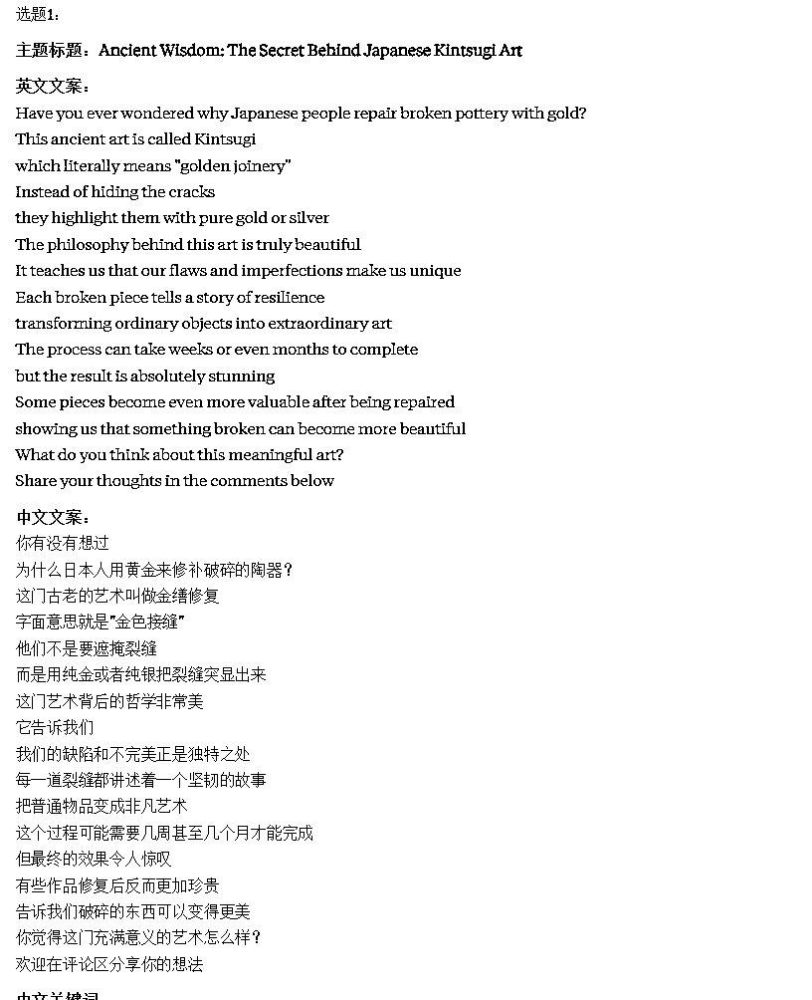

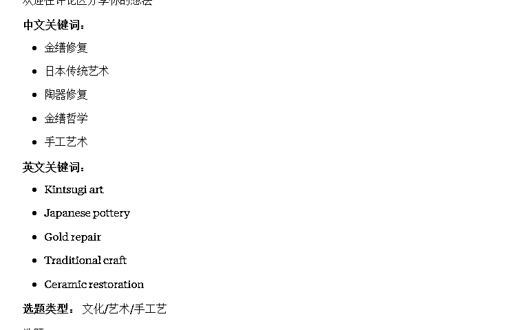

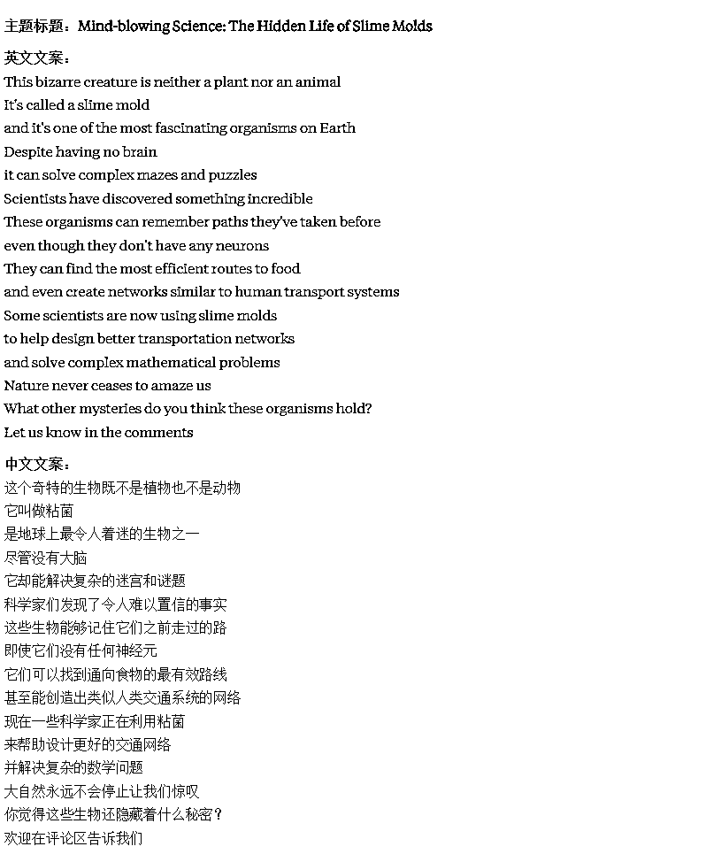

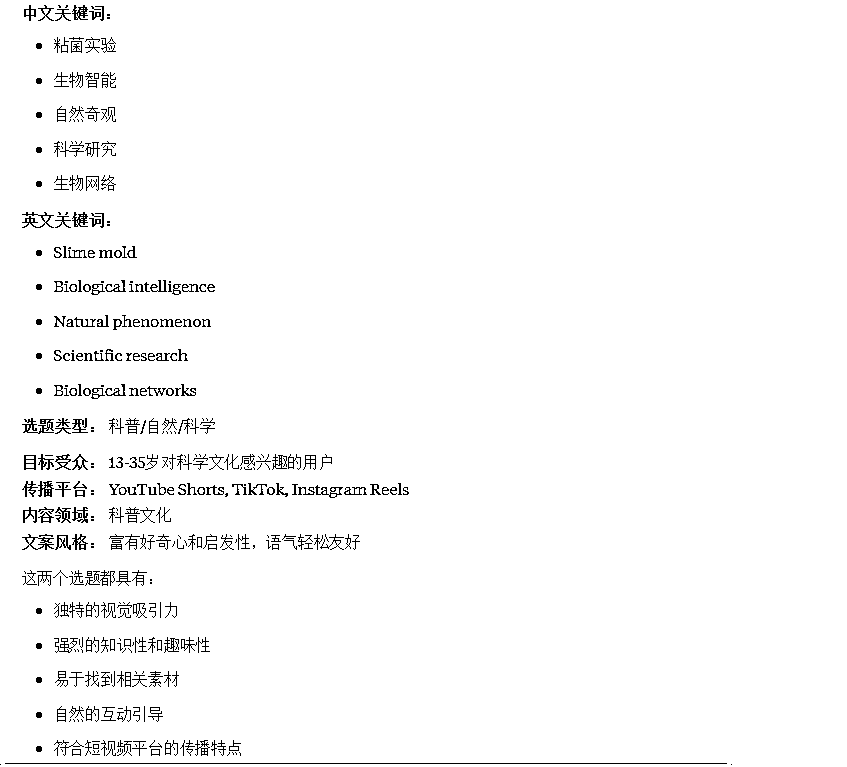

比如输入两个选题数量，AI就会返回两组完整方案。

接下来不要急着剪辑，先检查这些选题是否真的能找到合适的画面。

## 六、素材筛选：先验证，再制作

拼接类解说的素材，可以直接在YouTube等平台搜索相关视频，再通过重新剪辑和二次表达，制作成新的内容。

实际操作时，尽量避免直接使用原作者的正脸画面，也不要简单搬运完整原视频，而应该让自己的旁白、节奏、结构和素材组合成为作品主体。

在确认选题之前，先用AI给出的关键词搜索素材，观察三个问题：

1. 能不能找到足够多的相关视频？
2. 画面是否清晰、直观、有吸引力？
3. 是否存在同类型内容，能够证明这个选题已经被市场验证？

### 示例一：金缮艺术

关键词：

**Kintsugi art / 金缮修复**

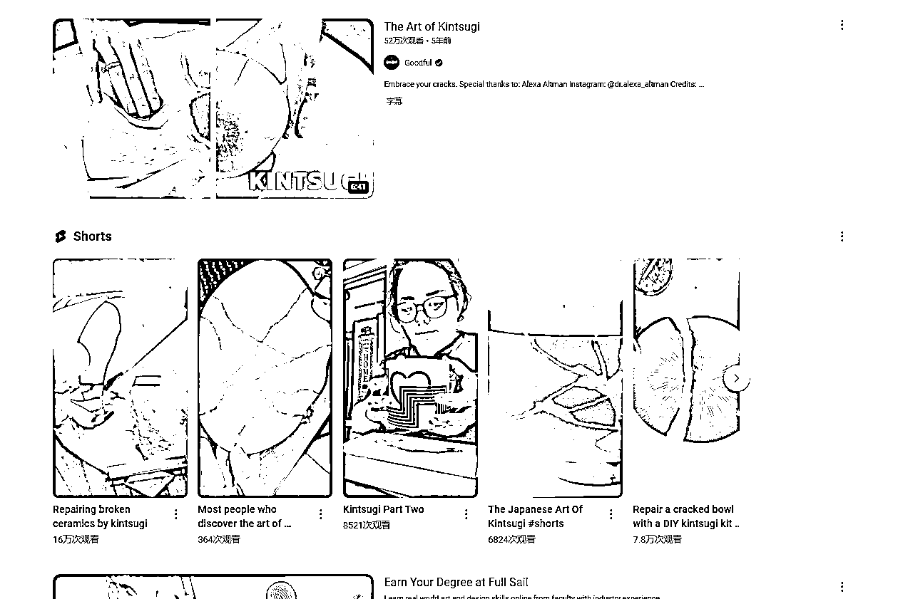

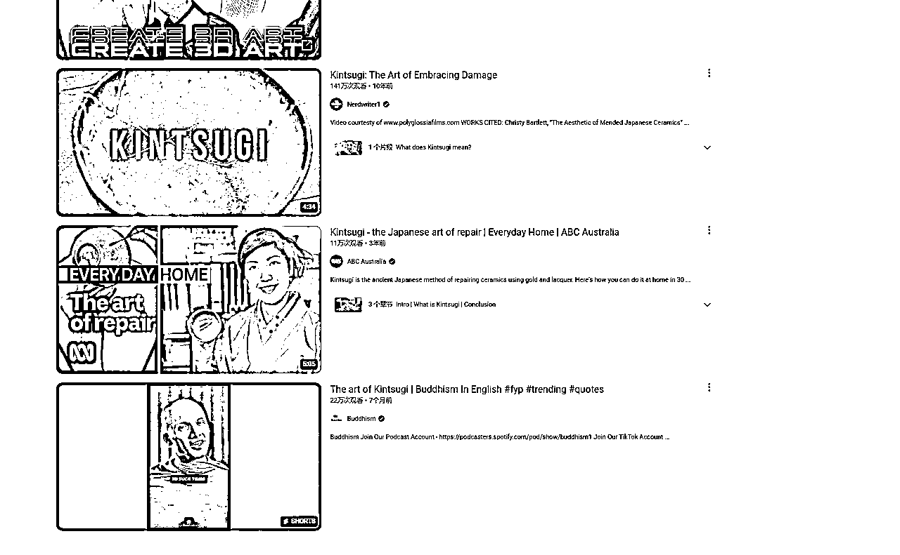

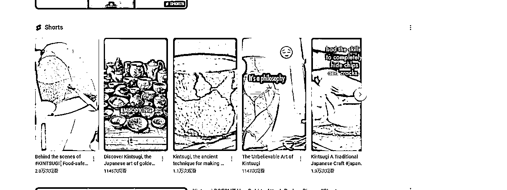

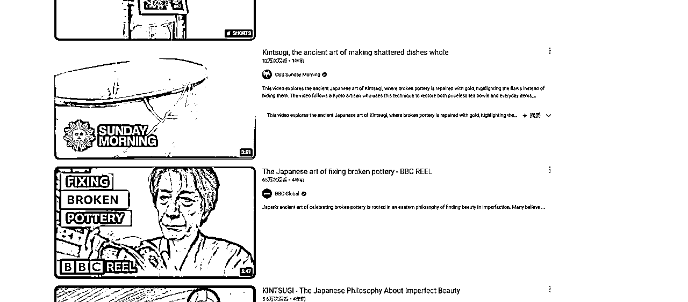

搜索到这里，如果发现相关素材数量足够、画面有观看价值、同类视频也有不错播放，那么这个选题基本就可以成立。

### 示例二：黏菌实验

关键词：

**Slime mold / 黏菌实验**

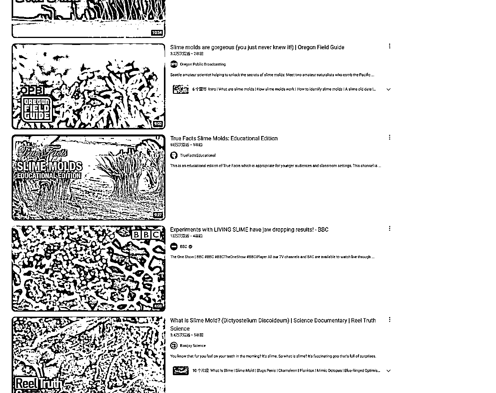

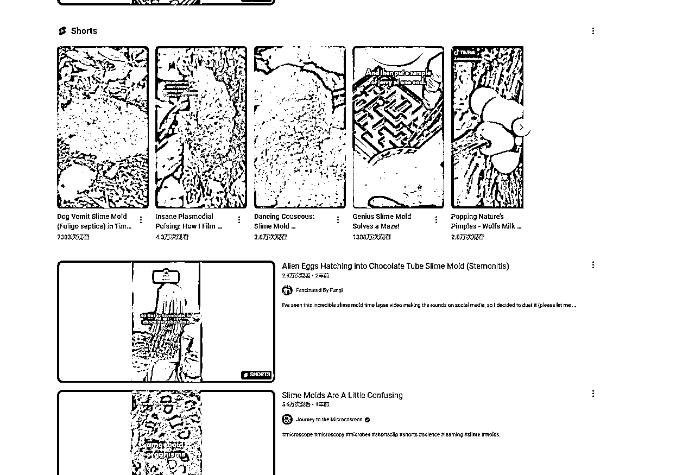

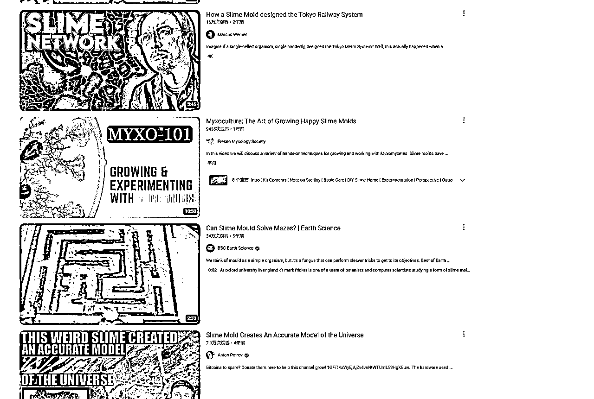

同样，只要素材能找到，画面具备视觉冲击力，且已有相关内容获得播放，就说明这个方向值得继续做。

最后，把这两个选题的标题、文案、关键词和素材链接统一保存下来，方便后续批量制作。

```
选题1：
主题标题：Ancient Wisdom: The Secret Behind Japanese Kintsugi Art
英文文案：
Have you ever wondered why Japanese people repair broken pottery with gold? This ancient art is called Kintsugi which literally means "golden joinery" Instead of hiding the cracks they highlight them with pure gold or silver The philosophy behind this art is truly beautiful It teaches us that our flaws and imperfections make us unique Each broken piece tells a story of resilience transforming ordinary objects into extraordinary art The process can take weeks or even months to complete but the result is absolutely stunning Some pieces become even more valuable after being repaired showing us that something broken can become more beautiful What do you think about this meaningful art? Share your thoughts in the comments below
中文文案： 
你有没有想过 为什么日本人用黄金来修补破碎的陶器？ 这门古老的艺术叫做金缮修复 字面意思就是"金色接缝" 他们不是要遮掩裂缝 而是用纯金或者纯银把裂缝突显出来 这门艺术背后的哲学非常美 它告诉我们 我们的缺陷和不完美正是独特之处 每一道裂缝都讲述着一个坚韧的故事 把普通物品变成非凡艺术 这个过程可能需要几周甚至几个月才能完成 但最终的效果令人惊叹 有些作品修复后反而更加珍贵 告诉我们破碎的东西可以变得更美 你觉得这门充满意义的艺术怎么样？ 欢迎在评论区分享你的想法
中文关键词：
金缮修复
日本传统艺术
陶器修复
金缮哲学
手工艺术
英文关键词：
Kintsugi art
Japanese pottery
Gold repair
Traditional craft
Ceramic restoration
选题类型： 文化/艺术/手工艺

选题2：
主题标题：Mind-blowing Science: The Hidden Life of Slime Molds
英文文案： 
This bizarre creature is neither a plant nor an animal It's called a slime mold and it's one of the most fascinating organisms on Earth Despite having no brain it can solve complex mazes and puzzles Scientists have discovered something incredible These organisms can remember paths they've taken before even though they don't have any neurons They can find the most efficient routes to food and even create networks similar to human transport systems Some scientists are now using slime molds to help design better transportation networks and solve complex mathematical problems Nature never ceases to amaze us What other mysteries do you think these organisms hold? Let us know in the comments
中文文案： 
这个奇特的生物既不是植物也不是动物 它叫做粘菌 是地球上最令人着迷的生物之一 尽管没有大脑 它却能解决复杂的迷宫和谜题 科学家们发现了令人难以置信的事实 这些生物能够记住它们之前走过的路 即使它们没有任何神经元 它们可以找到通向食物的最有效路线 甚至能创造出类似人类交通系统的网络 现在一些科学家正在利用粘菌 来帮助设计更好的交通网络 并解决复杂的数学问题 大自然永远不会停止让我们惊叹 你觉得这些生物还隐藏着什么秘密？ 欢迎在评论区告诉我们
中文关键词：
粘菌实验
生物智能
自然奇观
科学研究
生物网络
英文关键词：
Slime mold
Biological intelligence
Natural phenomenon
Scientific research
Biological networks
选题类型： 科普/自然/科学

目标受众： 13-35岁对科学文化感兴趣的用户 
传播平台： YouTube Shorts, TikTok, Instagram Reels 
内容领域： 科普文化 
文案风格： 富有好奇心和启发性，语气轻松友好
```

# 七、文案二次优化：让观众先停下来

有了初稿之后，还需要进行第二轮改写。

这一次的重点，不是把内容写得更复杂，而是让它更适合短视频传播。

优化方向主要包括：

- 开头三秒必须抓人
- 第一处表达要有冲击力
- 语言尽量口语化
- 句子短一些
- 删除无意义的铺垫
- 每句话都尽量推动内容向前发展

可以把初次生成的文案重新放进固定提示词模板，让AI按照同一套标准再次优化。

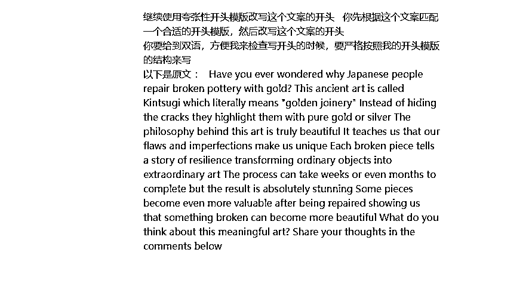

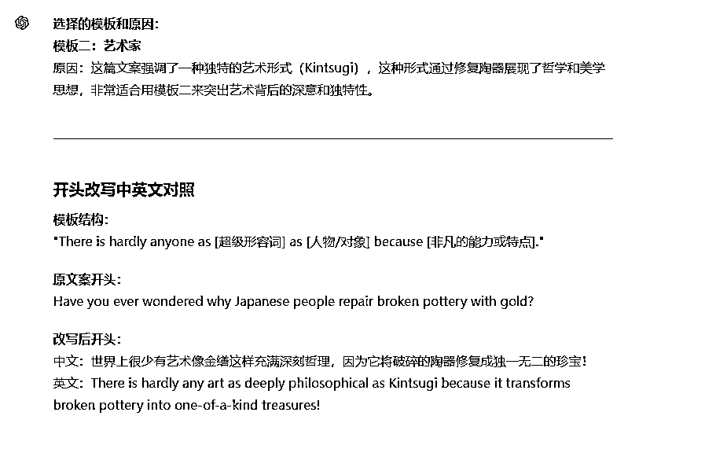

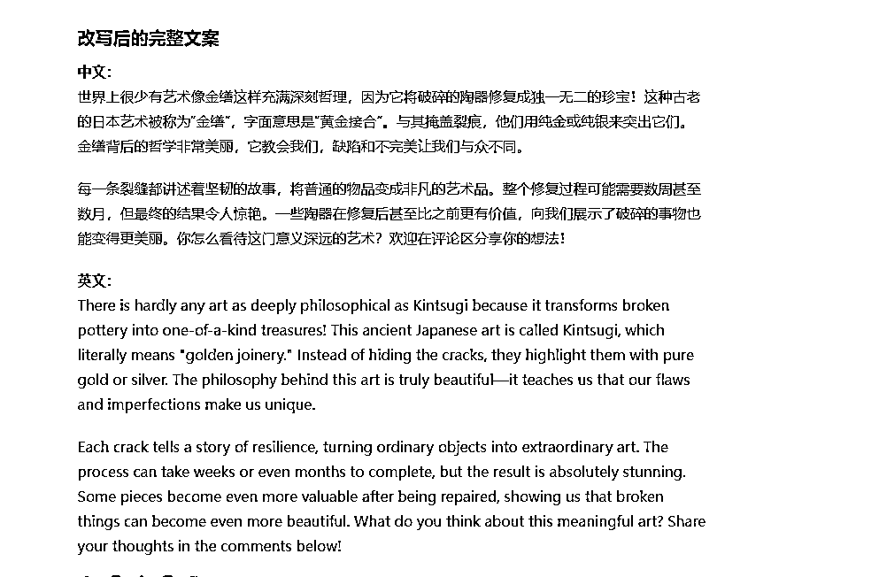

经过二次处理后，金缮主题的英文文案可以写成：

There is hardly any art as deeply philosophical as Kintsugi because it transforms broken pottery into one-of-a-kind treasures! This ancient Japanese art is called Kintsugi, which literally means “golden joinery.” Instead of hiding the cracks, they highlight them with pure gold or silver. The philosophy behind this art is truly beautiful—it teaches us that our flaws and imperfections make us unique.

Each crack tells a story of resilience, turning ordinary objects into extraordinary art. The process can take weeks or even months to complete, but the result is absolutely stunning. Some pieces become even more valuable after being repaired, showing us that broken things can become even more beautiful. What do you think about this meaningful art? Share your thoughts in the comments below!

对应的中文表达为：

几乎没有哪一种艺术，能像金缮一样拥有如此深刻的哲学意味。

它可以把破碎的陶器，重新变成独一无二的艺术珍品。

这种古老的日本修复技艺叫作金缮，字面意思是“金色的连接”。

修复者不会刻意隐藏陶器上的裂痕，反而会使用纯金或纯银，将这些裂缝清晰地勾勒出来。

它背后的理念非常动人：

缺陷和不完美，并不会让我们失去价值，反而会成为独特性的证明。

每一道裂缝，都记录着一段经历，也象征着一次重新站起来的过程。

普通器物经过修复后，可能变成极具艺术感的作品。

整个修复过程有时需要几周，甚至几个月。

但完成之后，最终效果往往令人惊艳。

有些陶器在修复完成后，价值反而比破损之前更高。

它告诉我们，破碎并不一定意味着结束，有些东西经过修复，反而会变得更加美丽。

你怎么看待这种艺术形式？

欢迎把你的想法留在评论区。

第一次生成的中文版本也可以直接使用：

你有没有想过，为什么有些日本人会用黄金修补破碎的陶器？

这种古老的修复艺术叫作金缮，意思就是“金色的接缝”。

他们并不是为了把裂痕藏起来，而是用黄金或白银将它们突出展示。

这种艺术背后的思想非常特别：

人的缺点和不完美，恰恰构成了独属于自己的特点。

每一条裂痕都承载着一段经历，能把普通器物变成不寻常的艺术品。

修复一件作品，可能要耗费几周，甚至几个月。

但最终完成后，效果通常十分惊艳。

有些器物经过修复后，价值甚至超过了原本完整的时候。

这似乎也在提醒我们：

破碎的东西，并不一定失去意义；有时，它们会因此变得更加珍贵。

你喜欢这种充满哲思的修复艺术吗？

欢迎在评论区说说你的看法。

这两种版本各有特点。

前者的开场更具冲击力，适合追求强烈前三秒留存的短视频；后者更加自然，适合节奏平稳、偏知识分享的账号。

本质上，AI最终能生成什么样的文案，取决于你提供了什么样的参考语料，以及你使用了怎样的改写模板。

你可以提前整理不同风格的优秀文案，用它们训练出适合自己的表达方式。

无论是悬念式、夸张式、提问式，还是故事式开头，都可以根据账号定位灵活替换。

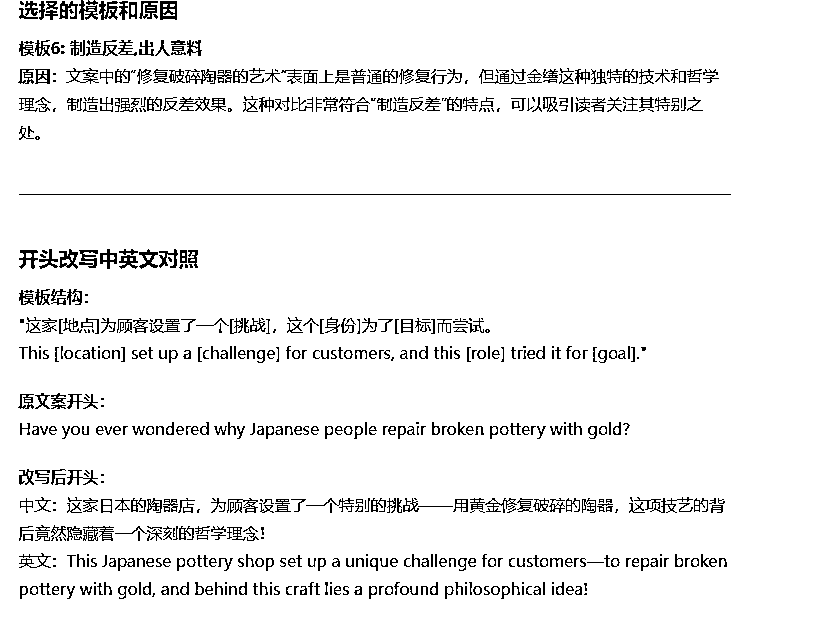

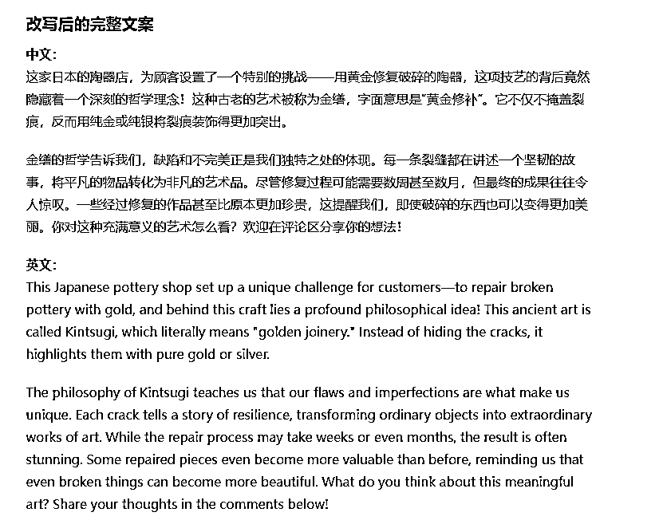

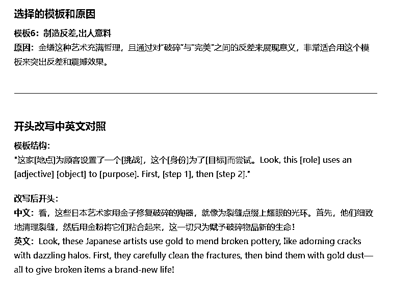

今天分享一套AI解说的完整玩法，从拼接混剪到爆款二创，一条龙讲清楚。先收藏，免得后面找不到。

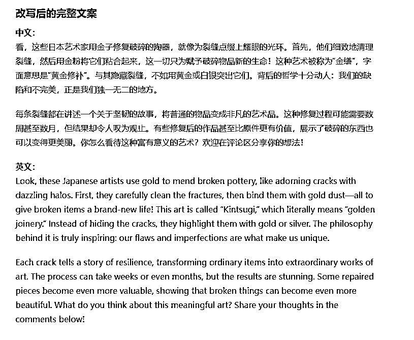

只要你套用不同的模板，就能得到风格完全不一样的开头文案。选拼接类素材的时候，有两点要特别注意：

1. 长视频同样能用，把里面最亮眼的片段单独截取出来就行。
2. 在YouTube上找素材，不用老老实实点进视频，鼠标悬停就有预览，下面还有进度条，拉着拖一拖，几秒钟就能判断这视频是不是你要的，省掉等广告的时间。

拼接类的正向文案写法基本就是这些。关于怎么根据选题找视频素材，我会单独开一篇，到时候直接跳转就行。

再说反向操作，也就是逆练。逆练拼接类解说其实很轻松，只要完成六件事：

1. 找到对标视频，扒下来。
2. 把视频转录成英文。
3. 套模板改文案。
4. AI配音。
5. 找素材。
6. 剪辑。

我们来实际走一遍流程。比如这个视频：https://youtube.com/shorts/QgqNKSIrmek?si=mji-5NjxtdkIkCFe

转录成英文这一步，```
How high is the temperature of seemingly ordinary steel coils? An interesting phenomenon occurred when throwing snowflakes into the steel coils. The snowflakes evaporated instantly. In fact, these steel coils that seemed cold were just produced by the factory. The temperature was 3000 Fahrenheit. After cooling a bit, these hot steel coils are placed outdoors to let them cool naturally. The freshly baked hot rolls are still hot after being stored in the warehouse for several days.
``` 用飞书妙记或者其他AI转录工具都可以，能实现功能就行，细节不多说。

接下来是改写。举个例子，原视频有一段解说：“看似普通的钢卷，温度到底有多高？把雪花扔进去，雪花瞬间蒸发。其实这些钢卷是刚从工厂出来的，温度高达3000华氏度，稍微冷却后放到室外自然降温。存放几天后，这些新出炉的热卷依然烫手。”

我们改写成更有吸引力的版本：“如果你把雪花扔向钢卷，你以为它们会瞬间消失吗？表面冷酷的钢卷，其实藏着惊人的秘密——它们烫得吓人。当雪花触碰到这些工业巨兽，不是融化，而是瞬间蒸发。这些看起来冰冷的金属卷材，刚刚从生产线下来，温度接近3000华氏度。即便移到户外自然冷却，这些大家伙依然保留着恐怖的热量。几天后放在仓库里，它们仍然散发着出厂时的余温。”

为什么要强调“改写模板”？因为开头决定留住观众。常见的开头套路有这些：直接介绍技术（说明型）、夸张修饰（夸张型）、提问引入（疑问型）、警告后果（警告型）、描述不寻常现象（描述型）、介绍有趣职业（夸张型）、使用强烈形容词（夸张型）、预告才能（预告型）、描述奇特现象（描述型）、刻画社会现象（说明型）。每一类都有自己的适用场景，选对模板，文案的质感立刻不一样。

写完文案后做配音，AI配音就不展开说了，很多方法都能复用。走完这一整套，你会拿到四样东西：原视频、原文、改后文、配音文件。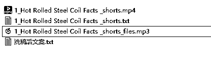

接下来是找素材环节，具体方法可以跳转对应板块，这里不多占用篇幅。

进入剪辑。不管是正练还是逆练，剪辑手法是一样的。开始前先把所有素材备齐：原视频、原文、改后文、配音文件，外加围绕选题找好的视频素材。 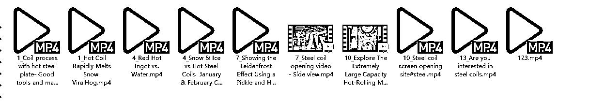

视频素材最好准备5到10个，这样剪起来才顺手。万一这个选题突然爆了，你还能用同一批素材二次拼接，一个选题重复利用。把素材全部丢进cupcat里面。

剪辑分五步：

第一步，导入音频，识别字幕。导入音频时记得切掉气口。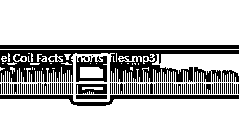

第二步，根据音频每句话的气口添加对应画面。识别字幕以后，按每句话分割，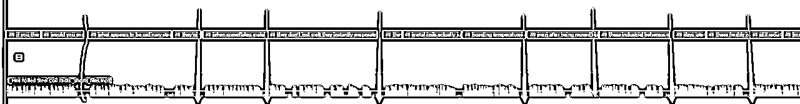 分割的位置就是插入画面的地方。处理画面的时候，有几个技巧很实用：镜像、加减速、智能调色（曲线、锐化）、放大缩小选框。如果素材是长视频且清晰度高，可以直接拉成竖屏，只要主体不丢就行；或者拉成4比5，做画中画效果。要是觉得原素材的音效能增强感觉，也可以适当放出来。像这样处理好。

第三步，在画面间隔处加转场特效和转场音效。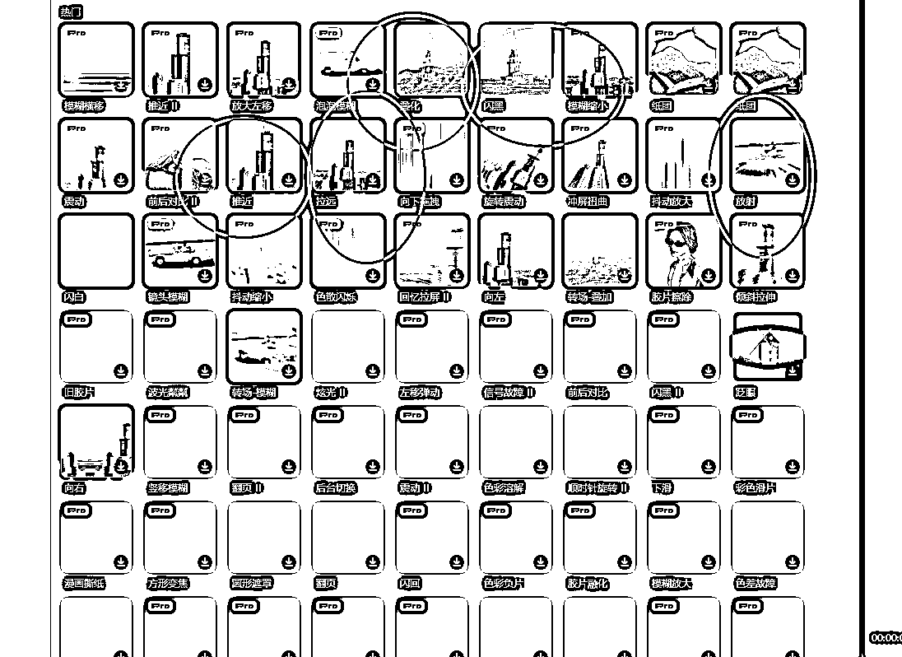  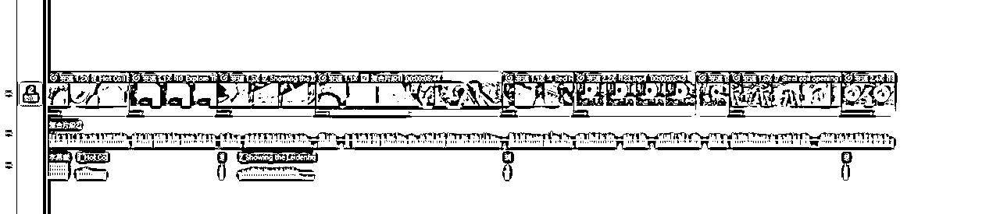

第四步，调整字幕特效。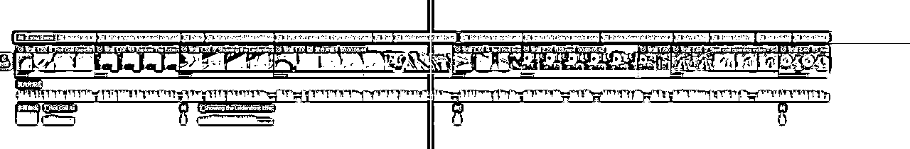 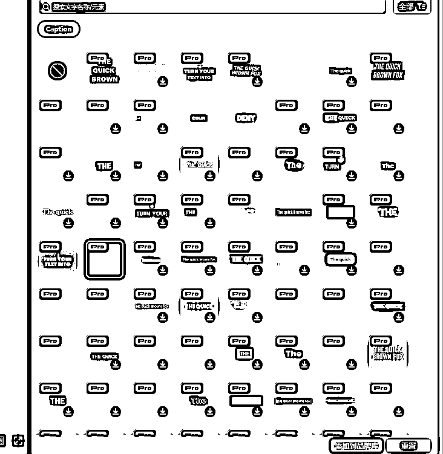

第五步，导出成品。从原视频到逆练成品，这条链路就通了。

说完拼接类，再讲爆款视频解说，也就是原视频解说。它的玩法是对爆款视频做深度二创去重，或者把一个博主的多个视频剪在一起。好处很明显：你借鉴的是已经验证过的爆款，再加工一遍，流量自然会更好。但缺点也藏不住：万一遇到小气的博主，可能直接来diss你，发版权警告，要求赔偿甚至删视频。所以选爆款的时候，要么避开人物主体，要么用国内爆款素材，能把风险降到最低。

爆款视频解说在收集素材和剪辑手法上，跟科普解说差不多，只有一些小细节不一样。所以重复的部分不讲了，重点说差异。

正练这个方向，不需要AI帮你出选题，你得自己去挖爆款视频。操作方法是：先把爆款素材手动写出描述词，或者用拆解工具把视频抽成图片，挨个发给GPT或Claude，让它们描述整体情节，再套用解说词模板，完成文案二次进化。相关工具和参考链接，可以去看之前的拆解文档。

逆练还是老路子，跟科普解说的逆练工作流相同。

剪辑之前，需要准备三样素材：改写后的中文文案、对标视频的原素材、改写后的配音。

举个例子。原视频文案大概是：小男孩想买蛋糕，手伸进口袋发现钱不够，难过地要走。一个女人叫住他，问明情况后，想了想，拿出卡片改了价格，让男孩买得起。男孩很开心，把钱给她。但蛋糕其实是给爷爷的生日礼物。女人值得一个赞，可惜没人给她点赞订阅。

这个版本平平无奇。改写后可以变成：“看看这个小男孩，买蛋糕的尝试让人心碎。他满怀期待地伸进口袋，下一瞬，表情就垮了。正当他空手转身离开，一位善良的女士叫住他，问清缘由。男孩指了指蛋糕，可钱不够。女士心疼了，思考片刻，掏出一张卡，悄悄改了价格。男孩乐坏了，递上钱，接过蛋糕——原来，这是给爷爷的生日礼物。这位女士的善举，值得至少一个赞，只可惜，到现在还没人给她点赞或关注。”

配音也按这个版本来。

开始剪辑：

第一步，导入音频，识别字幕。导入音频时切气口。

第二步，导入原视频做处理。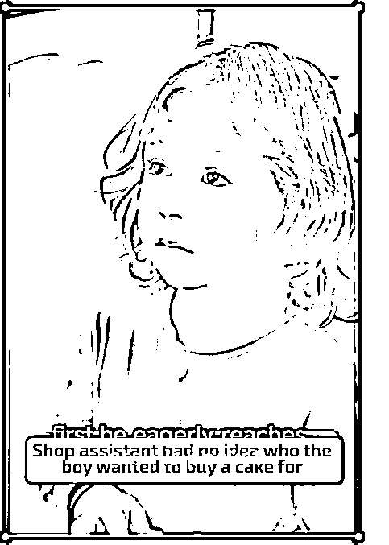 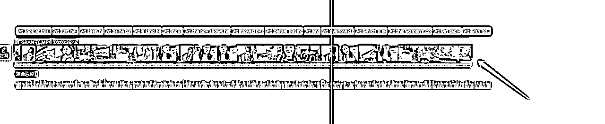

到这里，爆款视频解说的剪辑核心也讲完了。剩下的就是多练，模板背熟，素材攒够，流量自然来找你。

有时候解说节奏和画面节奏对不上，你会发现解说比画面长，也会发现解说比时间轴短。这时候就要动手调了。可以把原片整体放慢一点，也能把某个片段复制出来做镜像倒放来凑时长，或者找个相似的空镜、过渡镜头来补位。反过来如果原视频太啰嗦，就把冗余片段删掉，或者整体提速来对齐配音。

##### 原片处理

先把原片做智能分镜分割，选定镜像模式，然后逐段把片段置中放到画布中央。画面里有字幕、logo之类的杂物，用裁剪裁掉。整体再叠一层画中画效果，也就是背景做模糊填充。

比如这个：

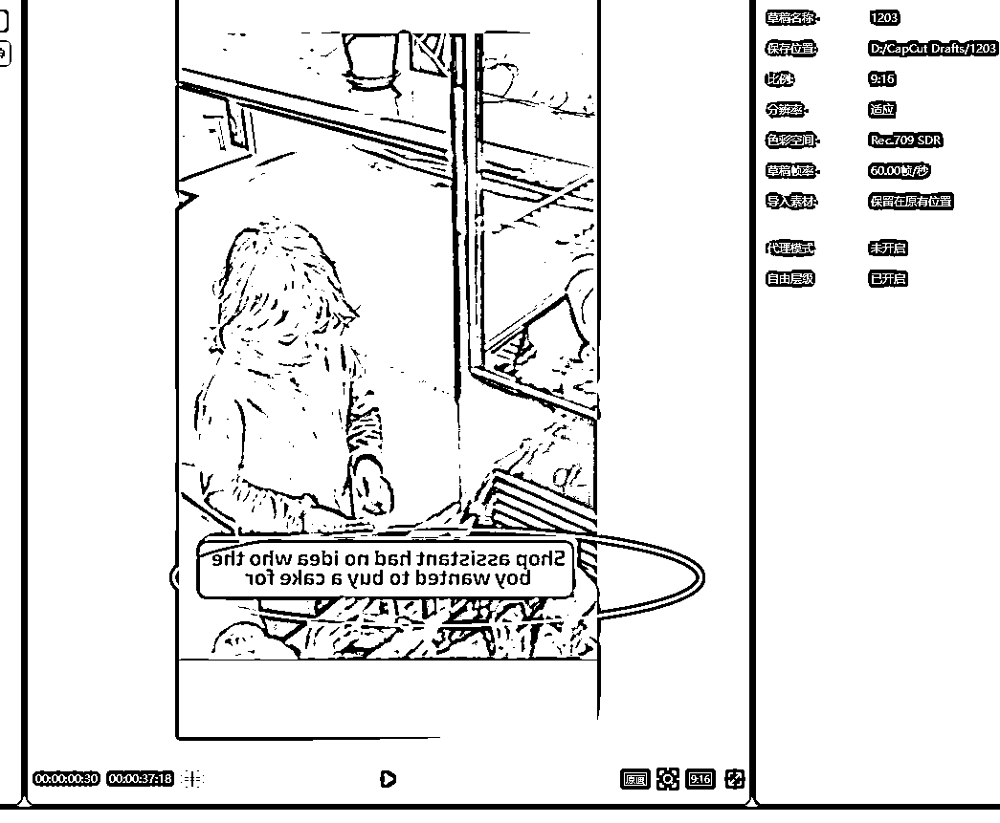

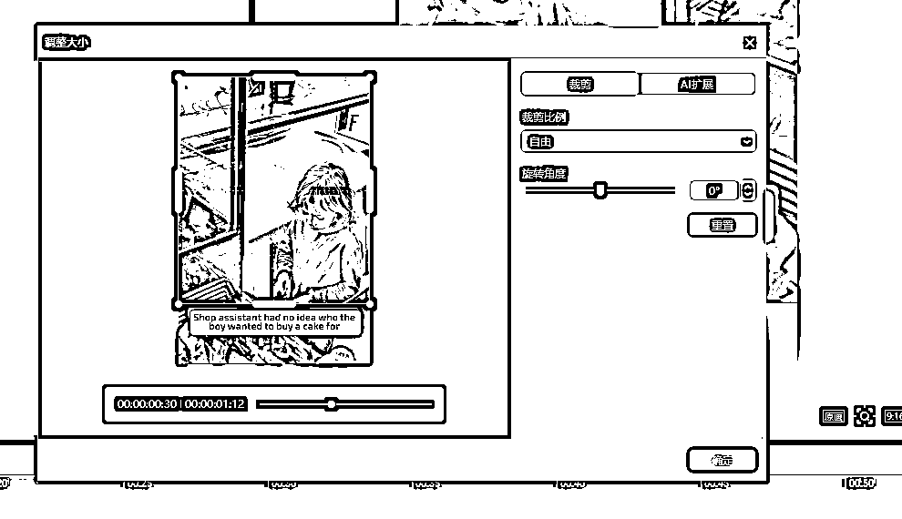

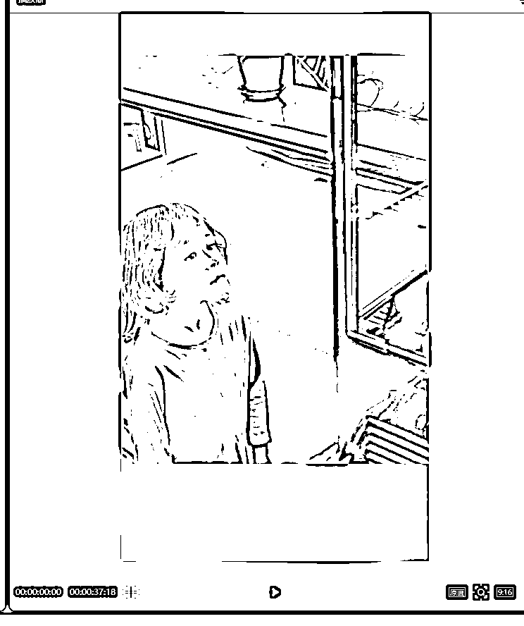

所有片段处理完后，合成一个复合片段，再根据音频时间轴微调对齐，用加速减速来找准点。


#### 3.给复合片段做智能调色

*   智能调色，曲线调整、锐化等
*   锐化强度
*   色温、饱和度、色调
*   曲线里的亮度、红色通道、蓝色通道、绿色通道
*   原素材自带的音效如果能加分，就适度保留放出来。

#### 4.字幕特效的打磨

做原视频解说，核心过重点就在这里。因为同类型素材用的创作者太多，很容易出现0播。字幕特效就是一个强有力的过重手段，所以一定要在这上面下功夫，可以按每句话手动配一些emoji表情包。

##### 4.1 手动给字幕配emoji

这里分享一个我常用的库，基本能覆盖需求：

https://emojis.sh/

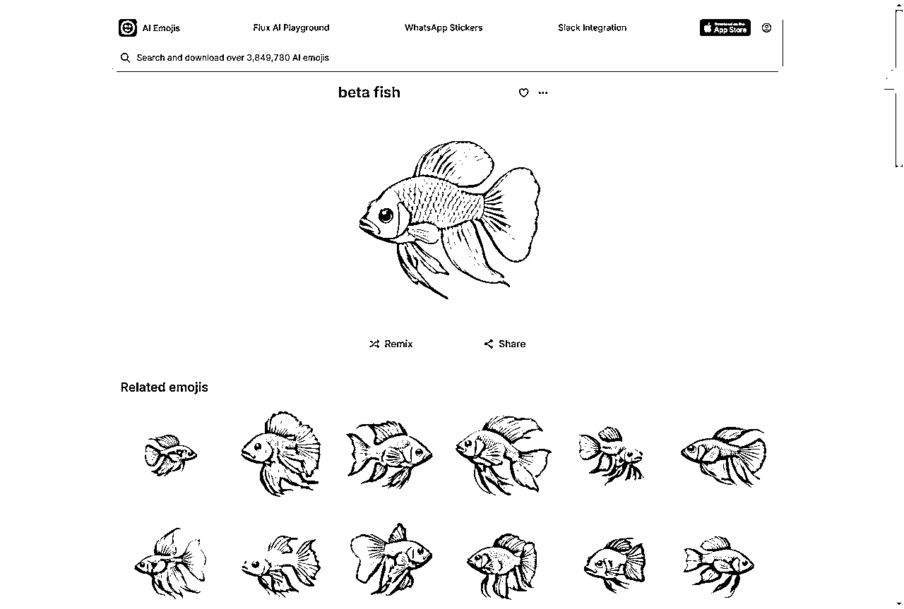

把文案丢给AI，让它提炼每句话的emoji关键词，再去对应下载。别嫌麻烦，素材库攒够一次后，后面基本就能直接复用。

##### 4.2 用剪映的字幕特效自动上emoji

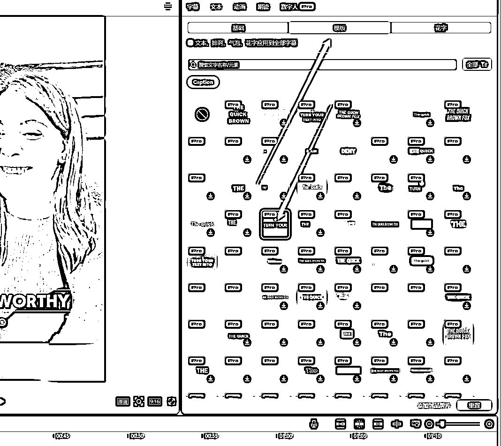


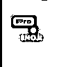

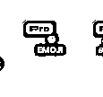


这几类都是基于文案自动在字幕上方匹配表情包的特效。


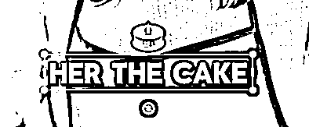


##### 5.导出成片

对标视频→逆向实操复刻

以上就是爆款视频解说也就是原视频解说从头到尾的操作思路。

# 找素材的核心打法

找素材这块，几条路子最管用：

## 在平台上主动搜关键词

### 1.1 先让AI提炼关键词找素材，首选 YouTube！

拼接类科普解说就是为这种方式量身定做的，靠关键词就能快速锁定同主题的视频源，直接批量下载。

先提炼关键词，以之前逆向拆解的文案为例，点击跳转

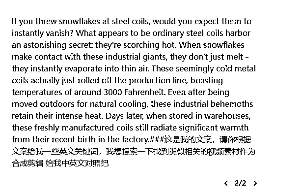

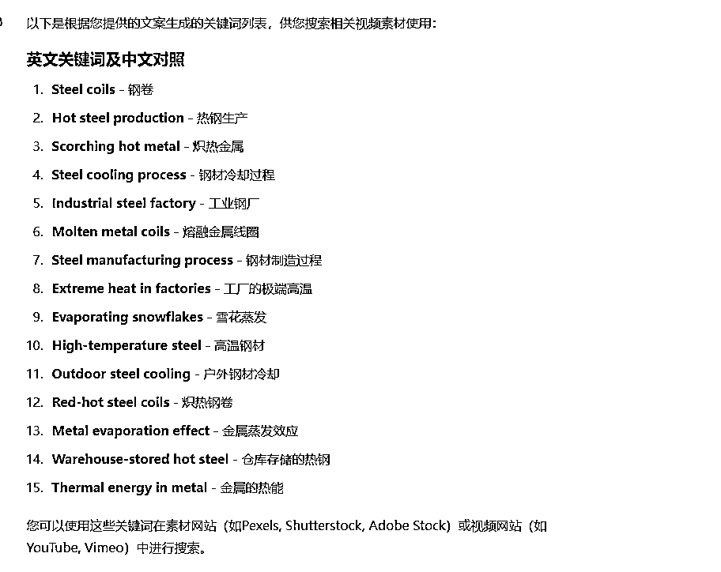

```
Steel coils钢卷
Hot steel production热钢生产
Scorching hot metal炽热金属
Steel cooling process钢材冷却过程
Molten metal coils熔融金属线圈
Steel manufacturing process钢材制造过程
High-temperature steel高温钢材
Red-hot steel coils炽热钢卷
Metal evaporation effect金属蒸发效应
Warehouse-stored hot steel仓库存储的热钢
Thermal energy in metal金属的热能

If you threw snowflakes at steel coils, would you expect them to instantly vanish? What appears to be ordinary steel coils harbor an astonishing secret: they're scorching hot. When snowflakes make contact with these industrial giants, they don't just melt - they instantly evaporate into thin air. These seemingly cold metal coils actually just rolled off the production line, boasting temperatures of around 3000 Fahrenheit. Even after being moved outdoors for natural cooling, these industrial behemoths retain their intense heat. Days later, when stored in warehouses, these freshly manufactured coils still radiate significant warmth from their recent birth in the factory.

如果你把雪花扔向钢卷，你觉得它们会立即消失吗？看似普通的钢卷却隐藏着一个惊人的秘密：它们烫得吓人。当雪花接触到这些工业巨人时，不仅仅是融化 - 而是瞬间蒸发在空气中。这些表面看起来冰冷的金属卷材其实刚刚从生产线下来，温度高达华氏3000度。即使被移到户外进行自然冷却，这些工业庞然大物仍然保持着强烈的热量。几天后，当它们被存放在仓库里时，这些新生产的钢卷仍然散发着来自工厂诞生时的显著热量。
```

这几个关键词我觉得可用，就拿文案去搜。

先从第一个开始搜：Steel coils

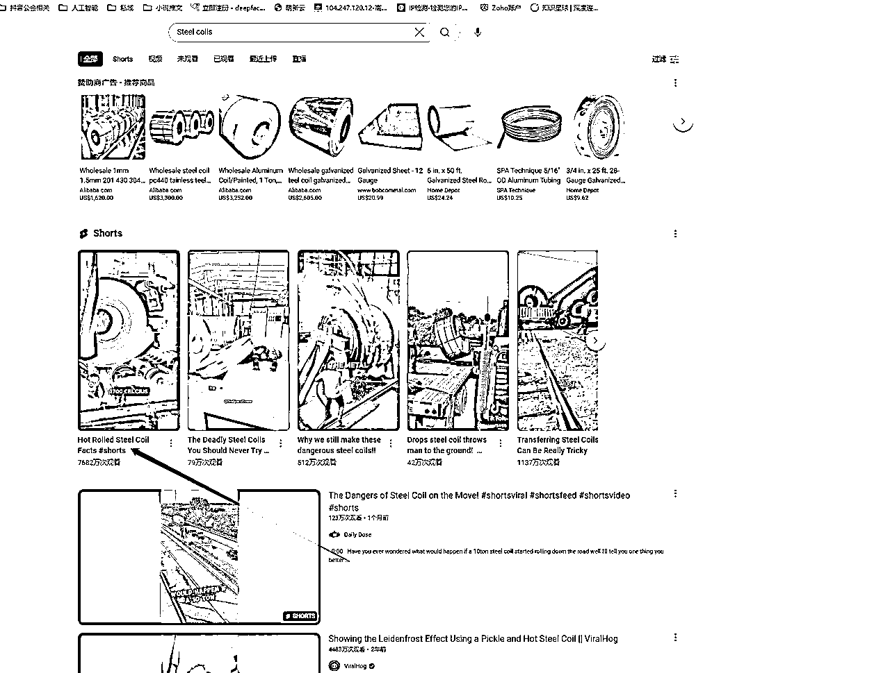

立刻就出来了对标片，不过这个词偏了，搜出来的是刚出产线的金属卷。那就先跳过。

AI提炼的词有偏差，讲的是雪花和下线钢卷，我就直接用原文第一段去搜，看看能不能命中更强相关的视频。

### 1.2 直接用文案首段检索

If you threw snowflakes at steel coils

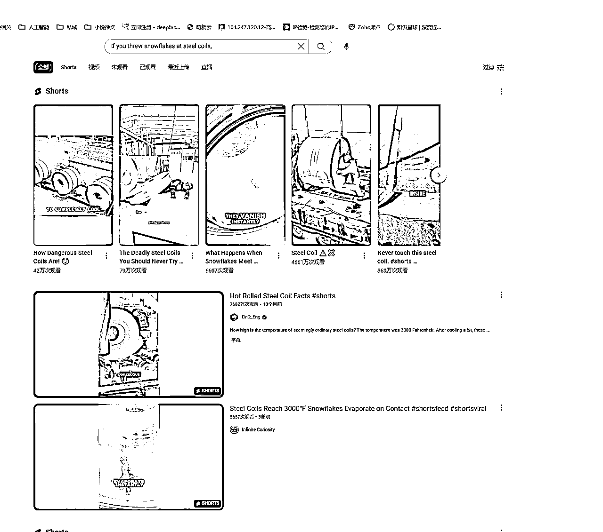


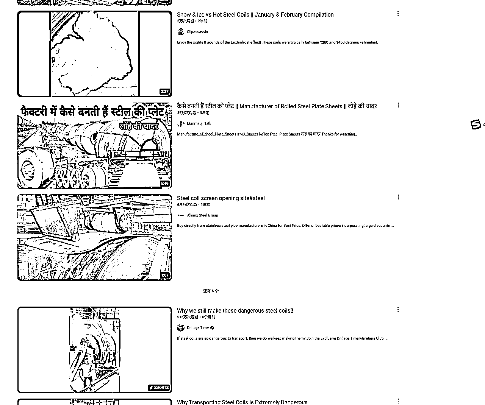

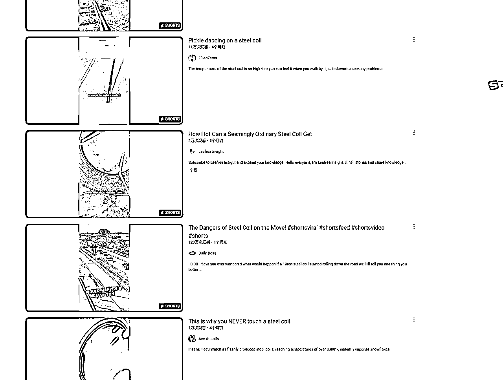

这个方法更准，很快就找到了雪花融化、高温钢卷的相关画面，我就开始收素材。

我一共收了这些，但还是不够支撑整段配音，


配音文件有44秒，我担心素材量不足，所以还要拓展同类词，比如热钢卷、冷却钢卷、熔炼钢卷等。可以回去让GPT再给一批词，或者直接把中文翻译成英文检索。

当关键词搜不到想要的画面时，比如这个：

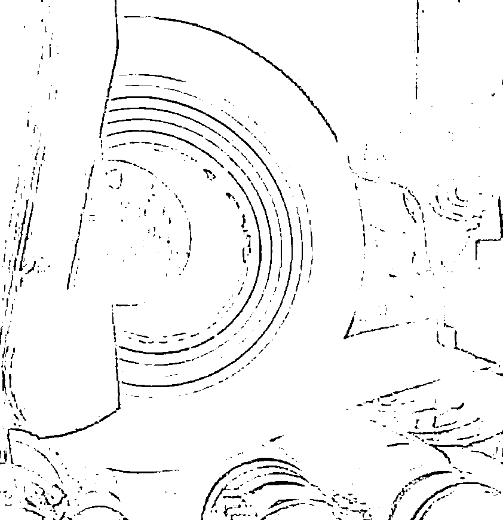

画面效果很理想，我就想拿到。那就用第二种办法，点击这里

## 海外用谷歌识图找，国内用百度识图找

做原视频解说时，关键词搜不到原片，这个方法就是救命稻草。

回到刚才的需求，我想找到这个片段，就截一帧画面丢给谷歌识图去反查。

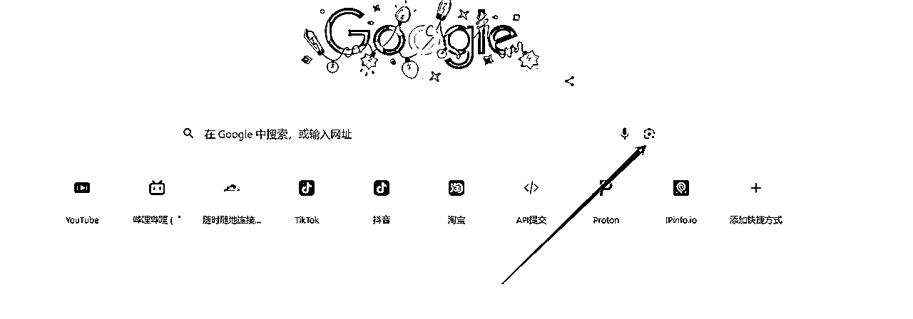

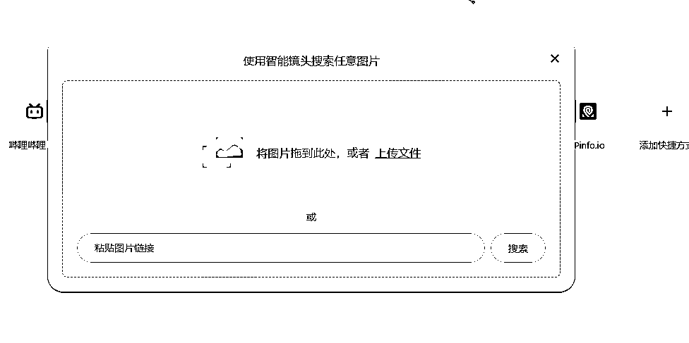

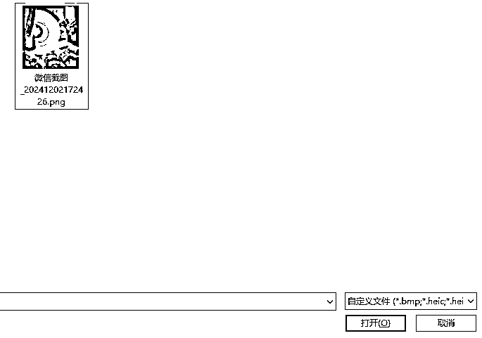

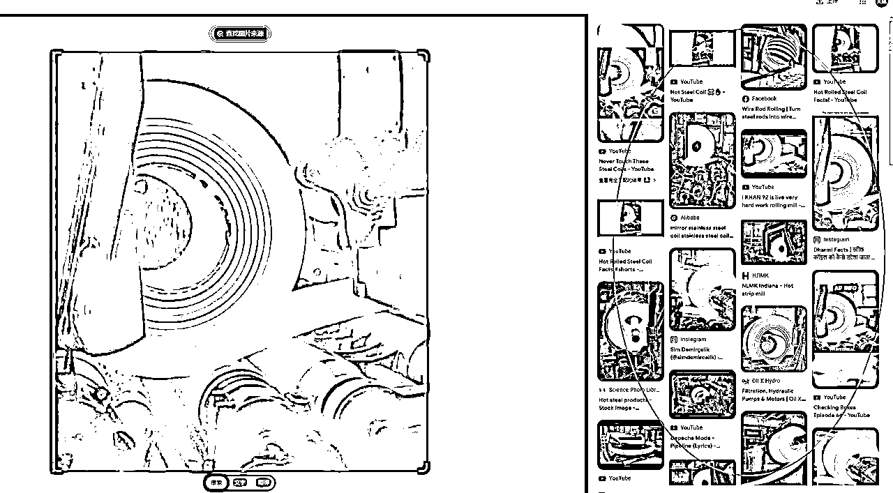

里面能翻出不少相关素材，但要注意避开同行的二创，除非实在找不到再从同行视频里拆一点可用片段。

比如我翻到这个，


感觉不错，但它来自一个购物站，部分平台解析不了。那我就右键看源代码，ctrl+f搜.mp4，复制链接单独打开试试。


对，就是我要的资源。这就是一条路，另外大部分情况靠识图就能找回原素材。

方法给你了，具体能挖多深看你对技巧的理解。

下载方面，针对平台有通用做法：

推特、INS、TIKTOK、YT，最简单的是在谷歌搜“平台名 + 在线解析”，把链接丢进去就行。

## 从对标视频暴露的信息里反推

有些创作者为了避嫌会在视频里@原博主，或者评论区有人提到出处XXXX，标题和描述里也会有线索，就能顺藤摸瓜找到原作者。

1.  标题和描述
2.  评论区


# 二创素材本源：站外获取

我们做的是 Shorts，它属于YouTube，那除了YouTube，其他平台都算站外。国内的抖音、快手，海外推特、INS、TIKTOK，都是你的素材池，你要建立自己的素材库。比如做爆款视频解说，就要抢爆款的二创首发；做拼接解说，就要累积同类题材的素材库。

前期会很累，等体系搭建起来，这两条赛道的内容生产会变得很顺。

大概流程是这样：

先定一个素材采集阵地，比如我先锁定 TIKTOK、推特、INS，再复用国内抖音、快手。国内素材文字水印多，去重去水印成本高。

分支的选择要看赛道属性。爆款视频解说很多跟人物、事件相关，用海外人物素材做解说有侵权风险，视频爆了容易被原博主投诉下架甚至索赔。所以做爆款解说，我更倾向优先用国内爆款素材来降低风险。

科普拼接类，素材合理化利用版权基本是允许的，风险很低，素材源头就可以以海外为主。

举例：

推特：

我想做爆款内容，排除人物素材，先确定一个搜索方向 Animals，OK在Top里看到它，


播放200多万，先别急着下素材，先判断是不是同行。


能判断出这也是个二创号，主打温馨动物治愈系。那我直接关注点赞，后续持续挖掘。


当你关注了大量这类账号，第二天打开主页推荐，系统会给你源源不断推来同类型素材作者。

不同平台的推流机制和用户习惯不一样，很多在Shorts上没有的内容在其他平台会有。所以市场已经验证过的素材，赶紧二创就对了。

TIKTOK 和 INS：

这里和 YouTube Shorts 重合度最高，能少用就少用，可以当作补充。或者通过推荐逻辑找到相关作者后重点监控，抢二创首发权。

关键词搜索、关注同类型账号，隔段时间或第二天再用推荐页刷新，尽量用新号建立信息茧房，不要用网页刷，手机刷效果更好。国内抖音怎么找对标，这边同理。

素材库的搭建因人而异，看资源获取能力和网感、韧性。

# 本篇结束，学完了就赶紧去实操，别浪费了。