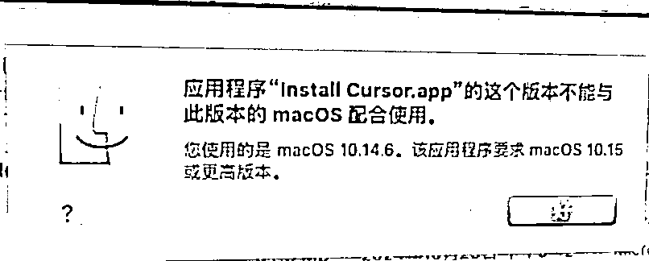
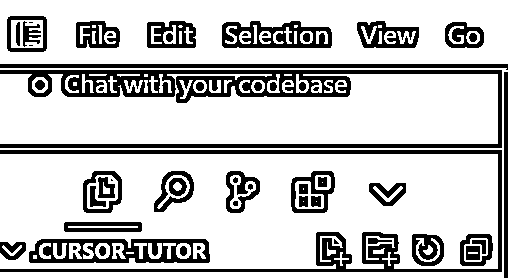
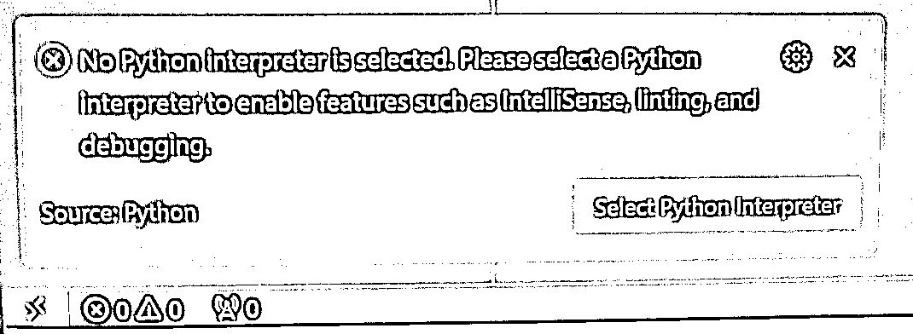
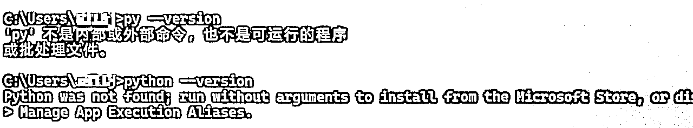
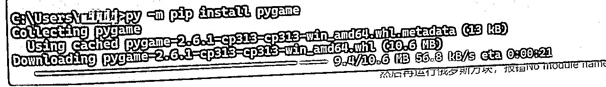
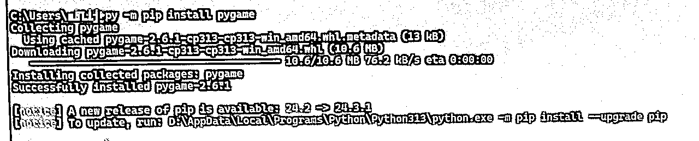
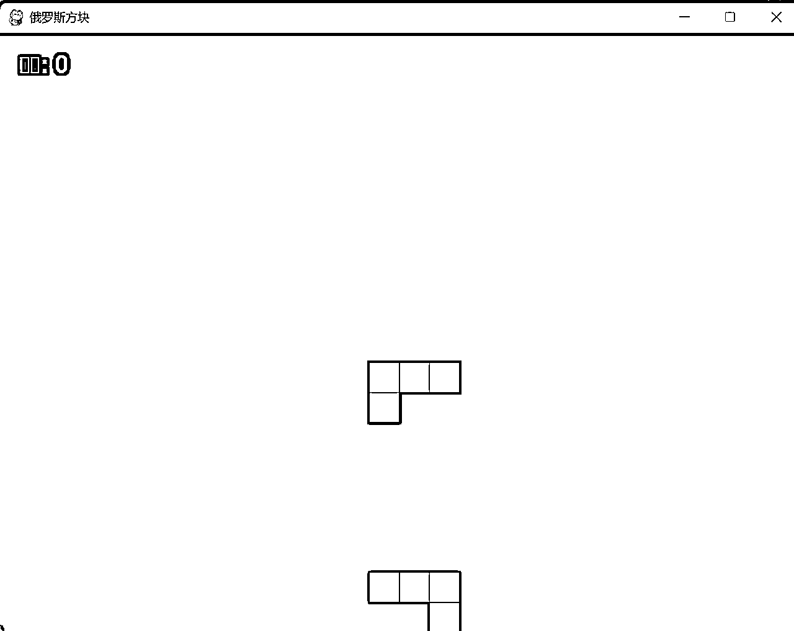

# 折腾 Cursor 安装的那些糟心经历
作者：龙哥

## 系统版本门槛先卡住人

第一次点安装包，弹出来的报错让我一脸懵：

C:\Users\AdministratorAppDatalRoaming\Microsoft\Windows\StartMenu\ProgramshCursor.Ink 参数错误

网上搜了半天也找不到准答案，后来我直接去找报错里的那个路径看，发现我的机器根本没有 StartMenu 这个文件夹。灵机一动，难道是系统太老？拿台 Win10 以上的机器试了一下，果然就装上了。

换到家里的 Mac 也没能幸免，直接提示需要 macOS 10.15 或更新的版本才能用。

Win7 和老 Mac 我都不想折腾升级，花费太大，最后干脆下单整了台新机器。其实这个问题估计也就我这种老设备用户才会撞上。

总结一下，Cursor 能跑的环境就是：Windows 10 及以上，macOS 10.15 及以上。

## 安装过程中的小插曲

1、先说流程本身，其实就是一路 Next 到最后。临门一脚要注册账号，我用的邮箱注册。第一次提交贼慢，结果蹦出一个 ERROR，点返回重填还是报错。我折腾了七八次，记不清具体步骤了，只记得邮箱好像注册上了但死活登不进去。最后重置密码才算顺利搞定，邮箱全程没换过。

2、装完打开 Cursor，发现并没有弹出让选工作目录的提示。它自己默默建了个 .CURSOR-TUTOR 文件夹，用起来也没问题。

## 真正跑起来才发现的问题

1、照着教程在 Chat 里让它写了个 Python 版俄罗斯方块，代码粘到 .py 文件里一跑，立刻报错：

No Python interpreter is selected. Please select a Python interpreter to enable features such as IntelliSense, linting, and debugging.

我打开终端瞅了眼环境，感觉和当年配 Java 的情况差不多。

于是去 python官网https://www.python.org/downloads/ 挑了个合适的版本下下来。我习惯装在 D 盘，所以大概率环境变量没配好，不过在命令行里敲 py 倒是能用。

2、装完 Python 后，编辑器里就出现了运行的小三角。点它跑俄罗斯方块，又来新报错：No module named 'pygame'

解决办法就是在终端里装库，pip install pygame 或者 python -m pip install pygame 都行。因为我的 Python 装在 D 盘，最后用的命令是：py -m pip install pygame，等进度条走完就算成功了。

搞定这些后，简单的程序就能直接跑起来了。亲眼看到俄罗斯方块在屏幕上动起来，那种成就感跟当年第一次打印出 Hello World 一模一样，让人特别有劲。

