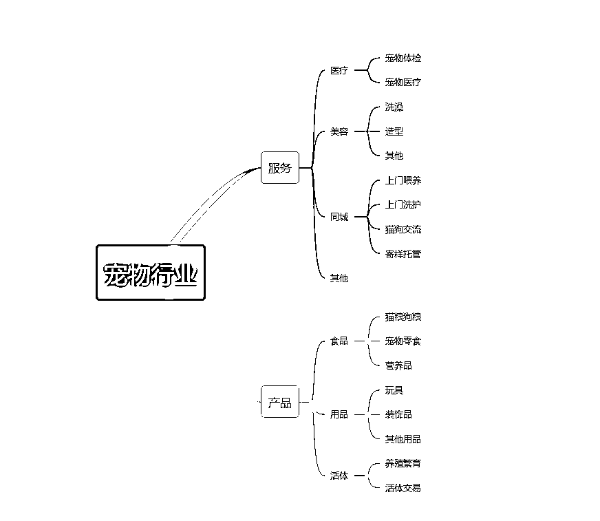
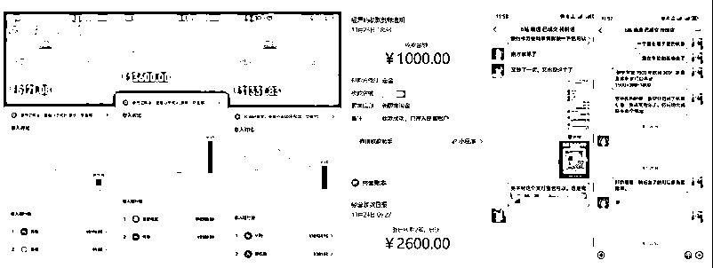
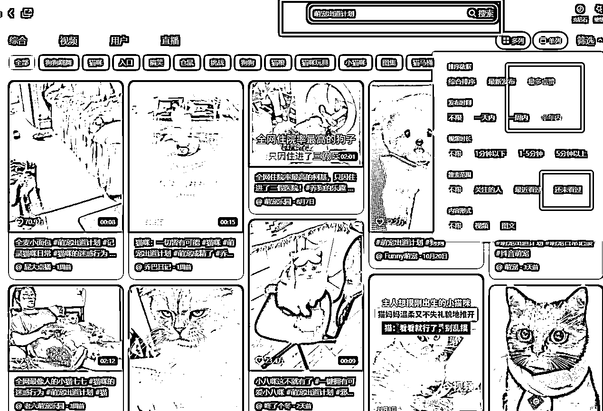
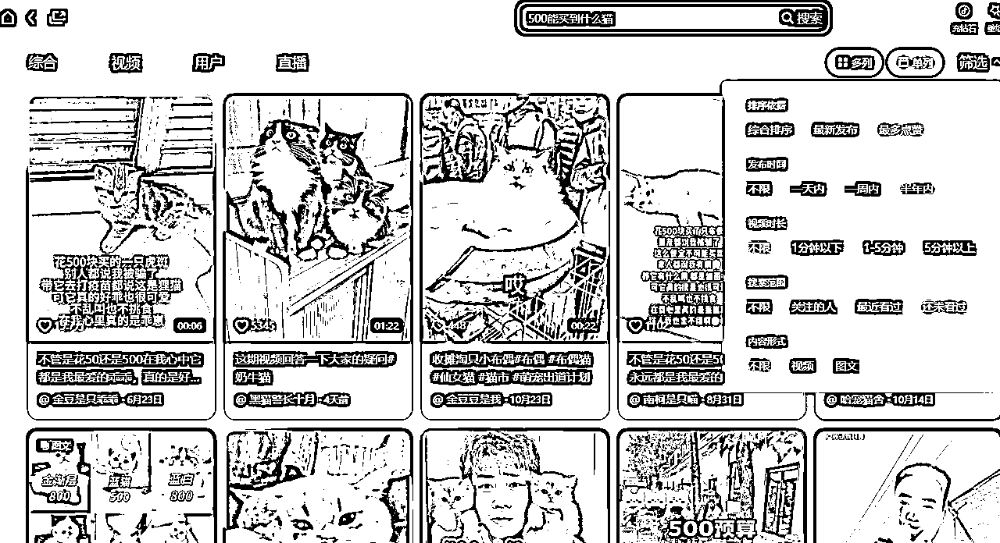
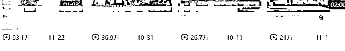
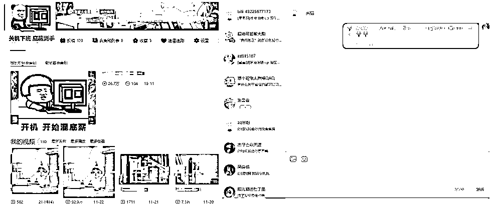
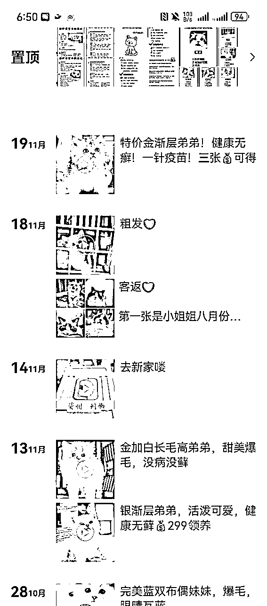
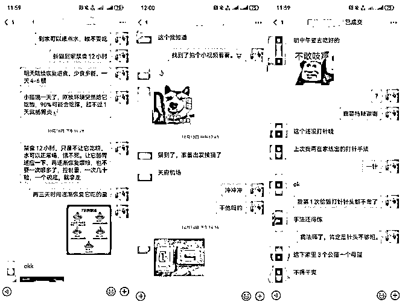
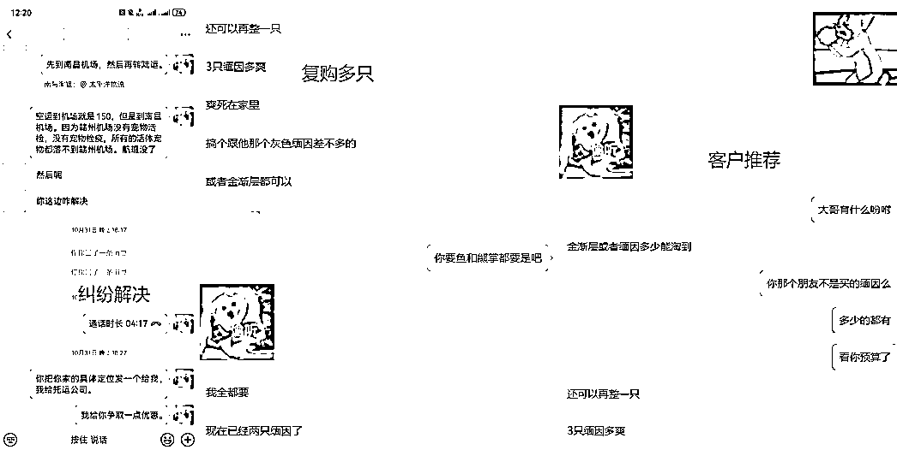

# 别急着说内卷，一部手机、不投流、纯搬运，普通人做宠物赛道也能月入过万

大家好，我是龙哥，创业八年，混过公关圈，带过养生带货团队，也做过国学民宿。去年和一个星球里的圈友深聊之后，付费学了点东西，一脚踩进了宠物这个行当。今天不聊虚的，把这段从0到1的实操过程全盘托出，希望给想入局的朋友一点参考。

## 为什么偏偏是宠物？

说实话，选这个赛道，我是做过功课的。它最大的优点就是“干净”——平台对宠物内容的容忍度很高，引流基本不踩红线。而且行业覆盖面足够宽，从活体到用品到服务，条条都能深挖。我跑过同城宠物市场，翻过公开数据，还特意问了一位在北京做宠物公司融到B轮的朋友，最后才下定决心。

现在年轻人晚婚晚育的越来越多，不管单身还是恋爱，谁不想有个毛孩子陪着自己？一到假期全家要出门，猫猫狗狗谁来喂？这背后全是生意，而且能拆出很多细分方向。

这一块的分支图分享给大家，值得慢慢研究。

## 我现在在做什么？

简单来说：线上无货源卖活体，成本几乎为零，一部手机就能开干。刚开始我也试过混剪，但出效果太慢，兼职剪辑的水平又参差不齐。后来干脆走搬运路线，速度快、起量猛，而且不容易被查重——抖音搬到📕，📕搬到抖音，只要手速够快，重就追不上我。

流程也简单：短视频平台引流到🛰️，客户看中宠物先交定金，发货之前把尾款结清。这样操作，资金风险被压到最低。现在我已经在同城做线上结合线下的延伸，比如上门喂养、猫狗乐园，还有宠物社群聚会、相亲团建之类的业务，已经开始产生收益了。

## 到底赚不赚钱？

活体的客单价基本都在千元以上。利润空间就看你怎么聊了，正常能拿到单笔的三分之一到三分之二，熟练之后对半甚至更高。我拿一个号测试了一个月，单号变现1.5万+，现在还在涨。三个号同时跑，马上准备结合线下矩阵放大。

给大家看部分后台数据，还有一部分是银行卡收的款，就没放上来了。

## 具体怎么做？手把手拆给你看

我觉得任何项目就两件事：引流 + 转化。把人从平台弄到🛰️里，剩下的就是聊天成交。下面全是为了这一步服务的。

### 第一步：硬件准备

一台工作机（多台更好），办一张电话卡，老号最理想。新号养2-3天再开始注册平台，千万别急——我吃过亏，新号直接注册，结果赶上本地是电诈高风险区，手机号被封了7天，啥都干不了。

### 第二步：账号和平台

注册抖音、📕、视频号、B站这些平台，头像、昵称、背景图都改好，主页留出引流联系方式。我实测下来，B站走得最稳，就重点说B站。萌宠号自带流量，养好号之后第一条作品基本就有500的基础播放。抖音人多但杂，📕女性多但成交不爽快，B站目前是我的主阵地。

### 第三步：作品分两类

- 流量视频：萌宠日常、搞笑、可爱、治愈系，主要用来起号涨粉。
- 转化视频：宠物市场买猫砍价、选猫的过程，引导客户来咨询。

实操建议：流量视频播放量稳定在300-500之后，就可以开始发引流视频了。

### 第四步：素材和剪辑

主打搬运，基本不剪，省时间。从不同平台交叉搬运防查重。比如抖音的视频搬到📕，📕的搬到抖音。素材怎么找？直接在平台搜话题，像#萌宠出道计划、#记录猫咪日常、#猫咪迷惑行为这些，看到好看的先过自己审美，再去别的平台搜一下，没有相同的就去水印下载。

一个技巧：每次找新素材记得选“自己还未看过”的筛选项，不然会重复搬。

引流视频则要去搜宠物市场相关的视频。

筛选条件选“半年内”，因为好视频总有人没来得及搬，时间长了就选近期。

### 第五步：更新频率和导流

每天发3-5条，早中晚各一次，尽量在饭点前一个小时发布。不用指望每条都爆，持续发一周左右，就会有人来问了。记得主页留好联系方式。

当账号有流量之后，会出现三种情况：

1. 用户私信问“猫咪怎么卖”，直接回复联系方式就行。
2. 评论里有人问，要马上私聊他。
3. 把评论置顶，比如“喜欢同款小可爱的看主页”。

基本上这么做爆率很高，私信多到回不过来就设置自动回复。这里说一句：主动私信也可以，但实测被动等着用户加，账号活得久，不容易违规。

### 第六步：私域成交

**人设**：引流号和🛰️号名字要对应，千万别起成“宠物公司官方”这种。没人喜欢跟客服聊天，个人名才像朋友。进人之前要养号，提前一星期发朋友圈，每天十几条，这样新人加进来不会觉得你是新号。聊天多用表情包，收藏一些萌宠表情，偶尔发语音条，信任感很快就有了。

**朋友圈**：别刷屏纯广告。产品圈占40%，其余60%放客户反馈、买家秀、个人生活、养宠干货。内容不够可以去📕搬。为了方便看，可以设成几个专区，比如【每日特价】【猫猫反馈】【新猫到家】【养宠小知识】。每天别发太多，有人问就单独找。

**话术**：

- 新客进来第一时间打标签，备注来源、预算、想要的类型。晚上12点以后的消息第二天再同意，这样会多一次添加成功的提示。
- 聊天要有节奏，别搞成一问一答。客户跑偏了就拉回来，解决不了的问题一个表情包带过。适当发语音、打语音电话，既能增加信任，又能避免被截图留证据。
- 成交之后记得回访，收集反馈视频。一方面能做朋友圈素材，另一方面客户觉得你重视他，复购和转介绍自然就来了。

## 三个必须提前解决的问题

### 供应链

活体不是猫粮，不能随便找代发。全国最大的宠物交易市场在东北，沈阳那边养户多、代理多、配套完善。想认真做，可以直接飞过去谈。不想跑，就上闲鱼、📕、抖音搜卖猫的视频，看他们主页介绍，加联系方式进货。注意辨别骗子，别急着打款。提前和批发商谈好售后条款，不然真出了问题，对方口径一变，亏的是你自己。

### 收款异常

很多客户在付款那一关看到风险提示就跑了。这时候发语音跟客户解释一下，或者转支付宝。最好的办法是把之前成交的录屏发给新客户看，让他安心。没有成交记录就自己造一个。如果客户非要走闲鱼，宁可不做——闲鱼周期长、要垫款、到手还砍价，得不偿失。

### 售后

活体免不了生病，猫瘟、腹水这些都会遇到。一手货源一般只给3天售后，因为价格已经够低。我们在主页背景图里写清楚售后政策：售后期内出问题，要么补发，要么退三分之一。提前说好，客户一般不会闹。真出大事，让客户提供全程录像，再去找卖家。做好售后转介绍率很高，我这有个客户已经买了三只还要买。出纠纷优先语音沟通，别留文字截图。

## 后面往哪走？

这个赛道我是当主营业务来做的，线上为主、线下为辅。线上卖活体，先猫后狗；线下做同城上门喂养、猫咖、猫狗乐园，还有宠物选美、社群聚会。线下门店也能反哺线上的信任感。目前这些已经开始盈利了。

## 最后一句话

所有项目都有沉淀期，别急着拿结果，让子弹飞一会儿。以前做电商、带货、直播，天天跟平台斗智斗勇，累得慌。还是做私域、做复购，慢一点，反而踏实。以上是我自己的经验分享，有兴趣交流的随时找我，链接更多同行，一起成长。