# 长沙专升本书小红书获客，我们从调研到跑了一个月的最新复盘

这篇文章聊两件事：一是动手前我们做的市场摸底，二是实际投放一个月后看到的现象和思考。

## 一、市面上的玩家到底怎么玩

先交代样本：我们把目光锁定湖南区域，前后看了280多个同赛道账号，筛掉全国性大机构后，主流玩法基本能归成两种——一种是企业认证号矩阵，一种是企业认证号加老师/素人号组成的混合引流矩阵。这中间有个花絮：湖南这边机构在线上营销的投入力度，跟河南、山东这些卷王省份还是有差距，目前能做到全国平均水平的，我们只看到新支点一家。另外跑去抖音观察了一圈，不少机构靠视频和直播截流，内容数据加直播间互动折算下来，转化效率和小红书差不多，流量导入微信的开口率大约在5%~10%。

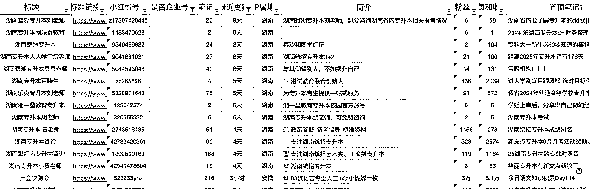

补充一下数据采集的规则：只收录蓝V认证账号，一家机构有多个账号的，取粉丝量最高的那个；全国连锁和综合类考试培训不在本次分析范围内。盘下来的企业号情况，比较有代表性的有这些（具体主页链接可回原文查看）：湖南华图（2024年7月开号，粉丝150）、湖南库课（2023年5月开号，粉丝1354）、湖南领途（2023年5月开号，粉丝3194）、湖南乐贞（2021年9月开号，粉丝8081）、湖南中公（2021年9月开号，粉丝1231）、湖南人人学（2023年1月开号，粉丝2889）、JY新支点（2023年9月开号，粉丝2007）、湖南学理（2024年4月开号，粉丝46）、湖南湘试（2022年8月开号，粉丝1047）、湖南宏图兴学（2022年5月开号，粉丝500）、MX梦象（2021年5月开号，粉丝1577）、升德尚（2022年6月开号，粉丝4258）、湖南考翼（2021年10月开号，粉丝1630）。

把这些账号再按业务属性分一下，大致三类：一是业务铺到多个省份的综合机构，二是扎根本地的综合机构，三是只做湖南（以长沙为主）的垂直机构——最后这类才是我们的直接对手。

### 企业号怎么拿线索

先说自然流。小红书对留资类业务的管控明显收紧，尤其10月15号的新规落地后，自然流能拿到的量直接被砍了一多半，矩阵号的效果也随之缩水。现在靠自然流基本就是赌笔记内容，看能不能吸引到精准人群。我们跑了十天得出的初步结论是：想吃自然流红利，个人号明显比企业号好使。

再说是付费投流。长沙本地的蓝V机构基本都在投聚光，笔记里挂咨询组件，引导用户留电话或者微信。从官方那边打听来的行情，专升本行业单个微信开口成本大概在150~220元之间，结合我们自己的投放记录，湖南本地能把开口成本做到160~180元左右。只要投产比能守住1:1.2，这个模型就能一直转下去。不过要注意，这类付费流量的黄金窗口只有考前1~3个月，能不能稳住就看各自的出价优化了。

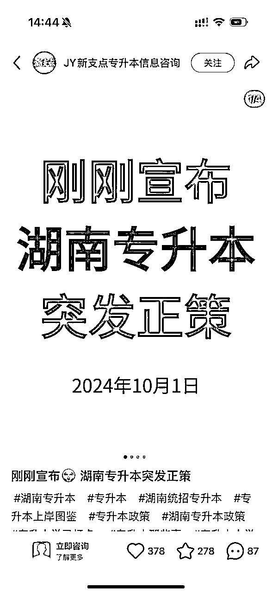

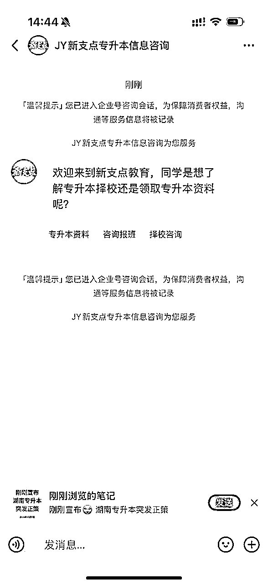

### 重点关注：新支点在做什么

新支点是个值得拆解的样本。我们统计到它旗下已知账号有24个，这还不算那些没挂“新支点”名字的号；从2023年开始重点做小红书，今年依然是主战场，8月中下旬一口气推了至少10个账号，合计发了500多篇笔记。它最核心的打法就是资料引流：每篇笔记都配一张堆满资料图的封面，诱导学生来私信咨询；但加上微信之后并不会直接发资料，而是先问专业、备考进度这些关键信息，同时定期开线上直播公开课，一点点把信任养起来。

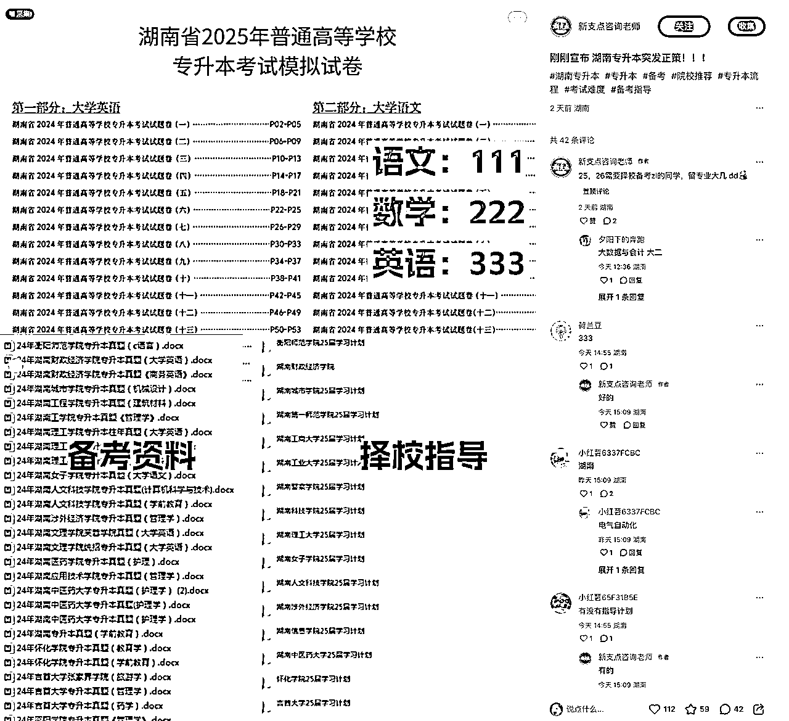

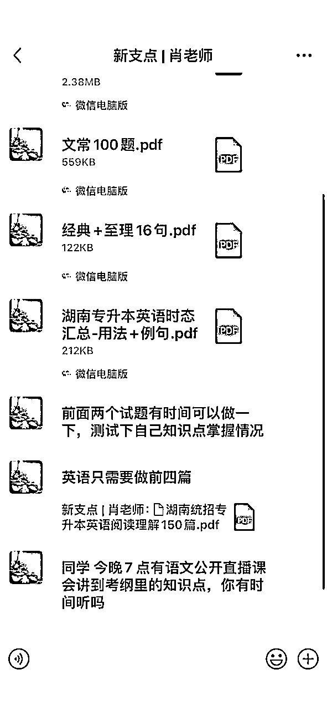

至于搜索端的表现，我们在11.8~11.13这6天里，分上午（10-12点）和下午（16-19点）两个时段，模拟普通用户去搜「湖南专升本机构」「湖南专升本」「长沙专升本」这些关键词，结果高频出现的蓝V号主要有三家：升德尚、新支点、励学。但真正霸屏的依然是各种素人引流号——学姐号、老师号、测评号。同样的词放到抖音上搜，前排几乎被新支点包场，而且它直播间数据也还行，平均在线个位数到十几人；乐贞在抖音也有一定存在感。

其他值得顺带看一眼的：考翼2023年还在小红书上做，2024年已经彻底停了，改推考研自习室和考研寄宿，所以它在专升本赛道上的打法基本没有参考价值。梦象一共4个账号，在小红书上做得中规中矩，没什么特别突出的笔记或者账号。

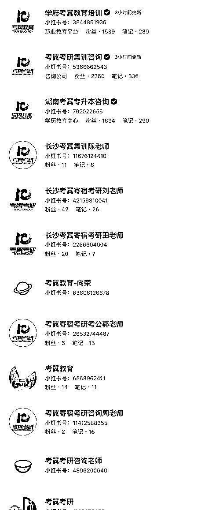

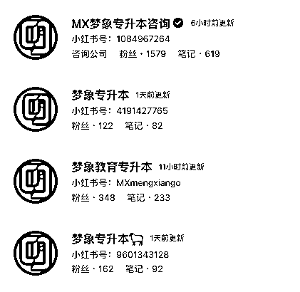

### 个人号的分工与引流

个人号这边，粗略能分出四种角色：

1. 上岸前辈型——人设是已经考上的学长学姐，内容围绕经验、规划、资料分享，走“废号法”路线，吃自然流。
2. 机构老师型——内容跟上面类似，但多了一层老师身份加持，会额外做政策解读、择校指导、院校数据分享。
3. 测评机构型——一般是工作室或机构雇的人，专门做机构横向评测。
4. 个人IP型——这方向在赛道里比较少见，梦象以及个别老师/学长前辈尝试过出镜做视频，内容靠真人露脸立信任，具体流量数据还不透明。

从引流方式看，现在个人号的内容载体还是以图文为主，少部分有视频，甚至纯视频起号，主要集中在学长学姐和机构老师这两类角色上。自然流要想跑起来，得靠足够多的号+足够多的内容去堆矩阵，慢慢试出流量入口。付费流量是小红书官方最近在拓展的方向，除了常规聚光投放，还可以绑定KOS关系，把老师的私人号挂在机构主体下，这样就能给个人号也投流。这条路值得后面重点测试。

### 直播这块是不是机会？

目前小红书专升本赛道基本还没有像样的直播间，机构用直播做招生的情况也比较少。如果你想抢增量，直播引流是个可以试试的空白点。湖南地区现在直播频率最高的新支点，选的是抖音而不是小红书。我蹲了它直播间两个小时，峰值在线20人，平均不到10人。数据不高，但胜在持续，真想深挖的话还得再观察一阵。

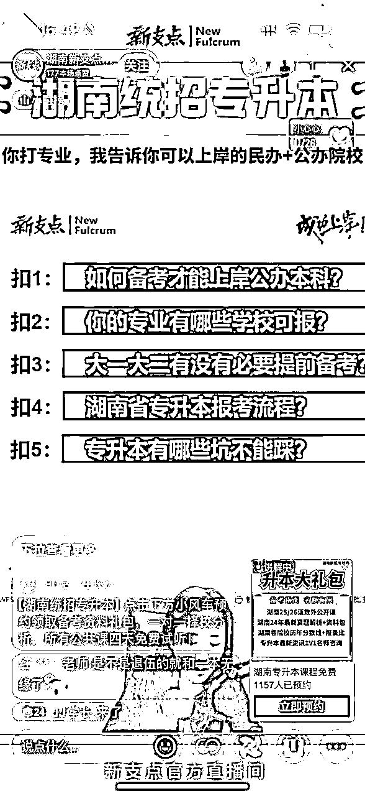

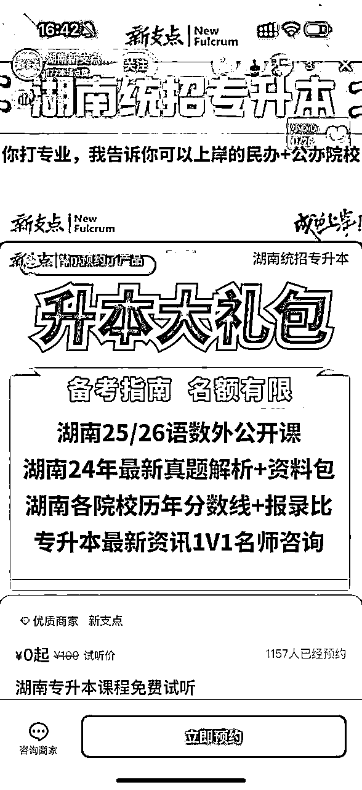

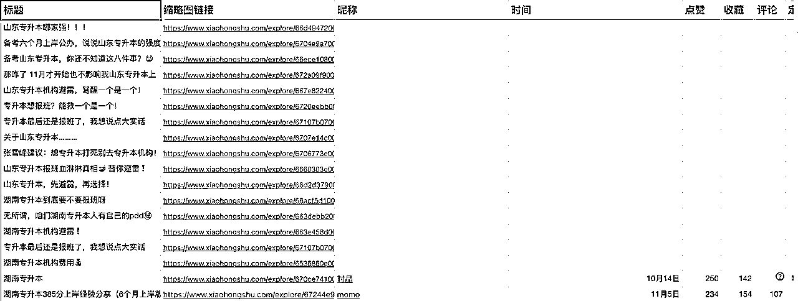

## 二、用户长什么样，他们又想要什么

经过这10天的运营和对行业的了解，我们服务的核心人群非常明确：专科在读学生。这群人上小红书主要就四件事：找学习方法、找复习资料、了解机构并报名、找研友搭子。

### 画像速写

- 年龄集中在18~23岁，正处在大专阶段，对学历提升有明确诉求，想通过统招专升本挤进本科，为就业增加筹码。
- 性别大体均衡，但分专业有差异：文科类女生比重偏高，工科类男生稍多。
- 地域上全国都有，但山东、河南、广东、江苏、湖南这些教育与报考大省活跃度更高，学生面临的压力也更大，找培训资源的意愿更强。

### 行为特征拆解

搜索习惯上，高频词集中在“专升本”“专升本培训”“省份名+专升本”“备考攻略”“考试科目”这些。一旦快报名了，比如湖南省考期临近，就会有一大波人搜“湖南专升本报名流程”。除了搜机构名，他们还会横向对比好几家，看课程、师资、价格、口碑，再综合官方账号、上岸笔记、博主测评做判断。

互动偏好上，经验分享是流量密码。学长学姐上岸经历、备考心路这类笔记很容易爆，点赞收藏评论三连，评论区里全是问复习安排和资料出处的。机构号发的课程和师资介绍也受关注，尤其是“英语名师押题课”这类带名师标签的内容，用户会主动评论私信深挖。另外，只要看到分享历年真题、知识点总结、思维导图的笔记，他们大概率直接收藏，甚至追着求链接、求购买渠道。

时间规律上，每年本省报名期和考试期前后，还有寒暑假这种整块备考时间，平台活跃度会明显飙升。比如3~4月报名季和9~10月强化期，搜索和互动都会冲到峰值，这也是机构投放最该加码的节点。平时的话，他们多在课间、通勤路上刷，碎片化阅读为主，所以封面和标题必须能在几秒内抓住眼球。

## 三、给团队的内容和运营动作建议

内容层面，别只发课程介绍。可以多做三种：一是邀请成功上岸的学员做视频或图文专访，聊真实感受、踩过的坑和解决办法，这种内容容易建立共鸣和信任；二是按科目出备考攻略，结合历年真题讲知识点和解题技巧，既展示专业性，又能帮用户解决问题；三是做政策解读系列，持续更新各省报考政策、招生院校和专业的调整，让用户在你这里一站式看清楚变化。

笔记质量上，标题要多用疑问、数字、亮点句式，比如“专升本英语怎么在一个月内提20分？”“专科生必懂的5个上岸捷径”；封面要干净、干净、再干净，配上大字号关键信息。排版别挤成一坨，多拆小标题、加序号和表情符号，图文搭配思维导图和示意图。比如讲数学知识点时，配例题图加解题思路图，可视化能显著提升完读和收藏。

这些就是我们阶段性跑下来踩到的部分实况，后续有新的数据变化再同步更新。

很多做专升本培训的机构，在小红书上投入了不少精力，但效果却天差地别。最近整理了这份实战观察，从笔记设计、团队协同、账号布局到投放节奏，有不少值得琢磨的细节，分享给大家。

先说笔记这一环。一篇内容能不能留住人，结尾的引导很关键——别光顾着输出干货，记得顺手点一句“觉得有用就点赞收藏哦，想了解专升本课程详情，欢迎私信我们”。这样既给了用户行动理由，也把咨询入口悄悄留了下来，后续转化才有抓手。

接着是客户团队的配合。评论区、私信得有专人盯，回复要快，态度要专业耐心。哪怕用户问的问题重复一百遍，也别敷衍。每一次认真回应，都是在给机构的好感度加分。用户感觉到被重视，离下单也就不远了。

再从整体营销来看，限时优惠是很有效的催化剂。报名季、寒暑假这些节点，推出折扣、满减、赠课、送资料等活动，配合笔记持续造势，制造“错过再等一年”的紧迫感，能明显推动用户尽快做决定。

说说我们调研得到的几个判断。湖南地区的专升本机构，线上重心基本都压在小红书上，打法也趋同，大多是标准化的“素人矩阵”运营。流量被大量小账号瓜分，想跑出来要有两把刷子。另外，平台对自然流量的限制目前看不出松动的迹象，想靠自然流吃红利，难。明年的竞争主战场，大概率会转向“蓝V账号矩阵+付费投放+私域运营”的组合模式。对甲方而言，盯紧投产比，才是真正的破局点。还有一个长期价值的判断——个人IP（不管是CEO还是主讲老师）的塑造，是机构最有护城河意义的资产之一。可以参照某些头部账号的玩法，在客户团队能力匹配的前提下，尽早孵化自己的IP角色。

关于笔记内容，我们测试下来，效果最稳的是三类：

**学习资料类**：按科目拆知识点，内容要“量大管饱”，排版务必精致，重点高亮得醒目，千万别整成黑白打印风。

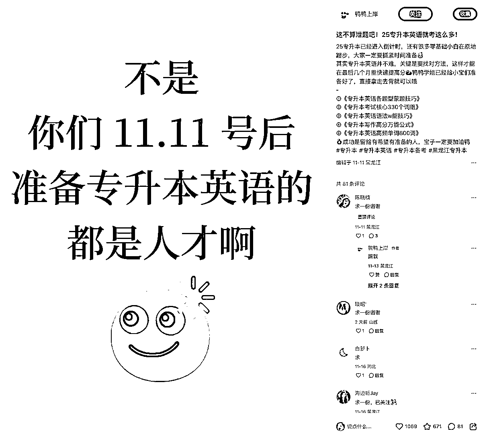

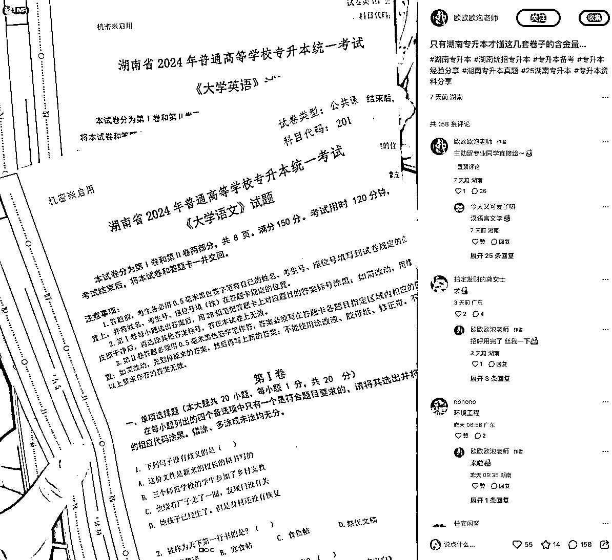

**上岸经验分享类**：让学长学姐讲备考经历，重点写清楚各科目怎么学、用了哪些资料，文末一定要放一张资料合集大图，引流效果拉满。

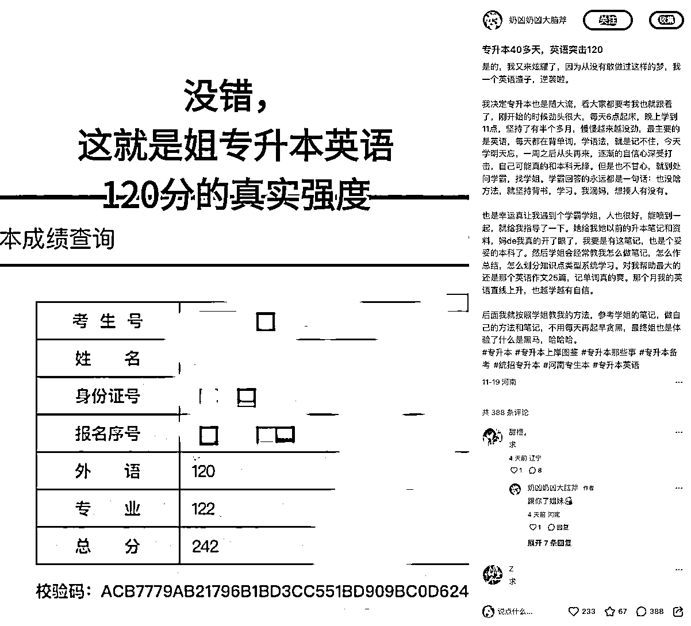

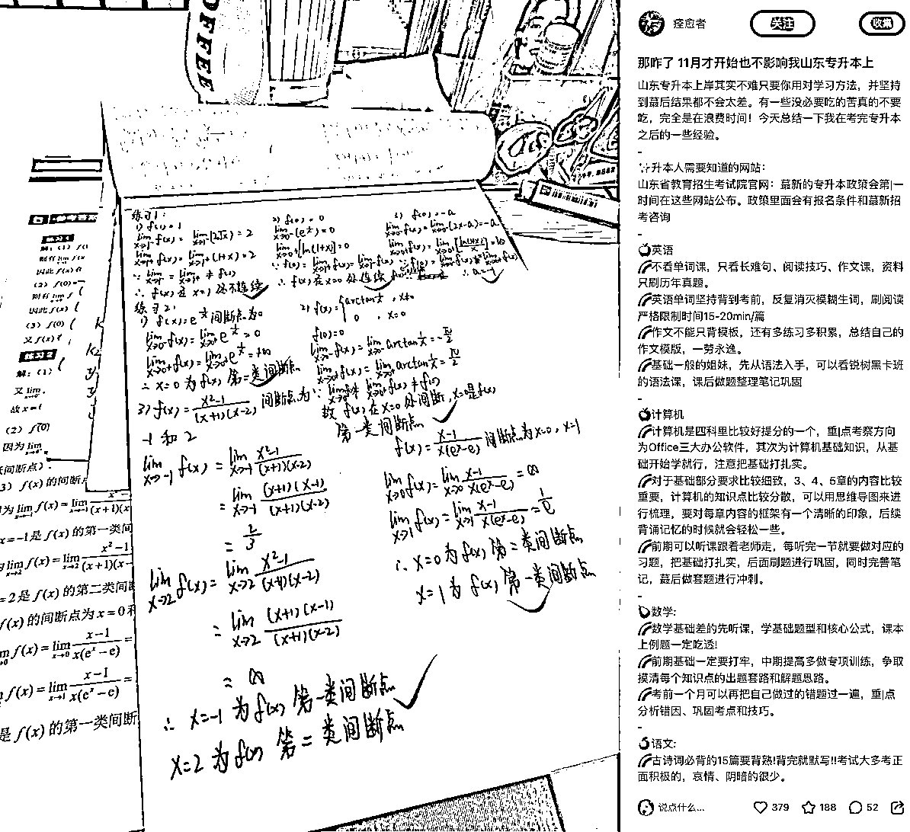

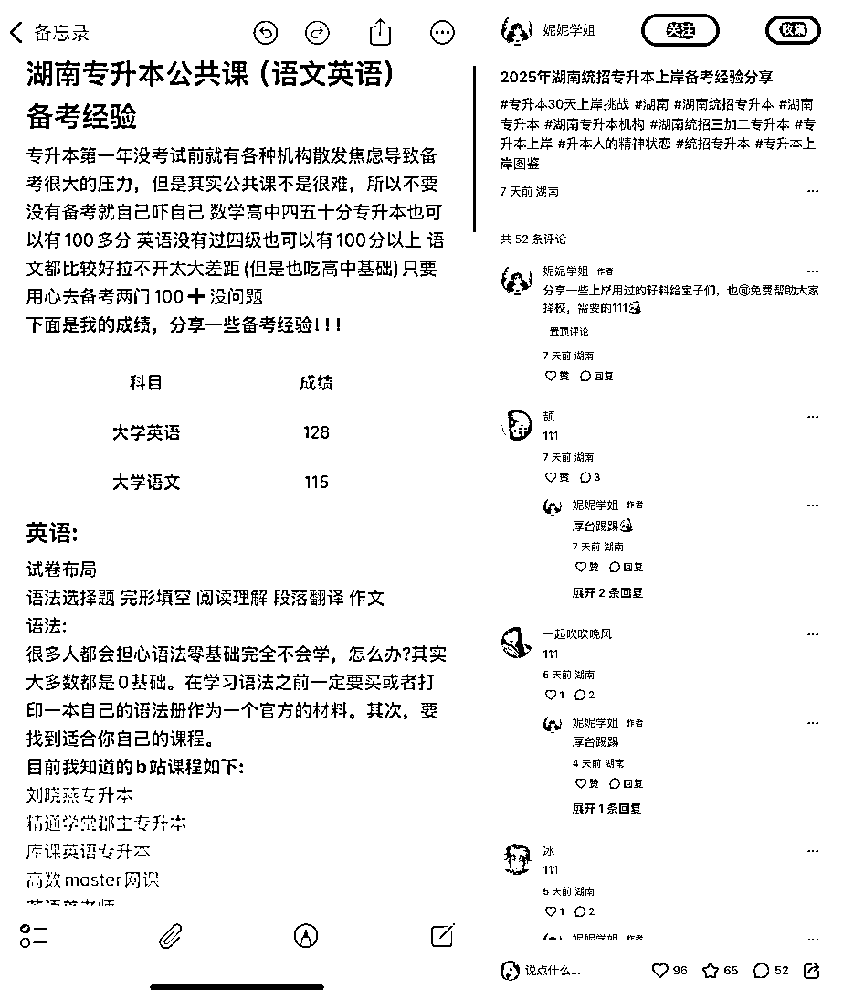

**政策合集类**：标题走“政策有变”“突发调整”的路线，把备考前需要了解的专升本政策一次性打包，让用户感觉“看这一篇就够了”，结尾照样用资料合集图钩子。

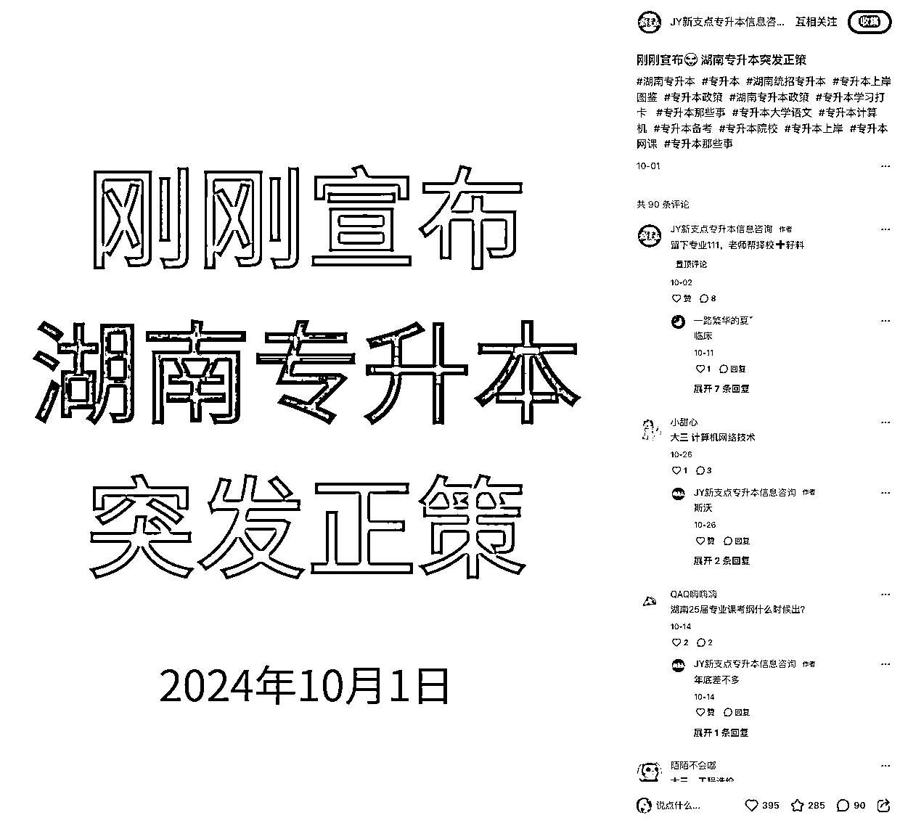

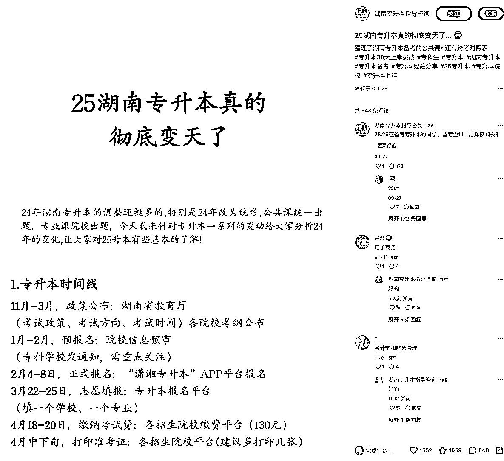

最后聊聊投放数据。从目前跑出来的情况看，每天9点到14点是流量的黄金时段，不仅跑量猛，成本也稳，大概人均50左右。17到18点、19到20点这段时间成本明显偏高，如果再多观察几天还是这样，建议直接暂停这两个时段。

投放优化上，有几个实操调整可以马上做：
1. 停掉17:00-18:00和19:00-20:00的时段；
2. 现在两篇笔记同在一个计划里跑，容易出现软广抢量、硬广跑不出去的情况。不如复制原计划，让两条计划并行，各带一篇笔记分开测；
3. 预算可以加码，现在日预算500，建议提到800到1000，把量级做大；
4. 私信回复速度再提一提，会直接影响到加V率；
5. 可以再补两篇投放笔记，之前那篇讲价格的没什么效果，但别急着下结论，换个角度继续测。

总之，小红书这个盘子不大也不小，用心打磨笔记、盯紧数据、灵活调整，机会还是有的。希望这些经验对正在做专升本线上拓客的你有点启发。