# [ComfyUI]虚拟模特换装三视图，轻松省下模特费用
作者：龙哥

> 原文参考：飞书文档链接（见素材来源）

# 一、开篇

各位伙伴们好，我是龙哥，一直在ComfyUI领域深耕。

今天带来的是服装迁移工作流的升级思路。这套流程我连续打磨了三天。

对于电商服装系列的套图制作来说非常合适，直接帮你省掉请模特的预算。

先给大家看看成品效果

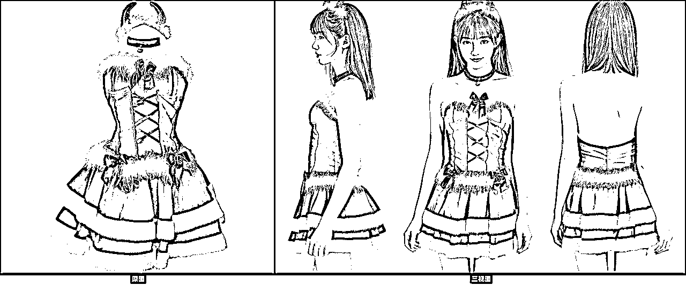

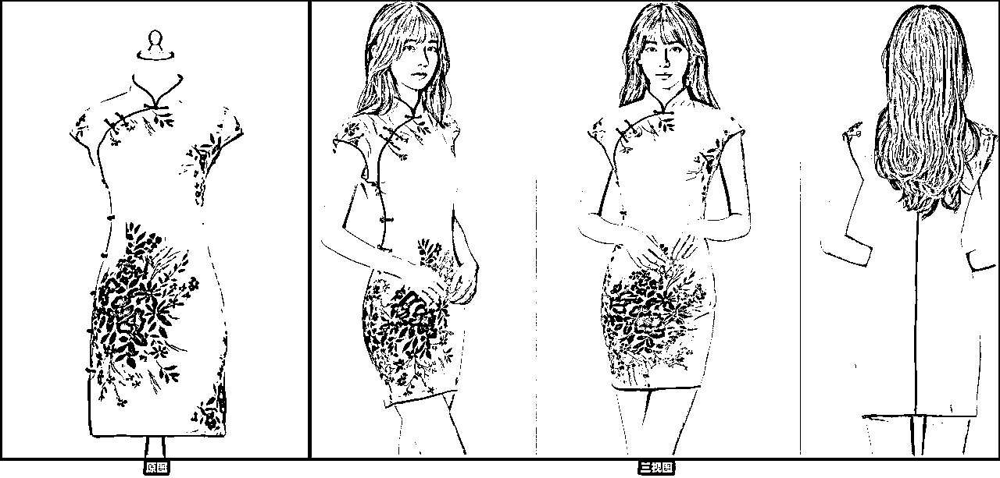

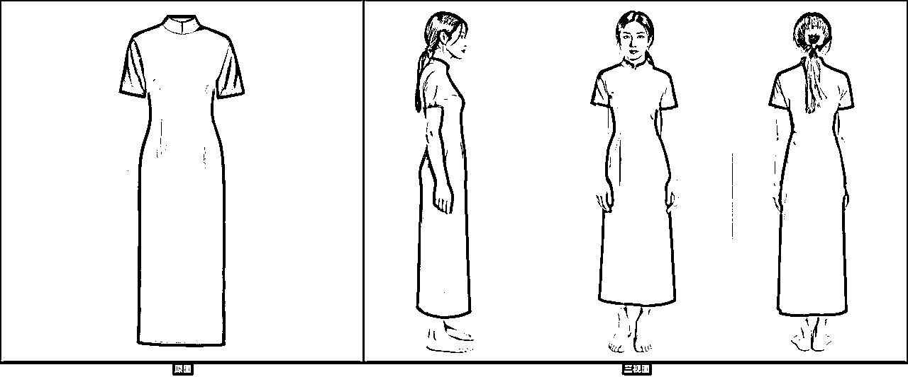

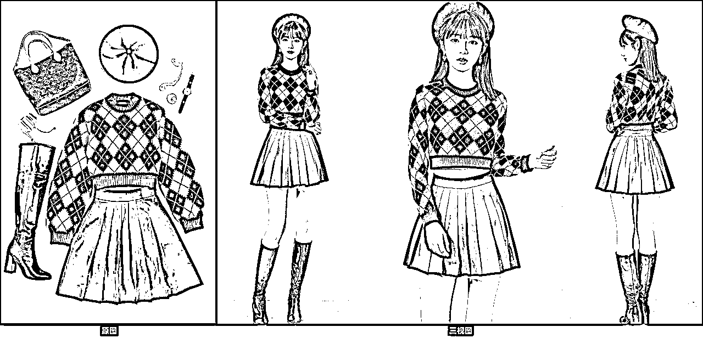

# 二、工作流拆解

说实话，这套工作流偏商用向，稍微有点复杂度，所以暂时不提供免费下载。不过别急，我会把每个模块的截图和运行原理都展示清楚，大家对照着搭建，完全可以复现同样的功能。

整体分为七大块，覆盖了图像生成、遮罩修整、服装迁移、脸部精修、高清放大、自动裁剪以及最终拼图。

全流程总览图如下

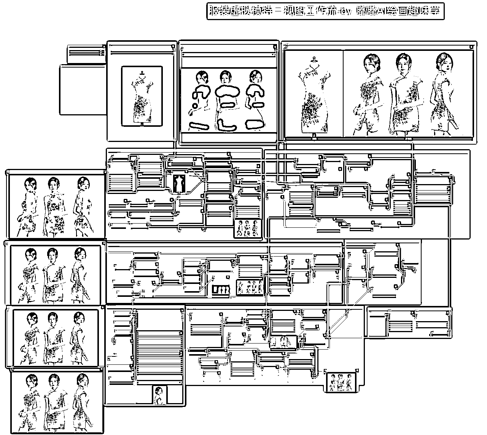

## 2.1 生成三视图

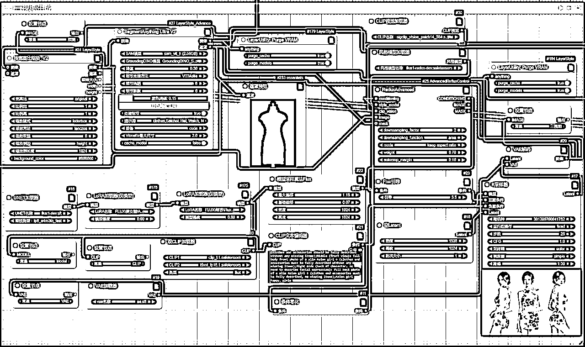

这个环节用的是Flux与Redux配合提示词的策略，来产出与参考服装相呼应的三视图，为后面的换装打下基础。

核心提示词也直接分享给你

Photos in raw format, HD, 4KA real model outfitting photo, three views, namely the left side, the front side, and the right side. The characters are the same person to maintain consistency, and the picture should form an overall display.This diagram consists of the following parts:Left (model shown from left without face): profile photo of a slim Asian girl + (clothes and accessories should be fully described without any missing items);Middle (front view): full body front photo of a slim Asian girl + (clothes and accessories must be fully described without any missing items);Right side (back of character, no need to describe facial expression): full back photo of a slim Asian girl + (clothes and accessories must be fully described, no missing items);Asian girl happy，simle

这里有个关键细节值得注意

我启用了Redux的权重调节机制

默认数值是3，数字越小，参考服装占的比重就越大。如果你发现抽卡出来的三视图和原始服装结构差异很明显，不妨把权重调低，例如改成2再试试。

我们追求的效果是：AI既能忠实参考服装，又能理解提示词，因此需要反复微调。

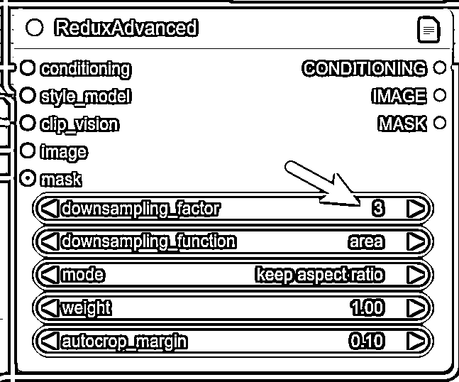

## 2.2 遮罩处理

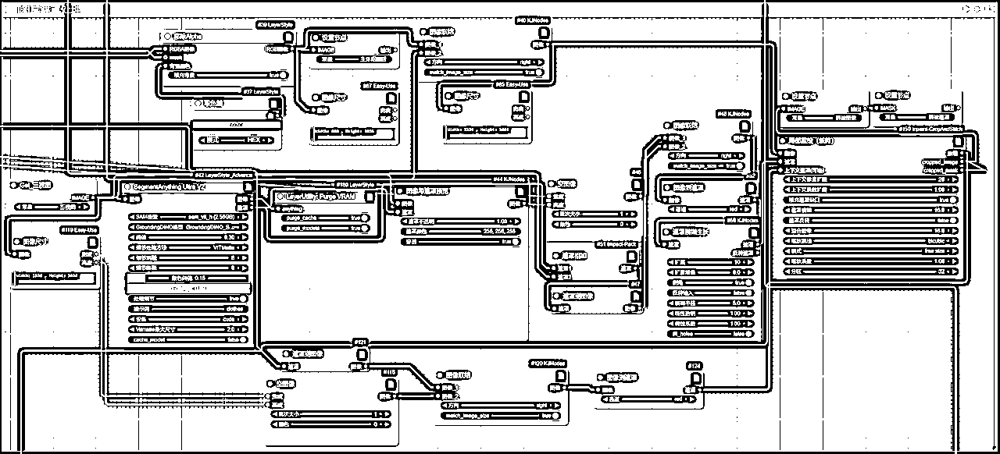

这一模块主要用来生成合成图和对应的遮罩，给后续的服装迁移提供基础素材。

另外还加入了一个遮罩桥接预览功能，支持手动涂抹补全，能把自动识别遗漏的区域也覆盖进去，大大提升了操作的可控性。

这里的原则很简单：最终遮罩必须覆盖参考图中所有需要换装的区域，迁移时才能做到完整保留。

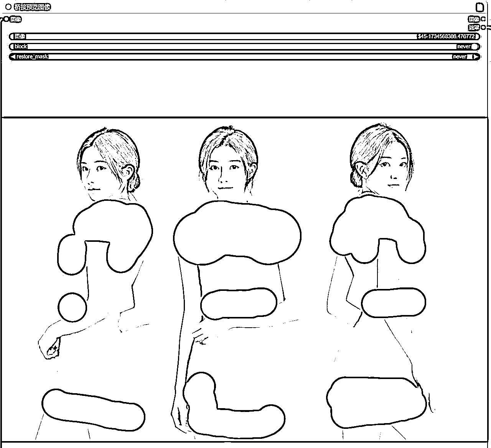

## 2.3 服装迁移

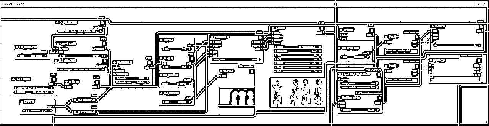

遮罩处理完毕，就可以开启这个模块跑图了。它借助Fill加Redux的能力，能实现衣物的精准移植。对于简单图案的图片，迁移准确率基本能冲到99%，复杂图案也能保持在90%左右，当然实际效果需要不断调参，多抽几次卡就行。

生成迁移结果后，会进行一次裁剪，只保留右侧三视图部分，方便后续执行脸部修复和清晰度增强。

## 2.4 面部细化

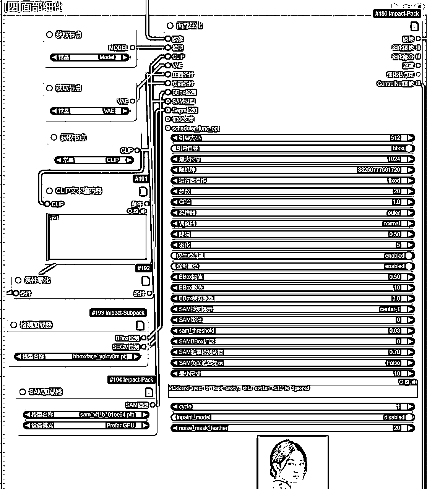

这个模块要不要开，取决于之前的模特脸部表现。如果脸部有瑕疵就启动它，如果看着正常可以直接跳过，这样能省下不少时间。

你也可以在这块做扩展，比如加入Pulid换脸插件，实现自定义人脸替换。

## 2.5 TTP高清放大

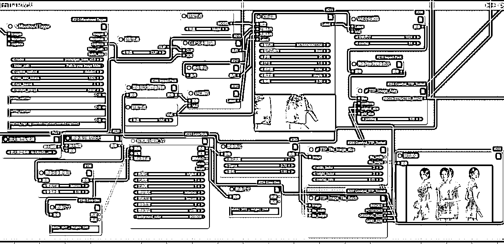

我这里用的是比较常见的TTP放大方案，能把画面直接推到4K级别。如果电脑性能有限，可以适当降低放大倍数，或者换成SD放大、Supir放大等其它方式。

之后我还会专门写一篇放大功能的汇总分享。

## 2.6 裁剪与拼图

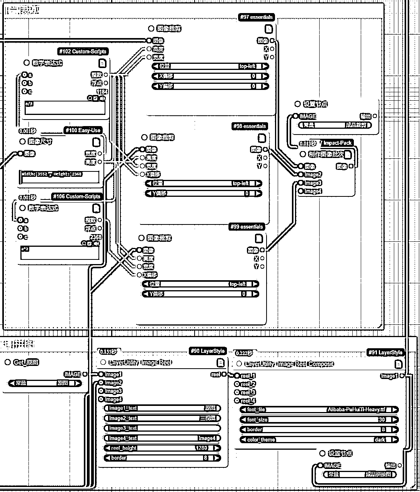

这两个环节算收尾操作了。按照分辨率自动裁剪，三视图就会被拆分成三张独立的图片；拼图则是把原图和生成的三视图水平排列在一起。

# 三、小结

好了，今天就聊到这里。核心思路就是借提示词能力先产出三视图，再去做后续的换装处理。

这种方式的随机性较强，可控性相对弱一些。我测试过几十次，偶尔抽出来的并不是三视图，这时候就得重新抽卡。

下一次我会分享基于姿势图来生成的方法，那种方案的可控性会明显提升。

这次的工作流暂不开放下载。但每个模块的截图都足够清楚，只要有一定基础，跟着搭建就能实现同样的效果。