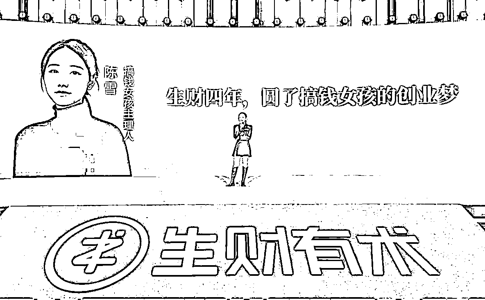
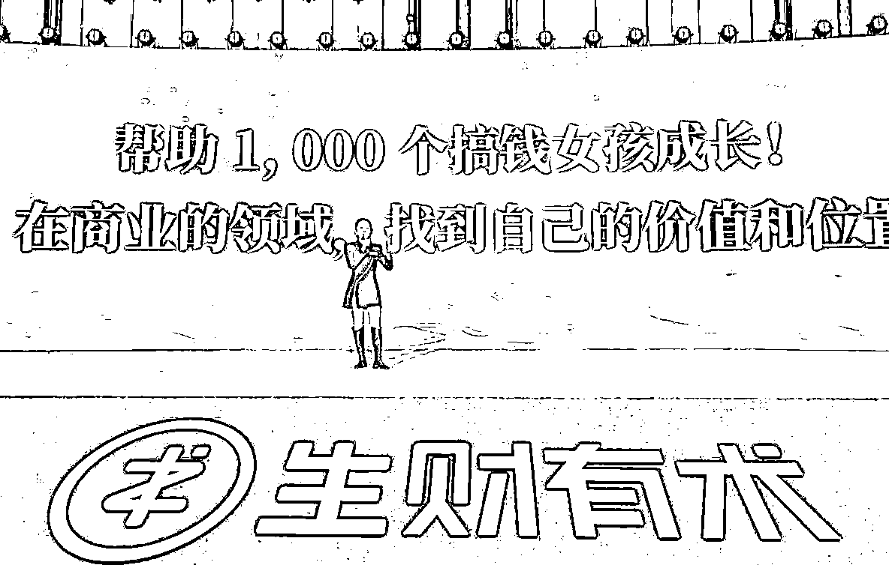
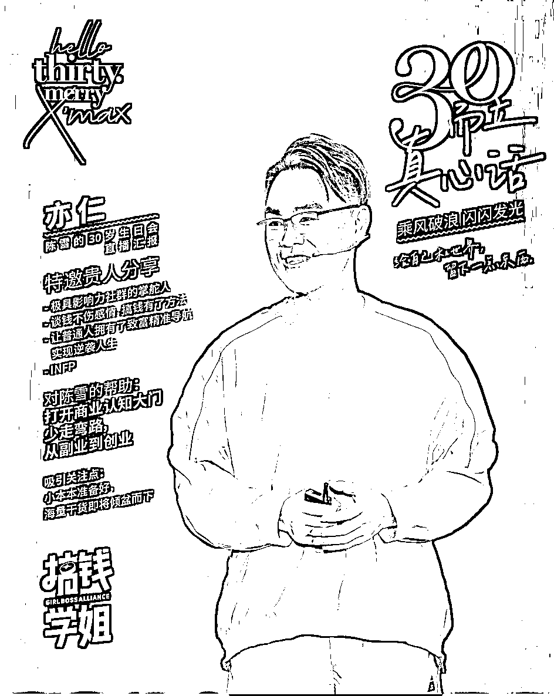
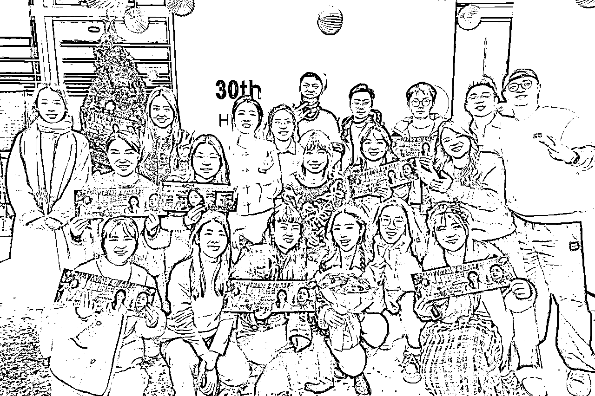
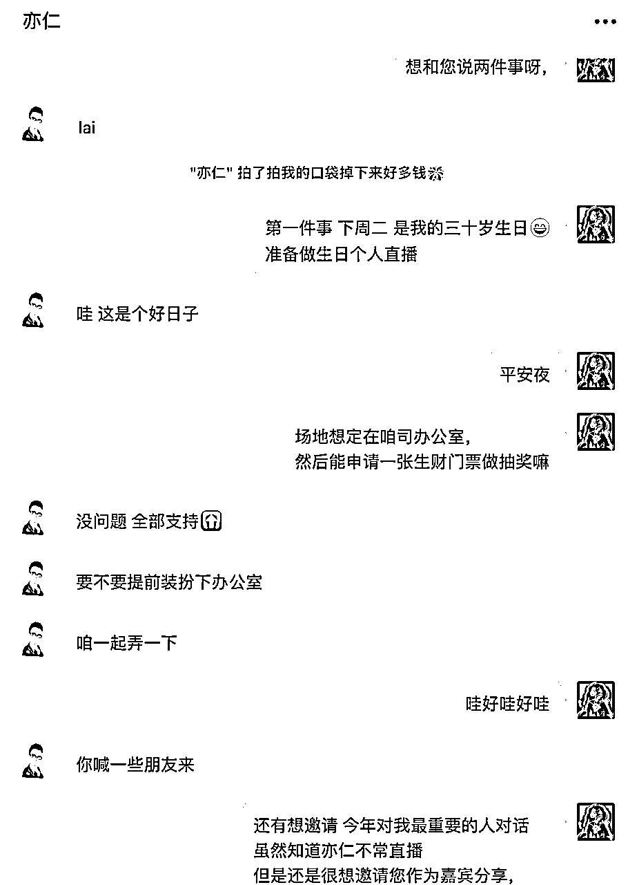

# 如果回到三十岁创业，亦仁会给自己哪些提醒

> 来源：[https://pcuddnfsui.feishu.cn/docx/HxBWdbw8Yowwgjxr0JUcJ8dtn0b](https://pcuddnfsui.feishu.cn/docx/HxBWdbw8Yowwgjxr0JUcJ8dtn0b)

关键词：c 生财 分享 特质 观点 机会 圈子 生态 世界 定位 勇气 视野 年轻人 投资 印象 主义 商业定位 商业价值

大家好，我是生财有术的四年老朋友陈雪，也是「你好航海家」的固定连线嘉宾，播客「搞钱学姐」的档主。

在接触生财之前，我对副业的认知非常狭窄，总觉得只有做内容、做博主一条路，而且我一直没赚到钱。加入生财后，我才亲眼见到各种不同的赚钱样本，对“搞钱”这件事的理解彻底被打开了。

这条路走来也有迷茫期、焦躁期和低落期，个人实力平平，起步也普通，但我一直坚信只要不掉队，机会终会抵达。2022年我选择搬去杭州，因为在我迷路的时候，待在正确的生态里，跟随生财的节奏，总能撞见新的可能性。

四年沉淀，今年三月的千人航海家大会，我成为唯一登台的女性分享者。过去一年，我累计促成超千名用户付费加入生财，让更多女生像我一样建立起对赚钱的清晰认知和路径。

平安夜恰逢我三十岁生日，我做了场直播，并邀请亦仁坐客。我们围绕十个议题展开交流，整理成文字稿约七千字，现与圈友共享。

## 一、回到三十岁创业，他会给自己哪几条自省

亦仁：

人都是在错误里成长的，我自己就是一路踩坑走过来的。假如时光倒流到三十岁，我不会跟自己说要少犯错，犯错本身是必要的，但我会放几个更具体的提示给自己。

第一条，要努力进入一个整体水准都高于自己的社群。

环境决定视野、信息浓度、认知高度和格局。单靠自己闭门造车很难突围，放到一个更好的场域里，会被潜移默化地推动。我会尽力把自己塞进平均值都高于我的圈子。

第二条，敢犯错，但要控制代价。

别让一次失误伤到身体、亏空资金、搞坏关系。世界就是通过不断试错来寻找解法，所以要大胆试，但底线要守住。

第三条，观点要精简，下注要重。

不要囤积大量观点和认知，看到的要坚决投入。只做少数几件事，甚至只做一件事，然后全力all in，拿到最大化结果，而不是东摸西碰。

第四条，多一些感恩心态。

感谢用户、感谢贵人、感谢团队同伴。他们在幕后做的努力，是台前能更快前行的根基。

第五条，把身体健康排到更前面。

我们是在玩一场无限游戏，健康是唯一的硬约束。你能持续多久、能做到多大，都取决于身体。其他东西都能再争取，健康耗损就无法回补。如果有了这些前提，人生就更可以放开去体验了。

亦仁现在的状态越来越好，完全逆生长，说不定能活到一百五。

陈雪：

第一条提醒很戳我，别害怕犯错。我们总想绕开坑，看到亦仁我就想躲，生怕捅娄子。以后就算搞砸了也要大胆承认，跟老板也直接沟通。

还有一个点也很有冲击力，要工作到老。听着很残酷，但梁宁老师最近一直在讲建立能活到一百二十岁的认知。

亦仁：

我已经按能活到一百五十岁来做规划了，哈哈，很认真。

我们这一代或许真的有很大概率长寿，AI的发展会重塑寿命预期。以前觉得八九十岁就不错，现在要重新算账。八十岁才算中年，三十四十岁才刚起步，说退休还早得很。

陈雪：

我之前一直有执念，想三十八岁退休、六十岁躺平，觉得健康、颜值、精力到时候都会下滑。这种心态会让人做事很急，拿到一个结果就想收手。现在想通了，人可能要活到一百二十岁，所有选择都会在未来兑现，每件事都有很长的窗口期。

亦仁：

这个时代焦虑感很强，但人生本身就是体验。焦虑、崩溃、糟糕的状态也是一种体验。接纳全部的自己，从经历里提炼价值，很多片段会在某个节点连起来，成为上天给你的礼物。这句话送给大家。

## 二、为什么他会说“什么拯救了你，就拿什么去拯救别人”

亦仁：

大学时期我就是靠拼命赚钱活下来的，家庭条件一般，所以特别能理解生财圈友的那种状态。我没有圈子，只能在网上疯狂找方法、聊项目，慢慢练出了从海量信息里判断项目能否变现的能力。这项能力拯救了我，让生活变好，也让自己更自信。

2017年我就想过，把拯救我的东西拿出来分享，它一定能帮助更多和我一样的人。这句话的来路就是这样的。

## 三、他心目中值得扶持的年轻人具备什么特质

亦仁：

我比较欣赏的年轻人有几点。

首先是开放程度高。自我防卫低，愿意认真倾听，能读懂对方的意图，还会回去深入研究。真正厉害的人都能从正向和负向反馈里吸收养分。

第二是愿意为自己的判断下注。这世界不缺观点，缺的是能用时间和行动去兑现观点的人，能以更长周期看问题。

第三是长期主义。不会被短期利益带偏，能判断什么才是真正重要的，愿意用当下的牺牲换取未来的价值。

第四是懂得感恩。成功后不觉得全靠自己，会记住贵人、用户、员工的付出。不懂得感恩的人容易被反噬，持续感恩的人才会越走越稳。

## 四、听不懂该怎么办

亦仁：

现在有了AI，几乎没有真正听不懂的问题。两个人交流时没立刻同频很正常，回去让AI拆解一下就能明白。真正卡住的往往不是理解力，而是自我保护的ego在作怪，怕承认不懂，怕显得很挫。

听不懂就问，我很乐意展开讲。开放度高的人会把不同的观点当成礼物。我最近在学投资，加了一些投资群，大佬的话我很多都听不懂，每次都觉得开心，因为那是成长点。拿去问AI，解释得比大佬还清楚。关键是，你内心是不是真的想懂，想拿到这个机会。

陈雪：也就是是否真心想把机会变成自己的，然后去弄懂它。

# 亦仁眼中的陈雪

## 一、他眼中的陈雪是什么样，四年有何变化

亦仁：

第一印象是接地气。最初认识的是黄牛党的陈雪，很实在很落地。

第二印象是有质感，这两个词很冲突，却又自然地体现在她身上。内容有质感，视觉也有质感，很统一。

第三个词是有勇气。台上分享能听出来她做过很多走出舒适区的决定，这需要很大的勇气，很少人能持续突破自己的表达边界。

在我看来，她的变化是定位在进化。从“搞钱女孩”到“想带着一千个女生一起搞钱”，身份的升级背后是使命感和愿景在成型，这很棒。

陈雪：

新版的爱搞钱女孩三标签：勇气、质感、接地气，记下来。

## 二、生财与陈雪的默契点

亦仁：

先感谢一下榜一大哥。

陈雪和生财的共同点是都来自草根，包括我和很多圈友。我们都有超越草根的渴望，想赚钱，但不止于赚钱。我们追求的是超越利润的价值感。这也是我们能聚在一起的原因。

## 三、陈雪可以被复制吗

亦仁：

陈雪这个人是不可复制的。能站在这个位置，是时机、机缘、资源共同作用的结果。让我回到原点再做生财，也到不了现在这个高度。

但IP的逻辑是可以复制的。把自己活出来、真实表达、在过程中找到能帮到别人的商业模式，这条路人人可走。世界需要更多人站出来表达、做事，引领别人前行。IP不一定是特别优秀的人，只要愿意站出来、带着人一起走，就能被认可、被追随。现在情绪普遍低落，更需要这样的人。陈雪本人不可复制，但IP路径完全可以复制。

## 四、如何把陈雪放大

亦仁：

放大就是让更多人通过她找到商业定位。商业定位本质是想清楚你要帮助谁。

每个人都能帮到别人，每个人的优势、甚至短板都能成为帮助别人的起点。比如INFP特质，我一直觉得是缺点，后来才发现它带来极强的共情和理解力，能做出更贴合用户的事。

如果陈雪能找到一千个人，帮助她们认清优势、敢于表达、敢于去帮别人，就等于把自己放大了一百倍。不一定是一百倍，但一百个愿意帮助别人的人就足以形成生态。

## 五、实现“帮助一千个女孩”的建议

亦仁：

定位是战略选择，要先选清楚自己能帮什么人、优势在哪。

第一步，做出一套可复制的方法论，让她们能跟着走，真正找到自己的商业价值。

第二步，让一部分人跑起来。一千人里有一百人跑快一点，有十人跑得特别快，他们会成为样本。人们是因为看见才相信，看见身边的人真的做起来了，才愿意投入时间，获得正反馈，然后继续走下去。生财航海的逻辑也是先让一批人跑出成绩，形成示范。

陈雪：先有方法，再让一部分人先富起来。

亦仁：对，先富带动后富。

## 彩蛋：陈雪如何把亦仁请来直播

陈雪：亦仁几乎不直播，但他竟然答应了我的邀请。

亦仁：惊喜吗？

陈雪：太惊喜了。圈里人说四一八他都没直播过，我生日他竟然来了。

我先问他能不能借生财场地做生日直播，能不能送我一张门票，他说当然支持。然后我鼓起勇气问能不能请他当嘉宾，那边沉默了很久。我知道INFP会纠结，但我做好了被拒绝的准备。反正我也就在起点，再坏也坏不到哪去。结果我赚到了。

亦仁：这个世界永远奖励主动的人。

陈雪：我把这个过程分享给大家。想链接更高能量的人，就主动去，且把理由讲清楚、把时间边界拿捏好。被拒绝也没损失，本来就在起点。

大家看完有启发、有收获就行。

