# 一个普通人👸号日更1000天的写作方法论

大家好，我是龙哥。曾是程序员，现全职自由两年多，目前主攻「1对1脱单陪跑」，陪你开启甜甜的恋爱。

今天聊聊我在👸号连续日更1000天的实践复盘。

坦白说写这篇我纠结过，最近账号流量有点低迷，数据不理想。后来想通了，我已经写了1000多天，阅读起伏不是第一次，流量回落只是长期创作里必然会遇到的一环，解法一定存在，只是我还没寻到。况且自己也算有点小成果，或许能给正在摸索的朋友一点参考。以下内容仅供参考，不构成决策建议。

1000多篇里，阅读破万的有85篇，其中4篇10万+。凭借这些文字，我从一个沉默的大龄码农，零基础切入情感领域，现在月流水三万。转行的详细过程我此前写过，这里不再展开。

当前流量下滑，我把它看成持续写作过程中必须解决的课题，并非绝路。

# 目录

# 一、为什么要日更，以及不同阶段的目标变化

我从2022年3月7日开始在👸号日更，至今已超1000天。

**起步阶段的目标**
起初有两个推力：报完一门写作课，老师建议坚持日更；想把荒废的写作习惯捡回来，上一次👸号发文还是2020年6月3日，空了近两年。
日更到100天时，我结束八年北漂，回晋回到太原，和妻子结束异地。表面原因是公司裁员，深层原因是早已想离开北京换种生活，被裁后我没在北京找工作。如今回看，裁员是转机的起点，若没有这次被动选择，也未必会开启自由职业。也感谢文字帮我记录下这段心路。

**100天后的目标**
不再上班后时间充裕，需要一个每天必须完成的事来保持自律。写作成了锚点。其次，我想借写作探索边界，除了写代码还能做什么。当时写过：接下来继续保持每日更新。《刻意学习》提到N阶行动者：能坚持10天算有体会；100天能改几个习惯；1000天能把人生整体抬升一个层级；10000天约30年，能接近一个时代的尺度。持续积累，小则在时代中立足，大则能改变格局。

**200天后的目标**
希望把零散内容沉淀为系列。后来做出三个小报童专栏：《印象笔记使用指北：让无序的生活变得有序》《感恩日记书写指南：心怀感恩，幸福常伴》《高效脱单经验书》，其中《高效脱单经验书》销量最好，约卖出400多份。李笑来提到三种个人商业形态：一次卖一次、一次卖多次、把别人的时间买来再卖。我这几个专栏属于第二种——同一份内容多次变现。

**300天后的体悟**
到300天左右，我把日更的意义拆成三段：
第一段是加法期，无定位，合法范围内容皆可写。核心是克服写作恐惧，训练把事想清楚说明白的能力。
第二段是减法期，收敛主题，形成明确定位，能产出专栏或课程。关键是不贪心。
第三段是乘法期，写作力×其它能力。写作力是核心竞争力，即他人短期难以复制的能力或资源。

**400天后的转向**
约400天时，有朋友找我咨询情感，结束后给我发了666元红包。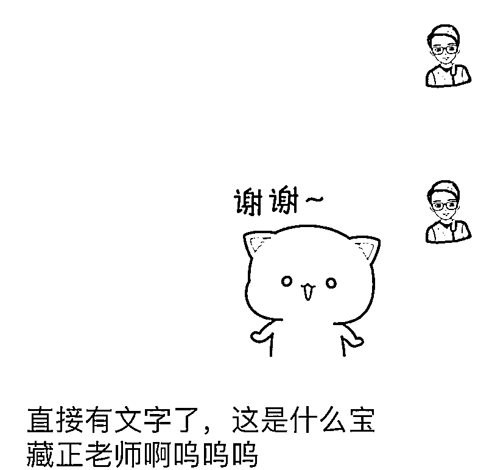
平时咨询多为几十到两百元，666元对我而言是异常值，我主动提出做一个「情感修炼手册」帮助他脱单。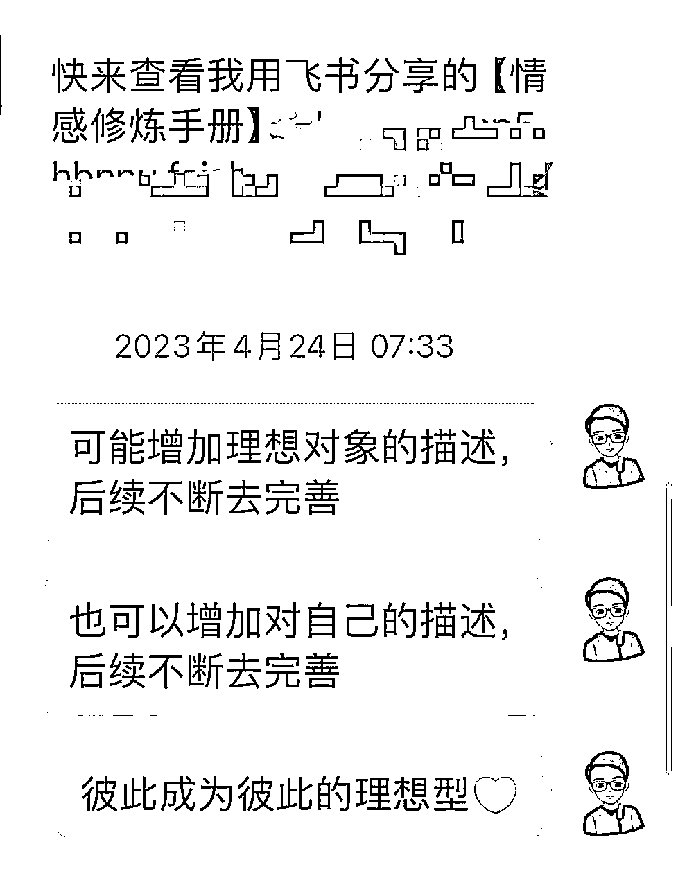
在这个过程中我逐渐感觉到自己或许擅长陪伴他人脱单，尽管外表木讷，这可能是我未被发现的天赋。意识到后，我用了几个月学了两门恋爱课程，读了几十本相关书籍。书单我放在了🛰️读书，搜索「脱单相亲找对象」即可查看，目前收藏者超百人。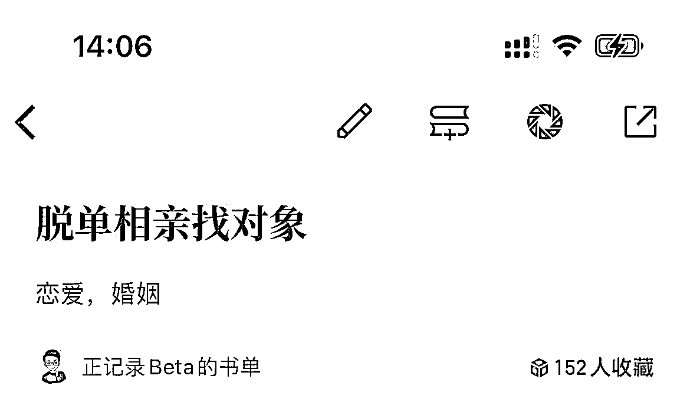

**500多天后的使命**
500多天时我实现了月入三万，也产生过“此后可永久不工作”的想法。随后我的日更目标升级为：助人脱单是我的人生使命。为这个使命付出时，我感受到的是快乐而非消耗。我把这句话写入写作模板开头，每次动笔前用肯定的语气自读一遍。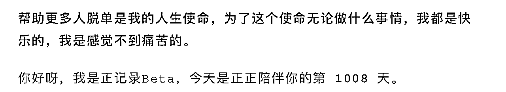
泰勒·本-沙哈尔在《幸福的方法》里说，人对工作的态度有任务、职业、使命三种。视工作为使命的人，工作本身即是目的。薪水重要，但源动力是热爱。你也可以做个小练习：用“只要持续写作，…”造句，看看能延伸出多少可能。譬如只要持续写作，我就能保持开心；只要持续写作，我就能实现财务自由；只要持续写作，我也许能再出10万+……

# 二、普通人可用的日更写作系统，稳定输出1000天

想长期不中断，最忌只靠意志力。意志力只能撑一会儿，多数人100天左右就会放弃。更靠谱的是搭建系统。系统不是堆砌工具，而是各环节强关联。房子由砖构成，但砖堆不起来房子，还需要水泥钢筋和图纸。写作亦然，信息堆砌不等于文章，必须加工、组织成结构。

**1. 信息输入**
写作分有定位和无定位两类。

无定位时，我的做法是每天记录“今日收获”。读了什么书、碰到什么问题、情绪有怎样波动、见了谁、有何启发。实在没收获就写为何没收获，做反思避免重蹈。核心是提升信息敏感度——看到一个事物能联想到哪些关键词和可写角度。看到花，有人想到春天，有人想到少女，有人想到爱情。写久了，敏感度提升，定位会自然浮现。普通人的定位多不是想出来的，而是写出来的。万维钢在《精英日课》说，好的东西往往是做对事的副产品。持续公开写作就是做对的事，转行赚钱是副产品。即便没有副产品，持续写作也能带来更深的思考力和更优质的人脉。

有了定位后，易陷入无题可写的困境。三个选题思路可参考。

关键词替换法。先梳理与定位相关的关键词。我做脱单陪跑，词库有：脱单、单身、相亲、恋爱、母胎单身、相亲对象等。再看常出10万+的👸号一个月内的标题，做关键词替换。比如深圳卫健委的“身上有这几个缺点，我劝你别改！”可变为“相亲对象身上有这几个缺点，我劝你快跑！”另一例“有一类花生，千万别吃”可变为“有一类相亲对象，千万别接触”。核心是借鉴头部账号的标题框架，它们更懂流量。

知乎选题法。有定位后可同步分发到知乎。知乎支持👸号文章自动同步。网页端登录后进入创作中心-账号关联开启同步；手机端“我的-创作中心-更多功能-账号管理”也可设置。同步后会收到回答邀请。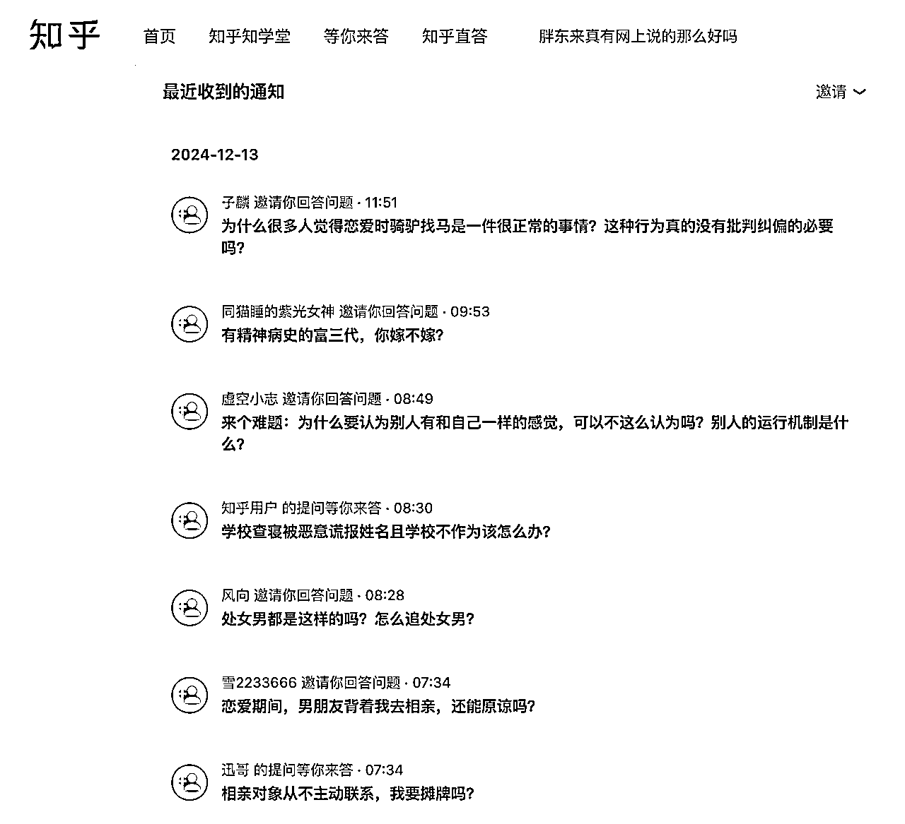建议挑浏览量上万、回答数低于百的问题。比如“相亲对象从不主动联系，我要摊牌吗？”浏览量数十万，回答仅66个。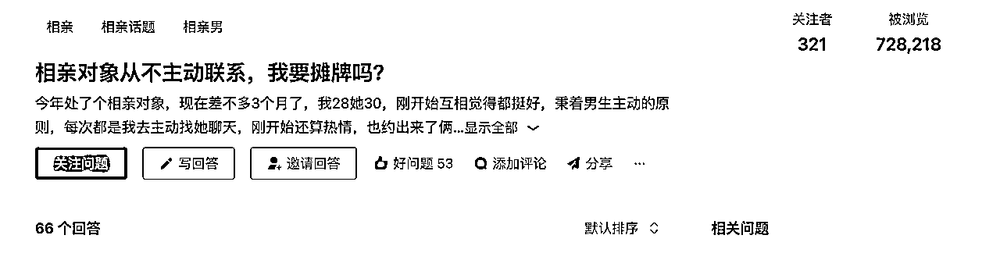

评论区选题。评论是内容的一部分。每周末我会回看一周读者评论，挖掘可延展的话题。也可逛同行评论区，阅读相关书籍，咨询类服务可把案例脱敏后加工成文。能力提升后，几乎每条经过你大脑的信息都能变成素材。

选题需要归档。我电脑里有“待写话题”文件夹，灵感来时即刻记下。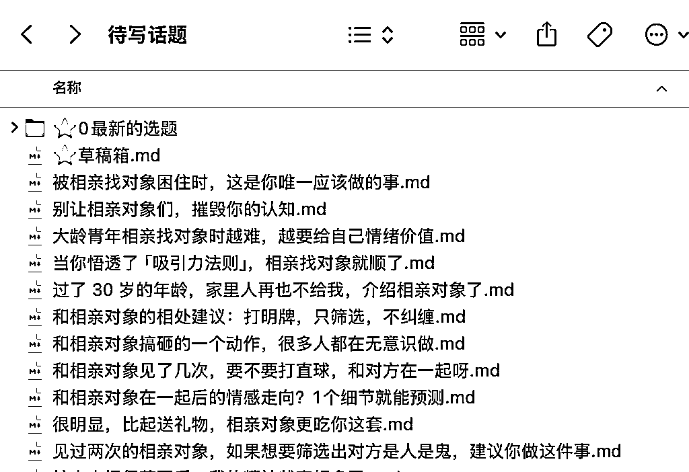也可用flomo等笔记工具，打上写作话题标签，写完即删。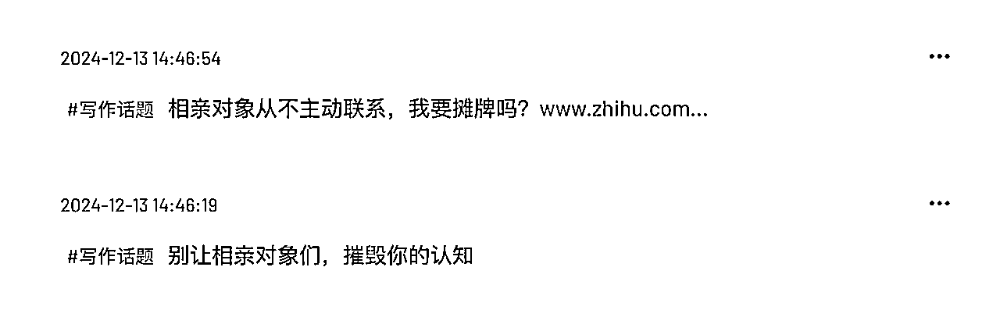

**2. 信息加工**
很多人先写完再起标题，常常花一小时写文，一分钟定题。经验上，阅读不佳多因标题不佳；少数情况是标题尚可但被大新闻抢走流量。圈内常说：10万+差一个爆款选题，文章成爆款80%靠选题。所以加工第一步是把选题打磨成合格标题。

我现在借助AI工具Claude。流程如下：
1. 把过往阅读过万的标题全部列出，让AI归纳共性。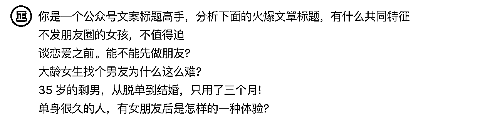
2. 让AI把共性提炼成可复用的爆款标题公式。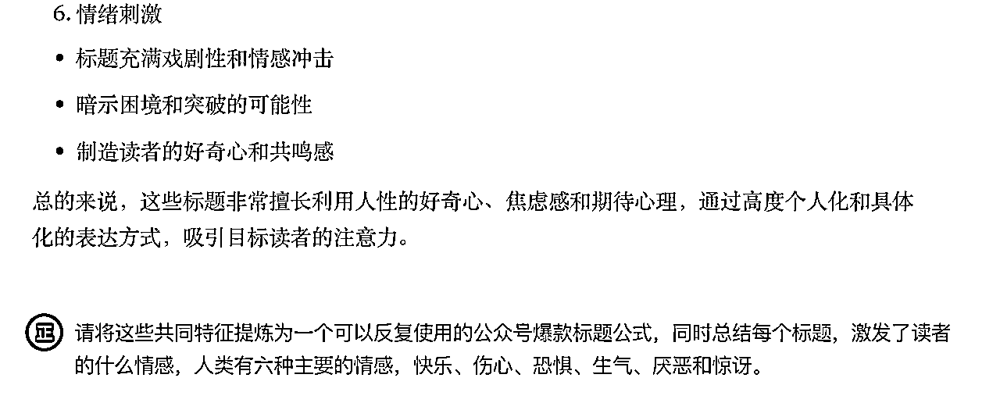
3. 用公式优化新标题。

举例，话题“相亲对象从不主动联系，我要摊牌吗？”经优化，AI推荐版本为“28岁的我，相亲对象从不主动联系，竟然因为这个致命原因！”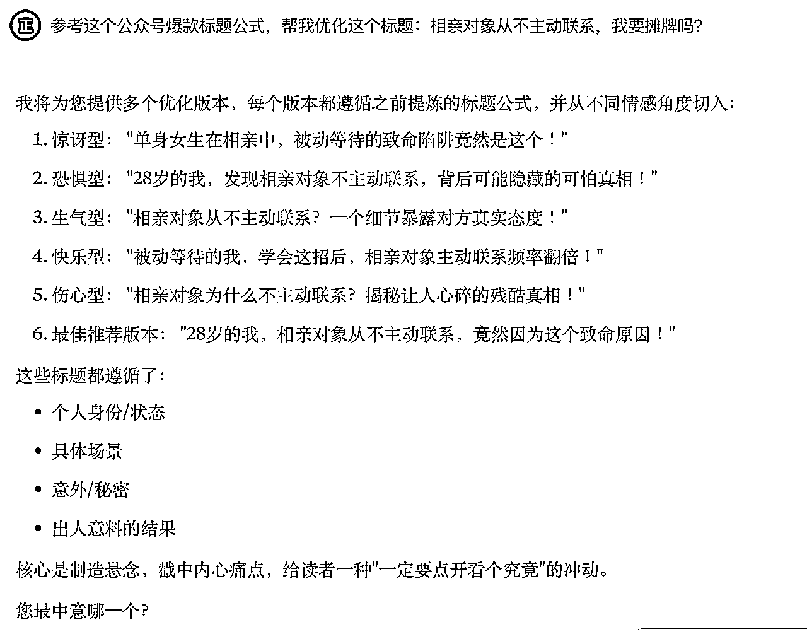我微调为“28岁相亲多次，相亲对象从来不主动联系我，竟然因为这个细节！”这个细节来自《魔鬼约会学》里“吃相毁帅哥”的案例：学员吃饭几乎把脸埋进碗里，天灵盖对着人，左手像鹰爪掐碗，右手狂舞筷子，边嚼边抬头看人……形象堪比猪拱食。

标题确定后，围绕它列关键词和问题。如主动与被动的区别、什么情况下该主动、细节如何被发现、相亲注意事项、核心择偶标准、主动联系几次无回应是否该止损等。想不出来可让Kimi等工具帮忙列。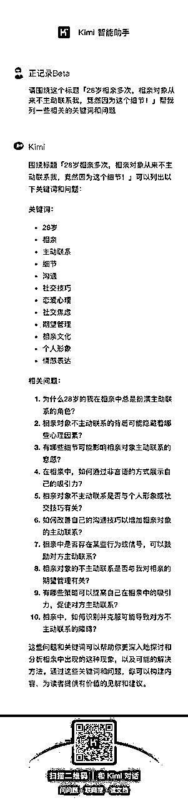也可用flomo的找一找功能检索个人笔记，快速提取关联点。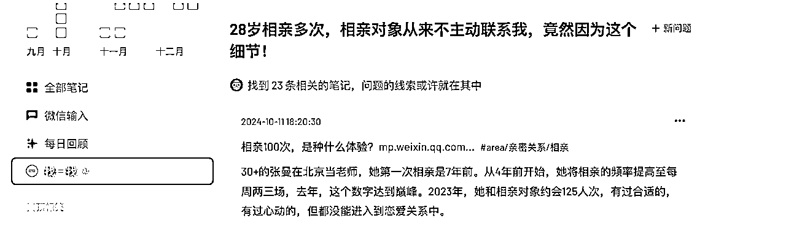可持续用AI搜索，直到素材足够支撑一篇文章。

**3. 信息输出**
加工完要动笔。先定框架。实在没灵感就用清单体，别追求复杂结构，越复杂越难坚持。清单体即罗列要点，如《年入百万的十个方法》，写起来顺畅。用户时间有限，没空拆解复杂逻辑。“得到”APP的锦囊里清单体很多。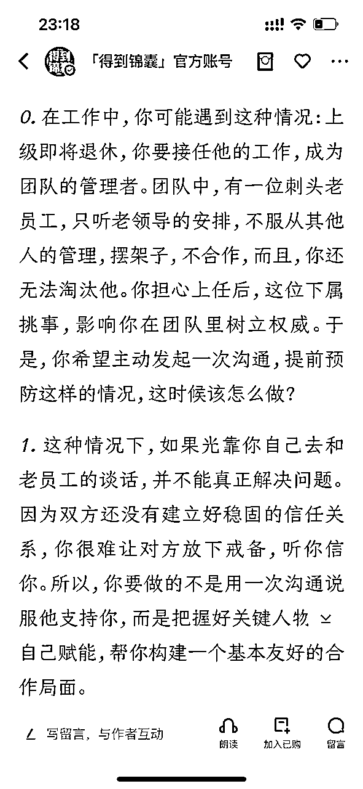

定好框架就起草。我过去讨厌打草稿，因信息堆砌总反复改动，最后放弃。后来改用语音写作，用Get笔记APP直接口述成文字。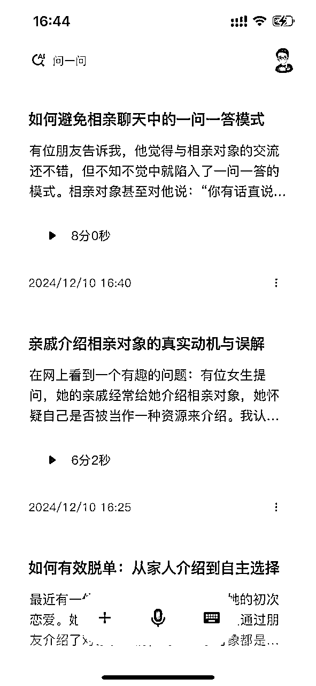先把初稿说出来，再慢慢润色。

以上就是我日更1000天的底层方法。写作靠的不是硬撑，而是建立可运转的系统，系统跑起来，普通人也能持续产出并打开可能性。

我现在的写作流程已经跑顺了，核心就是先说后写。

拿着「Get笔记」开口讲七八分钟，下来就能拿到大约一千字左右的初稿。有了这份口述草稿，再到电脑上做二次加工和精修，整个👸号的创作压力明显小了。

口述和手指敲键盘的感觉完全不一样。说的时候，脑子里沉淀的东西会被主动调出来，联想会一串串地冒出来。相反，手放在键盘上写作时，我总是不自觉地想去检索资料，而不是先用自己已经知道的去组织思路。时间就这么被搜资料耗掉了。

选「Get笔记」很重要的一个点是，它在把语音转成文字之后会帮我做一次润色，减少了后续自己改动的量。

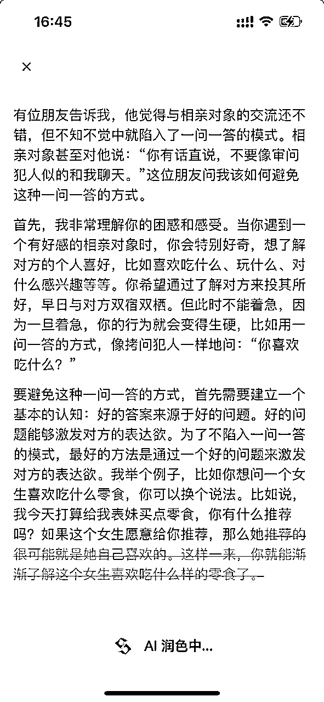

进入到修改环节，我主要做两件事：一是把骨架和逻辑顺一遍，让文章通顺；二是给关键位置补上金句或比喻，让阅读更有亮点。

比喻的部分我会让 AI 来试。比如我会让 Kimi 对这段话做比喻处理：

一个简单的问题，你愿不愿意离开你所在的这个小城市，去更大的城市发展呢？

如果你都不愿意离开，你所在的这个小城市，不愿意跳出自己的舒适区，要真正的提升自己，那太难了。

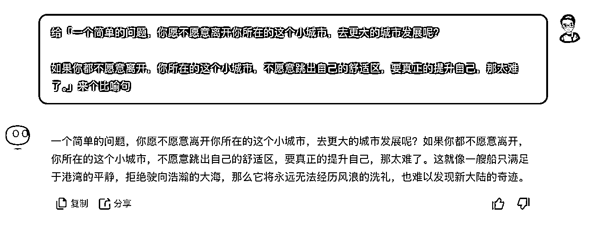

开头和结尾的情绪价值也很关键。同样用 Kimi 来做收尾加持：

在成年人的恋爱关系中「人际距离」是一个重要的考量，

你和异性朋友之间的「人际距离」通常保持在 0.5米 以外，那你试着想想你和男朋友的「人际距离」应该是多少呢？

我的文章结尾，请你根据这个内容，给文章增加一句（最好是金句），有情绪价值的结尾，增加读者转发和评论的概率。

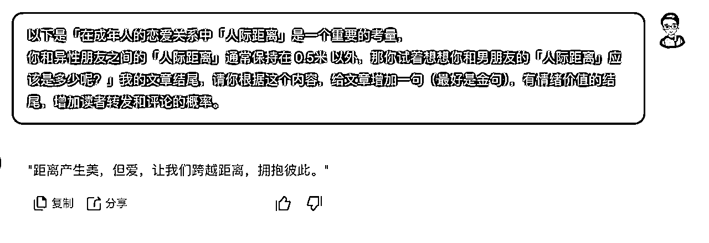

打磨完文字就要排版上线。我个人在用 Typora(https://typora.io/)，用最基础的标记语法就能快速成型。

比如连续三个###就是一个标题层级。

再比如成对的双**号，就可以把文字加粗处理。

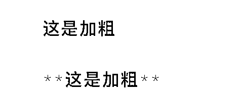

排完版后，直接导出 html，复制到👸号后台粘贴即可完成发布。

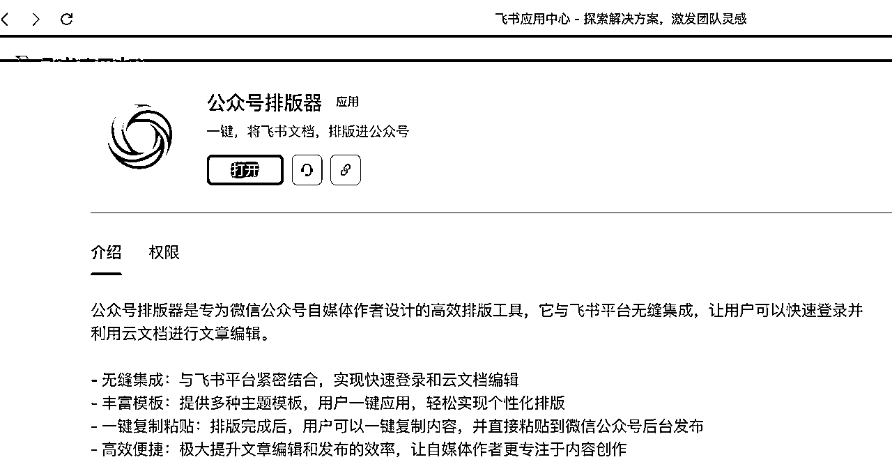

排版没有唯一标准，挑自己顺手的来用就行。

## 第四：写作系统之：文章管理

要把写作效率做上去，就得让旧文章能被复用。于是历史稿件的管理就变得重要。

比如我想查「如何快速脱单」这个话题，我过去写过什么观点。可以用「腾讯元宝」https://yuanbao.tencent.com/搭一个专属智能体，把知识库指向👸号的历史文章，让它帮我检索。

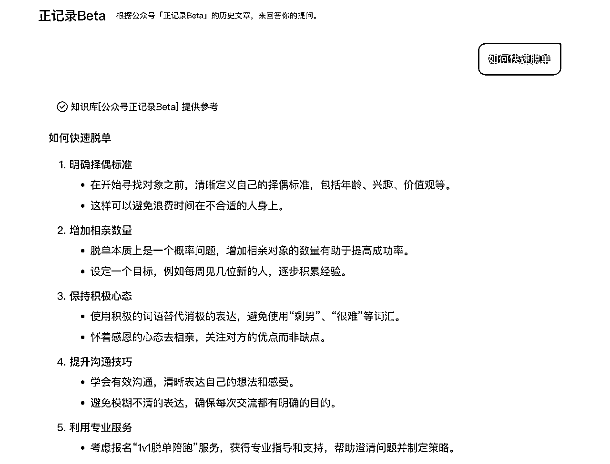

也可以用「智谱清言」 https://chatglm.cn/ 来对接👸号数据做搜索。

至于本地检索，我以前靠「印象笔记」APP 找过去的👸号稿。我日更已经超过 1000 天，单本笔记里超过 1000 条，搜索时卡得不行。

后来我把本地备份的 markdown 文章导入到 Obsidian 软件 https://obsidian.md/ ，检索速度快很多，写新稿时引用旧稿也很方便。ps： Obsidian 默认就是 markdown 格式。

比如我要写「归属感」相关的东西，直接在 Obsidian 里搜「归属感」，就能把所有相关旧文揪出来。

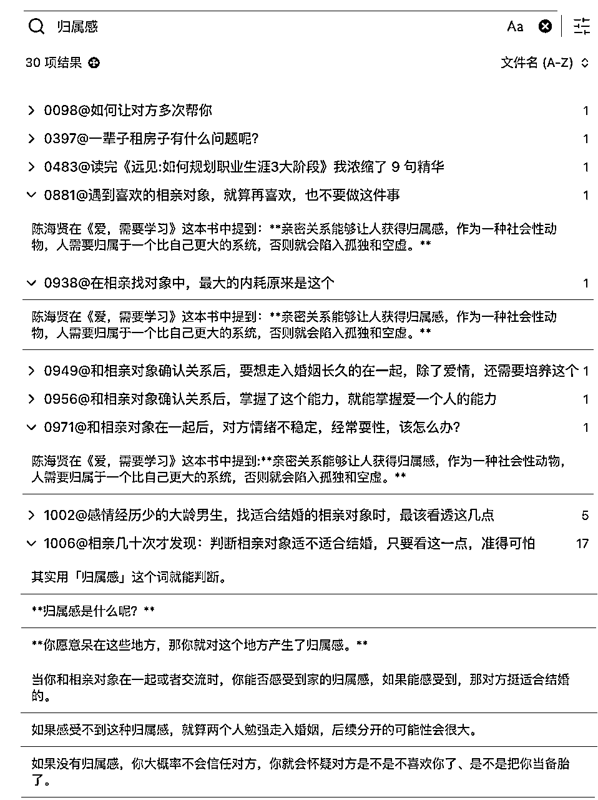

说到历史文章，我坚持一个备份思路。重要数据用 3-2-1 策略：

先保证有三份拷贝；

这三份要放在两种不同介质上，别全堆在一台电脑或一个硬盘里；

最后要有一份放在异地，比如云端。

我的稿件都同步到 GitHub https://github.com/ 上，也可以用坚果云 https://www.jianguoyun.com/ 这类云同步工具。

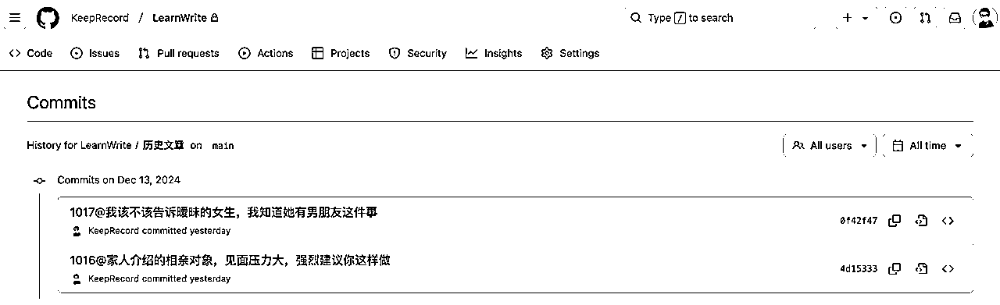

## 第五：日更系统之：时间管理

讲了这么多，时间管理才是地基。我主要靠「滴答清单」做循环任务来管写作节奏。

第一个循环任务是：每天最多写两篇日更。

界面上会显示还剩几个小时的红色提醒，比如 9 小时，意思是我今天的任务还没完成，已经拖了九个小时。

名字里特意用了「每天」和「最多」，是有道理的。「最多」包含零，就算今天不写不更，也算完成目标。我要的是系统能长期运转，不是靠一次爆破。

长期来看，每天做到一件事太难了，你能保证每天都睡觉吗？把要求写成「必须每天」「至少」，压力会失控，心情不好就更不想碰，最后很容易彻底躺平。

所以要做备份。《巨人的工具》里说的 2=1、1=0，就是要有备胎。如果只有一份稿，丢了就麻烦。没有备份的话，今天写就今天发，一旦当天没写完，脑子里会一直挂着这件事，什么都做不好。

凯文·凯利在《宝贵的人生建议》里也提到，把「创造」和「改进」拆开。不要边写边改，边雕边琢磨。编辑会扼杀创造力。

我的做法是：写新稿前先把前一天的稿改完发出去，进入状态后再起草新内容。

第二个循环任务是：每两周做一次选题，集中阅读和收集话题。

有时候对着电脑发呆半小时也想不出写什么，就是因为没有选题池，都是临时想临时写。

我每两周按固定的选题方法梳理一次。写的时候从池子里挑一个最想写的主题，兴趣会带动效率。

第三个循环任务是：每周复盘一次过去的文章，看异常值。

复盘的点很多。比如哪篇写的时候最顺最有心流，长期看能找到自己的定位和网感。

再比如阅读量高的文章，是标题赢了，还是配图赢了；阅读量低的，是选题不行，标题不行，还是关键词没选好。

另外一个和写作无关的时间管理小工具，为了防止长时间盯屏，我在 Mac 上装了 Eye Monitor，直接在 App Store 搜就能下。它会定期让屏幕变灰，强制我休息。比如写这篇文章时就会弹出提醒。

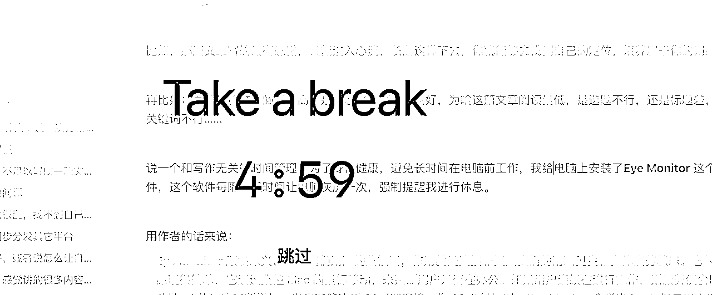

用作者自己的话说：

Eye Monitor 就是用眼的监视器，用来监控用眼卫生和身体疲劳。原理很简单，它通过监控鼠标移动判断你是否在工作。连续操作，疲劳值每分钟加 1，达到 60 分钟就会推送提醒；一分钟内无操作，疲劳值每分钟减 6。

我用它写东西时几乎感觉不到时间流逝，只有提醒响了才停下来，比番茄钟那种明晃晃的倒计时要舒服。

Windows 用户可以用类似的 Project Eye https://github.com/Planshit/ProjectEye

# 3.日更写作可能遭遇的 N 种挑战及解决方案

有人问我日更 1000 多天，有没有想过放弃。无数次想过。每次想放弃时，我都把它当成一个问题去拆，原因是什么，能怎么优化。找到思路就能继续。备稿的存在就给了我处理问题的空间。

## 第一：写作习惯与技巧提升

第一，如何把写作变成习惯。

可以先用语音写作，把日常冒出来的想法随时录下来。我以前不敢做视频直播，怕没话说口齿不清。系统用语音写作一段时间后，表达明显变好，后来也上了几次视频号直播。

判断习惯是否养成，有个简单标准：「不做就不舒服，做了才舒服」。比如连续两天不刷牙会难受，连续两个月不刷牙就不会难受了，习惯已经固化。

英国小说家毛姆说「写作是一个很容易培养并且很难破除的习惯」。

第二，想法很多但不够成一篇，该怎么留存。

直接扔到 flomo APP 里写，暂时不打标签。之后可以定期从「无标签」筛选里挑一条发到即刻、朋友圈去。

不打标签的原因是 flomo 有「无标签」筛选功能，方便快速捞出这些碎片。

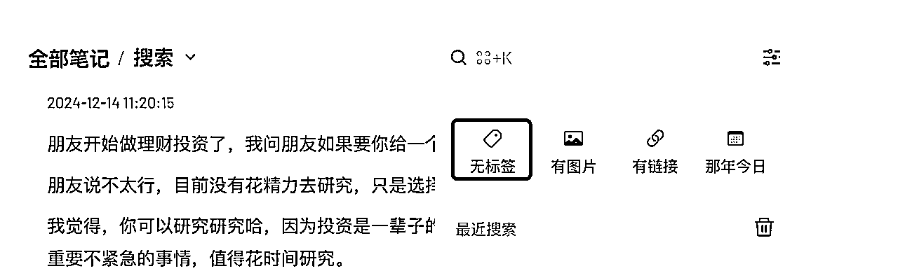

第三，什么时候灵感更好，怎么保持。

我现在是自由职业，写作时间不固定，多在早上。写之前我会先闭目养神几分钟，眯一会儿后状态会明显好很多。

洗澡时也特别容易发散，脑子里想法一个接一个。因为浴室信息输入少，大脑会自动开始自娱自乐。

有研究在澳洲访谈了 1000 多人，发现最容易有灵感的 8 个场景是：深夜、工作时、在家、安静时、通勤时、运动时、在大自然、洗澡时。其中洗澡的比例是 30%，仅次于工作和深夜。

第四，日更从多少字开始合适。

建议控制在 300 字以内。🛰️👸号 300 字以上才可申请原创，长文门槛就满足了。

另外，启动时容易用力过猛，觉得要出成绩就得付出超常努力，结果半路死掉。给自己设上限更容易找到节奏。先习惯 300 字，再慢慢拉到 500、1000、甚至 3000。

## 第二：内容创作与个人定位

第一，日更内容很乱找不到定位怎么办。

可以尽快开启随喜咨询。不限定主题和时长，结束后对方觉得值多少就付多少。

你不是单打独斗的，你是和无数人多次碰撞的结果。用未知去探未知。你也不知道对方会来问什么。我的「脱单陪跑」服务，就是一次随喜咨询后长出来的。

第二，日更内容要不要分发到其他平台。

帅健翔在《优势成长》里说，读完一篇文章问自己三个问题：我学到了什么？我怎么用？我怎么帮别人用。

你要不要把稿子分发出去，就问自己：这篇文章对别人有帮助吗？有帮助就分发，帮的人越多，回馈越多。没帮助就不发。

我用的同步工具是「爱贝壳内容同步助手」，是 Chrome/Edge 的浏览器扩展，可以一键把动态、图片、文章、视频分发到全网。

第三，怎么做到引经据典，快速找到出处。

读书时把有触动的笔记存进 flomo，写稿时脑子里一闪，就去 flomo 里找。另一种情况是，读书时遇到好段落就记下来，顺带想想它能支撑写哪篇文章。

## 第三：心理调整与情绪管理

第一，日更的孤独感。

长时间坚持一件事确实孤独。两个解法：找榜样，加入小圈子。

我决定日更十年的契机是看到罗振宇每天一段 60 秒语音做了十年。所以现在每天在得到 APP 看《罗胖60秒·十年合集》，这是我的标杆。

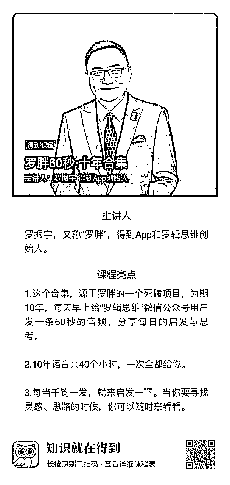

再就是加入日更群。我加过一个以 100 天为周期的群，有一期 28 个人，最后 14 个退出。规则是：一天不更新不接龙，就发 100 元红包；中途退出，要给群里每个人的👸号打赏 100 元。现在群里还剩十几个人，有好几个日更超 1000 天了。

第二，今天实在没东西写怎么办。

把历史里有价值、阅读还不错的文章重发一遍。比如👸号「辉哥奇谭」就这么操作。

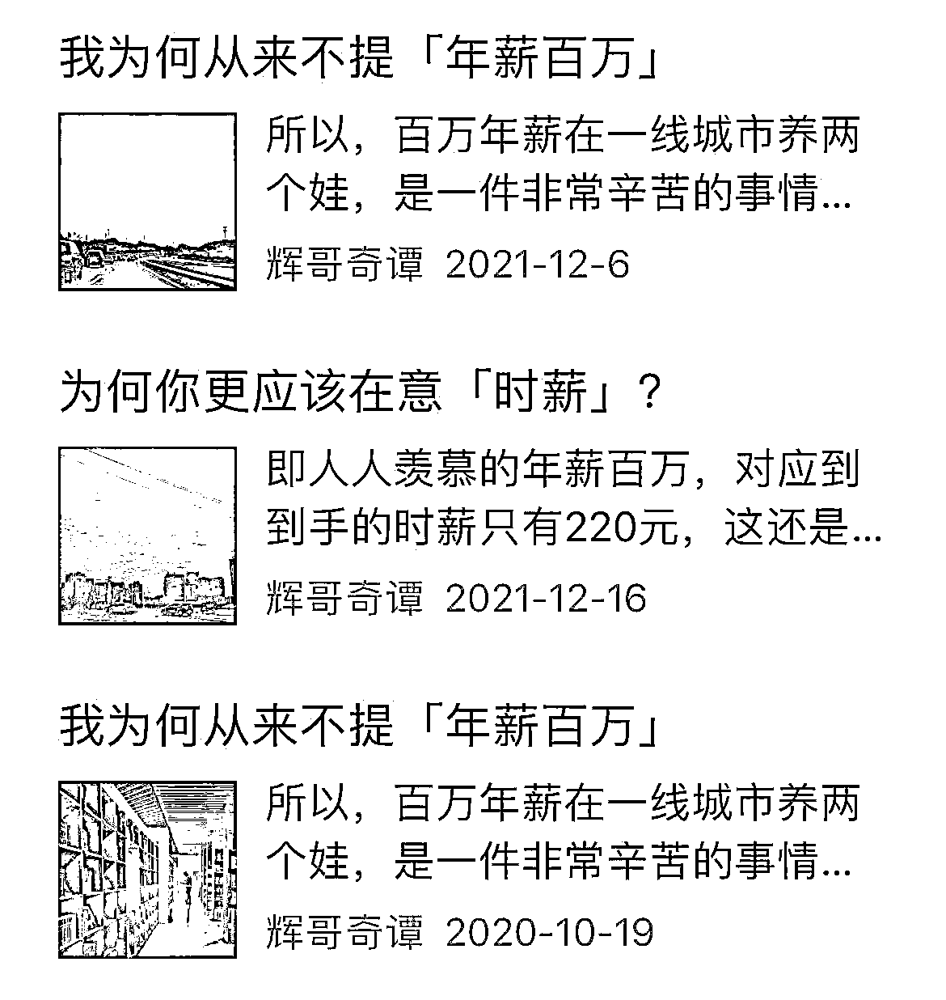

好处有两个：好内容能被更多人看到；系统可以有容错，允许偶尔复用旧稿。

第三，面对批评和失败的心态。

公开表达难免被批。我会安慰自己，我写的是文章，不是批我个人。而且公开表达的好处远大于坏处，批评有时候反而能带来收益。

有情绪就发泄。作家冯唐问朋友一天怎么安排，朋友说「两小时读书写作，六小时妒忌别人，包括妒忌你」。

第四，写作倦怠期。

倦怠期本质是输入被消耗完了，老本吃完了还在原地打转。

久石让在《感动，如此创造》里说：我所谓的倦怠期，其实是原来输入的内容被消耗的差不多了而已。书的结尾他写：创作没有终点，今日要胜过昨日，明日要超越今日，以做出更好的音乐为目标不断超越自己。

第五，阅读量下滑时的自我怀疑。

写这个分享前，我的阅读量比之前掉了不少。写完后又回了一些。

流量拉胯时刚开始会焦虑，后来接受了。就像炒股，方法对也需要时间。24 年 4 月也拉胯过，五月就恢复了。

这一次拉胯让我有空把写作系统做了优化，大量引入 AI 工具，提升效率。着急是没用的。

## 第四：持续写作的挑战与益处

第一，静不下心读书怎么办。

书只是学习方式的一种，找到适合自己的方式就能静下来。我喜欢读书因为我笨，可以反复读同一本书。问大佬同样的問題问几次人家会烦，书不会烦我。

第二，坚持不下去怎么办。

坚持是普通人最容易做到的事，难在持续。

送一句：Perseverance – a lowly virtue whereby mediocrity achieves an inglorious success.（毅力——一种卑微的美德，平庸之辈借此获得不光彩的成功）。

《晨间日记的奇迹》提到，养成习惯要过三关：三天、三月、三年。可以给每个考验期设奖励。比如第四天大吃一顿，第一百零一天国内游，第三年零一天国外游。

还可以设能量咒语，在修仙体系里咒语能触发力量。日更的咒语就是看到或听到这句话就该写了。我的咒语是「每天更新一下」，既提醒我主动更新，也提醒我别被别人更新。

第三，断更怎么办。

断更很正常，只要没彻底放弃，第二天接着写就行。甚至可以当这件事没发生，只是暂时没更新。

第四，日更是不是每天最重要的事。

我觉得不是，日更并不是你每天最重要的事，

别再把“日更”当成每天的头等大事了——你真正要用心经营的，是这一天本身怎么过，而不是绞尽脑汁硬憋出一篇稿子。

长期写作到底能带来什么？首先，它会让你的大脑学会“等待答案”。很多人之所以焦虑，是因为他们永远在消费信息，却从不参与生产。而写作，恰恰让你从“旁观者”切换到“创作者”的位置。

另外，写不写字的区别，可能比你想的更深刻。娜塔莉·戈德堡在《写出我心：普通人如何通过写作表达自己》里提到一个说法：作家有两条命。他们照常过着平凡的日子——在杂货店挑水果、过马路、早上换衣服赶着出门，手脚麻利，看起来和所有人一样。但作家身上还有一个被训练过的部分，这个部分能让他们再活一次：坐下来，重新审视自己的一生，一遍遍回顾，细细端详生命的纹理和褶皱。

最后，把几点重要心得留给你：

1. 别指望意志力能撑太久，靠谱的是建立一套科学、合理的系统，才能走得更远。
2. 长期做一件事，遇到卡点再正常不过。每次卡住，想办法找到破局思路，就能接着写下去。
3. 不要在“找定位”上反复纠结。先动手做，在行动中积累其他能力，定位自然会慢慢浮现——比如通过随喜咨询的方式。
4. 人生其实就两件事：立志和心安。如果你想长期做一件事，先问问自己：做这件事的长期目标到底是什么？
5. 持续公开写下去。这是每个人都用得上、摸得着的杠杆。有大佬说过，他打造个人品牌的方式特别简单——每天写一篇。
6. 身处 AI 时代，要刻意养成 AI 思维。每当你想做一件事，先想一想：这件事能不能和 AI 结合？
7. 低谷期值得珍惜，因为它一定藏着礼物。最好把这段经历用文字记下来，等你回头再看，会发现所谓低谷，也不过如此。
8. 经常有人问我：现在开始日更还来得及吗？说实话，什么时候开始真的不重要，重要的是你到底投入了多少时间。

就到这儿吧，希望没有浪费你的时间。祝你在这个时代，龙哥盟。