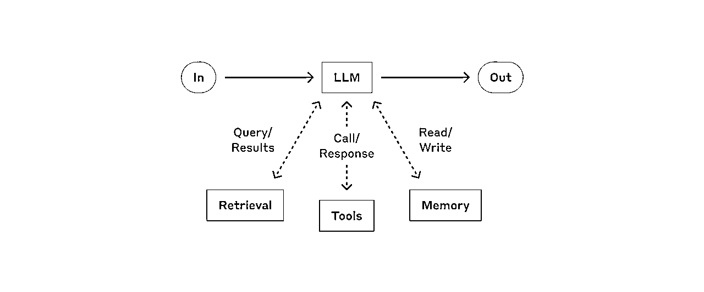
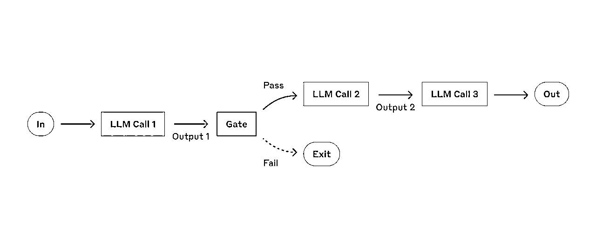
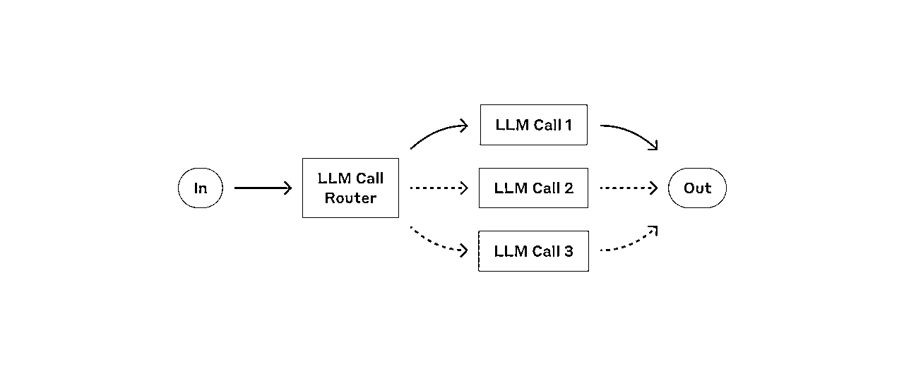
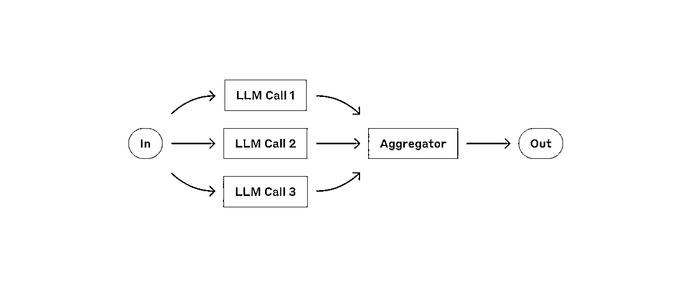
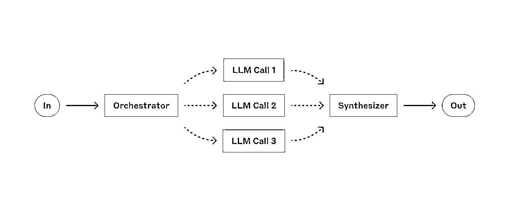
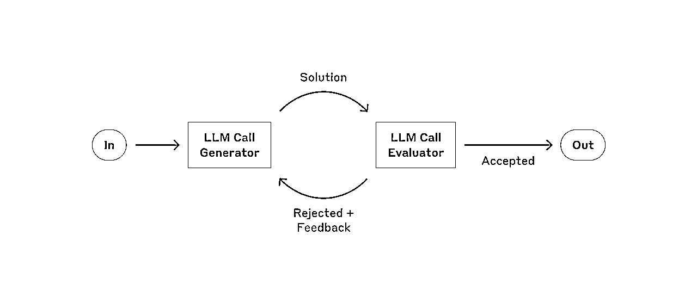
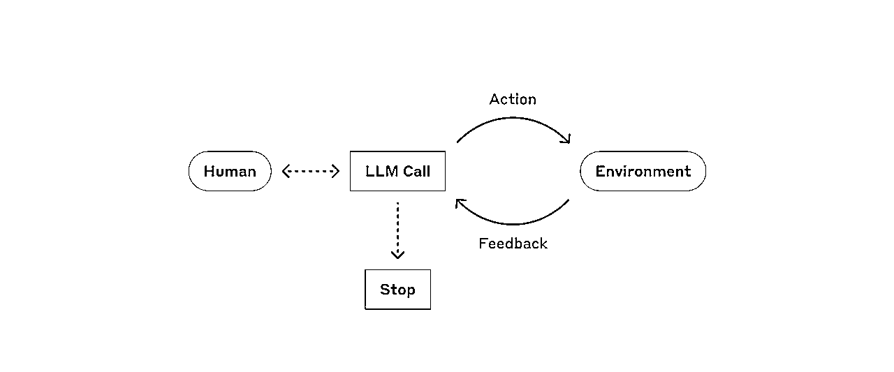
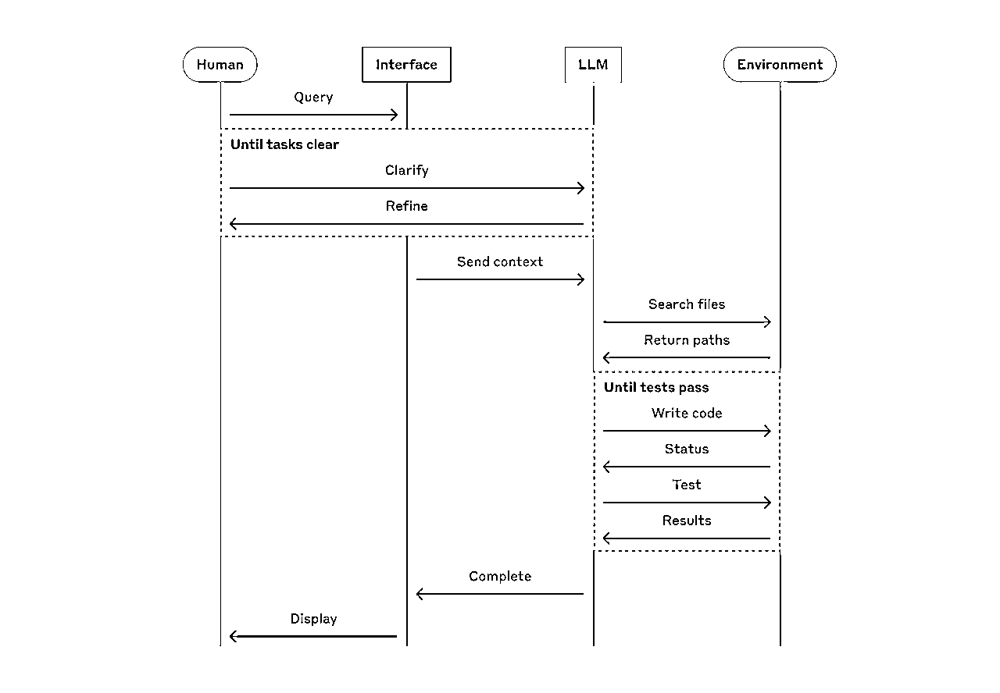

# 构建真正有效的智能体

原链接：

# Building effective agents 构建有效的智能体

2024-12-20

过去一年里，我们协助数十支来自不同行业的团队落地基于大语言模型的智能体项目。实践反复指向一个结论：表现最优的方案很少依赖复杂的框架或专用库，更多是借助简洁且可组合的模式去搭建。

本文汇总了我们与客户共建以及自研过程中的观察，并为开发者提供可落地的实践建议。

# What are agents? 什么是智能体？

“智能体”这一概念在行业内并不统一。部分团队将其理解为可长期自主运行并调用多种工具完成复杂事务的系统；另一些团队则偏向将其视作遵循既定流程的规范化实现。Anthropic 内部把这些形态都归入智能体体系，但会在工作流与智能体之间做架构层面的区分：

*   Workflows 是通过事先编排好的程序路径来驱动大模型与工具协同的方案。工作流是通过预定义代码路径协调 LLMs 和工具的系统

*   Agents 则不同，大模型在其中会自主决定下一步流程与工具使用，并掌控任务执行的具体方式。另一方面，在智能体系统中，大语言模型（LLMs）可以动态地指导自己的进程和工具使用，并保持对完成任务方式的控制

下文将对两种范式分别展开。附录 1《Agents in Practice》中，列出了客户获益较为明显的两个应用领域。

# When (and when not) to use agents 何时（以及何时不）使用智能体

构建大模型应用时，最稳妥的策略是先追求最简可行解，在必要时再逐步增加复杂度。大量场景下根本无需引入智能体。智能体通常以更高的响应延迟和成本为代价换取任务能力的提升，需要审慎评估投入产出是否合理。

当复杂度提升确有必要时，工作流适合边界清晰、强调稳定与可预期性的任务；智能体则在需要高度灵活性和模型主导决策的规模化场景下更具优势。对不少业务而言，通过检索增强和上下文示例优化单次模型调用即可满足需求。

# When and how to use frameworks 何时以及如何使用框架

当前市场已有不少降低门槛的框架，包含：

*   LangGraph from LangChain; 来自 LangChain 的 LangGraph ;

*   Amazon Bedrock's AI Agent framework; 亚马逊 Bedrock 的人工智能代理框架；

*   Rivet, a drag and drop GUI LLM workflow builder; and Rivet 是一种拖放 GUI LLM 工作流构建器；以及

*   Vellum, another GUI tool for building and testing complex workflows. Vellum 是另一款用于构建和测试复杂工作流程的图形用户界面工具。

它们通过封装模型调用、工具解析、调用链式等底层操作，让上手更快。但这类方案往往引入额外抽象，会遮蔽底层提示与返回，调试成本上升，同时容易诱发不必要的复杂化。

建议先直接调用大模型 API：许多典型模式用几行代码即可实现。若使用框架，必须理解其内部运作机制。对底层实现的误判是常见错误来源。

可参考我们的 cookbook 查看示例实现。

# Building blocks, workflows, and agents 构件、工作流程和智能体

本节梳理我们在生产环境中观察到的常见模式。从基础单元——增强型大模型出发，逐步过渡到组合式工作流与自主智能体。

## Building block: The augmented LLM 构件：增强型 LLM

智能体系统的核心单元，是具备检索、工具调用、记忆等增强能力的大模型。现阶段的模型已能主动运用这些能力——自行生成检索式查询、挑选适配工具、判断信息保留范围。

The augmented LLM 增强型 LLM

落地方向建议聚焦两点：一是依据具体场景定制增强能力，二是为模型提供简洁且文档完善的调用接口。实现方式多样，其中一种选择是采用近期发布的 Model Context Protocol，通过极简客户端接入不断扩大的第三方工具生态。

下文默认每个模型调用都已具备上述增强能力。

## Workflow: Prompt chaining 工作流程：链式提示词

链式提示将任务拆解为顺序执行的步骤，后一步模型以此前一步的输出为输入。可在任一中间节点加入程序化校验，即图中所示的 “gate”，保证流程不偏离轨道。

The prompt chaining workflow 链式提示词工作流程

适用情境：任务能够被清晰地拆分为固定子任务时，此类流程表现良好。核心 trade-off 是用一定的延迟换取更高的准确率，让单次调用面对更简单的子问题。

### Examples where prompt chaining is useful:

链式提示词有用的例子

*   Generating Marketing copy, then translating it into a different language. 制作市场营销文案，然后将其翻译成不同的语言。

*   Writing an outline of a document, checking that the outline meets certain criteria, then writing the document based on the outline. 编写文件大纲，检查大纲是否符合某些标准，然后根据大纲编写文件。

## Workflow: Routing 工作流程：路由

路由先对输入进行分类，再分发到对应的专业后续任务。该模式实现关注点分离，使提示更聚焦。若不采用路由，单一优化往往会损害其他输入类型的表现。

The routing workflow 路由工作流程

适用情境：任务包含若干类别且更适合分别处理，同时分类能够被可靠完成，无论是依靠大模型还是传统分类模型算法。

### Examples where routing is useful:

路由有用的例子

客服后台常常会把用户咨询先分流：普通问题、退款事宜、技术故障，各有各的处理通道、提示词和工具。同时，简单高频的提问走轻量级模型，比如 Claude 3.5 Haiku；复杂罕见的难题则升级给像 Claude 3.5 Sonnet 这样的强模型。这样一来，成本与速度都能达到较优平衡。

这其实是 LLM 工作流设计的一个缩影。当任务变复杂，我们需要更聪明的编排方式。下面就来拆解四种常用的模式。

## 并行化（Parallelization）

有些任务不必一个个排队做，多个 LLM 可以同时开工，最后用程序把结果聚合起来，这就是并行化。它通常有两种形式：
- **分段（Sectioning）**：把任务切成一块块互不依赖的子任务，各自独立运行。
- **投票（Voting）**：同一个任务反复执行多次，得到多样化的输出，再综合取舍。

### 并行化工作流程

什么时候适合用并行化？当拆出来的子任务能并行运行以提速，或者需要多个视角、多轮尝试来提升置信度时，它就派上用场了。尤其是面对多因素纠缠的复杂任务，与其让一次 LLM 调用顾此失彼，不如给每个考虑因素单独开一次调用，让模型各司其职，效果往往更好。

几个典型场景：
- 分段：搭建内容护栏时，一个模型实例负责响应用户查询，另一个独立实例负责筛查不当内容或请求。比起让同一个 LLM 调用既做回答又做安检，这种方式靠谱得多。
- 分段：自动化评估 LLM 性能时，每次调用分别评价模型在给定提示词上的不同维度表现。
- 投票：审查代码漏洞，用多个不同提示词分别检查，只要其中一个发现问题就标记出来。
- 投票：判断内容是否不妥，让多个提示词从不同角度评估，或设置不同投票阈值，从而在误报和漏报之间找到平衡。

## 协调者-工作者（Orchestrator-Workers）

这种模式里，一个中央 LLM 当起“总指挥”，先动态拆解任务，再分派给若干“工人”LLM，最后把各方结果整合起来。

### 协调者-工作者工作流程

它特别适合那些无法提前预测子任务的复杂场景。拿编码来说，一次改动到底涉及哪些文件、每个文件要改成什么样，往往视具体任务而定。从结构上看，它和并行化有些相似，但核心区别在于“灵活”：子任务不是预先定死的，而是由协调者根据当前输入现场决定。

实际案例：
- 每次都需要对多个文件做复杂改动的编码产品；
- 需要从多个信息源收集并分析相关内容的搜索任务。

## 评价者-优化者（Evaluator-Optimizer）

这个工作流像一场“生成-反馈”的循环：模型A先给出一个回答，模型B在循环中不断评价、给反馈，让回答逐步迭代优化。

### 评价者-优化者工作流程

使用它的前提是：评估标准清晰，而且迭代带来的改进能被量化。两个信号很关键：第一，人类把反馈说清楚后，模型回答能明显变好；第二，模型自身也有能力给出这种反馈。说白了，就像作家反复打磨稿件，一版不行就再来一版。

适用例子：
- 文学翻译：译者 LLM 第一版往往抓不住某些细腻表达，评价者 LLM 却能敏锐指出问题，给出有建设性的批评；
- 复杂搜索：需要多轮搜索和分析才能拿全信息，评价者负责拍板“要不要继续搜”。

## 智能体（Agents）

随着 LLM 越来越能理解复杂输入、做推理规划、可靠调用工具并从错误中自我恢复，智能体也开始在生产环境里大展拳脚。它的启动方式不外乎两种：听人指挥，或者和人讨论。一旦任务明确，智能体就自己规划、自己动手，必要时再回头向人类要更多信息或判断。执行过程中，它必须从环境里一步步获得“基本事实”，比如工具调用结果、代码执行情况，才能确认进展。遇到检查点或障碍，它可以暂停下来等着人工反馈。任务通常以完成为终点，但为了保持控制，也常会限制最大迭代次数。

可别被“智能体”三个字唬住。它能处理很复杂的任务，但实现起来常常很直接：本质上就是让 LLM 在一个循环里根据环境反馈去调用工具。所以，工具集和配套文档的设计，就成了成败关键（详见附录 2“为您的工具设计提示词”）。

### 自主智能体

智能体最适合“开放式问题”：你很难预测需要几步，也无法用硬编码固定一条路径。因为 LLM 可能会跑很多轮，你必须对它的判断有一定信任。这种自主性让它特别适合在可信环境中规模化地处理任务。当然，自主也有代价——成本更高、错误还可能被不断放大。所以，最稳妥的做法是先放到沙盒环境里广泛测试，同时装好防护栏。

一个很实际的例子：用编码智能体解决 SWE-bench 任务——根据任务描述，修改涉及到的多个文件。

总结一下：并行化、协调者-工作者、评价者-优化者、智能体，这四种编排方式各有各的主场。按任务的确定性、复杂度和预算来选，才能让 LLM 发挥最大价值。

“计算机操作”参考实现：让 Claude 像人一样操作电脑，独立完成各类任务。

编码 Agent 的顶层执行流程

## 组合与改造这些模块

这些模块并不是硬性标准，而是开发者可以按场景自由取舍、拼装组合的通用做法。同任何大模型能力一样，只有通过量化评估和持续优化，才能确定哪条路最有效。需要再次强调：只有当复杂度能带来可验证的改进时，才值得在系统里加重负担。

## 摘要

在 LLM 领域，赢家不一定拥有最精巧的系统，而是拥有最贴合需求的方案。从简短易用的 Prompt 开始，经过全面测评不断打磨，等到简单方案真的失灵了，再引入多阶段自主 Agent 架构。

打造 Agent 时，我们坚持三条原则：

1. 设计保持精简，别让复杂度失控。
2. 把 Agent 的计划过程亮出来，优先保证可解释性。
3. 认真打磨 Agent 与电脑的交互层（ACI），说明文档做扎实，测试做充分。

框架能让你迅速起步，但进入生产环节后，应当果断剥掉多余的封装，回到基础组件。遵守这些原则，Agent 才能既强大又可靠、易维护，也能让使用者放心托付。

## 致谢

本文由 Erik Schluntz 与 Barry Zhang 撰写，基于我们在 Anthropic 构建 Agent 的经历，也融入了客户给予的真知灼见，深表感谢。

## 附录一：Agent 的实际应用

与客户合作时，我们看到两个很有潜力的 Agent 应用方向，正好印证了前面的观点。这两类任务都要求 Agent 边对话边行动，有清晰的成功判断标准，可形成反馈闭环，同时允许人在其中进行必要干预。

### 用户服务

用户服务把常见的对话式终端与外部能力调用结合起来，非常适合更为开放的 Agent，原因如下：

- 整个服务过程保持着自然的对话节奏，同时也需要查询外部资料、执行实际操作；
- 通过接口能拉取用户档案、历史订单、知识库资料；
- 退款、更新工单这类操作，可以由程序自动处理；
- 服务成功与否，能根据用户自定义的解决状态来明确衡量。

已有企业采用“按成功解决计费”的定价，把这种服务推向市场，可见他们对自家 Agent 的成效心里有底。

### 编码 Agent

程序开发领域是 LLM 潜力表现最充分的舞台，能力已从补全代码演进到自主排查问题。编码 Agent 特别能打的原因在于：

- 代码是否正确，可以交给自动测试来验证；
- Agent 能根据返回的测试反馈不断修正；
- 问题域定义清楚，结构完整；
- 产出水准可以客观评定。

在我们的项目中，Agent 只要阅读 Pull Request 描述，就能在 SWE-bench Verified 基准上解决真实的 GitHub issue。不过，自动测试只能确认功能是否正常，要判断方案是否契合整体系统，仍然需要人来把关。

## 附录二：如何雕琢工具层的 Prompt

无论搭建哪种 Agent 系统，工具层通常都是关键部件。工具让 Claude 能与外部系统和 API 交互，前提是把 API 中的结构、定义精确描述清楚。当 Claude 需要借助外部能力时，它会在回复里生成一个专门的工具调用块。工具的定义和规范，应当像 Prompt 一样精心设计。下面给出一些实操建议。

同一个操作常有多种等价表达方式。文件改动可以写 diff，也可以整体重写；要返回有结构的数据，可以放进 Markdown，也可以写成 JSON。从工程实践看，这些只是形式差异，可以无损转换；但对大模型而言，不同格式的书写难度差别很大。写 diff 必须提前知道代码块头部中有多少行改变；把代码放进 JSON，则要额外处理换行与引号的转义。

确定工具的输入输出形态时，我们有三点体会：

- 提供充足 token，让模型在落笔前有“思考”余地，避免把自己绕进死胡同；
- 让格式尽量贴近网上常见的文本样式；
- 别让模型背负格式上的额外负担，比如不用去精确跟踪几千行源码的准确数目，也不用对自己生成的代码做转义处理。

一条可迁移的参照：你在 HCI 上花了多少功夫，就应在 Agent-Computer Interface (ACI) 上花同样的功夫。一些具体做法：

- 站在模型视角自问：光看说明文字和参数，这个工具怎么用？是否一眼就能看懂，还是要仔细琢磨？如果人都不好理解，模型大概率也会困惑。一份好的工具说明应当包含使用范例、边界条件、输入字段的规范，以及同其他组件之间的界限。
- 想要让用法更直白，可以调整变量的命名或说明文字，好比为刚入门的开发者写一段漂亮的 docstring。当你打理一批相似工具时，这一步格外重要。

做 Agent 时，真正决定成败的往往不是 Prompt 写得多漂亮，而是工具设计得有多抗造。

别急着去堆 prompt，先把工具拿去“上刑场”。在工作台里喂一堆真实样例，盯着模型用工具时会怎么翻车，哪里会踩坑，记下来再改。循环跑、不断迭代，才能揪出那些隐蔽的错误模式。

更进一步，要给工具做“防呆”。通过调整参数和接口设计，让模型根本犯不了错。比如做 SWE-bench 智能体时，我们花在工具打磨上的时间远超调 prompt 本身。发现一个典型问题：智能体跑到子目录后，用相对路径调用工具就会迷路出错。于是我们把工具强制改为只接受绝对路径，这个改动一做，模型的使用准确率就直接拉满了，几乎零失误。

工具越不容易错，模型就越可靠。把精力从写更长的提示，转向让工具更“傻瓜”，效果才是最明显的。