# 抖音虚拟资料冷门搬运打法拆解：避开红海赛道的小众实操路线

> 搬运赛道里大家都在做文件美化、打印实拍、单纯图片去重，我今天分享的是一条现在仍能跑通的偏门取流路子。文末放了实操数据截图，先看完再动手。

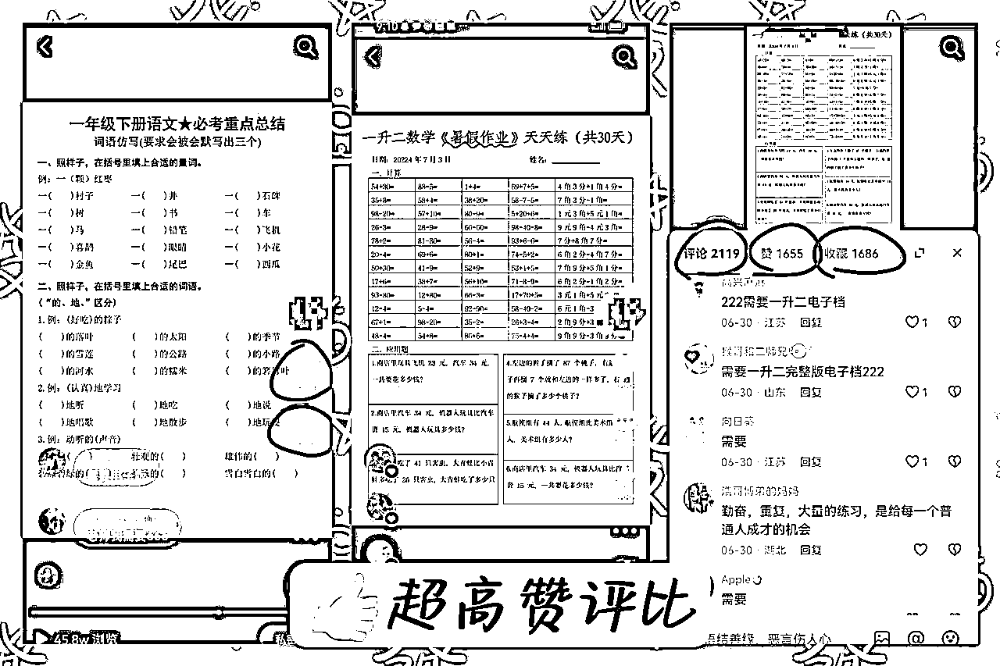

# 一、实操 SOP

## ① 前期准备

1. **设备与号码**  
二手手机即可，闲鱼上200-500元收一台，尽量不要选华为安卓，部分系统刷机后易出问题。遵循一机一号原则，尽量避免反复切换登录。账号矩阵规模越大越好，跑得起100个就别只跑10个。

1. **流量卡选择**  
想长期用且能通话、后期可能做小红书的，去公众号或知乎搜“流量卡”，月租19-29元的套餐很多，三大运营商任选。限制是同一身份同一运营商30天内限购1张。  
老手可考虑淘宝买虚拟号，搜索“抖音号”，常见10张100元首冲6元，单号成本约16元。短板是不能通话、不能发短信、无法注册小红书。

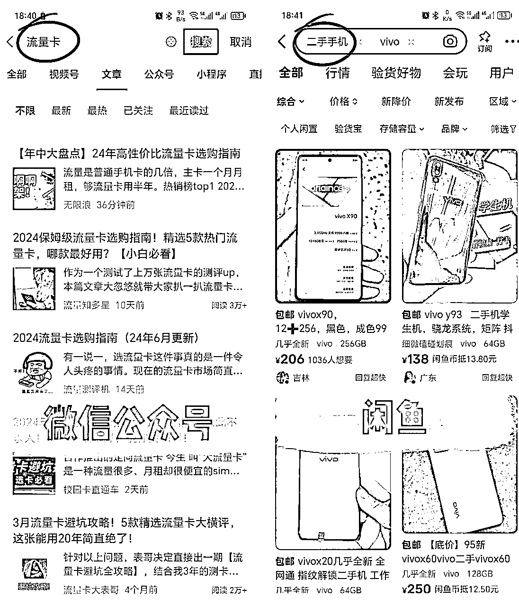

1. **网络环境**  
手机恢复出厂后全程用移动数据，不连WiFi，避免后台判定同一网络多设备登录，把号打成营销号。

1. **养号心态**  
新手先备好2-3天的内容再开始连更，防止前期没反馈就放弃，对拖延症很友好。

## ② 养号

### 基础信息设置

* **昵称**：简洁直指定位，例如做一年级内容可命名为XX老师一年级。
* **头像**：小红书检索“女老师真人ai头像”，挑一张接近真人的图去水印使用。

* **简介**：千粉前主页不做引流，写常规介绍即可。如：感谢抖音平台❤️每日分享XX年级优质资料。
* **隐私**：抖音→我的→设置→隐私设置，将点赞/收藏/关注/粉丝全部隐藏，避免爆后被同行盯上。

### 7天养号节奏

* 注册后前3天每天刷同年级视频或挂相关直播1小时左右，保持活跃，累计即可。
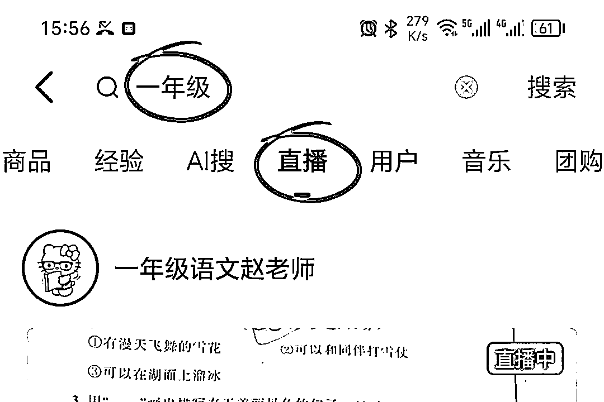
* 第4天起每天1-2更，保持连贯。
* 7天内只发内容，除非单条破千赞，否则不做任何引流与互动。

## ③ 找对标爆款

**核心认知：爆款具备可复制性，关键在找准异常值。**

1. **关键词检索**  
例如二年级资料，暑期对应一升二/二升三，开学后对应“二年级上册语文”“二年级上册数学”。向下刷或用筛选器挑近一周或近一天点赞最高的图文，收藏后横向对比，选出最优的。其他年级同理。

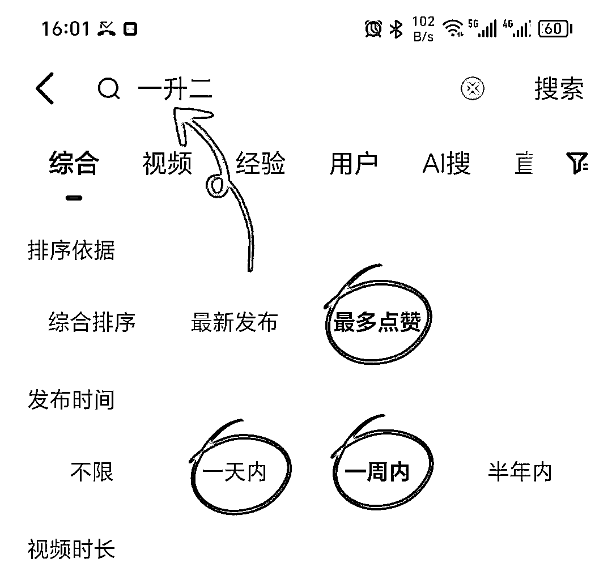

* **筛选标准**：48小时内上线的图文/点赞数高于账号粉丝数/账号粉丝低于1万。
* **优先级排序**：发布时间越短越优先 > 账号体量越小越优先 > 点赞高于粉丝数。  
找不到就继续找，别随意放宽门槛，多练手培养网感。昨日最好标准可作为今日起步线。

## ④ 爆款玩法：图文转视频

### 玩法要点

1. **思路**：研究爆款是为了短期吃到流量，核心仍是搬运去重。此次拆解图文转视频，在期末旺季仍有机会。
1. **注意**：①搬运必须是近期图文大爆款，越新越好；②去重要能过查证，还能承接爆款流量；③玩法要稳定，能持续跑。

### 图片去水印下载

作品分享→复制链接→微信小程序“轻抖”→粘贴链接→去水印保存。工具不唯一，效果相近。

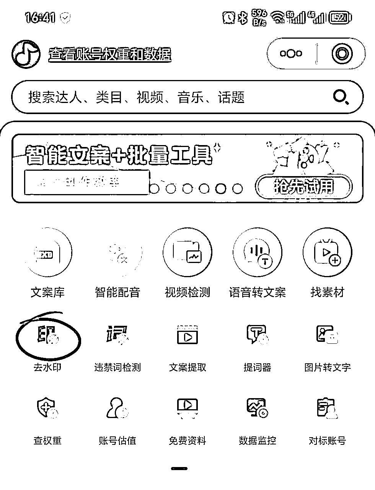

### 清晰度提升

画面模糊可用“Wink”或WPS做画质修复。

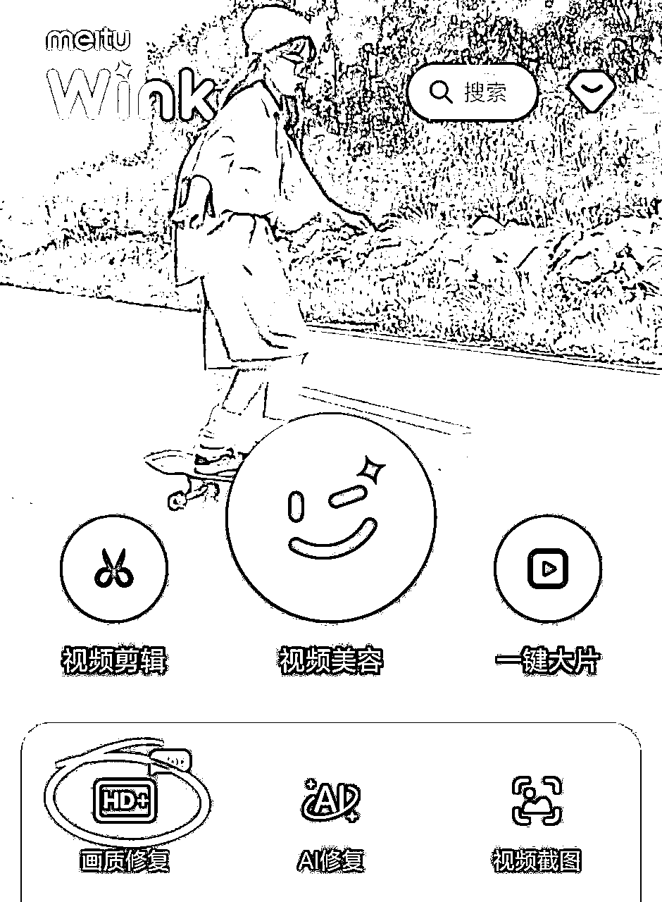

### 去重处理

* **工具**：美图秀秀
* **标题**：抹掉原文案，换字体、换颜色后重写
* **背景**：叠加正片叠底，灰色背景去重感较好
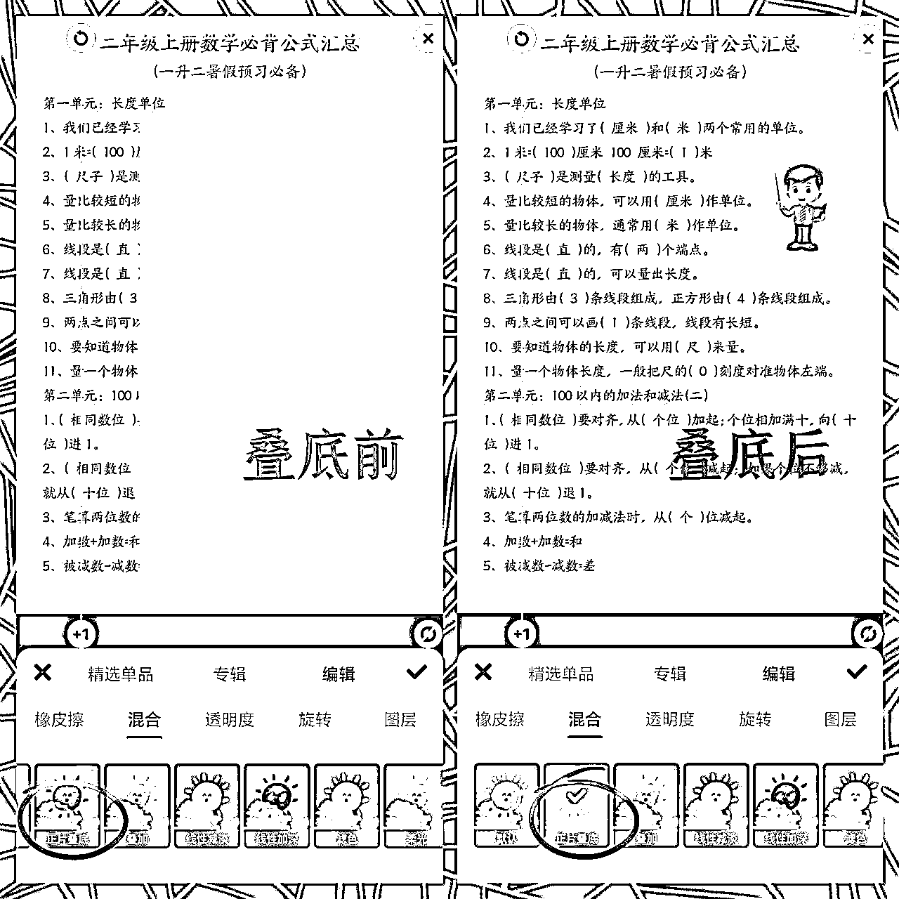
* **人物贴纸**：叠加正片叠底后把透明度调至15%左右，让贴纸若隐若现
* 可在不影响观感的前提下增加其它去重元素

### 视频制作

* **工具**：剪映电脑版，手机版亦可
* **流程**：导入4-6张图→每张约2秒→加翻页/擦除转场→配同行爆款BGM→最后一张预留钩子，养号期后使用

### 标题与描述

* **标题**：简洁贴合，如“二年级上册语文必考重点总结”
* **描述**：先解释标题+软钩子，如：二年级上册语文期末复习必考重点总结来了！！完整可打卡💯

## ⑤ 引流三件套

1. 提前准备1-2个抖音小号，专门在主号评论区做引导，主页参考下图设置。
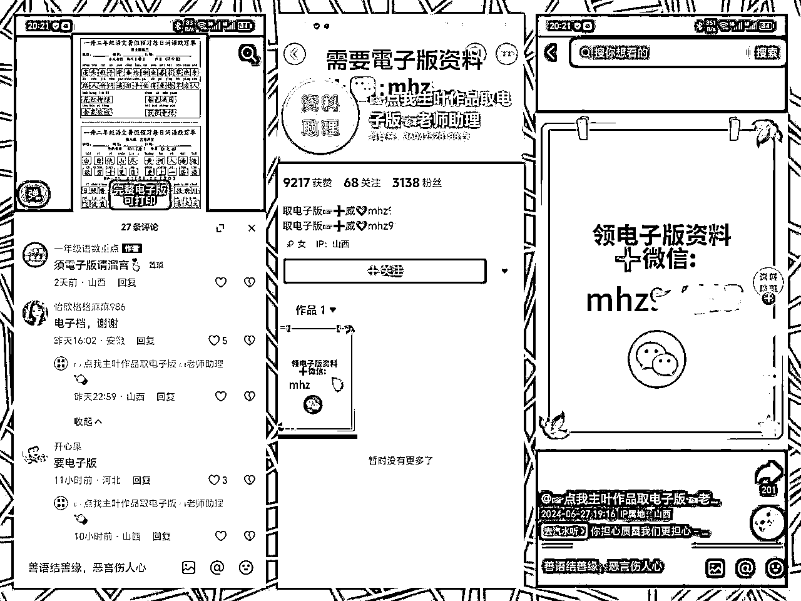
1. 主号作品置顶评论引导关注与评论。
1. 回复私信时点右下角加号→我的喜欢→提前点赞的带微信引流作品，把联系方式发给用户。
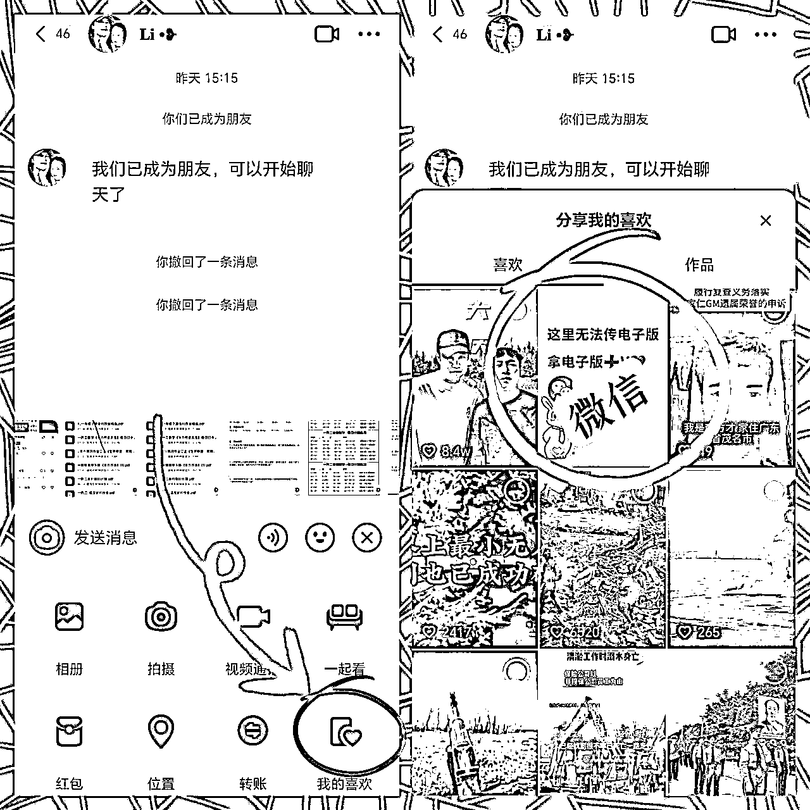

> 引流规则会随平台调整，平时找对标时同步观察同行的变化，及时迭代。

## ⑥ 变现与二次成交

变现形式与基础话术同小红书玩法不再赘述。重点说二次成交话术示例：

* 通过啦！！！我们正在招收抖+小红书学员，可关注朋友圈⭕感兴趣随时私聊~
* 通过了！！感觉不错可当天补差价进学年或1-6会员群哟～招收抖+小红书学员🔥线上副业★时间自由★月入过万

**常用话术**
* 无答案：本套无答案，可用夸克或小猿搜题拍图找答案，或换套卷。
* 催付：拿不定主意建议先选39元学期群进去看资料💪感觉可以再当天补差价进学年或1-6群。
* 群多：共12个群，QQ文件可永久保存，微信保存不了。可先收藏图片扫当前学期，后续再扫。
* 更新：专人每天更新资料，保证与教学进度同步。
* 版本：语文人教版全国统一，数学有人教/苏教/北师/青岛54/63/西师/冀教，英语三年级起点有人教/外研/译林/冀教。
* 引导进群：单份19.9偏贵，大多数家长选39.9学期群，持续更新且更全，进群后单个资料也可单独找给你。

# 二、常见问题摘选

1. 号违规了除了换号还有什么办法？  
可使用注册超30天、近期无违规的老号做辅助验证，新号注册后把手机刷好再登录。

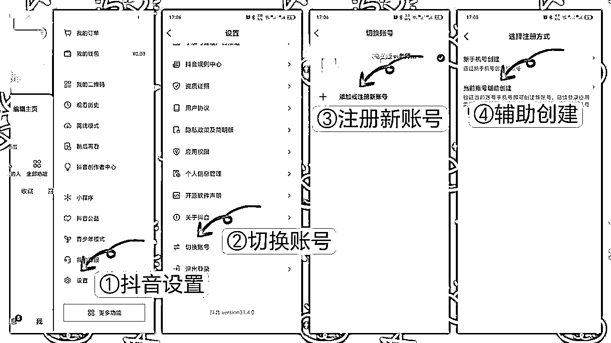

1. 如何用微信数据判断转化？  
单人价值=总收款÷总引流。淡季均值6-10，旺季8-15。每日统计，积累数据后可发现异常，异常即调整信号。

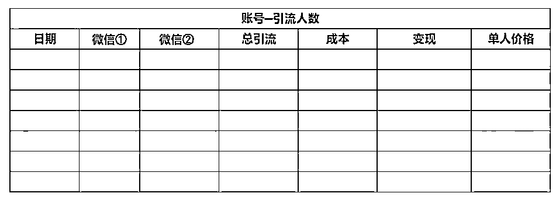

1. 评论私信提示音怎么开？  
见下图设置。

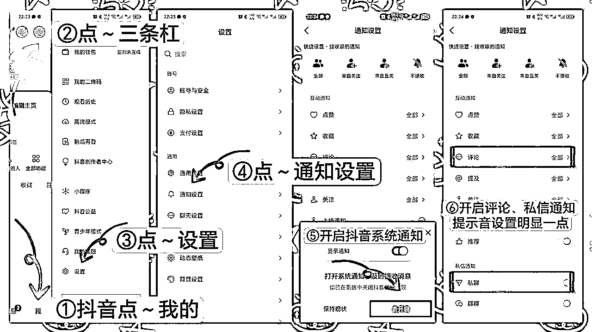

1. 视频爆了为什么没人加微信？  
有效引流=好钩子+及时置顶+小号及时回复评论+及时私信回复。同行是最好的教材。

1. 限流/违规怎么处理？①新机新卡重起；②违规结束观察流量；③流量异常注销7天后重注；④老号辅助验证。

1. 养号期后如何操作？主号及时置顶+回私信，小号水军求资料+回评+回关私聊。检查违规，隐藏低播放<1000作品，第二天破百赞的及时复制。

1. 引流小号如何搭？抄同行小号样式，把微信换成自己的。用另一账号自查背景与作品是否被隐藏，被隐藏则换模版。

备用背景图如下：

1. 接流微信怎么设？8-9位最佳，便于记忆，避免0/o/1/l/i等易混字符。
1. 发布前检测？见下图。

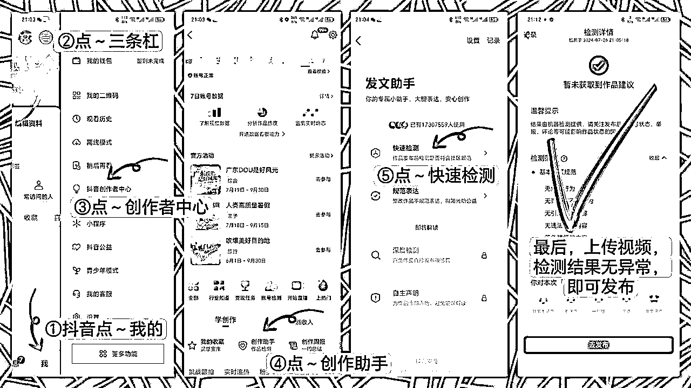

1. 需要实名吗？不需要。粉丝过万再实名，账号挂掉或流量差直接注销重开。
1. 发作品必须用移动数据吗？主号必须一机一号+移动数据。前3天养号需刷，之后找对标用小号刷，网络随意。
1. 养号后还要每天刷1小时吗？前3天累计刷满即可，后续不用。
1. 钩子何时加？7天后可加作品钩子，千粉前主页不放微信，用评论小号引导。
1. 能发图文吗？只发视频。视频爆了可再发图文版，去重效果不如图文转视频，需时时检查违规。
1. 能建粉丝群领资料吗？不建议，易实名且易违规，仍以小号引流为主。
1. 爆款图带水印怎么办？带水印页舍弃，带钩子页舍弃或遮盖，凑够4-6张，凑不够就换。

# 三、项目盘点

## 优势
赚钱统计9月航海30%船员已变现，期末旺季更快。门槛低、近零成本、天花板高，身边案例旺季月入过万常见，5-8万也有。小学资料每年迭代，需求稳定，换学期时20%-40%家长续费，形成被动收入。微信资产累积可做二次多次变现。

## 劣势
明显淡旺季。期末/期中/开学易成交，淡季引流100人可能只剩30人。可通过丰富变现形式对冲。

# 结语

本文聚焦玩法技巧与小Tips，打开思路即可。做虚拟资料，流量之外，朋友圈搭建、话术设计、私域产品组合同样关键，早布局少踩坑。

文章写了3天，与小红书资料玩法多处相通，建议结合阅读。感谢@希平老师指导，感谢@星城老师与@拾一的支持。祝大家年底钱包鼓鼓，一起发财！欢迎评论区交流，后续持续补充。