# 单枪匹马靠聚光投流，12个月沉淀4万粉丝私域，完整复盘

各位圈友好，我是更绪，四川南充出发，现主攻小红书赛道，擅长内容结合投放拿客资做转化。

不久前发过一篇虚拟资料的实战总结，有幸被编辑加精。那篇里也提到过，我在武夷山做茶生意时试了聚光投放，效果超出预期，于是把这套打法迁移到虚拟品类，才有了后面的复盘。

眼下临近年底，我大概率要离开武夷山去一线城市发展，这篇就当是给这段山城经历收个尾。数字大家自行判断真假，我可以默认是摆拍也没关系，方法论才是重点。

接下来会把这条业务线从起步到当下成果全盘拆开，并整理出一套可复制的聚光拉新SOP。只要你的品类在小红书可投放、想从平台拿客户，都可以照这个思路验证。现在聚光的窗口期依旧存在，很多做小红书的人还没碰过，对正在深耕平台的朋友应该有参考价值。

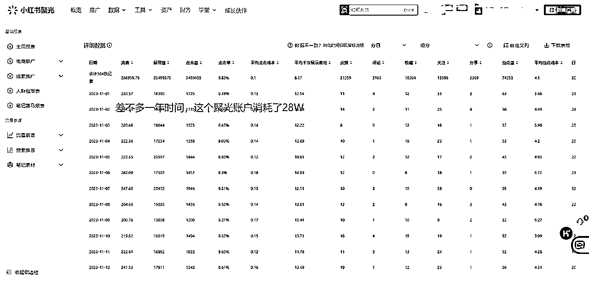

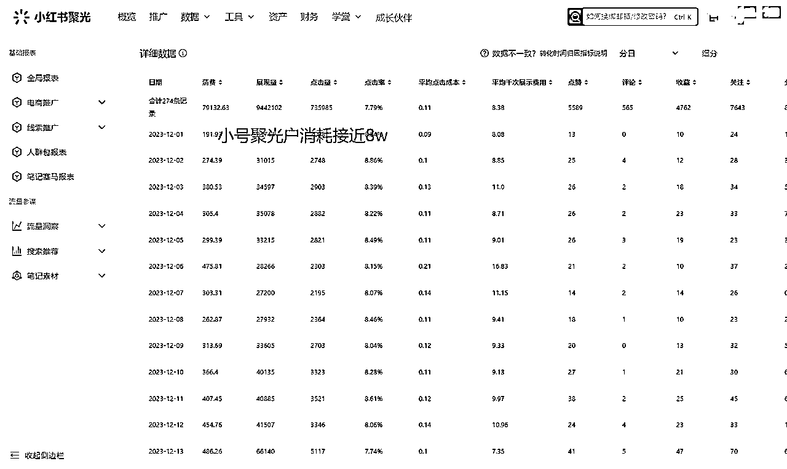

目录概览

1. 投放是必选项，聚光的机会窗口仍在
2. 先复制再改良，一条笔记扭转局面
3. 因违规被迫开户，反而打开新局面
4. 实操中踩过的雷区
5. 通用版聚光获客执行清单
6. 一些个人体会

# 一、投放是趋势，且聚光依然有红利

## 1. 自然流量缩水，环境趋紧

小红书从去年9月底开始，笔记自然播放普遍下滑。过去百来播的基础内容，现在十几二十播是常态。这绝非个例，我访谈过上百位从业者反馈一致，你也在做的话感受应该很明显。

平台商务现在几乎天天给商家打电话推聚光开户，催得非常紧。这本身就是商业化加深的信号。

官方此前发过通告，我一度以为是虚张声势，结果真落到实处。最近账号异常率明显升高，看到这篇的你可能已经遇到。

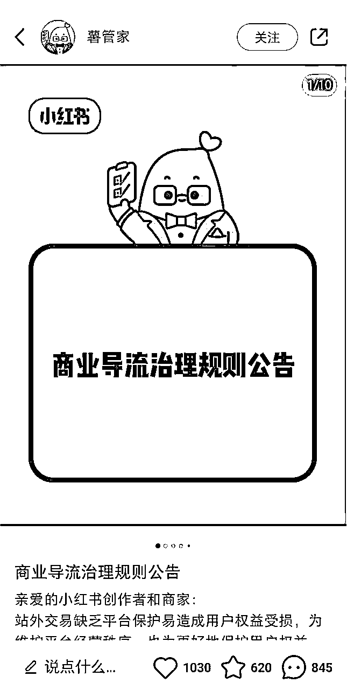

## 2. 投放不是遥远的事，门槛很低

平台越规范，白嫖流量的难度越高。小红书如此，其他内容平台也一样。有免费方法当然优先，但投放是你必须学会的一招。

投放并非遥不可及的技术，只是开户就能上手，不是大机构的专利，工作室能做，个人也能做，而且操作非常轻。

如果你的业务现在靠自然流就能带量，打开聚光不仅能降低封号风险，还能借助付费杠杆把增长放大数倍。

## 3. 聚光的性价比依旧突出

能在小红书投放获客的品类里，聚光的投入产出一直比较友好。产品经历一年多的迭代，用户画像沉淀足够，功能也在持续丰富，成熟度没问题。

再加上小红书内容制作成本低，适合投放的素材好找。从入门视角看，聚光基本没有硬伤。

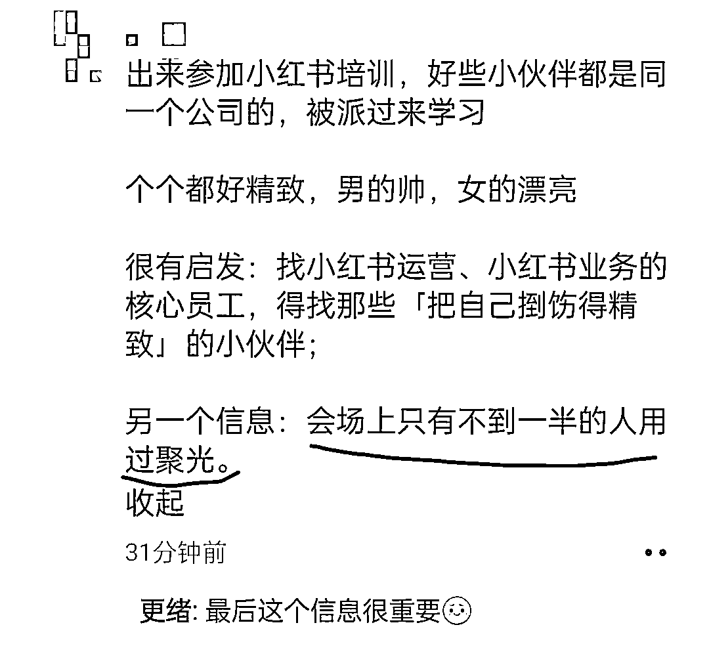这张图表达很清晰，会用的人已经能淘汰掉半数对手。

## 4. 投放的本质仍是内容

在任何内容型平台，获取流量的根本能力是做内容。投放只是放大镜。投放过程中，你的内容判断也会被强迫提升。

内容能力到位后，在多平台拿流量会变得异常简单。

下面进入我的实操拆解。

# 二、复制后改良，一条笔记完成破局

## 1. 我曾在知乎、抖音、视频号测试，最后锁定小红书

到武夷山后熟悉茶品线，就开始找互联网出货路径。去各大平台找对标，犹豫很久怎么选。

抖音？我早期操作过多个项目，没什么起色，而且我的实名在20年就被封了，心态被打击直接放弃。

视频号？人群画像其实匹配，但我对它几乎没了解，没敢选。

知乎？我写了一篇，播放起来了却卖不出茶，回头一看纯属耗时。

小红书？能看到同行在卖茶，自己也有点经验，胜算较大。最终定下来。

现在看，选品类、选平台，第一原则是选自己熟悉的，尤其是资源有限时。缺少正向反馈很难坚持下去。

当然也要顺势，我再懂知乎也很难把茶叶卖起来。

## 2. 只抄干货笔记，涨粉不产生成交

确定平台后，我每天研究同行，找近期低粉高播放的干货内容硬抄。最火的模板是“每日认识一款茶”，几天涨粉破万。

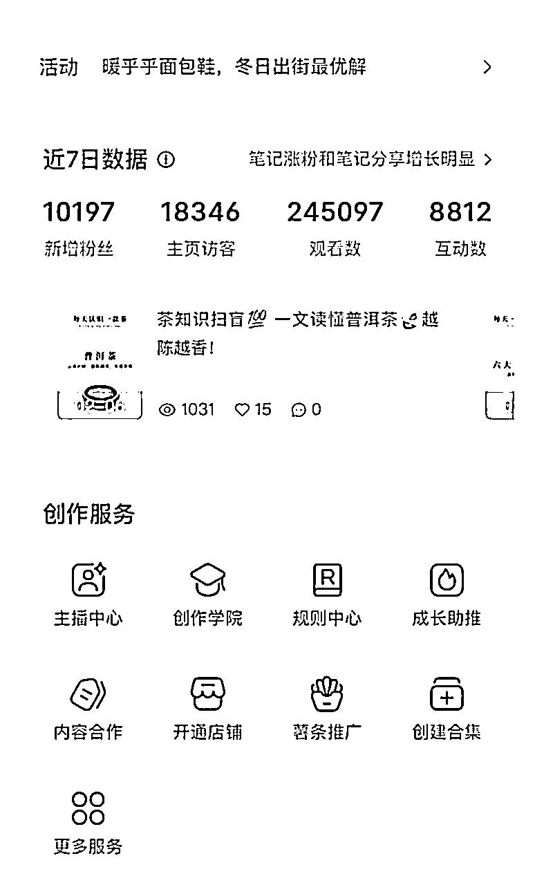这个框架到现在仍有流量，发出去就能吸粉。

可粉是涨了，茶却卖不动，跟知乎写文章一样，数据好看无用。好在把小红书做爆款的内容流程跑通了。

粉丝、播放这些数字大部分时候只是自我满足，对变现帮助有限。很多人被这些指标牵着走，我后来把它列入小红书的十大误区。

## 3. 转向抄带货笔记，第一个付费客户出现

我才意识到，应该抄带货笔记。前面那些数据漂亮但无意义，带货笔记数据可能平淡，却能直接带来咨询。

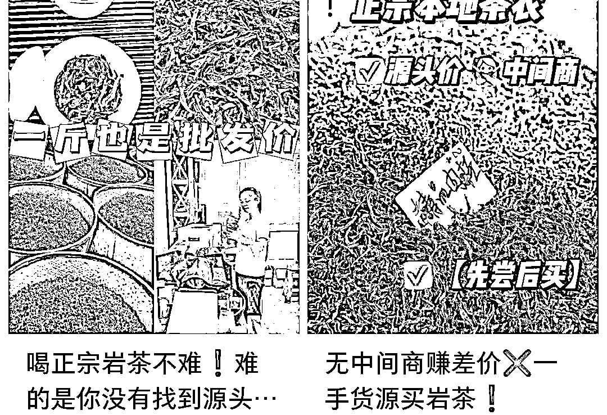这两篇是我当时找到的带货参考，数据在线。

照着做两篇，当天微信就被加了。第一个客户就此产生，下图就是当时的截屏，至今还在复购。

## 4. 复制后优化，单月卖出十几万

复制后有了手感，明白什么结构能转化。所有有效内容本质都是触达用户某个痛点。

买茶的用户到底在意什么？真不真？贵不贵？有无溢价？

我把小红书、淘宝、抖音、视频号所有茶叶相关的高互动内容和用户评论全部梳理一遍，提炼出核心焦虑：

1. 价格是否透明实惠，有无高溢价
2. 是否真正的源头货
3. 品质与性价比如何
4. 是否打药，是否安全

把封面改成直击价格痛点，主图文案写“买一斤也是批发价”。

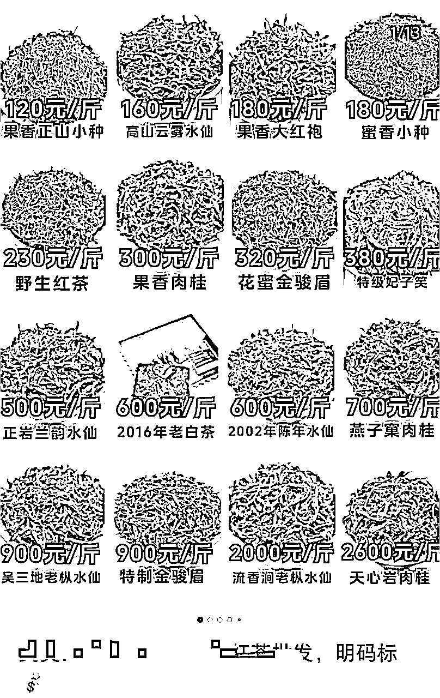在层图和标题里再补上茶厂直供、资质证书、用户评价、有机证明等信任元素。

笔记直接爆发。后来同行人手一篇这个样式，但效果已不如最初。

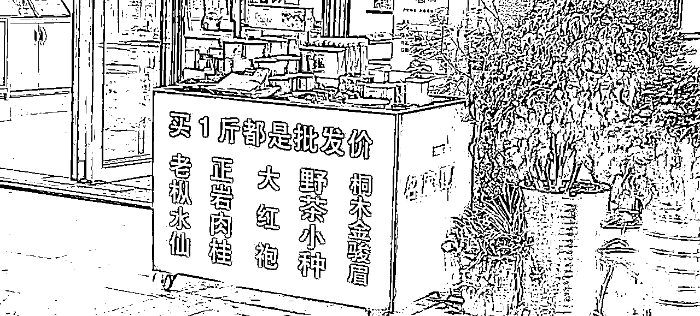后来在武夷山街头看到茶叶店门口的标语“买一斤都是批发价”，才恍然，原来这些卖点线下早已烂大街，只是没人搬到线上。

发布后一个月，微信新增1000多人，茶叶销售额超10万。紧接着账号因站外导流被限流。

# 三、被迫开启聚光，反而打开新局

## 1. 起初只想买个“白名单”

账号被限只能想办法。当时聚光正火，听说投放后可开通白名单，留微信不违规，于是找销售开了户。

我对投放几乎零经验，只在抖音玩过千川。心里其实抵触，觉得投放很高端。其实门槛非常低。

当时想法很简单，花钱求平安，给平台交保护费。

## 2. 一投即爆，接待不过来

开户后每月需消耗几千才保白名单，只好硬上。没打算赚钱，就用千川的模糊记忆把那条爆款笔记直接拿去投。

结果直接起飞，原准备的两个微信号处理不过来，连夜又注册几个号承接。

算下来获客成本约10元/人，对中高客单的茶来说极低。最低的茶也要两三百一斤。小红书用户质量高，成交率高，复购也不错。

## 3. 上瘾后加码投入

尝到甜头自然加大力度。按爆款模板复刻多篇，开多个广告户，天天建计划跑。累计广告消耗约36万。

一年下来，私域加店铺端达成预期，同时沉淀约4万具信任基础的客户。

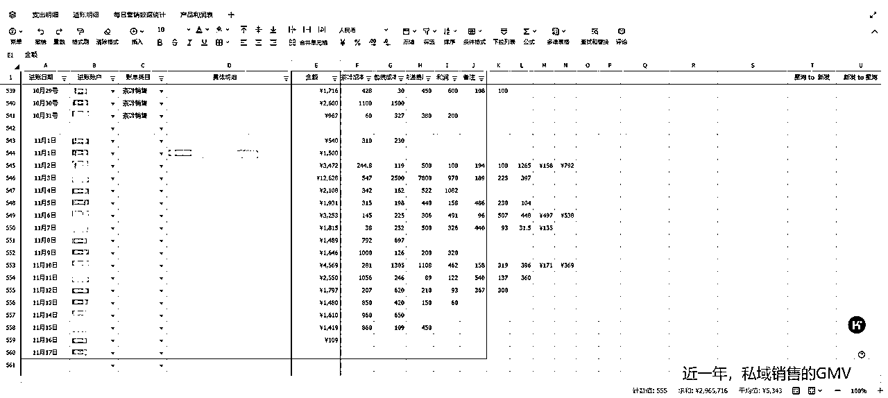

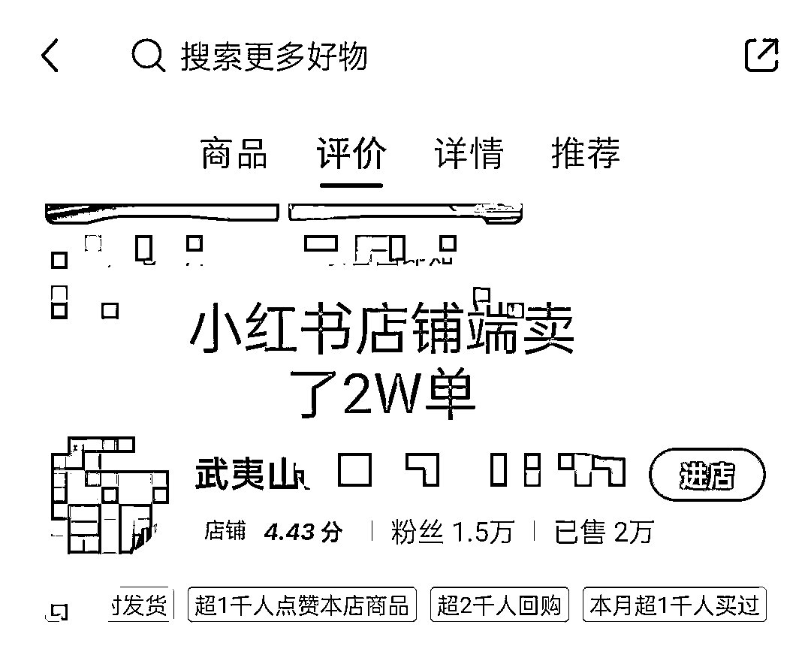

# 四、聚光投放踩过的坑

## 1. 不要走官方销售开户

第一个户是官方销售开的，没有返佣。后来通过服务商才知道有返点。账号绑定后想换很麻烦，历史数据和模型会清空。

官方销售会索要营业执照，一旦给出就被锁定，后续只能找他开，没返点。现在服务商返点至少18%。投几十万，返佣差出好几万，千万别走销售。

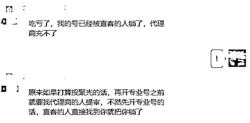

## 2. 别信代运营

很多服务商会推自己的代运营，统统别信。90%没含金量。真正厉害的团队不会靠代投赚钱，除非后端极强愿意分成。只收服务费的，大多是水货，钱打水漂。

投放必须自己操盘，只有自己最懂业务和用户，才能做出有效素材，掌控投放节奏。

## 3. 电商投放目前表现平平

无论是聚光还是乘风，小红书电商投放效果都不理想。用户电商心智弱，GMV基数低，数据积累不足。获取客资还可以，直接投店内转化基本亏钱。

等到小红书电商GMV达到抖音十分之一时，可能才有机会。现在先沉淀。

## 4. 别死磕爆款

爆款出来后，我一年都在找下一个爆款。爆款可遇不可求，运气成分大。

更稳的做法是测出多篇中等效果的模板持续跑，细水长流，而不是非要一个万赞起飞。

# 五、精简高效的聚光投流SOP

复盘下来，核心就一步：做出能击中用户需求的笔记模板，然后让聚光一直跑。其余都是锦上添花。

素材不行，策略再精细也没用。把精力放在素材。

## 1. 先做干货涨粉，养号冷启动

新号直接上硬广投流，前期浪费很高。先发行业干货内容涨粉，给账号积累用户画像。

比如我一开始发的茶知识、茶文化笔记，就是典型的干货，容易爆，能涨粉，虽不直接变现，却为投放打底，相当于低成本冷启动。

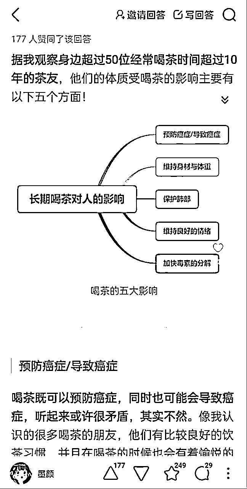

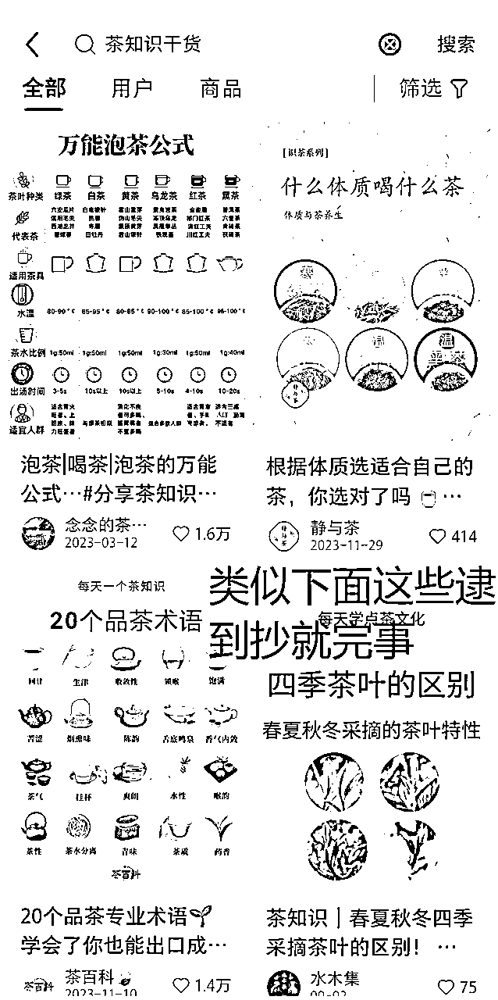

## 2. 找可投放模板，复制比原创快

这是最关键一步。

对用户洞察弱没经验，直接复制。找右下角带“赞助”字样的投放笔记，直接复刻操作简单高效。

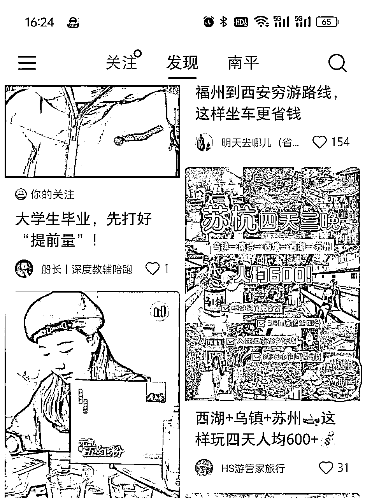多找几篇，逮着复制，别有心理负担，不盗图就不会违规。

如果洞察力强，可以复制并改良。像我当时的做法，把全平台用户提问、评价全部梳理一遍，找到核心诉求，再优化同行笔记。

## 3. 测试模板，有两种打法

第一种，自然流测。先发不投，看自然流下有没有评论私信咨询，有就说明模板可用。自然流跑出数据再投，转化率更高。周期约一周到一个月，金钱成本低。

第二种，直接投。懒得等自然流积累。笔记无数据，平台要时间找人，前期可能亏钱建模。只要亏损可控就让它跑，前期亏几百建模很正常。投放本质就是放大自然流跑得好的内容。

做投放这么多年，我把这条路重新复盘了一遍，发现真正能跑出来的项目，靠的往往不是多么高级的技巧，而是一套可以被反复执行的流程。今天不聊虚的，直接上实操干货。

第一步，搭计划的时候就得有“池子思维”。别把一个计划里的笔记就放个一两条，那样系统几乎没有优化空间。我会尽量保证每个计划至少放3篇笔记进去，然后在里面慢慢观察，谁行谁不行，让数据自己说话。

第二步，前期不要太敏感。刚上线的时候，只要不是亏到离谱，就别急着关计划。有些朋友投了两天看到消耗有点高，立刻就慌了。其实这个阶段最怕的不是亏，而是计划根本跑不出去。只要数据在动，就给它们一点耐心，前面几天别怕交学费。

第三步，差不多5到7天之后，就该做一轮淘汰了。怎么判断？看封面点击率。这个指标我觉得是最直接的。如果一篇笔记的封面点击率能超过8%，说明及格了，留下继续投；如果能超过10%，那可以说是种子选手，值得加计划、加预算、重点去培养。反过来，那些点击率还不到8%的笔记，就不用再纠结了——数据已经在告诉你，它不讨人喜欢，果断换掉就好。

第四步，也是最容易被忽略的一步：算账。客资投放和电商不一样，没有那么直观的投产比可以看。你没办法第一时间看到“我花了100块，赚了200块”，所以必须自己精细地去算。算清楚两笔账：第一，平均每个加到私域的客户，广告费花了多少；第二，这些客户平均能给你带来多少利润。这两笔账必须清楚。很多人就是不喜欢做这种细节，随手一看觉得自己是赚的，等过了几个月才发现，自己一直在给平台打工。如果你是做项目的小团队或者个体户，这一点尤其重要。

第五步，循环起来。前四步做完，只是一个周期。接下来要做的是继续测新的模板、投新的计划，不停地重复刚才那套流程。如果现成的模板还好用，那就每天盯着后台的数据，时不时建一两条新计划，保证每天的消耗和跑量在可控范围里就行。等到哪天模板跑不动了、量明显少了，再回头去找新的素材和模板来补位。

这件事做完之后，我有几个特别深的感悟。

第一个感悟：抄，一定要狠狠抄。别把“抄”想得不光彩。对标、模仿、借鉴、学习，说到底都是抄。我复盘了一下自己做这个项目最大的转折点，其实就是抄了两篇同行的笔记，然后根据自己对用户需求的判断做了一点优化和改动，行情就打开了。你看老话说“前车之鉴，后车之师”，本质上也是在抄前人的经验。抄不丢人，你不抄，别人也会来抄你。最好抄到什么程度？抄到对方都觉得害怕，抄到对方随时担心你把他的流量全抢走。如果你能做到这个状态，项目基本没有做不起来的道理。

第二个感悟：别怕新东西。人嘛，天生喜欢待在舒服的地方，不愿意冒险。但真正能让数据暴涨、让增长突破瓶颈的，往往就是那些敢走出舒适区去接触新事物的瞬间。新事物当然有不确定性，但换个角度想，风浪越大鱼越贵。平台的新工具、新玩法，多试一次，也许就是一次机会。

第三个感悟：学会借势。这个世界说白了就是一个巨大的草台班子，很多人看着很厉害，其实也是搭了什么势能才飞起来的。人和人本身的差距没有想象中那么大，但“人+势能”和“人”之间的差距，就是天壤之别。回看这个项目，我没做太多复杂的事情，关键就在于我把聚光这个平台的势能接住了。平台有势、工具有势、项目有势，身边厉害的人也有势，能借就借。

第四个感悟：尽量留在大城市。这个我感触特别深。小地方的信息流通太慢，很多新玩法、新趋势你根本接触不到，而且能调用的资源少得可怜。比如你想找个合适的人来配合做直播，在小城市都很难。很多想法项目，不是你不努力，而是被这些客观条件一步步拖住，最后不了了之。大城市至少还能让你离信息和资源近一点。

差不多就说这么多。如果你正在做投放，希望这篇对你有用。

觉得有帮助的话，顺手点个赞，就是给我最大的鼓励啦～