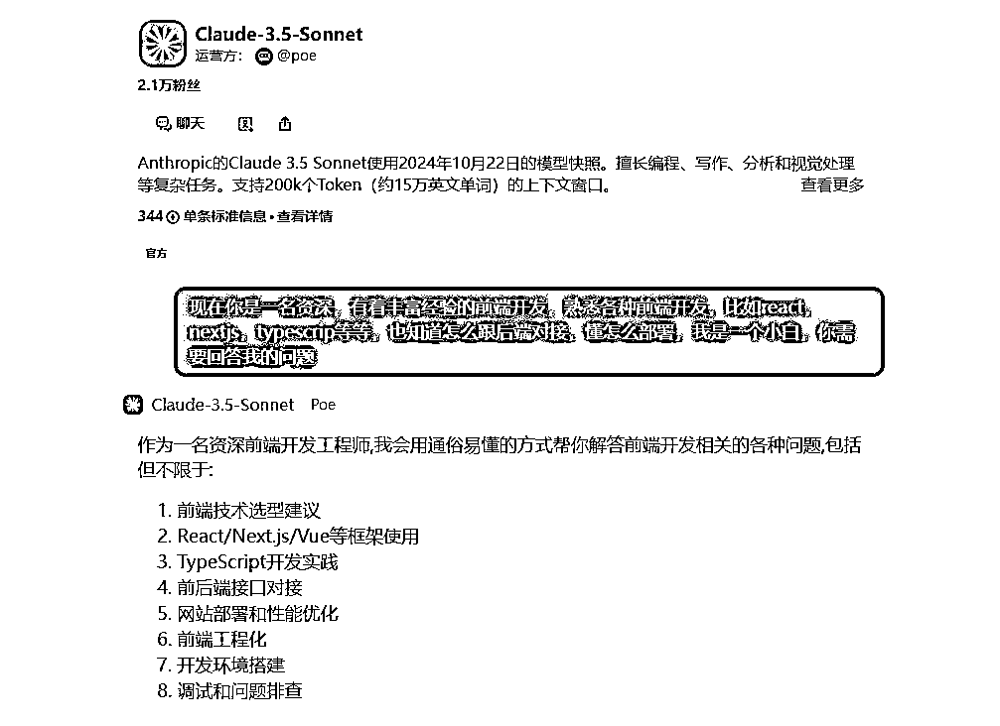
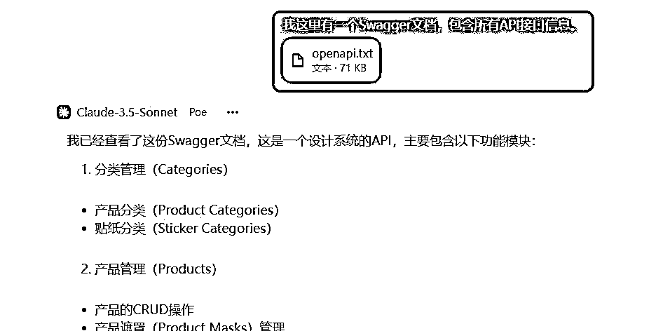
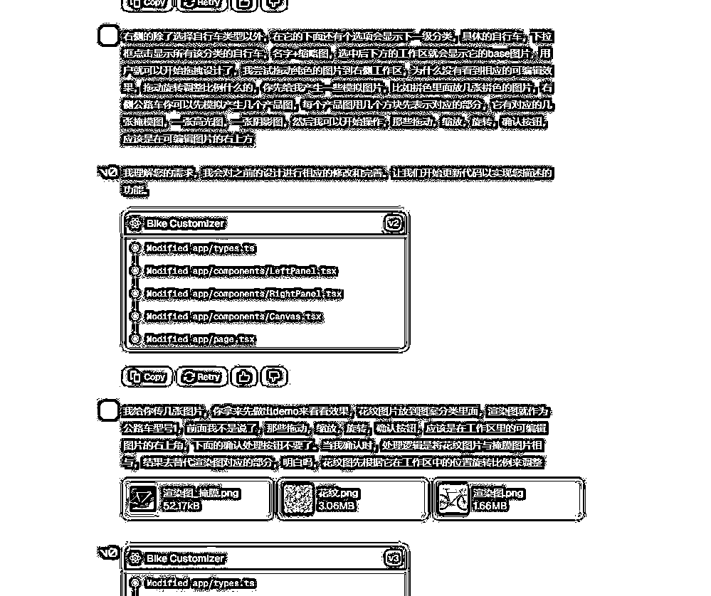
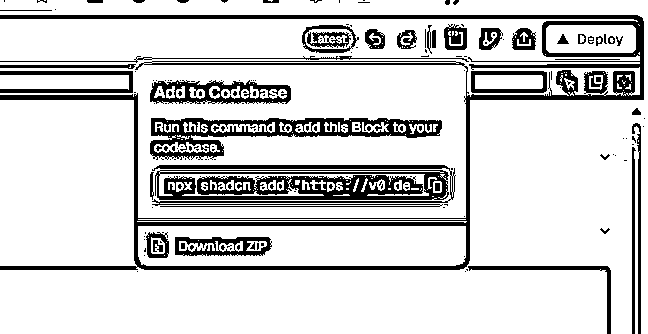
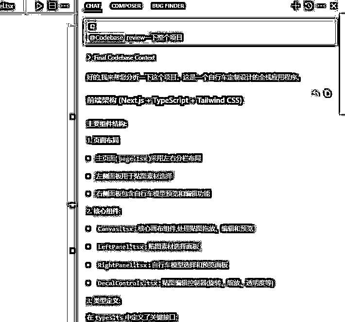
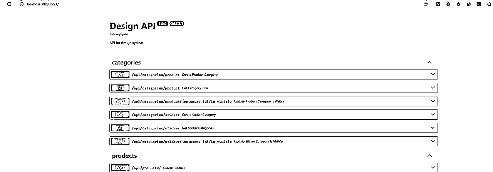
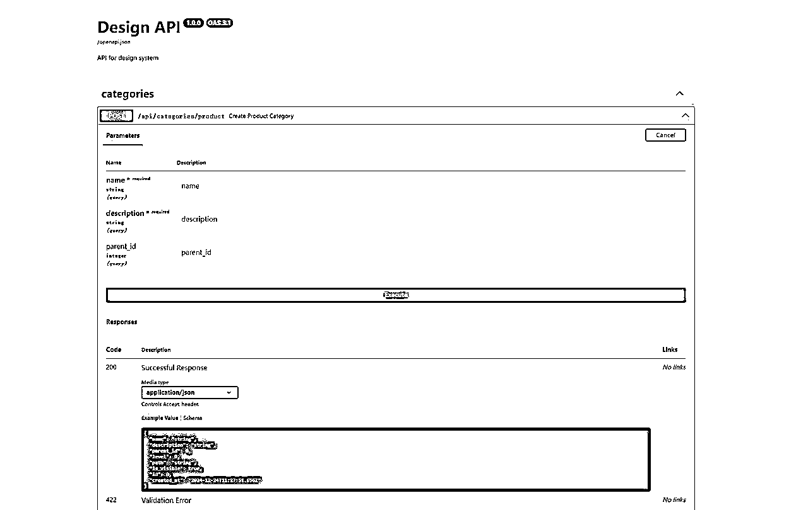
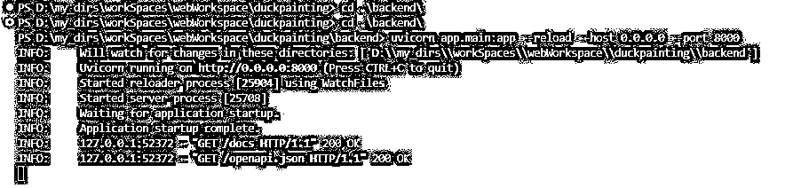
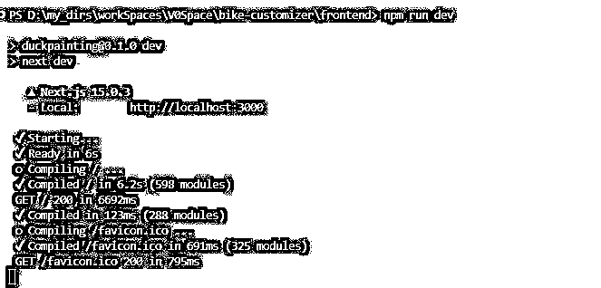
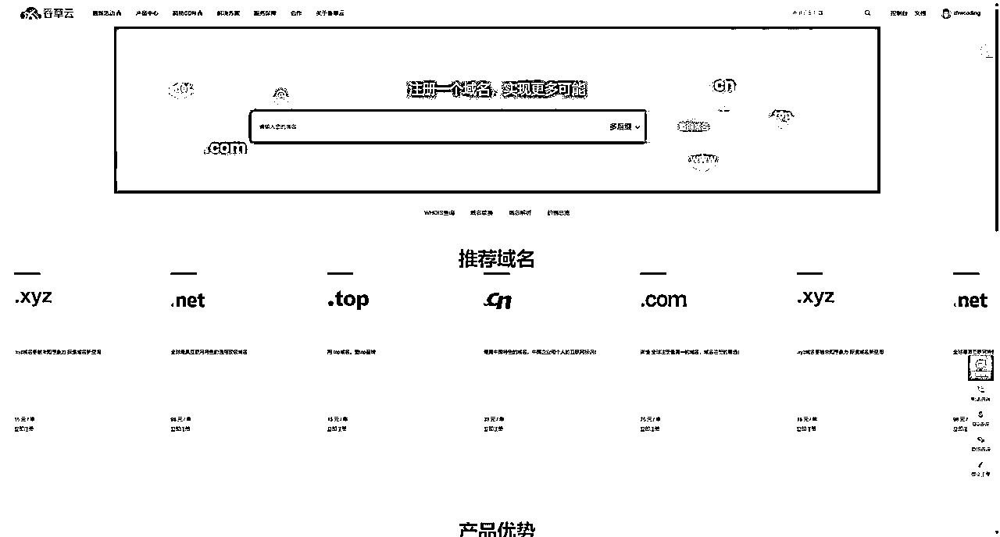

# 从0到1：我完成并上线部署了一个网站

小白两周，我的第一个全栈网站终于上线了

谁能想到，半个月前我还是个对 React、Next.js、PostgreSQL、FastAPI 完全没概念的小白，连“全栈部署”这四个字听着都像天书。可现在，我竟然把自己的第一个全栈项目完整地做出来并部署上线了。虽然访问量少得可怜，但对我来说，这已经是开发路上很有分量的一步。

整个经历就像一次充满惊喜的冒险：用 v0 画前端原型，让 Cursor 陪我写后端，再拉着 Claude 一点点抠细节；从本地跑通，到买域名、租服务器，最后用 Docker 把前端、后端、数据库、Nginx 这些容器全部编排起来。说实话，如果现在再选，用 Supabase 处理数据库、Netlify 做部署会省心太多；但自己折腾部署所带来的掌控感，也是托管服务给不了的。我寻思以后迟早要做更复杂的东西，索性抱着“晚学不如早学”的心态硬啃了一波。结果部署环节果然最耗时，但收获也最大。

当时看了小排老师的文章，我果断砍掉了用户认证、图片 CDN 这些花哨功能，先让核心流程转起来。开发中踩了不少坑，好在 AI 助手基本都帮我把坑填平了。想跟同样刚起步的朋友说一句：非必要真的别直接去碰服务器，过程出问题会很折磨；就像来来老师分享的那样，用 Netlify 这类工具部署，会轻松得多。

作品地址放这儿：https://duckpainting.com/。目前只适配了电脑端，手机访问还不正常。里面暂时只放了自行车定制和手机壳定制两个场景，操作很简单：把图片拖上去，调整好位置，点确定就行。

还要感谢这次📕航海活动的木木教练、十月领队老师、志愿者星星，以及群里无私分享经验的各位大佬。这期航海我没能全部打卡，但一直坚持发 Cursor 相关的图文内容。反正自己天天在用，顺手做成内容发📕，居然涨了几十个粉丝，也慢慢找到一点内容创作的感觉。现在每次创作前，都会很自然地去找对标、去模仿；也不像以前那样思前想后了，发了再说，管它有没有人看。第一次航海，好歹完成了最初的目标——完整走完了这一期。

唯一的遗憾是当时没报 Cursor 航海，想着以后看手册自学就行；现在回头看，要是参加了，也许能少走不少弯路。

下面进入正题，写得比较随意，大家见谅：

一、Claude 支持

开发过程中，我主要依赖两员大将：Cursor 和 Claude。其实 Cursor 底层也是基于 Claude 的，但 Claude 在代码开发和理解上的表现，确实比 ChatGPT 更出色。

关于 Claude 的使用，我试过三种途径：

- 官方版 Claude：上下文容量不太够用，即使开了付费会员，处理较大文件时依然有些吃力。
- Poe 平台上的 Claude：体验不错，上下文容量更大，尤其是 200K 版本，用了这么久还真没碰到过上下文超限的情况。不知道是不是阉割版，但用起来确实顺手。
- Claude 独享号：因为我一直续费着 ChatGPT，就想着能不能找个便宜点的 Claude 号，结果发现闲鱼上半价就能入手，100 万积分完全够用，性价比相当高。

我把对话拆成了四个方向，分别对应：项目经理沟通、前端开发、后端开发、全栈部署指导。主力模型是 Claude 3.5，需要处理大量文件时再切到 3.5-200K 版本，从未被上下文长度卡住。






再聊聊经验总结：

1. Cursor 的局限：随着项目代码量变大，Cursor 的表现会打折扣。解决办法是写好详细文档、配好 CursorRule，同时自己一定要把控全局，别把一切都交给 AI。开发时可以让它给你讲讲基础概念，帮助建立理解。

2. 基础知识的重要性：对项目架构的关键要素越熟悉，开发效率越高。比如 Next.js 的项目结构设计原理、每个文件的职责、参数传递机制、前后端交互流程——这些都可以缠着 Claude 让它讲给你听，稍微理解一下就行。在反复 debug 的过程中，框架和语言的基础知识也会一点点积累，渐渐形成对项目的整体认知，这样才更容易掌控开发方向，也更会用 AI 助手。

二、前端界面设计（v0）

前端我选的是 Vercel 推出的 v0，开了一个月会员，它在界面生成方面的表现确实让人惊艳。最初它给我生成了很多页面，主页、各种跳转都有；但后来一想，MVP 最小化可行产品才是重点，就统统砍掉，只保留最核心的那个界面。其实吧，这种程度的前端用 Cursor 也能直接做，未必非要上 v0。

具体流程是这样：

1. 需求分析与规划：先和 Claude 讨论产品需求，让它帮忙梳理和优化需求文档，把模糊的想法翻译成可执行的开发计划。

2. v0 代码生成：把整理好的需求提交给 v0，让它产出完整前端代码。这里要特别注意代码组织：别让单个文件过长，组件要合理拆分，保持整体结构清爽清晰。




3. 交互式优化：利用 v0 的实时预览功能，一边看效果一边调整，反复迭代到满意为止。

4. 代码导出注意事项：更推荐用 v0 的代码下载功能；压缩包那种方式我试过，容易导致文件重复、目录结构混乱。拿到代码后，一定要仔细确认完整性和正确性。



执行命令之前需要先安装 Node.js，官方地址是：https://nodejs.org/zh-cn/download/，装完后 npm 会自动跟着装好。任何一步遇到问题，随时可以问 Claude 等 AI 模型。

三、后端开发（Cursor 辅助）

先说 Git 版本控制：即使不打算上传 GitHub，也强烈建议在本地做版本管理，防止 Cursor 把代码改得面目全非。关键节点记得提交代码，比如：新功能实现之后、Bug 修复完成之后、确认程序运行正常的时候。Git 的安装和使用不知道的话，直接问 Claude 或 ChatGPT 就好。

项目结构管理方面，我建了一个总目录，前端、后端各自放一个子目录，后面部署相关的文件也统一放进来。使用 Cursor 时，先打开项目文件夹，用 @codebase 命令让它熟悉整个项目，并把数据库设计方案、API 接口设计、业务逻辑需求这些关键信息都丢给它。



后端开发流程：让 Cursor 帮忙搭建框架，启动后端服务（通常在 localhost:8000），再通过 FastAPI 的交互式文档（localhost:8000/docs）来测试接口：验证请求和响应是否正确、检查数据格式、覆盖各种场景。





Cursor 的使用小技巧：当项目变大时，尽量指定具体文件去修改，或者用 Ctrl+K 选中代码块精确定位，避免一次性改动过多代码。沟通时给出清晰的报错信息、明确指出要改哪里，并及时反馈修改结果。

四、Debug 历程

Debug 真没什么高深经验，就是多问、反复问；只要有报错或者效果不满意，就不停地让 Cursor 改。但有一点务必注意：每次点 Accept 之前，一定要看一眼它到底改了什么。因为 Cursor 有时会莫名其妙地删掉一大段代码，如果无脑接受没发现，后面排查起来会相当崩溃。所以时刻记得用 Git 提交，才能保证随时退回之前的版本。

另外，每月 500 次 fast 提交对我来说绰绰有余。说起这个就心疼——我是原价买的，其实在闲鱼上三十多块钱就能买一个月，后悔啊。

五、本地测试

先把后端跑起来：



再启动前端，一般通过 localhost:3000 访问：



然后在本地测一测功能是否正常。如果有报错，直接丢给 Cursor 或 Claude，它们会告诉你如何修复。

六、基础设施搭建

域名和服务器我一直在香草云买，不知道有没有更好的选择。它家是香港线路，不用🪜就能访问。之前我为了练手 Linux 买了一台，也部署过一个静态页面；那时候还不认识 Docker，七搞八搞倒是能访问了，但原理完全没搞懂。官网是 https://www.xiangcaoyun.com/，价格也还行，一个月二十来块。腾讯和阿里的服务器我也租过，访问速度确实快不少，但备案比较麻烦，所以没用下去。




再分享一个 SSH 连接服务器的工具和一个远程访问文件的工具，是我存的绿色破解版：XshellPlus-7.0.0033r-Modified-Green.zip

下载链接：https://pan.baidu.com/s/1h742s478yz3auWgbGLaoiw?pwd=wrxy 提取码：wrxy

七、Docker 容器化部署

这部分花的时间最长、精力最多，问题也最多。好在我一直追着 AI 刨根究底，最终都解决了。很多细节以后慢慢整理，印象最深的是一个访问权限问题，足足折腾了我一天。

新服务器到手，先装 vim、docker、docker-compose，之后就用 Docker 来部署。用这种虚拟环境要方便很多，能少踩一堆兼容性的坑；只要指定好文件，容器会自动把依赖装好。最后还是那句：人生苦短，能用最省事的方式把应用上线，就别非要折腾，除非真的有必要。

先贴一下我的 docker-compose.yaml 配置：

```
version: "3.8"

services:
  frontend:
    build: ./frontend
    container_name: duckpainting-frontend
    ports:
      - "3000:3000"
    restart: always
    depends_on:
      - backend
    environment:
      - NODE_ENV=production
      - ADMIN_PASSWORD=${ADMIN_PASSWORD}
      - NEXT_PUBLIC_API_URL=${NEXT_PUBLIC_API_URL}
      - NEXT_PUBLIC_BASE_URL=https://duckpainting.com
    env_file:
      - ./frontend/.env.production
    # volumes:
    #   - ./frontend:/app
    #   - /app/node_modules
    #   - /app/.next
    networks:
      - app-network

  backend:
    build: ./backend
    container_name: duckpainting-backend
    ports:
      - "8000:8000"
    restart: always
    depends_on:
      - db
    environment:
      - ENV=production
    env_file:
      - ./backend/.env.production
    volumes:
      - ./backend/static:/app/static
      - ./backend/uploads:/app/uploads
    networks:
      - app-network

  db:
    image: postgres:13
    container_name: duckpainting-db
    ports:
      - "5432:5432"
    restart: always
    environment:
      - POSTGRES_USER=${DB_USER}
      - POSTGRES_PASSWORD=${DB_PASS}
      - POSTGRES_DB=${DB_NAME}
      - POSTGRES_HOST_AUTH_METHOD=md5
      # - PGDATA=/var/lib/postgresql/data_duckpainting # 明确指定数据目录
      - PGDATA=/var/lib/postgresql/data/pgdata # 修改数据目录路径 # 明确指定数据目录
    env_file:
      - ./backend/.env.production
    volumes:
      - postgres_data:/var/lib/postgresql/data # 简化卷挂载 # 使用新的卷名
      # - ./postgres/pg_hba.conf:/var/lib/postgresql/data_duckpainting/pg_hba.conf
      - ./postgres/init-scripts:/docker-entrypoint-initdb.d # 初始化脚本
    healthcheck: # 添加健康检查
      test: ["CMD-SHELL", "pg_isready -U ${DB_USER} -d ${DB_NAME}"]
      interval: 10s
      timeout: 5s
      retries: 5
    networks:
      - app-network

  # 添加数据库备份服务
  db_backup:
    image: postgres:13
    container_name: duckpainting-db-backup
    volumes:
      - ./backups:/backups
      - ./postgres/backup-scripts:/scripts
    environment:
      - POSTGRES_USER=${DB_USER}
      - POSTGRES_PASSWORD=${DB_PASS}
      - POSTGRES_DB=${DB_NAME}
      - PGHOST=db
    env_file:
      - ./backend/.env.production
    depends_on:
      - db
    entrypoint: [""]
    command: ["/scripts/backup.sh"]
    networks:
      - app-network

  nginx:
    image: nginx:latest
    ports:
      - "80:80"
      - "443:443"
    volumes:
      - ./nginx/nginx.conf:/etc/nginx/nginx.conf:ro
      - ./nginx/conf.d:/etc/nginx/conf.d:ro
      - ./nginx/ini_nginx.sh:/docker-entrypoint.d/init-nginx.sh
      - nginx_temp:/tmp/nginx
      - ./certbot/conf:/etc/letsencrypt
      - ./certbot/www:/var/www/certbot
      - ./backend/uploads:/app/uploads
    environment:
      - NGINX_CLIENT_MAX_BODY_SIZE=10M
    depends_on:
      - frontend
      - backend
    networks:
      - app-network
    restart: unless-stopped

  certbot:
    image: certbot/certbot
    volumes:
      - ./certbot/conf:/etc/letsencrypt
      - ./certbot/www:/var/www/certbot
    command: certonly --webroot -w /var/www/certbot --force-renewal --email 18817795007@163.com -d duckpainting.com -d www.duckpainting.com --agree-tos
    # entrypoint: "/bin/sh -c 'trap exit TERM; while :; do certbot renew; sleep 12h & wait $${!}; done;'"

volumes:
  postgres_data:
    name: duckpainting_db_data
    driver: local
  nginx_temp: # 添加临时目录卷
    name: nginx_temp

networks:
  app-network:
    driver: bridge

```

研究容器编排的日子终于告一段落，整套部署方案已经完整跑通，体验是真的香，忍不住来分享一下。

这次的架构采用分层设计：最上方用一份全局docker-compose文件做总调度，把所有服务的依赖关系、启动顺序和网络通信都捋顺；每个服务容器呢，则各自保留一个专属Dockerfile，把运行环境、敏感参数、启动命令全部固化。这两部分配置一旦就位，只要运行中不闹幺蛾子，一键拉起整个项目就是分分钟的事，顺畅得让人直呼过瘾。

全套配置我已经理好了，需要的兄弟在评论区说句话，我就把剩下的文件全部挂出来。