# 手把手教你用 Coze 搭建“📕链接一键二创”工作流
作者：龙哥

小绿书的带货热度依旧很高。有人靠它获得了不错的收益，也有人发布后几乎没有阅读量。

至于账号运营、选题和流量获取，这些交给专业运营人员去研究。今天我们只聊一个技术问题：

**如何借助 Coze，把📕链接中的内容提取出来，自动完成文案改写、图片处理，并生成可以继续使用的内容。**

过去我也尝试过把📕内容重新改写后发布到小绿书，但实际操作中经常遇到几个问题：

- 图片尺寸不一定适配；
- 文案改写后不够自然；
- 每篇内容都要重复处理，效率很低；
- 一旦图片数量较多，手动操作会非常麻烦。

后来了解到，可以通过图片裁剪、参数调整、叠加自有元素等方式，对图片进行再加工，同时配合工作流自动处理文案和图片。于是，我整理出了一套完整流程，下面从零开始搭建。

需要提前说明的是：虽然教程尽量写得详细，但最好先了解 Coze 的基本操作，以及“工作流”大致是如何运行的。

---

# 一、先梳理整体流程

我们最终要实现的逻辑如下：

**输入📕链接 → 提取原始内容 → 改写文案 → 批量处理图片 → 输出新的文案和图片**

其中，图片部分单独拆成一个工作流，后续无论是本项目还是其他项目，都可以直接重复调用，避免重复搭建。

---

# 二、搭建前的功能拆解

## 1. 各个模块分别负责什么

在正式创建节点之前，先把功能拆开：

1. **提取📕内容**  
   需要借助插件读取链接中的文字和图片。

2. **文案重写**  
   使用大模型节点，根据原文生成新的表达。

3. **图片处理**  
   先裁剪，再调整亮度、对比度、饱和度，最后叠加自定义图片元素。

4. **多图批量执行**  
   因为一篇内容通常不止一张图片，所以必须支持批量处理。

首先进入插件市场，搜索📕内容提取相关插件。

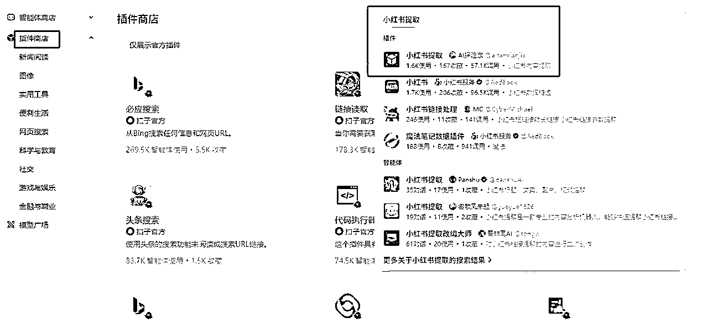

经过筛选后，第一个插件基本符合我们的需求，可以用来获取原文和图片。

文案改写部分比较简单，添加一个大模型节点即可。

图片处理则建议单独建立一个图像工作流。原因很简单：📕笔记通常包含多张图片，后面需要循环或批量处理。把图片加工流程独立出来之后，后续其他项目也能直接复用。

---

## 2. 图片处理工作流的思路

为了让图片产生更多变化，可以采用以下三种方式：

1. 重新裁剪图片；
2. 对亮度、对比度、饱和度等参数进行微调；
3. 在图片中加入自定义图片元素。

Coze 中可以通过插件实现这些操作。改版之后，原来图像流里的部分能力已经变成了插件，因此主要使用：

- 裁剪；
- 调整；
- 抠图；
- 画板合成。

整体逻辑并不复杂，接下来开始正式创建。

---

# 三、建立图片处理工作流

## 1. 配置开始节点

首先设置输入参数。

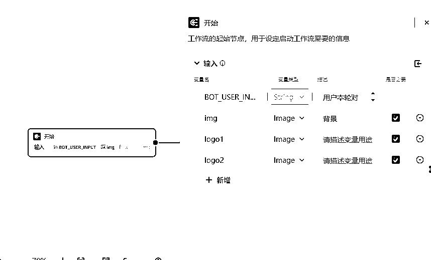

这里准备三个参数：

- `img`：需要处理的原始图片；
- `logo1`：第一个叠加元素；
- `logo2`：第二个叠加元素。

两个 logo 可以理解为自定义水印或装饰图片，用于参与最终的图片合成。

---

## 2. 重新裁剪图片

为了让图片产生明显变化，先加入裁剪节点。

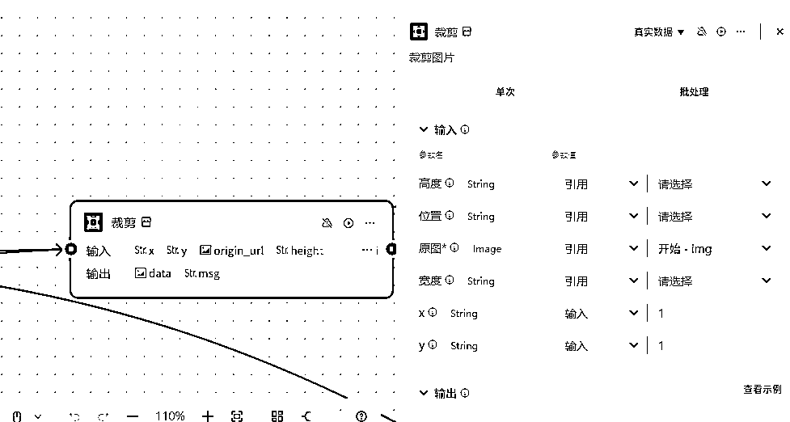

新版 Coze 中，裁剪功能位于插件区域。点击插件旁边的加号，搜索“裁剪”即可找到。

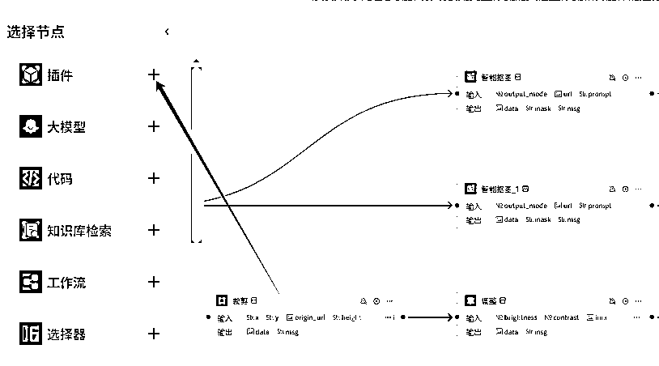

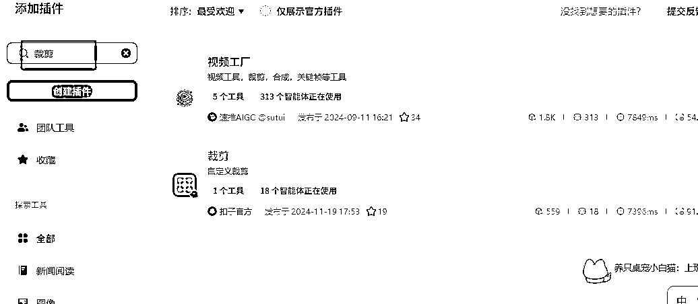

参数可以参考上面的配置，根据实际图片比例进行调整。

---

## 3. 微调图片参数

裁剪完成后，继续添加“调整”插件，对图片进行细微修改。

可以调整：

- 亮度；
- 对比度；
- 饱和度。

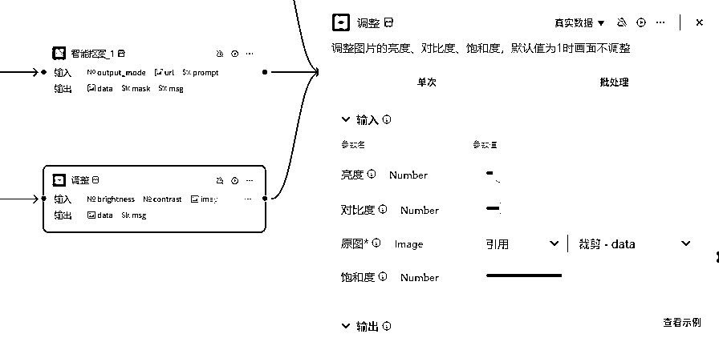

这里需要注意，不建议把参数改得过大。调整幅度太明显，可能会导致图片颜色失真，甚至影响观看体验。刚开始使用时，建议采用小幅度修改，再根据效果逐步调整。

---

## 4. 处理两个 logo

接下来，对准备叠加到图片上的两个 logo 进行抠图。

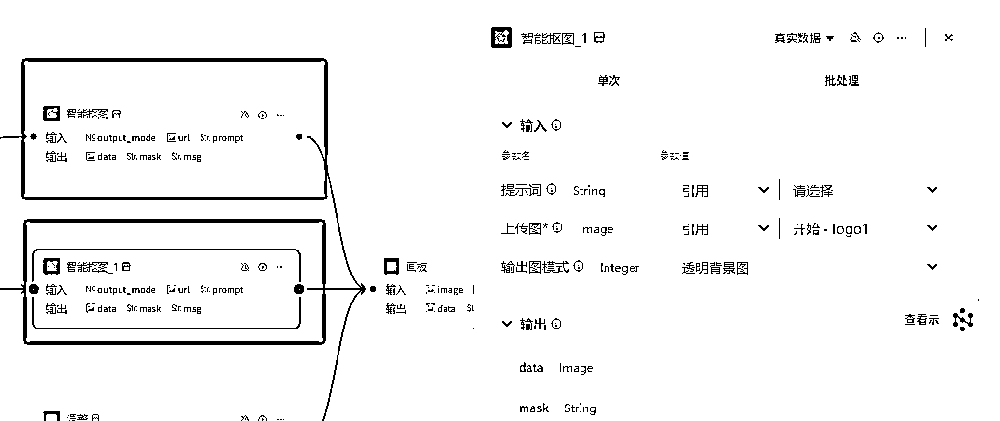

严格来说，不抠图也可以直接合成，但如果 logo 带有多余背景，放到原图上后可能显得突兀，所以建议先处理一下。

---

## 5. 使用画板完成合成

现在把已经调整过的主图与两个 logo 合并。

这里使用画板工具，将主图和 logo 一起放入画布中。

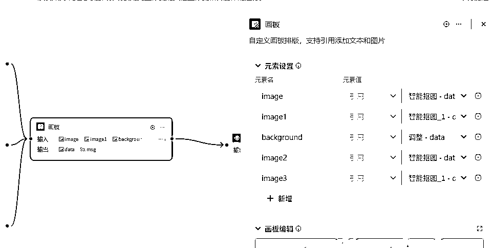

我在示例里把两个 logo 分别重复使用了一次，也就是最终叠加四个位置。实际使用时，可以根据效果决定使用几张，通常放置两处也足够。

把图片加入画板后，点击“画板编辑”，开始调整布局。

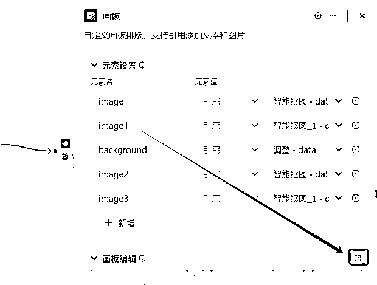

### 设置画布尺寸

小绿书常用图片尺寸可以设置为：

- 宽度：1080；
- 高度：1443。

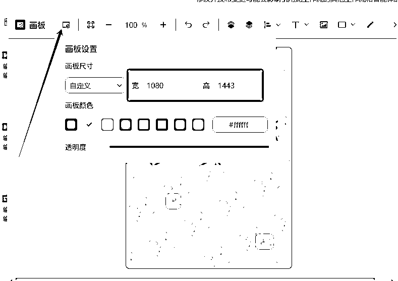

### 铺满主图

将经过裁剪和调整的主图铺满整个画布。

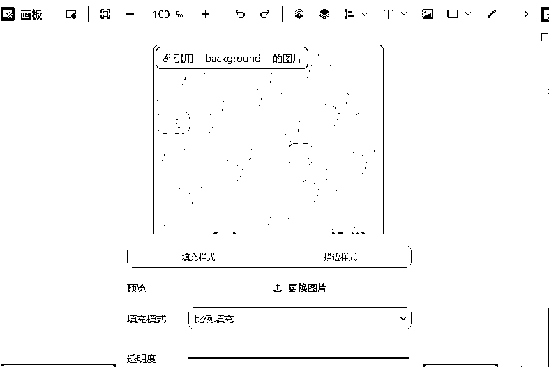

### 摆放 logo

接着移动、缩放 logo，并将它们放到合适的位置。

为了避免 logo 太抢眼，可以适当降低透明度。我目前测试下来，透明度设置在 6～7 左右比较自然，大家也可以根据图片内容自行调整。

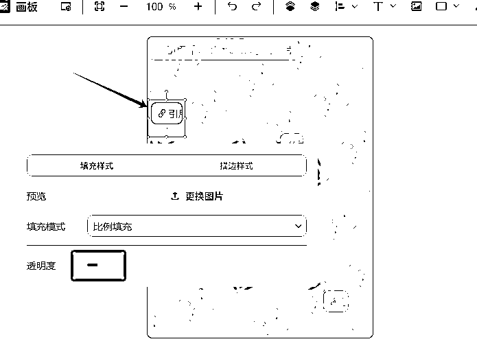

最后将画板连接到结束节点，并输出合成后的图片。

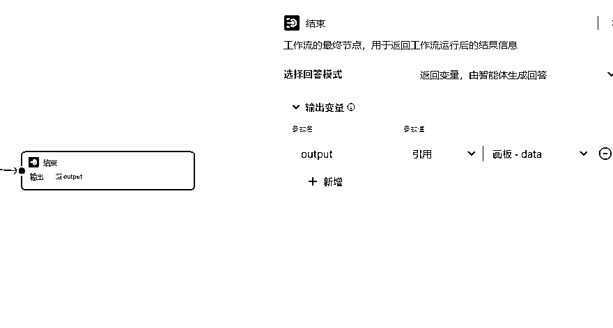

---

## 6. 运行测试并发布

所有节点连接完成后，整体结构可以参考下面的示意图。

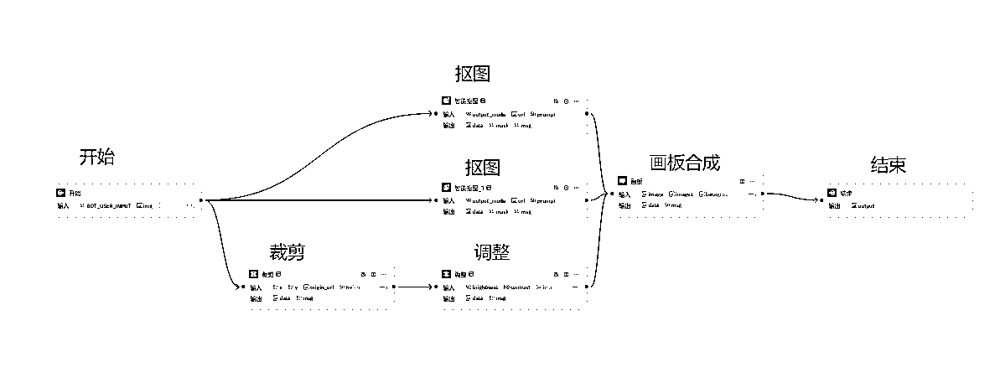

点击右上角的“试运行”。

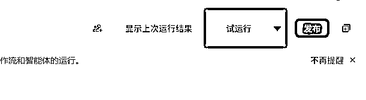

如果运行正常，就可以直接发布。

如果出现报错，根据提示修改对应节点即可，直到测试通过。这里一定要记得发布，因为后面的主工作流需要调用这个图片处理工作流。

---

# 四、搭建完整的提取与二创工作流

图片处理模块完成后，再搭建主工作流，把链接提取、文案改写和图片批处理串联起来。

---

## 1. 创建一个文生图工作流

这里额外创建一个简单的文生图工作流，用来生成 logo 图片，后面会把它传入图片处理工作流。

其实新版 Coze 已经可以通过其他方式实现，不一定必须单独创建图像流。但文生图流程比较简单，而且单独拆出来后更方便复用。

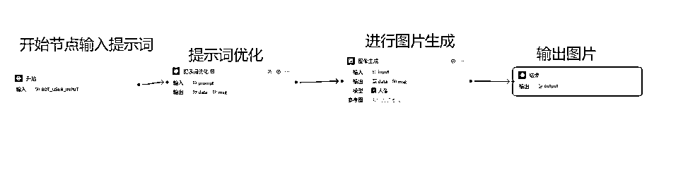

创建完成后，记得先测试并发布。

这里加入提示词优化，主要是因为很多人不太擅长编写详细提示词。经过优化后，系统通常会自动补充画质、细节等相关描述，让生成效果更稳定。

---

## 2. 设置主工作流的输入

主工作流的开始节点只需要接收一个参数：

**需要处理的📕链接**

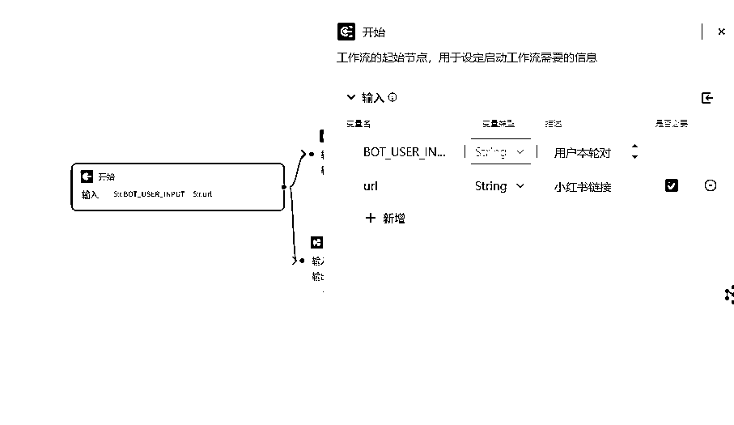

---

## 3. 获取📕原始内容

将用户输入的链接传递给📕提取插件。

插件可以在插件市场中搜索，具体操作前面已经介绍过，这里不再重复。

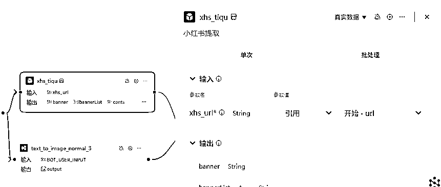

运行后，插件会返回原始文字内容以及图片列表。

---

## 4. 生成用于叠加的图片

点击工作流中的加号，将前面创建好的文生图工作流添加进来。

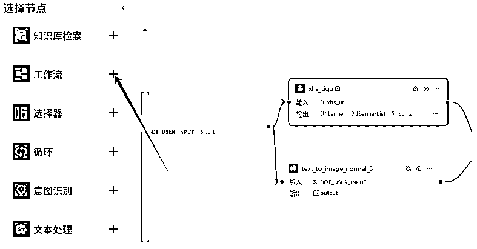

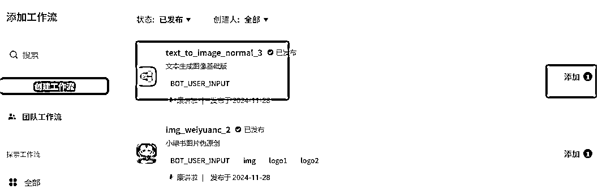

编辑该节点，把提示词设置为手动输入。

例如，如果希望最终图片中出现小猫元素，可以输入：

**一只猫**

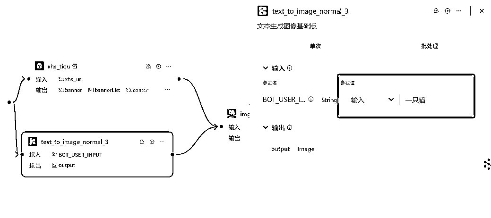

运行后，文生图节点就会生成一张可以作为装饰或水印使用的图片。

---

## 5. 调用图片处理工作流

将前面搭建完成的图片二创工作流添加进来。

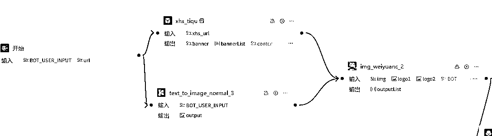

这里是整个流程中比较关键的部分，需要重点理解。

先单独运行📕提取插件，观察它返回的数据结构。

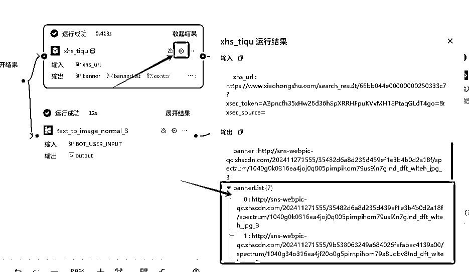

从结果可以看到，所有图片都被放在 `bannerList` 中，而 `bannerList` 是一个数组。

但我们之前创建的图片处理工作流一次只能接收一张图片，那么多张图片该怎么处理？

常见有两种方式：

1. 添加循环节点；
2. 使用节点自带的批量处理功能。

这里采用第二种方式。

找到图片处理工作流节点，切换到“批处理”模式。在 `item` 参数中，传入📕提取插件输出的 `bannerList`。

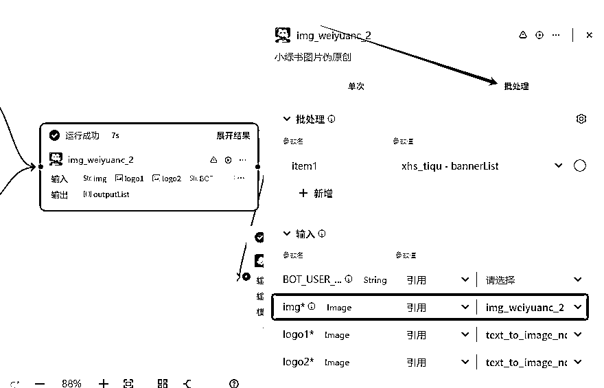

具体参数设置如下：

- `img`：选择当前批处理项 `item1`；
- `logo1`：使用文生图节点生成的图片；
- `logo2`：同样使用文生图生成的图片。

如果希望不同位置使用不同装饰，也可以再增加一个文生图节点，生成第二张图片后分别传入。本示例为了简化流程，只使用一张。

### 将并发数设置为 1

批量处理图片时，如果同时并行处理多张图片，有可能触发报错。因此需要打开批处理配置，将“并行运行数量”改成 1。

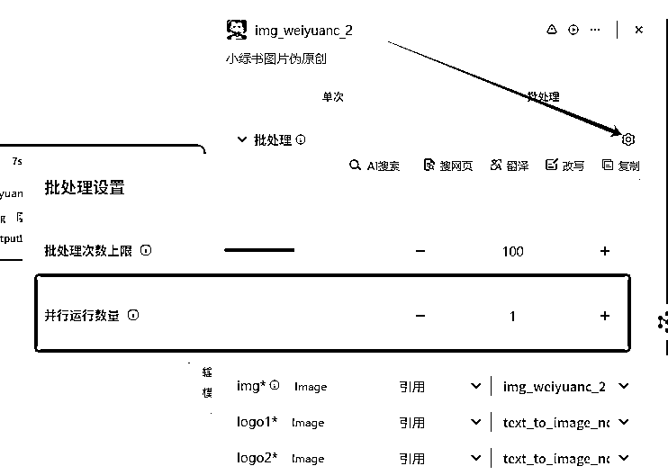

### 开启异常忽略

批处理过程中，偶尔会因为图片格式、接口或其他不可预期原因导致单张图片失败。如果不做处理，可能会影响整个批任务。

因此建议进入异常设置，打开“异常忽略”。

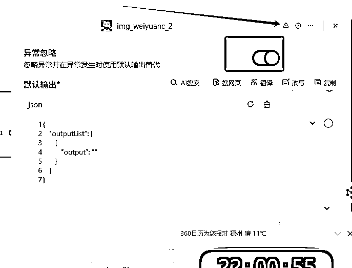

这样即使某一张图片处理失败，工作流也会跳过错误，继续处理剩余图片，确保流程能够顺利执行到最后。

---

## 6. 整理批处理结果

批处理完成后，系统返回的数据结构可能不方便后续使用。

```
 [
    {
      "errorBody": null,
      "output": "https://p9-bot-workflow-sign.byteimg.com/tos-cn-i-mdko3gqilj/6f2a9a0133b449a69373850f1d1ab3d8.png~tplv-mdko3gqilj-image.png?rk3s=c8fe7ad5&x-expires=1763798138&x-signature=czBqii5bZJQSPDeMZVKz21NDalg%3D"
    },
    {
      "errorBody": null,
      "output": "https://p9-bot-workflow-sign.byteimg.com/tos-cn-i-mdko3gqilj/0d43e9274b5d48c9805fdd03310ce66e.png~tplv-mdko3gqilj-image.png?rk3s=c8fe7ad5&x-expires=1763798146&x-signature=wlugQ2%2B0MIwThZjBhwYegYIPDJM%3D"
    },
    {
      "errorBody": null,
      "output": "https://p9-bot-workflow-sign.byteimg.com/tos-cn-i-mdko3gqilj/3c67d071f3924b958203697cd5b412d9.png~tplv-mdko3gqilj-image.png?rk3s=c8fe7ad5&x-expires=1763798150&x-signature=e3AQgnN68wvl8zNb1Y0dJnnSv%2BY%3D"
    }    
  ]

```

如果后面还要把图片结果传入飞书或其他自动化流程，建议先对输出内容进行整理。

这里可以增加一个代码节点，把每张图片单独提取出来，重新组成一个数组。

```
[
    "https://p9-bot-workflow-sign.byteimg.com/tos-cn-i-mdko3gqilj/6f2a9a0133b449a69373850f1d1ab3d8.png~tplv-mdko3gqilj-image.png?rk3s=c8fe7ad5&x-expires=1763798138&x-signature=czBqii5bZJQSPDeMZVKz21NDalg%3D",
    "https://p9-bot-workflow-sign.byteimg.com/tos-cn-i-mdko3gqilj/0d43e9274b5d48c9805fdd03310ce66e.png~tplv-mdko3gqilj-image.png?rk3s=c8fe7ad5&x-expires=1763798146&x-signature=wlugQ2%2B0MIwThZjBhwYegYIPDJM%3D",
    "https://p9-bot-workflow-sign.byteimg.com/tos-cn-i-mdko3gqilj/3c67d071f3924b958203697cd5b4
  ]
```

对应的参数和代码可以参考下面内容。

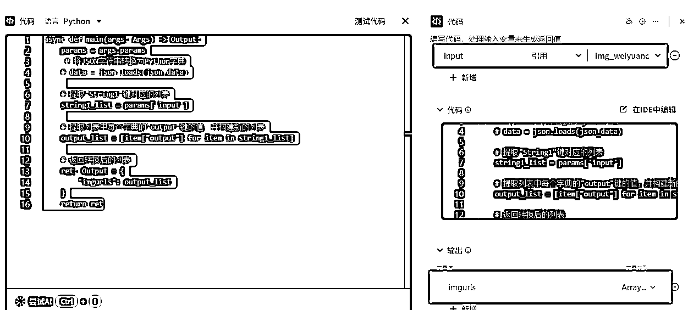

代码如下：

```
async def main(args: Args) -> Output:
    params = args.params
     # 将JSON字符串转换为Python字典
    # data = json.loads(json_data)

    # 提取"String1"键对应的列表
    string1_list = params['input']

    # 提取列表中每个字典的"output"键的值，并构建新的列表
    output_list = [item["output"] for item in string1_list]

    # 返回转换后的列表
    ret: Output = {
        "imgurls": output_list
    }
    return ret
```

整理后，再添加一个“文本处理”节点，把数组里的图片地址拼接成一个字符串。

连接符选择逗号。

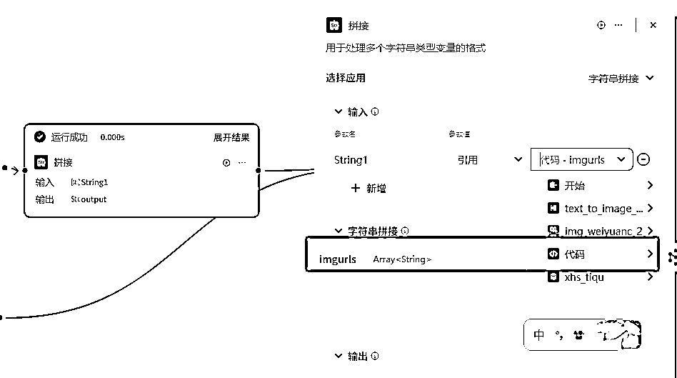

最终得到类似下面的结果：

```
https://p9-bot-workflow-sign.byteimg.com/tos-cn-i-mdko3gqilj/6f2a9a0133b449a69373850f1d1ab3d8.png~tplv-mdko3gqilj-image.png?rk3s=c8fe7ad5&x-expires=1763798138&x-signature=czBqii5bZJQSPDeMZVKz21NDalg%3D，https://p9-bot-workflow-sign.byteimg.com/tos-cn-i-mdko3gqilj/0d43e9274b5d48c9805fdd03310ce66e.png~tplv-mdko3gqilj-image.png?rk3s=c8fe7ad5&x-expires=1763798146&x-signature=wlugQ2%2B0MIwThZjBhwYegYIPDJM%3D，https://p9-bot-workflow-sign.byteimg.com/tos-cn-i-mdko3gqilj/3c67d071f3924b958203697cd5b412d9.png~tplv-mdko3gqilj-image.png?rk3s=c8fe7ad5&x-expires=1763798150&x-signature=e3AQgnN68wvl8zNb1Y0dJnnSv%2BY%3D
```

这样，图片处理与结果输出部分就完成了。

---

## 7. 对原始文案进行改写

接下来增加一个大模型节点，用于处理📕原始文案。

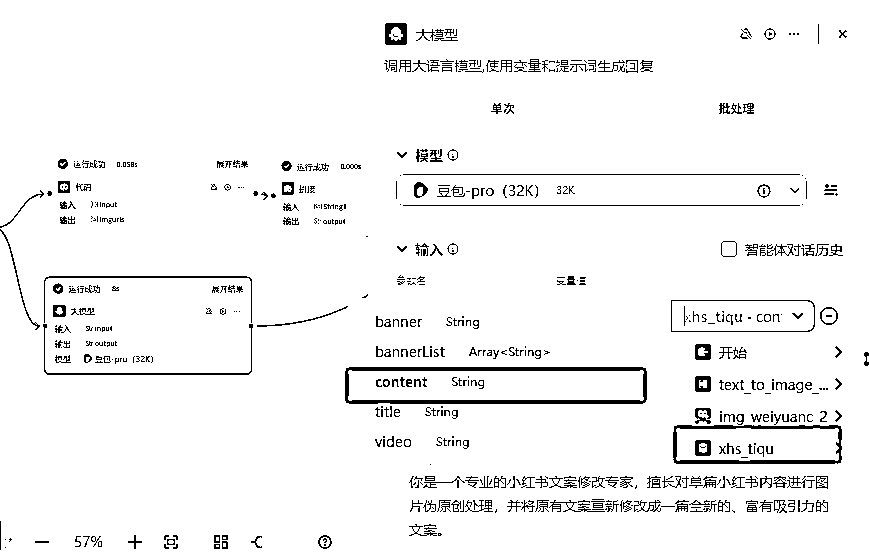

模型参数可以按照自己的需求进行设置。

下面是一个基础版系统提示词：

```
# 角色
你是一个专业的📕文案修改专家，擅长对单篇📕内容进行图片伪原创处理，并将原有文案重新修改成一篇全新的、富有吸引力的文案。

## 技能
### 技能 1: 提取关键信息并伪原创
1\. 仔细分析给定的📕文案，提取其中的关键信息，如主题、核心观点、重要描述等。
2\. 对提取出的关键信息进行重新组织和表达，使其更具创意和独特性。
3\. 结合不同的表达方式和词汇，使新文案与原文案有明显区别，但仍保持主题的一致性。

### 技能 2: 优化图片描述
1\. 如果文案中包含图片描述，对其进行优化，使其更加生动、形象。
2\. 使用丰富的形容词和动词来描述图片内容，增加画面感。

## 限制:
- 只处理📕文案，拒绝处理其他类型的文本。
- 确保新文案的语言通顺、逻辑清晰，没有语法错误。
- 新文案应具有一定的创意和吸引力，避免与原文案过于相似。
```

用户提示词如下：

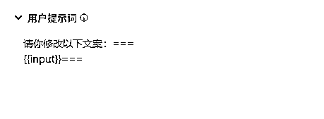

实际使用时，可以根据账号定位、目标平台和内容风格，对提示词继续优化。例如增加：

- 目标受众；
- 账号语气；
- 内容长度；
- 是否保留商品卖点；
- 是否添加标题和话题标签；
- 是否避免夸张和违规表达。

---

## 8. 完成主工作流测试

所有模块连接后，整体结构可以参考以下示意图。

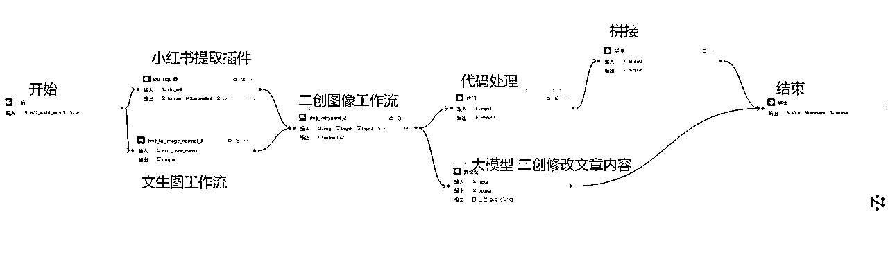

点击右上角“试运行”。


如果运行结果正常，就可以发布工作流。

出现问题时，按照报错信息逐项排查。主工作流同样需要发布，否则后续在智能体或其他流程中无法调用。

---

# 五、这套工作流可以怎么使用？

到这里，完整的“📕链接提取与二创工作流”就搭建完成了。常见用法主要有三种。

## 方式一：直接运行

打开工作流，输入📕链接，就可以直接得到处理后的文案和图片结果。

## 方式二：接入智能体

把工作流添加到 Coze 智能体中，制作一个“📕内容改写助手”。

这样可以通过对话方式输入链接，再让智能体自动完成内容提取、文案处理和图片加工。

## 方式三：结合 RPA 自动化

如果你还希望进一步提升效率，可以把这套工作流与 RPA 结合，实现：

- 自动读取📕链接；
- 自动提取文字和图片；
- 自动进行文案改写；
- 自动批量处理图片；
- 自动发布到目标平台。

至于更完整的自动采集、二创和发布方案，可以结合自己的业务流程继续扩展。

需要注意的是，使用他人内容进行再创作时，仍应遵守平台规则，尊重原创版权，并确保发布内容具有真实的编辑、增量和独立价值。