# 《单店月销200万+，📕电商实操全流程拆解》

无推广纯干货版

大家好，我是龙哥，也是抖音同名账号。93年，内容创业做了10年，广告、MCN、电商都碰过。加入龙哥盟三年，一直潜水学习，最近开始输出，蛮紧张的，麻烦多支持一下。我现在主要做📕电商和个人IP，📕电商整体做到月均千万级别。

个人商业IP每月变现约100万。📕疗愈+声音赛道，粉丝体量200万+，IP变现过千万。

电商方面，旗下多家店铺稳定月销100万以上，最高单店月销800万，单篇笔记最高带货80万，退货率控制在8%左右，冬季品类上升也在20%以内。这个成绩在圈内很难被超越。

今天这篇就是要把单店月销200万+的📕电商打法，完整讲透。内容比较长，详细资料见飞书。

目录概览：

📕关键数据展示

一：当下最有效的打法——服务器爆破法

二：底层逻辑拆解

三：素材搬运玩法

四：笔记批量化生产体系

五：电商实拍爆款素材制作指南

六：素材结构配比逻辑

七：📕电商运营注意事项

### 📕关键数据展示

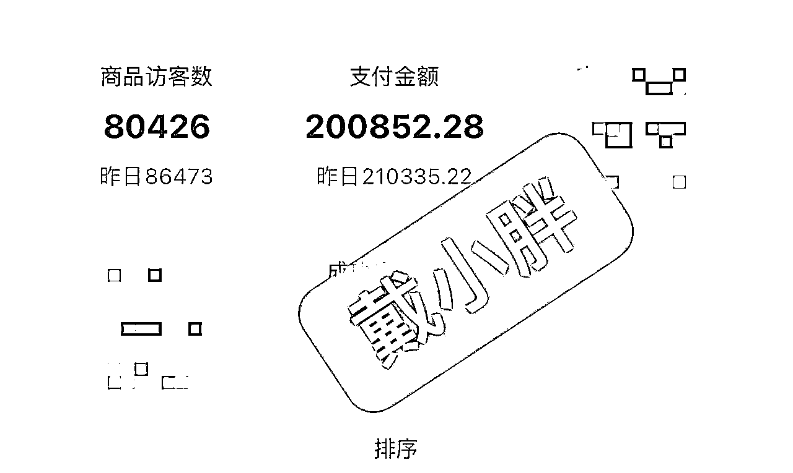

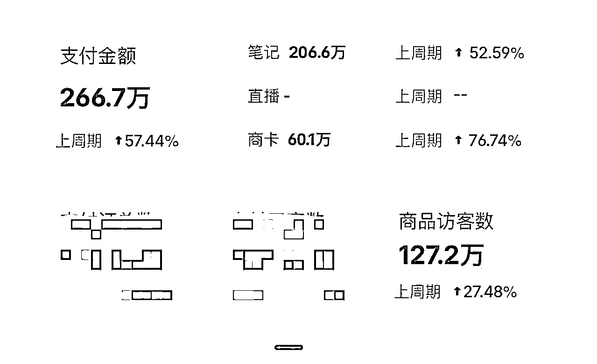

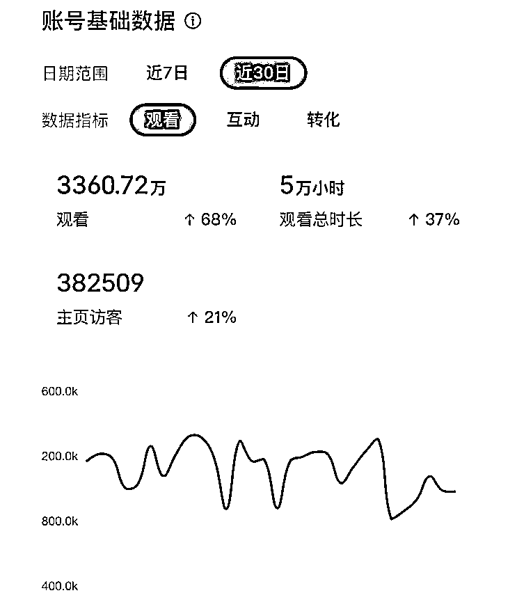

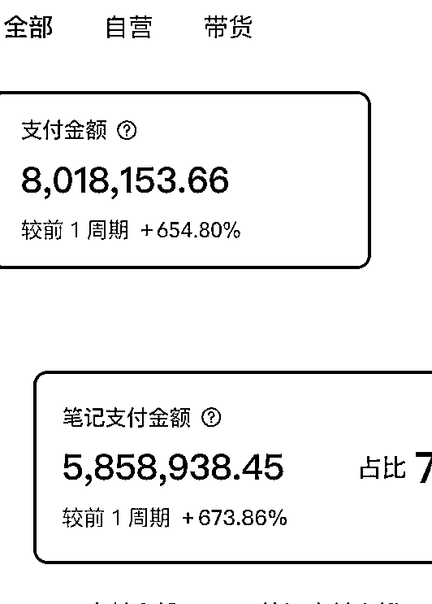

### 一、当下最有效的打法——服务器爆破法

这是我总结出的目前📕电商最强路径——服务器爆破法。正在做或准备入局的人必须掌握。

核心就是用无限扩号、扩量、扩笔记的绝对体量去碾压概率。

我们过去的打法是10万条笔记战役，单号日更50篇，一个月就能产出200多万条内容。

先讲底层逻辑，再讲落地操作。

### 二、底层逻辑拆解

1、批量收割平台的基础保量。发一条笔记，平台基本会送你200播放的基础流量券，发一条送200，免费的流量不拿白不拿。而且针对精准人群的素材，并不需要高播放，只要有转化就行。我很多笔记阅读量只有40也能出单。

2、用体量去击中概率。📕的流量分发极其不讲逻辑，但也因此机会最大。我们随手下楼取快递拍的笔记，也有1600万播放、50万GMV的案例。为什么会爆？因为我发了10万条，跑出几条千万播放是必然的。

### 三、素材搬运玩法

##### 无中生有搬运法

这套玩法不需要你原创，直接把现成的爆款拆解重组。

操作步骤：

第一步：挑2篇同行爆款，分别拆出封面A和封面B，内容A和内容B。

第二步：用去重工具做100%去重处理。

第三步：重新组合，去重后的封面A+去重后的内容B组成一篇，去重后的封面B+去重后的内容A组成另一篇，再用GPT生成2个爆款标题分别搭配。

理论上，20篇爆款原素材，经过去重重组能产出200篇原创组合，再配20个标题，就能裂变出4000篇可用的笔记。

### 四、笔记批量化生产体系

稳定日产1000篇原创笔记，其实并不难。

模板获客类：10个爆款背景 × 10个爆款话题 × 10个爆款标题 = 1000条素材。

电商实拍类：10个固定爆款角度 × 10个固定爆款产品 × 10个固定爆款场景 = 1000条素材。

以电商实拍为例：

1、先找站内正在爆的低粉笔记。

2、拆解标题、封面、文案、正文、标签。

视频爆款要素拆解

*   BGM文案：直接复用，剪映分离音频即可。
*   画面分镜：1V1拆解，统一角度连拍100条，换配饰、道具。
*   画面要素：运镜、角度、光线、色调。
*   技术实现：按爆款视频分镜1V1仿制，出拍摄大纲。

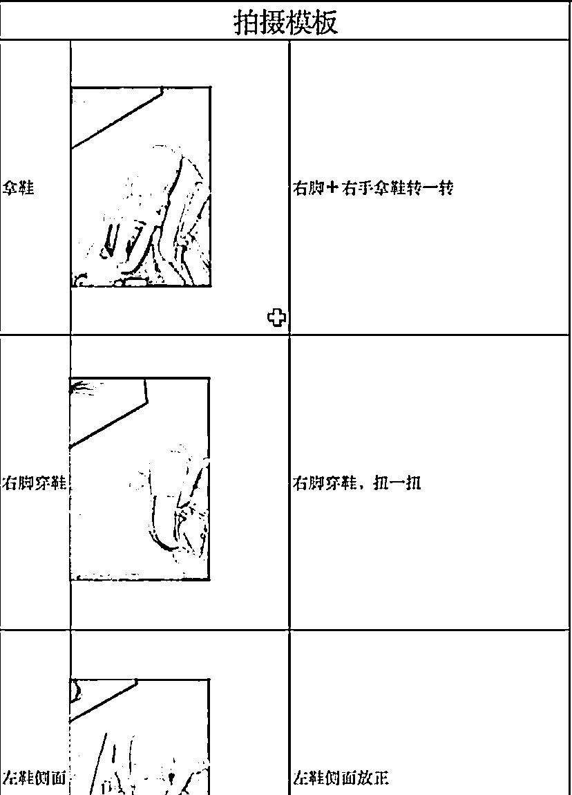

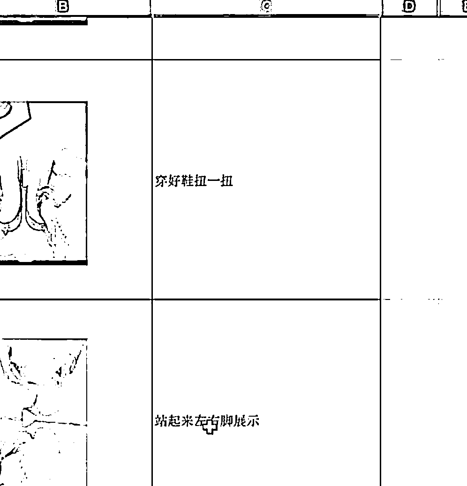

*   每条镜头一次性拍100条并编号，换道具、小布景，比如饮料换成可乐雪碧、箱子颜色更换、背景更换。

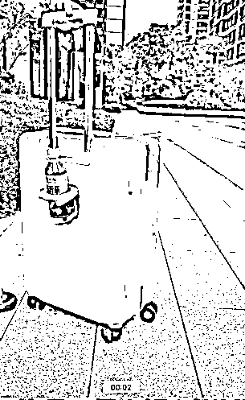

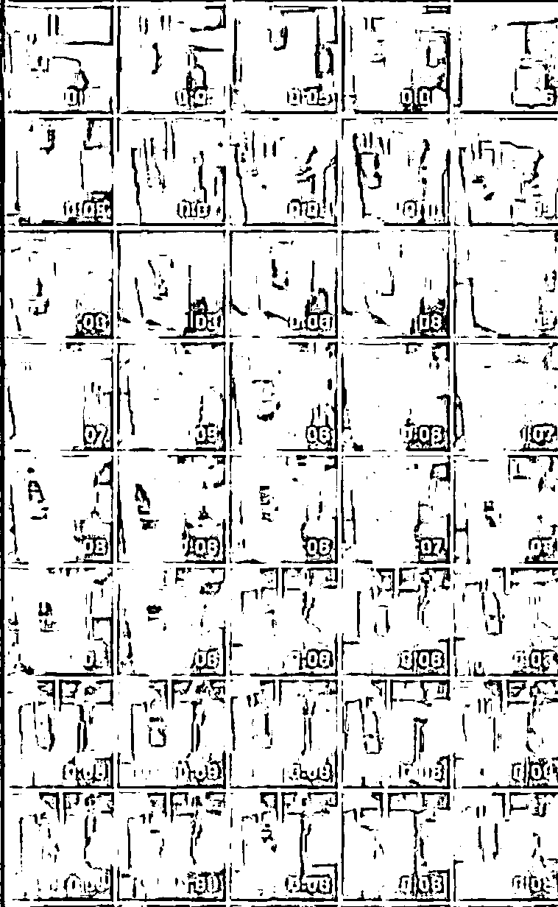

*   分组打包给剪辑统一处理。

Live图笔记爆款要素拆解

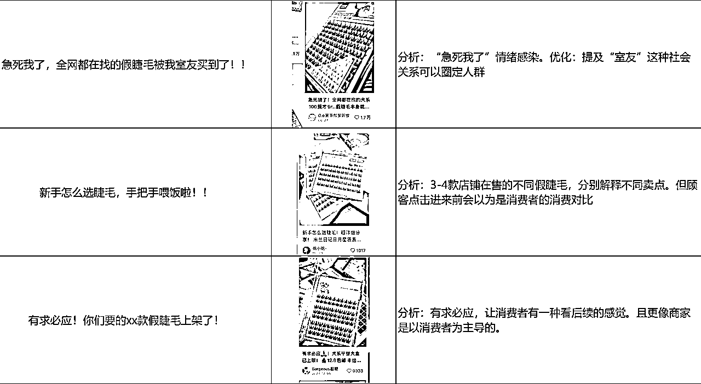

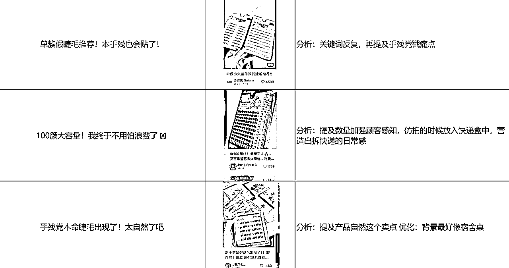

3、像素级模仿，找到产品可借力的爆款点，直接像素级复刻。

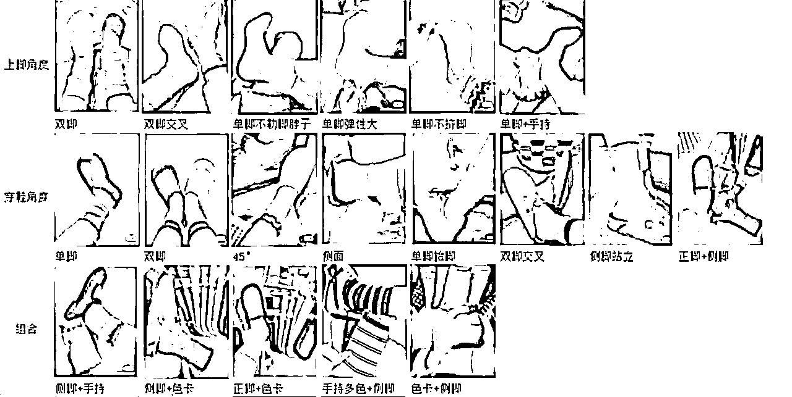

批量生产的核心是内容模板化+流程标准化。我们用爬虫抓取大量低粉爆款笔记，每周更新当周素材库，进行拆解和极致模仿。

最后的问题：如何日产100万条笔记？答案是堆量。1台手机扛1000条，1000台手机就能扛100万条。这套方法已在社群和学员中验证，食品、女装、养生、百货等多个品类均可直接上手。

### 五、电商实拍爆款素材制作指南

先分享两个提升转化的小技巧。

#### 一、如何做带价格、带评价的高转化Live图封面

1.点击➕

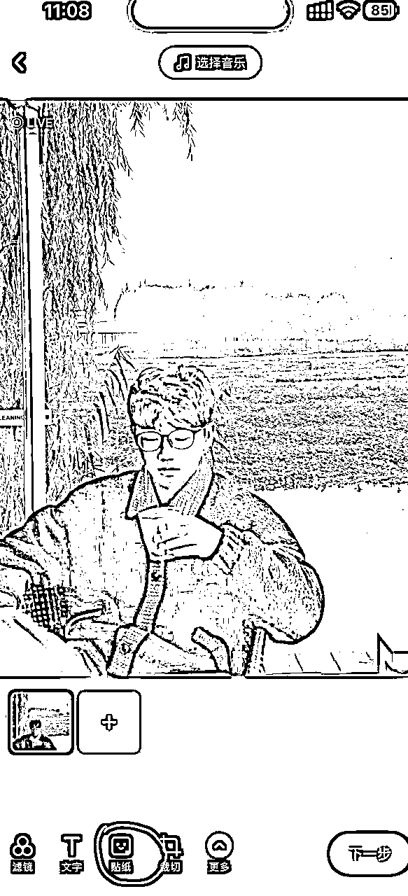

2.上传你的Live图素材

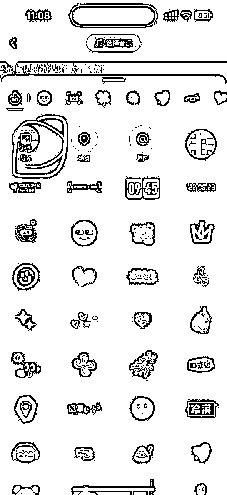

3.打开贴纸功能

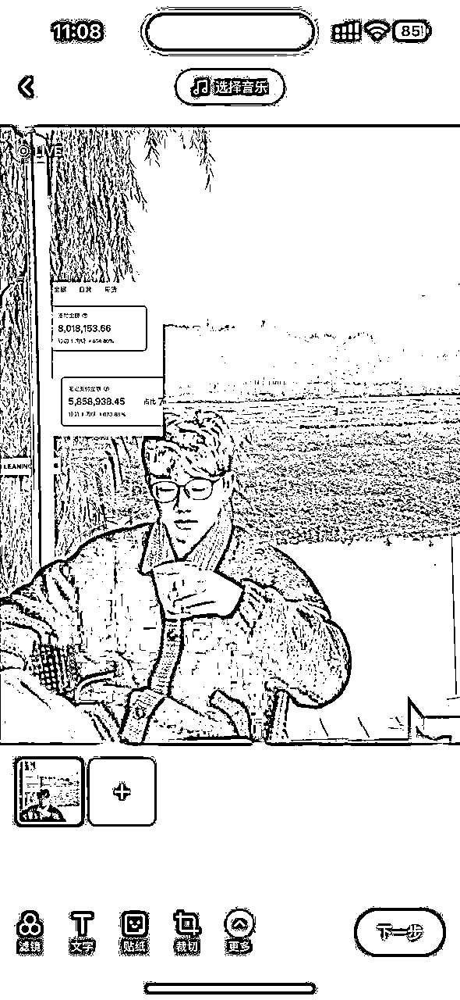

4.从相册上传价格截图或好评截图，调整位置后发布即可。

#### 二、如何批量制作Live图

Live图不止实拍，搬运视频抽帧也可以。我拍一段3分钟视频，挑10个最好的3秒片段做Live图完全够用。

1、打开编辑软件

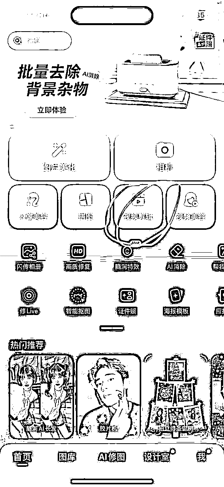

2、导入视频素材

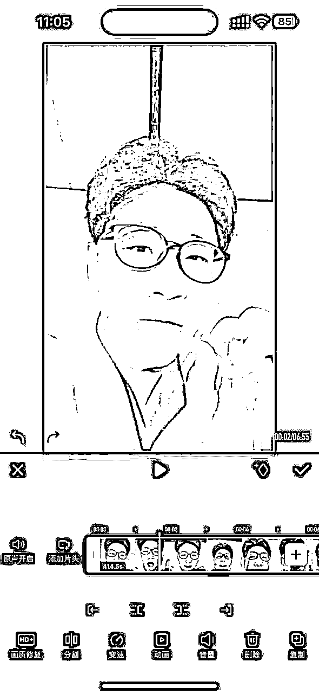

3、截取最优的3秒片段

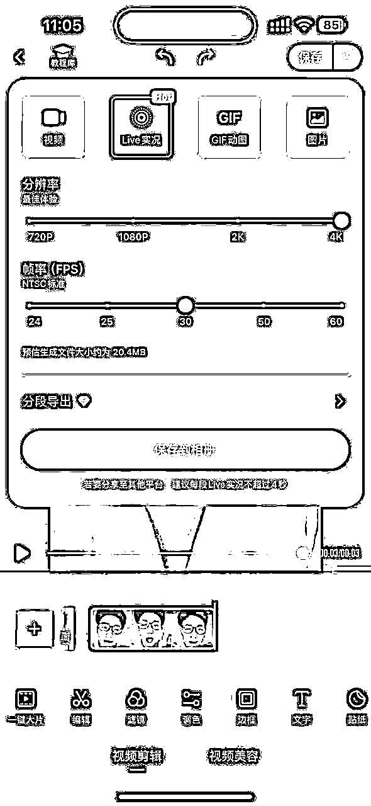

4、点右上角三个点，选择保存为Live图。

这个方法既能解决新手拍照困难，也能把站外爆款搬运后去重抽帧输出。

#### 三、实拍Live图拍出高转化的关键要素

核心四要素：灯光、角度、背景、焦距。

灯光最重要也最被忽视，推荐3500-4000K中性无影灯做主光，没预算就用下午四五点透过窗帘的柔光。

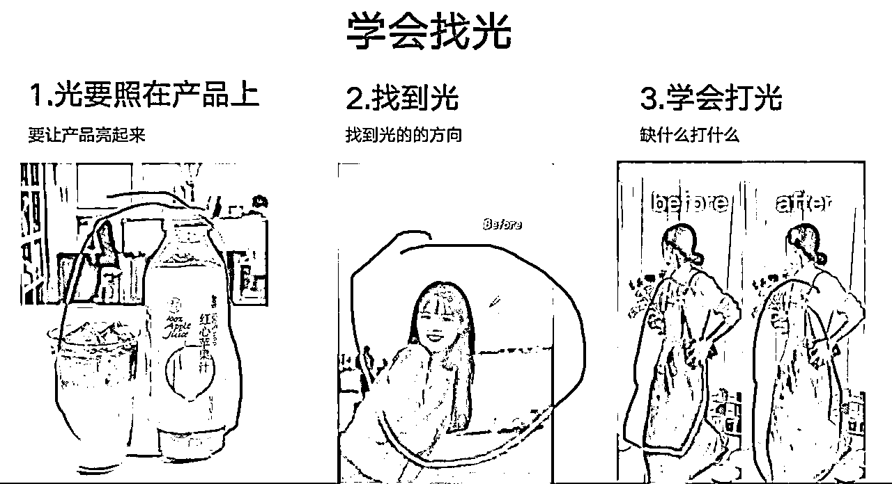

角度直接抄千赞爆款笔记的角度，完全照搬。

背景建议逐步升级，先用拼多多花一两百买摄影道具，再过渡到📕的高级感软装，按图购买二手平替即可。

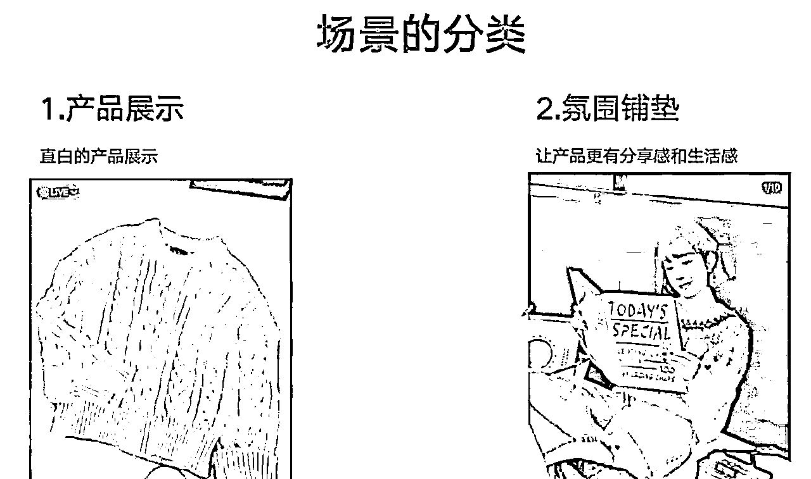

焦距决定质感。同样的角度背景，焦距不对就爆不了。

#### 四、Live图的进阶玩法

Live初阶是越随意越好，越真诚分享越有流量。📕爆款永远是随意的买家秀，不是卖家秀。

进阶是看起来随意，实则每张图都藏着800个心眼。就像你的绿茶闺蜜，说好不化妆却化了裸感清纯妆，说好随便穿却处处是心机。

所以进阶Live是有所随意，有所不随意。

以女装举例：

场景可以随意，上班、居家、落叶。

视角可以随意，爆款角度永远是随意的角度。

不随意的点：配饰、模特身材气质、灯光、穿搭。你以为随便穿，其实是各种遮髋遮胯、oversize、凹造型。

最终营造出富家千金刚脱下卡地亚，换上平价吊带的错觉，让用户产生向往感。

这就是网感，这就是爆款网感。

### 六、素材配比思路

#### Live图 vs 视频对比

Live图：点击率高、转化率高、加购率高、爆发力强、产出快、新人友好。缺点是基础流量小、爆发周期短。

视频：爆发周期长、稳定持久、天花板高，单条视频持续爆6个月、变现百万很常见。缺点是产出效率低、新手难把控。

#### 配比建议

1、起号期：Live 90% + 视频 10%。Live上手快转化高，40个小眼睛也能出单，快速堆量搏概率。一般3天内必爆，7天可上榜。

2、大店期：Live 30% + 视频 70%。店铺权重高、人员素质高，需要用持久爆发的视频去承接流量。即使视频质量一般，链接权重也能推着出单，后续猜你喜欢流量会接力。

3、常规期：月销几十万的团队建议Live 70% + 视频 30%，保证爆发和效率。

4、常规进阶：Live 50% + 视频 50%。Live减少同质化场景，增加新鲜元素和多布景，视频提升持久力，同时规避新规对同质化和不真诚营销的打击。

### 七、📕电商运营注意事项

#### 1、如何规避最严新规

如何避免同质化、不真诚营销的处罚？

第一，拥抱实拍。实拍效率远高于搬运混剪。1条3000赞的Live图可卖6000单，变现几十万。日拍上千张Live图很轻松，10个固定角度×10个固定场景×10个固定产品=1000条笔记。

第二，低成本搭建高级场景。搜索“100块打造高级感场景”“香奶奶挂画”“好看壁炉”等，低价高质场景随意搭建。

第三，必须做多品策略。单一产品单一脚本已被严打。要铺量博概率吃低保流量，就必须多品多SKU，每个SKU都投放适量的素材。

实操要点：

1物理隔离+场景隔离，绝不让两个账号同场景同角度铺量，多搭场景即可。

2主号仅起号期发笔记，3天冲榜后流量由子号承接。

3适当提高视频比例，近期视频流量明显逆势上涨。

4拍摄时增加新鲜元素，配饰、咖啡、闺蜜互动等，避免同质化。

5可对标A封面+B文案+C标签重组内容，把重复度降到30%以下，规避系统检测。

#### 2、堆量发布的时间间隔

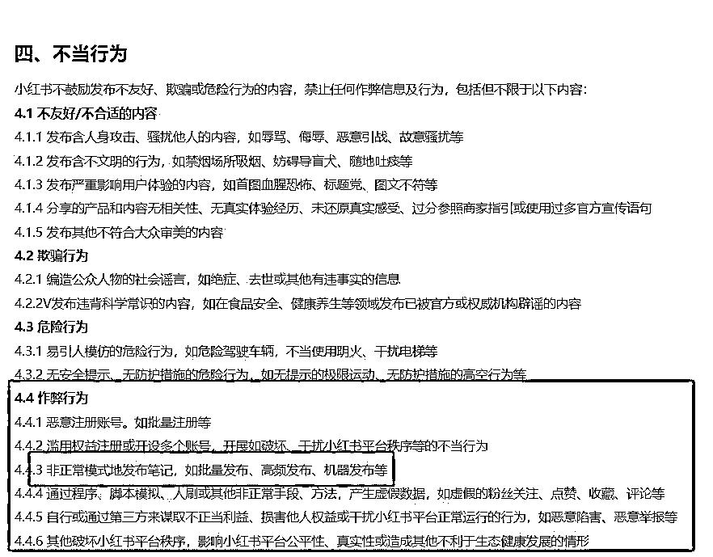

量小隔1小时，量大隔半小时，根据体量调整。

配比：白天30条，半夜10条。白天手动间隔约40分钟/条。

例如白天每发3条就定时晚上发1条，12点发1条，12点40发1条，1点20发1条，1点40定时1点的内容，以此类推。

我们常用的间隔参考：

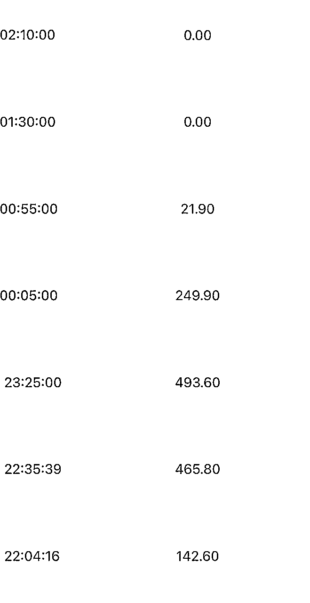

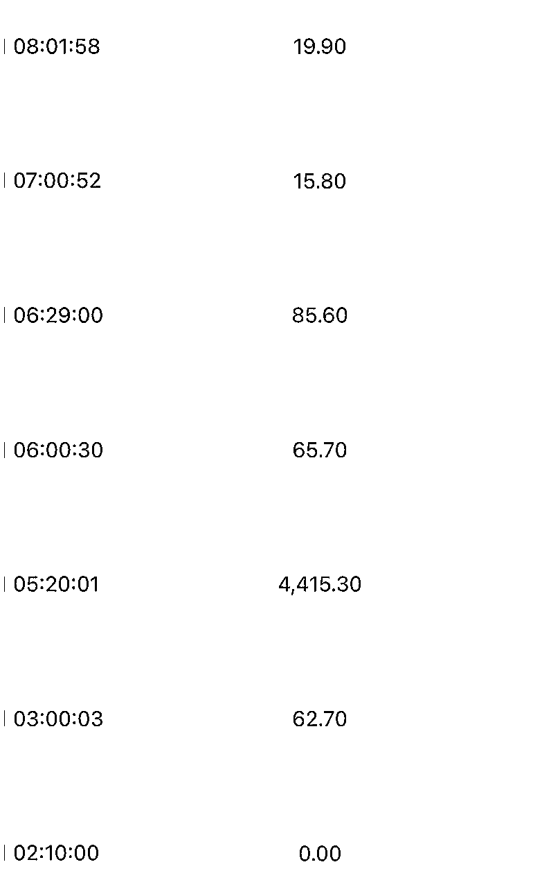

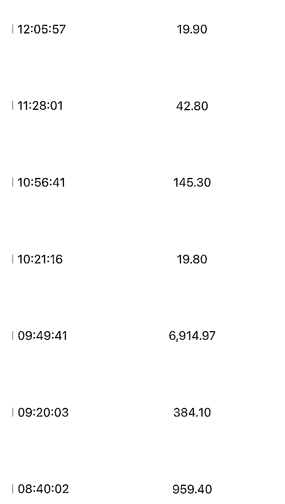

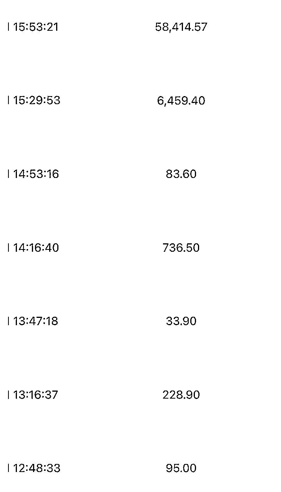

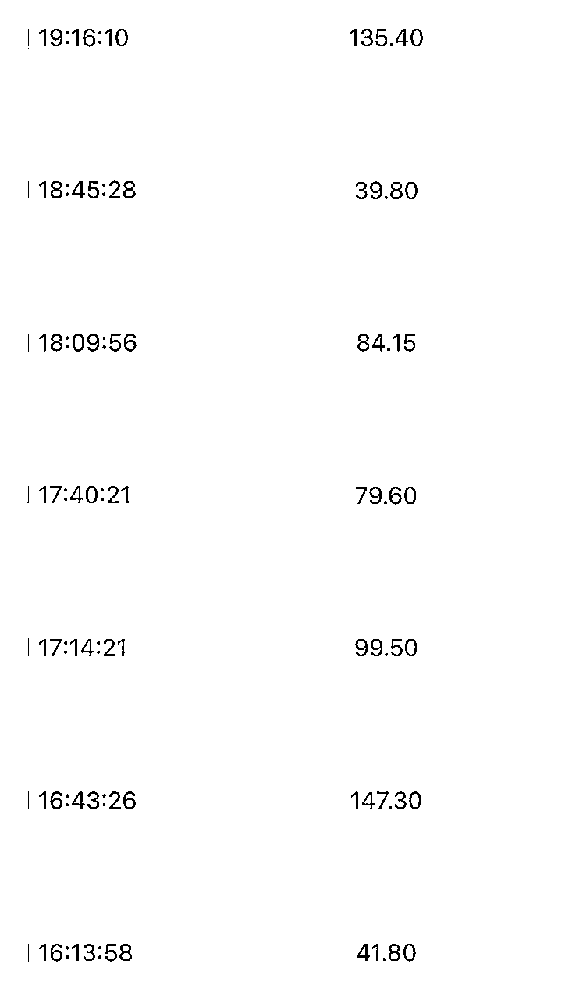

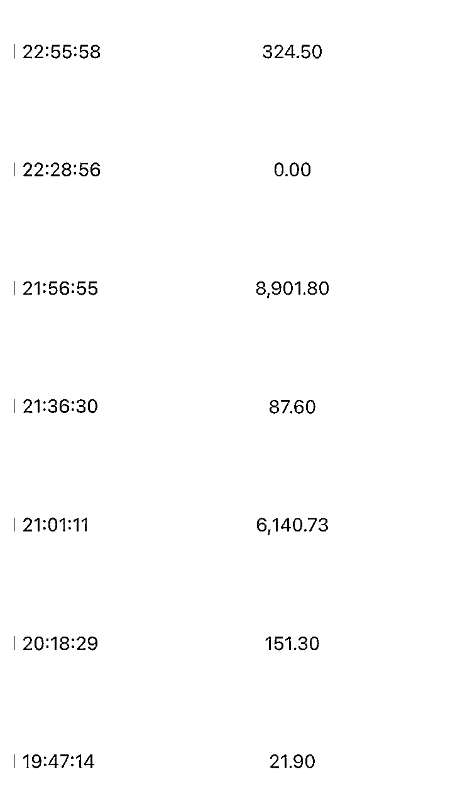

分享就到这里，觉得有用的朋友点个赞支持一下~