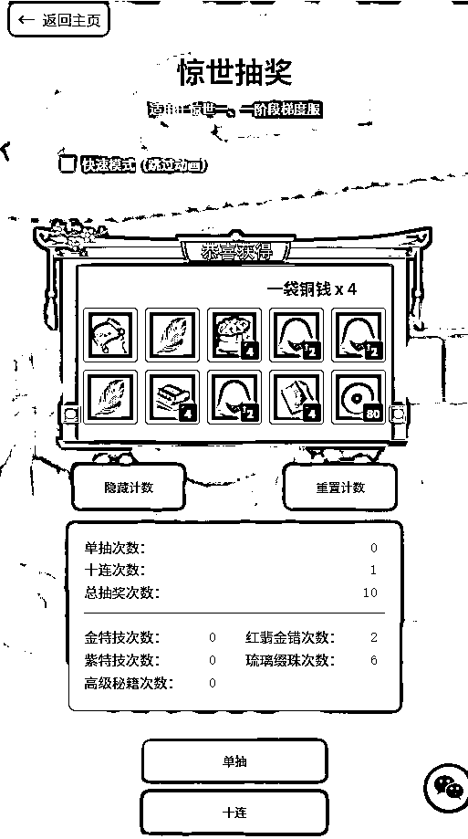
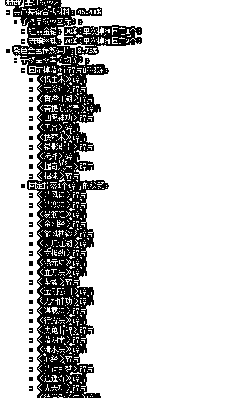
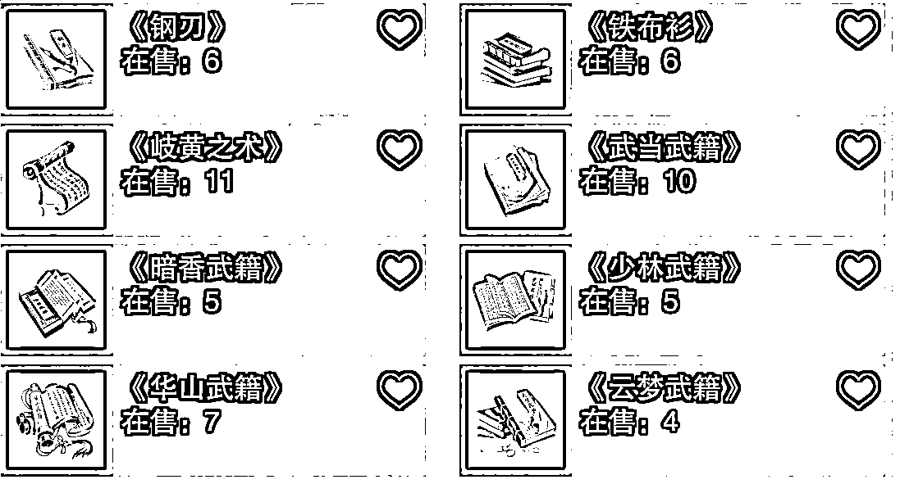
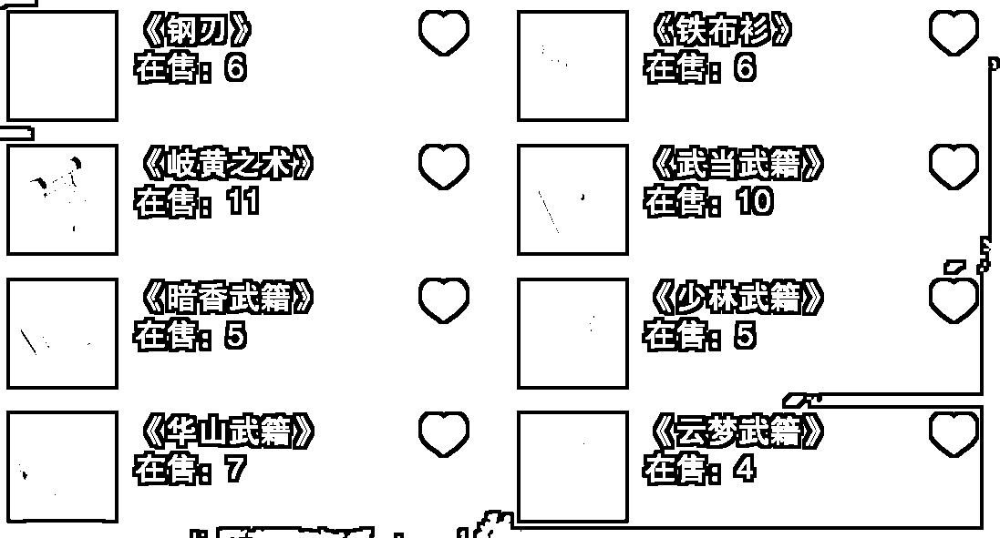
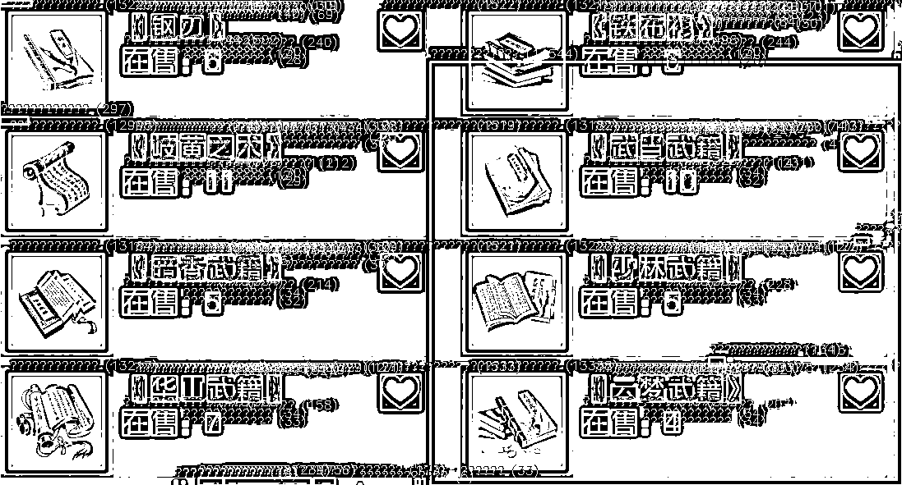
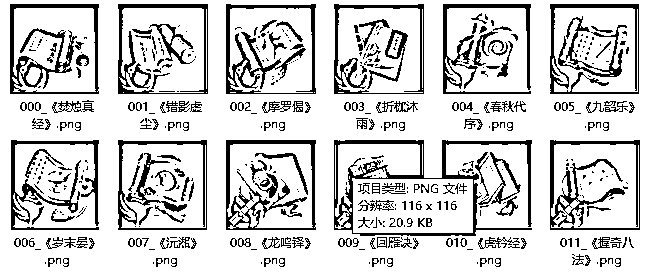
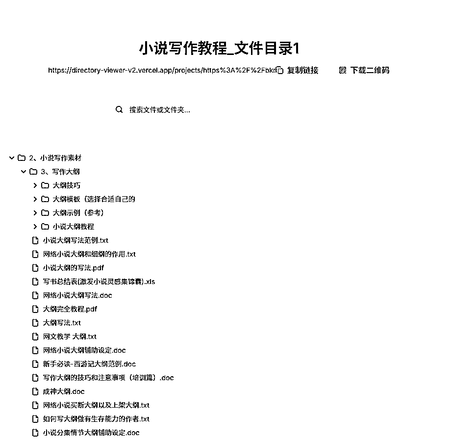

# ('不会编程的新人小白在cursor航海收获了什么？', (2, 26))

零基础小白用Cursor“航海”，不仅做出了两个网站，还赚到了钱？

老实说，在开始这次Cursor航海之前，我连一行代码都没写过。但这趟折腾下来，我不但做出了两个能用的网页工具，还顺手卖出了几单游戏脚本，收获远超预期。想把这趟旅程记录下来，给同样不敢下水的朋友一点参考。

先说说我最先做的抽奖模拟器吧。

起因特别简单：我常玩的一款游戏里，抽奖一次要6块钱，概率还低到让人怀疑人生。但游戏圈里大家普遍相信“垫刀”——也就是在正式抽奖前，先抽一堆别的奖，把“坏运气”消耗掉。于是我就冒出个念头：干脆把游戏里的抽奖搬到网页上，做成一个免费的模拟器，让大家随便垫、随便爽。

接下来就是和Cursor聊需求。具体过程不展开，航海手册写得很细，遇到不懂的直接问Cursor，什么问题都能问。放一下网站和概率图，给大家感受一下：

目前这个抽奖模拟器已经累计1300多次访问了，我还顺手在网站上挂了个游戏脚本代卖，也卖出去几单。访问量截图在这：

最让我头疼的环节，是200多件物品的图片和名称要一一对应。光靠手动根本做不完。于是我又让Cursor写了个小工具，把图片灰度化、自动识别物品边框、再批量切割命名。一套流程下来，效率直接起飞。我也因此悟出一个道理：凡是需要机械重复点击、重复处理的电脑操作，几乎都能找到批量解决的办法。工具处理的效果长这样：

第二个作品叫目录查看器，灵感来自我同时参加的闲鱼虚拟资料航海。

当时手头有份要卖的虚拟资料，文件特别多、体积也大，截图只能展示一小部分。有个客户就来问：能不能看看完整目录？可要是直接甩网盘链接，人家一下就把资料全拿走了。后来我发现百度网盘可以导出目录的txt，但那个格式实在折磨人——整整13003行，正常人根本读不下去。于是我又把主意打到Cursor身上：让用户把目录txt上传到网站，自动生成一个可展开的网页目录，每个文件夹都能随意展开收起，还支持搜索。

再把链接或二维码发给客户，客户就能直接看到完整的资料清单，信任感瞬间上升，成交率也跟着涨。最终效果就是下面这种可折叠的目录页：

这段开发过程也踩了不少坑，分享几个特别重要的心得。

第一，动手前一定要先和Cursor聊清楚实现方案。做目录查看器的时候，我一开始没多想，用了数据库存数据，结果部署到Vercel上才发现，免费数据库容量太小，小文件没问题，大文件目录直接失败。后来反复排查，才看到Cursor提示说“其实可以不用数据库”，当时我整个人都不好了——前面全白干了。重新讨论方案后，才做成现在这样，大文件小文件都能兼容，还只用免费的存储空间。

第二，开发阶段一定要让Cursor把日志加上。遇到bug的时候，光说“失败了”很难定位。比如切割图片那小工具，一开始怎么都切不对，不是位置偏移就是尺寸不对。后来我让Cursor把每一步的处理结果都输出成日志，一步步导出图片，把问题标出来，甚至把识别正确的框用绿框标出来。有了日志，再出bug就把日志丢给Cursor，马上就能精准找出问题，效率简直天差地别。日志和代码截图如下：```
                # 二值化处理
                _, binary = cv2.threshold(mask, 127, 255, cv2.THRESH_BINARY)

                # 形态学操作，确保网格线连续
                kernel = np.ones((3,3), np.uint8)
                binary = cv2.dilate(binary, kernel, iterations=1)
                binary = cv2.erode(binary, kernel, iterations=1)

                # 二值化和形态学操作后，保存调试图像
                debug_binary_path = os.path.join(binary_output_folder, f'debug_binary_{image_file}')
                cv2.imwrite(debug_binary_path, binary)
                print(f"二值化处理完成，已保存调试图像: {debug_binary_path}")

                # 反转图像，使图标区域为白色，网格线为黑色
                inverted = cv2.bitwise_not(binary)

                # 反转图像后，保存调试图像
                debug_inverted_path = os.path.join(binary_output_folder, f'debug_inverted_{image_file}')
                cv2.imwrite(debug_inverted_path, inverted)
                print(f"图像反转完成，已保存调试图像: {debug_inverted_path}")

                # 连通区域分析
                num_labels, labels, stats, centroids = cv2.connectedComponentsWithStats(inverted, connectivity=4)
                print(f"\n找到连通区域数量: {num_labels - 1}")

                # 面积统计和分析
                areas = [stats[i, cv2.CC_STAT_AREA] for i in range(1, num_labels)]
                if not areas:
                    print(f"在 {image_file} 中未找到任何有效区域")
                    continue
               # 判断区域是否有效
                    if area < min_area:
                        reason = "面积过小"
                        color = (0, 0, 255)  # 红色
                    elif area > max_area:
                        reason = "面积过大"
                        color = (0, 255, 255)  # 黄色
                    elif aspect_ratio < 0.7 or aspect_ratio > 1.1:  # 调整宽高比范围为0.9-1.1
                        reason = "宽高比不符"
                        color = (255, 0, 0)  # 蓝色
                    elif w < 40 or h < 40:
                        reason = "尺寸过小"
                        color = (255, 0, 255)  # 紫色
                    else:
                        reason = "有效区域"
                        color = (0, 255, 0)  # 绿色
                        valid_count += 1
```

第三，每完成一个小功能，或者做完一个小项目，一定要立刻保存版本。Cursor在开发过程中很容易“改一处坏一处”，本来好好的功能，加了新东西之后突然就崩了，然后陷入无限改bug的循环。所以版本保存太重要了。航海手册里推荐的GitLens我强烈推荐，我的目录查看器项目就存了十几个版本。

第四，耐心真的不能少。Cursor不是万能的，它会理解错你的意思，也会反复犯同一个错，尤其是agent模式，可能一个bug改来改去改不好。这时候如果急躁，就更难看清问题出在哪。不如冷静想想，该怎么描述需求，让它真正理解你。反正遇到什么问题都可以找Cursor聊，比百度好用太多了。

最后想说，有一点点灵感就大胆去做吧，别总想着有没有市场。先把开发的乐趣体验到，做得多了，好产品说不定就会自己长出来。加油，大家都可以。