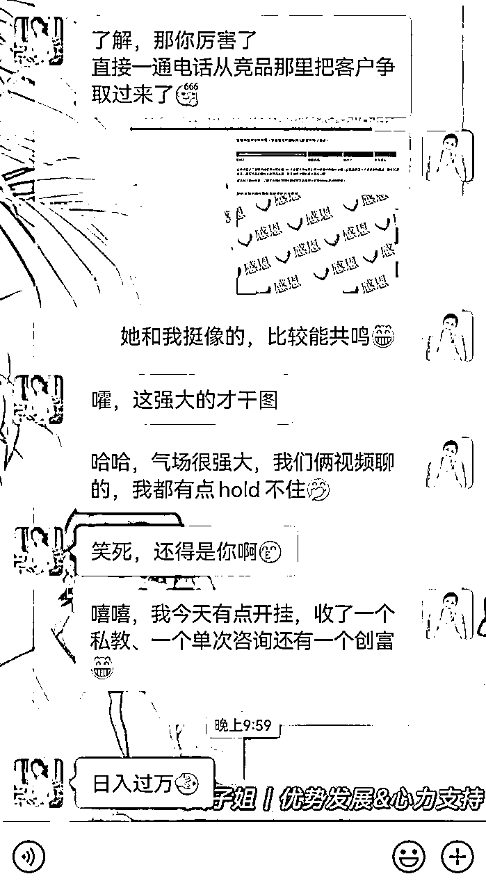
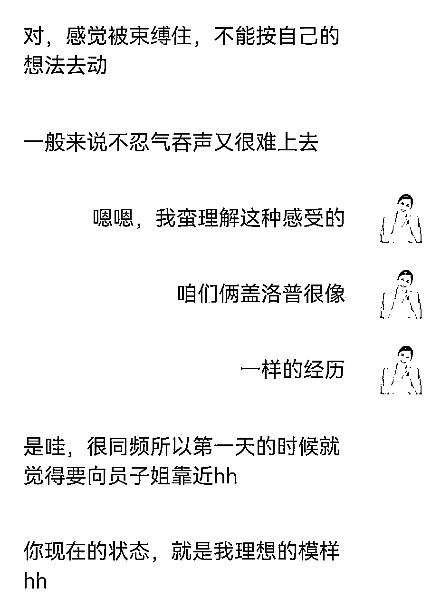
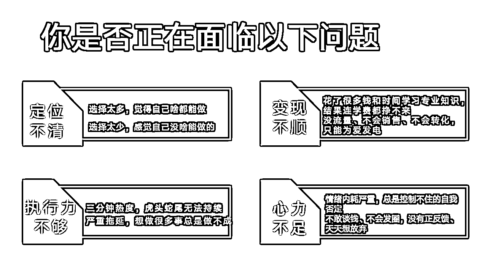
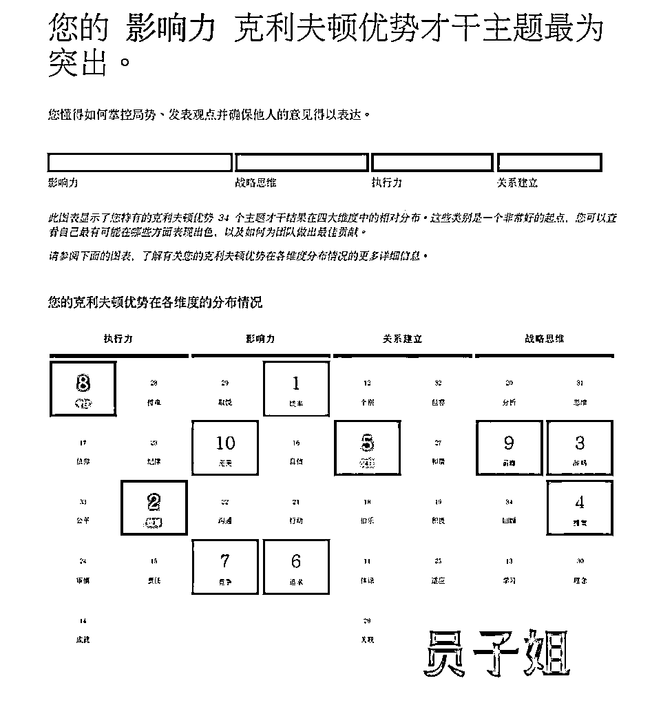
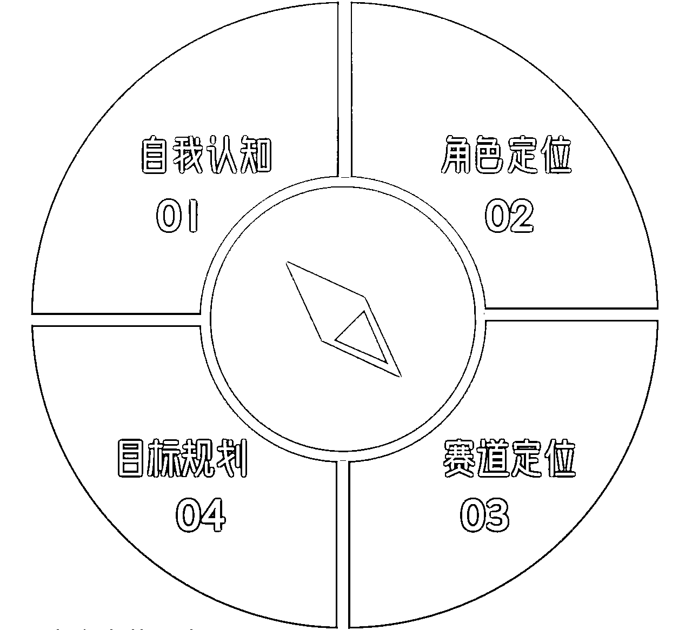
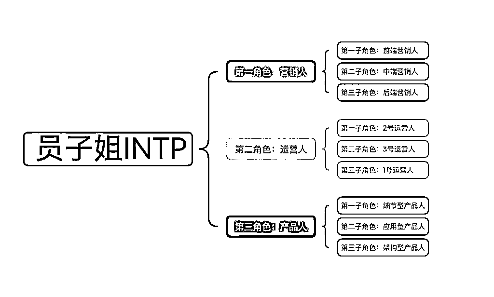
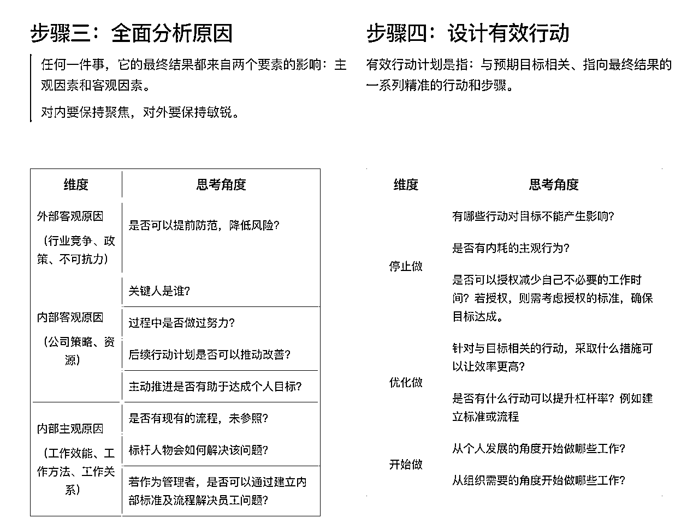
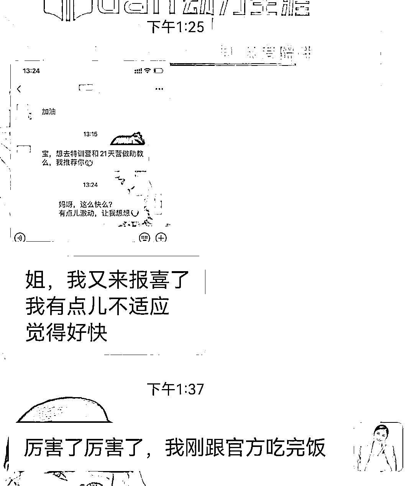
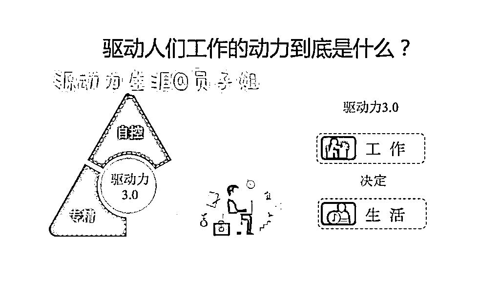
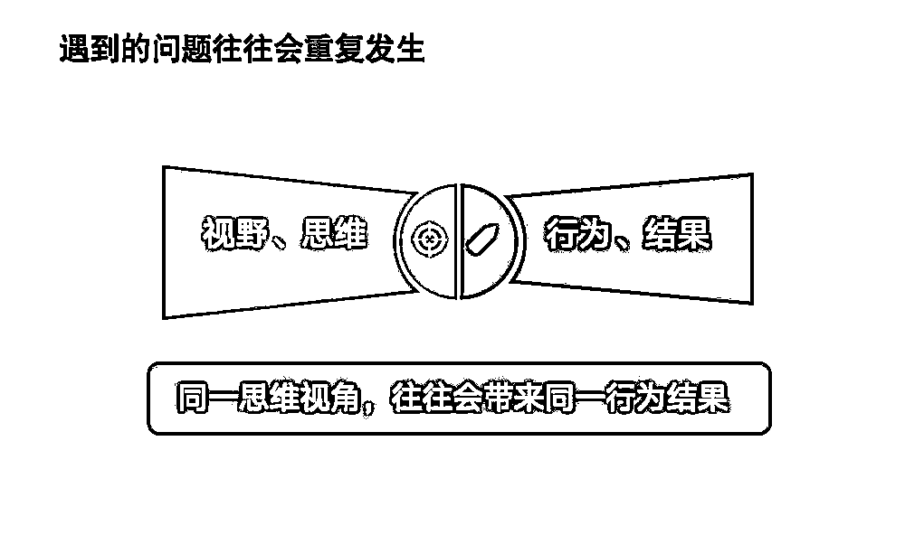

# 不坐班两年，从月入1500到日入过万，我的完整打法拆解

先抛结论：摆脱上班这件事，不是靠一腔孤勇，而是一套可以被复制的路径。我走过的每一步，今天都会拆给你看。

我叫员子姐，盖洛普体系认证的优势教练，同时也是生涯规划师、MBTI人格类型解读师、结构化复盘教练，偶尔也以IP经纪人的角色帮咨询师客户打磨产品与成交方案。我日常服务的对象，刚好覆盖三类人：想升职加薪、待开拓副业的职场人；希望放大个人优势的创业者和自由职业者；以及准备独立执业、但还在摸索商业路径的咨询师。这几年，我先后为超过550位职场人做过咨询，累积案例时长600多小时，还陪跑了上百位新手咨询师，帮他们打通了从接单到变现的整条链路。

2018年，我的职业天花板出现了。当时我能想到的解决办法只有一个：转行。我也确实这么干过，而且不止一次——当过大学老师、进过体制内、做过互联网，还参与组建过高科技公司。13年里换了3个行业，每一次都能快速做出一些成绩，但没有一个方向让我愿意长期扎下去。后来我意识到：一直在不同赛道之间切换，其实是在逃避真正的卡点。直到我开始系统研究优势理论，一切才有了转机。我逐渐确认了自己的核心能力、价值边界和利他方式，这成了我最难时期的稳定器。2023年1月，我正式成为独立咨询师。第二个月，我成了靠谱团队的合伙人，月收入从1500直接跳到五位数，第一年年营收突破50万。2024年更是跨过了一道分水岭，从月入过万做到了日入过万。

这两年我最大的变化，不是收入数字的上涨，而是内心的稳定。如果2023年是在做外功，跑通闭环、突破瓶颈，那2024年就是在修内功：厘清框架、守住节奏、稳住状态。现在，外界发生什么、别人怎么看，已经很难撼动我的生活节奏。我团队里的很多学员，也慢慢从学习者变成了同行者。他们说得最多的一句话是：你活成了我想成为的样子。

但我要说句实话：我并不是一开始就走在光里。2018年之前，我跟大多数人一样，被困在一个“不知道下一步往哪走”的僵局里。我做咨询这几年，见过上千个来访者，也听过上千种不同的焦虑——职场晋升受阻、副业毫无起色、自由职业朝不保夕。这些问题看起来各不相同，但底层其实是同一件事：没有找到一个能支撑自己长远发展的支点。

我这里有两段亲身经历，能说明问题。第一段关于晋升。有一次，一个我势在必得的晋升名额，最后落到了别人手里。论业绩、论能力、论领导的态度，我都觉得自己没问题。结果输的地方，居然是同事打分。我去问领导，他只回了我一句话：互评分数拖了后腿。那个瞬间我整个人是懵的。我一直在想，我到底是在哪件事上得罪了谁？也就是从那时候开始，我怀疑过自己的性格，甚至想过要不要把自己磨圆。后来学了盖洛普优势我才明白：我的统率才干排第一，天生就是直来直去的行动派，不怕对抗，想到什么就说什么，做了事也敢认。再加上我关注事远多于关注人的情绪，责任感强，见到损害公司利益的事就忍不住要管。这些特质在我身上是天然的，但在别人看来，就是“这个人不好惹”。更麻烦的是，我当时的能力和位置，根本驾驭不了这份强势，所以越坚持做自己，越容易被反噬。

第二段经历，是关于“擅长”的陷阱。刚工作的头几年，我最喜欢的任务就是办活动。最疯狂的一次，我同时接下两场大型会议，其中一场还是国际商务级别。零经验，硬着头皮，最后居然顺利办成了。从那以后，“活动专家”这个人设就焊在了我身上。无论什么档次的场合——基层聚会、高层会议、行业展会、海外商务考察，最后都会汇总到我这里。刚开始我很享受这种被需要的感觉，但等我把流程做成一套标准SOP，每天重复操作同样的步骤，我开始感到一种窒息式的无聊。我找领导聊过，领导说：这事你最合适，换别人我不放心。我找朋友抱怨，他们都觉得我矫情——能做自己擅长的事，还有什么不满足？但我的痛苦恰恰就在这里：我明明很擅长，却越做越空虚。后来我终于想通了一段话：任何公司、任何职位都不会百分百合你心意，如果每次不顺心就想着“换一个”，那不叫止损，叫给自己挖坑。

真正的破局点，是从一套完整的自我定位系统开始的。这也是我后来做咨询时，一直用来帮人校准方向的方法——个人优势罗盘。它一共四步，环环相扣：从认识自己，到选定角色，锁定赛道，再落到目标。

第一步，向内看。别急着问“我做什么能赚钱”，先回答“我是什么样的人”。我对学员做定制化规划时，会同时参考霍兰德测评、性格偏好测评、职业价值观评估，以及盖洛普优势测评。为什么用多套工具？因为单一视角容易失真，组合起来看才更接近全貌。好的咨询师手里一定有一个工具箱，而不是一把锤子。这一步看起来慢，其实最能帮你避坑——它能让你看清自己适合做成什么，也明白用什么样的姿势做事最顺手。对自己了解得越深，后面每一步的命中率就越高。

第二步，角色定位。这个环节绝大多数人会忽略，也是我每次咨询都反复强调的一环。很多来访者张口就问：“我想做副业，帮我定个位。”我问：你想解决什么问题？想提供什么价值？对方通常一脸茫然。这就是顺序搞反了。选角色就像选餐厅口味——你先决定吃中餐、西餐还是日料，再挑具体哪家店，而不是每家店门口都转一圈。在企业里，核心角色无非三类：产品人、营销人、运营人。做自由职业、做个人IP，这三选一同样成立。你要先想明白，自己的手感更接近产品、流量还是交付。

第三步，锁定赛道。我给三个参考原则：一，优先选自己有资源积累的方向；二，切入市场需求大且离钱近的领域；三，选一个你够得着、做得了、也愿意持续投入的细分赛道。三条都满足，基本就不会走偏。

第四步，以终为始落目标。同样一套复盘心法：先想清楚终点长什么样，再拆解现在该做什么。关于复盘心法，我整理过一套完整的工具包，内容比较长，有需要可以私信我领取。

我自己的定位也不是一步到位的。一开始我做复盘课程，月入1500；后来摸到了流量入口，月入过万。最开始我盯着中年职场人转型，后来又开始陪跑新手咨询师。服务的人越来越多，但定位反而越来越收敛。因为我知道我的优势组合是什么：我是大影响力+战略思维的人，在那种纯粹中立的教练对话里，会感觉压住了自己；我的舒适区是顾问式的咨询——用战略和前瞻的视角，结合生涯规划和优势的双重框架，帮人看清路径。再加复盘心法和统率、完美、竞争这些强势才干一起作用，我总能推着来访者把想法落地，真正做出改变。这里也说一句实话：定位不是一成不变的，它会跟着你的状态、市场的变化、你对自己的理解而动态调整。

直接讲一个真实例子。2023年5月，有个女生从朋友圈看到我，跑来微信问我：“我想转型，你直接告诉我选什么职业吧。”我回了几句，她就消失了。三个月后她再次出现，开口就要做我的优势合伙人。这个行为本身就很有她的风格——她的第一才干是完美。第一次认真聊完，结合她的职业价值观和测评结果，我帮她把方向定成了：优势教练+情绪疗愈。她之前做过情感咨询、倾听师，很喜欢这方面的工作，气质上也更像产品人。我要求她先做公益咨询，练手感。结果没多久，她就碰上一个把所有咨询师该踩的坑全踩了一遍的来访者。那一单做完，她几乎想放弃。后来她进了顶峰会，顺手写了篇觉察日记，没想到被粥左罗本人点赞了。这给了她一个很大的正反馈。接着她去参加了粥老师的写作训练营。第一个月，她几乎每天跟我诉苦，说稿子写不出来；第二个月直接断更了一个月。结果从第二个月末开始，她突然开始不断报喜：上稿27篇，写出2200字的长文，又拿到了10w+。三个月后她的状态完全变了；第四个月她当上了写作营班长，开始带新人；到第六个月，她的成绩单已经是中稿120多篇，至少7篇10w+，还开始接到剧本写作的邀约。她顺便考下了一个MBTI领域的专业认证，高分过。现在她的日常是写稿、带班、教别人写作，同时全职带孩子。经常写到凌晨三四点，但她甘之如饴，再也没有跑来跟我抱怨过。今天中午，她发消息说又有新合作找到了她，她自己也觉得这一年成长快得不真实。

你看，当一个人找到了自己的优势赛道，不上班这件事就不再需要硬撑。我最近看了一部叫《人生七年》的纪录片，里面有句话让我印象很深：富人之所以越来越富，穷人之所以越来越穷，关键差异在于——富人很早就识别出自己比旁人强在哪，然后一直在这个领域里积累，主动搭建自己的圈层，把手边的资源用到了极致。你去看身边那些越活越顺的人，是不是都在自己最擅长的那条路上，越走越宽？

最后，聊一聊自由职业路上，我特别想分享的几个关键词。先做心理建设：自由职业不是逃避职场的避风港，它要求你扛下收入的不确定性，面对比公司更复杂的压力，并且有足够的本钱支撑自己试错。如果这些都接得住，再来看下面几条。

第一，提前储备一门能吃饭的手艺。我接到过太多这样的求助：“我就是不想打工了，怎么办？”我说可以，那先回答我：你有什么技能是能换成钱的？结果大多数时候，对方沉默了。还有一部分人，本职工作都没做到及格线。这个行业里，理白和靠谱有一句话我特别认同：连本职工作都做不好的人，做副业也很难翻身。听起来刺耳，但这是事实。所以无论你现在在什么状态，只要未来打算不坐班，请先提前准备。设计师可以接单，程序员可以做外包，老师可以独立讲课，医生也可以做健康咨询。它们都是原技能的延伸，能让你在切换轨道后快速站稳。如果之前什么都没积累，那就从今天开始学一门。我当年就是为了解决自身职业困惑去学规划，学着学着爱上了，一路深耕到现在。很多人羡慕我第一年就拿到结果，但真正的原因早在七年前就埋下了。这七年我一直在补课：咨询能力、写作能力、公域运营、社群经营、个人品牌……一个都没落下。比如小红书，我2022年初就开始学运营，直到23年才等到爆款。没有白走的路，只有提前埋好的种子。

第二，在长板上持续下注。当收入不再只是吃饭问题时，人对工作的要求就变了——希望它有意义、有价值、能表达自己。自由职业最迷人的地方，就是能把“赚钱”和“热爱”两件事合并成一件。但前提是，你在做自己擅长的事，否则靠什么日复一日地坚持？鱼天生属于水，你非要让它学爬树，那是互相折磨。所以，要做三件事：分析自己，把喜好、强项、现有技能全部盘一遍，可以用测评加专业解读来辅助；分析市场，看看什么需求真实存在且有人愿意付费；分析同行，找出你也能做的细分切口。

第三，设计自己的商业闭环。专业能力和赚钱能力，这两个东西经常被混为一谈。我见过太多拿到证书的咨询师，花了十几万学费，积累了大量督导时长，结果收入并不好看。为什么？因为市场只认可它愿意付费的价值，不认你的证书和头衔。真正的商业闭环，必须自己完整跑过一遍才知道水有多深。第一年，我把整个链条——找需求、定产品、做内容、搞流量、做成交、做交付——全部亲手做了一遍。第二年，我开始按优势调整：大影响力的人更喜欢站到镜头前、社群里去影响一群人，而不是一对一服务。于是我逐步减少了个案数量，把精力投向合伙人孵化和私教陪跑。低客单的客户，我推荐给我带出来的咨询师。客户不会流失，徒弟不愁案源。等他们能出师了，我们再联合交付，把我的时间价值放到最大。我的战略思维特别强，每天都在琢磨怎么省力，于是我把一切能标准化的环节都尽量授权给别人，自己专注内容、获客和成交。当然，调整商业结构时也要尊重合伙人的意愿度，让每个人都能用自己最舒服的方式发力。

第四，学会借力。一个人闭门造车，很容易卡在某一步走不动。这时候，一位优质导师的价值就显现出来了——他能帮你校准方向、打开资源、绕开坑。我也正是因为一路上有贵人相托，才能在两年内走到今天。希望你有勇气去找、有能力去认、有智慧去用那些愿意托你一把的人。

好了，今天的分享就到这里。如果你也想像我一样，把工作做成生活的一部分，记得先把上面的功课做完。愿你在自己的海里，游得自在。

很多人一提到“选老师”，第一反应就是：找最牛、最贵、最有名气的总没错吧？还真不是。

选老师这事，表面上是在挑专业能力，实际上是在挑一种与你合拍的风格和价值观。员子姐常说，影响力是会互相吸引的。就像理白和靠谱，跟他们交流，专业上没得说，情绪体验也特别舒服，那种“不用解释，对方全懂”的默契，真的很难得。

她自己也踩过坑。曾经脑子一热报了个课，最后宁可损失大几千块也坚持退掉。不是因为不心疼钱，而是因为更心疼自己的时间、精力和心情。她做事向来直接，不喜欢拐弯抹角，更受不了那些带着说教腔、把所有问题都归因到原生家庭的调调。她说：我尊重这类内容，但不代表我要为此买单。这就是性格差异，也是价值观差异。找老师，一定要找和你脾气秉性相近的人。

而且，别迷信大咖。很多名气很响的老师，实际交付全靠助教，你可能连老师的真人都联系不上。反而是一些小IP，有时间、有精力，还会亲自带教，给你的关注和指导才是实打实的。

那起步阶段没有成功案例怎么办？很简单：把自己活成案例。员子姐2023年收到18个合伙人，靠的就是这套方法论和持续迭代拿到的真实结果。很多人把她当成对标对象，因为她的状态骗不了人。朋友圈可以包装，业绩可以修饰，但一个人的精气神和真实状态，装不出来。

为什么很多人做事做一半就放弃了？因为看不到确定性，开始怀疑当下，最后自己先松了手。想活得轻松、只工作不上班，内核一定要稳。见过太多人，听说小红书赚钱就扑过去，没动静又开始追视频号，最后还是没正反馈，焦虑到不行。前段时间还流行“自由职业者返厂”，员子姐也遇到过类似诱惑——一位老板在无锡开新公司，给她开出50万年薪加股份。收入不稳的时候，这种offer确实很诱人。但她短暂犹豫后，拒绝了。因为她无比清楚：自己已经拥有那种人生掌控感——有喜欢的事做，能陪娃陪父母，也不耽误赚钱，更重要的是，她可以拒绝不喜欢的客户。现在的日子，她爱得不行。干嘛要退回那个曾困住自己的笼子？职场，已经是回不去的曾经了。

在不确定的时代，要去做确定的事。心力，就是你内心对目标那股坚定的愿力。向内探索，清晰知道自己要什么；对正在做的事，保持笃定；对眼前的生活，保持松弛。

旧的地图，找不到新大陆。既然要追逐自由掌控的人生，那就下

我作为优势教练，常让大家做一件事：觉察。觉察不是坐在垫子上冥想，而是把它贯穿在每天的生活里。我们觉察什么？觉察自己的思维模式、行为模式，以及情绪感受。做成了一件事，回头看看当时是怎么思考的，做了哪些动作；搞砸了一件事，也看看当时是怎么想的，怎么做的。如果你在同一个场景下，连续用三种方法都成了，那这就是你的擅长模式；如果同一个方法，你在三件不同的事上都做成了，那这个方法就是你的优势。觉察的终极目标，就是找到这套专属模式，用它指导未来的每一步。

很多人离不开职场，还有一个隐藏原因：即便离开了，也还是被单一收入拴得死死的。一个人收入越不稳定，越容易焦虑内耗，越容易做出短视的决定。所以，只工作不上班的第八个锦囊，就是：多渠道收入。

员子姐虽然是做咨询和教练的，但她的收入并不只有咨询这一项。主线收入要有，支线收入也要有。支线的意义，一是主线突然断掉时，生活还能正常转；二是让你有底气保持现在的状态。她见过不少同行者，走着走着就消失了——有人去做了保险经纪，有人重新打工，有人继续当全职妈妈。她的收入渠道有哪些呢？

第一，一对一咨询、私教。第二，项目合作，她在一些平台当导师，有项目收入。第三，分销大佬的产品，这部分不用怎么交付，占用的时间精力很少。第四，带货佣金和平台自动出单，因为她是小红书和视频号的职场博主，有积累就有自然收益。第五，投资理财。别以为理财要有大本金，她刚工作时月薪也就几千块，但每个月至少存1000，后来买房时，那张卡里攒了好几万，真解决大问题。她给私教学员的建议是：无论收入多少，哪怕只有几千块，也要强制留出一部分存起来。这笔钱，既是救急的底气，也是你养的一只会下蛋的鸡。

这是员子姐自我探索的第七年，也是只工作不上班的第二年。她最大的感受是：技能点越攒越多，对抗焦虑的能力就越强。大环境怎么变、别人怎么说，都不会轻易动摇她，因为她相信，经过这些年的积累，自己无论做什么都能做成，都能赚到钱。

最后，想对每一个正在往理想状态靠近的人说：别指望一口吃成胖子。从小钱开始赚，不求短时间暴富，只求可持续、可掌控、自己喜欢。很多人向往“只工作不上班”，把它当成理想职业状态。但真正理想的职业状态，其实是：工作让你更好地理解自己、成为自己。你在哪里、做什么职业，都不重要，重要的是，无论何时，你都拥有自己的成长体系，让自己一直保持生命力。

以上，是员子姐的分享。