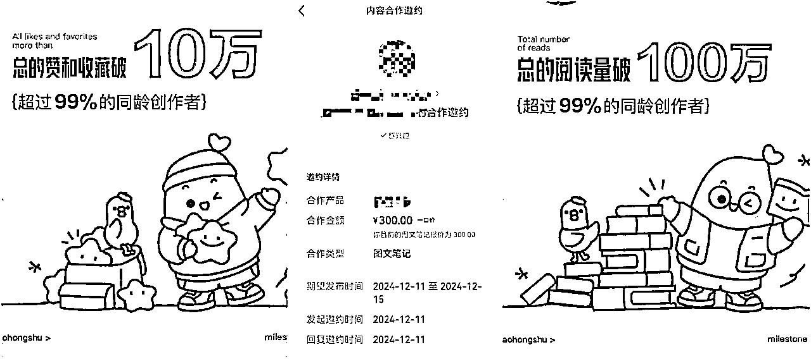
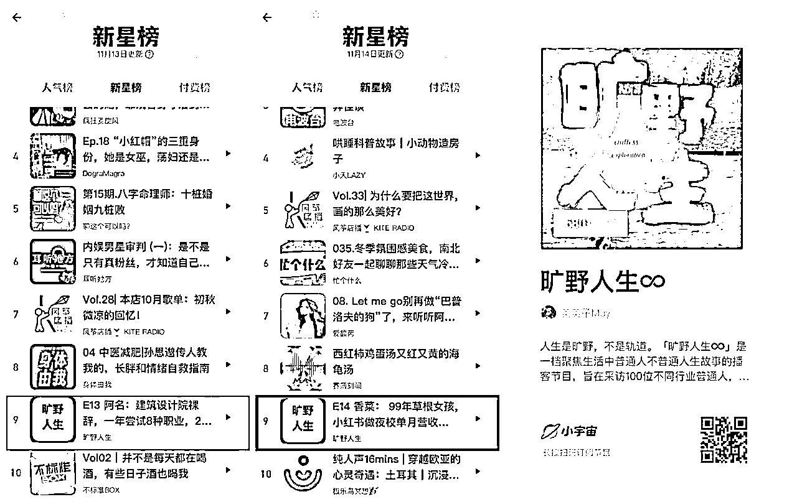
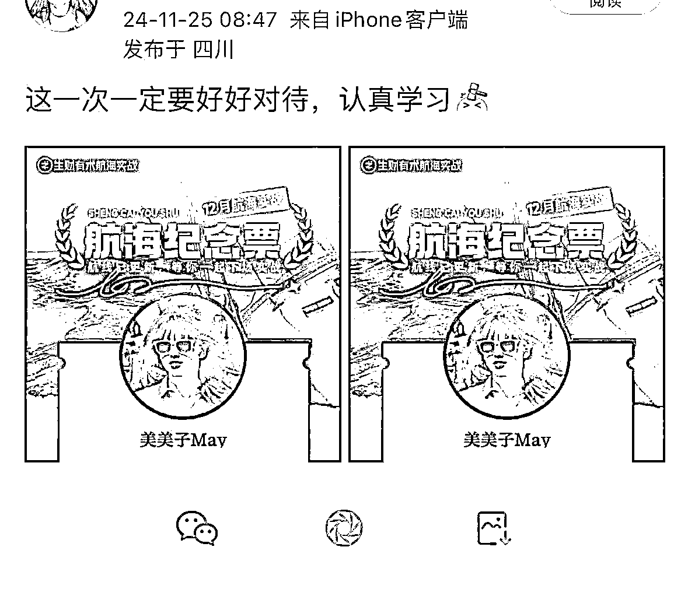
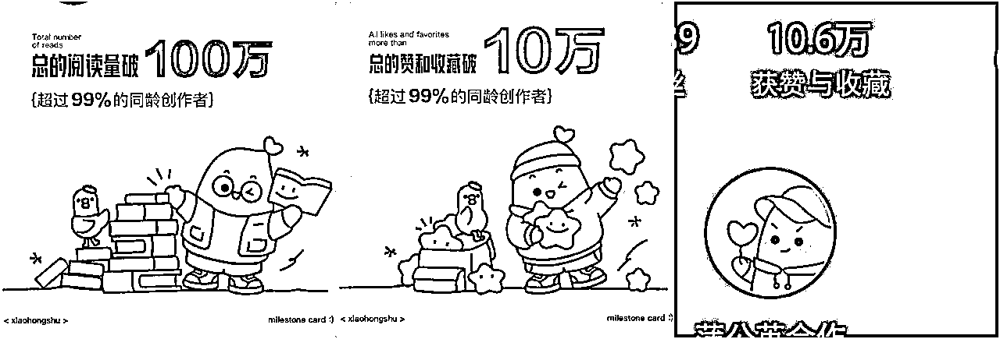
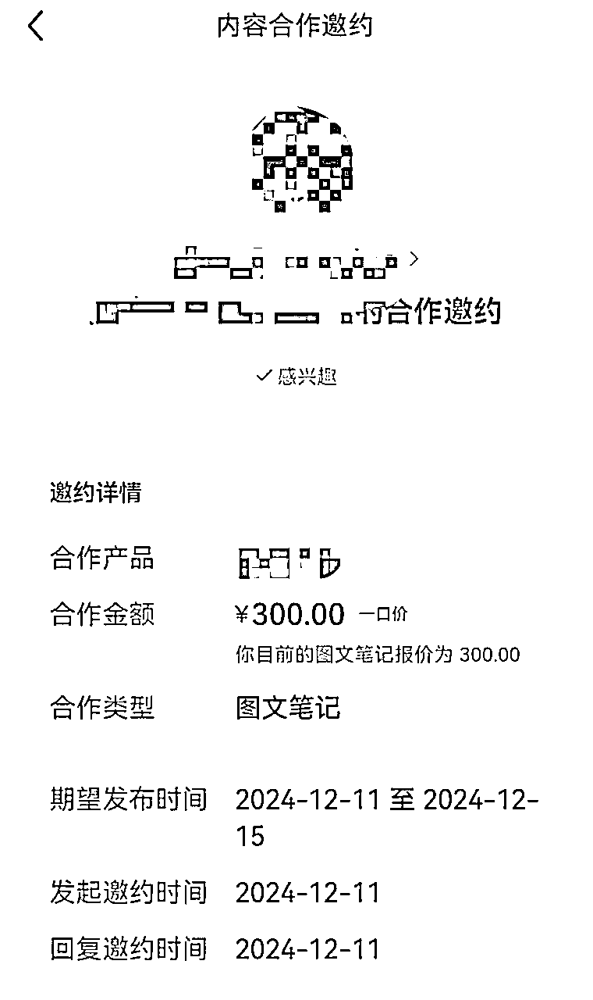
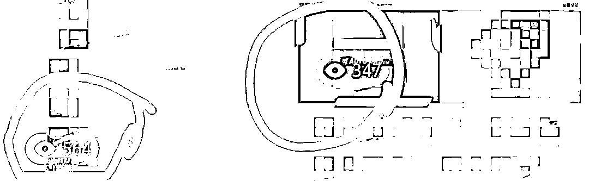
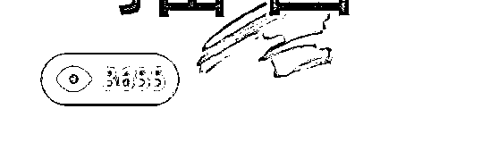
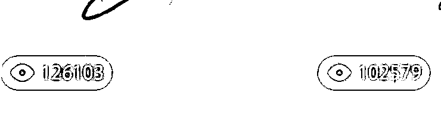

# 从银行裸辞到📕爆款频出：我是如何用15天做到阅读量破百万的？

## 先说说我是谁

大家好，我是龙哥。今年三月，我做了个重要决定——从国有银行辞职，转身投入自由职业的怀抱。现在我的身份有两重：一半是保险经纪人，另一半是自媒体创作者，主要在做播客和📕。

今年12月，我参加了📕航海活动。短短半个月，一个全新账号就做到了粉丝近1500、总阅读量突破100万、点赞收藏超过10万。我发了200多条笔记，其中30多条成了爆款，单篇最高阅读量冲到12万+。更让我开心的是，我开通了蒲公英商单功能，还接到了人生第一单商业合作。

我还在做一档播客叫《旷野人生∞》，三个半月时间做到了小宇宙订阅接近6000，其中两期节目还上过新星榜。

其实我是今年一月份加入赚钱的，之前一直是潜水状态，参加过两次航海也没认真对待。但这次报名📕商单航海前，我问了自己一个扎心的问题：

我到底是真想做出点成绩，还是只想拿个体验卡凑热闹？

报名之后，我用报名截图发了一条仅自己可见的动态，对自己说：这一次，一定要全力以赴。

幸运的是，航海还没结束，我已经在📕上取得了一点点小成绩，今天就把这段经历完整分享给大家。

## 我的账号数据：两项实验同时进行

报名航海后，我运营了两个📕号。一个是我之前就有的职场号，虽然更新佛系，但现在也有2000多粉丝了。另一个是全新账号，用来分享播客相关内容，也是这次航海的主战场。

为什么要做这个新号？因为我想把《旷野人生∞》这档播客做好，于是自然延伸出了在📕分享相关内容的念头。

现在的成绩：粉丝近1500，总阅读量破100万，赞藏超10万，共发布笔记200多条，其中爆款30多篇，单篇最高阅读12万+。蒲公英商单已经开通，第一笔商业合作也在12月11日顺利接下。

## 从零到一：我的📕起号全记录

### 第一阶段：勤勤恳恳发文，没人看

新号注册后，我完全不知道发什么。索性截图了自己的播客清单，配了一个问题式的标题发出去。结果嘛……浏览量只有217，2个赞，倒是引来了10来条评论。

这次试水给了我两点启发：第一，浏览量能过百，说明这个赛道有戏；第二，一开始就能引来评论，说明问题式标题确实能拉高互动率。

但点赞少得可怜，我想是不是文案太敷衍了？于是第二篇我花了大把时间，精心写了一篇“自认为很棒”的长文案，配上新图。结果呢？浏览量300左右，8个赞。后面又发了好几篇，数据都差不多。

呕心沥血写出来的东西没人看，说实话，挺打击人的。

### 第二阶段：研究对标账号，模仿出奇迹

实在想不通问题出在哪，我开始研究同类型账号，专门找那些已经爆了的笔记。当时看到一篇赞藏好几千的爆款，标题里有“长脑子”三个字，瞬间勾起了我的好奇心。

我想：既然这个标题能吸引我点进去，那它一定也能吸引别人。为了不被人说抄袭，我只借用了“长脑子”这个词，配合我之前验证过的提问方式，自己原创了一个标题发出去。这次浏览量首次突破500，赞藏各十几条。

但离目标还远。为什么标题差不多、内容差不多，数据却差这么多？我把自己的笔记和爆款笔记放在一起对比，终于发现了端倪：人家的图片比我干净、舒服多了。

于是我开始换封面。为了追求效率，我直接搜索同类爆款笔记，下载图片后用美图秀秀简单处理——裁剪、擦除多余元素、加上自己的文字或滤镜。效果立竿见影！新封面发出去，第一次阅读量破千，赞藏破百！

### 第三阶段：控制变量，随手一发就是爆款

尝到甜头后，我开始系统地做两件事：优化标题、优化封面图。

标题方面，我总结出了几个规律——要么带情绪词，要么带数字，要么做前后对比。比如“敏感的人一定要……”、“内耗的女生都……”、“95年，29岁……”。一旦看到同行的好标题，我就会收藏进素材库。

封面方面，核心是简洁舒适或者有意境感。温馨的书桌、chill的咖啡厅角落、闲适的自然风光，都是好选择。

我保持着每天至少3篇的更新频率，基本每天都能产出上千阅读的笔记。到了第五六天，突然有一篇笔记破了万，之后数据一路飙升——到现在已经12w+阅读，赞藏接近2万。

前期呕心沥血没人看，后来随手一发天下闻！

### 第四阶段：节奏稳定，突破不断

这篇爆款直接带动了整个账号的活跃度。我按上面总结的标题和封面标准，保持着每天3篇以上的更新量，最多的一天发了9篇。

那段时间，好几篇笔记冲到了5万、10万阅读量，每次打开📕都是99+红点的状态。粉丝也顺利突破1000大关，开通了蒲公英商单。

### 第五阶段：得意忘形，流量暴跌

流量好的时候，赞藏疯涨，粉丝稳步增加。但我开始不满足了——光是做内容等商单太被动了。我有好几个📕群都满了，却没好好利用起来，于是动了别的心思：开个店铺卖资料？把小红的粉丝引流到私域？

那天我在选品中心看中一个电子资料，就把它挂到了我之前数据很好的几篇笔记里（相当于二次编辑），同时在群里发了一些引流信息，还回复了私信。

结果第二天，每天99+的页面，史无前例地一个红点都没有。那一刻我意识到——被限流了！

我又发了几篇新笔记，浏览量稀稀拉拉，跟之前天差地别。盲目尝试导致流量暴跌，流量暴跌让我陷入焦虑：做了这么久的号，不会就这么废了吧？

### 第六阶段：虚心求教，稳中求进

我赶紧去航海群提问请教，教练一针见血地指出三个问题：①数据好的账号不要随便改；②与笔记内容不搭边的商品链接不要乱挂，会被判违规；③不要用正运营的账号发引流消息，应该用小号。

我立刻停止一切引流和私信回复动作，把之前挂的商品链接全部移除。

到了第二天，红点终于回来了！99+的页面又出现了！从那以后，我照常保持更新频率，把精力聚焦在内容升级和账号成长上。日拱一卒，稳中求进。

## 我的六点复盘与思考

**第一，选题要从自身出发。** 不是我喜欢做什么，而是我能做什么，能不能从主业或过往经验延伸。我做播客相关，目标是反哺播客、实现引流。这对我来说就是一种方法尝试，既便📕没做起来，也只损失一次探索的机会。大家选题时，一定要考虑能否反哺主业或利用过去的积累。

**第二，研究对标，坚持日更。** 我每天至少3篇，最多9篇，早中晚各发一篇。勤奋是基础，但更重要的是——看到同行的好帖子我都会转存到另一个号里做灵感库，持续学习。

**第三，标题里的关键词太重要了。** 当然不能傻勤奋，要及时复盘。如果发了一段时间浏览量还是低，就要想想是选题有问题，还是发的方式不对。我发了大概10篇后突然出了爆款，就是复盘发现标题有吸引力，然后开始提炼流量的密码，比如“长脑子”“内耗”“高能量”这类词。

**第四，保持学习，持续优化。** 航海期间教练们的直播分享对我帮助很大。比如12月17日柠檬教练讲的如何增加📕广告位，正好点醒了我。我发现自己目前的图片太单一，没什么广告位的机会，接下来会重点优化。

**第五，轻量化开始，降低行动门槛。** 有人问我怎么做到一天发好几篇，秘诀就是模式化写稿。熟练之后，每篇帖子只需要改改标题和核心内容就行。不要想着每一篇都从头创新，能形成一套内容模板，行动门槛就降低了。

**第六，坚定信念，一定要拿到结果。** 前两次航海我都是划水过来的，什么都没做成。但这次，我下定决心要认认真真拿结果——而事实证明，只要你想，你真的可以。

## 写在最后

日拱一卒，每个人都有自己的节奏。

不管现阶段有没有成果，实践本身就是最大的收获。

也祝每一位圈友都能成功上岸，拿到自己想要的结果！