# 📕残蟹项目全套细节玩法，复制就能出单

小某书卖“破相蟹”全流程拆解：跟着做就能起单

刷到这条内容的朋友，我是龙哥。平时主要研究小某书精准获客，也实操过不少小项目。

又到螃蟹季。去年我做了一轮“破相蟹”的生意，最近朋友照我的路子跑了一遍，上线头一天就进账300多。这活儿门槛不高，但细节确实多。

先给没接触过的朋友科普一下，什么叫破相蟹？其实就是打架弄断了腿、但还活着的螃蟹。肉质和鲜味跟完整蟹几乎没差别，就是长相不好看，没法拿去送礼，所以市面价特别低。

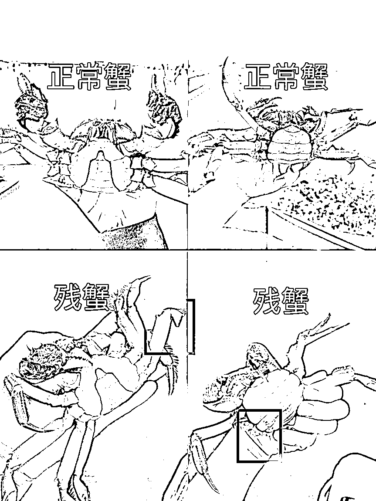

很多人图实惠，不介意这种小瑕疵，市场里其实藏着不少需求，只是没多少人正眼看过。这门生意的本质，是抓住买家捡漏的心态：拿低价吸引人，实际发出去的却是完好无损的螃蟹。买家拆箱发现每只都很漂亮，惊喜感直接拉满。这就是整套打法的心理套路。

一句话概括全流程：在小某书发内容吸引人，把流量导到VX；买家在二手平台下单；我们拿着单去拼夕夕采购；再把拼夕夕的单号填回二手平台；买家收到货，交易结束，中间的差价就是赚到的钱。

链路是：小某书发帖钓人 → VX承接 → 某鱼收款 → 拼夕夕拿货 → 某鱼发货 → 交易闭环

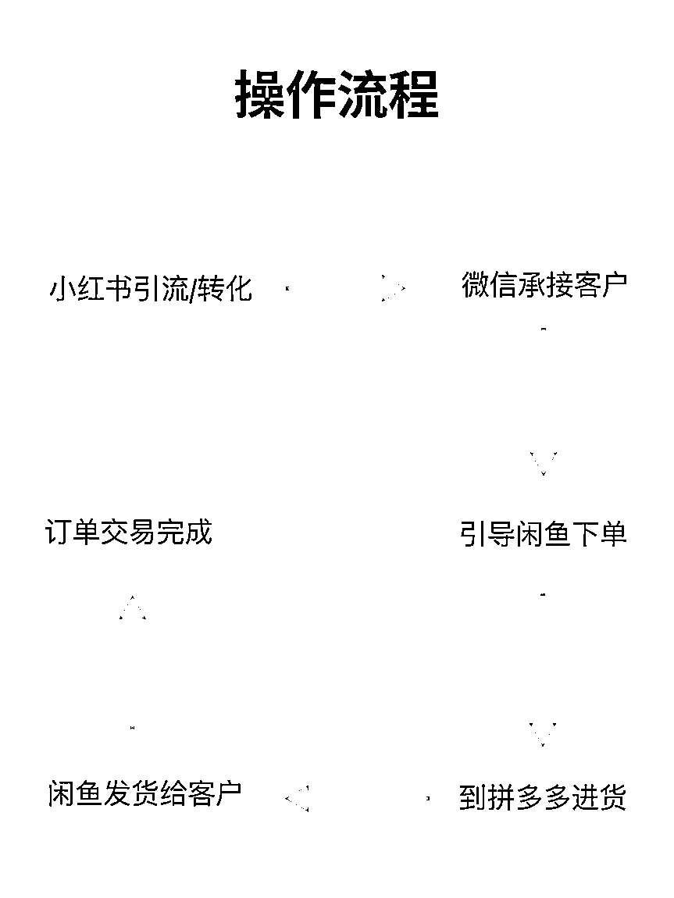

流程不复杂，但细节决定你能在这行跑多久、口袋能鼓多少。下面按步骤走，漏掉一块都可能影响最终收益。

# 一、先备硬件和立人设

这个阶段要完成两件事。

第一，开一个全新的号。注册时别连Wi-Fi，手机尽量用iPhone 7P以上，安卓机别用太老的，最好用五年以内的机型。

第二，准备一个VX大号去加同业，再把对方的动态搬过来，在VX小号上把形象先立起来。

大号怎么加同业？去短视频平台搜螃蟹相关词，不要找开店博主，去他们视频底下冒充买家留言：“哪能买”“怎么下单”。过1-2小时，就会有成堆卖家主动找你。加上后，翻他们动态，哪条能打动你，就把文案和配图Copy到小号动态里。只搬你觉得能打动人的，如果一条都没有，就继续找更多同业。

这么干的原因：让买家在加你之前，就先认定你是专门卖这个的，信任感先到位。动态每天发3-5条，不能断。

动态的意义在哪？买家从小某书过来，跟你聊不了几句就加你，加上之后第一件事肯定是翻你动态。如果里面空荡荡，他凭什么给你转钱？你们才认识几分钟，本质上还是陌生人。动态就是你的信任名片。顺手把动态设为仅三天可见，再把加进来的买家打一个标签，我用的标签叫“蟹友”。

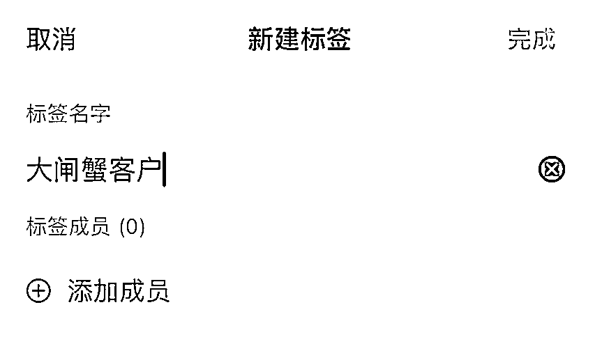

所有与蟹有关的动态，只发这个标签组的人看。这也是我坚持先做动态再谈接客的理由。

# 二、包装账号

把号的四件套填好：主页图、昵称、签名、背景图。可以直接套用我的模板，稍作修改就能用。

名字：小雨的破相蟹小铺
签名：
✈️人在外地，爸妈在苏州养了20多年蟹
🦀螃蟹爱打架，总有破相的蟹卖不掉
🙏🏻帮他们把这种蟹清掉，只只鲜活，放心买

把名字和城市换成自己的就行。核心形象就是“帮长辈卖蟹”的实在人，别崩。

主页图怎么弄？用新号搜“姑娘的真实自拍”，点“最新”和“图文”。

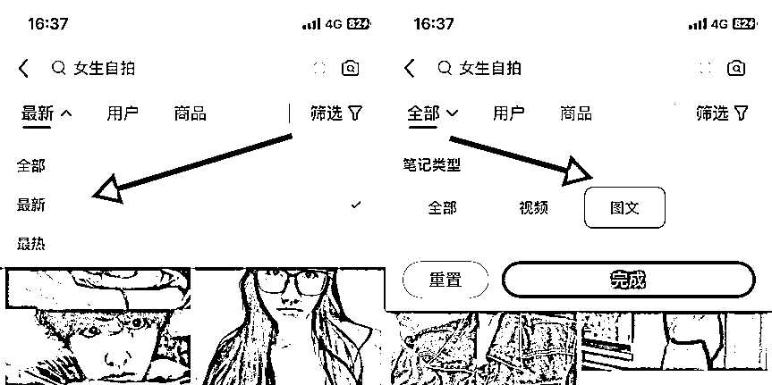

选图标准有四条：
1. 必须真人出镜，动漫、风景、物件一律不要。
2. 要有生活气，别用棚拍、精修感太重的图，更不能用明星图。
3. 20-30岁之间，露脸。
4. 颜值中上，好看的脸会影响下单率。

确定后裁成1:1，作为主页图。

然后把这套主页图、昵称、签名同步到VX和某鱼，三个平台完全一致。买家从A平台看到B平台，再到C平台，始终是同一个形象，才会觉得顺畅可信。如果三处三种模样，等于直接告诉买家你不靠谱。

成交的唯一前提就是信任。一旦失去，价格再低、话术再好都没用。

# 三、素材收集与再加工

素材优先去小某书的留言区翻。我平时最喜欢去螃蟹类帖子下面挖图，那里全是买家晒的真实照片，质感完全不输博主。

怎么找到这类帖子？先搜“残蟹”，看到吐槽向的内容就点一个赞，系统会以为你喜欢看这个，之后推荐页不断给你推同类内容，图源永远不会缺。

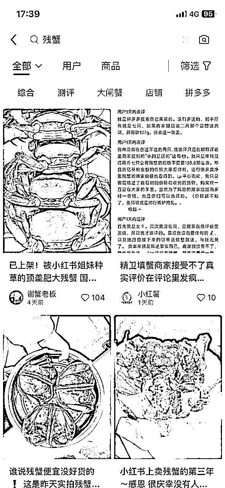

然后进到帖子留言区，找带图的留言。选图标准有四个：
第一，封面是活蟹，个头要大，至少大于手掌。
第二，熟蟹的黄让人一看就有食欲，公蟹的膏要厚要嫩。
第三，画质高清，焦点对准蟹身。
第四，比例必须是3:4，横屏或方图不要，后期不好处理。

例如：

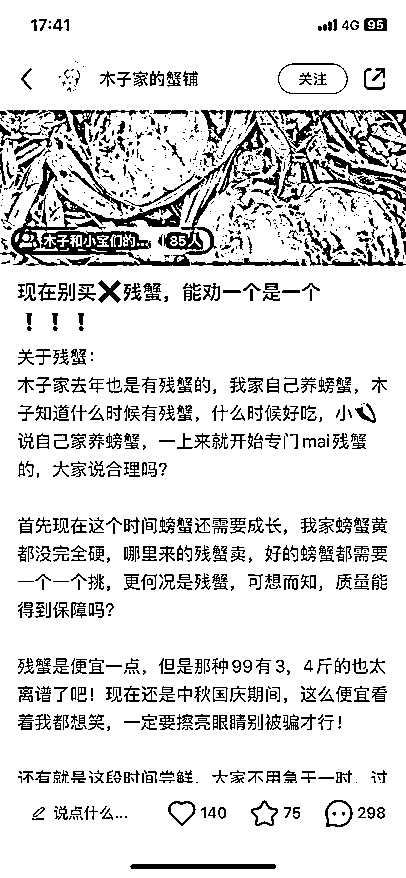

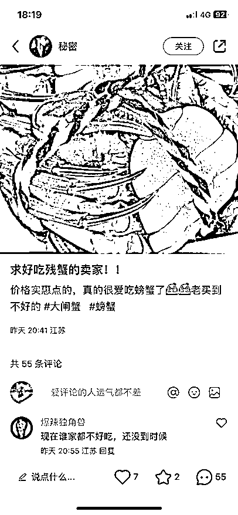

翻留言区找让你心动的图

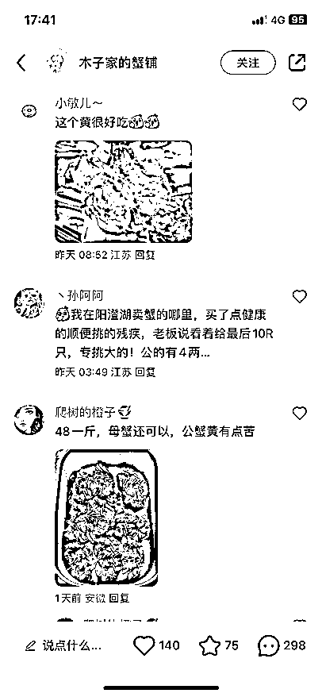

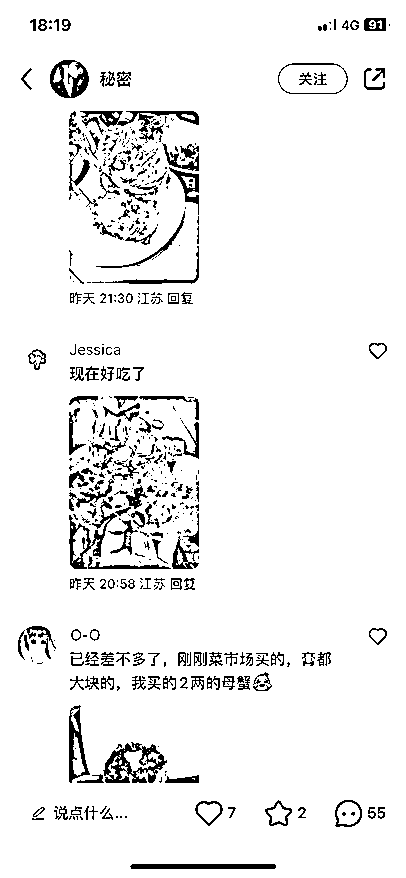

获取图片时要记住：千万不要下原图！必须用截图功能！

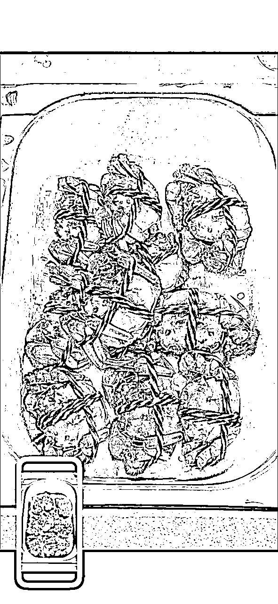

说个反直觉的点：从相册下原图再发笔记，哪怕再加工过，被判搬运的概率也远高于截图。手机自带的截图可以避开平台的内容比对，安全系数高得多。

按标准收图：生蟹的收30张，熟蟹的收30张。收完放在手机相册中对比，不好看的删掉。

接着做再加工。以苹果为例，安卓同理。打开一张截图，点编辑，选右上方的比例，设为3:4，再点一下翻转图标，完成。

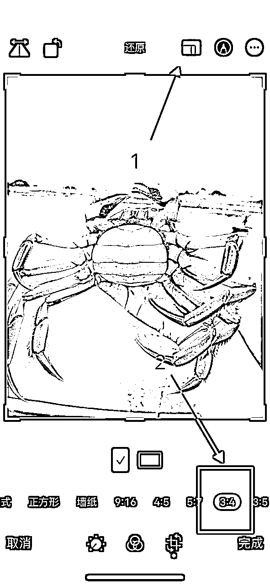

每一张图都过一遍。然后打开修图工具，任选一张，加个滤镜，颜色不合适就拉一下强度。

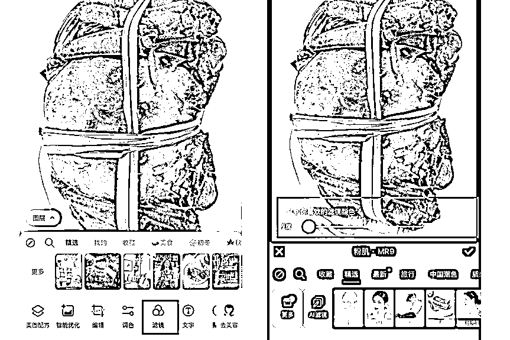

点贴纸，选一个不显眼的小图形，缩到几乎看不到，确认。

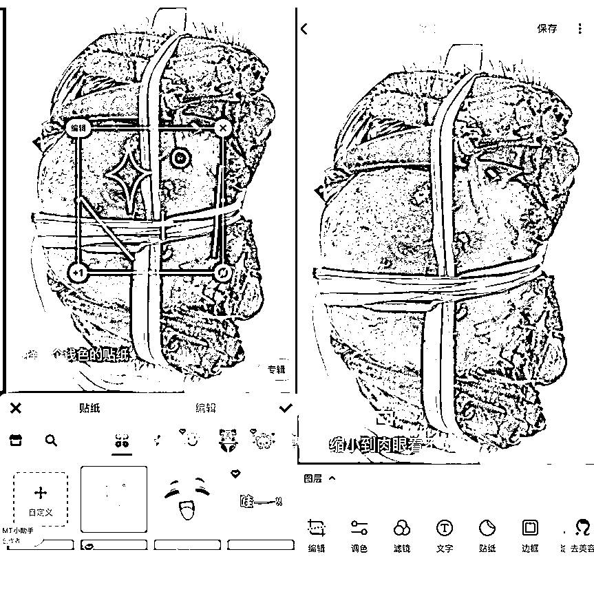

在保存按钮旁有三个点，打开“记忆配方”，再保存。

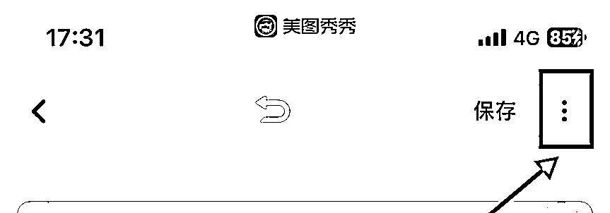

再处理别的图时，点开底部“我的”，调用刚才存好的模板，一键保存，批量出图，省下大量时间。

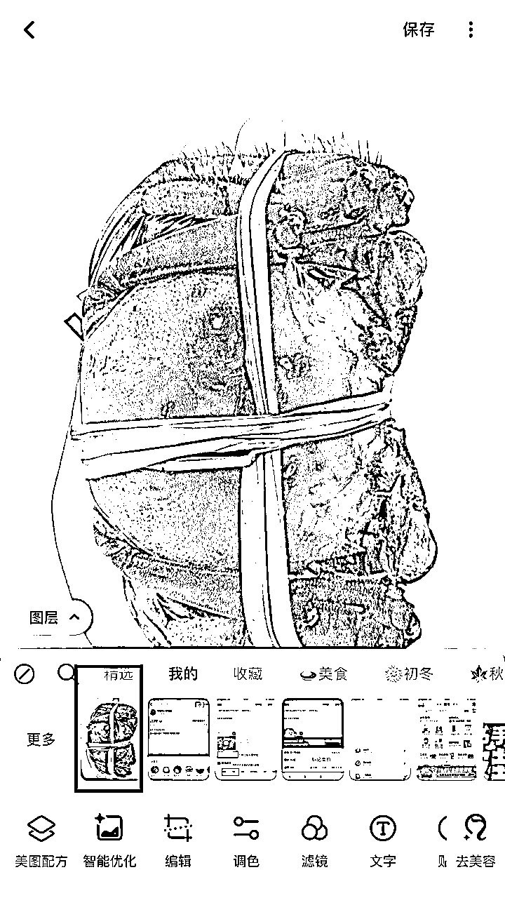

素材流程讲完了。现在听着可能有点绕，别急，跑到那一步自然就懂了。

发头一篇帖子，有三个不能：不定位、不连Wi-Fi、不要下原图。新号不可能第一条就爆，头一篇的核心作用是测流量。只要号正常，不出半小时就会有人在留言区问：“哪能买？”

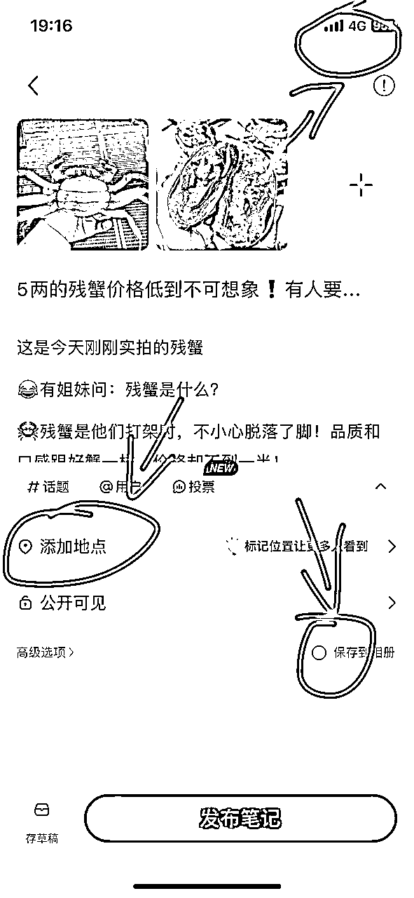

# 四、留言区和私聊话术

留言区有人问，统一回：后台戳我，发你今日报价。

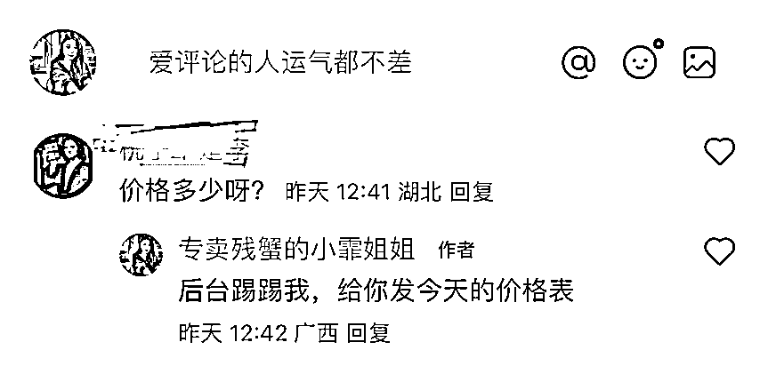

目的就是把目标买家引进私聊，同时让后来的人看到这段对话，学会主动找过来。

有人主动私聊你，就用这类话术去接。

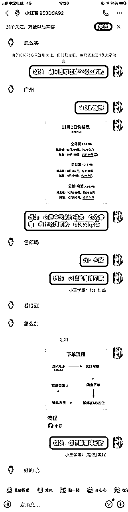

这套话术能覆盖大多数常见问题，照着场景套用就行。

# 五、算收益、找供货

再往后是去拼夕夕找商家，定你的利润空间。

我钟爱拼夕夕，是因为它的价格能压到很低，哪怕单量少，也能拿到有竞争力的进价。拿这个量去谈线下代理，估计连门槛都摸不到。

但拼夕夕的缺点也很明显：虚假宣传太过分。比如买家下单三两的蟹，你在拼夕夕也下三两，结果买家收到后可能二两都不到，还是带着绳称的。拆掉绳子，净重怕是只有1.5两。你能想象那蟹有多小？买家不炸才怪。我这边不少售后纠纷都是这么来的。

更恶心的是，拼夕夕还会主动给买家推送商品信息，买家一眼就看出你是中间商，差价当场穿帮。

拼夕夕让人又爱又恨，可谁让它便宜呢？如果你能找到更合适的供货渠道，建议绕开拼夕夕找朋友合作。

下面算笔账。比如报价单上3.0-2.5两母蟹，卖179元10只。

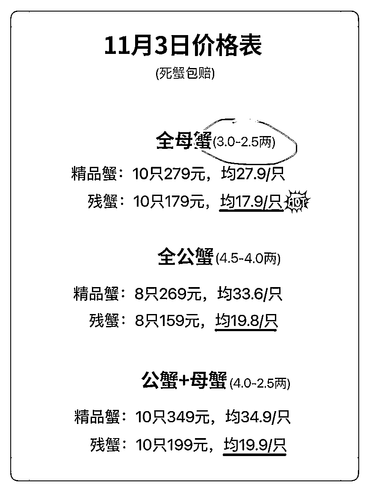

再去拼夕夕找同一规格的商家，看报价。

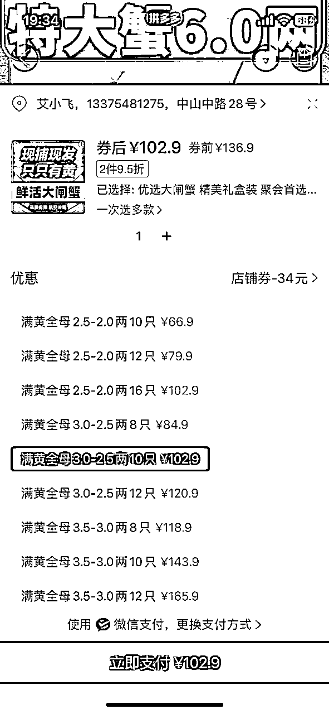

对方进价102.9元10只。179-102.9=76.1元，这就是一单的毛利。想走量的话，把毛利压到20-30元一单也行，下单率会更高。

拼夕夕商家的价格天天在变，波动大概十块。有单后要常盯：他们涨你也涨，他们跌你也跌。

报价单里的全品蟹那栏别动。

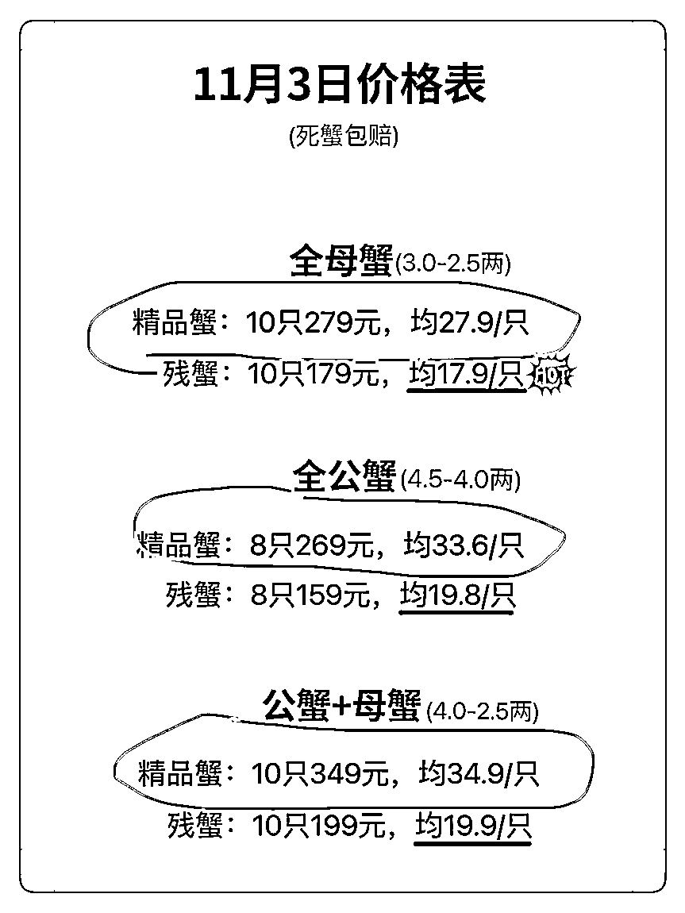

那栏不是拿来卖的，纯粹用来衬托破相蟹便宜。买家一对比，自然知道该选哪个。

买家问报价单上没有的规格怎么办？

情况一：问“有没有更大只的？”你回：“有，你要多大？”等他报出规格，去拼夕夕找对应链接，加上你想赚的钱报过去。

情况二：问“十只太多，能来五只吗？”先看拼夕夕有没有五只装，没有就婉拒：“我们最少x只起卖，只发五只的话邮费得你出。”他追问邮费，就报一个让他知难而退的数，比如60块。他会觉得邮费比蟹还贵，自然会放弃。

报价单是死的，买家的需求是活的。核心只有一点：想清楚一单要赚多少，守住这个区间。

# 六、筛买家、防对手

这一步最重要，处理不好号就没了。破相蟹这行同业特别多，恶性竞争严重，今天你搞我，明天我搞你，常态了。新号就像刚出生的婴儿，经不起一轮集中投诉。所以源头就要把高风险的人筛掉。

第一，看IP归属地。只要看到对方IP在江苏，私聊一律不回，但留言区可以正常回复。

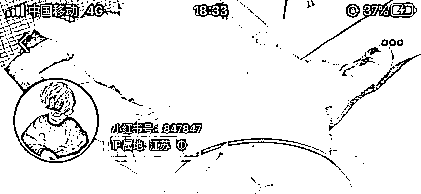

原因有二：其一，江苏IP大多是做这行的同业，他们来找你，无非是想套出违禁词，比如VX号、VX码，然后投诉你的号。其二，就算真是江苏买家，也不是我们的目标。人家本地买这种蟹可能比我们进价还便宜，而且直接湖里捞了就卖，我们毫无优势。发报价单过去只会被嫌贵，纯属浪费时间。

所以，江苏IP的私聊直接往左一划，点删除。

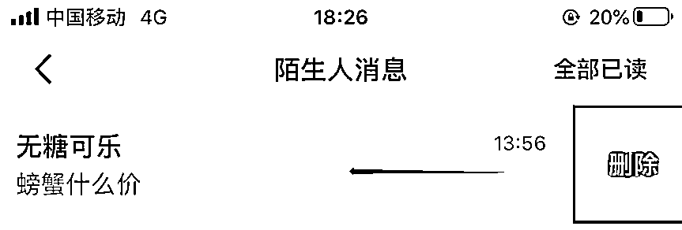

第二，警惕聊不到两句就急着加VX的人。

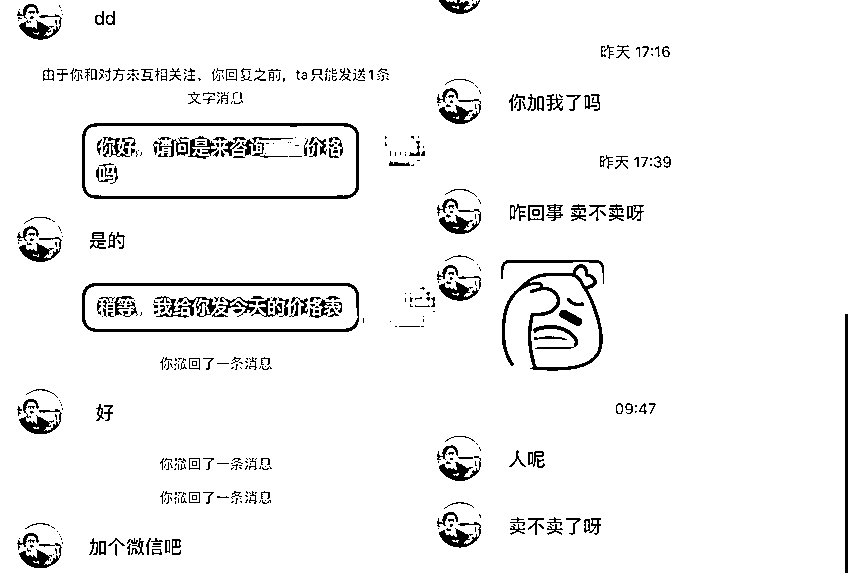

正常买家的信任度很低，不可能聊几句就把VX交出来。谁会追着一个陌生人要🛰️？这种“主动送上门”的，九成是同行。他们加上VX后，先投诉你的私聊，再投诉你的动态，一套操作废掉你两个号。我被人这样搞过，所以现在遇到急着加VX的，直接删。为了几十块去赌号的安全，不值。

第三，爱讲价、爱挑刺的，也尽量别接。比如“线下也没这么贵，能少点吗？”这类人一旦接单，售后往往很麻烦。他们会把货源上的小毛病无限放大，然后索赔、投诉，你赚他几十块，得伺候他像伺候皇上。

还有一些“事儿多”的问题：能不能让快递在指定日到达？蟹壳满不满？份量不够怎么办？蟹黄不多怎么办？味道不鲜美怎么办？

遇到这种，果断放弃。别给自己找麻烦。

这套玩法最大的好处是：不用囤货、不用自己发货、一部手机就能启动。想试的朋友，先把前两步的准备工作做完，再往下走。

做📕带货，引流这块真的要长点心眼，有些客户一看就知道不能碰，尤其是那种上来就抠细节问个没完的，你一定要提高警惕。

因为我们现在用的大多是拼多多的货源，价格是便宜了，但货源本身就不太稳定，虚假宣传的情况也挺多的。

一旦遇到这种喜欢深挖细节的，你最好别接单，别想着硬成交，这种人不是我们要的客群，后期极容易给你惹麻烦。

再说说那种三无账号

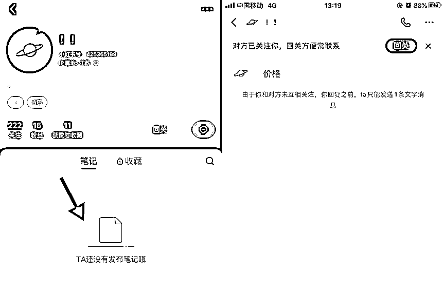

就是主页空空如也，没有头像、没有昵称、没有地区、没有简介、也没有任何笔记的。

跟你私信的时候你点进去一看啥都没有，这种基本都是小号在搞事，真实买家还是同行来捣乱根本分辨不清，我之前就被这种号恶意举报过📕号，还被骂骗子，问他订单号他又不回，我估计十有八九是同行过来找茬的。碰到这种类型，能绕就绕，别自找不痛快。

讲了这么多，那到底什么样的客户才是我们要的？

总结下来就是：不怎么挑刺，提问少的，主页里有生活日常笔记的。

这类买家就算收到的货重量有轻微差异，或者口感没完全达到预期，也基本不会来找你麻烦，因为他觉得网购有点小误差很正常。

可一旦遇到那种特别较真、话特多的，就会把你耗得筋疲力尽。

好，再帮你捋一下，哪些人坚决不要碰：

*   1.IP显示江苏地区的
*   2.上来就问你要🛰️号的
*   3.死爱砍价、事儿特别多的
*   4.纯小号来的

# 八、出单话术

## 评论区话术

评论区怎么回也很关键。有人留言问“多少钱”“怎么买”“怎么下单”之类的，你就统一用一句话回：后台踢踢我，我给你发今天的价格表[偷笑R]

如果评论区有人故意来捣乱，比如说“你这价格比我还贵”“价格好高”“是不是骗人的”。

只要是对笔记有负面影响的评论，全部删掉。

要是同一个人连续发好几条来带节奏，直接拉黑。

## 引导加微话术

私信来了，怎么把人安全地引导到🛰️？

这一步你要先准备一个📕的小号，什么是小号？就是平时发什么都没什么播放的废号，没有就重新注册一个也行。

准备好之后，把大号的头像和名字同步过去。

可以做一张引导图

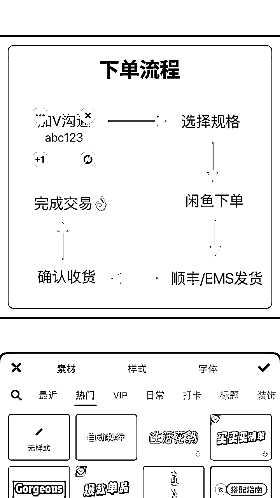

然后用小号发这张图，标题就写“流程”两个字。

接着用大号去搜索这个小号的ID，找到这条笔记给它点个赞。

客户来问怎么下单的时候，你就在“分享笔记”这

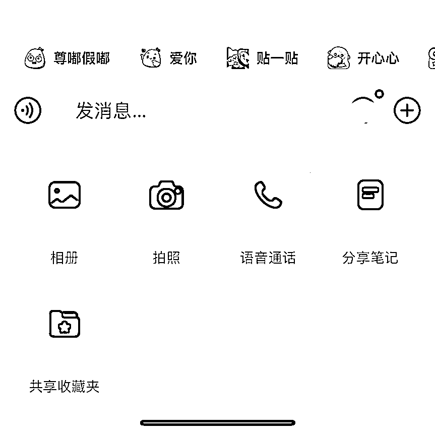

把你刚点赞的那条小号笔记发给他

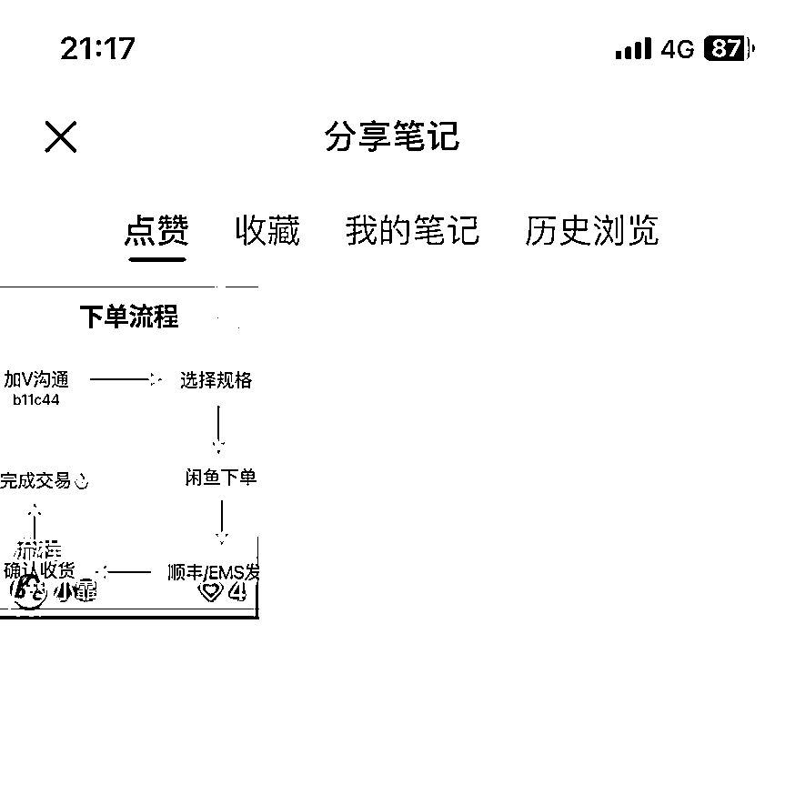

并配一句：姐妹，这样看得到吗？

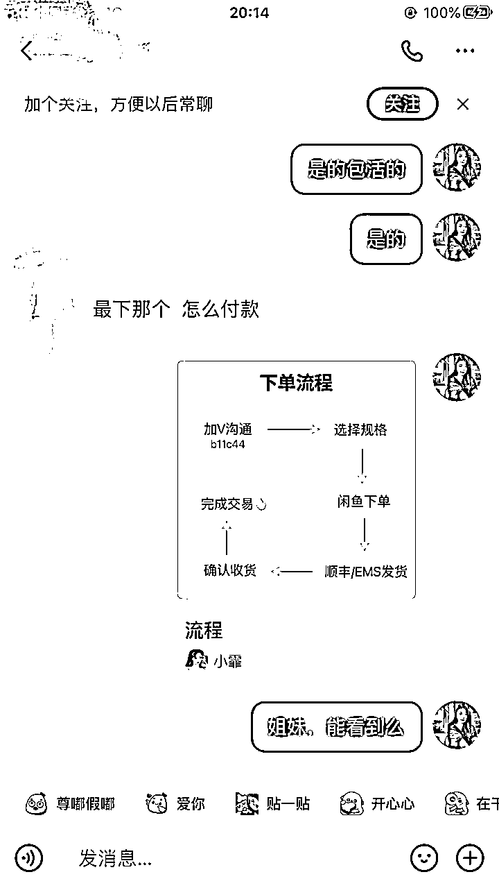

流程就走完了。

不过要注意，📕对引流行为打击非常狠，系统每隔几天就会全网扫描一遍，一旦发现有引流动作就会自动屏蔽。所以分享多了，客户就看不到了。

这时候怎么办？有两种办法。

第一， 用小号每隔一小时发一次，仅自己可见，然后把客户看不到的那条删掉，只留一条公开的。再用大号去点赞小号的笔记，就能躲过检测。

如果这个方法没用，还有第二种。客户说还是看不到，你就把跟他的聊天记录截图发过去，并附一句：姐妹，这样看得到吗？

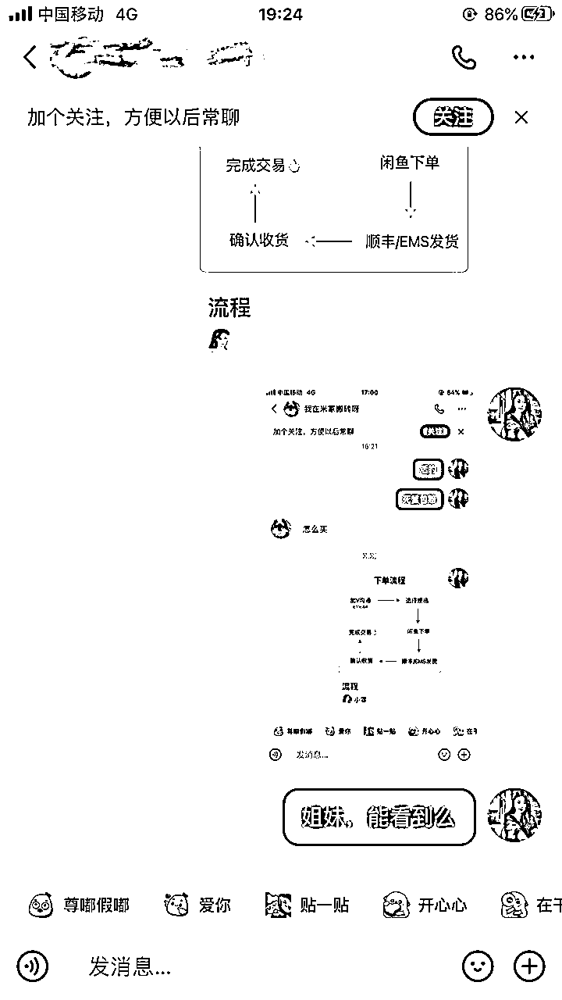

这里再补充一个认知，📕引流根本做不到100%安全，我们这种就是典型的商业引流，平台是十分反感的。所以账号寿命普遍撑不过5天，5天后一违规就得注销重来。

好消息是，📕注销后当天就能用同一个手机号重新注册，而且不用重新实名，这点比抖音方便不少。

# 九、🛰️话术

客户加到🛰️，有意向了，第一句话怎么说？

先问：你好姐妹，请问你是想要哪种规格呢？然后把今天的价格表发过去。

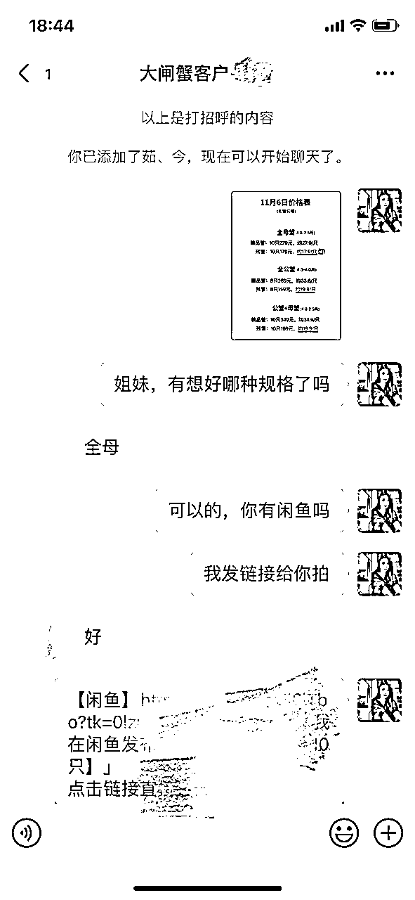

如果他回：“谢谢哈，我还没想好，过几天再买”。

这种人当下没有购买欲望，也没关系。你隔两三天再去跟一下：姐妹，现在的蟹很肥，口感特别好，有没想好要哪一款？再把当天价格表发过去。

要一直去跟进促成成交，而不是让他一直躺在朋友圈里吃灰。

你要清楚，加进来不下单的客户，对我们来说等于零价值。加🛰️的目的，要么成交，要么删掉。

# 十、闲鱼链接流程

客户选好规格后，就在闲鱼上建一个付款链接。具体怎么弄？

打开闲鱼，点击底部中间的“卖闲置”

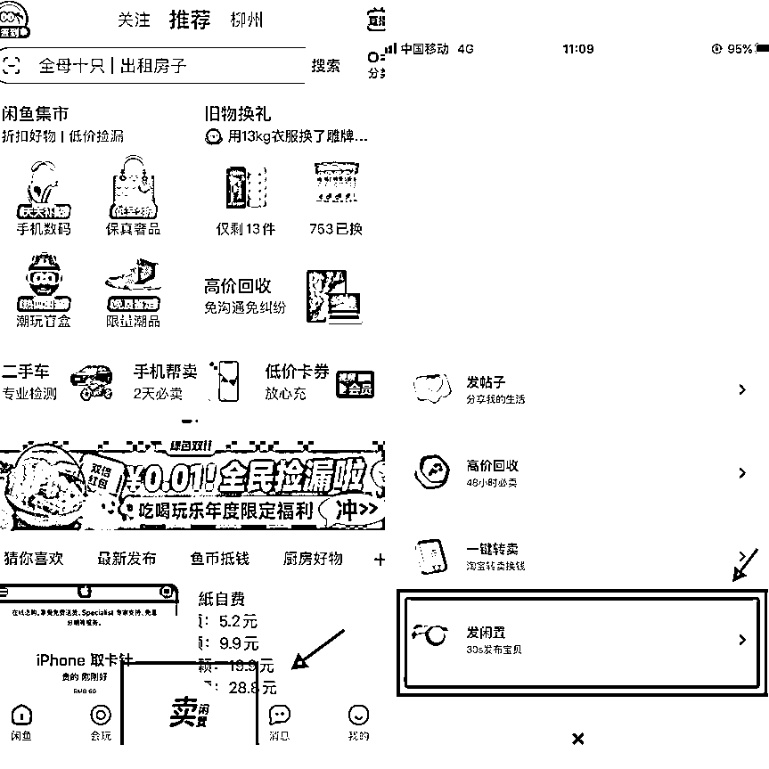

相册里选一张好看的大闸蟹封面，标题写上客户要的规格。

比如要10只3.0-2.5两的母蟹，就写：3.0-2.5全母10只

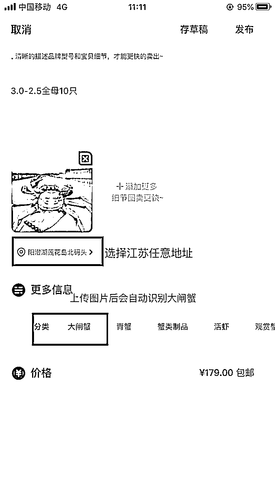

售价填好，不要填原价，设成包邮，直接发布。

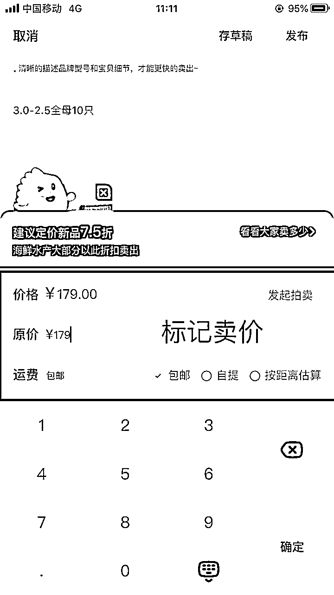

发布完点右上角的分享🛰️图标，把链接发给客户。

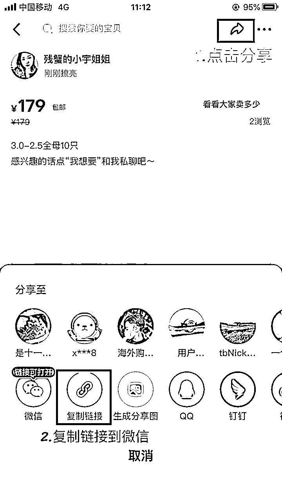

发完后加一句：待会拍了告诉我哈，我让我妈妈给你挑大的！

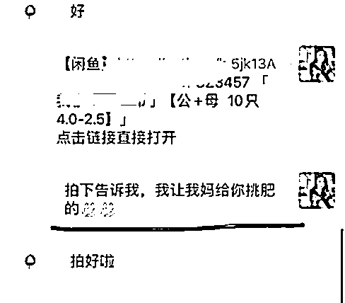

客户拍完款后简单聊两句就收尾，别聊太多没必要的。

# 十一、拼多多下单

客户下单后，你就立刻去拼多多下对应的规格。这里有个关键点，如果不想让客户收到拼多多的骚扰短信，有两个小技巧。

第一，把客户的手机号改成你自己的，快递打电话来的时候你再转达正确的号码，这样信息就不会直接发到客户手机上。

第二，如果你想省事，就先把手机号填成自己的，等拼多多物流开始变动了，再找客服说：不好意思号码填错了，能不能帮我改一下？然后把客户的正确号码填上去。

这两种方法能很大概率避开骚扰短信，但不是百分百保险，有时还是会漏。

万一客户还是收到了短信来闹，该怎么回？

第一步，先稳住自己的情绪，心态稳了才能安抚客户。

你可以这样说

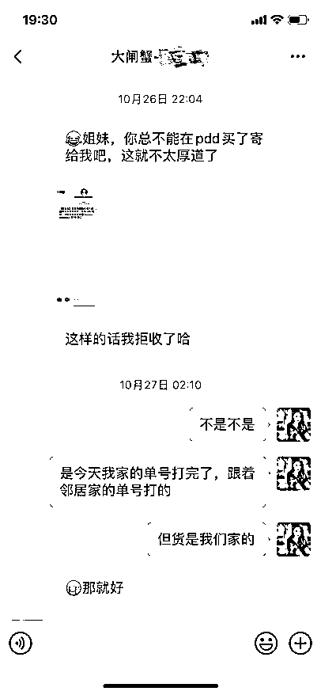

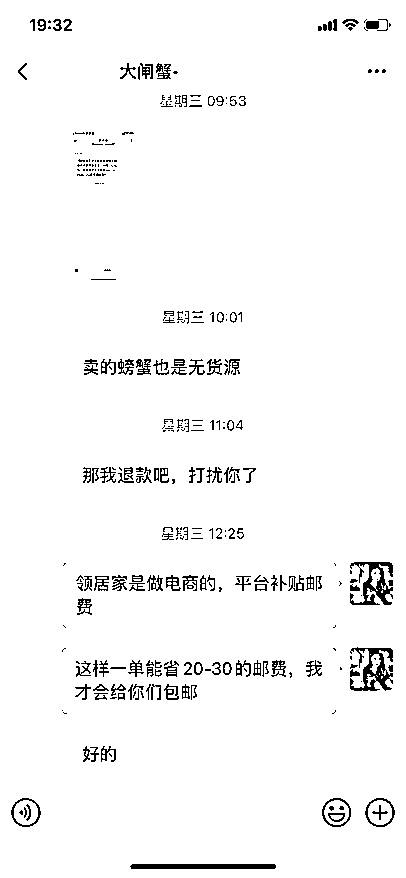

一般爱吃大闸蟹的，或者玩📕久的都知道，平台上价格普遍很贵，他来你这里肯定是冲着便宜又包邮来的。

所以你可以把包邮这个点放大来说，他更容易理解。

如果遇到特别难缠的，再电话里跟我沟通，每个客户情况不一样，只能见招拆招。

另外，拼多多一旦出单号了，一定要立刻复制到闲鱼上给客户发货，别等客户发现不对想退款了才去填，那个时候售后就很难处理了。

# 十二、售后

客户收货后发现重量和宣传不符怎么办？

还是那句话，先别急，心态放平。第一时间打电话给我，我会根据情况给你方案。

如果我没及时看到消息，你可以按下面步骤走。

先跟客户说：姐妹真的很抱歉，能先拍个图给我吗？我发给我妈妈看看到底怎么回事。

然后你立刻去联系拼多多客服，把问题说严重一点，给他们施压，争取赔付或全额退款。

接着再跟客户解释：不好意思实在抱歉了，可能是我妈妈的员工阿姨不小心发错货了，你看我先给你赔20元意思一下可以吗？我也是第一次在网上卖这个蟹，真的不希望出这种事。姐妹真的很抱歉。

先观察他的态度，如果他接受了，就发个20元红包，再道个谢。

如果他还在纠缠骂你，不要激动，冷静一小时后再回：实在抱歉，刚我又打电话给我妈妈了，我妈妈也当着我的面批评那个员工阿姨了，说20块太少了，让我赔双倍给你，赔40块。这是妈妈对你的歉意，请你收下，姐妹真的很抱歉。

总之一直安抚情绪，不要吵架，不要斗嘴，一口咬定是我们这边发错了，是我们的问题。

如果赔钱道歉都解决不了，那基本就是个难搞的人。

总之，心态要冷静，先安抚客户，再把问题抛给拼多多客服，看他们怎么处理。拼多多平台一般是偏向客户的，等他们赔了你才有底气跟客户周旋。

无论如何，生意不能做亏本买卖，不能自己掏腰包填坑。

拼多多的货源确实不稳定，如果你能找到更好的供应商，价格跟拼多多持平甚至更低，可以去谈合作。找不到也只能先忍受它的缺点，毕竟价格优势摆在那里。

# 十三、货款多久到账

有人会问钱什么时候到账。

一般是客户收货确认没问题后三天左右点击确认收货，支付宝就会到账。

如果客户一直不点确认收货，系统会在发货后15天自动默认收货，到时钱也会打到你的支付宝。

一单蟹的交易就结束了，你的辛苦费也到手了。

# 十四、账号违规怎么处理

交易流程讲完了，再说说笔记违规怎么办。

我们这种商业引流的笔记，平台是特别排斥的，限流、被封是常事。但违规也有规律，越往后越严重。

按影响从小到大排：

第一种，影响最小，第二天就会收到

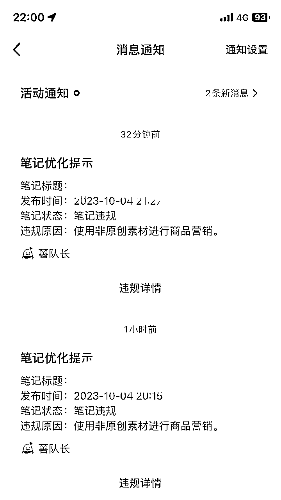

收到这种提示不用管，它只是怀疑内容不是原创，没有实质证据，也不是举报，是系统自动检测的，不影响流量。直接点进笔记编辑一下再发布，流量就恢复了。平台自动检测会有这个提示，很正常。

第二种

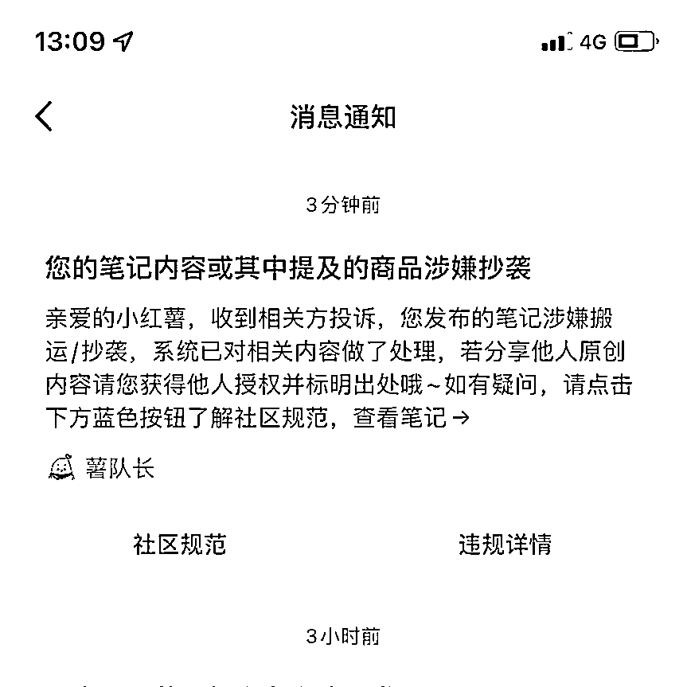

提示说笔记涉嫌抄袭，说明有人举报了，平台也有了证据。

这时把这条违规笔记删掉，1-2天内别再发同样的素材，隔两三天再发。这种影响不大，不会限流。

第三种

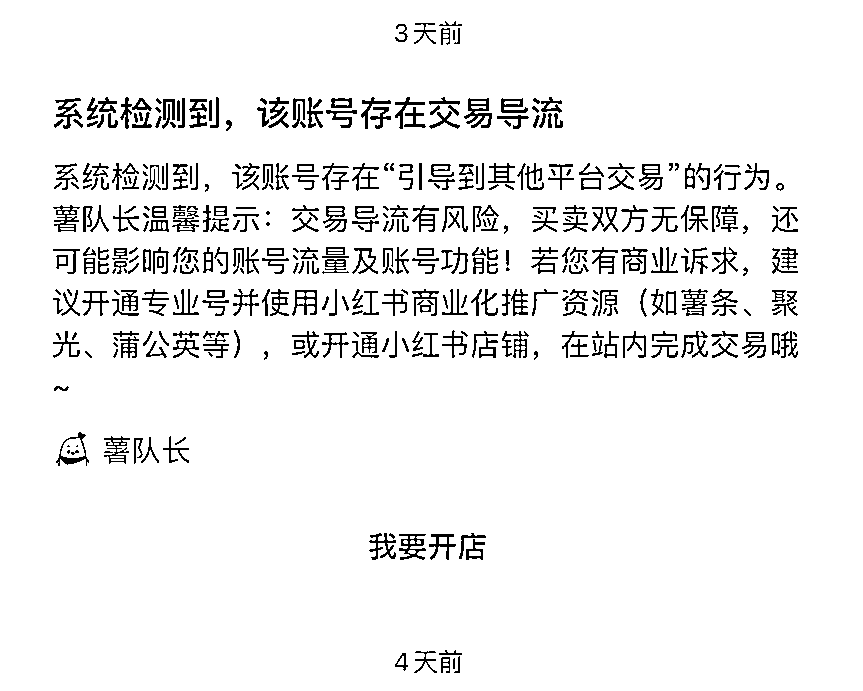

这是平台周巡查时自动检测到你有导流动作，发来的警告。

意味着你快到注销的边缘了，但该发笔记还是发，该引流还是引流，流量正常，不用过度担心。

第四种

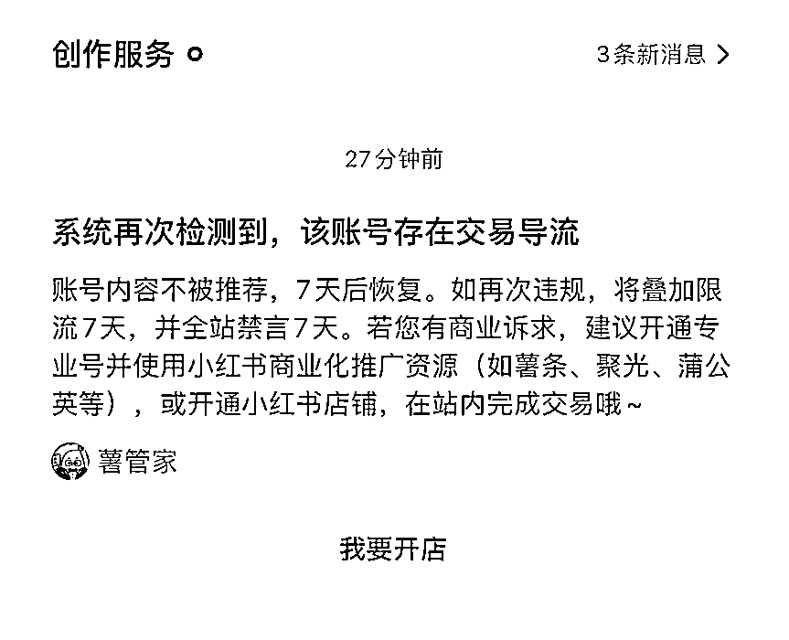

收到这种提示就很严重了，看到立刻注销，注销原因选其他，别拖。

隔半天后就能用同一个手机号重新注册新号。

这些关键点一定要按步骤走，别自己乱操作。一旦乱操作，这台手机可能就注册不了号了，就算注册了流量也会大打折扣，所以一定要照做。

# 十五、总结

基本上核心流程都讲完了，实操中肯定还会遇到各种细节问题，这篇文章可能没全部覆盖到。

能看到这里说明你是真的在认真学。

你可以把这篇文章当成操作手册，有不会的就对照着步骤走，也可以当成📕入门教材，以后哪里不顺手了再翻回来看看。

看完记得给我一个反馈，谢谢！

原创：艾小飞

转载可私信

禁止抄袭和搬运