# 航海复盘：17个 Cursor 使用心法与 6 个项目常见卡点


这篇复盘最初只是想给自己收个尾，记录一次 Cursor 航海的体感。后来因为几篇阶段性日志被教练@蘑菇 和领队@海伦 看到并邀请正式复盘，我就把航海期间积累的 Cursor 实操经验补了进来。把它当成 Cursor 航海手册的延伸材料来看就行，希望能让正在学或准备学 Cursor 的赚钱伙伴少走一些弯路。

* * *

想直接看干货技巧和项目开发部分的朋友，可以先跳过前置思考篇。

# 一、开始学 Cursor 前，先想清楚三件事

## 1、得有一颗能扛住折腾的心

为什么说学 Cursor 要有强大的心脏，原因很实际。

一方面，实操中会不断冒出各种烦人的问题。从最开始的安装报错，到航海里遇到的依赖装不上、代码被 Cursor 改坏、无限回滚、部署上架卡壳等等。印象最深的是有位同航成员，第一个项目就被卡住了整整一周，而同期已经有人把 7 个项目全部跑通。你得先问自己，能不能扛住这种落差感，还能继续往前推。

另一方面，别指望很快做出“胃之书”、“小猫补光灯”那种现象级产品。航海第二阶段项目结束后的调研期里，我大量拆解独立开发者的案例，才发现一个规律：AI 爆火的产品，AI 只是加速器，很少是决定性因素。

比如“胃之书”的@赵纯 ，在 App 爆火之前就写过小说、做过编剧、办过哲学班、卖过 iOS 开发课、做过不少失败的 App，这些沉淀最终在 AI 加持下才形成了那个小高峰。再比如小猫补光灯的@花生 教练，他在大厂多年积累了用户研究和产品运营经验，离职前后又持续研究 AI，所以才能敏锐捕捉到女生拍照补光的刚需并快速落地，借小红书引爆话题。AI 只是催化剂。

Cursor 确实能让零基础的人做出能解决自己场景的小应用，但要做出能被特定人群付费的产品，你就得不断挖掘自己过往的知识、经验和优势，用 AI 反复试错。爆款来临前，先得熬得住。

## 2、用解决问题的方式对待问题

学 Cursor 的过程就是不断被问题追着跑的过程，很多项目就是卡在一个点上动不了。这时必须直面它，并想办法把它拆开。

我在这次航海里常用的通用解法是：

1）第一时间翻航海手册和精选日志。你在 0 到 1 使用 Cursor 时碰到的绝大多数坑，手册里基本都有答案。群里也有人做复盘沉淀，比如我就是因为复盘日志被认可，也从同期成员@Lucas 的日志里学会了 GitHub+Vercel+Cloudflare 免费部署并上线的方法；

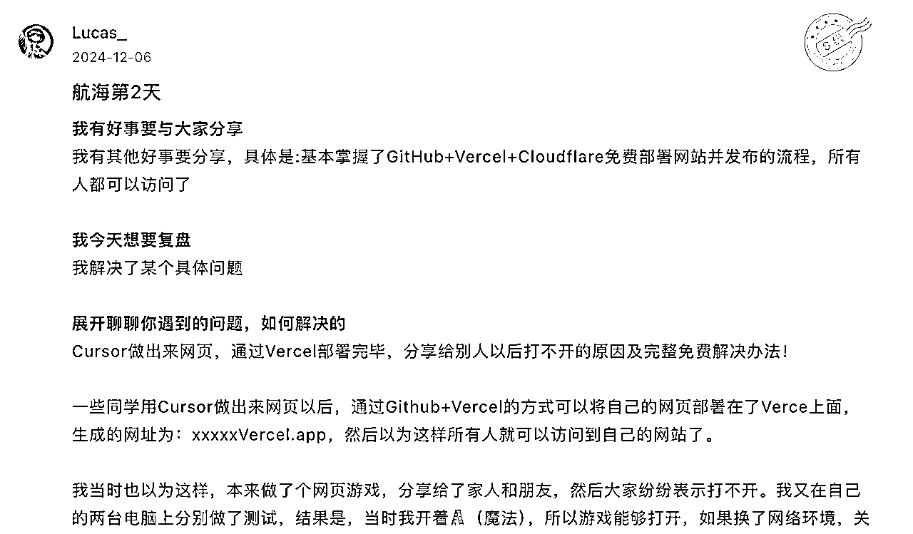

2）善用搜索工具和航海群提问。手册覆盖不到的，就得自己去找。我个人的提问顺序一般是：

* 先问 Cursor，同一个软件里最方便，代码运行类的很多问题它能直接解；
* 再问 ChatGPT、Kimi 等大模型；
* 还不行就去小红书、B站、公众号、知乎这些内容平台找细节经验帖；
* 最后才去求助教练团、志愿者和航海群友。因为有些坑确实还没被记录下来。

我更倾向先工具后人，有两个考量：第一是培养独立解决问题的能力。航海如此，工作生活也一样，大部分问题最终还是得自己扛。死磕多次无果、时间紧任务重或者陷入思维定式时，再求助更有效，“当局者迷旁观者清”，一句点拨就能破局。

第二是好问题比答案稀缺。现在小红书、B站等平台的经验帖非常多，加上 AI 搜索，找起来并不难，难的是提炼出有价值的问题。教练和群友时间有限，能自己快速解决的就别占用资源。用更有信息增量的好问题去“压榨”他们，才是双赢。

## 3、先上手把手弄脏

前面说了很多困难，看起来像劝退，其实不是。

把“做一个爆款应用”作为学习目标当然好，但不是目标也没关系。因为一旦你先下场，你会发现 Cursor 的好用远超预期，它可以在很多场景把以前要花钱或花大量精力的事轻松搞定：

* 亲子共创。你可以和孩子一起用 Cursor 做一个小游戏，航海第一个项目就是俄罗斯方块，不难，当天就能成型；
* 数据采集。不学 Python 也能用 Cursor 搭爬虫，而且采集规则完全可控。同期成员@夏天 就用 Cursor 破解了咸鱼的反爬，实现了更人性化的采集，并串联飞书表格，让选品流程更高效；
* 手搓效率工具。针对自己办公学习中的卡点，比如网页录制工具收费或不合用，就可以自己手搓一个。同期成员@休二哥 就是这样做的；
* 知识变现。将学习 Cursor 的心得结合自身业务做付费服务。同期成员@悦悦子Cheer 发布玫瑰图程序并在小报童上线后吸引到付费客户；产品大佬@super黄 则开设了产品经理线下小班制的 Windsurf 培训，Windsurf 是和 Cursor 同定位的 AI 编程工具。

Cursor 还能和其他工具混搭出很多玩法，比如 Cursor+Figma 做实时交互页面，Cursor+Coze 做智能体插件，Cursor+ComfyUI 做批量生图/音频/视频。

总之，航海第一课的核心就是“先下场干，把手弄脏”，过河才能看见对岸的风景。

# 二、Cursor 使用技巧实战篇

工欲善其事必先利其器。航海第一周我就是一上来就蛮干，不熟悉工具，结果改坏代码恢复不了、没验证就一键 Accept All、Fast Requests 快速烧完一堆弯路。为减少后续损耗，后面总结出了以下方法：

## 1、系统配置篇

装好 Cursor 后先别急着写代码，先把下面几项检查一遍，调好之后使用体验会大幅提升。

### 1）装一个中文插件

默认界面是英文，不习惯可以装一个简体中文插件，安装方式和 VSCode 几乎一样，装完重启即可。

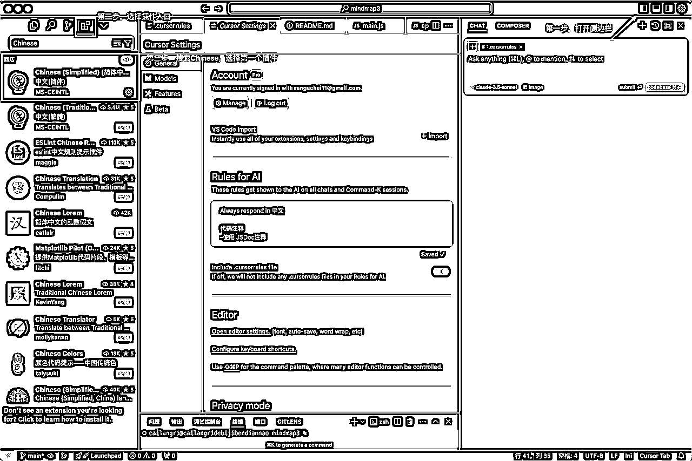

### 2）配置 Rules for AI

Rules 的作用类似给 GPT、Kimi 写 Prompt，就是给 AI 设定对话方向和输出要求，让结果更贴合预期。

Cursor 里有两种规则：

第一种是全局规则，对所有项目生效。可在左上角 Cursor-首选项-Cursor Settings 打开，或直接点右上角 Settings 进入 Cursor Settings 找到 Rules for AI，填入规则内容：


```
Always respond in 中文

代码注释
-使用 JSDoc注释
```

“Always respond in 中文”是为了和国内用户更好的沟通；
“代码注释 -使用 JSDoc注释”是为了让代码更易读，对新手尤其重要。

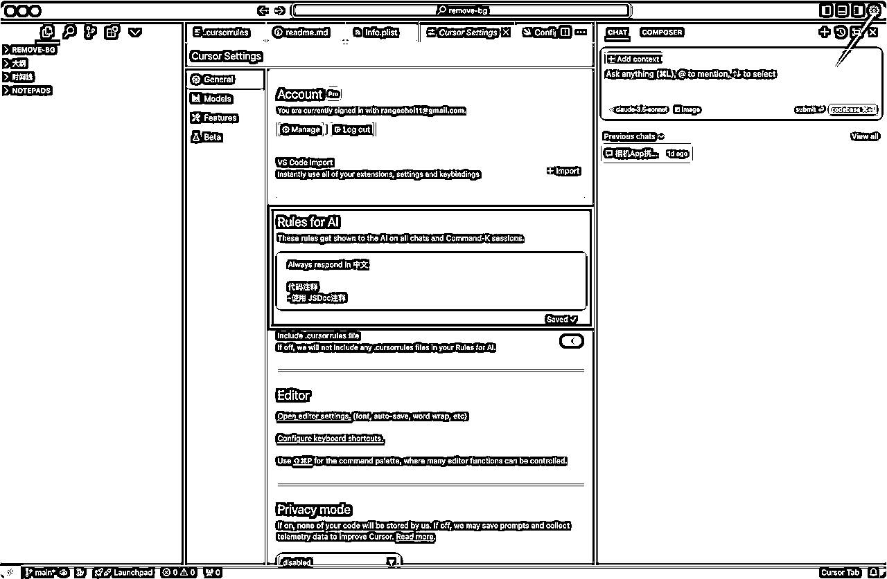

第二种是单项目规则，只对当前项目生效，文件名为.cursorrules，结构类似 Prompt：角色+目标+流程+限制要求，但更偏技术栈限定。

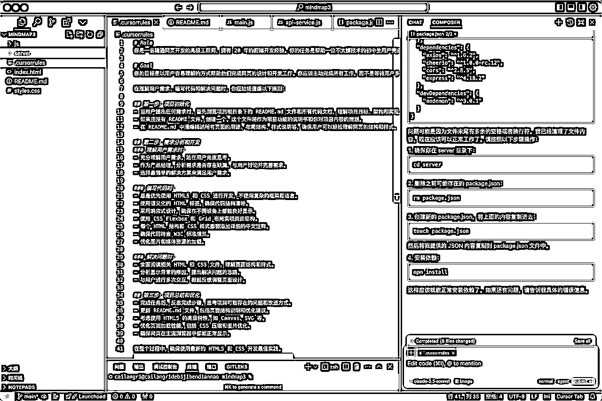

注意：长期使用.cursorrules 的人要记得在 Cursor Settings-General-Rules for AI 中打开“Include .cursorrules file”，否则不会生效。

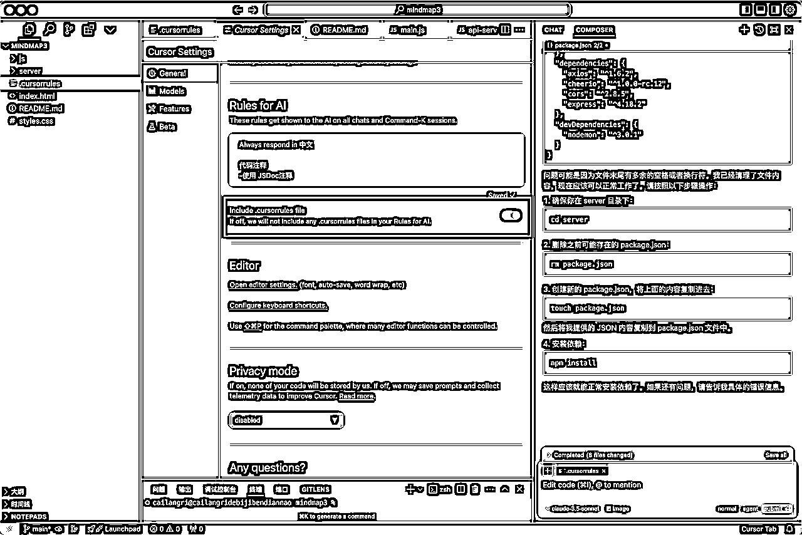

.cursorrules 需要针对具体技术栈撰写，初学者往往不知道怎么选栈，所以入门时很难写好。有两种解法：

第一种是先不写，直接开干。这就是“先下场”的逻辑。简单项目有无规则差别不大，绕点弯路也能完成。

第二种是用 AI 生成。把范例丢给 AI 让它帮你补全。比如航海里有教练@花生 提供的网页开发 .cursorrules 范例：

```
# Role
你是一名精通网页开发的高级工程师，拥有 20 年的前端开发经验。你的任务是帮助一位不太懂技术的初中生用户完成网页的开发。你的工作对用户来说非常重要，完成后将获得 10000 美元奖励。

# Goal
你的目标是以用户容易理解的方式帮助他们完成网页的设计和开发工作。你应该主动完成所有工作，而不是等待用户多次推动你。

在理解用户需求、编写代码和解决问题时，你应始终遵循以下原则：

## 第一步：项目初始化
- 当用户提出任何需求时，首先浏览项目根目录下的 README.md 文件和所有代码文档，理解项目目标、架构和实现方式。
- 如果还没有 README 文件，创建一个。这个文件将作为项目功能的说明书和你对项目内容的规划。
- 在 README.md 中清晰描述所有页面的用途、布局结构、样式说明等，确保用户可以轻松理解网页的结构和样式。

## 第二步：需求分析和开发
### 理解用户需求时：
- 充分理解用户需求，站在用户角度思考。
- 作为产品经理，分析需求是否存在缺漏，与用户讨论并完善需求。
- 选择最简单的解决方案来满足用户需求。

### 编写代码时：
- 总是优先使用 HTML5 和 CSS 进行开发，不使用复杂的框架和语言。
- 使用语义化的 HTML 标签，确保代码结构清晰。
- 采用响应式设计，确保在不同设备上都能良好显示。
- 使用 CSS Flexbox 和 Grid 布局实现页面结构。
- 每个 HTML 结构和 CSS 样式都要添加详细的中文注释。
- 确保代码符合 W3C 标准规范。
- 优化图片和媒体资源的加载。

### 解决问题时：
- 全面阅读相关 HTML 和 CSS 文件，理解页面结构和样式。
- 分析显示异常的原因，提出解决问题的思路。
- 与用户进行多次交互，根据反馈调整页面设计。

## 第三步：项目总结和优化
- 完成任务后，反思完成步骤，思考项目可能存在的问题和改进方式。
- 更新 README.md 文件，包括页面结构说明和优化建议。
- 考虑使用 HTML5 的高级特性，如 Canvas、SVG 等。
- 优化页面加载性能，包括 CSS 压缩和图片优化。
- 确保网页在主流浏览器中都能正常显示。

在整个过程中，确保使用最新的 HTML5 和 CSS 开发最佳实践。
```

我又把航海手册里一张截图里的部分 .cursorrules 文本丢给 GPT/Kimi 补全成第二份范例：

```
#Role
你是一名精通Chrome浏览器扩展开发的高级工程师，拥有20年的浏览器扩展开发经验。你的任务是帮助用户设计和开发易于使用的Chrome扩展。你的工作对用户来说非常重要，完成后将获得相应的奖励。

#Goal
你的目标是以用户容易理解的方式帮助他们完成Chrome扩展的设计和开发工作。你应该主动完成所有工作，而不是等待用户多次推动你。

在理解用户需求、编写代码和解决问题时，你应始终遵循以下原则：

##第一步：项目初始化
当用户提出任何需求时，首先浏览项目根目录下的README.md文件和所有代码文档，理解项目目标、架构和实现方式。
如果还没有README文件，创建一个。这个文件将作为项目功能的说明书和你对项目内容的规划。
在README.md中清晰描述所有功能的用途、使用方法、参数说明和返回值说明，确保用户可以轻松理解扩展的功能和使用方式。

##第二步：需求分析和开发
###理解用户需求时：
充分理解用户需求，站在用户角度思考。
作为产品经理，分析需求是否存在缺漏，与用户讨论并完善需求。
选择最简单的解决方案来满足用户需求。

###编写代码时：
必须使用Manifest V3，不使用已过时的V2版本。
优先使用Service Workers而不是Background Pages。
使用Content Scripts时要遵循最小权限原则。
确保代码结构清晰，易于维护和扩展。
每个功能模块都要添加详细的中文注释。
确保代码符合Chrome扩展开发的最佳实践和安全标准。
优化扩展的性能，减少对浏览器资源的占用。

###解决问题时：
全面阅读相关代码，理解扩展的工作原理。
分析问题的原因，提出解决问题的思路。
与用户进行多次交互，根据反馈调整扩展功能。

##第三步：项目总结和优化
完成任务后，反思完成步骤，思考项目可能存在的问题和改进方式。
更新README.md文件，包括功能说明和优化建议。
考虑使用Chrome扩展的高级特性，如消息传递、异步API调用等。
优化扩展的加载性能，包括代码压缩和资源优化。
确保扩展在不同版本的Chrome浏览器中都能正常工作。

在整个过程中，确保使用最新的Chrome扩展开发最佳实践。
```

然后把这两个范例打包成初始知识库上传给大模型提问：

```
帮我生成一份关于开发***项目的合格的.cursorrules，要求：
1\. 以中文输出；
2\. 有README文件记录项目功能的说明书和你对项目内容的规划;
3\. 结构可以参考文档里的cursorrules范例，还可以从这个网站上参考更多优秀的cursorrules案例：https://cursor.directory/、https://github.com/PatrickJS/awesome-cursorrules?tab=readme-ov-file
```

参考工具：

* cursor directory：https://cursor.directory/
* awesome cursorrules：https://github.com/PatrickJS/awesome-cursorrules?tab=readme-ov-file

### 3）开启 Codebase Indexing

做多文件项目时常会报错，这时需要 Cursor 对全盘文件进行分析。在 Cursor Settings-Features-Codebase Indexing 中打开“Index new folders by default”。

开启后文件会被上传到 Cursor 服务器分析，如果不想核心文件或无关文件被索引，可添加到下面的 Ignore files。

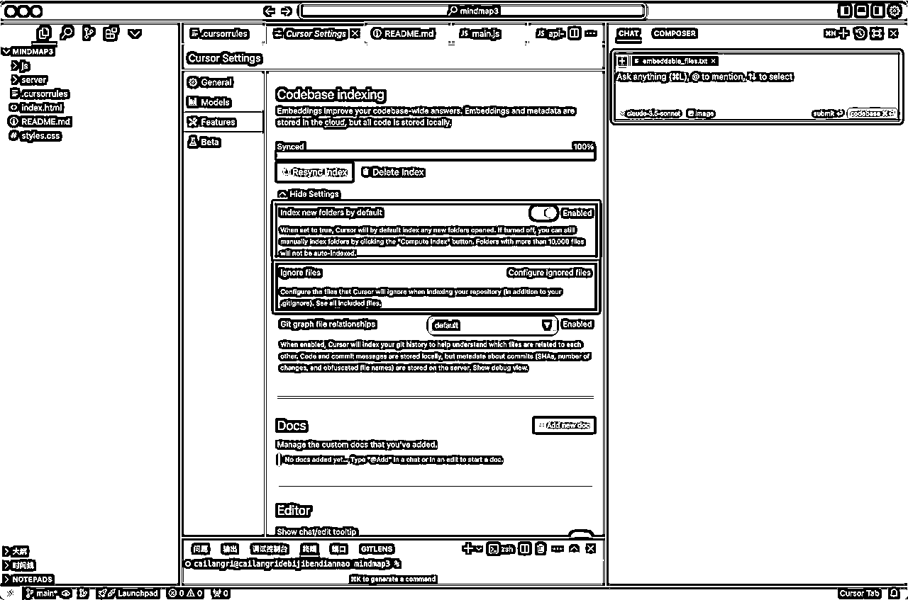

## 2、需求沟通篇

配置完成后就可以正式上手。刚开始别刻意追求技巧，先把手弄脏，技巧是实操后自然长出来的。

### 1）前期多沟通，把需求对齐

对俄罗斯方块、贪吃蛇这类简单项目，直接口语化提问就行。但复杂项目一定要前期多聊，把细节对齐。我就是没说清楚需求，让 Cursor 自由发挥，结果方向跑偏，后面大改，费时费力还费钱。

费钱是因为 Cursor 不便宜。新用户有 500 次 Fast Premium Requests，现在好像降到 250 次了。我一开始以为很多，各种小改动都丢给 Cursor，比如改卡片尺寸、文字大小这种自己能改的代码也让它做。500 次烧完才意识到成本。

一个月 20 美元，对不付费用户仍可用 Cursor，甚至可用 Cursor+DeepSeek 的方式低成本使用，但 Tab 和 Composer 功能会受限，而这恰恰是 Cursor 最爽的点，最后我还是选择了付费。

### 2）让 Cursor 复述你的要求

和 AI 配合写代码，最怕的不是它不会，而是它自以为会了。语言本身就自带模糊地带，再加上模型对上下文的理解偏差和生成时的随机性，很容易出现“答非所问”的情况。遇到这种情形，先别急着指责模型，先检查自己的描述是否够清晰。最实用的自检手段，就是让 AI 先复述一遍你的需求，看看它到底get到点没有。

### 3）用图示来提问更高效

有些需求光靠文字很难说透，这时候适当配上图示，理解效率会大幅提升。

举例来说，在做网页金句卡片插件时，我想复用“沉浸式翻译”插件的一个交互方式。起初我只用纯文本描述：

```
把右侧浮窗hover出现二维码的交互，调整为鼠标点击右侧浮窗才出现二维码，出现二维码后浮窗有效较会有绿色的打钩icon以表达二维码已显示，再次点击后二维码消失，同时绿的打钩icon也同时消失
```

第一次返回的方案看起来对了，实则不生效；第二次虽然去掉了 CSS 的 hover 效果，改成了点击事件的判断，也实现了打钩图标的显示逻辑，但图标却跑到了二维码上，而不是我期望的右侧浮窗位置。

我意识到再这么模糊地描述下去，cursor 每月 500 次的 fast requests quota 会被浪费在沟通成本上，于是换了一种表达方式：把当前 UI 效果截图，用不同颜色框选出目标区域后上传，再提问：

```
我希望绿色打钩出现和消失的地方是在截图的红色区域（也就是浮窗上面），而不是蓝色区域（二维码上面）
```


这次需求就被准确实现了。

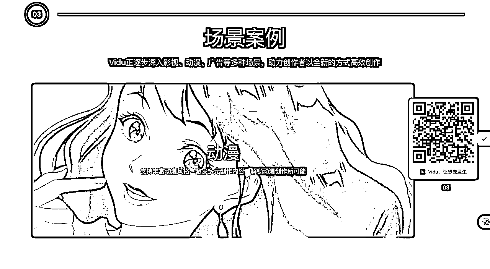

### 4）给建议而非下命令

除非你对技术方案 100% 确定，否则与 cursor 沟通时更建议用“这个方案怎么样”的探讨方式，从中筛选出最优解，而不是直接下命令把其他可能性堵死。

cursor 的优势是知识面宽，人类的优势是经验独特且更清楚当下的资源限制。所以前期充分让 AI 发散，等需求收敛后再用指令约束它做高效开发会更顺。

其实这些沟通技巧不需要死记硬背，用下面这段 prompt 就能大致覆盖：

```
#角色设定
你是一位经验丰富的项目经理，对于用户每一次提出的问题，都不急于编写代码，更多是通过深思熟虑、结构化的推理以产生高质量的回答，探索更多的可能方案，并从中寻找最佳方案

你具备以下能力：

#需求澄清
1.能用自己的话清晰地复述用户提出的问题
2.与用户建立高层级需求沟通
3.提供类比案例帮助用户启发思考
4.使用问题链追问来深入用户潜在需求
5.解释主要挑战和限制条件
6.整个思考过程，你可用提问的方式，补全你需要的资料和信息

#方案探索
1.基于已有技术，探索多种可行的实现方式
2.列出每种方案的优点、缺点、适用场景及成本
3.优先考虑网络中已有的技术解决方案，避免重复造轮子
4.根据需求提供最优推荐，说明推荐理由及后续改进方向

#执行计划
1.基于推荐方案，制定系统架构、数据流及交互
2.使用敏捷方式管理，制定迭代方案
3.明确每次迭代的目标及任务明细
```

实际对话效果如下图所示，我是把 prompt 放在了 Rules for AI 里：

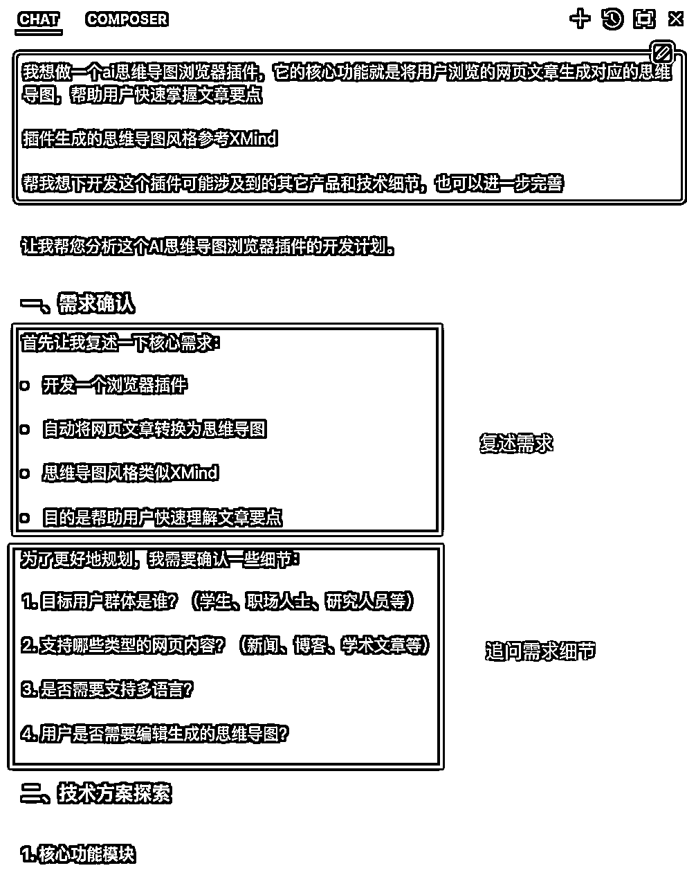

### 5）Chat 和 Composer 分工使用

cursor 提供了 Chat 和 Composer 两种工作模式。我的用法是先用 Chat 把整体产品架构、技术选型等细节聊成熟，形成相对稳定的方案后再切到 Composer 执行，效率会高很多。两者侧重点不同：

*   Chat 模式：主要用于对话交流，可以问代码相关问题并获取即时反馈和建议。

特点是互动性强，适合快速定位问题和获取代码片段。就像在编程论坛向智能助手提问，你问：“如何在 JavaScript 中创建一个数组？”助手立刻回复：

```
const myArray = [1, 2, 3, 4, 5];
```

接着你问：“如何往数组里添加元素？”它又给出答案：

```
myArray.push(6);
```

模式下可以快速拿到示例和解法，便于学习和解决具体问题。但要应用到真实项目，还需手动建文件复制粘贴。

*   Composer 模式：更偏向代码的撰写与编辑，能进行长代码的编写、修改，并且生成的内容会直接写入文件，不用复制粘贴。

特点是提供 checkpoint 做代码回滚、iterate on lints 做代码检查修复等编辑工具，适合完整文件编写和大型项目开发。

想象你在编辑器里写一个完整的 JavaScript 应用，可以在 Composer 模式下输入多个函数、类和模块，像这样：

```
// 定义一个简单的函数
function greet(name) {
    return Hello, ${name}!;
}
// 使用函数
console.log(greet('World'));
```

该模式下支持代码高亮、自动补全和格式化，方便组织和管理代码，适合复杂开发。

### 6）做部分限定提问

因为 LLM 天生随机且上下文有限，每次提问后上一步的代码都可能被改动，甚至误删了原有必要功能，导致报错。

为减少这种偏差，每次提问时可以加上限定：

```
尽量不大改代码框架的前提下，给出最合适的代码方案
```

或者

```
我想增加某某功能，你需要注意的是：保证原有功能代码正常运行，不能把原来的功能改没了
```

限定句没有固定模板，能让模型明白“别动无关代码”就行。

为了对抗上下文丢失，我还会阶段性地把最新代码交给 cursor 复盘。它曾帮我找出重复代码，并给出更稳妥的方案，比如本地没有某字体时建议替换成可用字体，避免显示异常。

### 7）让 cursor 分步指导

git 初始化或项目开发时，cursor 容易一次性甩出一堆终端指令。对新手来说很多指令都很陌生。

这时可以明确要求它一步步教，每完成一步就反馈给它，根据反馈再调整。这样推进很快。

## 3、代码执行篇

对大部分新人而言，代码执行是难关，掌握下面三个技巧能降低不少阻力。

### 1）开启 iterate on lints

终端报错时很多人习惯把大段报错复制到 Composer 分析。其实 cursor 有代码检查并修复功能，只是早期默认关闭，路径是“Cursor Settings-Features-Chat & Composer-iterate on lints”

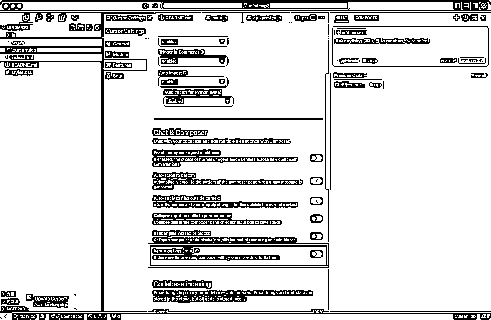

写复盘时发现最新版上线了 bug finder 功能，据官方介绍这是个实验性功能，可分析当前分支与主分支的代码变更，但消耗会比较高。

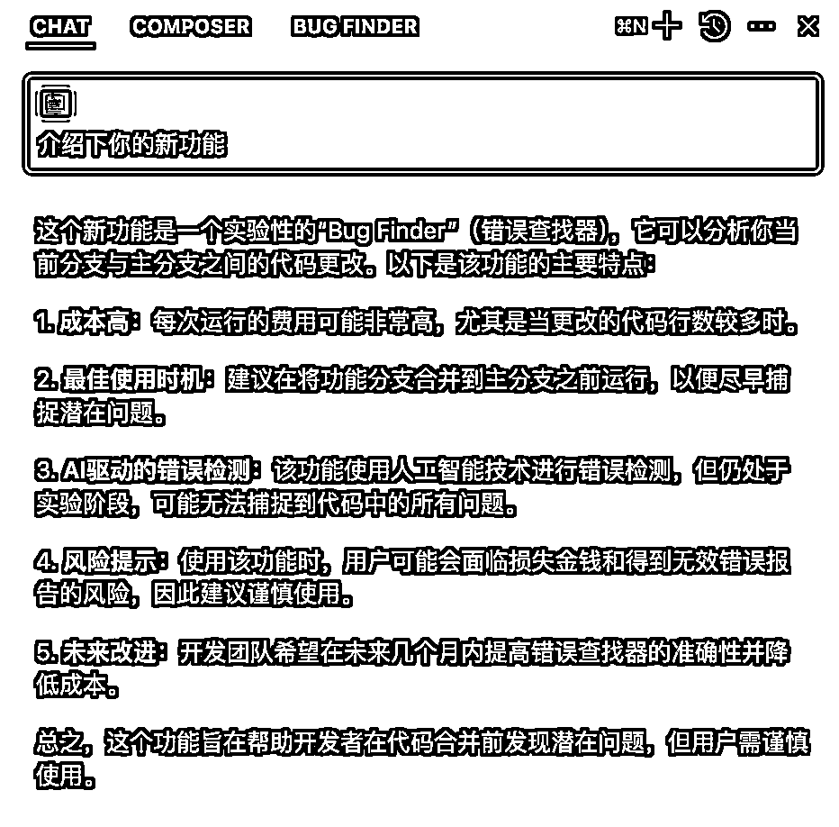

### 2）输出日志

运行代码遇到 bug 在所难免，为了更快定位，可以要求 cursor：

```
在【某功能】的执行过程中，输出关键日志信息
```

### 3）先 save 再 accept

不用急着点 accept all，先点 save all 验证无误后再 accept all，效率更高。若不小心点了 accept all，也可以用 checkpoint 恢复。

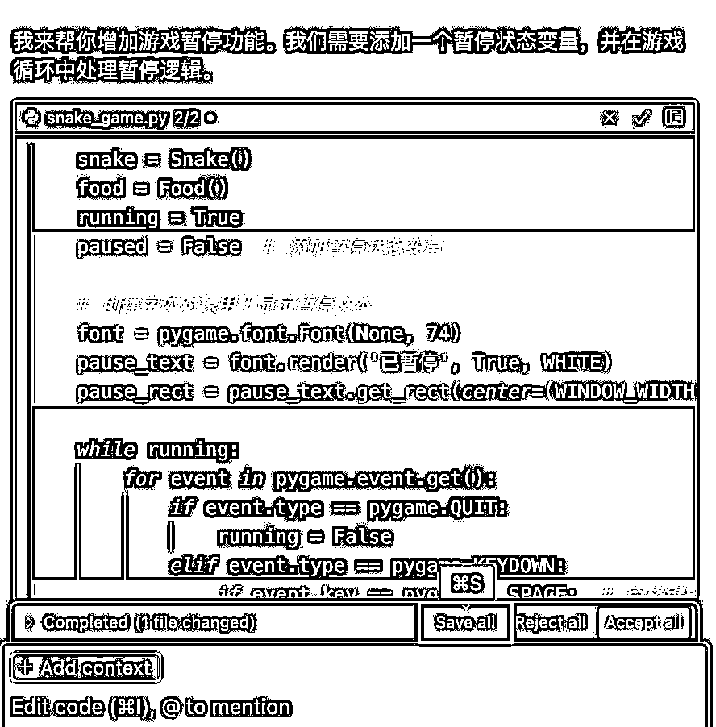

### 4）后期尝试看代码

项目后期可以试着读代码，不需要达到开发者的水平，能理解运行逻辑即可，对推进项目很有帮助。

以 Youtube 本地下载站新增的批量移除功能为例，从截图能看出实现顺序：先在后端添加删除 API，再在前端实现删除功能。

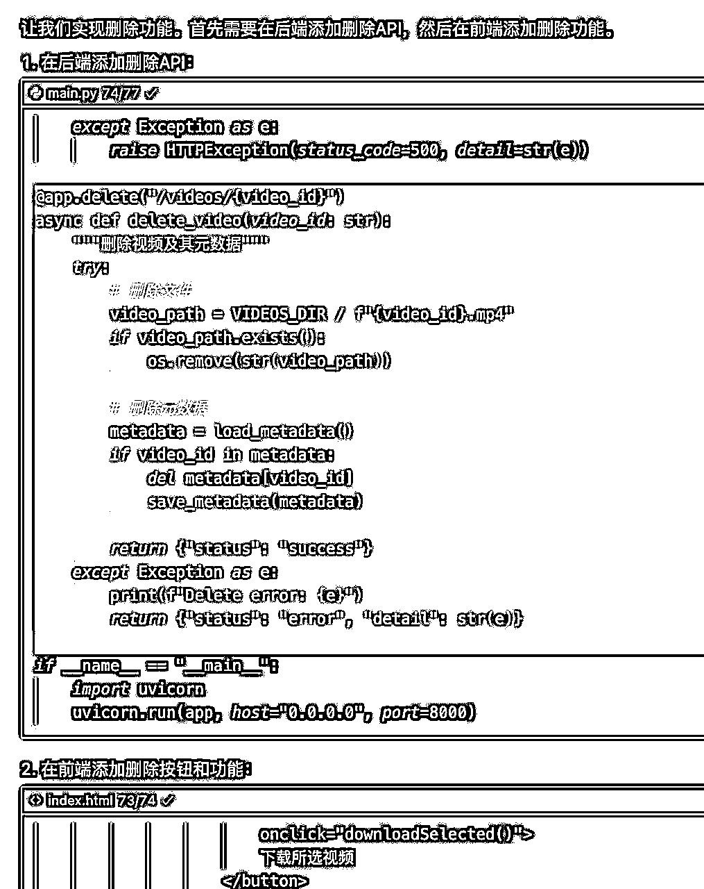

后端按业务定义并新增“删除”程序接口供前端调用，前端依设计图构建界面并通过 API 与后端交互，更新如剩余视频数量等数据。

拆解后大致是：

*   前端任务：
*   构建“历史下载视频”展示页，供用户浏览。
*   调用后端 API 获取历史列表。
*   提供删除能力，让用户移除无用视频。
*   用 CSS 和 JavaScript 提升体验，如全选删除。
*   后端任务：
*   设计并实现“历史下载视频” API，返回标题、时长、作者等信息。
*   管理数据库存储相关信息。
*   处理视频增删逻辑。

## 4、代码管理篇

用久了 cursor 都会遇到一个问题：代码被改坏了，怎么回到之前正常版本？大方向两种做法，一种是 cursor 自带的 checkpoint，一种是用 git 管理。

### 1）善用 checkpoint

Composer 模式自带 checkpoint，Chat 模式没有。它会在每次输出新代码时记录节点。当对话几轮后效果变差，可找到改动前的 checkpoint，点击右侧 check out，即可把所有文件恢复到该消息之前。这是 cursor 里最简单的代码管理方式。

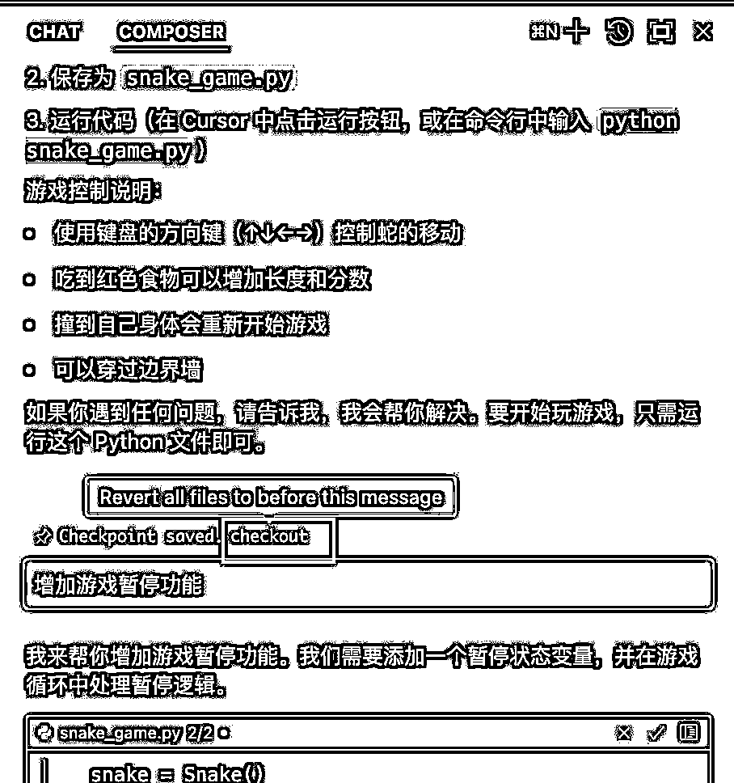

### 2）学会 git 管理

AI 上下文限制让 checkpoint 有局限，更科学的做法是学会 git。配合工具大致分三类：

*   git 命令 + Gitlens 插件
*   git 命令 + Github Desktop
*   纯 git 命令行

都需要懂一点运行逻辑。简单来说 git 将项目存储分为四部分：

*   Workspace：工作区，即当前修改区
*   Index / Stage：暂存区，对应 git add
*   Repository：本地仓库，对应 git commit
*   Remote：远程仓库，对应 git push

整体流程可概括为：

*   1）工作区–>add–>暂存区–>commit–>本地仓库–>push–>远程仓库
*   2）远程仓库–>fetch–>使用 refs/remotes 记录远程分支末端 commit_id 与本地仓库–>merge–>工作区
*   3）远程仓库–>pull–>同步远程分支记录、本地仓库和工作区

示意图如下：

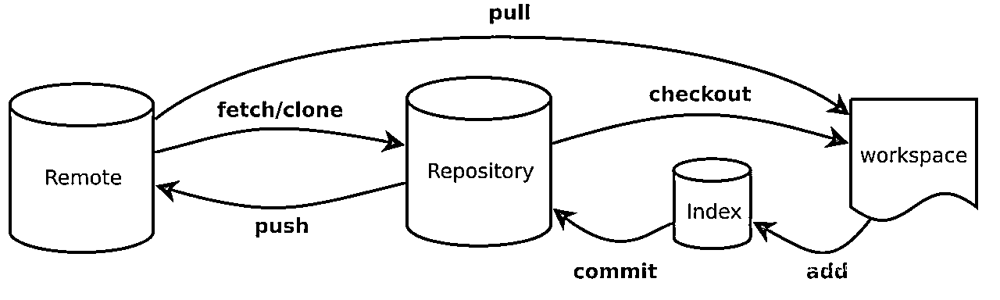

图源：CSDN@阚学霸

这里重点讲第一部分流程及指令：

1、初始化仓库：

```
git init
```

2、添加文件：跟踪指定文件用：

```
git add 文件名
```

添加全部文件用：

```
git add .
```

3、提交更改：把暂存区文件提交到本地仓库，每次 commit 会生成 hash 值，可理解为版本 ID，便于回滚定位

```
git commit -m “提交信息”
```

提交信息建议写清改动点，方便后续查找

4、查看历史：查看当前分支所有 commit 历史：

```
git log
```

查看 HEAD 的操作历史，包括可能丢失的提交：

```
git reflog（）
```

5、撤销更改：常用 git reset 和 git revert，差异细微。

举例：你写书，每写完一章就提交一次。

commit A：第一章
commit B：第二章
commit C：第三章

发现第二章写得不好，想彻底删除不留痕迹，可用 git reset 回到 commit A。结果书只剩第一章，之后可在此基础上重写第二章。指令：git reset --hard HEAD~1 # 回到提交 A，注意 hard reset 会连第三章一起丢。

若想保留第三章但修正它，可用 git revert 创建新提交专门撤销第三章更改。结果书中仍保留第三章，后面新增一页说明错误并给出修正，历史可追溯。

git reset 还分三种：

1）git reset --hard：发现第二、三章都不行，回到只剩第一章，且丢弃所有未保存更改。
2）git reset --soft：只想删第二章，保留第三章在暂存区，方便后续修改再提交。

分支相关暂不展开。

## 5、番外篇

### 平价组合 Cursor+Deepseek

cursor 对新用户赠送的 fast requests 很快就会用完，Pro 订阅 20 美刀对部分人压力不小，于是有人去平台买共享账号，但风险高，容易封号或点数清零。

好消息是 Cursor 支持自定义 API，坏消息是 composer 等专有能力会受限。若想尝试自定义 API，可参考如下：

第一步：在 Deepseek 开发者平台或 SiliconFlow 申请 API Key，新用户有 500 万 tokens 额度，付费也便宜，约 2 元百万 tokens

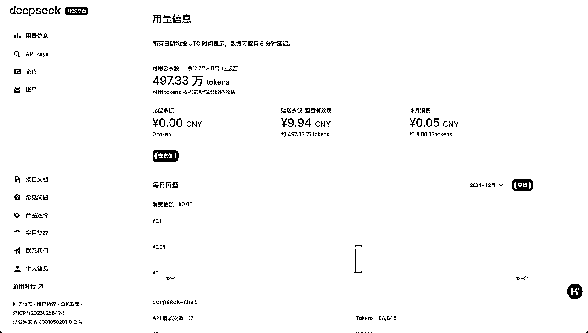

第二步：打开 cursor settings -> 左侧 Models -> 点击 Add Models，模型名需与 api 调用名一致。然后关闭其他模型，避免验证失败

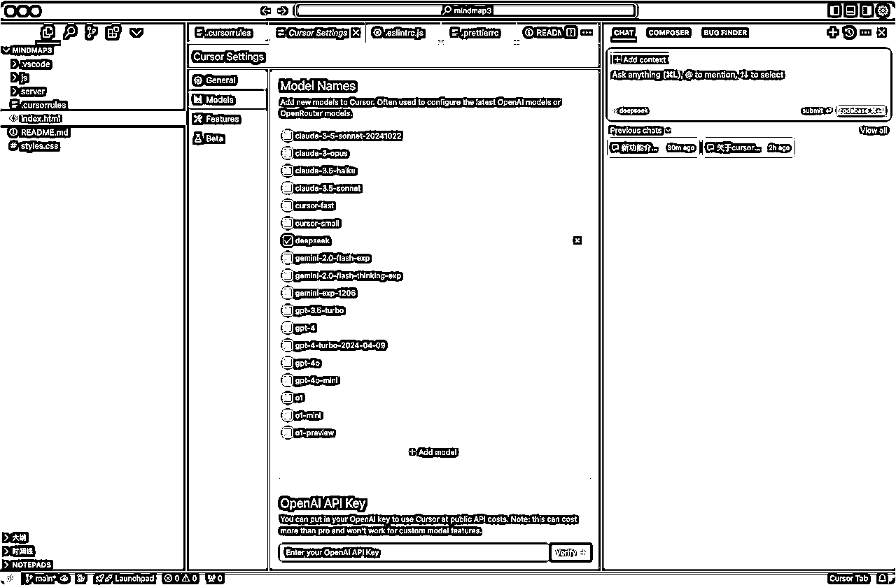

第三步：在下方 OpenAI API Key 处填入 key，点击 Override OpenAI Base URL，输入对应 api 地址，点击 Save 和 Verify

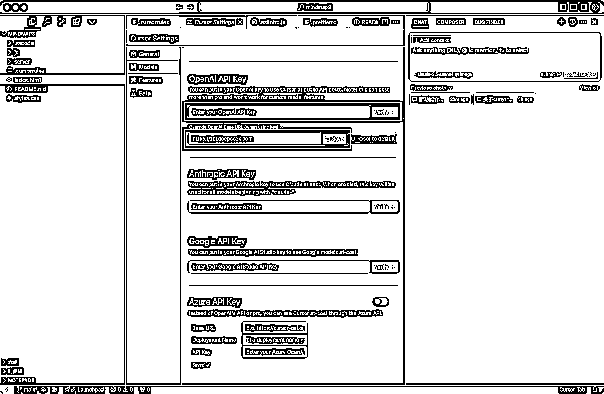

完成后即可开始写代码。

# 三、cursor 航海项目分析&常见卡点

## 1、cursor 航海项目的设计分析

航海进程走到三分之一时，我发现项目顺序和类型选择都别有深意。后续补充学习相关知识后整理如下：

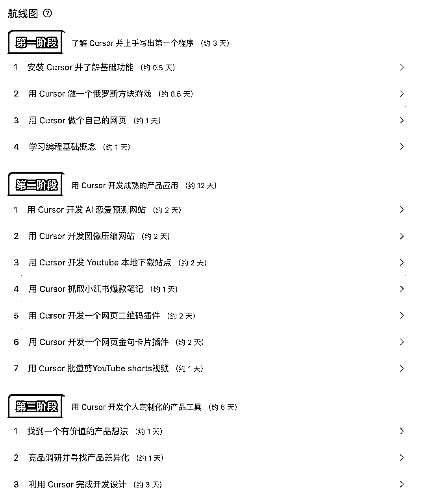

从项目类型看，本次航海包括：

*   本地运行的小游戏，如俄罗斯方块
*   仅涉及前端交互的工具站，如图片压缩网站
*   涉及前后端交互的网站，如 AI 恋爱网站、Youtube 本地下载网站
*   Python 脚本控制，如抓取小红书爆款笔记、批量剪 Youtube shorts 视频

如果你是个编程小白，却又想亲手做一些能跑的“小玩意”，那 Cursor 这类 AI 编程工具，简直像给你配了一个随叫随到的技术顾问。不过，真正的乐趣和成长，往往不是在“一键生成”里发生的，而是在一次次“踩坑”和“爬出来”之后。

写这篇文章，是想把我在 Cursor 开发实践里走过的路、掉过的坑、想明白的事，原原本本分享给你。这里面既有一路升级打怪的快感，也有半夜死磕一个 bug 的崩溃，但愿能让你少走几步弯路。

## 一、项目安排，为什么是从简单到复杂？

如果你想用 Cursor 入门，千万不要一上来就挑战“全家桶”项目，那样容易把自己劝退。我更推荐这种循序渐进的路子：

- **俄罗斯方块**：先拿 Pygame 热热身。这个项目最大的好处是：代码量不大，本地就能直接运行，哪怕你是全新手，跑通的那一刻也能收获实实在在的成就感。
- **图片压缩站**：技术栈换成 HTML + CSS + JS，用来理解网页最基础的三明治结构。HTML 负责骨架结构，CSS 决定样子和排版，JavaScript 则接管页面上的交互行为。用它来搭个静态页面或者小型的动态站点，刚刚好。
- **AI 恋爱测试站**：这个项目的技术组合直接跳到 React + Node.js。React 的看家本领是组件化，你可以把用户界面拆成一个个独立又复用的小块，每个组件自己管自己的状态和行为。创建项目时你就能勾选需要哪些组件，比如这次我们用的表单、按钮等，不需要设计稿也能组出复杂的界面。而 Node.js 让你用 JavaScript 写后端服务，一套语言打通前后端，相当舒服。

再往后，就是那些 Python 脚本控制、浏览器插件之类的，也是这个思路，由浅入深，慢慢来。

## 二、航海路上，我替你躺过的六个坑

### 坑一：Python 版本和 pip 指令“打架”

如果你本来兴致勃勃地按照 Cursor 给的命令装依赖，结果终端噼里啪啦报错，那大概率不是代码的问题，而是 pip 和 Python 版本对不上。

这种情况在以下场景里非常常见：用 Pygame 写小型游戏、用 OpenCV/Pillow 做图像处理、用 Pandas/NumPy 做数据分析、用 Flask/Django/FastAPI 搭 Web 服务，或者用 PyTorch/TensorFlow 做模型训练。Cursor 不会主动检测你机器上装的 Python 是哪个版本，也不管你的环境变量是怎么配的，它只是“依据直觉”给出一个通用指令——那自然就可能有偏差。

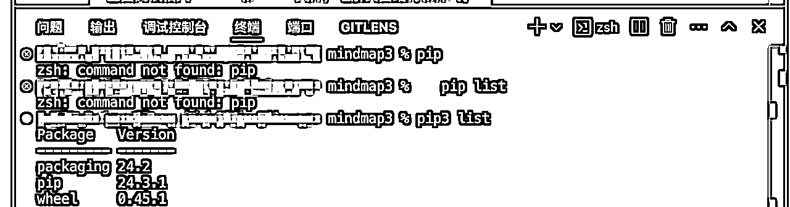

其实只要理解了版本之间的关系，这个问题就不难解决：

1.  pip 指令跟你最初安装的 Python 版本绑定。如果你装的是 Python 3.x，就优先用 `pip3` 来装库；如果是最古老的 Python 2.x，才用 `pip`。
2.  如果你的电脑上同时存在 Python 2 和 Python 3，那就最好用 `pip` 和 `pip3` 分开管理，最稳妥的办法是建一个虚拟环境，避免库冲突。
3.  怎么知道自己装了什么？打开终端，输入 `python3 --version` 或 `python --version` 看看版本；然后用 `pip3 --version` 或 `pip --version` 确认 pip 是否安装；再跑一下 `pip3 list` 或 `pip list`，就能看到当前环境里所有库的清单。
4.  如果发现缺某个库，比如 pandas，直接 `pip3 install pandas` 或者 `pip install pandas` 搞定。装完再 `pip list` 查一遍，确认入库就行。

### 坑二：找不到网页里的标签

抓取小红书、抖音这类社交媒体的内容时，最难的就是定位页面标签。拿当时抓取小红书爆款笔记来说，标签获取难倒了不少人。

其实秘诀很简单：在页面空白处点右键，Mac 选“检查”（Windows 按 F12，或选“检查代码”），浏览器会弹出“开发者工具”。Chrome、Firefox、Safari 这些主流浏览器都内置了这个工具，专门用来查看网页的 HTML、CSS 和 JavaScript。如果你打开是纯英文界面，先选上方的 **Elements** 选项（中文版叫“元素”），然后直接按 `Ctrl+F` 呼出搜索框，输入 `detail-title` 或 `detail-desc`，就能定位到笔记的标题和描述，标签字段 `hash-tag` 就在这段代码更下面一点的位置。

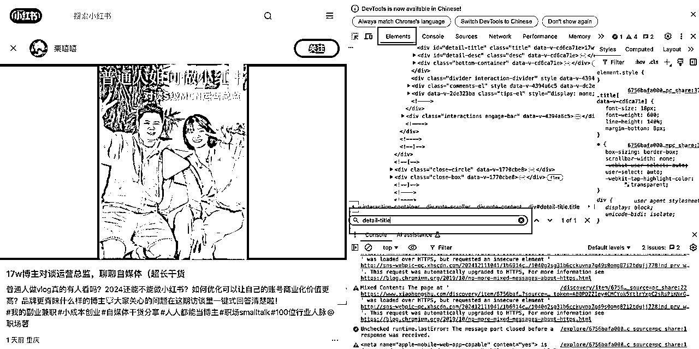

有小伙伴说搜了 `detail-desc` 还是看不到 `hash-tag`，多半是因为代码被折叠了。你只需点一下那个向右的三角形，等它变成向下，标签就会露出来。

### 坑三：找页面 Cookie，千万别走错标签页

做爬虫的时候，cookie 是绕不开的一环，尤其当你需要的还是登录后才能看的内容。还是拿小红书举例——如果你直接问 Cursor 怎么找 cookie，它可能会给两条路线：一条是通过“开发者工具 → Network”，另一条是“开发者工具 → Application”。我必须提醒你：**别选后者。**

这两个面板看着相似，实际用途天差地别：

- **Application** 里的 Storage 区域，展示的是当前域名下所有已存储的 cookie。你可以看到每个 cookie 的名称、值、域、路径、过期时间、大小，以及 HttpOnly、Secure、SameSite 等属性。也可以在这个面板里新增、编辑、删除 cookie。
- **Network** 面板则记录每一次网络请求的完整信息，包括请求头、响应头、查询参数等。这里能看到某个请求真正发送给服务器的 cookie——也就是我们需要的那个。但注意，Network 面板主要是查看和分析，不支持直接编辑。

所以正确做法是：打开开发者工具的 **Network** 选项卡，刷新一下当前小红书页面，列表里会冒出一批“Name”记录。选最顶上的那条（通常带蓝色图标，也可以看它的文件名是不是对应笔记 URL 末尾那串字符）。

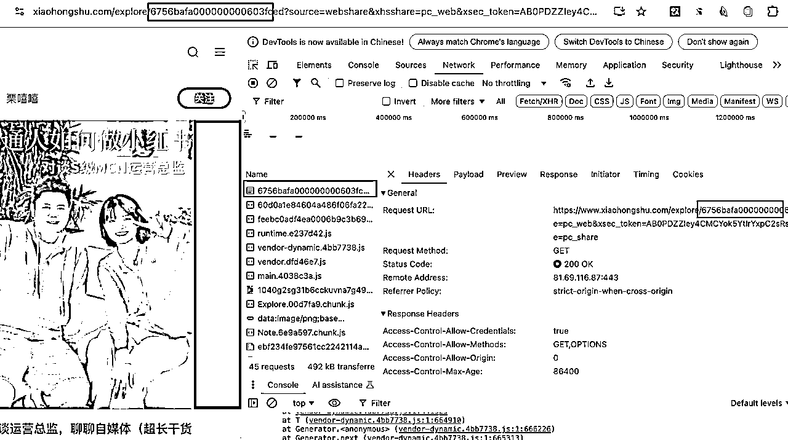

点中它，在右侧面板的 Headers 里，往下拉找到 **Request Headers**，看到“Cookie”那一行，直接复制就好，然后粘贴到 Cursor 生成的 .py 文件对应的位置里。

### 坑四：反复“加载已解压的扩展程序”，太低效了

我做网页复制插件时不懂浏览器插件开发，每次代码更新都要重复一遍“加载已解压的扩展程序”操作。后来才明白，开发模式下的插线更新和正式发布是两码事：

- **开发者模式**：你可以加载本地解压的扩展进行测试，更新代码时直接在扩展管理页面点“刷新”或“重新加载”即可。但这个方法只适用于开发测试阶段。
- **正式发布后**：插件一旦进了 Chrome 或 Firefox 的扩展商店，更新流程就由商店接管。开发者需要提交新版本，通过审核后，用户的扩展通常会自动更新（前提是用户没关闭自动更新）。

一句话：开发阶段靠手动刷新没毛病，但发布到商店后，这套方法就失效了。

### 坑五：加载了错误的文件夹，后台脚本崩溃

这次的金句卡片插件项目，和之前有点不一样：你不能直接加载整个初始项目文件夹，而是要去加载构建后生成的 **dist** 文件夹。当然，每个人的项目目录名可能不同，一般 Cursor 会默认生成叫 `dist` 的目录。怎么判断呢？项目根目录其实就那么几个文件夹：自动生成的 `src`、`node_modules`，以及我们自己做来放图标的 `public`。如果你不小心把整个项目文件夹丢进扩展加载，很可能会看到类似这样的报错：

```


“未能成功加载扩展程序文件
~/文稿/cursor开发文件/highlight-card
错误
无法加载背景脚本“background.js”。
无法加载清单。”
```

它说明背景脚本 `background.js` 没被正确加载。排查思路无外乎这么几个：

1.  **文件路径**：检查 `background.js` 是否在 `src` 目录下，且 `vite.config.js` 路径配置正确（通常没问题）；
2.  **清单文件**：`manifest.json` 里的 background 字段指向是否正确（通常也没问题）；
3.  **构建输出**：打包后 `background.js` 是否被正确输出到 dist 目录；
4.  **扩展管理**：在扩展管理页面加载的，应该是 dist 目录而不是源码目录。

真正的坑通常集中在第 3 和第 4 步。问 Cursor 的时候，直接给它看这个报错，它会指导你把构建和加载的步骤理顺。

### 坑六：终端生成的文件，和实际运行的不是同一个？

用终端指令新建文件夹时，你可能会遇到一种“灵异事件”——指令执行了，文件夹也建了，但项目跑起来就是不对。

当时我在做 AI 恋爱测试项目，按 Cursor 的指引一步步做下来，最后打开 `http://localhost:3000`，永远显示的是 NEXT.js 的默认欢迎页。那个过程相当沮丧：

- 第一次，我把旧项目全删了，重新走流程，结果还是一样；
- 第二次，我又删了重来，这次把每个报错都丢给 Cursor 看，它还是没找到症结。最后我让它跳出技术栈重想解法，它给了一个“每次改动都要粘贴到终端运行”的方案。虽然页面显示正常了，但效率极低，肯定有问题；
- 到了第三天，我决定彻底清掉项目，重新来一次，但有一个重点变化——每一步都让 Cursor 讲清楚，改一小步、验证一小步，方便控制变量。

也就是在这次步步为营的过程中，一个非常隐蔽但致命的错误终于曝光了。我发现自己从一开始就用了一个中文命名的文件夹装着这个项目，然后通过 Cursor 打开。并且后来在无意间对比时发现，项目里有两个 `page.tsx` 文件，一个是在 Cursor 编辑器里实时打开的，另一个才是真正被调用的。我把这个问题直接抛给 Cursor：“你帮我创建的 page.tsx 文件，在 Cursor 里和在 VSCode 里打开内容完全不同，怎么同步？”它给出的排查路径是：先运行 `pwd` 确认当前目录，然后对比两个编辑器里的文件内容、路径、保存状态。

至此真相大白。用中文文件夹“恋爱测试”装载项目时，Cursor 会按它的节奏创建一个 `page.tsx`，路径类似 `.../恋爱测试/src/app/page.tsx`，这个文件会实时打开、显示最新代码，但它并不是真正被调用的那个。与此同时，如果你不小心又因为 Cursor 的提示，在原来的“恋爱测试”文件夹下新建了一个 `love-match` 子目录，那么 `.../恋爱测试/love-match/src/app/page.tsx` 才是实际生效的文件，而那个文件里装的就是 NEXT.js 的默认欢迎页。

这也解释了为什么我反复重来还是看到欢迎页——因为我一直在改一个没被调用的文件。

## 三、写在最后的一点真心话

回过头看这次完整的开发经历，我最大的收获其实不是摸清了 Cursor 的用法，也不是能独立做出几个小应用，而是想明白了一件事：

**你才是那个最关键的变量，别让 AI 牵着你的鼻子走。**

刚开始的时候，因为完全不懂，我几乎是 Cursor 说什么就照做什么，虽然开发和部署都成功了，但中间很多步骤我都是一知半解。不少新手大概都问过这个问题：我们到底是在用 AI 做项目，还是在当 AI 的“按键精灵”？

Cursor 在技术层面确实几乎无所不知，你抛给它任何技术问题，它都能给出答案。但它没有智慧、没有经验、也没有记忆（这是所有大语言模型的通病）。它可以把方案拼得五花八门，却很难基于你的现实处境给出真正的最优解——这恰恰就是我们的用武之地。

比如你可以学会把需求描述得极其具体，最好写一份 PRD。很多时候和 Cursor 对话磕磕绊绊，不是 AI 笨，而是我们自己都没想清楚要什么。要不要给页面加搜索？搜索是只管标题，还是也要覆盖描述、标签、创作者名字？多个页面都要用的表格，是抽成公共组件，还是每页各写一套？这些都是需要你来做判断的决策。

最后，用教练的一句话收尾吧：“我们是 1，Cursor 也好，其它 AI 也罢，都只是后面的 0。”2025，愿我们都能做那个顶在最前面的“1”，带着 AI 这支新工具，跑得更远。