# 快手数字人带货付费单品打爆实操全流程
作者：龙哥

大家好，我是龙哥，先简单做个自我介绍。

* 22年做快手无人直播，累计变现突破100万；
* 23年转战抖音单品付费，主攻付费素材打法，用原创脚本+原创拍摄把一款白牌食品做到抖音TOP3；
* 24年聚焦快手数字人付费，已孵化6个头部爆品，单品日销峰值4万+；

沉寂很久，这次首次在星球发帖，和大家聊聊快手单品付费这个打法。

# 项目是什么

* 快手数字人单品付费的本质是什么？
简单说，就是用付费加热带货短视频引流，视频挂车或导流到直播间成交。而在快手，直播间的承接交给了数字人完成，全程无真人主播。

* 这个模式的核心优势在哪？
* 成本低：素材多为搬运混剪抖音爆款，减少了拍摄剪辑的人力投入；投放测试成本也更可控；直播可直接调用官方女娲数字人系统，省去真人主播费用。
* 结果更确定：选品和素材基本来自抖音已验证过的爆款，复用性强，对比抖音等平台，更容易快速出结果。
* 高度可复制：选品、投放、素材、直播四个环节均可流程化。我们标准化后曾同时开6个号运营，即便流量一般，每天保底利润也能稳定在2000+。
* 收益更稳：全程合规，不存在录播封号风险。单品虽有生命周期，但矩阵化轮动测品打品，整体现金流比较平稳。

* 适合谁做？
* 手里有一定资金，但缺稳定项目或基本盘的团队和个人；
* 之前在抖音打过单品的团队。

* 我为什么切到这个赛道，以及实际结果
22年入局内容电商，第一个起量的就是快手搬运+无人直播。当时出现过日赚5万第二天死号的极端情况，赚钱快但无法正规化和放大。

23年开始思考如何正规化和稳定化。认知是，合规且能复制才是放大的前提。于是全年死磕素材和付费投放，最终在抖音拿到结果，但随着比价系统上线、同行内卷加剧，利润持续下滑。

今年4月后，刷到快手可做数字人直播，认为这能极大降低主播成本，便带队入局。经过打磨后跑通标准化流程并实现盈利。

实操下来感受明显，对比抖音付费，此项目在拍摄剪辑、测品、主播成本上都大幅节省，且平台竞争没那么激烈。对比自然流项目，此项目合规稳定，不用担心今天有单明天没单。

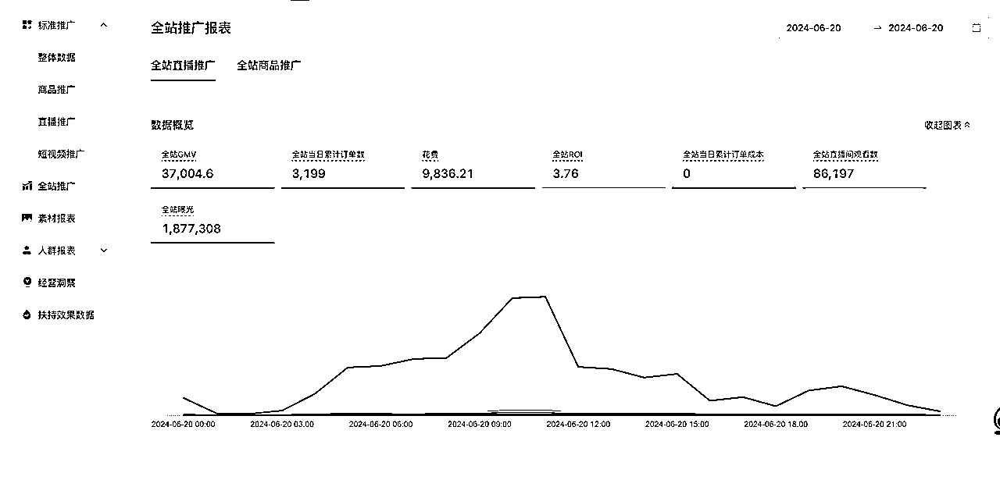

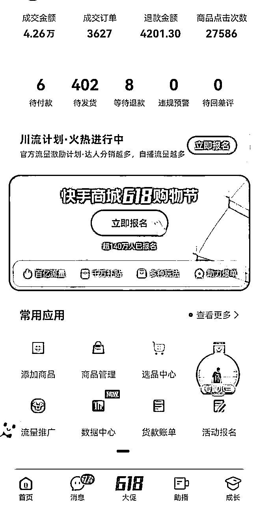

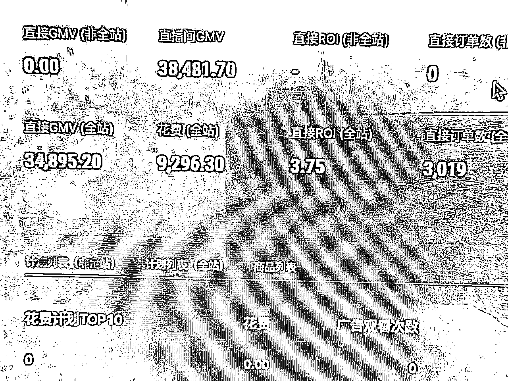

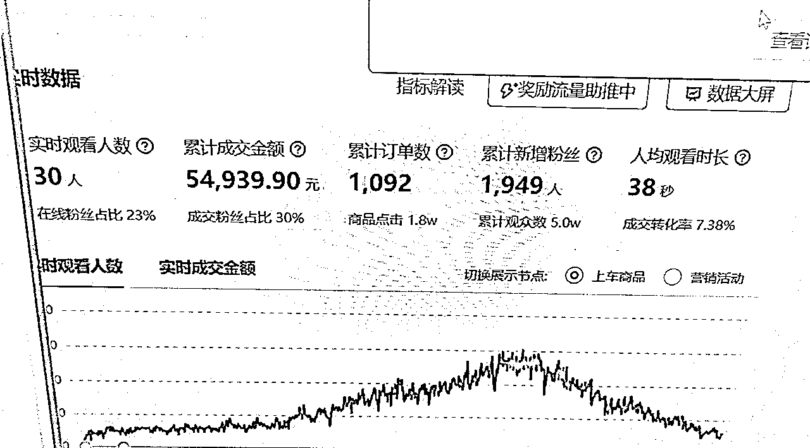

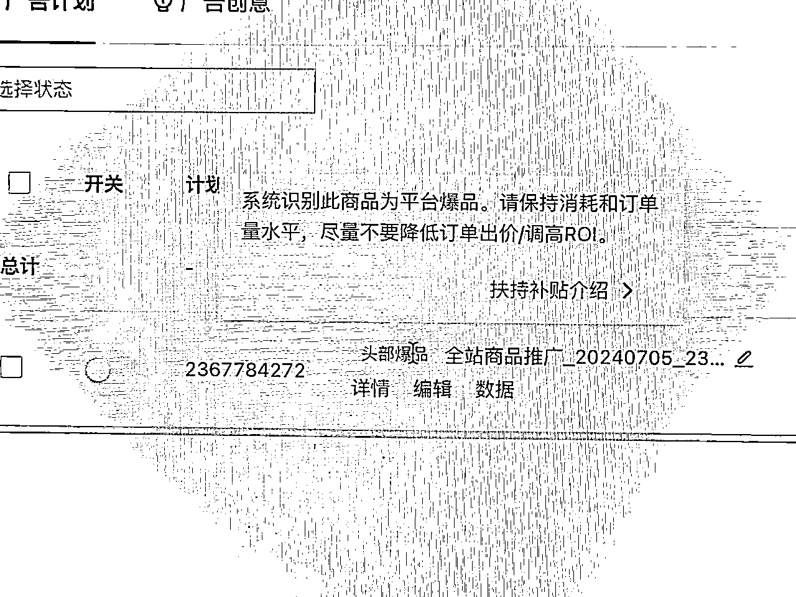

# 详细拆解

## 一、选品

### 核心要求

选品时常纠结：那么多品类，到底该选什么？

先回到本质：我们卖的是需求，消费者买的是痛点被解决。产品能否卖出去，取决于卖点能否被看见，能否在视频里把需求点讲透。

因此选品要遵循三条：

要求一：卖点可视化。视频能直接呈现卖点。例如：一个视频开头拆箱、折叠、收纳效果全展示；另一个视频开头先呈现用户痛点如床单易移位，再引入产品并对比使用前后效果。

要求二：体量够大。产品销量决定了打爆后的天花板。抖音端一般以月销100万以上为基准。

要求三：品质不过关勿碰。品质差会导致退货率飙升，提高投产门槛；若被平台判定劣质产品，会下架甚至罚款。

### 选品路径

#### 抖音养号定位
建一个新号，疯狂点进卖货直播间加购、收藏、关注、点赞，让系统判定你是卖货内容人群。随后推荐就会集中在带货账号。锁定目标账号后，用考古加等数据工具查其销量数据和直播间流量结构，重点看付费占比。

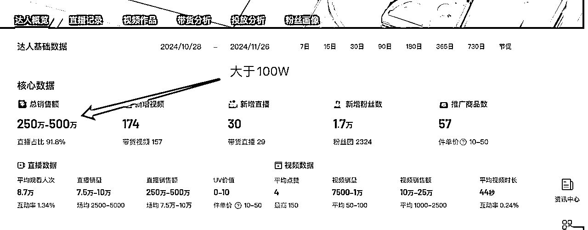

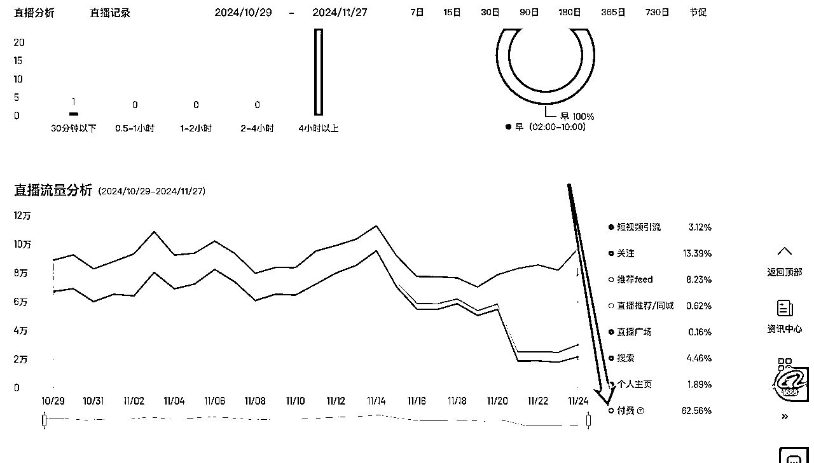

#### 考古加
* 找达人：达人列表选直播达人，筛选付费单品为主的达人；
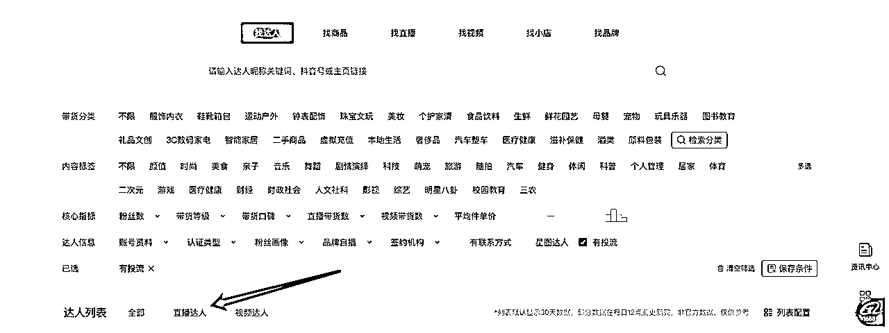
* 找商品：以直播为主且有投流的商品；
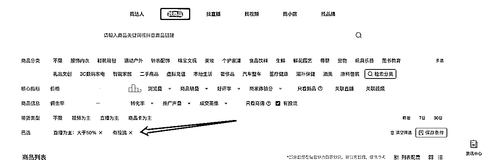
* 找直播：筛选付费比例50%以上的带货直播，查看其详细数据，锁定付费单品；
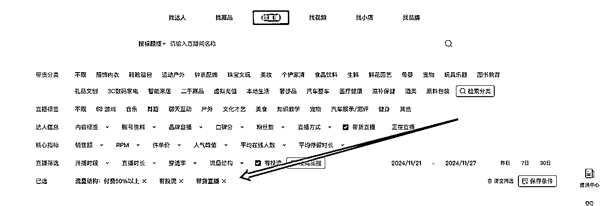

#### 有米云
* 直播引流素材：时间维度选一周，聚焦日用百货类目，挑近期爆量的素材，反推品；
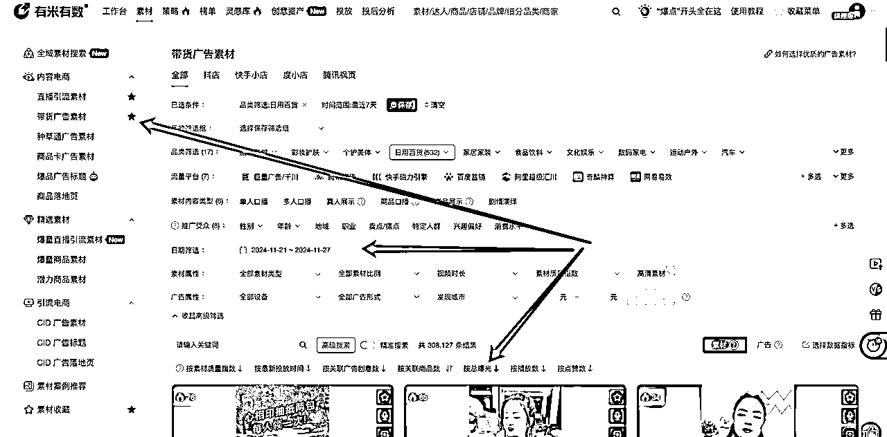
* 短视频引流素材：逻辑同上；
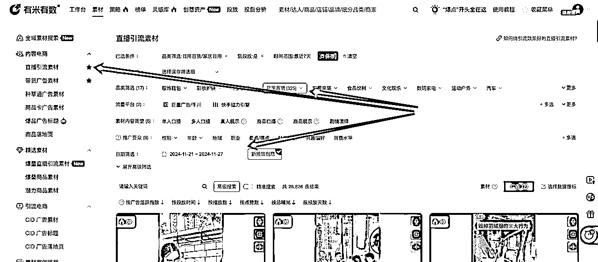
* 还可直接用爆量直播引流素材、爆量商品素材搜索品。若已有有米云账号，记得把后台功能全部用起来；
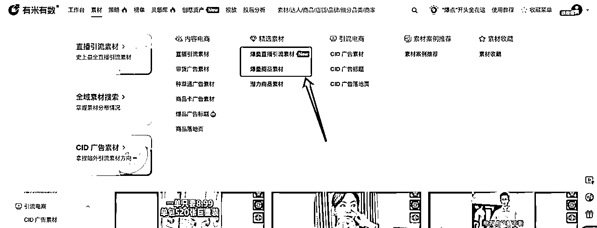

## 二、投放

### 投放底层逻辑

很多人觉得付费很玄学：为什么投产低？为什么不消耗？那么多计划该怎么搭？

先理解平台的广告售卖机制。假设你是平台，广告主能调出价和提交素材，N个广告主抢曝光，广告位怎么分配？

如果纯价高者得，出价高的会优先占位，但平台会被大量用户体验差的内容占据。反之纯内容优先，体验好但营收受影响。

所以主流平台采用ECPM竞价体系。

ECPM = CTR * CVR * 出价 + GPM/IPM/小店评分等增益。

* CTR = 行为数 / 曝光数。行为数指点击进商品落地页或进入直播间的次数。
* CVR = 订单数 / 行为数。引流直播间则为进直播间人数中实际支付的比例。
* 出价：广告主在计划中设定的转化出价。
* GPM/IPM/小店评分：平台差异化增益项。

从公式可看出，CTR、CVR与素材强相关，出价由广告主控制。平台会根据ECPM排序分发。想降成本，核心就是做内容，拉高CTR、CVR，用更低出价拿到流量。

随后我们再拆解ROI构成和归因。

#### ROI决定因素
ROI = GMV / 广告消耗 = 点击率 * 转化率 * 客单价 *1000 / 千次展现成本。内容电商按曝光扣费。

* 点击率
点击率 = 行为数 / 曝光数。提升关键在于3秒完播、5秒完播能否留住目标人群，以及之后能否用卖点或优惠+行动指令把人推入直播间。开头留人能力最重要。

* 转化率
引流直播间则取决于主播话术、直播场景、商品定价；短视频挂车则取决于定价及主图详情页。

* 千次展现成本
花费 / 曝光 *1000。费用高低反映流量贵贱。
什么时候贵？
* 竞争加剧，僧多粥少，如大促期间；
* 产品客单价升高，目标人群收窄；
* 计划设置人群包、达人定向、莱卡等，系统探索难度加大。

#### 计划类型差异

* 最大转化
简介：只设预算和投放时长，不设成本目标，平台以最大转化量交付。
优点：系统动态调预算和出价，跑量优先，探索人群更广。
缺点：无成本保证，无赔付。
* 成本保护
简介：用户设出价/ROI目标，系统据此出价尽量获量。
优点：成本有兜底，超成本可赔付。
缺点：跑量不确定，出价竞争力不足时计划不消耗。

#### 实操搭建建议

* 测品期
问题：账号无模型，素材和产品皆新，出价高易跑飞亏钱，出价低则不消耗。
建议用最大转化。玩法：每个品至少备15条素材，用最大转化跑3-5天。若出现投产转正素材，说明品和素材可行，转成本控计划。若3-5天投产普遍低于盈亏线60%，直接放弃。不死磕单品，只测不磕。

* 测品通过期
已找到正投产素材，目标是锁成本放量。此时可建出价计划和ROI计划同时跑。跑1-3天后上全站投放，持续迭代素材。

## 三、视频素材

确定品后，素材是关键。原则：只找爆款对标，不做创新。

### 对标来源

方式一：抖音。搜产品关键词，下载点赞高的视频作为对标。例如速开杯，直接关键词搜索找高赞视频。
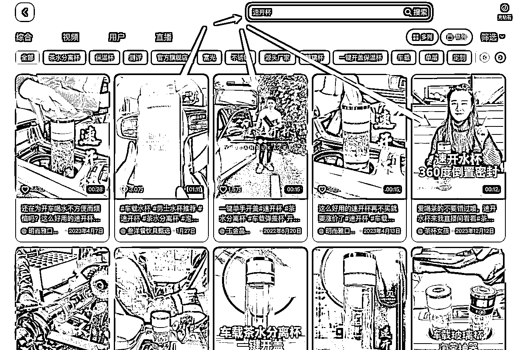

方式二：有米云。产品关键词在直播引流素材和带货广告素材中搜索，排序选总曝光倒序，下载高曝光素材。若抖音已刷到同款竞品账号，可直接搜该账号投放素材。
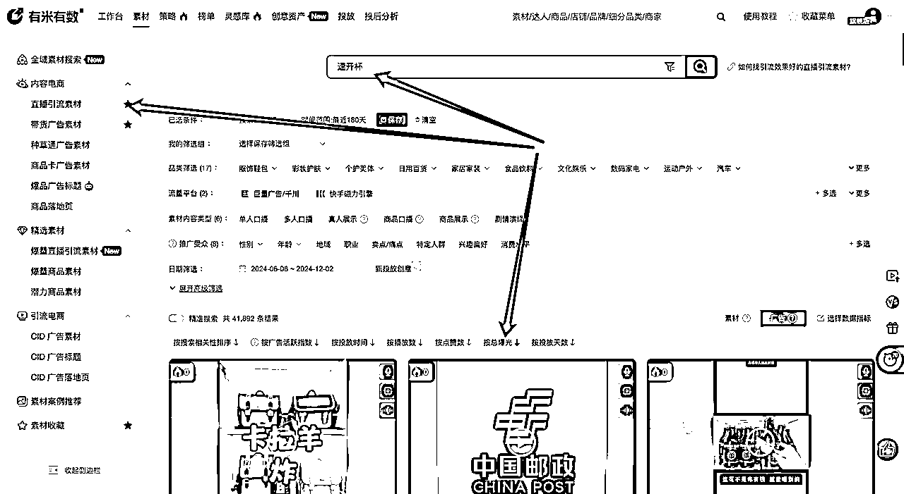
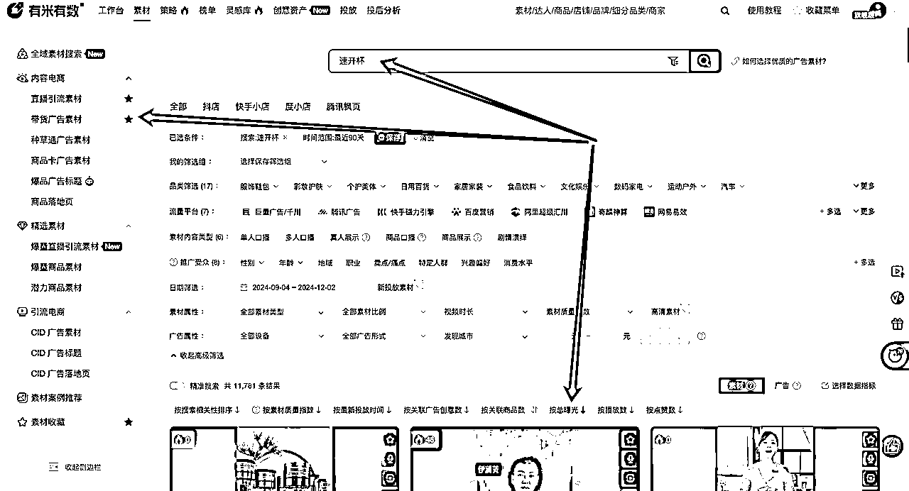

方式三：考古加/蝉妈妈。找商品：输入关键词，找到视频销量高的链接，进入查看其视频列表。注意大主播切片如董宇辉、罗永浩等不适合当对标，要选素人纯产品展示账号。找视频：时间选180/365天，按销售额排序。
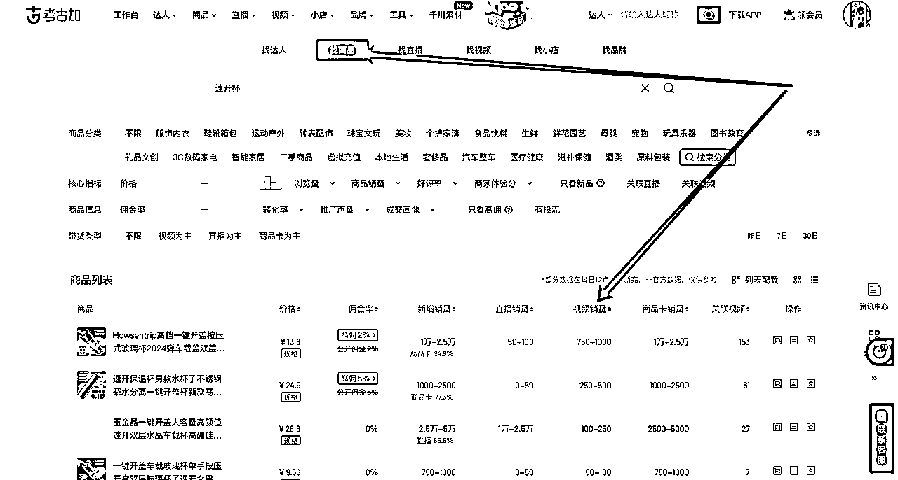
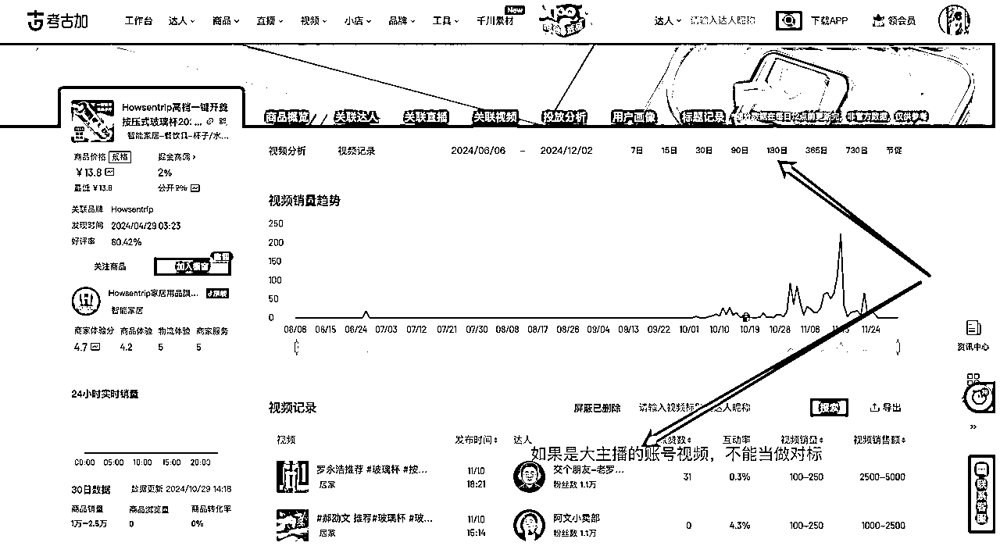
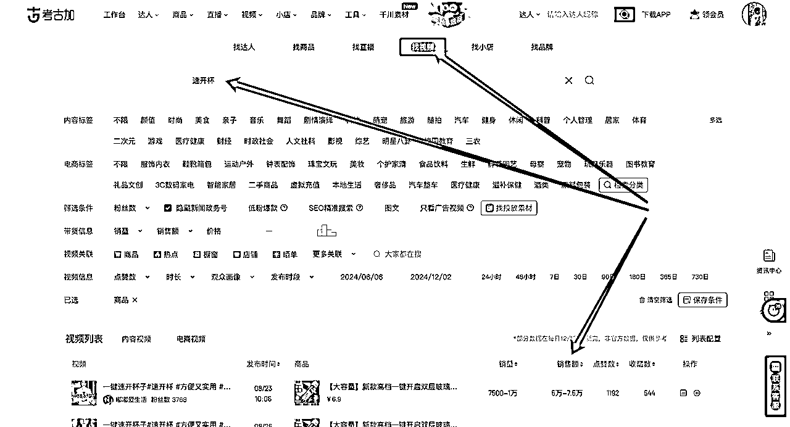

方式四：快手。关键词搜索，下点赞高的视频。
### 混剪实操

混剪核心：高度还原爆款，禁止创新。视频由文案、音频、画面构成，还原要点：

1. 保留原视频文案/音频，已被验证过，重复也不判重；
2. 高度还原场景；
3. 保留前3秒或第一个镜头，开头决定点击和留存。

实操步骤：
1. 拆解对标视频分镜。以床单防滑垫为例：床上贴胶带-引入产品-铺床动作-滚动展示-床单放地-铺地板动作-铺好效果-铺沙发效果。
2. 建素材库。下载抖音相关素材，用剪映智能镜头分割拆解，建立混剪素材池。
3. 按分镜还原，用原音频文案不动，保留第一个镜头。用素材库替换中间镜头，补齐时长，修剪冗余，检查卡点流畅度。

工程文件截图和成品效果如下：
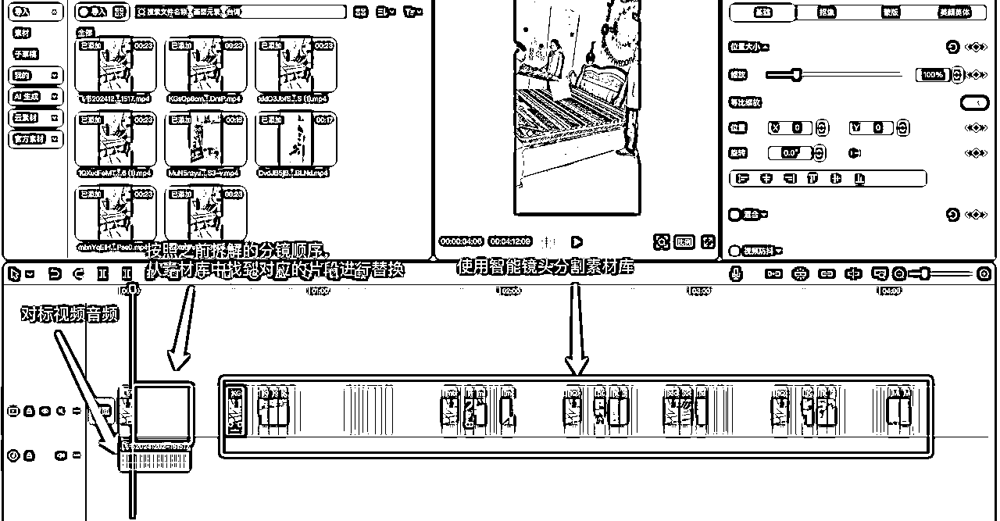

## 四、直播

### 话术框架

直播间为单品间，来的用户基本已被短视频种草。话术循环讲透同一款产品即可。

框架：场景营造/介绍 + 卖点强调 + 同类对比 + 引导购买/逼单

以速开杯为例：

* 场景一：开车人群。经常开车的朋友是不是喝水很麻烦，杯盖拧不开不安全？这款速开杯单手按钮开盖，密封不漏，玻璃材质防爆耐晒，车上喝水更方便。
* 场景二：外出钓鱼。钓鱼时腾不出手喝水，一渴一整天。这款单手开盖，方便好用。

* 卖点强调：一键开杯，开车必备；

做快手数字人单品付费这个项目也有一段时间了，踩过坑，也吃到过肉，今天不整虚的，直接把我跑通的全套玩法摊开来讲，从选品话术到厂家对接，再到一些掏心窝子的总结，一次性给你说明白。

先拿我们正在跑的杯子来说说选品和素材的逻辑。这个品当时能跑出来，核心就抓住了几个点。

第一，是“专属感”。我们直接打出免费刻字，也就是说，用户花一杯奶茶钱，能拿到一个印着自己名字或者专属标语的杯子，这种定制化的体验，天然就有吸引力，而且刻字服务是免费的，这比什么优惠券都实在。

第二，是“解决痛点”。很多人不爱用保温杯泡茶，就是因为喝一口满嘴茶叶渣，体验很差。我们这款杯子做了茶水分离的设计，茶汤和茶叶彻底分开，喝的时候不会吐渣。而且过滤网用的是SUS304不锈钢，这是个很扎实的卖点，哪怕用上一两年，天天泡茶，滤网也不会生锈，耐用性上直接打消用户顾虑。

第三，是“价格锚定”。为什么我们敢说这个品能打？你可以去某猫某东搜一下，这种品质的茶水分离杯，最少也得八九十块。而我们今天直接打到19.9，还包邮、还免费刻字。再看同行，同样卖19.9的，很多都是小容量且不刻字的版本，我们是大容量、包邮、刻字全包了。这就是典型的同品不同价，同价不同品，用户一看就知道在哪下单划算。

关于直播间的逼单节奏，我们是这样设计的。主播会直接告诉用户，距离下播还有多少分钟，现在拍下的都能免费刻字，一旦下播恢复原价，刻字服务就要额外加5块钱了。再有就是制造紧迫感，后台库存已经是个位数，主播卖完这波就要去打包发货了，明天开播福利价肯定没了。话术就一句话：现在刷到就赶紧拍，犹豫徘徊等于白来。这种临门一脚的逼单，能很好地提升转化率。

再说数字人直播间的搭建，这块其实不用把官网的东西抄过来，你直接去看官方文档照着做就行，链接我放在文末评论区，比自己瞎摸索快得多。

然后是大家问得比较多的厂家对接。我们找厂家一般就去拼多多或者1688，用价格去筛，筛出三四个备选的，然后重点聊这几个问题。第一，支不支持一件代发，很多厂家只走批发，不做代发，这个必须先确认。第二，问清楚哪些地方要加运费、哪些地方不发货，方便回来设置店铺运费模板。第三，产品是否有合格证，做代发能不能带上合格证，如果是3C数码类目的，还要确认有没有3C标。这一点一定要重视，不然遇上有心人打假，一投一个准，索赔起来很麻烦。第四，是否有快手面单，没有快手面单的话，订单同步过去会打不出单，导致发不了货，这就很被动了。

最后说几点掏心窝子的总结。

第一，卖货的本质，就是卖需求。选品大于素材大于直播大于投放。你想想，飘柔广告做得再好，和尚也不会去买洗发水。一个品选好了，素材上稍微用点力就能起飞；但要是品本身很烂，素材再怎么折腾，效果都微乎其微。

第二，一个真正的好生意，必须满足三个条件。一是合规，符合平台规定，不踩红线、擦边球碰都不碰；二是有稳定利润，不能吃了上顿没下顿；三是可复制，这意味着你的项目上限足够高。

第三，抓时代红利很重要。现在的抖音付费流量红利已经见顶了，但快手付费仍然有比较大的机会，尤其是官方今年把数字人工具推出来之后，直播的人力成本大幅降了下来，这对我们中小商家来说，等于又多了一波红利期。

第四，多实操，拿反馈，多总结，做时间的朋友。当剪辑、投放这些方法全部透明化之后，真正的核心竞争力就只剩一件事——选品命中率。这是没有捷径的，没有人天生就会选爆品，只能靠不停实操、不停复盘来提高。一个优秀的狙击手，都是成千上万发子弹养出来的。那些所谓一招制敌的东西，其实都不是壁垒，只是信息差。真正的壁垒，都是稳扎稳打，一步一个脚印磨出来的。

最后，流量大的平台不一定能赚到钱，流量小的平台也不一定就亏钱。抖音7亿日活，跟你没有关系；快手4亿日活，也跟你没关系。真正跟你有关系的，只有你的同行。你同行在那个平台已经拼得刺刀见红了，你现在进去就是送人头；反过来，你同行水平堪忧但还赚得盆满钵满，那你进去大概率也能吃到肉。

以上就是快手数字人单品付费项目的全部分享。如果对你有帮助，欢迎评论区交流，感兴趣的圈友可以一起切磋，一起赚钱，共同富裕。