# 90天从零到品类榜首：Temu全托管实战复盘

> 分享人：糖饼 | 驻地：厦门

先做个自我介绍。过去我在手机厂商负责营销，也做过电商平台的运营。2022年离开大厂后和朋友试过几个项目，都因为跑偏而收尾。今年4月加入赚钱社群，顺手帮朋友照看一家国内拼多多店铺，投入产出比很低基本放养。8月起正式试水Temu全托管，到11月初，一家店铺冲上品类畅销排行榜第一，另外两家日单破千，单店月度净利率超30%，月收4万+，三店合计月入10万+。

此前我从未触碰过跨境电商，全程靠啃赚钱的Temu航海手册摸索。过程很硬，也有不少坑，下面把关键经验整理出来，给准备入局的人一些参考。

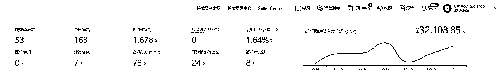

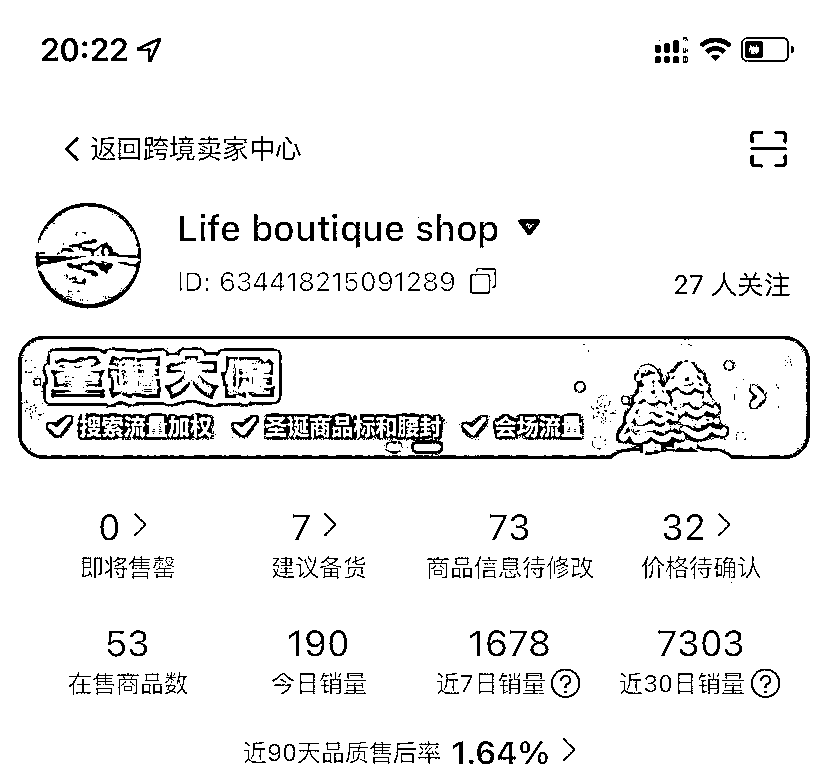

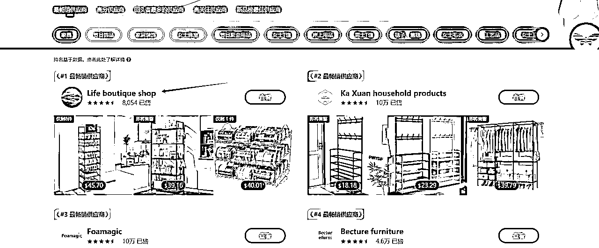

## 一、起步阶段的重心：选品、上架与议价

Temu全托管的标准路径是：开店 → 挑选上架 → 提交议价 → 生成备货单 → 采购 → 贴标 → 发货 → 日常维护。个人身份证即可注册，新手建议先开一家验证节奏，后续可凭个体工商户资质扩店，最高可到20家店群。基础流程航海手册已覆盖，这里只讲实操要点。

### 如何找到可跑的爆品

电商的本质是选品。Temu不像其他平台有强引流工具，也不主打客服售后，你能主导的唯一杠杆就是选品。选品决定存量，在全托管模式下几乎等于决定订单体量。

另外要记住，Temu隶属拼多多，走的是全球低价路线。现阶段入场，采购价超过35元的高客单方向不要碰。无论什么阶段，这类货出单稀疏，开店期更不适合。你自己在拼多多下单的最终驱动是什么？本质上是价格。

我常用的两种打法：

##### 工具辅助+同站竞争分析

常用工具：Temu卖家数据助手

1. 用插件看动销——起步店铺可重点看新店热销与大卖新品，上架时间一个月内，日销在千以内且已被平台验证有市场的品优先

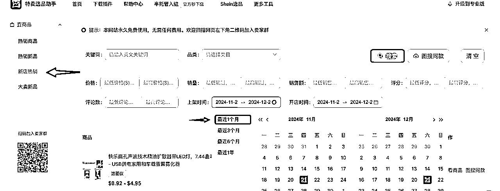

2. 复核同站竞争——筛选后查看同款在线数量与销量表现，再决定是否上。我的经验阈值是：在线链接少于6条，上架一个月内平均销量超100条，基本算合格品

##### 站内机会榜与站内榜单跟款

关注机会商品里的站内稀缺与潜力款，这类商品站内库存极少，且会获得官方流量扶持。先查站内同款存量，大部分找不到或极度稀缺，再结合亚马逊销量判断是否值得引入。

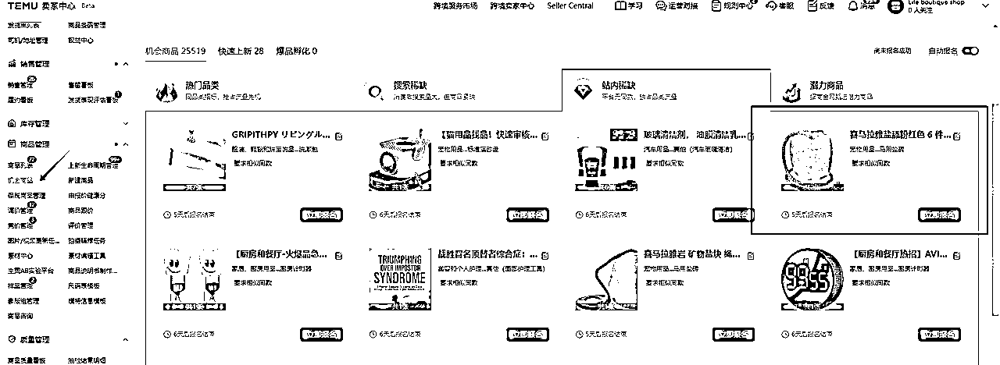

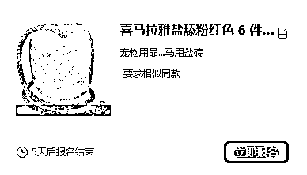

举例：某机会商品站内无同款，亚马逊月均销量超千件，1688拿货价约10元，2-3kg左右的SKU，打包两个装加贴标成本约21元，利润率有30%以上，直接提交链接议价即可。议价通过后系统会自动报名，不放心可回到机会商品页面手动确认。注意报名必须完全匹配类目与尺寸规格，否则拿不到官方扶持。

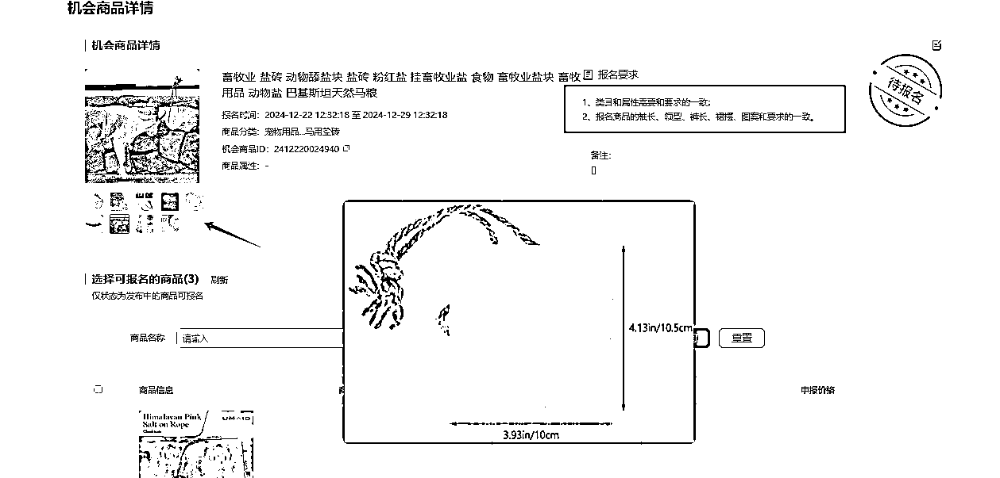

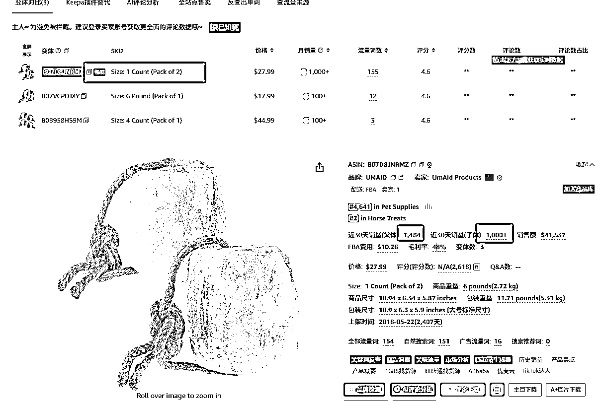

补充工具：亚马逊卖家精灵，关注👸号回复推荐码可领体验期。

**选品雷区务必避开：**

1. 新手慎选：含电含电池、SKU繁多的服饰鞋袜手机壳类、易碎品、医疗美容、挥发性、液体类
2. 评分低于4.5且评价数超过10条的品，不论工具还是站内看到都建议放弃
3. 花草树木在海外认知里属于活物类，不要碰，上架寄样后易触发资质审查。我之前选的宠物咀嚼木棒就被判定需活物资质
4. 首饰类也会触发资质核查，上架后即时或隔1-2天触发
5. 2024年11月起，所有食品接触类需资质

并非所有触发资质的品都不可做，若资质覆盖国家较少仍可操作。遇到议价有利润但被要求资质的产品，复制SPU ID 进入合规中心上传资质即可。

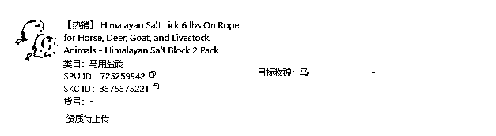

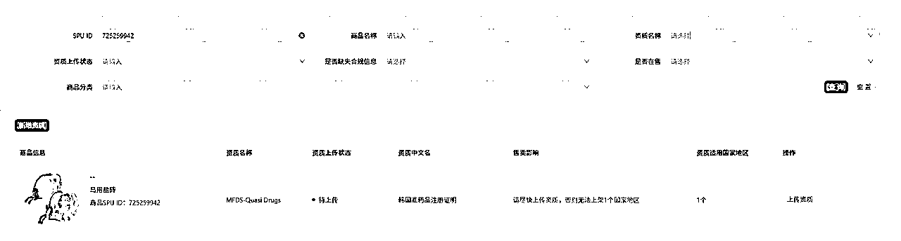

### 提高上架效率的方法

航海手册提到店小秘采集。我实测多款后更推荐妙手，免费且流程顺畅，使用前先完成授权并填入授权码。注意店小秘采集的链接无法直接发布到同一站点，多站点需付费。

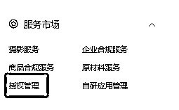

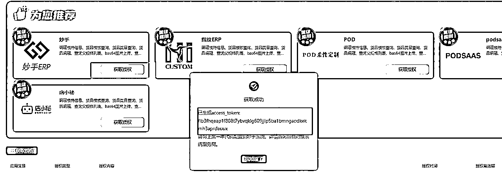

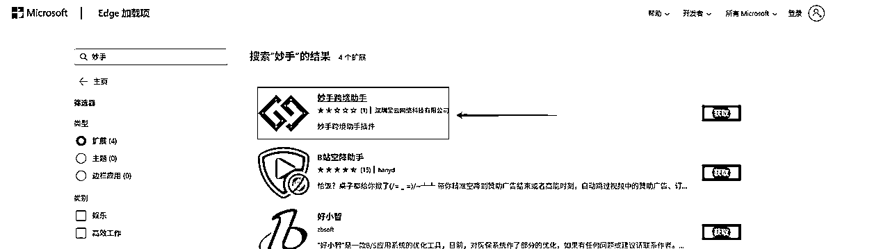

##### 妙手采集上架流程：采集 → 修改价格/SKU/上传标签图 → 发布

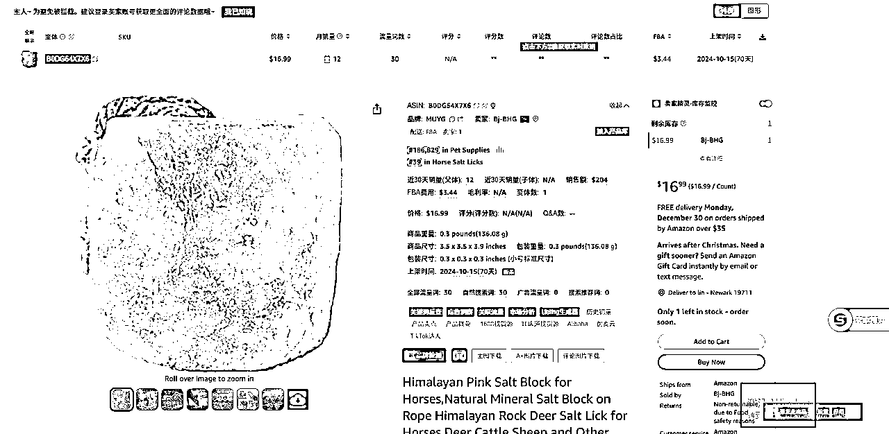

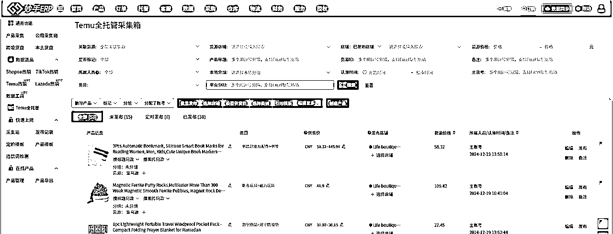

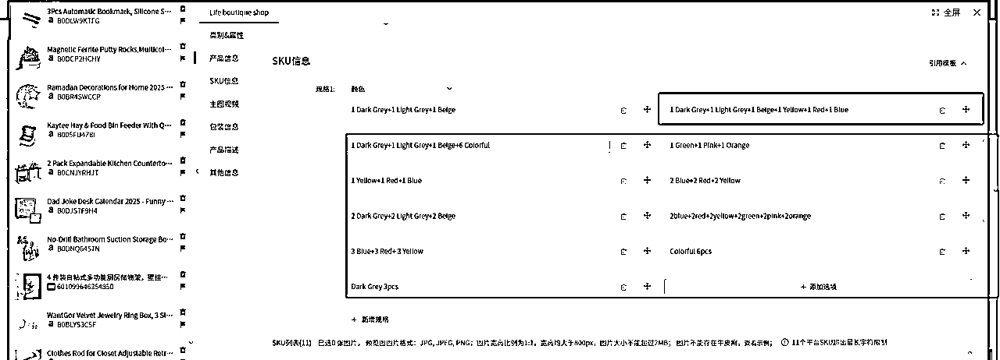

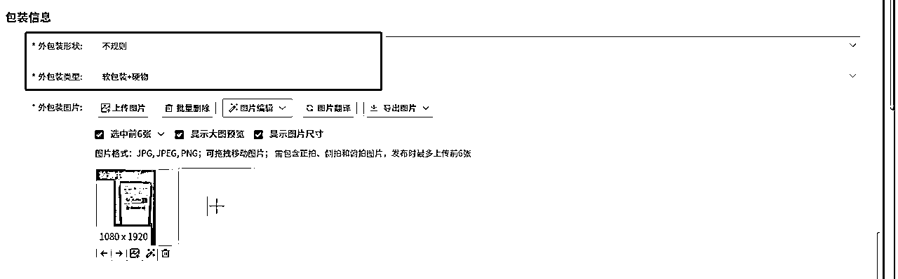

店铺运营小提醒：

1. 新店不必追求垂直，先按选品标准找到合适货上架议价
2. 原链接SKU多时，保留1-2个动销亮眼的款即可，Temu首单备货10-15件，精简SKU更省成本
3. 有效上架=符合选品原则+议价有利润，缺一不可
4. 上架后长期不议价，参考下方议价技巧

### 议价技巧与差异化

Temu目前议价全自动，人工不可干预。你盯上的品别人也可能盯上，普货普遍用同图，系统大概率不通过或无利可图。可通过以下方式提高通过率：修改SKU图、SKU名称可用中文、更换主图、主标题突出材质描述。

Linkfox可做AI换背景提升差异化，官网有教程，注册后联系客服可领新人体验。

例如某置物架，各家链接图几乎一致，用工具抠图生成多套背景后放入SKU图和主图再议价。同时不要只发一条链接，批量上多条并行议价，提升命中率。

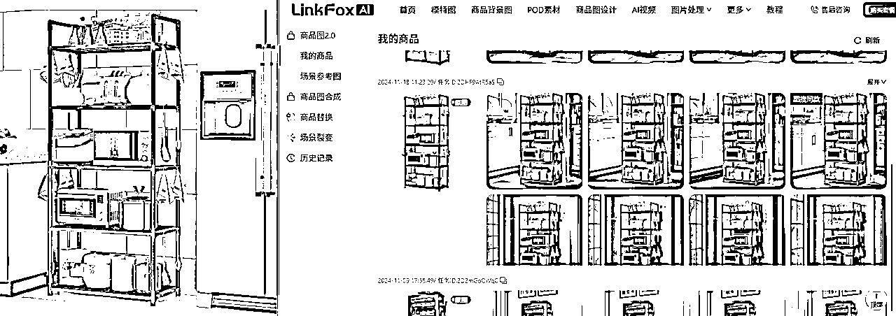

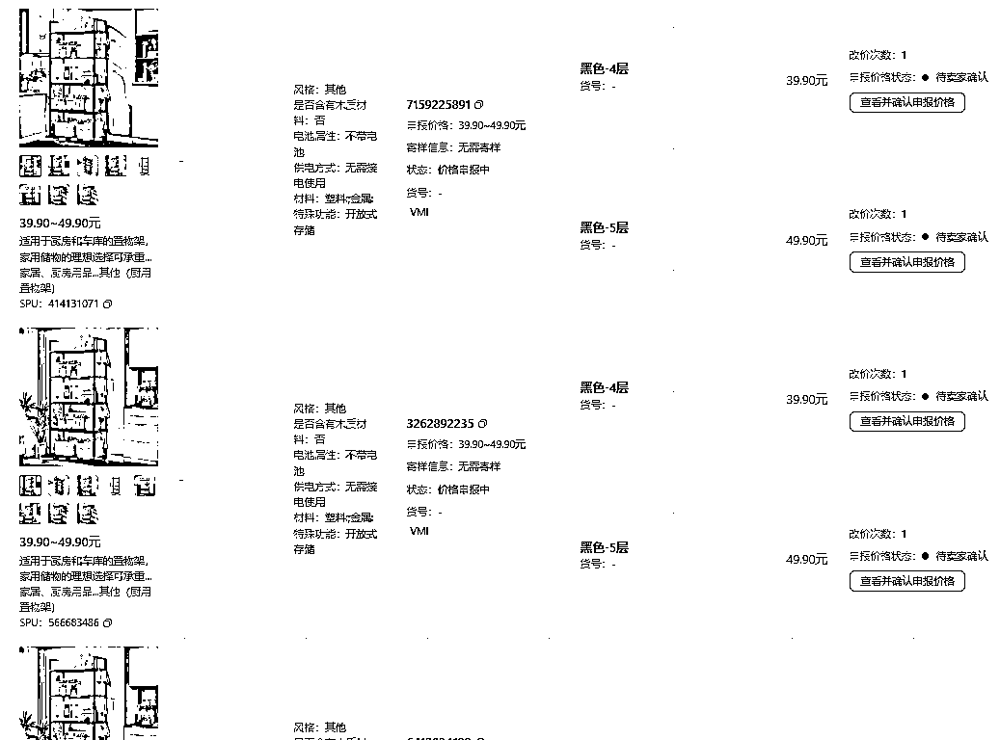

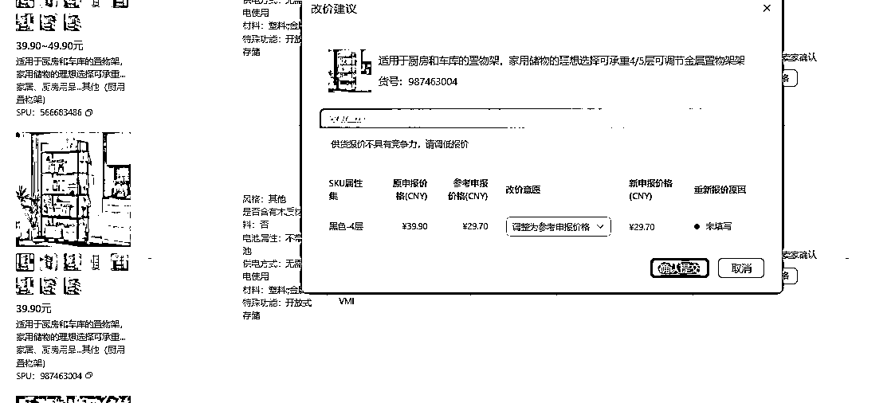

提示：议价等待期不要空转，持续找品、上链接、做差异化、再议价，形成闭环。

## 二、发货与入库的常见坑

平台自11月初执行《GPSR》要求，欧盟及英国北爱尔兰地区违规商品将下架。我曾因贴标不合规被退多笔备货单，运费损失不大，但已上架商品断流，错失销售窗口。技术动作做齐的前提下，执行细节失误代价很大。

### 资质与贴标，新手高频失误点

基础合规要求欧代标准，电器类需英代，玩具类需美代。所有商品需防窒息警示，纺织类需额外标注，食品接触类需专用标识。

纺织品标识示例

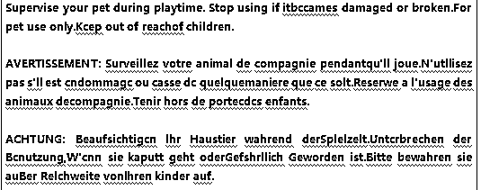

起步阶段做普货，先把欧代与防窒息搞清楚即可，避开雷区。

**欧代是什么**

欧盟授权代表。把商品卖往欧洲时需要一个当地代理作为沟通桥梁，消费者出现问题时由代理对接，保障权益。

**如何办理**

可通过跨境服务市场办理：店铺后台 → 跨境服务市场 → VAT及其他合规服务 → 欧盟授权代表。也可找长期合作代理，或通过电商平台找服务商，年费约110元一年。

**上传信息**

办理完成后进入卖家中心 → 合规中心 → 负责人信息申报 → 新增代理信息申报。按服务商提供的资料填写即可。

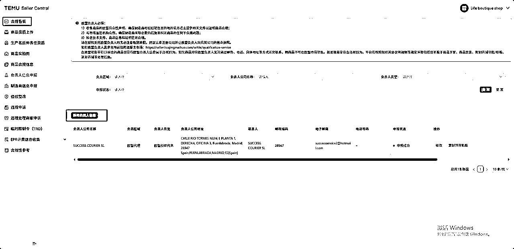

**标签需包含的要素**

标准标签在新建商品时需上传外包装实拍图。特殊品类外，其余商品可共用一张标签实拍图。

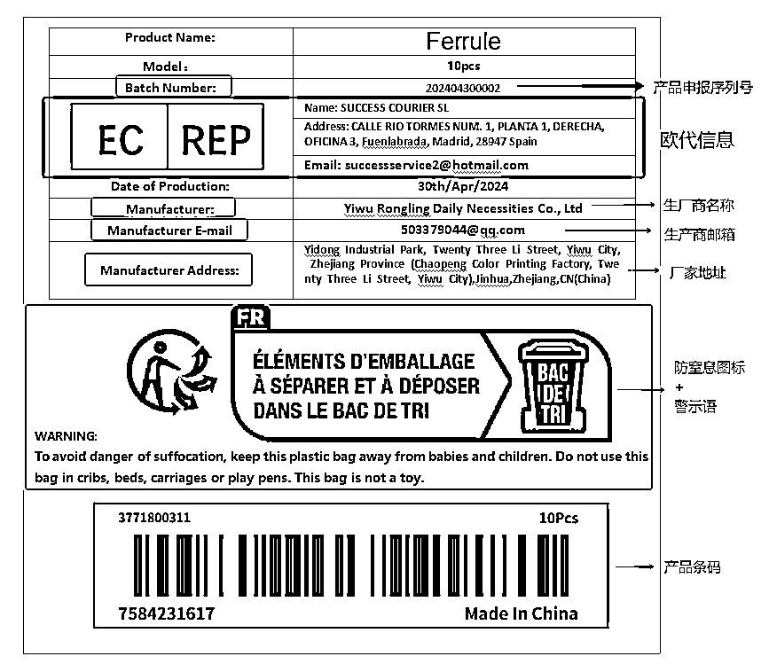

标签制作参考工具

注意工具仅作辅助，最终需按供应商实际贴标尺寸调整。

**合规信息申报**

选品、上架、议价、人工确认后，发货环节需上传实拍图，点击去处理进入上传页，上传即为此前制作的标签实拍图。

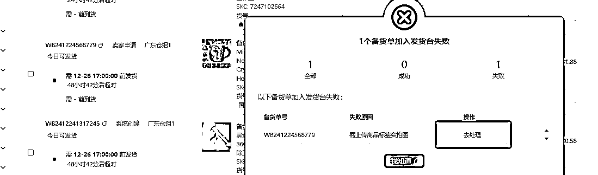

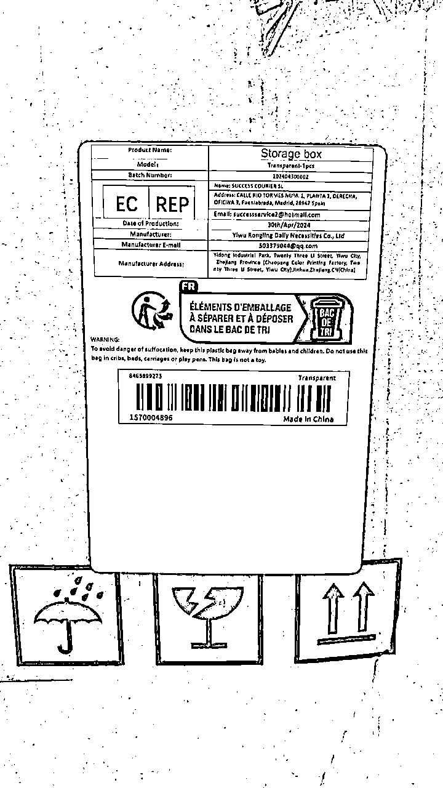

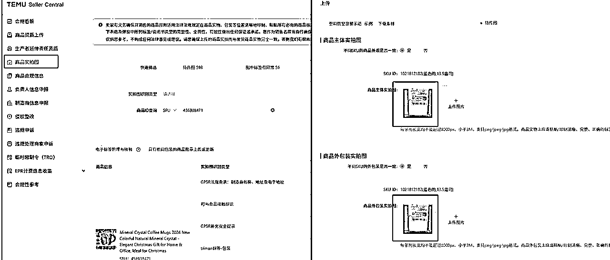

上传后需到合规信息处申报，标签信息与申报信息必须完全一致。魔鬼在细节，我十月全程无退货，十一月一波退货堆满储物间。

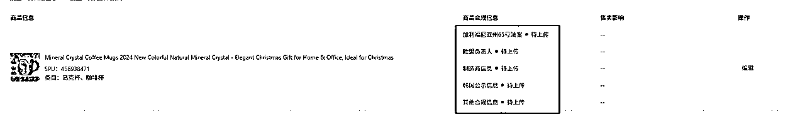

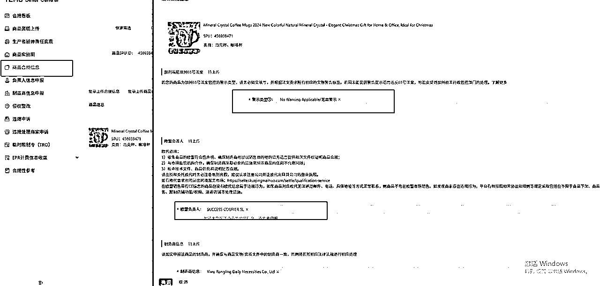

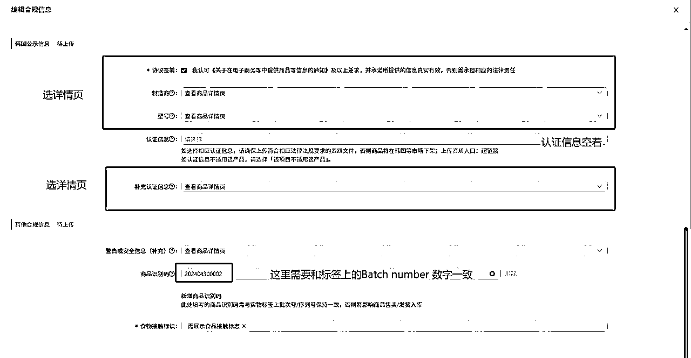

### 质检驳回案例与处理

**标题不匹配**

曾售3件套组合装，因热销新增1件装SKU，补货两周后质检不过被退。解决办法是去掉标题中的数量词，Temu会校验标题与实际销售数量是否一致。

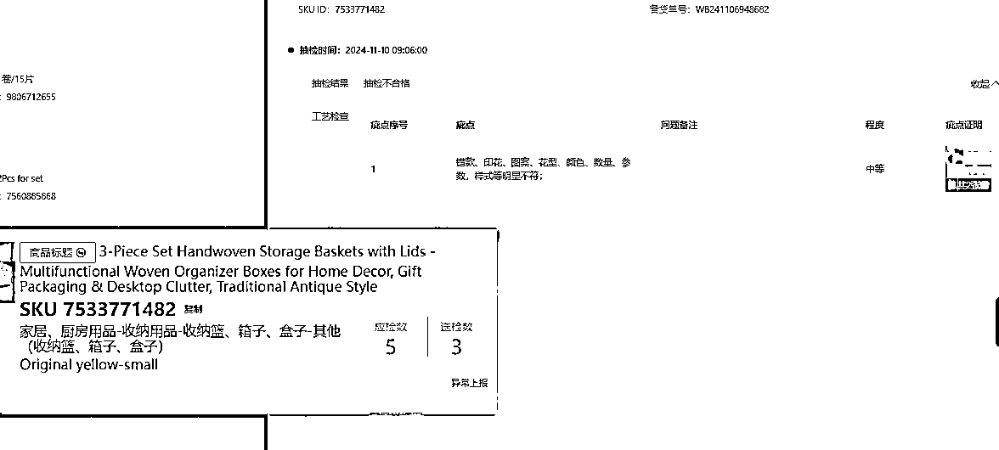

**包装未封口**

多轮备货未出问题，某次被退。不同仓库质检标准存在差异。建议全部封口，平台判定包装合格的核心是商品不会掉落。

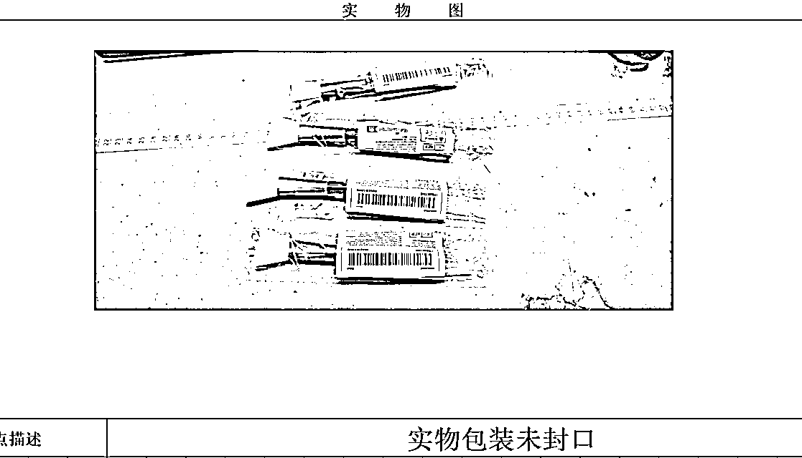

**标签问题**

强制欧代后常见。标签需严格对应：生产商信息、批次、地址、联系方式必须与申报信息、合规图、外包装图一致。让供应商贴标代发时务必试贴并拍照留底，避免扯皮。右下图因警示语不完整被退。

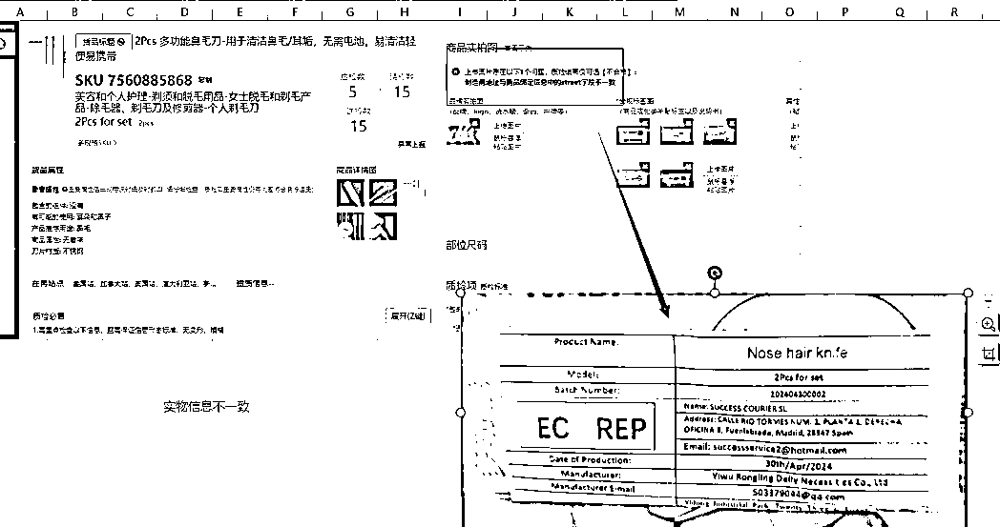

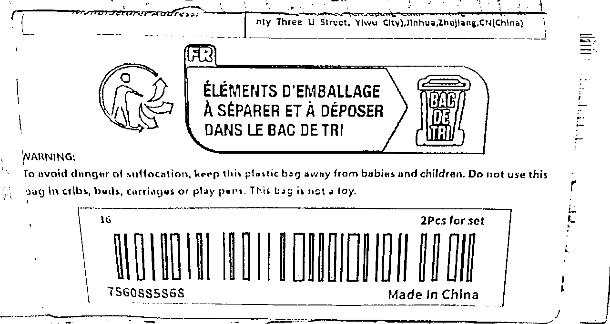

**包装破损**

大批量运输中易破损，与卖家厂家无关。塑料制品到手易碎。建议选品时规避，或与供应商约定到仓货损处理方案，使用更厚瓦楞箱成本会上升。

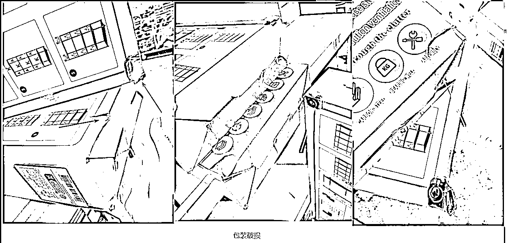

因厂家原因被退可协商部分退款，包装损坏可让厂家重寄包装自行打包。标签问题需撕下旧标更换新标。去标不伤包装可用吹风机加热或热敏纸涂改液，切勿直接覆盖。

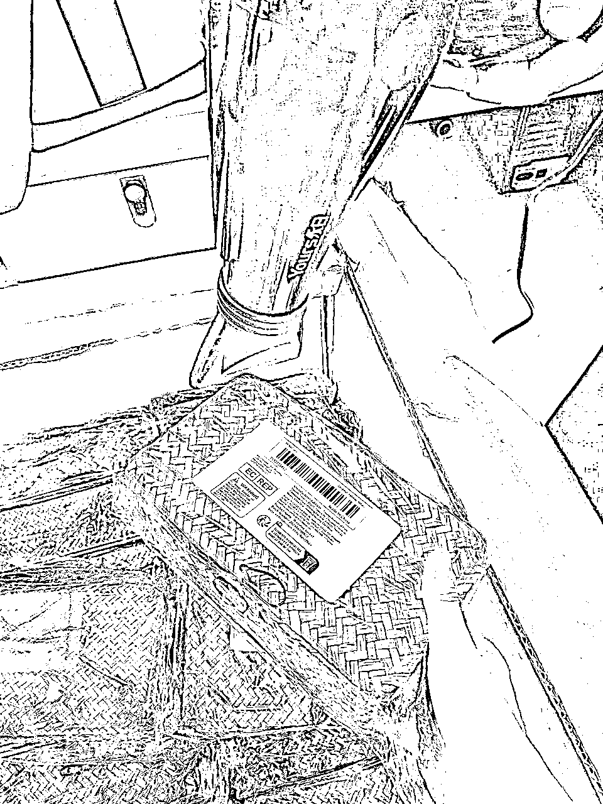

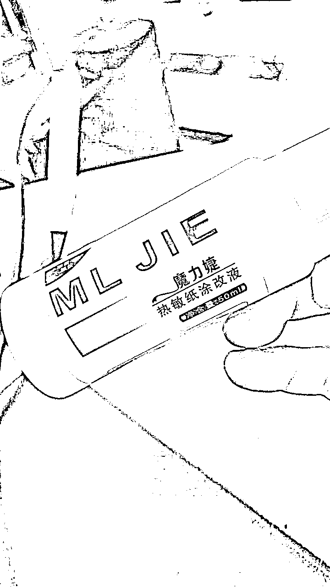

## 三、库存管理思路

### 核心原则：少量多次、提前判断、不满仓

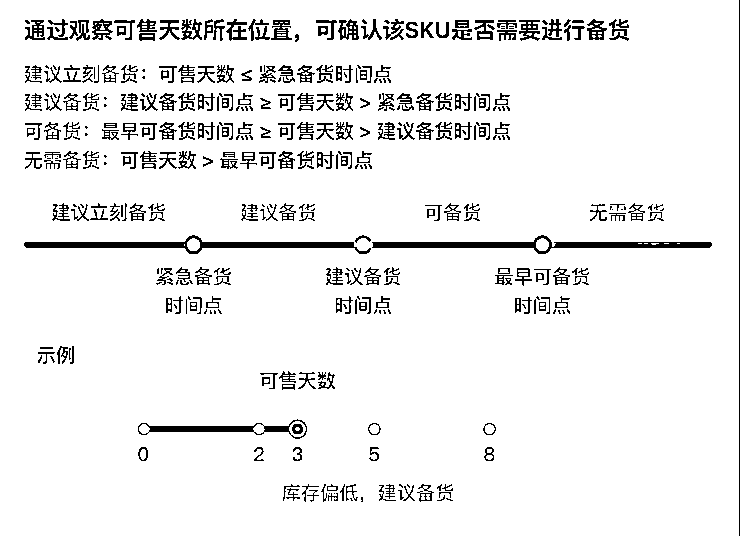

系统备货逻辑基于销售数据，新手易被误导。建议不完全跟随系统推荐。

品质分75+且动销稳定的热销款，评价数50+更稳，仓内11天+在途3天备货，保证不断流并留爆单缓冲。

品质分70+动销零星的普通款，仓内5天+在途3天，小批量测试，避免滞销。

**警惕伪爆款**：首单上架48小时售罄，系统要求补大货如120单。不要误以为是爆品，很可能是平台新品流量倾斜导致前期低价快速出清，补货后可能被要求降价或销量断崖，最终滞销。正确做法是补首单量+5~10件。

伪爆款背后是新品流量扶持，可对比自家到仓售价与站内同款差异，以保利润为前提做营销。

Temu对每个商品有品质分，低于90有罚没，按申报价2/3/5倍执行。库存管理需精细，操作多了自然更顺手。

## 四、经验总结

1. 新店前两个月不要做垂直，先跑量观察。稳定出单且3/7日销量持续走高的链接，可新增SKU做组合装或不同色，用AI生成差异化图，多备几条同链接对冲品质分波动。
2. 大货备货前紧盯品质分。全托管无法控评，外部控评成本高且周期长，从下单到评价需15-30天，还分图文视频定价。评价到10条出品质分，低于70谨慎补货。
3. 议价超过24小时未通过直接放弃，继续找新品。即使是站内稀缺潜力款，也可能议价失败。

做Temu这段时间，我最大的感受就是：想赚到钱，别把精力耗在琐事上。

先说店铺运营的节奏。我习惯把80%以上的产品交给供货商做一件代发，前提是对方必须靠谱、关键时刻能联系上。这样每天真正花在一家店上的时间最多半天，剩下的精力就能拿去多开几家店、放大整体利润。把选品眼光练好，永远是最核心的能力。

然后是核价。我给自己定的标准是至少留出35%的利润空间，低于40%的品类我直接不看。别小看贴标成本——供货商收费从0.1到0.5不等，有些品类有起订量，量少的时候贴一件甚至要花10块钱。这些都要提前算进成本里。

首单发出后，一定要盯紧物流到仓时间和质检时效，这两项数据是你后面判断补货周期的重要依据。把到货时间算得准一些，爆款链接才不会断流。我踩过一个坑：有款产品日销20多单，结果11月初因为贴标问题，在途货物质检不过，备货单也重新生成不了，直接断货10天。等再补上货，销量基本归零。所以后来我学乖了——爆款一定要多复制几条差异化链接，分散风险。

新品上架后的前7天是最关键的窗口期。上架后要马上关注前端价格，尽快报名活动，哪怕让出几个点的利润也要冲。7天内出不了单，后面成为爆款的概率就小一半。这也是为什么一开始核价就要留足35%以上利润的原因——活动期烧得起，后面才扛得住。

运营过程中一定要找到对应类目的小二或者卖家群。别指望小二随时回复你，但真出了事，这也可能是唯一的反馈通道。

回到那个大家常问的问题：现在入局Temu还有机会吗？我的判断是还有。Temu 2022年9月在美国上线，现在已经覆盖150多个国家和地区，整体流量和利润情况比Shein要强。但入局前期一定一定要从最简单的普货跑通全流程，再根据自己情况量力而行。宁可自己多开几家店，也不要贸然拉大团队——贴标、重新打包这类体力活可替代性太强，不是核心壁垒。

最后说点心里话：今年8月我刚入局两周的时候，心情一度很沮丧，各种卡点接二连三。当时请教了圈友@七喜，真的很感谢赚钱的力量。第一次发帖，说得不对的地方欢迎大家指正。祝大家圣诞节快乐，新的一年提钱大吉！

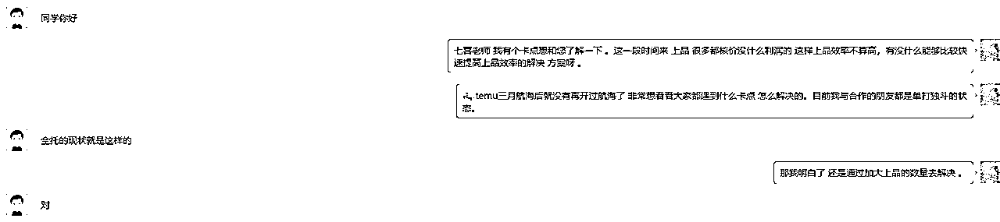