# 风向标是怎么被我“挖”出来的：10个私货拆解复盘

🤝 嗨，我是老彭

一开始我也以为，风向标得靠到处找情报源、做成情报汇总表才行。后来发现根本不是这么回事，我压根没这么玩。

所以这次我就用最个人的方式来聊一聊：拆解我自己。说实话，我并没有一套固定的风向标方法论，也没有专门的情报库，也不追那些做账号拆解的博主，我发的那些东西，全都散在日常的琐碎里。

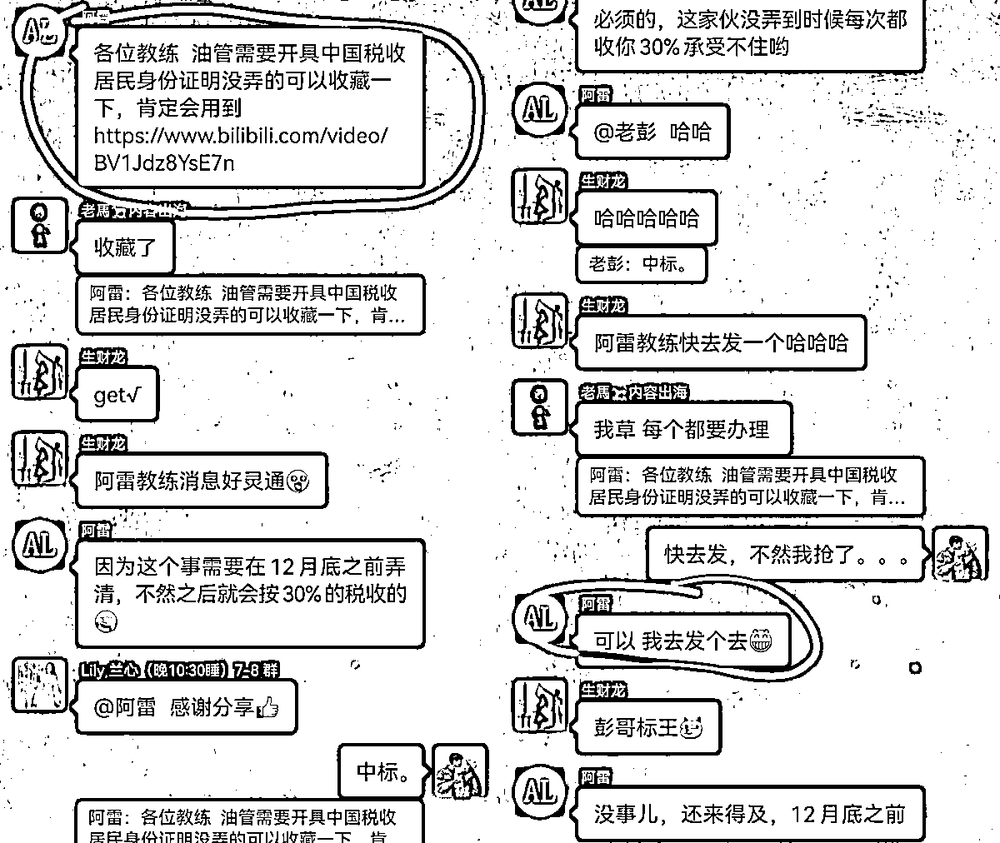

☝️ 你们其实也一样，只是没察觉到而已

❓️ 为什么偏要拆自己：当然不是为了装逼打动圈友[bushi]，主要是我拆不了别人哈哈🤣

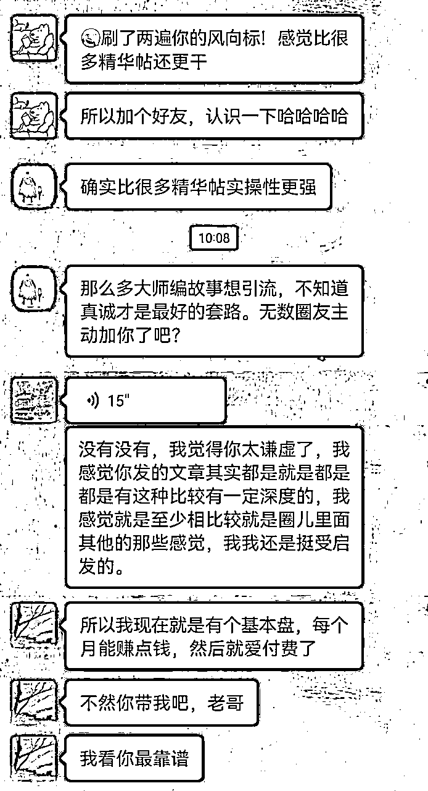

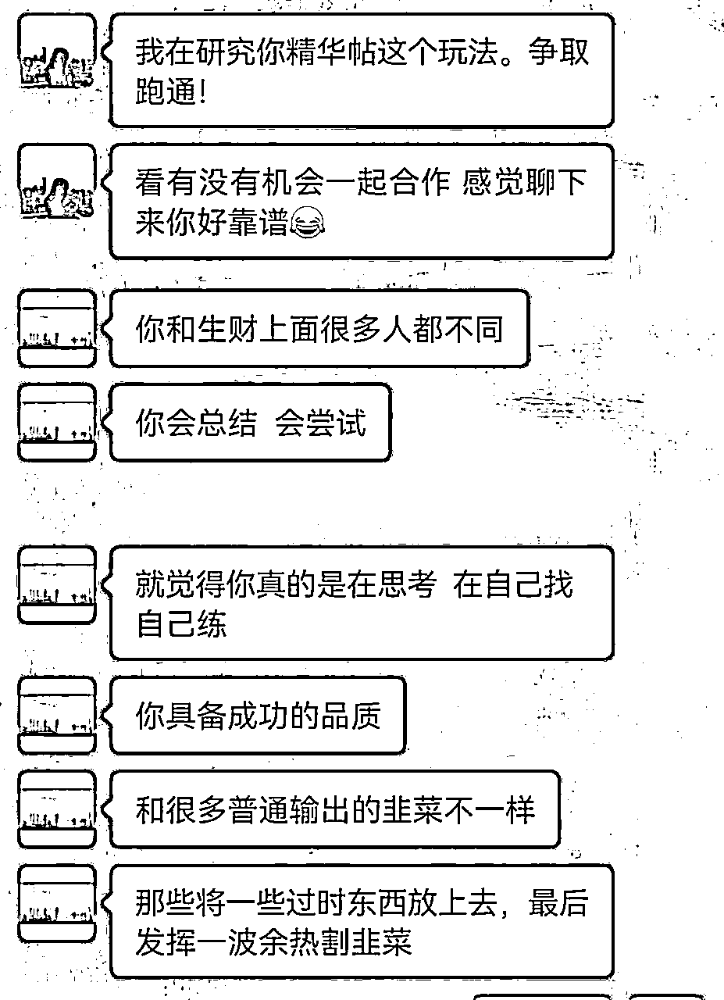

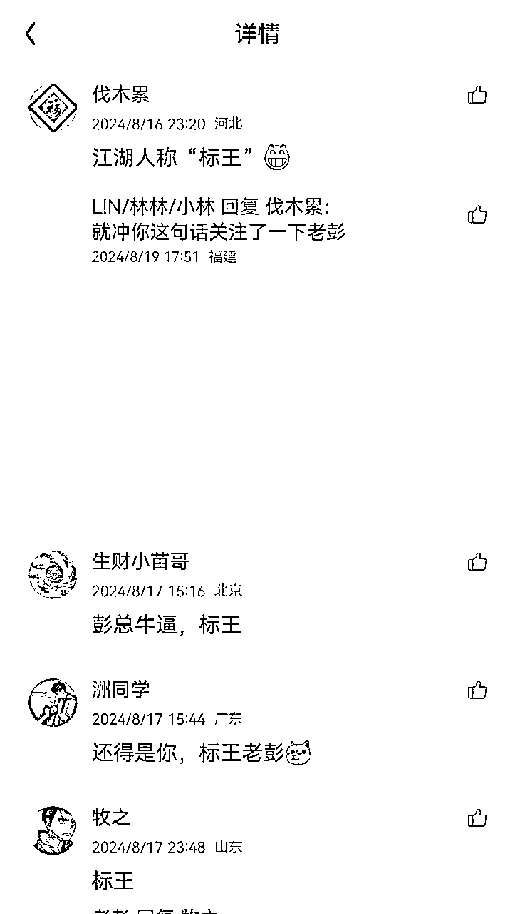

下面我把10个案例摊开讲，尽量挑不同维度的来分。前面5个偏理论思考，后面5个偏实操落地。

开始吧，1-5归为思路类，6-10归为执行类

## 案例一：用AI把自媒体做一遍

📌链接：https://wx.zsxq.com/group/1824528822/topic/4848242882422818

1、suno 放出了 v4：我就想去补一下最新信息

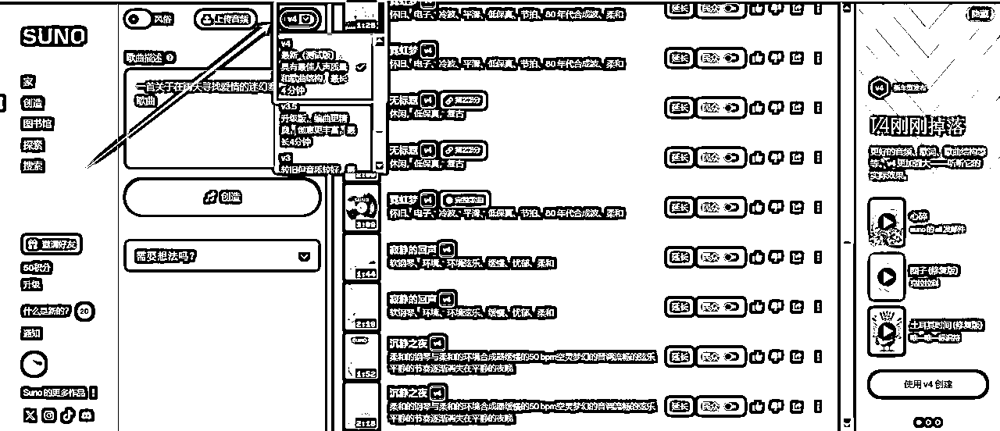

2、去📕搜 “suno v4”，翻热门帖子看看大家在聊什么

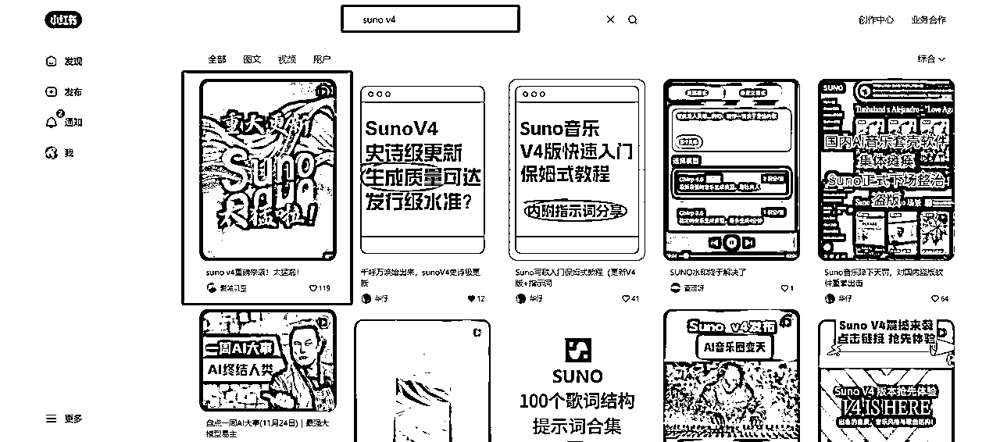

3、点进热门作者主页看更多内容：

结果被 “AI音乐涨粉12w” 这个点带住了

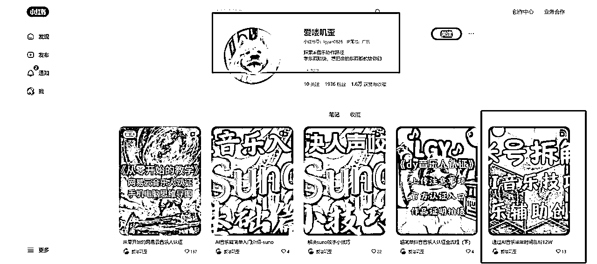

4、去看里面的拆解案例：有人靠AI音乐做科普号

这个思路完全可以平移到别的赛道

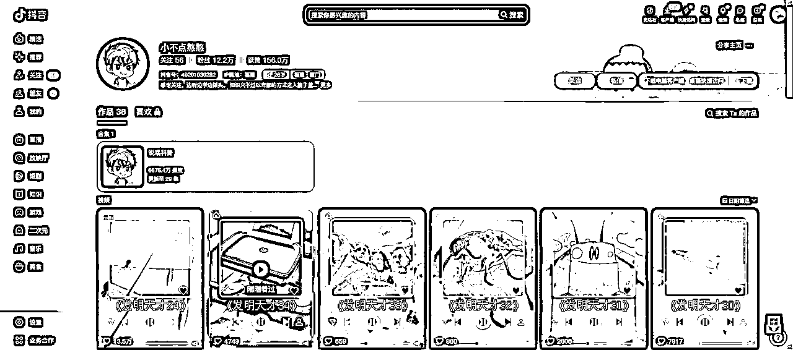

于是我把主题拉大到：「用AI重新做一遍自媒体」，把自己看到的信息和产生的联想整理成一条风向标。

✅️大概的提炼路径：

1、对自己所在的赛道保持敏感，留意新玩法出现
2、带着问题或好奇心用关键词去搜，通常是内容平台
3、盯住平台上的热门答案
4、这些热门内容基本都是同赛道的前辈，信息量比我们大，顺着看下去，同赛道的优质内容很容易点醒自己，思考一下就成了一篇风向标

## 案例二：「YouTube视频下载」的信息差生意

📌链接：https://wx.zsxq.com/group/1824528822/topic/8858454858222242

1、在闲鱼搜“油管”，想看看现在在卖哪些付费工具

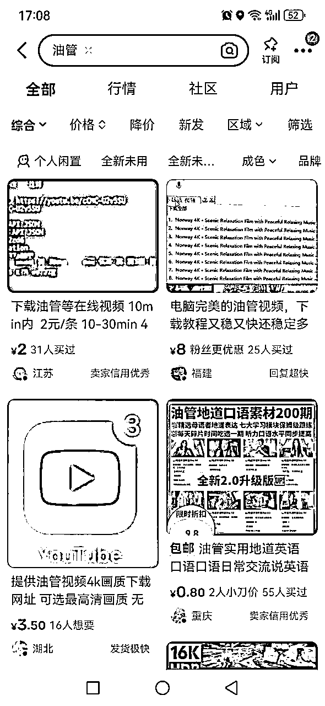

2、意外撞见一个信息差：YouTube视频下载也能变现

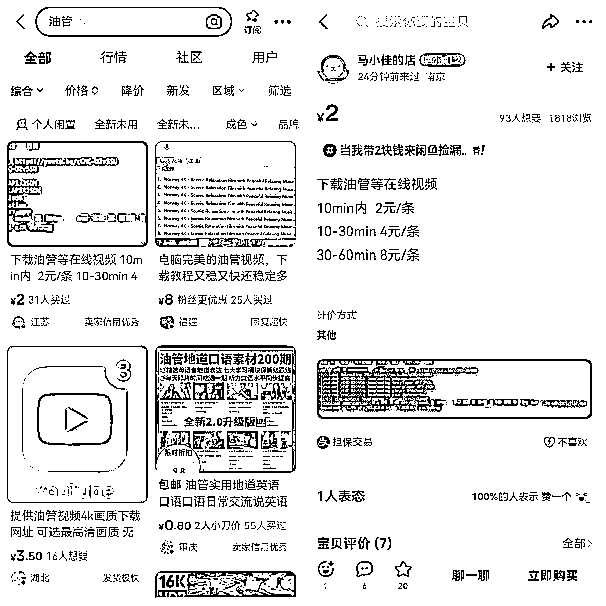

大概扫了一下，视频下载这么基础的需求，居然需求这么大。感觉门槛低、正反馈快，能马上写。边写边想，纵向看这属于虚拟产品的一种，横向看这只是信息差的一种。有时候抓到一个点就能开写，当你把它当成风向标来写，写作过程中会自动帮你做信息增量，最后效果会很不错~

已有圈友去实操了，这种中标感太爽😎，也是我觉得社群风向标未来可以发展的方向之一...

## 🔺顺手放一个我常用的写作小技巧：

1、风向标可以用分点概括的方式来写
2、写到第1点时，大脑往往会自己冒出第2点，就像被激活了一样
3、就拿本篇举例，我最开始只写了一段话“标红的那段”，当把它当成风向标来分享时，写着第1点的观察就一路写到了第6点。我很多文章都这样，你现在看到的这段方法论也是👻
4、不喜欢分点就最后把1234删掉，合成一段话即可

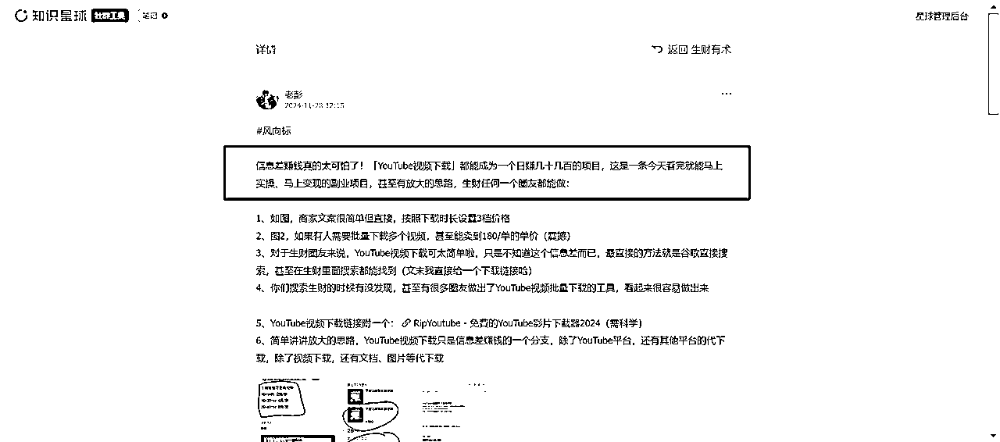

## 案例三：「新手xx学习」账号定位

📌链接：https://wx.zsxq.com/group/1824528822/topic/8858452881244412

1、📕平时会点赞一些AI内容：因为我自己也在学AI

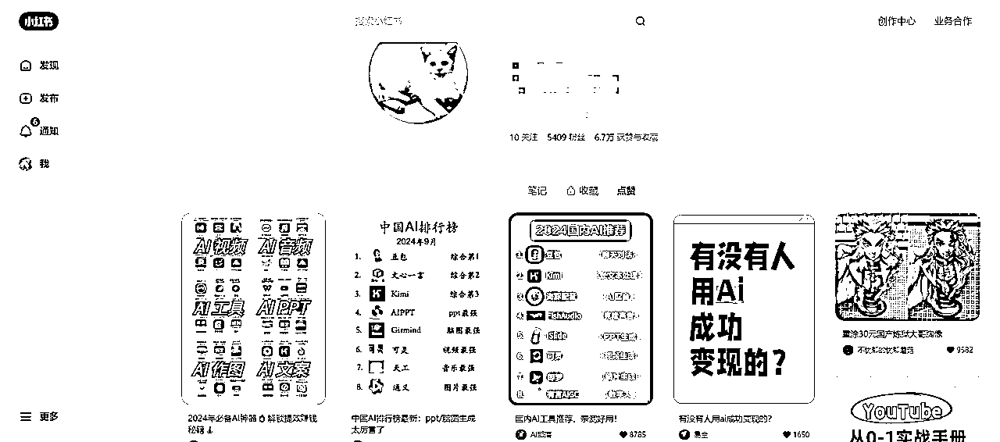

2、数据就给我推了“AI画图134次”这种帖子

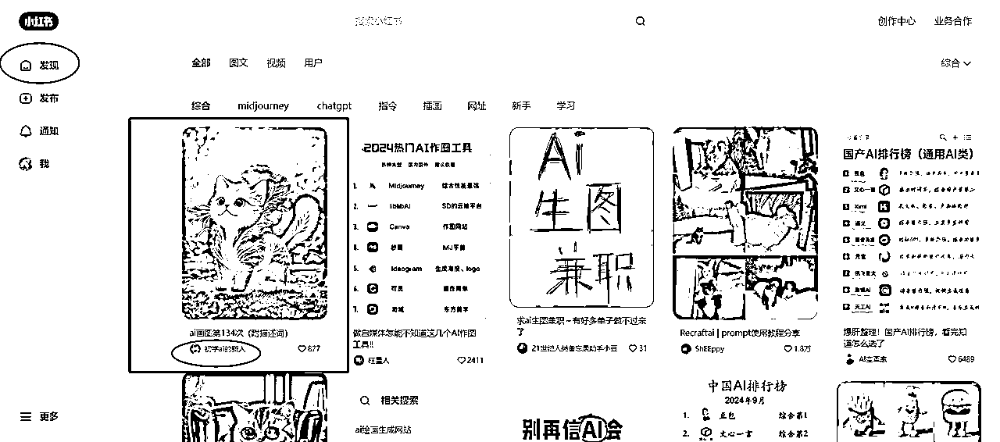

看到这个号的时候我挺惊喜的，它解决了一个我一直在找的问题：新手怎么做AI自媒体的定位和内容规划。之前我一直没找到可模仿的对象，既然对我有用，那对别人大概率也有用，于是就整理成风向标。

✅️大致路径：

1、在内容平台点赞你想深挖的内容，比如我某天想了解reddit，就去搜了并点了赞
2、等大数据喂线索，不用刻意刷，就是日常用的时候顺手看，被触动就🛰️里记关键词👇️
3、再顺藤摸瓜，判断有没有能梳理成风向标的价值点

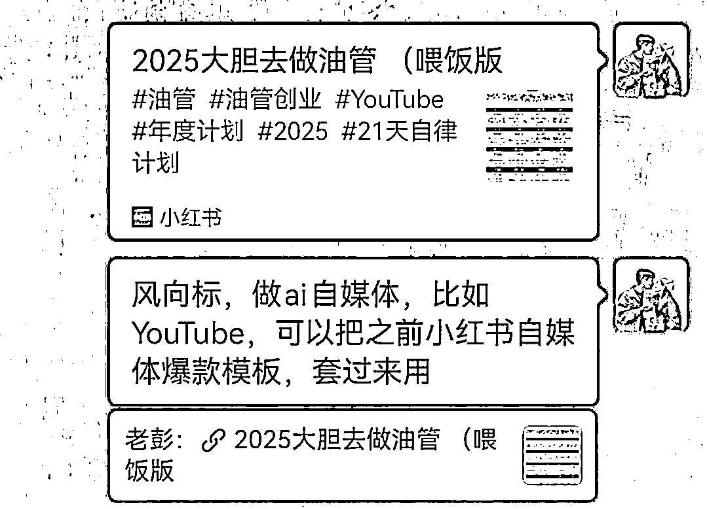

## 案例四：借Boss判断YouTube赛道

📌链接：https://wx.zsxq.com/group/1824528822/topic/5121548258521424

1、我想做YouTube，但不知道选什么方向

2、脑子里条件反射就跳出来：去Boss搜YouTube，看大家在招聘什么领域

3、为什么会有这个反射？因为以前的经验告诉我，头部自媒体公司通常做矩阵，尤其是可复制的赛道

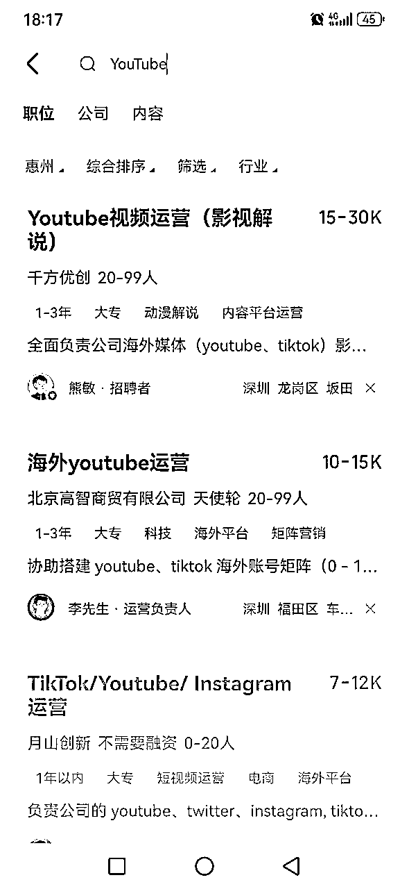

所以，只要你在做项目时遇到问题，能立刻联想到一个通用的解法，而且这个解法对很多人都适用，那这条信息就是有价值的。我们在实操中其实每天都在产生这种信息，只是没意识到也能发风向标。

## 案例五：「围观群」最小可行性产品

📌链接：https://wx.zsxq.com/group/1824528822/topic/412814512154528

1、我很少主动加人，但因经常分享，会有圈友主动来链接
2、有些人自我介绍或者聊天能感觉出很会赚钱，我就会忍不住去看他的朋友圈或👸号，里面往往藏着干货
3、拿这篇风向标举例，有个圈友在朋友圈卖了一个围观群，交付极轻，我当时就想，这个我也能做，我身边很多朋友也能做，而且这种形式付费意愿很强。换位思考，如果我能围观比我强的人，我也愿意买单

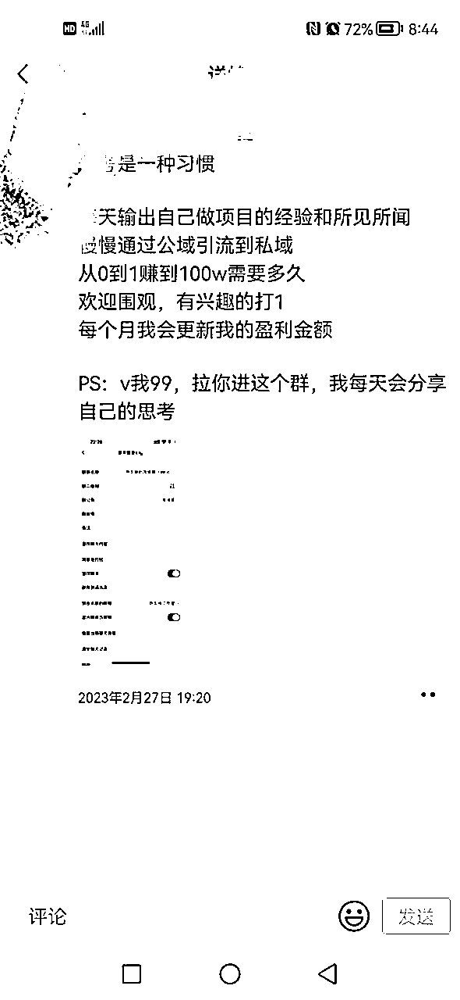

这只是其中一例。关注身边那些很会赚钱的朋友，他们在社交媒体上的动态，很可能就是藏着的信息差。

* * *

接下来5个是实操类，在星球的中标率特别高。原因很简单，能分享出来本身就代表有一定执行和思考，思路大概率靠谱，而且有信息增量：既有干货价值，还能赚钱、赚情绪价值、赚人脉，有些人直接来求带。如果你做知识付费，这就是很好的切口。

## 案例六：「实操复盘」📕私信引流5个技巧

📌链接：https://wx.zsxq.com/group/1824528822/topic/214285122841521

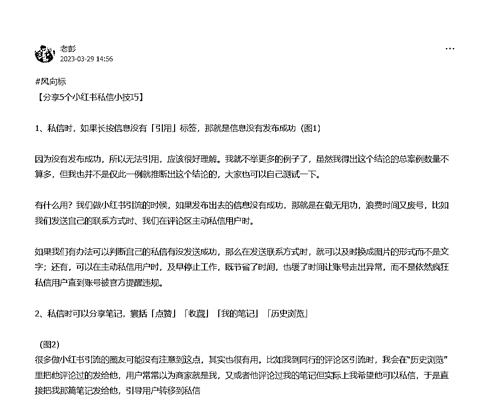

1、当时我在某公司做📕引流负责人，写过日引流100+的爆款帖
2、实战中遇到问题解决问题，会把经验沉淀下来分享给团队，当时也写了几篇风向标
（基本都中标，☝️看上面视频）
3、所以你们在做项目时，遇到问题解决问题的过程，完全可以多总结方法论和经验，这些信息很容易中标。

## 案例七：「细节迁移」📕短剧剪辑粉的引流获客

📌链接：https://wx.zsxq.com/group/1824528822/topic/4844182222825828

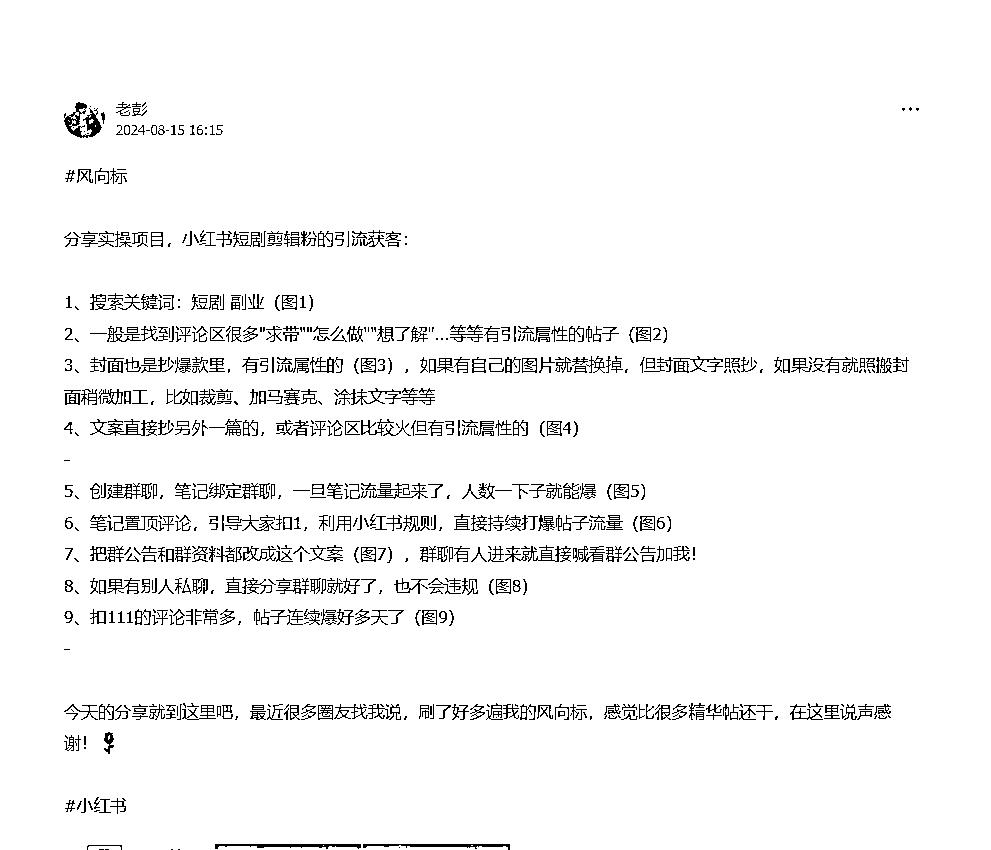

1、直接上一个有增量的例子
2、因为我一直分享📕引流实操，被大佬圈友左哥邀请合作了
3、短剧剪辑粉的引流获客，我直接把之前创业粉、兼职粉的那套打法复制过去用
4、所以，如果你在项目中观察到的思路可复制可迁移，就值得写出来，就像我前面借鉴Boss选赛道一样。

## 案例八：「项目放大」学历提升运营思路

📌链接：https://wx.zsxq.com/group/1824528822/topic/4844185448122218

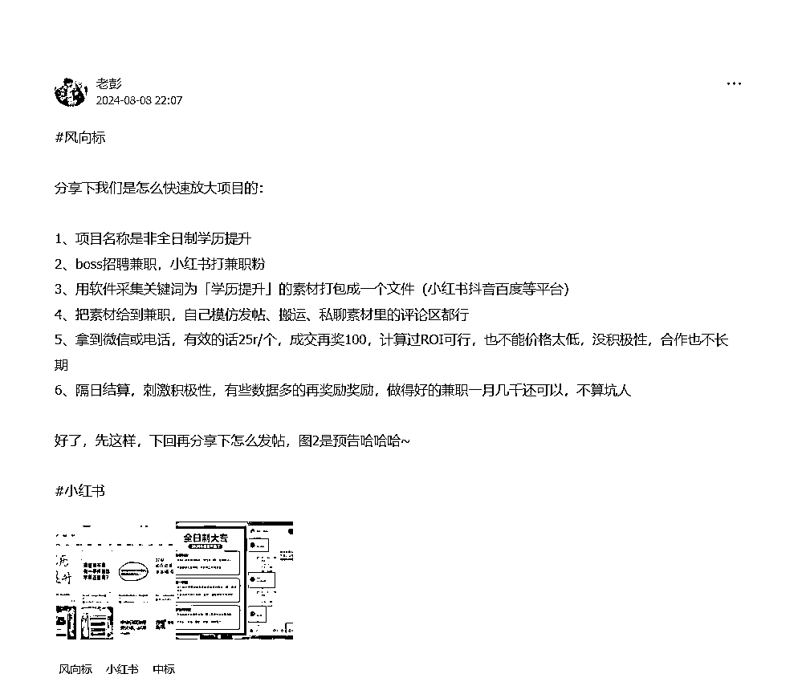

1、这是朋友来请教，我给的一个运营方案
2、方案灵感来自招聘网站上同行和同类行业的借鉴
3、每个人经验不同，面对别人的问题时给出的答案，往往也是有价值的

## 案例九：「实操拆解」初中生升学业务

📌链接：https://wx.zsxq.com/group/1824528822/topic/1522852882512122

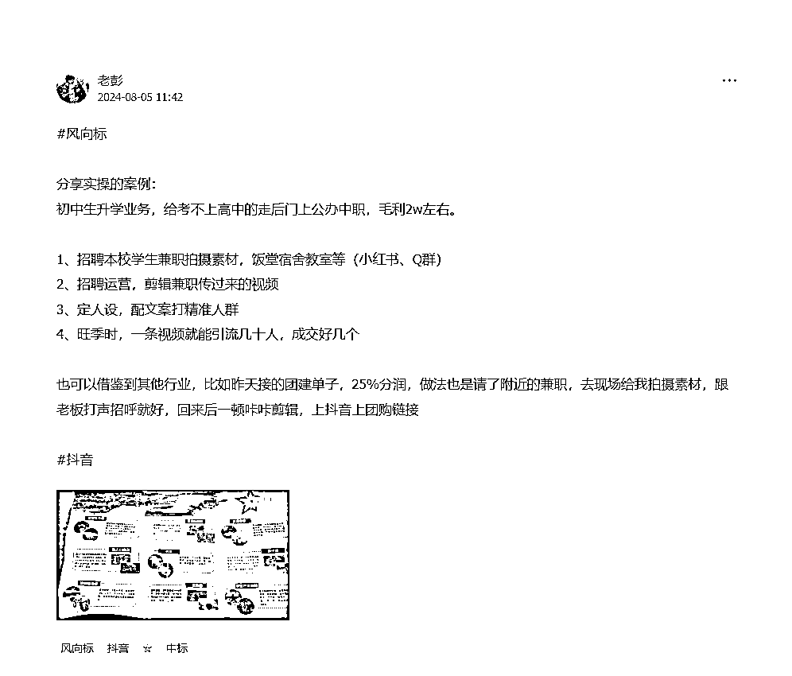

1、这是我在Boss上认识的一个老板，也是我拓展人脉的一种方式，我写过一篇Boss引流老板粉
2、当时4-5月快中考了，我对这个业务有点兴趣，就去聊了，他们以前做电销，想转新媒体
3、请我吃了几次饭，我现场帮他们梳理了对标玩法，按最低成本拆解执行：
①视频素材，让本校学生兼职拍，②剪辑，招个运营剪吧，③文案，抄对标微调。后来他们跑通了
4、7-8月旅游时看到类似的运营打法，突然想起来可以发个风向标
5、其实就是代入同行视角，去拆解热门或感兴趣的案例，思路通顺的话，即使没验证过，也大概率有价值。

## 🔺实操类风向标的重点：

不一定要自己去实操后才能产出，拆解别人的实操也行，只要案例本身够好，拆解出来的信息增量就够。

## 案例十：「项目挖掘」📕留学粉变现

📌链接：https://wx.zsxq.com/group/1824528822/topic/1522421812521882

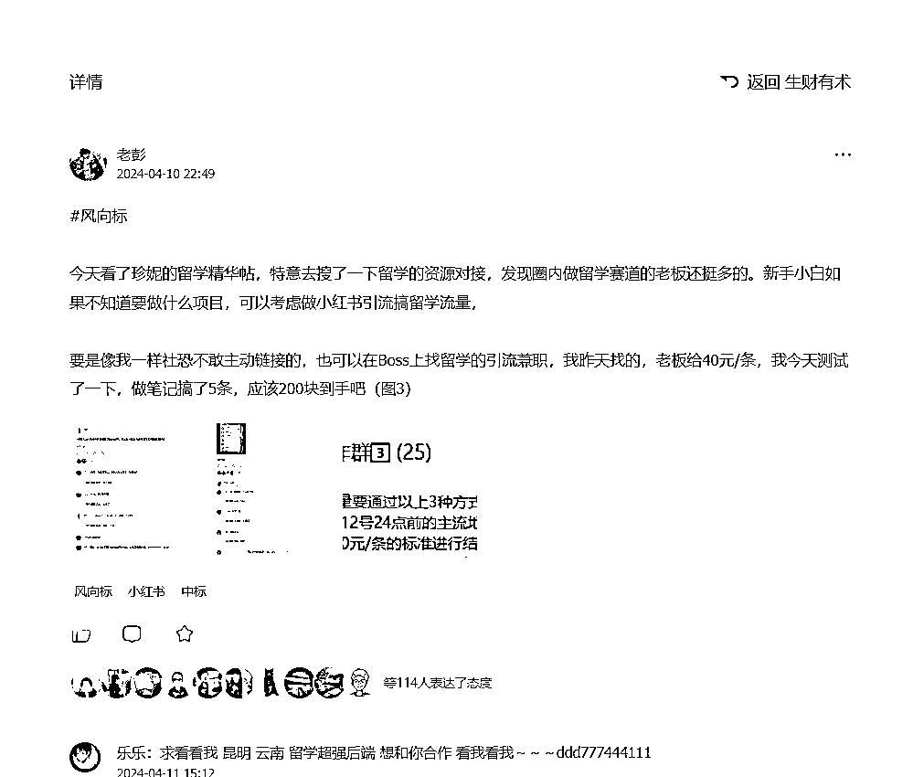

1、这是我在星球看到圈友珍妮的留学精华帖，感觉这个赛道利润不错
2、我虽然有引流经验，但不确定能不能跑通，就上Boss找了个招兼职的，40元/个
3、很快就跑通了，于是把实操分享出来，后面还做了复盘贴，200多赞，吸引到了更高客单的后端合作
4、说到这里，嘿，这1-3步的实操路径单独抽出来也很值钱，可以单独发风向标。养成这个习惯吧

## 结尾

先总结一下：风向标其实离我们很近，就藏在日常里，只是以前没意识到它也能发。

再说个心态层面，因为我就是这么做的，所以才能一直写下去：

就把发风向标当成记录，中不中标都无所谓；也当成一种习惯，去验证自己的思路有没有价值。有价值时我会很开心「真是个天才」，没价值时就笑笑「这思路居然不行」

👋拜拜，下期见~