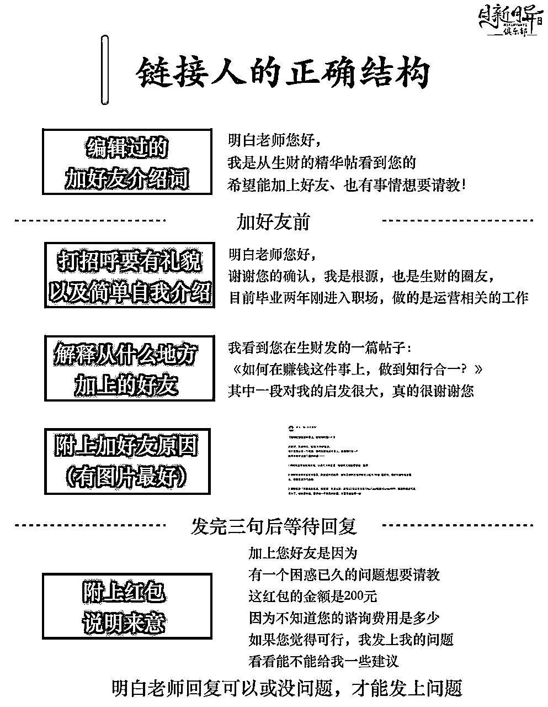

# 【生财技能】新人进群后，怎么请教和互动才不尴尬又能被记住

> 来源：[https://oee5lr7gsk.feishu.cn/docx/ONpMdFl2oo9GXsxtHa3cZVnInKc](https://oee5lr7gsk.feishu.cn/docx/ONpMdFl2oo9GXsxtHa3cZVnInKc)

全文共：8,105 字

预计阅读时间：6.88 分钟

几年前我刚入生财的时候，看到一篇很棒的文章，想去加作者好友，十次有九次石沉大海，被回了也聊不下去。

那段时间我心里一直有个念头：这些大佬是不是都很难打交道。

后来沉淀几年才回过味来，问题根本不在圈子里的人，而在我自己的做法上。

现在再看当年我发出的好友申请备注，有些干脆就是一句话，有些甚至没写。换作是我自己，看到这种申请连点都不会点。就算被通过了，我发出去的那些聊天内容，现在回头看都觉得尴尬、没分寸。

今天就把我踩过的坑总结成一套打法，聊聊新人在社群里该怎么正确地请教和建立连接。

* * *

# 想认识大佬，第一次交流通常有三种入口

很多新人想和想认识的人搭上第一句话，大体就这几种路径。

## 场景一：从公众号文章底部联系方式加好友

看到公众号文章底部有加好友方式，直接冲上去加，成功率很低。

特别是那种大号，读者很多，你的申请很容易被淹没。

我的做法是先用赞赏破冰。金额别是几块钱的个位数，也别一上来就砸太多，新人要考虑成本。我一般会选16、52、88元以上。

不是一次就赞赏完，我会拉开三到五天，每天赞赏一篇，然后再留言私信。大概可以这样说：

某某老师您好，这几天在看您的公众号，受益很多，尤其是前天那篇，帮我解决了困惑。想加您好友，跟您多学习。

连赞五次以上，你的私信基本会被留意到，对方通常会回复：可以。

## 场景二：通过其他平台先私信，不要直接加微信

在知识星球、微博、小红书看到高质量帖子，想认识作者，但没有联系方式。

这时别急着搜微信，先用平台自带的私信功能聊第一轮。和场景一逻辑一样，如果能赞赏就先赞赏，再私信。平台私信作为第一触点，回应的质量会好很多。

## 场景三：在微信群里看到人，想加好友

群里加好友大家都很熟了，这里重点说说怎么在群里更好地互动和建立链接。

* * *

# 新人进群，最核心的素质是主动

主动这件事听起来简单，做起来很难。

拿保险来说，银行柜台是被动等客户来办业务时顺带推销，成交一个大单，柜员佣金大概就几百块。保险业务员是主动上门，同样一单，第一年佣金能有20万左右。

主动和被动，差距就是这么大。

在社群里也一样，主动发言、主动帮忙、主动搭话的人，才会被看见。你的优点才有机会被赏识，也才更容易获得帮助。

* * *

# 在群里怎么链接和互动更有效

假设你想在某个群里认识大佬，有三招是我常用也很有效的。

## 第一，多活跃，别当潜水员

可以参与讨论，也可以看到别人求助时，尽力在自己能力范围内帮忙。活跃多了，好感度自然上来，后续想请教的阻力也会小很多。

## 第二，借话题自然切入私聊

当大佬在群里分享观点或回答问题时，你可以直接@他，展开三句以上的对话。聊完就可以顺势私聊加好友，陌生感会很低。

开场白可以这么设计：

谢谢通过好友申请。刚才在群里您说的那个观点，我觉得说得太好了。

记得把他在群里的原话截图一起发过去，重视感会立刻拉满。

## 第三，想深度链接，加好友的流程要规范

我自己测试下来最稳的加好友流程是这样的。

**先在备注里把来意写清楚**

别只写“请通过”。要喊名字，说清楚在哪里看到的，为什么想加。哪怕多写几句，也会让人觉得你用心，不是群发式的申请。

比如：明白老师您好，我是在生财看到您的，您的文章对我启发很大，能否加您好友？

通过之后，再次礼貌确认来意，最好连同你提到的那段文章截图一起发。很多人说想学习却连文章都没看，截图是最好的证明，你是真的关注过他。

**好友通过后，别一次性刷屏**

等对方回复了再继续说。一次性发八九行，对方手机会一直震动，压力很大。我一般控制在三段话以内，把认识渠道说清楚就停，等回复。

**深度链接的两种打法**

方式一，报名课程更近一步。如果只是说想认识，价值感很弱。更好的说法是：我看到您公众号里关于XX主题的内容，想更深入学习，不知道有没有付费社群或课程可以加入。

如果预算有限，直接说清楚：我现在是学生，预算大概在300-400以内，有没有适合的课程。这么标明预算，对方好推荐，你也不尴尬。

方式二，付费提问。把问题整理好，打招呼后先发红包，再提问题。付费意愿会让你印象分很高，也代表尊重对方时间。

* * *

# 加好友最容易踩的三个雷区

第一，刚通过就直接甩一长串问题。对方没义务帮你，手机一直震动，谁都烦。

第二，对话太粗鲁，缺礼貌用语。微信是文字沟通，多用“您好、谢谢、不知道方不方便请教”，气质完全不一样。少说“你帮我一下”“你这课程怎么买”，太唐突。

第三，加完好友不吭声。有人加了我之后，我主动问能不能帮上忙，结果三天不回。明显就是看见加就加了，没有目的性。这种很容易被删。

* * *

## 3.5 固定的请教框架

# 怎么请教问题，才会让人愿意回你

## 用红包先表达重视

想请教某个问题，打完招呼后别急着描述问题，先发红包。金额是有讲究的。

我常用的是52、66、131.4、188、200这几个数。188以上基本会被认为是真心求助。

等对方回复后再把问题发过去。红包不是买答案，而是买一个被认真对待的机会。如果对方说请说说问题再看，或直接收下红包，那就是可以聊的信号。

## 红包金额最好提前说明，避免尴尬

很多人以为发了红包对方就必须答。实际上可能对方一小时咨询费上万，你发8.8块，对方会觉得不被尊重。

更好的做法是先转账，或发红包前先说清楚：这个红包是200元，我不知道您的咨询收费标准，我的问题大概需要5-10分钟，如果金额可以接受就麻烦您帮忙。

提前报明金额和预期，是尊重。对方听起来舒服，即使不达他的标准，也会更愿意花点时间帮你。

* * *

我是根源，同时也是第四期的生财圈友

先做个自我介绍：我本是做心理助人工作的，服务过两万多位来访者；随后在传统渠道深耕了十二年，既卖产品也带团队。2022 年之后我把方向调到互联网，做起了知识变现类的尝试。

把这些年的输出整理在了星球里，下面按年份做个索引，直接点标题就能打开原文。能看到这里，说明你对我的内容还算有兴趣，也欢迎翻阅我过去写的沉淀。

**2021 年**

1. 《直觉式萨克斯 透过社群成功变现146万》 https://t.zsxq.com/116B1bcYc
2. 《73项被动收入打造》 https://t.zsxq.com/11EHjTH0P
3. 《杭州夜话02场，夜话官复盘》 https://t.zsxq.com/19IkX4UMl
4. 《年入百万，团队从20人到4万人》 https://t.zsxq.com/19JYt77hL
5. 《主题：如何更有效的链接见面会认识的圈友》 https://t.zsxq.com/19VY2LWg4

**2022 年**

1. 《互联网小白，第 1 次做线上产品，7 天赚回 10 倍门票》 https://t.zsxq.com/11ooZZbM7
2. 《把捣乱分子『逆势』转成爱用者的好方式》 https://t.zsxq.com/19lipLhJ5
3. 《 好的内容，是目前依旧没退旧流行的变现方式 》 https://t.zsxq.com/19BLMAYw1
4. 《明白老师的一个启发，让我从100天日耕的过程赚了30W+》 https://t.zsxq.com/19BgNoxfi

**2023 年**

1. 《私域的意义不是管理，而是经营》 https://t.zsxq.com/19WEsfSq1
2. 《9年传统行业 1 年时间，从一无所有，到年入 200 万》 https://t.zsxq.com/10nmEr1cA
3. 《25个提高微信成交率的小技巧》 https://t.zsxq.com/11AgRW24F
4. 《35 个让私域收入翻 3 倍的技巧》 https://t.zsxq.com/11FmV2aqZ
5. 《续篇 - 25个提高微信成交率的小技巧（26 - 50）》 https://t.zsxq.com/13yRbmUwo
6. 《 私域话题：涨价之后，如何回复以及留住客户？》 https://t.zsxq.com/11UJk9HxQ
7. 《成为自由职业者的20个必备特质 》 https://t.zsxq.com/14XTxhh15
8. 《 36个让私域成交率翻倍的实战指南！ 》 https://t.zsxq.com/17zSrYzvk
9. 《产品线有引流体系，如何通过沟通促成升单？》 https://t.zsxq.com/17ocUJEFA
10. 《知识付费赛道，如何透过处理『反对问题』，增加用户粘性和复购率？》 https://t.zsxq.com/181fSc5rv

**2024 年**

1. 《第一次尝试「问答群形式」的公域往私域转化，7天变现11万》 https://t.zsxq.com/18gBXlWxE
2. 《 线上新手，我是如何用一套固定流程，累计成交 300 万高价产品？ 》 https://t.zsxq.com/18IWgDiXo
3. 《 私域话题-如何在客户咨询过程中，透过三个步骤提高2倍成交率？ 》 https://t.zsxq.com/196Ad34aR
4. 《私域的十倍增长话题：不同信任程度的客户，如何提升成交率？》 https://t.zsxq.com/YKHGT
5. 《 为什么都是做副业，我能第一年就达到七位数？ 》 https://t.zsxq.com/APodD
6. 《 写作赛道，如何使用「算账思维」精准地评估产出？》 https://t.zsxq.com/ymcEE
7. 《 私域+知识付费话题：如何通过增加合理的触达次数，提升2倍以上成交率？》 https://t.zsxq.com/elSxU
8. 《9年传统行业转型第2年，如何维持百万利润》 https://t.zsxq.com/61VlK
9. 《把副业做到超过主业收入，你必须得知道的20件事！》 https://t.zsxq.com/bkbd1
10. 《用这 13 个思维，我做过的副业全都成功变现！》 https://t.zsxq.com/1q1Re
11. 《如何找到靠谱的人，让项目成功几率提升十倍？》 https://t.zsxq.com/hJZfN
12. 《私域筛选流程小尝试，四位数产品课程，转化率40%》 https://t.zsxq.com/o2dJx
13. 《 30个『提高5倍微信成交率』的小技巧 》 https://t.zsxq.com/oThQB
14. 《私域话题—引流来的客户，用什么样的话术，可以提高2倍成交率？》 https://t.zsxq.com/RuaIy
15. 《如何处理退费(反对)问题，让高客单产品的退费率大幅降低？》 https://t.zsxq.com/X2PEX
16. 《如何善待恶贵人，增加项目赚钱的稳定度？》 https://t.zsxq.com/aspYc
17. 【生财技能】如何透过几个标准、筛选出合适的合伙人？ https://t.zsxq.com/h1J4J
18. 【生财技能】我是如何做自己的时间管理体系、让工作效率能维持在挺不错的状态。 https://t.zsxq.com/u4HxT
19. 【失败经验】四万人的团队，如何凭证一身实力把团队搞崩盘 https://t.zsxq.com/YuLQz
20. 【生财技能】我知道副业很重要，但是却找不到坚持的动力 https://t.zsxq.com/SDRdD
21. 【生财技能】好的咨询师，都得有属于自己的课程 https://t.zsxq.com/sb0tW
22. 【生财认知】为什么大多数人的收入无法提升？ https://t.zsxq.com/bUiir

后续的更新会继续放在星球里，有需要的朋友可以持续关注。