# 7天靠ChatGPT撸出一个AI私域模拟器App，直接到手1万+

大家好，我是刘笑长。

这件事发生在2024年7月，那会儿Cursor还没像现在这么卷。一次朋友介绍的紧急单，让我用7天时间靠ChatGPT把一个Android App从0到1做出来，并拿到1万+的项目收入。

这篇笔记会把我一人扛产设研测的全过程摊开讲清楚，也讲讲怎么用AI编程把想法变成能赚钱的商用产品，希望对想入行AI编程、或者想把AI当副业的人有点参考价值。

先看下面36秒的演示短片，里面展示了最终产品的长什么样，客户隐私部分做了脱敏，也带过了从接需求、确认需求、报价、签约、交付PRD、交付Demo到收到1万款项的完整链路。

下面进入正文。

# 一、这个AI私域模拟器App是怎么来的

## 1、需求从哪冒出来的

2024年7月7日，客户是朋友转介绍过来的。对方想在微信核心功能和交互的基础上，叠加一套特殊功能，内部代号叫“AI私域模拟器”，希望尽快上线。市场上找了不少外包团队，都觉得达不到预期，于是找了朋友的朋友。朋友没空，随口微信丢给我一句：“要不要搞个微信Pro版试试？”

了解完客户主营广告投放后，我就接了。

* 微商时代类似的造假聊天记录、收款记录工具满大街都是，为什么还要再做一个？

* 广告投放公司拿它干嘛？批量做投放素材？还是做噱头？

* 用这个单子，顺便验证下ChatGPT编程到底能不能商用了？那时Cursor还没火。

* ……

好奇心驱使，我就接下了。

## 2、市场摸底

我去淘宝瞎逛了一下，截了几张图：

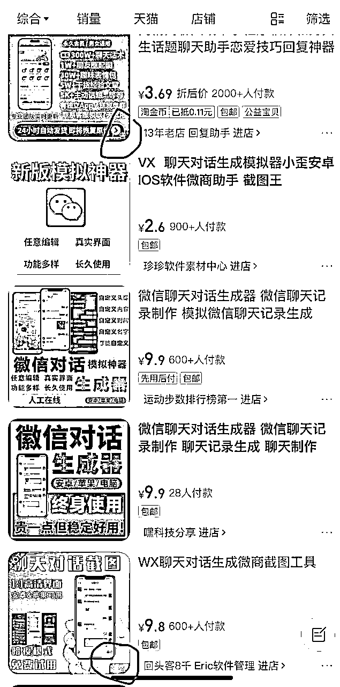

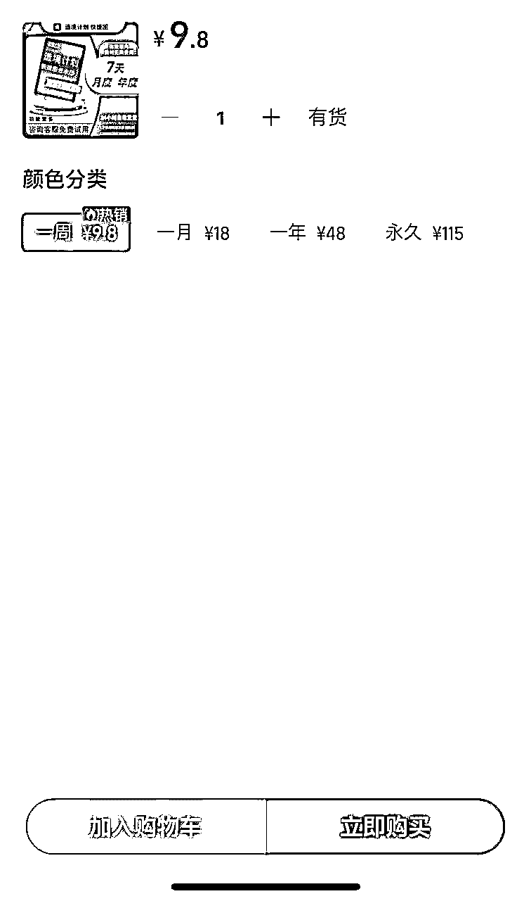

重点看第一张图右下角的“广告”标识。结合我对广告的理解和第二张图的定价，这事儿的变现能力相当强。

* 7天9.8元

* 1个月18元

* 1年48元

* 永久115元

典型的订阅制收费。用户获取成本只要控制在3元以内，就能靠买量放量赚钱。

按月费18元算，纯自然流一个月拉100个用户就是1800元，还不算复购。工具类App的魅力就在这，换个皮肤做点差异化功能，还能搞矩阵铺量。

## 3、把模糊需求拎清楚

客户说出来的需求通常很含糊，得像个产品经理一样把核心逻辑和交互理顺。跟微信沟通后，抓住了几个关键点：

1. 先做安卓，后续可能上iOS

2. 要百分百还原布局、字体、配色、间距、交互动效

3. 页面要支持DIY定制

这时候还没到写代码的时候，先做技术选型和PRD，把开发思路和客户对齐。

# 二、技术选型与PRD

## 1、技术选型

考虑到后续可能要上iOS，遵循一次开发多端复用的思路，结合ChatGPT的跨平台能力，候选是React Native和Flutter。

对比后，我选了Flutter。为了UI呈现和交互手感更接近原生，这个选择更稳。

Flutter还能一套代码生成Web端，如果未来业务需要网站、安卓、iOS三端覆盖，它是首选。

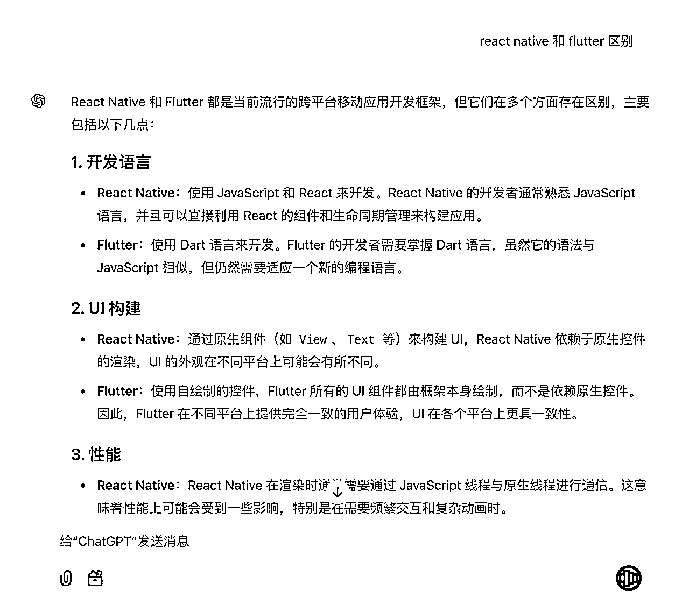

## 2、写PRD

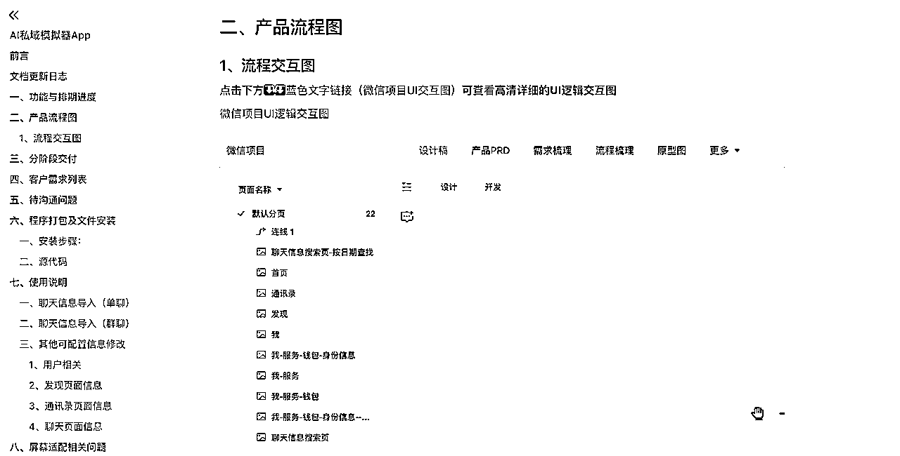

把需求拆成页面功能和页面关系，先在脑子里搭个全景图，这对估算工作量很有帮助。

把需求写成文档，能大幅降低双方的认知偏差，减少后期扯皮。

写PRD的时候，我其实也在同时准备给大模型的提示词。以前PRD是给工程师看的，现在主要也是给AI看的。

# 三、靠ChatGPT写代码

## 0、搭环境

不管什么语言，环境搭建最磨人。遇到问题直接丢给ChatGPT问就行。

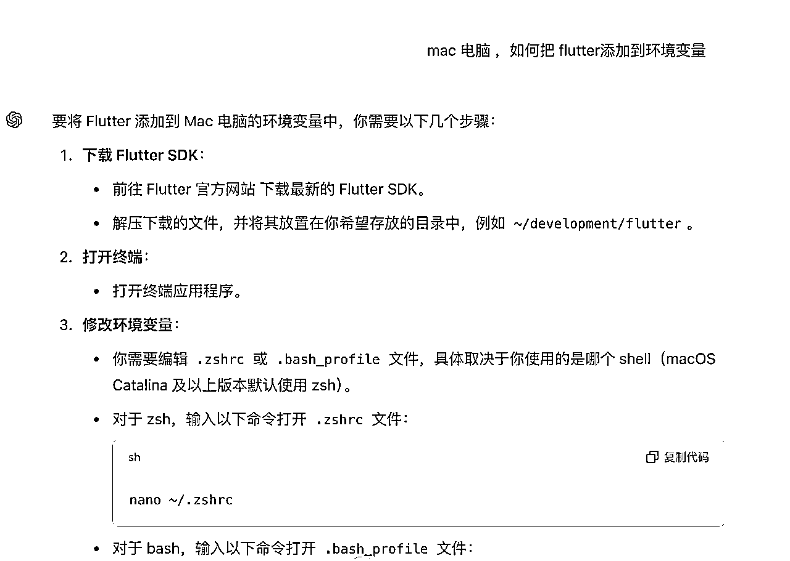

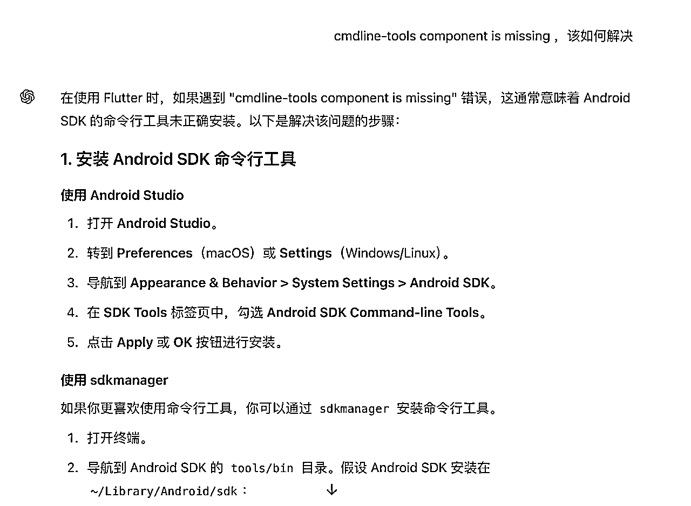

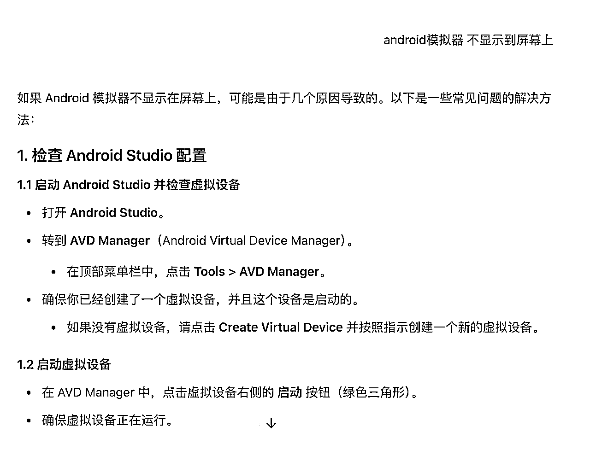

## 1、单页面复刻

直接把需要复刻的截图丢进去，提示词写“参照这张图，xxx”，ChatGPT就能吐出对应布局的UI代码。

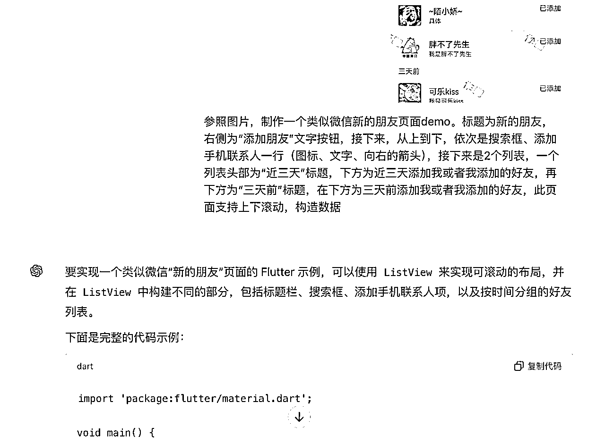

## 2、多页面联动

页面功能一多、代码量一高，就得拆成多个页面或类。页面之间需要数据传递来保持一致性。

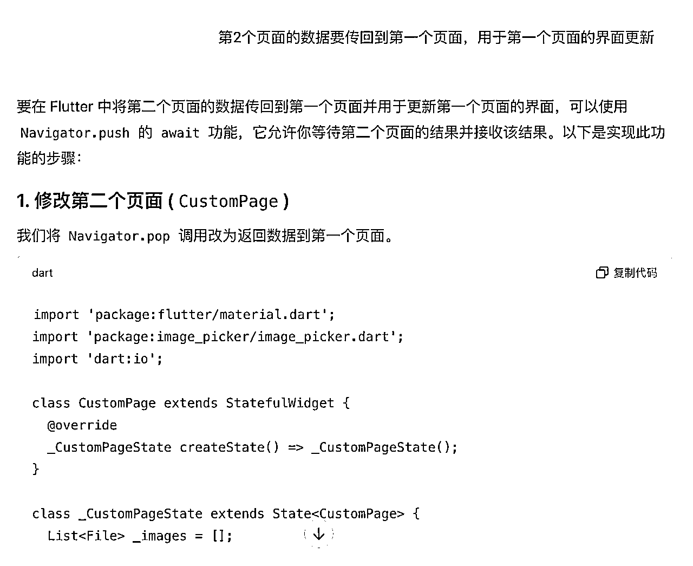

## 3、报错处理

调试报错时，直接把错误信息复制进去，或者截个图丢给它。

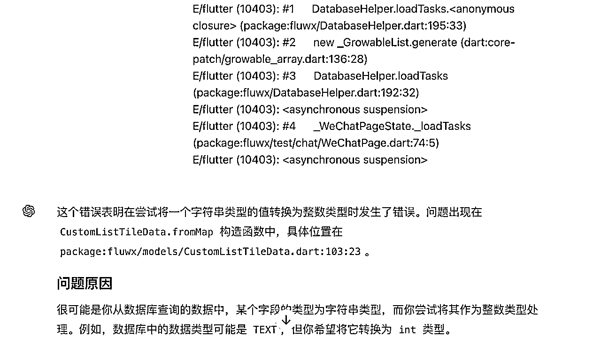

## 4、打包apk

flutter build apk --release

## 5、代码版本管理

Github、Gitlab、Coding都行。

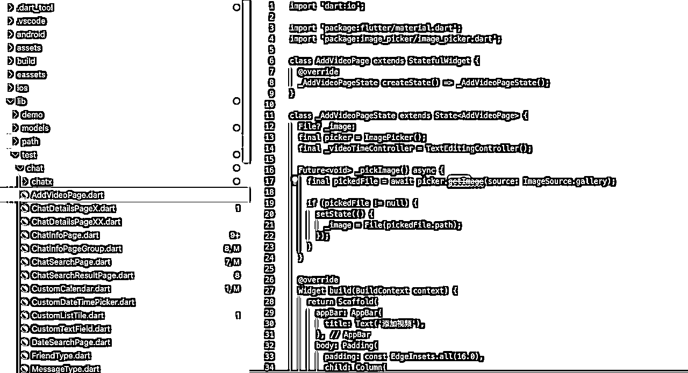

代码体量上来后，一定要用版本管理及时保存上传。因为大模型有时会越改越差，回滚很关键。

# 四、测试与交付

## 1、复刻时用的小工具

### 数码测色器 Mac版

能一键提取UI里的颜色值。

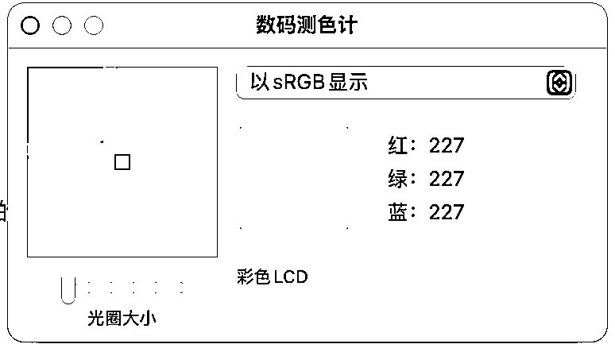

### PixelSnap 2 Mac版

能提取UI里的间距和边距。

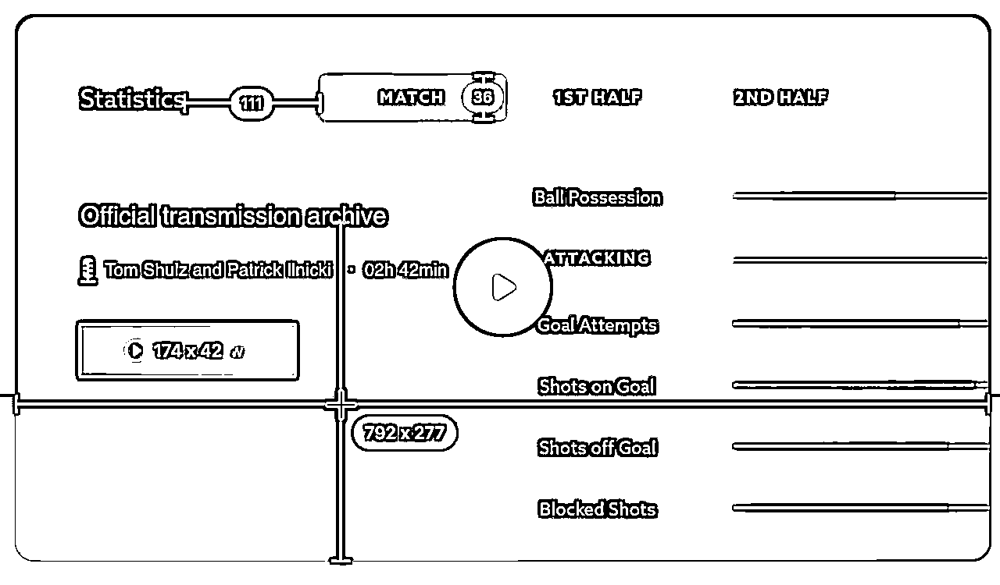

### Photoshop 2024

把两张UI截图叠在一起，上层降低透明度，就能直观看出复刻精度。

## 2、交付节奏

7月8日确认合作，7月11日交付产品需求文档，包含功能逻辑、页面流程交互和排期。7月15日交付核心功能Demo。纯编程时间大概用了4天，AI编程把效率拉满了。

产品上线使用一个月后，功能、交互、细节都没问题，客户又追加支付了2万。用真金白银的反馈告诉我，AI编程已经进入可商用阶段。

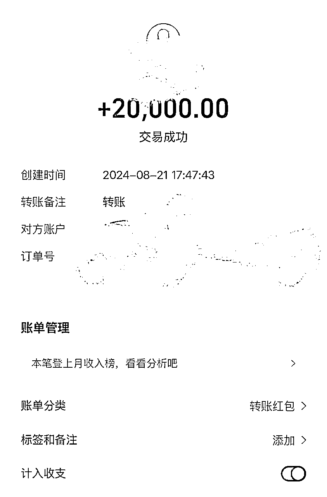

后来我也试了Cursor、Windsurf，这类工具在研发调试上又更进一步，不用反复复制粘贴，报错信息能直接读取，效率比ChatGPT再上一层。同样一个能商用的App，用ChatGPT大概要2.5天，换成Cursor能压到1天左右。

# 五、收尾感言

以前看过电影《无双》，讲画假钞的。每次碰到挑战，我都会想起这部片。这次项目让我确信，AI编程已经到了奇点时刻，用AI写的代码真的能用、能赚钱。

关于App选品、精细化运营、利润最大化等思路，我在另一篇帖子里详细拆过：

从选品策划、变现、数据分析、App矩阵多方面，分享App蓝海精细化运营玩法-知识星球

如果你在技术选型、App复刻、上线变现上遇到卡点，评论区聊聊。

现在真的是最好的时代！感谢龙哥盟，一起赚钱！