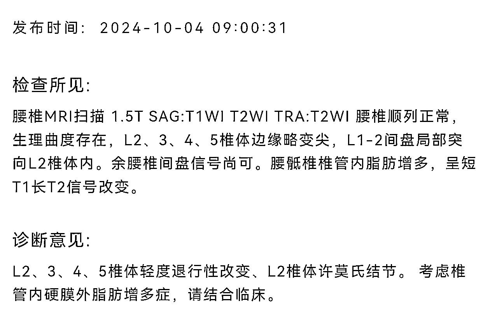

# 互联网人自救手册：身体篇

大家好，我是龙哥。2008年考进天津医科大学，2019年进入全国百佳三甲医院开始工作，内外妇儿全转过，ICU也干了三年。十几年下来，累计为上万人看过诊，也运营了三年多的免费问诊星球，处理过不少身体和心理上的困扰，有自己的一亩三分地。

下面这份笔记，是我结合临床经验和大家高频的健康问题，梳理出的一个基础版保养、体检和常见病思路。希望在拼业绩的路上，能别把身体搭进去。

村上春树说过，人体的肉体就是神殿，不管供奉什么都值得维护它的坚韧、美感和洁净。

以下内容仅为个人经验参考，个体差异很大，医学没有绝对。急症或不适一定要及时就医。如果你是同行或杠精，有不同看法是对的，请把精力用在帮助别人上。

祝看到这里的每一位，富贵平安、长寿百岁。

# 面部老化真相：皮肤篇

为什么脸抹了那么多贵价面霜还是问题不断，屁股却白嫩光滑，这公平吗？为什么欧美明星的花期普遍偏短，而国内不少明星过了四十反而更显年轻？差在哪？

医美当然是因素之一，更关键、更被忽略的是光照，也就是紫外线。

皮肤老化里，内源性只占约三成，七成是光老化。养孩子防不了老，勤防晒才行。物理防晒是遮挡、帽子、遮阳伞；化学防晒是防晒霜。建议全年、室内、飞行时都做。

一个冷知识：室内晒太阳补不了钙补不了维D。因为玻璃能挡UVB、挡不住UVA。合成维D需要UVB，而让人变老的正是UVA。

所以出门要遮脸。即便晒黑，也要用专业美黑产品。紫外线会损伤DNA，增加皮肤癌风险，这点必须重视。

远看人是色块拼图，先判断体态、发量、肤色，再看五官。一白遮百丑有道理。

当下主流的抗老逻辑是：医美>口服>外养。人从骨骼、骨膜、肌肉、韧带、脂肪、真皮到表皮都在衰老，想多层干预得靠仪器。

贵价护肤品有效，但穿透率只有3-5%，多停留在表皮，能改善肤感，改变不了深层结构，也挡不住每天0.02毫米的下垂。

皮肤的肌肉走向在变，颧脂垫在下移，纹路多是组织挤压造成，像地震时地层错位。所以要管熵增，别只做加法填充。很多整形后期显“过”，不是当时失败，是衰老后整体比例变了。

美白有上限，大概是手臂内侧或大腿的颜色就是天花板。好看和健康无上限：控糖减少糖化反应，避免脸黄、胶原断裂；少生气少熬夜，减少自由基，抗氧化即抗老。

皮肤管理是系统活，要结合目标动态调。最简单的组合是补水、早睡、防晒、心情好。最便宜的医美是减重，再热的热玛吉也留不住三两苹果肌。

痘痘：少上手、别挑破、可外用夫西地酸，忌糖忌奶制品。
痘印：深色沉淀一年以上不退的，考虑激光。
过敏：分区护肤、极简护肤、研究成分、用医用线、配合口服。
刷酸：角质薄者不适用，酸种酸度有讲究，不建议在家自行操作。
斑点：潜伏期长，上面一点、下面一窝，涂抹基本无效，号称祛斑多是概念，最终靠医美，必须防晒。
长痣：表皮平坦者可用药，带蒂突起者基本要手术切除基底，否则复发。警惕黑色素痣，别随意刺激，疑似恶变尽快切除。信面相的，先找专业人士评估再动手。
红脸蛋：皮下血管壁受损，皮肤科处理，多需激光。

# 发量焦虑：头发篇

二十年前理发店流行打薄，多了就剪掉一半。现在没人提了，植发太贵，每根头发都像有名字，Lily、Lucy，少一根就少一根。

脱发原因常被归咎于洗发水，科学上并无证据。已证实的因素包括：遗传、年龄、免疫、饮食、睡眠、压力、内分泌、物理化学刺激、脂溢性皮炎等。

遗传和年龄无法改变，主流可控因素集中在压力、睡眠、饮食、内分泌和免疫状态。说到底是社会意识形态、经济环境、互联网氛围在影响头皮。

我小时候看日剧，觉得他们头发就不浓密，现在想想与经济基础和生活方式高度相关。

养护思路：先排除可改变因素。怀疑雄激素性脱发的查雄激素受体，必要时用药。

已证实有效的成分，外用米诺地尔，内服豌豆苗提取物。我都用过，发量你们见过，没什么学医创业的痕迹，有时会觉得有点热。

另外头皮防晒很重要，别用过烫的水洗头。

实在尝试无效也别绝望，现在假发片以假乱真，明星都在用。努力赚钱，植发买自己的或买别人的，都是用钱买健康。没毛病，我们没毛病。

# 用眼过载：眼睛篇

戴眼镜的人越来越多，近视年龄越来越小。主因三点：电子产品普及，小孩都会操作手机平板；课业负担加重，学习时长远超我们那时；户外时间减少，近距离用眼暴增。

眼底问题也在上升，与高血压、糖尿病相关，也与寿命延长和诊疗技术进步有关。

不变的原则：节制用眼，控时长控距离，别让眼肌长期固定一个状态丧失调节力。防蓝光镜片是辅助，不是万能。

还要阻断继发风险：控血压、控血糖。原发病控制、指标监测、早期干预如激光，都是关键。

我父亲做过糖尿病视网膜病变玻切和白内障手术，因术后未遵医嘱恢复，一只眼仅剩光感，空间感丧失，倒水会洒、会撞东西，视野变窄。这是我多年的心病。看着盲人博主自媒体重建生活，总在想如果有一天看不见我是否有勇气。

普通人别自暴自弃。五感健全已是恩赐，平静生活背后需要代价。

视力下降、视野缺损、感光异常、飞蚊症要及时就医，做综合验光、眼底检查、眼压测量，别拖延，疾病进展很快。

初次近视或合并其他屈光不正，建议去医院视光中心验光，再凭结果去外面配镜或网购镜框更靠谱。

近视手术医学上只有两个标准：你是否真心想摘镜；你眼睛能否承受手术。能耐受就选合适术式，技术已很成熟。

医生为何戴眼镜不做手术？眼镜是保护。血液、体液、呕吐物、实验试剂都是眼部风险，护目镜不如常戴眼镜来得可靠。很多医生也无外观需求。

眼部感染如沙眼、麦粒肿、结膜炎，注意用眼卫生，别揉眼，会加重感染并加速眼周老化。确诊后及时用抗生素彻底控制炎症，否则易机化包裹，散粒肿需切开引流，引流后睑板腺易留瘢痕，造成长期不适。

蒸汽眼罩有效，增加眼周循环。多转动眼球，眼保健操从小到大。干眼可用人工泪液。就这么简单，好好爱护它们。

# 肛肠之痛：痔疮篇

人们都怕轮到自己的地方，就是十八层地狱或肛肠科换药。肛肠疾病太痛，有过经历的人都有阴影。那里神经丰富，又每日使用，久坐、吃辣、便秘都无法独善其身，可怜的菊花。

我本人十几年老患者。高三时喝苦瓜根水败火，结果拉肚子后便秘用力，纸上有血，后来长外痔。大学偶尔痒，工作后久坐饮食不规律加重，外痔变大，还出现血栓痔，剧痛难行，只能趴着床上。

病急乱投医喝过药，同事帮忙减压引流无用。心理建设一年后决定手术。手术后感觉比想象中好。周一住院采血灌肠，周一下午回病房，医生说不用换药。腰麻术后两小时知觉恢复，镇痛泵不疼，当天睡得香，第二天能吃饭。为防首次排便受罪吃白粥面条备乳果糖，术后每天温水坐浴三次，术后第四天软便排便，第六天黑线脱落，第七天上班，21天后首次坐飞机。一年多未复发，注意不长时间久坐，出差备开塞露。

痔疮分内痔、外痔、混合痔。内痔多出血不痛，外痔像小疙瘩可能疼痛肿胀，时间越久创面越大恢复越慢。

防治主张：不长时间久坐、多提肛、上厕所不玩手机、多温水坐浴。得了也不怕，调整习惯。说实话，健康到不长痔疮，其它病也不容易来。

保守治疗无效时，手术没那么恐怖。没复发的很多人不会说，网上负面声音多是幸存者偏差。

# 颈肩承重：颈肩篇

脑袋比肩窄，看似一颗球，重量却不可小觑。成人颅骨约十斤，等于一百个鸡蛋。颈椎要一直扛着，还要扛多久？还要经历多少姿势？

垂直承重已是向下力，斜着低头伏案盯屏，长期前倾，问题自然出现。急性多为外伤，慢性多为长期姿势不良。

我承认自己没注意。大年初一突感头脑浆糊似的、记不住事、想睡还恶心，以为老年痴呆或脑瘤，大年初五检查发现C3-4、C4-5、C5-6盘轻度变性膨出。休养后不再熬夜，调整办公姿势、吊单杠、游泳。

颈椎养护意识第一。支架、升降桌、颈托都只是手段，核心是时长和姿势从根源避免变性。

肌肉筋膜强韧能保护骨头。日常肩颈操跟练，自媒体和keep都有，中医推拿也有效。

中医师触诊可知问题：脊柱偏、长期偏用一边、腰肌劳损。肌肉收缩能缓冲震动，长期僵硬失去保护，韧带代偿后钙化，牵拉骨头变形。所以主动锻炼和被动放松都要做。

注意并非所有颈椎病都适合推拿牵引。特定类型骨头微动会影响神经脊髓，按了更糟。有病变先拍片再对症。

颈椎病变进程：劳累-轻度变性-重度病变，从物理治疗到只能手术。可在任何阶段叫停就医调整习惯，别硬扛。

手术也非一劳永逸。颈椎节段融合后，受力转嫁给邻近节段，易继发问题。像吊桥木板坏了换一块，邻板受力改变易损。

颈椎手术在骨科是大手术，备皮伤口二十多厘米，恢复期长。但神经血管压迫不处理会导致瘫痪失去支配。

我们这一代是久坐产物。早保养，别等蓄积到严重才后悔，不想在门诊住院处见到你们。

# 关节耗材：关节篇

膝盖是不可再生资源，关节置换很贵，这是前提。

关节负责连接缓冲运动保护。日常感觉不到，坏了就很难受。

肥胖是首要风险。200斤的人，小腿脚约30斤，其余170斤压在膝上，再跑跳损伤加剧。

避免关节血运不良：不长期久坐、不受凉，保暖泡脚按摩都可安排。

警惕继发因素：高尿酸结晶引发慢性炎症痛风，非常痛苦；免疫性疾病也会损害关节。

警惕运动副损伤：姿势不当、热身不足、大基数减重激进、运动方式不适合。建立耐受、充分热身、专业指导。

关节已有问题者，勿爬山爬楼梯。

保养好物：外用活血膏药、加热贴促进循环加速炎消积液吸收；内服钙+骨化三醇、氨糖软骨素，增加骨密度和缓冲。

# 腰背代价：腰背篇

小孩十几岁腰间盘突出的报道不少，意味着未来不能久站久坐劳累，很无奈。

有腰痛先查两个科：泌尿科排肾结石，骨科排腰椎间盘突出。有合并症状指向更明确：腰痛+血尿多泌尿科；腰痛+腿麻腿疼多骨科。

我们进化到猴子四足、人类双足、现代打工人久坐。久坐危害颈椎、腰椎、肛肠、下肢血管。

我爸近期做椎间盘突出切除，因神经压迫腿疼多年，多方治疗无效。手术切除突出盘及部分黄韧带肌肉，组织发黄发黑。术后症状明显缓解。同病房有人半年不能平躺，只能侧卧，人间酷刑。

网上见过患者因疼痛喝药自杀后抢救成功手术的故事。

我陪护期间也开始腰疼，曾有腿麻经历，片子当时正常但总觉得在临界状态。久坐的代价正在累积。

当时腰部一直不太舒服，我给自己上了个护腰，硬撑着陪老爸办理完出院手续，这才去医院做了核磁共振。片子出来，报告上写着：椎管内脂肪增多。

这是什么概念呢？大家啃过猪筒骨、牛骨髓吗？看没看过吃播博主举着大骨头吸骨髓的画面？大骨头中间是空心的，里面住着骨髓、神经、血管这些成员。我的腰椎管里，脂肪堆得太多，把坐骨神经和马尾神经都给压住了，于是各种症状就冒出来了。

后来我翻了不少研究资料。有的人是生病后用激素，脂肪重新分布；有的人纯粹是太胖。而我两种情况都不占，归根结底就是久坐，腰椎长期承压，身体只好增加一些保护性脂肪，结果反而压出了症状。

说白了，这是身体的代偿机制。人体这套自我调节系统其实非常强大，每天高速运转的同时还在不断地修缮、纠偏。代偿期就是还能勉强调节平衡；一旦进入失代偿阶段，各种机能就可能集体崩盘。

我那会儿的治疗方案是调脂，他汀类降脂药吃了一个月，没事就躺着休息，不到一个月症状就全消了。到写这篇文章为止，一直没再犯过。

后来我办了张游泳卡，每天下班去游几圈。游泳对心肺、颈椎和腰椎都特别友好，运动时的身体姿态也贴合自然的生理曲度。只要条件允许，我打算一直游下去。

为了不无聊，我还配了副骨传导耳机，边游边听播客，身体在锻炼、脑子在吸收内容，那种身心同步在路上的感觉确实很棒。

腰不太好的朋友，尽量别做骑马、跳绳这类给腰椎增加负担的运动。可以多吊吊单杠、开开背、摸摸门框，练练臀桥和小飞燕，把后背肌肉练强壮了，骨头自然更有依靠。最关键的一条：别久坐。能配升降桌就配一个，总而言之，别让身体长时间定格在一个姿势上。腰真的太重要了。

# 又管消化又管免疫——聊聊肝胆

肝脏相当于人体的化工总厂，是个不折不扣的劳模，一个人同时干着好几份活儿。它负责营养物质的代谢，参与维生素和激素的转化，所以肝功能一旦不好，人就容易缺这缺那。肝硬化男患者可能出现乳房发育，就是因为肝脏灭活雌激素的能力下降了。

肝脏还负责合成胆汁——别看名字里带个“胆”字，其实绝大部分胆汁是肝细胞造出来的，胆囊只是负责储存和排泌。

解毒同样是它的核心职能。有些物质代谢时会超过肝脏的承受上限，造成急性肝损伤；还有些东西本身毒性不大，经过肝脏一代谢反而变成了更毒的物质，伤及身体。

肝脏还承担免疫、血容量调节的工作，凝血因子的生成也归它管，所以肝硬化患者凝血功能差，一出血就往往很凶险。

肝脏最怕五样东西：病毒、酒精、药物、暴饮暴食，以及熬夜和情绪低落。偏偏这个器官干得多、喊得少，因为它内部神经分布很少，哪怕病得很重也未必觉得疼。

过去体检不普及、大家也没有健康筛查的观念，很多肝癌患者一直拖到晚期，出现牵拉疼、黄疸、暴瘦这些信号才去查，一查已经是晚期。

所以，平时主动避开风险因素、定期体检、有不舒服尽早看医生，这些话老套，但真的救命。

# 我怎么会“变态”了？——说说过敏

好多患者到了医院问导诊台：“我过敏了挂哪个科？”导诊说“变态反应科”，对方的眼珠子都要瞪出来：我好好一个人，怎么还变态了？其实这纯属误会——过敏在医学界的正式称呼就叫“变态反应”，而且还能细分为四型。

为什么有人对那么常见的物质过敏？牛奶、鸡蛋、粉尘、螨虫、猫毛狗毛、冷空气，都可能成为过敏原，甚至还有人对伴侣的小蝌蚪过敏，听着是不是很离谱？

过敏的本质，是我们身体里的识别—反应—防御系统出了故障，认不出“自己人”了，开始胡乱发起攻击，结果伤及自身的组织和器官。大水冲了龙王庙，一家人打一家人。

有人说“我免疫力低才过敏”，这还真说反了。过敏通常是免疫系统异常亢进、敌我不分，才会闹出各种症状。

过敏的表现千奇百怪、可轻可重。在头面部是打喷嚏、眼睛发红发痒；在皮肤上是瘙痒、起疹子；在肠胃道可能是腹泻；在生殖系统可能是流产；肝炎、脑炎属于比较重的类型；更凶险的喉头水肿，直接让人窒息，危及生命。

所以，如果你出现过莫名其妙的异常症状、又没确诊过过敏，最好去医院查查过敏原。已知过敏的朋友，核心就一条：远离过敏原。点餐、买零食之前先确认成分里没有雷区，了解自己的身体，常备抗过敏药，一有不对劲立刻就医。

免疫这回事也很玄，你控制不了它。可能突然就对某个东西有反应了，也可能过敏了好几年的东西突然就没事了。但无常之中仍有迹可循——如果你听说过神经性皮炎、应激性溃疡这类病，就会发现很多疾病和情绪、心理脱不开干系。现在关于心身疾病、躯体化症状的研究相当深入，人体确实会被精神和心理状态牵着走，免疫系统也不例外。凡事别太往心里搁，好好吃饭，好好睡觉，比什么都强。

# 替一位朋友问的——男科那些事

别尴尬，也别不好意思。在医生眼里，人就是生理学的XX和XY，加上第二性征的区别，剩下都是就事论事、对病下药。这个部分想了很久怎么写，干脆按“感受”和“功能”两条线来讲：前者关系到亲密关系里的体验，后者关系到传宗接代。

先说感受。这件事本来就是两个人的事，而且相当看结果——只要双方都觉得满意，什么长度、直径根本没有绝对标准。真要是某一方觉得不OK，那就开诚布公地沟通，再一起想办法解决。

1、关于时间短。医学上大致以两分钟为界，但就算不到两分钟，只要两个人都满意，也完全不用处理。时间短分原发性和继发性，背后的因素很杂：遗传、包皮过长、敏感度高、精神心理因素、一些慢性病，都可能掺一脚。

正确的流程是先查清原因，再对症处理：药物、心理疏导、戒烟戒酒、避开外界的理化刺激、控制慢性病、建立规律的生活习惯、多和伴侣交流增进亲密感，这些都要配合起来。

如果都试遍了还是不行，还有辅助器械和外部装置可以尝试。现代医学很发达，这个问题困扰着许多人，真没必要讳疾忌医。

有些男生的生育力惊人地持久，六十多岁还能当爹。诗里那句“一树梨花压海棠”，说的就是一位老夫娶了少妻，满头白发的年纪还让年轻小妾怀了孩子，被朋友写诗调侃——梨花是白发，海棠是娇妻。两人感情很好，小妾一连生了好几个儿子，老先生去世后，她也伤心过度，不久便跟着走了。

2、关于长度短。强烈建议先减肥。有研究显示，体脂率每上升10%，兄弟的长度可能缩水1到2厘米；成年男性减掉十几斤，兄弟能多出1英寸。所以，减肥是第一优先级。

脂肪一多，睾酮水平就往下掉，过量的雌激素还会削弱男性特征，影响雄风和战斗力，越来越“姨”，最后活成姐妹。这肯定不行。

要是实在短得离谱，现代医学也有招：把韧带切断，用内填外拔的缝合技巧，大概能拉长2到4厘米，效果还挺实在。此外还有补片植入、脂肪注射、皮瓣移植、玻尿酸注射等方案。但切记，一定要去正规三甲医院的男科或泌尿外科，千万别找私立诊所、莆田系那些来路不明的机构——那可是命根子，开不起玩笑。

就算长度不占优，也可以在别的维度多下功夫，把体验感补上来，让对方满意。

3、关于生育功能异常。想当爹的男士，泡热水澡、蒸桑拿这些事要节制——小蝌蚪的生成和成熟都需要比体温略低的环境，睾丸长在体外就是为了降温，太热可不成。

一般建议备孕的夫妻都做常规检查，包括传染病、遗传病筛查。男方查精液，女方查的项目多一些：生殖系统B超、TORCH、激素水平等等。没有异常就可以安心备孕。

要是超过一年还没动静，就得做进一步检查。也有不少人婚检完直接开始备孕，怀不上再回头查。

精子的活力和畸形率会被很多因素影响，抽烟、喝酒、压力大都在列。既然把优生优育当大事，就得积极配合调理身体——男生也就是关键时刻哆嗦那一下，更辛苦的活儿都是女生扛的。

有些医生会建议备孕期间男方同步补叶酸。成本不高，让补就乖乖补，反正孩子生下来跟你姓，不亏。

另外，多吃富含氨基酸的干净食物，油炸的、刺激的少吃；内裤别穿太紧；别照X光；避开化学物质的刺激；别碰有生殖毒性的药物。

# 替另一位朋友问的——妇科那些事

女性的尿道短、宽、直，男性的尿道长、窄、弯。先天结构决定了，女性泌尿系统和生殖系统的感染概率天然比男性高，所以更要多留个心眼。

而且每一次两性行为，都是一次菌群环境的震荡。所以事前要清洁、事后要排尿、上大号从前往后擦，这些习惯都是在给自己规避风险。

有过性生活的女性，建议每年查一次HPV和TCT：前者看有没有高危感染，后者看宫颈有没有病变。早发现、早处理。梅艳芳就是因为宫颈癌走的，而这病和HPV高度相关。有条件就去打疫苗，就算已经感染了某种分型也要打——HPV分型很多，打疫苗对没感染的其它分型一样有防御作用，怎么都不亏。

多说一句：HPV分高危和低危，低危型没有致癌作用。有些人的脖子上长的肉丝、肉赘，也就是丝状疣，就与低危型HPV有关。可以用明矾酊、乳酸溶液、5-氟尿嘧啶外用溶液等外涂，没效果就做激光、冷冻。

女性阴道的健康环境是弱酸性的，pH值在4上下，靠乳酸杆菌的代谢撑着。环境一旦被破坏，抵抗力就会下滑，外来菌群容易趁虚而入；反过来，感染又会破坏环境。两者互相成就、互为因果，所以千万别乱用洗液。

正常的分泌物是透明到淡黄色、没味道、量也不多。要是性状变了，及时就医——该做内窥镜做内窥镜，该留分泌物化验就化验，先确诊再用药，别自己瞎买药。

月经量过多过少、周期过长过短、过程中疼得厉害，都该去医院看看：是不是有肌瘤？雌激素水平是不是太低？是不是子宫内膜异位？

体质特殊的女孩子如果经期疼得受不了，止疼药不是不能吃。布洛芬这类，一个月吃一两片，谈不上成瘾，也没什么大危害，总比疼晕过去强。

红糖水其实没用，真正有用的是热水。但男朋友的关心，是有效的。

别信什么安全期，别为任何男人的承诺糟蹋自己。结婚之前、或者没打算要孩子的时候，避孕必须做到位。女孩子先爱自己的身体，别人才会来爱你。

男生要是真的疼女朋友，可以尝试分开用马桶；实在分不开，坐着小便，能把马桶周围的细菌浓度降下来，对女生的健康也是一种善意。

无论男女，练凯格尔运动都大有好处。

为了两个人的体验更好，现在有不少私密项目，比如增加黏膜紧致度、增强盆底肌，效果都不错。可以自己练，可以做电刺激，也可以双管齐下。

有个医美项目叫Fotona 4D，其中一个黏膜模式，是拿圆柱形探头伸进嘴里，让两边腮帮子里的黏膜受热收紧，用来给口角皮肤抗衰、解决口角囊袋和下颌缘模糊的问题。

是不是觉得这套词很耳熟？黏膜、探头、紧致——没错，这个技术最初就是为私处问题开发的。随着女性自我意识觉醒，取悦自己越来越被正视，这个市场也越来越大、越来越成熟。这是好事。

男科、妇科这两篇都聊完了，最后想跟所有男生女生说：要爱自己、注意卫生、重视健康。但千万别因为生了病就自卑或者觉得丢人——生病不是你的错。正视它，去正规医院看诊，别被莆田系和不靠谱的医疗机构骗了，记住了吗？

# 减肥这件事，念叨一辈子

减肥方法千千万，我最认可的还是饮食调整里的“8-16进食法”——一天内把所有的食物在8小时内吃完，剩下16小时只喝水不吃东西，更狠的甚至能做到2-22。

这个方法不光能瘦，还能稳定血糖。一天三顿饭，血糖本身就在大起大落，再加个餐、来点零食，血糖动不动飙到十几甚至二十。

有些自媒体博主会戴那种植入皮下的血糖探头，贴在大臂上，连着手机能连续监测几十天、24小时实时记录。他们发现，很多食物对血糖的影响远远超出我们的想象。

血糖忽高忽低的坏处，第一是折腾胰岛。我自己有过体会：不吃早饭反而没事，一旦吃了早饭、尤其是喝了粥，快到中午必定低血糖。这种胰岛素分泌大开大合的模式，本身也是糖调节受损的一种表现。我家有糖尿病家族史，所以我从很早就开始留意血糖。

第二，胰岛素多，人就容易胖。人体里能升高血糖的激素有一大堆（肾上腺素、胰高血糖素等等），但能降血糖的只有胰岛素一个。它降血糖的机制是加速组织对糖的利用——怎么利用？要么消耗掉，要么存起来。存成糖原还是好的，最怕的是存成脂肪。

所以升糖指数越高，胰岛素分泌越多，脂肪囤得越多，胖就是这么来的。从糖变成脂肪很容易，想再让脂肪出去，那就难了。稳住血糖、控制升糖食物的摄入，是减肥的关键。

糖这东西确实是双刃剑。人的基因天生嗜甜，大脑工作也需要糖供能；可一旦多了，就会变胖、变老、变丑、长痘，还会影响全身各处的菌群，让感染的概率上升。

所以，控制进食的时间、种类和速度，就是普通人成本最低的减肥方式。

可以下个薄荷营养之类的App，学会看配料表。糖太多的、过度加工的食物少吃，别迷迷糊糊吃了多少都不知道。学会挑低GI（升糖指数）的主食和配菜，用代糖做饭，一点一点把糖减下来。

说完了摄入，再说消耗。人体的能量消耗分几块：一是基础代谢，维持身体日常运转的基础消耗。年纪越轻、肌肉量越大，基础代谢率就越高。

二是小孩子的生长发育，这部分热量消耗很大，所以才说“半大小子，吃垮老子”。成年人没这个端口，所以人到中年就容易发胖。

三是活动消耗，这个就看各人适应什么方法了。我见过跳着绳瘦下来的、游泳瘦下来的、跳郑多燕瘦下来的、打拳击瘦下来的——什么都有。只要做到每天消耗大于摄入，就一定能瘦。关键是量力而行，看效果和速度来调整。

减肥产品到底有没有用？我觉得看成分和作用机制。要么是增强饱腹感、减少吸收，要么是促进排出，要么改善肠道菌群、增加消耗。这里不做具体推荐，大家自己去做功课。教你一个判断方向：拿不准的时候，就把配料表里靠前的成分一个个去查，确认它到底有没有效、有没有副作用。

容貌和体重，跟世上大多数东西一样，逃不过熵增定律——不管它，就会越来越乱、越来越失控，没有一劳永逸这回事。你对自己有要求，就意味着要常年自律，用每一天的行动去匹配。We are what we eat, we are what we choose。你的认真和选择决定了行为，而行为定义了你是谁。

# 每一次生气，都留在奶子里——乳腺篇

女性更年期的种种不适，大多跟雌激素水平断崖式下跌有关。那为什么不直接外源补充雌激素来治疗呢？反正雌激素又不贵，对吧？

原因在于：雌激素太多了，乳腺就要遭殃，它的致癌风险是实打实被证实过的。所以除非病情特别严重，否则医生不会把外源性雌激素当成首选方案。

很多乳腺疾病还跟育龄有关，绝经之后反而能自行缓解。有乳腺疾病的人，维生素E不能吃，豆制品也要少吃——维生素E和大豆异黄酮都属于类雌激素，会刺激乳腺。

所以女生的情绪，是会实实在在地通过激素波动影响到乳腺的。产后如果家庭关系不和睦，乳汁淤积、乳腺炎就可能找上门。女生一定要开开心心的，没有任何人值得你生闷气——每次生气，都可能在乳房里长成一个结节。这么想，还气得起来吗？

乳腺健康需要定期自检，顺序是：外上、内上、外下、内下、中部、腋窝——右侧乳房顺时针，左侧乳房逆时针，中间和腋窝也别忘了。要是摸到了肿物，或者出现血性、脓性的分泌物，尽快去医院检查。早干预的代价，一定比晚干预小得多。

日常保养也要细心。再激情，也别暴力对待；内衣别长时间穿太紧的；扩胸运动，任何年龄开始都不晚。肌肉和韧带保养好了，外层胸型自然更挺拔。

最后，心情好、睡眠好、饮食好，对任何一个器官都是最好的滋养。

# 身体的第二大脑——菌群篇

我是学西医出身，但对中医的态度一直比较客观。取其精华，去其糟粕，有些患者问我的中医问题，我也认真研究过。其中最有意思的一个概念是“脾胃”。

中医说的脾胃，跟西医解剖学里那个“脾”和“胃”根本是两回事。我一直很好奇：脾胃不和，到底是哪儿不和？为什么它能牵动人体这么多功能？它到底藏在哪？

直到读到一些文献，我忽然觉得——这个“脾胃”，很可能说的就是肠道菌群。

肠道被称为人体的第二大脑，肠道菌群已经被证实和人体几乎所有器官的疾病都有关联，特别是痴呆、记忆、睡眠、情绪这些，作用范畴远超大多数人的认知。

人体带着大量的细菌生活——一个100斤的人身上，大约有3斤是活的或死的细菌，包括肠道菌群、口腔菌群、阴道菌群、呼吸道定植菌群、皮肤表面的细菌等等。这些细菌的基因组加起来，是人自身基因组的几百倍，影响力可想而知。

为什么夫妻会越来越有夫妻相？原因有好几层：饮食习惯趋同、不自觉模仿对方的表情导致表情纹相似，都会让人看着更像。还有一个重要因素——菌群会通过共同饮食和接吻互相交换，潜移默化地塑造着两个人的健康和容貌。

有科研做过实验：把瘦动物的肠道菌群移植到胖动物体内，吃的完全不变，胖动物照样能瘦下来。所以好基因、好菌群，是真的值钱。

很多细菌本来就存在于生活环境里，一旦人体出现异常状态，它们就会侵入不该去的地方。比如大肠杆菌从肠道跑到泌尿系统，就会引起尿路感染；着凉后免疫力下降，就容易感冒。所以要让自己开心、营养充足、注意保暖，把免疫力养得杠杠的。

还有一些细菌和恶性肿瘤直接挂钩，比如幽门螺杆菌。体检时千万别漏了这一项。检测分有创和无创：有创是胃镜，无创是碳14呼气试验。查出阳性、又没有禁忌症的话，就做四联根除治疗，停药四周后复查确认是否根除成功。家里大人确诊的，要和老人孩子分餐，别在一个盘子里夹菜。

# 汽车都知道保养，人呢？——体检篇

都说现在的人各种病发病率高，其实主要就三个原因。第一，平均寿命大大延长了。古代人平均活三十来岁，还没活到疾病高发的年纪就没了——好消息是没生病，坏消息是死得早。第二，生活习惯和饮食确实不健康，加速了疾病的发生发展。

还有一个非常重要的原因：体检普及了、健康意识增强了。换句话说，以前同样有人得病，只是没被查出来，自然也就统计不出来。

体检的原则，靠谱的建议分成几类：

1、保底类。不管男女老少，不管有没有家族史、有没有慢性病，都该体检。最晚别超过30岁，就要做第一次全面体检。我们医院职工35岁以下没有免费体检名额，我都是自己掏钱去体检机构，或者挂门诊号，或者直接找我同学帮忙做。

这类体检必须包括：血常规、尿常规、生化系列，肝胆胰脾超声、泌尿系超声、甲状腺和乳腺超声，还有胸部CT。之后根据个别指标的异常去定位，看哪个系统需要进一步深查。

2、进阶类。如果存在高危因素——比如超过30岁、抽烟、喝酒、有家族史——就要加做胃肠镜、头部CT、冠脉64排等，排查消化系统、心脑血管系统的问题。有高危生活史、病史或家族史的，还要查肿瘤标志物。

你有没有过这样的瞬间：体检报告拿到手，翻了两页，心跳就开始不听话——箭头呢，结节呢，囊肿呢，怎么这么多看不懂的词？然后默默把报告塞回袋子，想着改天找个医生问问，改着改着就改忘了。

说句掏心窝的话，体检这事儿，最不值钱的就是那一张纸，值钱的是你拿到报告之后，到底有没有把它读明白。

先说说“查什么”的问题。如果你过去生过病，那体检就不是从零开始，而是带着旧账本去对账。尿酸高或者得过痛风的，关节核磁顺手做了；有糖尿病的，眼底、心脏大血管、下肢静脉的超声都值得排上；血压常年偏高的，眼底、肾脏、脑血管这些靶器官，更是一个都不能漏。目的就一个：不让并发症在暗处悄悄长大。

现在的体检中心也好，外面的机构也好，套餐早就给你准备好了，ABCDE任选，男女性别也做了区分。你要是实在拿不准，就把自己的病史和家族史原原本本告诉医生，他们比你自己更清楚该给你勾哪几项。

等报告出来，先别急着对号入座。看见箭头就慌、看见结节就腿软，真的大可不必。很多指标只是比正常值上限高了一丁点儿，临床上看根本不叫事儿。真正该做的，是拿着报告去找体检医生或者专科医生，把问题理清楚，分个轻重缓急。

第一类，是必须马上动手的。查出恶性肿瘤、肌酐高得离谱、或者被告知有“四高”——高血糖、高血压、高血脂、高尿酸，这些都属于发现了就别等的类型。有一种说法是“先靠自己调整饮食和作息”，我不太认同。你想啊，身体里那些看不见的变化，比如血管斑块、关节里的尿酸盐沉积、眼底的出血点，每一分每一秒都在跟你不正常的指标做交换。正确的做法是用药物先把指标摁回安全区，再用生活习惯守住阵地。先脱离危险环境，再谈重建秩序。

第二类，是可以安排一下、但不能无限期拖的。疝气该补的补、皮肤上的黑色素痣该切的切、高危型HPV感染该处理的处理、甲状腺4类结节该穿刺的穿刺。这类问题给个十天半个月的缓冲不成问题，够你请假、安排工作，但病程一旦有变化，优先级立刻往上提。

第三类，是暂时不用管的。甲状腺功能正常的1类和2类结节、影像学上小小的肝肾囊肿、没症状的小结石、性质不明确但很小的小肺结节——定期复查、调整生活习惯就行，别自己吓自己。

还有一件特别容易被忽略的事儿：体检步骤不标准，等于白做。留尿的时候手指别碰尿杯内壁，不然手上的细菌混进去，好好的一个人能被误诊成尿路感染。扎指尖血测血糖，得等酒精干了再下针，出血了也别用力去挤，不然组织液掺进去，数字肯定不准。量血压前得安静待一会儿，抽烟都可能影响读数，袖带位置还得跟心脏差不多高。体检前一天清淡饮食没错，但千万别搞全天禁食，饿出代谢紊乱，查出来的结果更没法看。现在短视频平台上正经认证的主任医生出了不少操作教程，动手之前先翻出来看两遍，照着做就行了。

说完体检，聊聊另一个绕不开的话题——补剂。

人在医院待久了，常听的一句话是“我以前也没这个毛病啊”。承认自己在退化，确实挺残忍的。但我们都得面对一个现实：过了身体最巅峰的那几年，往后每一天都是下坡路。你看乔布斯，看何鸿燊，钱多到那个份上，也没能买来续命的门票。所以金字塔尖上的人，统一梦想都是长生不老——从老祖宗秦始皇，到砸了几千亿搞生命科学的黄峥，一个道理。

我更喜欢把身体理解成一个水池，一边在进水、一边在出水。营养素、代谢物都遵循这个逻辑：吃进来的、身体合成的是一头，排出去的是一头。血脂高、尿酸高，要么是进多了，要么是出少了，要么是两头都出了问题。糖尿病、甲减这类，则是激素分泌和利用环节掉了链子。理解了这套动态平衡，就不会觉得“吃补剂就是外行”，也不会相信“补了外源身体就不再自己生产”的鬼话了。

市面上的补剂，我自己试过、也看别人用过不少。辅酶Q10和鱼油管心脑血管，叶黄素管眼睛，胶原蛋白肽管皮肤；走细胞路线有NMN、NAD+，再往下有胆碱、肌醇。微量元素里的锌和镁，对情绪稳定真有点用，钙铁和维生素则看具体人群。想提升记忆力、改善睡眠的，有人吃GABA；益生菌是国民级的选手，肠道扛着人体七成左右的免疫功能，孩子成长需要的不少物质也得靠肠道有益菌合成，维护好它，一本万利。讲究抗衰的话，虾青素这种抗氧化选手也算实打实有研究支撑的方向。

去年双十一保健品的消费额又创新高，说明大家对这件事的接受度已经很高了。但要是真准备吃，记住四条：第一，只买正规公司的正规产品，来路不明的偏方粉末一概不碰；第二，先搞清楚自己有没有基础病、肝肾功能怎么样，拿不准就去问医生；第三，别一次贪多，挑眼下最缺的一两样，轮换着来就好，一堆补剂同时进肚子，代谢也扛不住；第四，也是最重要的一条，补剂只是加分项，不是免死金牌，别以为吃了它就能随便熬夜、暴饮暴食，该克制的还是得克制。

再来说点看得见摸得着的。

我们公司有个健康角，放的东西不多——血压计、血糖仪、酒精、碘伏、试纸、几样常备药，一年耗材加添置一千块不到。有人问放这些干嘛？我说，因为看到了才会敬畏。

人这个物种很有意思，看一次安全事故的新闻能老实三天，三天之后该怎样还怎样。健康也是一样，需要一个东西在旁边不断提醒。家里有老人、有慢性病患者的，办公区有多久坐高危人群的，都建议备一套。你想想，每次路过都看得见血压计血糖仪，脑子里那根弦就会绷着：我有家族史，我差点就临界了。于是吃饭的时候少夹一筷子，买零食的时候多看一眼热量表，日积月累，差别就出来了。

再举一个例子：空腹血糖的参考线是3.9到6.1，体检报告出来，6.0，没超标，但离超标就差一步。这时候要是有一台血糖仪放在家里，你真的会时不时量一下，然后告诉自己：得踩刹车了。有一个做代理的姑娘，出差行李箱里永远放着一个体重秤，她说她怕的从来不是变胖的结果，而是放纵的那个因。深以为然，防患于未然，永远比灭火便宜。

还有一些小技巧，成本几乎为零，效果却好得出奇。我工位边上不放垃圾桶，想扔垃圾？起身，走去洗手间扔。就这么个看似折腾的习惯，把久坐的时段硬生生切开了。坐久了是太多毛病的源头，颈肩、腰背、痔疮、下肢血栓，都跟它沾边。你设闹钟提醒自己站起来？声音烦人，没过几天就免疫了。不如让身体动起来本身成为提醒。同理还有，杯子换小一号，喝完就得起身去接水——这来来回回的几步路，都是赚的。

做自媒体的人天天抱着手机，我前几年高强度工作的时候腱鞘炎都找上门了。后来用了一个懒人手机支架，躺着、靠着都行，把手机架在离脸三十厘米左右的地方，抬手就能操作，脊柱的压力小了，手指也省力了。要是早知道这神器，我身体还能再好一个档次。

除了日常的保养，还得聊聊“万一”的事。

很多人买房的时候，看的是交通、学校、商圈，却很少有人把“医院距离”列进硬指标。医院这东西，平时用不上，真到了用的时候没有，就麻烦了。尤其家里有老人孩子的，必须清楚离得最近的医院急诊在哪儿，打车多远能到，小区的路救护车进不进得来，担架能不能顺利上楼——这些看着不起眼的问题，关键时刻就是生死线。

我们家谱爸2016年心梗，凌晨发作。他当时觉得不对劲，立刻打了120，把身份证和医保卡攥在手里，把门打开，安静等着。从发作到心脏支架完成血液再通，不到两个小时——为什么能这么快？因为每一步都没浪费一分钟。心梗这个窗口期一旦错过，支架做不了，只能溶栓，再不行就搭桥。到了那种时候，你还到处联系熟人、打听最好的医院，折腾大半天，再厉害的专家也没办法替你把丢掉的时间找回来。所以，千万别讳疾忌医，该打的120要打，该做的决策要做，所有的流程，提前熟悉一遍，就是给自己上了一份隐形保险。

现在医院也确实方便了，各大医院👸号基本都能搞定挂号、缴费、查报告、交住院押金、出院结算，有的连病历复印件都能线上申请邮寄。多花几分钟把这些摸清楚，省下来的都是麻烦。

接下来说个很多人没意识到的事：男人和女人的病，压根不是一套剧本。

这跟X和Y染色体上带的基因、性激素对身体的影响、生活方式、劳作习惯都有关系。免疫系统的毛病和甲状腺疾病，明显更偏爱女性；而大多数恶性肿瘤的靶子，更多地落在男性身上。雌激素对心血管有保护作用，所以男性得冠心病的风险相对更高；但也正因这股激素的存在，女性要面对乳腺和妇科的肿瘤，也比男性更容易水肿。女性平均寿命比男性长个六七岁，是事实；男性平均寿命更短、心脑血管风险更高，更是保险精算师们心知肚明的数据。所以同样岁数的男女去买重疾险和寿险，男性保费就是贵一截，这价钱不是白贵的——激素分泌水平不同，应对压力的方式也不同。女性更会哭、会倾诉、会买东西解压，男性呢？抽烟、喝酒，一边解压一边给自己扣血。

女人还要过生育和月经的关卡，自古生孩子就是过鬼门关，这趟经历男人替代不了。所以我不主张打拳，也不搞对立的叙事。人与人之间最好的相处方式，是君子和而不同：一部分理解，一部分合作，严于律己，宽以待人。咱求的，不过是痛痛快快活在这世上。

最后想跟你讲一类人。

有一类博主，自称“糖人”——不是糖做的小人，是从小就带着糖尿病生活的人。很多是一型糖尿病，几岁、十几岁就确诊，二十几岁的年纪，胰岛素已经打了十几年。他们怨过吗？说实话，换我我也许会怨恨，怨基因、怨父母、怨老天不长眼。但他们没有。他们拿起试纸和胰岛素笔，以身试法，拿自己当试验品，把网红零食、冷门食品挨个测一遍，再告诉同样生病的伙伴：这个能吃，那个避雷。他们也会拍日常，讲植物神经紊乱怎么扛、生病的人怎么面对婚恋、会不会在喜欢的人面前自卑。这些东西，给旁人带去了认知价值、时间价值、情绪价值，然后这些价值顺理成章地转化成了商业回报。他们带的货，哪怕是没有糖尿病的人，想控糖、怕血糖高，也会跟着买。我认识几个这样的博主，每年的收入都是百万级别——这些钱，不仅能维持自己的治疗和生活，还能照顾好家里人。

我把他们叫作“被上帝咬过一口的苹果”——因为格外甜，所以才被咬了一口。还有盲人做自媒体、小儿麻痹症患者当美妆博主的，刷到的时候，连我这种钢铁直女都忍不住鼻子发酸。你会发现，这世上总有人在烂牌里打出了王炸，让你觉得人间确实值得。

所以啊，拿到什么样的人生牌面，都要好好打。不管身体给没给你出过难题，活着这件事本身，就已经是赢面了。

这里是梁靠谱。如果你看到了这里，愿你健康，愿你幸福，愿你的每一次“改天再说”，都变成“现在就做”。