# 生财有术 12月航海 小红书引流 教育资料赛道 实操复盘

> 来源：https://im4rf4hmff.feishu.cn/docx/OUVGdcsBVoy4sLxJVxcc2A3TnOf

大家下午好，我是家明表哥。家乡在广东中山，伟人孙中山的故里，欢迎各位来中山走走。

先向生财有术、剑渊领队、全体教练尤其是希平教练，以及志愿者团队尤其是大朱表示感谢，感谢大家给了我这次分享小红书教育资料引流航海过程的机会。

# 结果一览

先把数字摆前面，任何玩法最终都要看钱。

从小红书导向微信后，微信收款1122.58元、支付宝27元、微信码60元、快团团138.36元，还有20元客户已付款未到账。汇总来看12月4日开航之后合计1367.94元。

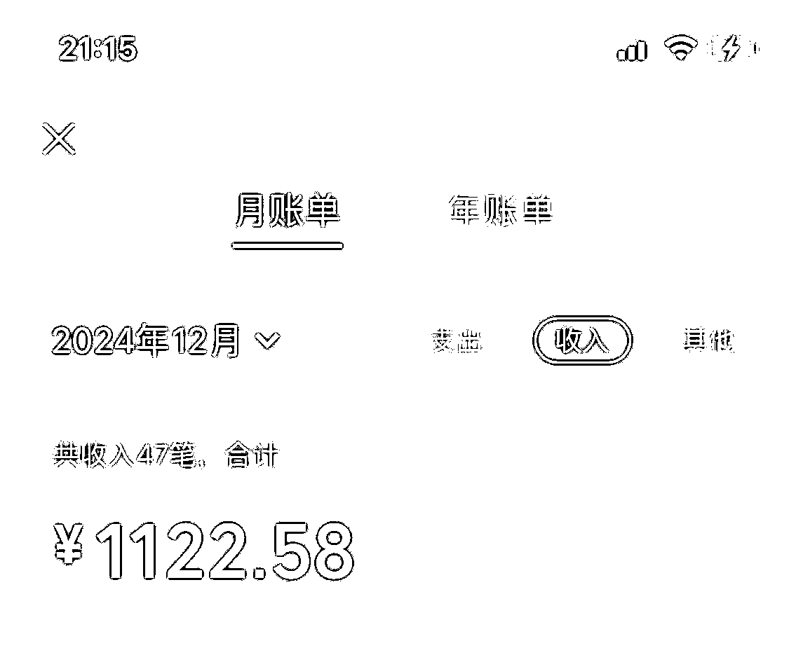

其余零星小额就不一一列了。

# 私域沉淀情况

比起回款，我更在意私域的沉淀量。航行期间微信新增接近三百人，后续整理时发现一批僵尸，我同步做了清理。微信的活跃度需要定期维护。

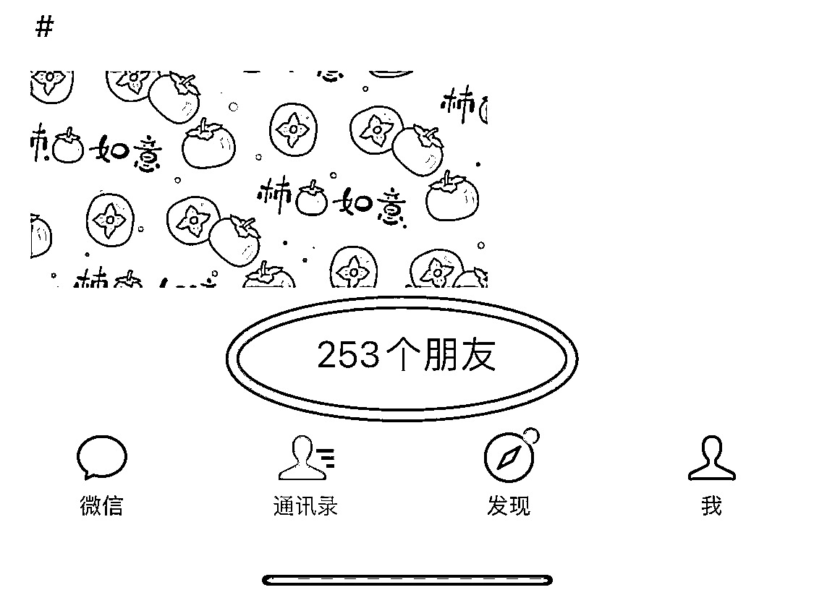

这里分享一个我常用的成交推进和建群思路。

刚认识的新客户，很多同行第一反应是立刻报价成交、尽快闭环。但一上来就谈付费，对方容易直接消失。关键是要转换沟通节奏，对方愿意添加，说明对资料本身有需求。

我加到人之后的沟通示例：

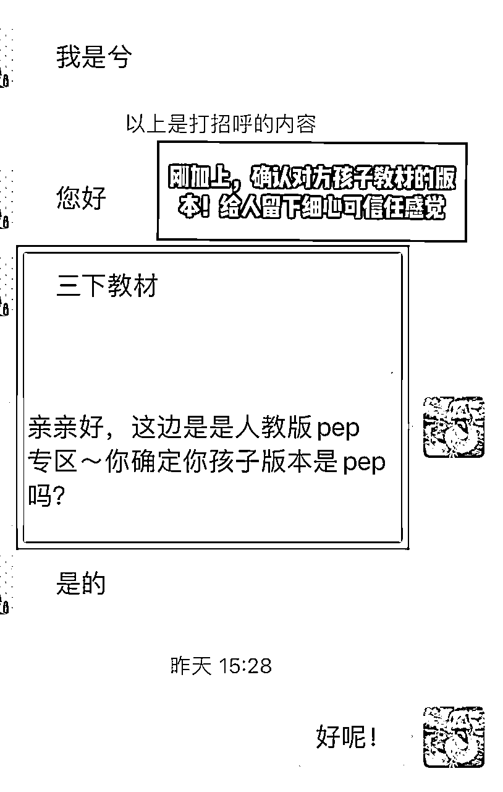

刚建立联系时不宜自我介绍过度，反而要先建立细心可靠的印象。我第一步会核对孩子使用的教材版本，避免后续版本出错。

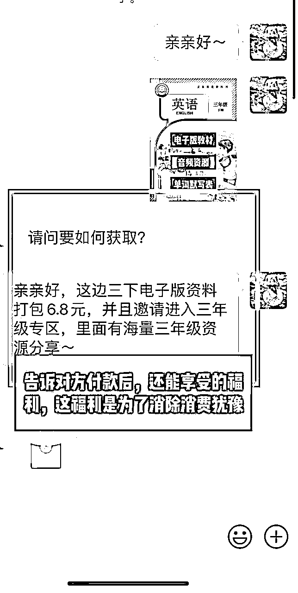

确认版本后，再把客户想要的资源抛回来，进一步点燃需求。能加到我的基本都是冲着资料来的。这里会分两种反应，有人报了价就冷场，我早期也犯过这个错，后来调整为先谈付费进资料共享群，并重点说明进入群能得到什么价值。同时提醒自己，启用新微信号的第一件事就是把群提前建好。

完成首单后，我会顺势介绍手上其他在售品：

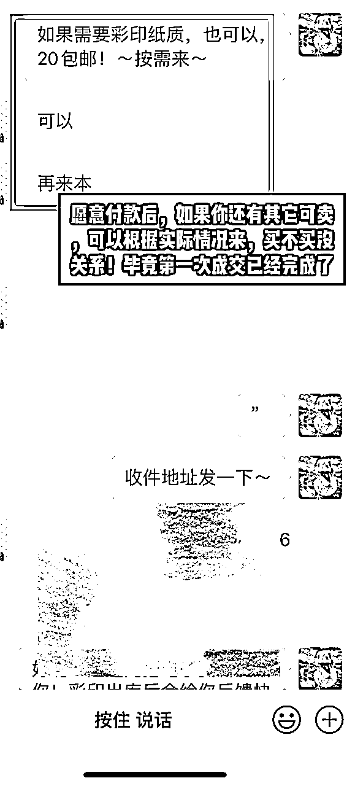

彩印类资料有明显季节性，春节前一周左右需求就会断崖式下降。顺势推进，又完成一笔。

电子资料交付完后就邀请进群

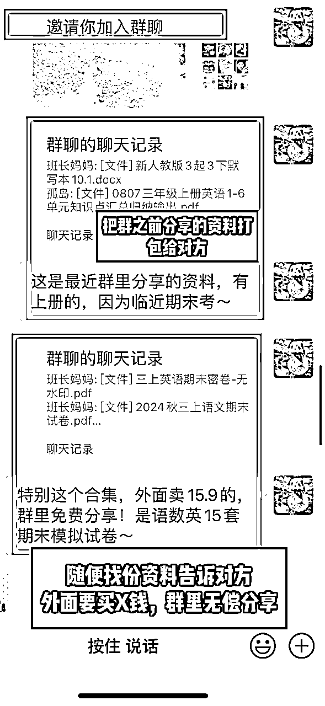

并把群里历史分享的资料打包发给对方，让对方感受到被重视，也先体验群的价值。

我还做了一个小设计，挑一份资料标注市场价约XX元，明显高于他为虚拟资料支付的费用，让他产生超值感。标注的价格是真实的，我只是运气好拿到带水印的免费版本，水印是航海期间教练教的去水印方法处理的，教练必须加鸡腿。

紧接着刚好有一次团购，我就顺手把团购链接也推给了对方，买不买看缘分。

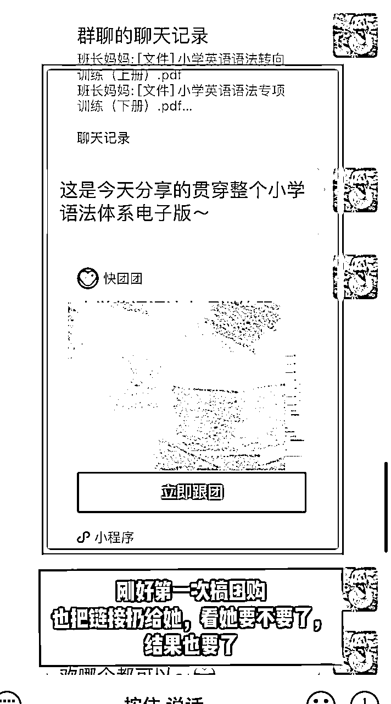

这样一环套一环下来，一个新加的客户在十分钟内完成了三次付款，合计46.7元。

当然并非所有人都能如此高效，有些客户在虚拟资料环节就卡住了。这时可以先放下，用朋友圈的成交晒单去刺激。私域并非人人当下就能成交，别因一时没结果而内耗。

接下来具体分享12月4日至12月22日这段时间的执行心态，希望对同行有参考价值。

# 每天必做的事：把航海手册完整读一遍

航海手册就是我们的行动纲领，每天必读并且把核心句默念三遍：通过小红书发布优质内容，将教育领域粉丝引到微信私域，并转化为教育资料产品的付费用户，实现变现。

这句话贯穿整个航程，也是每日复盘的锚点。

实践下来，我发现不少人卡在资料库焦虑上，其实资料库极易解决，甚至可以零成本获取海量资源。

路径：去小红书找到做得好的同行，加她进微信教辅资料群，直接在她的免费库里筛选所需资源。

在获取资料的同时，你也在复盘对方的获客路径。你会注意到她的爆款内容长什么样，可以借鉴。关注后你还能看到她如何把粉丝安全地导到私域，这套方法已经规避了违规风险，站在巨人肩上我们会更安全。

说到日更内容，我自己做得最差。教练要求至少运营三个号，我的总发布量从未超过六条，数量严重不足。好在有三条笔记小爆，为我带来了上百个私域新增。

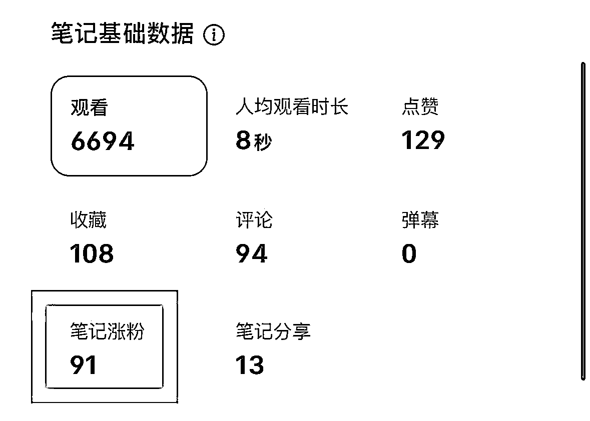

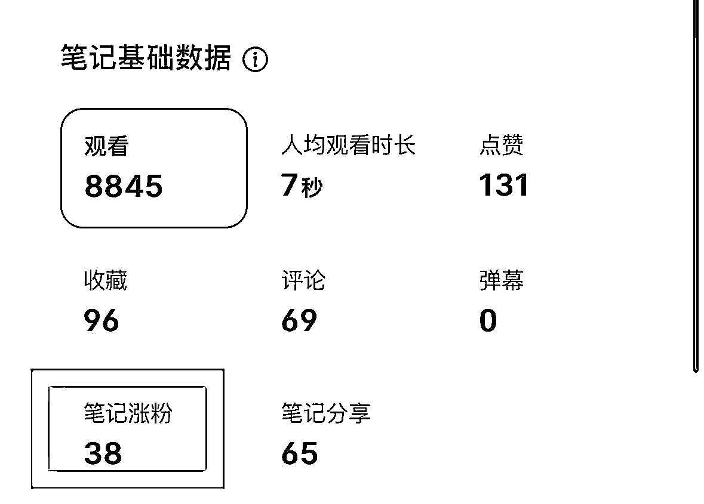

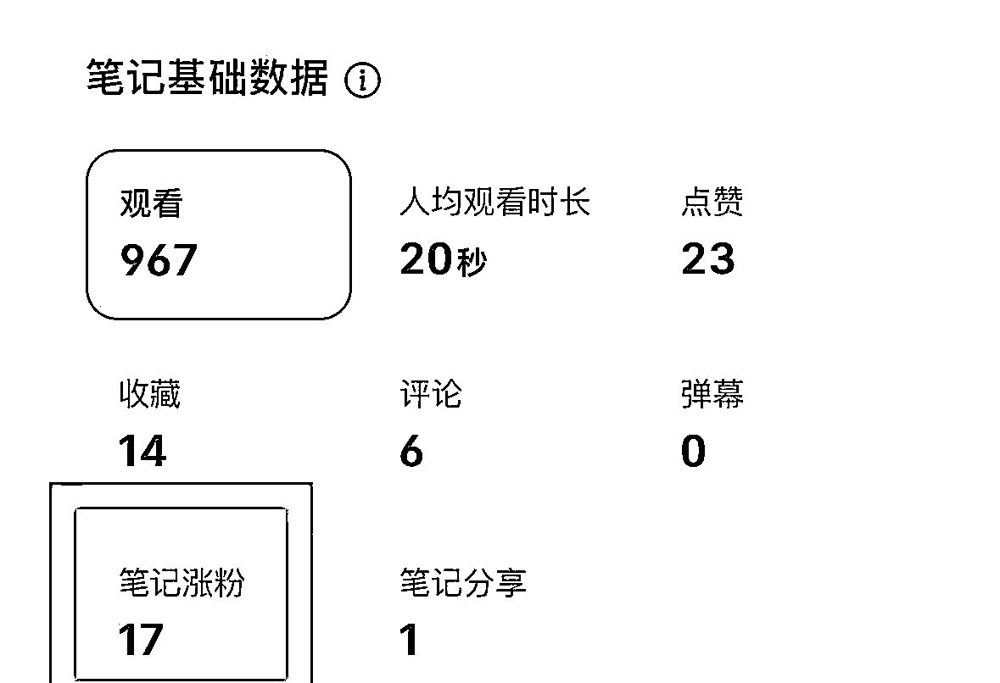

这些流量来自笔记，再通过私聊和群聊沉淀到微信。

从小红书到群的具体打法是私信加表情

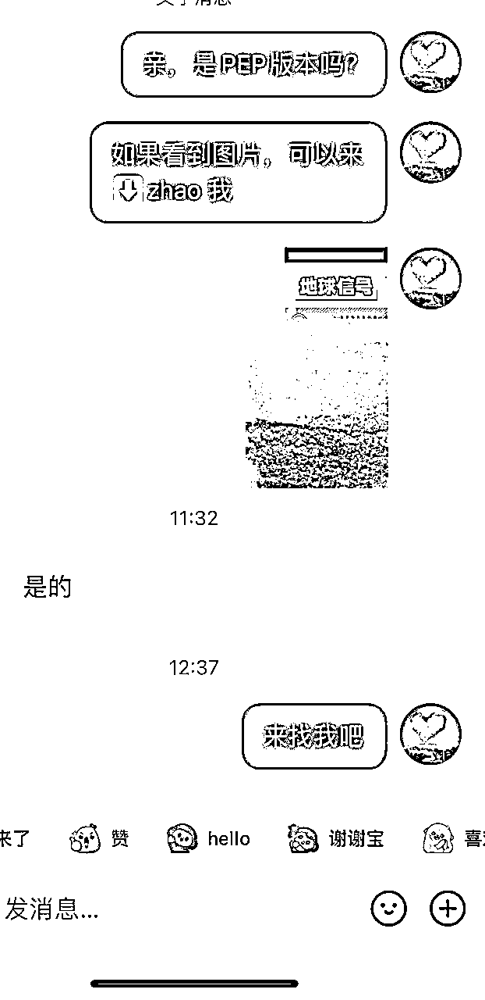

或者在群内用小号回复加表情互动

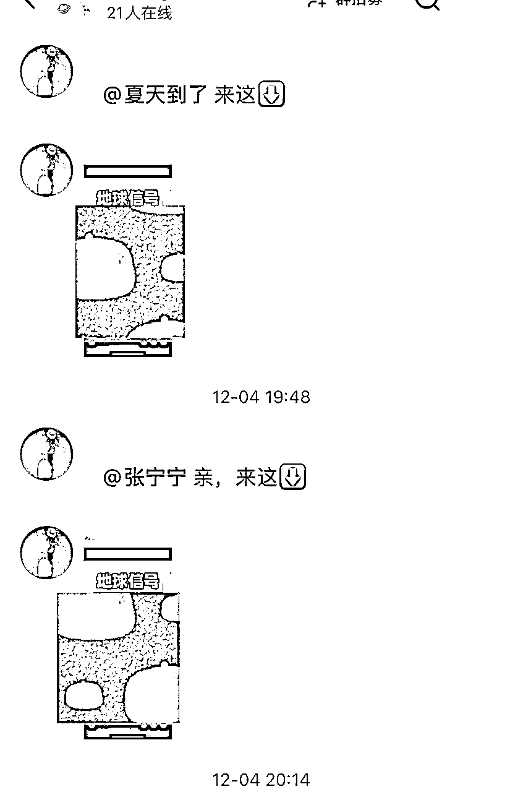

有朋友担心风险，我目前为止还没出事，但被判定违规的时间不确定。

后期笔记数据持续走低，我尝试去优秀账号作品下截流，这招也给我带来了近百个私域新增，但代价是被举报喜提七天禁言。从此引流速度明显下降，甚至有天一个人都加不上。我开始排查是小红书评论受限还是微信加好友受限，查明原因后对症处理。

航海期间我一直告诉自己，引流优先于收款，先把鱼引到池塘。只要人进了私域，即便当下不成交，随着时间的培养，成交概率始终存在。前提是人必须先进来。

笔记不再爆发、截流也不敢再用后，我把重心全部放在转化上。毕竟私域的意义最终要体现为回款。

我选择的赛道让转化相对顺畅：三年级英语教材改版。笔记钩子就是三年级英语电子教材。开船前两天我就准备好素材，在拼多多花7.77元买了一整套电子资料

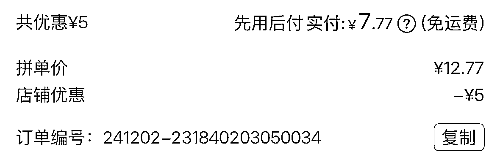

这7.77元的投入后来带来了四百多元的收入，纯利。虚拟资料的毛利确实诱人。

初期主要卖电子虚拟资料，用它做钩子把潜在客户拉进私域。后来有客户主动询问能否做纸质彩印，我立刻回应可以，并去拼多多核算成本定价，同时自己下单15.2元买一本作为笔记素材。

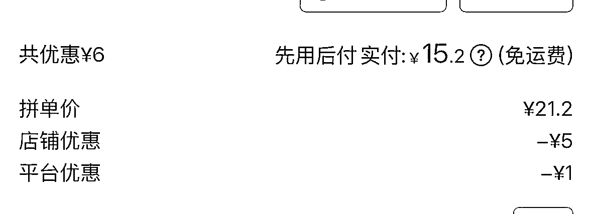

发布几天后咨询彩印的人越来越多，我直接联系商家出平台谈更低价，当晚就拿下第一笔大单二十本彩印，从该客户身上净赚190元。并在五分钟内完成从加人为成交。

该客户身份是教培机构老师，起初我对这类客户有戒备，觉得他们电子资料无限量，可能只买一份电子版。结果歪打正着，发现了彩印需求。随后我在朋友圈筛选出私域里身份为教培老师的流量，用这个案例做背书。虽然大家还在招生期未下单，但已经陆续透露需要彩印的数量预估超两百本，我都做了记录，并不时在朋友圈艾特提醒。距离期末考不到三周，我准备这两周再次跟进逼单。彩印生意只有这一个窗口期，开学后学生领到正版教材需求就消失了。

我对每个成交客户的备注都会写清购买品类，既方便筛选，也为后续复购做准备。

私域里的人都值得深挖，消费潜力很大，看你挖掘能力。我就在首单基础上发起二次成交，又收了138.46元。不算大，但对我来说是新的里程碑。

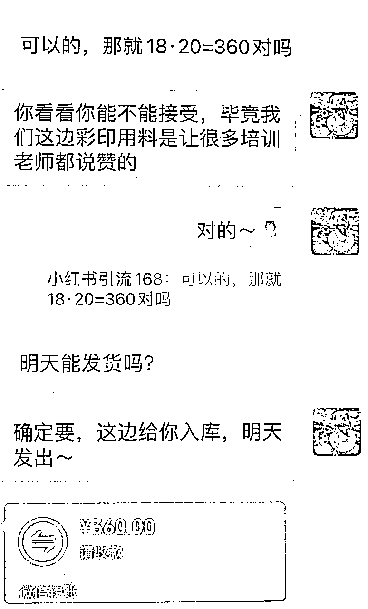

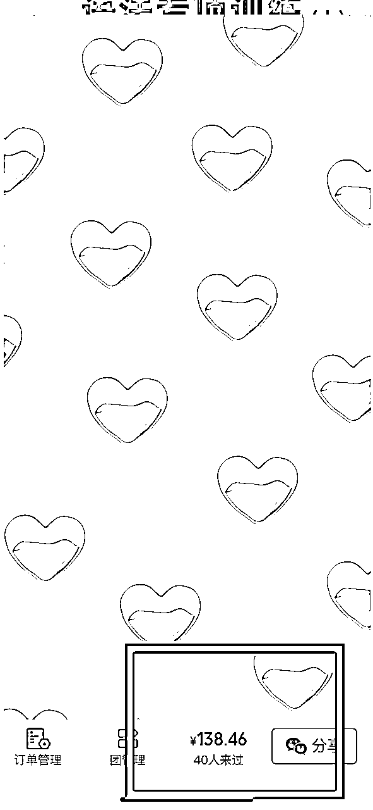

# 赛道选择思路

家里正好有三年级孩子，所以我从一开始就锁定K12赛道里的三年级。起初考虑过做全K12，但如果零到一未跑通就铺大面，很容易因精力分散而放弃。所以我聚焦三年级，只做英语一科。

了解教材改版的人知道，今年秋季三年级和七年级英语教材都改版了。那为什么我选三年级而不是七年级？抛开家里有娃这个客观条件，三年级家长的卷度明显更高，付费意愿更强。七年级家长虽然也关心学习，但更多已力不从心，孩子要上晚修，家长辅导参与度低，对教辅资料的需求感远不如三年级家长迫切。所以我果断锁定三年级。

# 踩过的坑

1. 不重视笔记数量，却纠结自己花心思做的几条笔记数据差。别玻璃心，数据差就说明没满足推流条件。要从用户视角出发，做钩子、做互动分。希平教练现在日更21条，巅峰期80条。我们没结果时更不该自怜自艾。听话照做才能少走弯路。航海群里教练们每天都在强调打磨和输出。记住，自媒体上先要有作品才有爆发的可能，量变才能引起质变。随便发一条就爆的是极少数，别把自己想得太高，先踏实提升质量和数量。
2. 别在资料库上浪费太多时间。先把流量搞起来。人货场固然重要，但没有人，一切都是零。资料库这件事不值得深究。
3. 引流成功后要尽快完成第一次交易，跑通闭环。我们航海的核心目标就是通过小红书优质内容引流教育粉丝到微信私域，并转化为教育资料产品的购买者实现变现。哪怕只收一元，能跑通全流程，就能在此基础上优化迭代。
4. 成交后要主动报喜，不管在航海群还是项目朋友圈。每一次报喜都是一次心态和业绩的跃迁。我每次在朋友圈报喜，都会带来新的付款咨询。
5. 迷茫时就回头再看教练们的分享。他们把宝贵的经验整理好了，现在不是慢慢来的时代，而是快点跑通闭环并持续出结果的人比较快。

最后送自己也送给大家八个字：听话照做，持续执行。