# 📕蓝海副业-英语演讲定制实操经验分享

最近挖到一个相当小众的赚钱路子——在红书上替人定制英文演说材料。说实话，这个方向知道的人不多，竞争压力小，上手也容易，基本上零成本启动，可每个月多赚个几千块真的挺轻松。我自己的操作节奏是每周抽一两个钟头把内容准备好，定时发布（写作部分外包给兼职），店里的商品全是自动发货，不用守着电脑，四位数左右的被动收入就稳定进来了。把部分进账截图放这儿给你们看看：

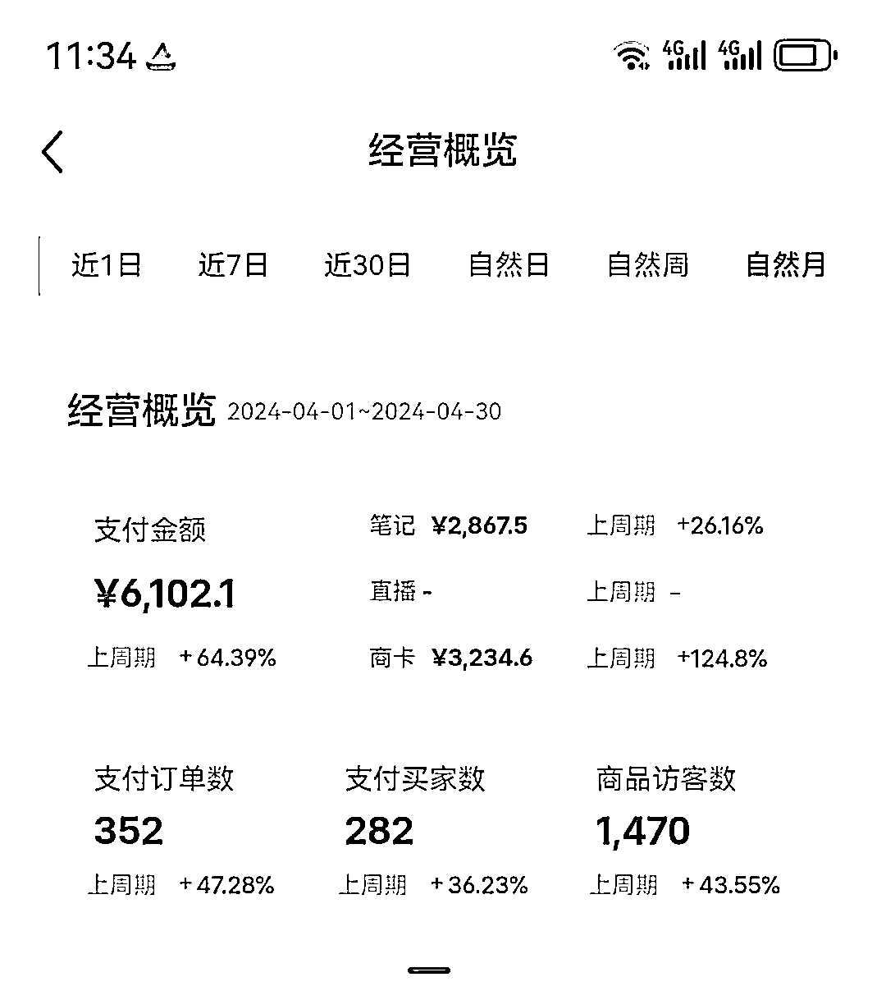

后来我把整套玩法也告诉了一个朋友——她英语底子就停留在高中水平，纯新手，但近两个月她靠这个进账超过两万。当然啦，她花的时间比我多不少。这个生意说白了就是投入多少回报多少，弹性很大。

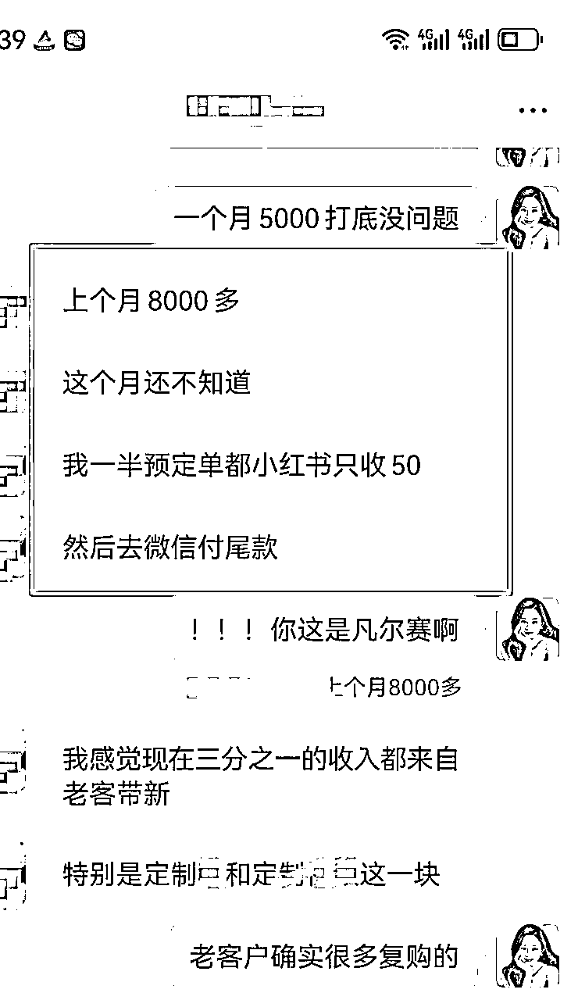

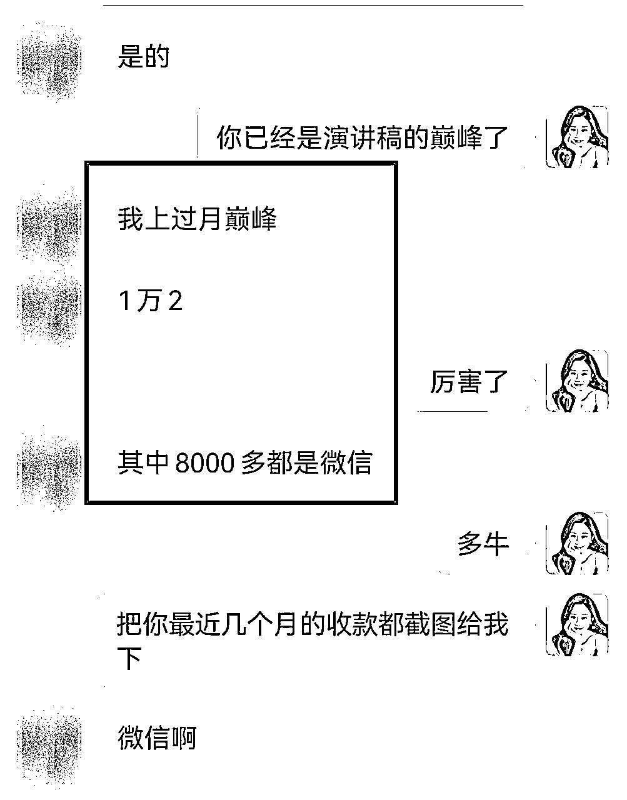

今天索性把这份超详细的落地教程全部公开，想试试的朋友可以直接照着做。

# 一、先弄明白这是个啥生意

老规矩，简单交代下我的背景。全职妈妈当了三年，去年上手的第一个搞钱项目就是它，靠这个赚到了六位数。今年又跟着社群参与了视频号带货的项目，收入冲到了七位数。我的很多商业认知其实都来自赚钱这个圈子，心里一直挺感激的。早先总觉得自己懂的太少，不好意思发声，就一直默默潜水。现在慢慢摸出了门道，觉得该回来做点分享了，希望这篇文章能拉一把那些还在迷茫观望的新手朋友，帮大家迈出第一步，得到点正反馈。

### 什么是英文演说定制？

没娃的朋友可能觉得陌生，我先解释下这个生意是怎么来的。

新课标落地之后，英语这门课对孩子们的要求明显变了——不再只看卷面分，更看重开口表达，还特别提到要能用英文把中国文化讲给世界听。所以学校也好、地方教育局也好、培训机构也好，都在张罗各种英文演讲比赛，给学生创造展示的机会。像业内比较出名的就有：希望之星、希语盛典、常春藤国际英文演讲展示活动、地球村青少年国际英文演讲交流活动等。

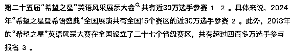

*光希望之星这一个比赛，每年报名的学生就超过三十万。

只要孩子能拿个不错的名次，对升学、选学校、面试来说都是实打实的加分项。所以家长们都挺踊跃的，尤其一线二线三线城市的父母，基本不愿错过。

但参加比赛就得备稿子、做背景视频之类的。对多数家长来说，与其自己费劲去写，不如花钱搞定；更何况大部分家长也真写不出像样的英文稿。需求一出来，我们的机会自然就来了。

围绕家长不同的付费想法，我们设计了两档产品：

1、对成绩有期待、舍得投入的家长，愿意付三位数来定制——定制版包含专属演说稿+配套音频+背景视频；
2、抱着试试看心态的家长，花两位数买现成的就行——成品版直接交付通用稿件+音频+视频。

不管是稿子还是视频，全靠人工智能批量搞定，新手操作毫无压力。

一张流程图把整个逻辑讲清楚：

*定制版的老客户追单很猛，因为比赛通常有好几轮——初赛、复赛、半决赛、总决赛，孩子每过一轮，家长几乎百分百会再回来下单。

### 收入盘子到底有多大？

*   成品版：每月至少出一百单，单价9.9到59.9元浮动。比如只要英文稿和朗读音频的，定9.9元就行；要稿子加音频再配视频的，按视频长短和精致度来，通常收29.9到59.9元。
*   定制版：旺季每月能接到10到30单，一单200到400元（寒暑假生意淡一些，其他月份都算旺季）。定制按时长和复杂水平计价，最便宜的也要200元起步；我们接过最贵的一单，3分钟视频定制收了450元。
*   利润空间看这里：走店铺成交，平台抽成5%，剩下全落自己口袋。要是把人引到🛰️上交易，那到手的全是纯利。

*想多赚就主推定制版。一般接下三个定制单，净利润就过千了。

把这个逻辑搞明白，再按下面给的流程一步步落地，该抠的细节都抠到位，头一个星期就能迎来首单。

# 二、从零到一的操作拆解

整个流程一共分五块内容：怎么产出视频素材、怎么接定制单、开店前要做哪些准备、怎么从📕获得曝光、最后怎么把咨询变成订单。

### 1、一条英文演讲视频是怎么做出来的？

先带你看一下成品的结构：画面内容+人声朗读+配乐+字幕，四个元素。用到的工具一共四款：度加、KIMI、记灵、剪映。

#### 第一步：让AI写出一篇英文演讲稿

国内外随便哪个大模型产品都能胜任，像KIMI、智谱清言、豆包、ChatGPT之类的都行。打开一个就能用，关键是提示词得写对：

“请用国内10岁小朋友的英语水平，用优秀的英语演讲稿的结构，生成一篇主题为‘XXX’的英语演讲稿，要求字数250词，并在最后附上生动优美的中文翻译”

拿KIMI举个例子，让它写一篇关于“春节”的英文稿，出来的效果是这样的：

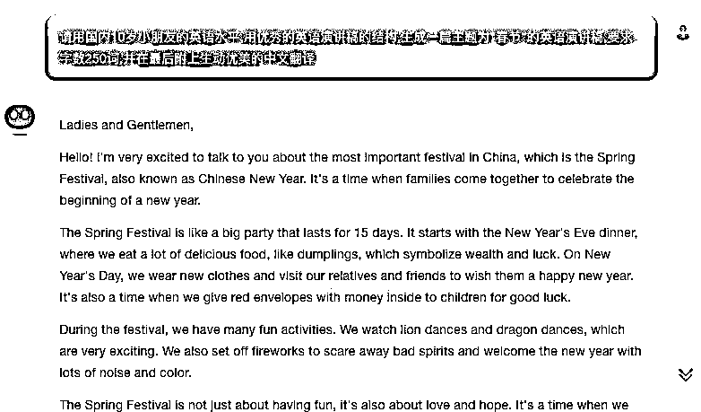

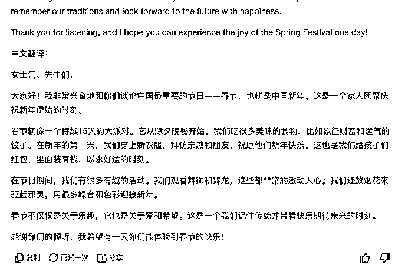

中文和英文稿最好都存进word文档里备份，因为这也是成品版要交付给客户的文件之一。

可能有人要问：主题从哪找？最快的路子就是看同行——他们视频里点赞高的选题，直接拿来复用就行。但稿件内容千万别照搬，很容易被人举报。自己拿AI写一篇原创的不难。

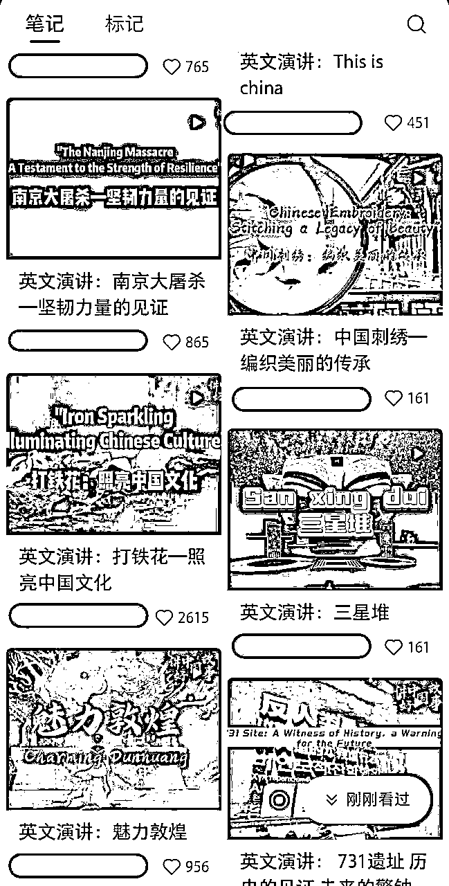

#### 第二步：把文字变成英文朗读声

1）浏览器里搜“记灵配音”，这是一个免费工具，进去后点“在线配音”。

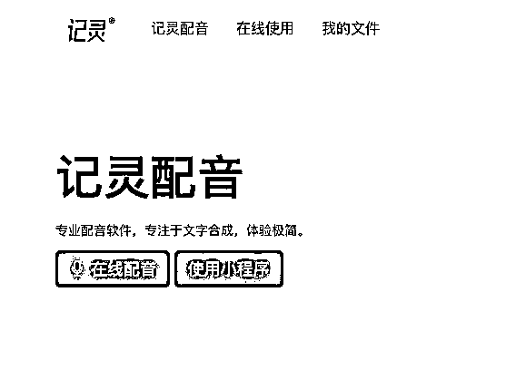

2）把刚才生成的英文正文复制到输入框，声音主播在外语分类里随便挑一个顺耳的，语速调到0.88左右。

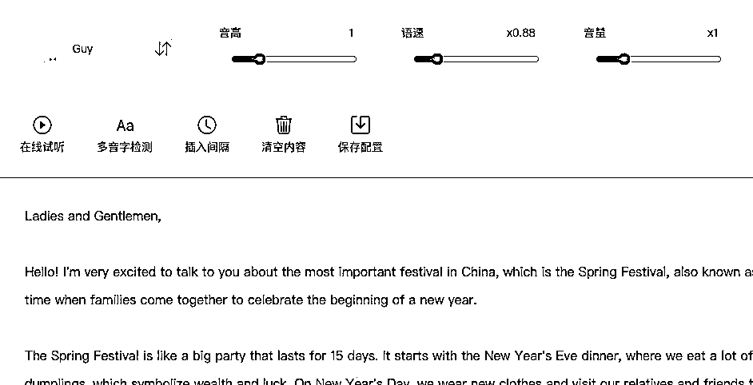

3）点“合成mp3”，等差不多五秒钟，把生成好的音频文件下载下来。这份音频也是成品版要交付的内容。

#### 第三步：用AI把文字变成画面

1）打开“度加创作工具”——这是百度家的AI成片网页，直接搜名字就能找到入口。

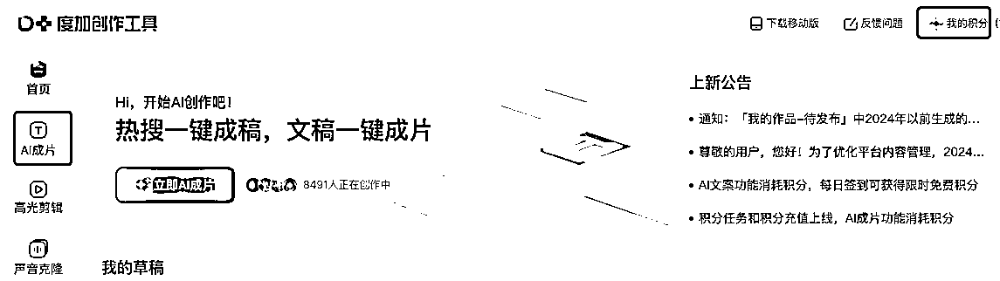

网站右上角每天都送免费积分，不需要额外掏钱充。

2）点“AI成片”，把上一步得到的演讲稿中文版本全部复制进文本框，按“一键成片”按钮。

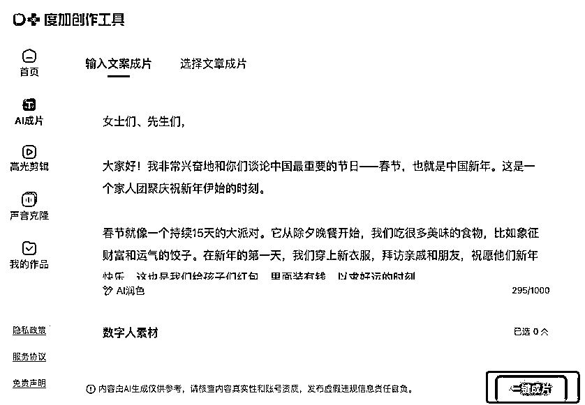

3）等大约15秒，系统会自动按文字意思匹配画面。点“发布视频”，等它渲染完下载就行。

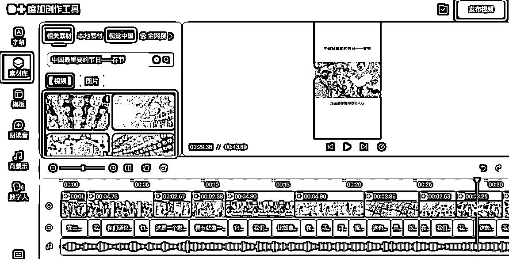

假如觉得某个画面不搭，在左边素材库手动翻翻看，找到合适的替换即可。

4）视频文件先存好，后面用。

#### 第四步：剪映里做最终合成

1）打开剪映，把前面存的音频和视频片段拉进时间轴。

2）视频原声关掉，画面比例调成16:9，这样能把原来自带的字幕裁掉。

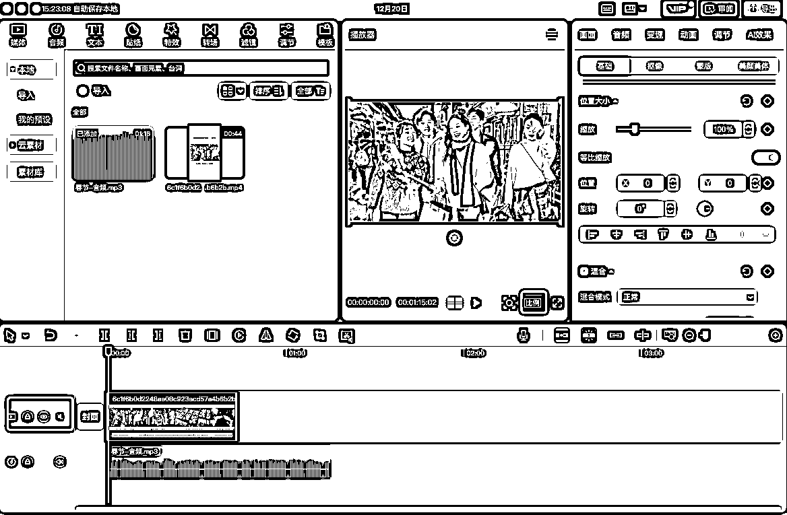

3）确保画面长度和音频长度对齐。要想做到这点，可以用变速工具，也可以回度加再生成一段补充画面。

4）加字幕：按“文本-智能字幕-识别字幕-翻译字幕成中文-开始识别”的顺序操作，识别完成后拿第一步的英文稿对一遍，把错的地方改掉，再调一下字体样式、大小和摆放位置。

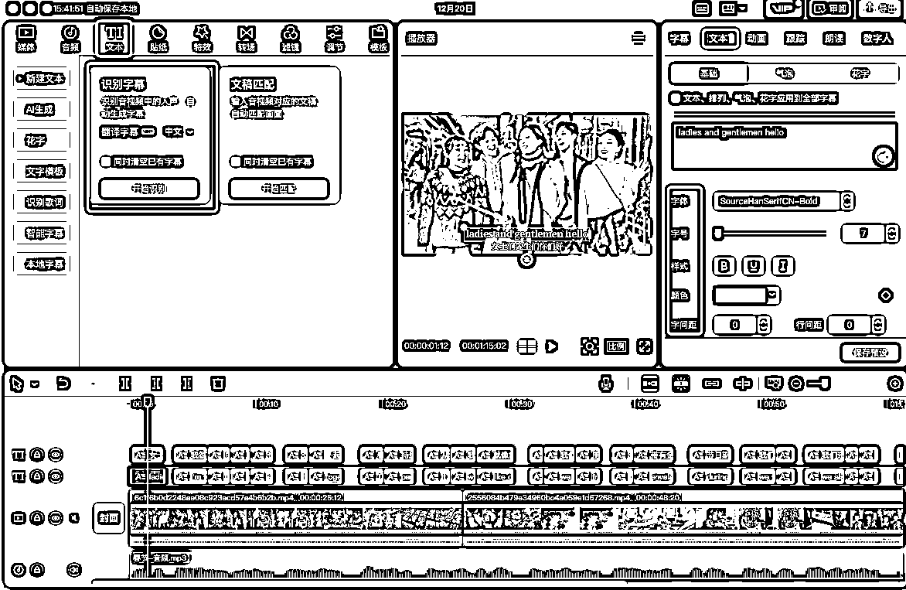

5）配乐：在“音频-音乐素材”里搜索和主题匹配的轻音乐，拖进去以后把音量拉低一点，别盖过人声。

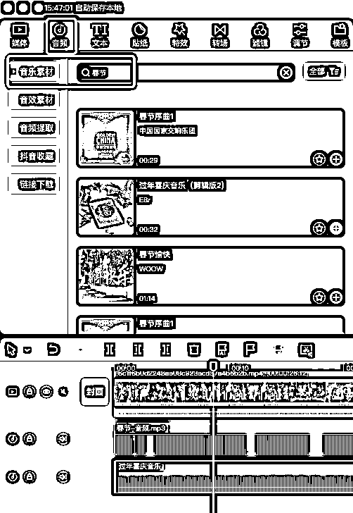

6）片头标题：在“文本-文字模板”里挑一套好看的模板，做成片头就行。

上述步骤走完，从剪映导出的片子就可以直接传上📕当笔记发了。

我用这套流程就已经能撑起每月四五位的收入了。要是你自己剪片水平更高，画面做得更精致，卖价完全可以再往上抬，收入自然跟着涨。

### 2、定制版是怎么做的？

说白了，就是在成品基础上按客户要求加料——比如多一段自我介绍，或者比赛规定了题目，那就在原有提示词上做增删。这里给一个通用模板：

“请用国内XX岁小/初/高学生的英语水平，用优秀的英语演讲稿的结构，生成一篇主题为‘XXX’的英语演讲稿，要求有简单的自我介绍，字数要求XXX词，并在最后附上生动优美的中文翻译”

视频部分无非是要求更高一点，多花点心思找镜头素材罢了。偶尔有客户要求抠人像换背景，剪映里现成的教程一抓一大把。

所以定制版的核心就是两件事：花精力找好素材，跟客户把需求聊透。其他环节和成品版没有区别，最后交的都是三件套：稿子+录音+视频。

### 3、上手前要准备什么？

有些同行喜欢把人往🛰️上引，但我们自己测下来，觉得在📕上直接开店成交更高效，还不用担心账号出问题。所以更推荐直接开店。

#### 硬件和账号

*   手机和账号尽量做到一机一卡一号，苹果或安卓都无所谓。
*   手头有旧账号的话，只要没发过动态、没有违规历史，养几天就能用。
*   要是账号发过东西或者有过小违规，直接注销重新注册。
*   日记内容和商品上架都用“千帆”电脑端后台操作。
*   开店模式只需要打理一个账号，等跑通了再复制矩阵不迟。

#### 账号培育期

新注册的号建议先养三到五天，每天抽一个小时左右刷刷同行的主页，点点赞、写写正常评论，算法很快会给你推一堆对标内容，灵感自然就来了。

#### 门面包装

*   昵称、头像、背景图、简介这四件套，直接参考做得好的同行，再改成适合自己的版本。
*   简介部分要把业务方向和个人卖点写清楚。

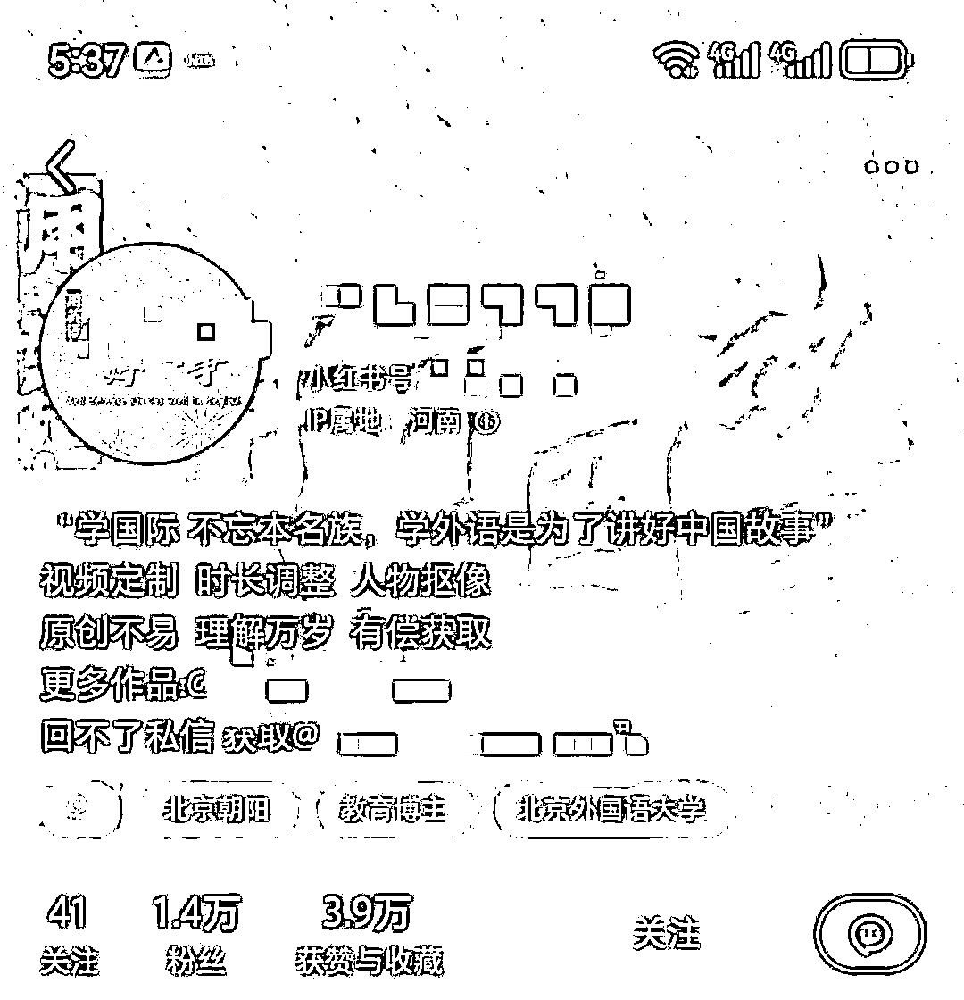

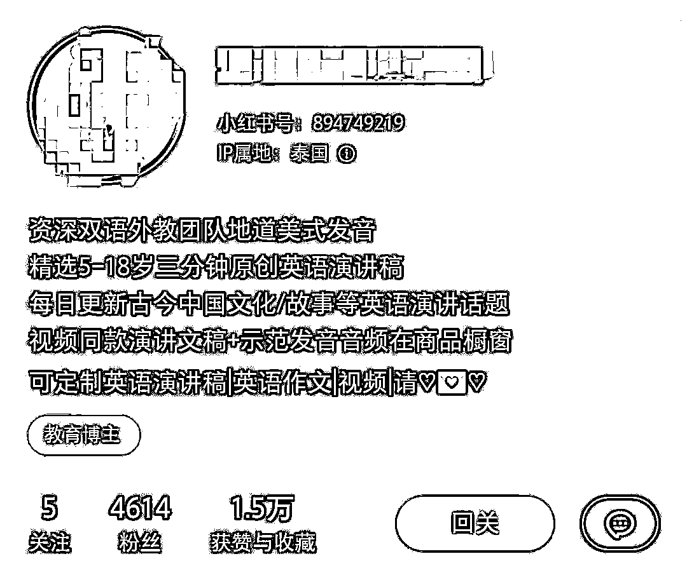

#### 开店这一步

0粉丝就能申请开店，不需要营业执照，选“个人”类型，拿身份证按提示操作就行。

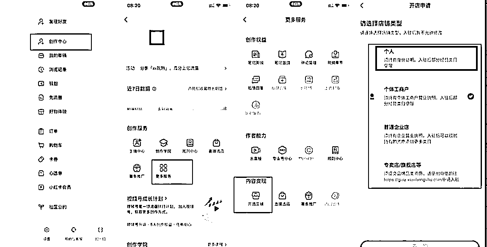

开店要交1000元保证金，但不用立刻交，提现的时候再补就可以。

商品类目记得选：虚拟定制。

自动发货我在用第三方插件，后台可选的不少，也有免费试用的。

#### 笔记和商品怎么发布？

标题、文案、标签都不用自己拍脑袋，直接研究同行就好，他们的做法就是最好的教科书。

登录千帆电脑端，发笔记和建商品都在这里完成。

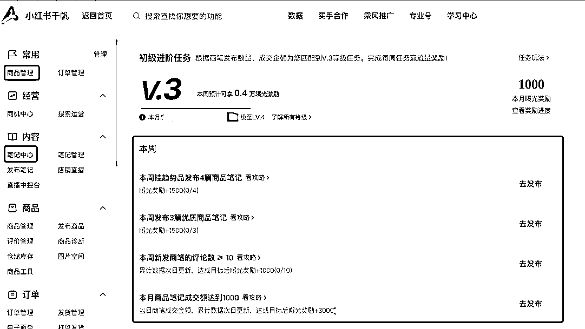

千帆的“笔记中心”每周都有做任务换流量奖励的活动，记得顺手参加。

先进入“商品管理-发布商品”。

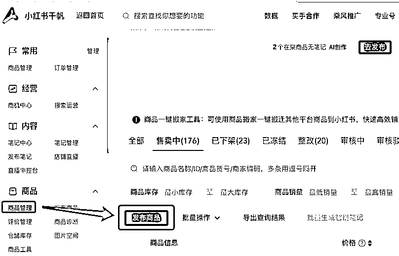

参考同行写好标题，做一张商品主图，类目选“虚拟定制”，下一步。

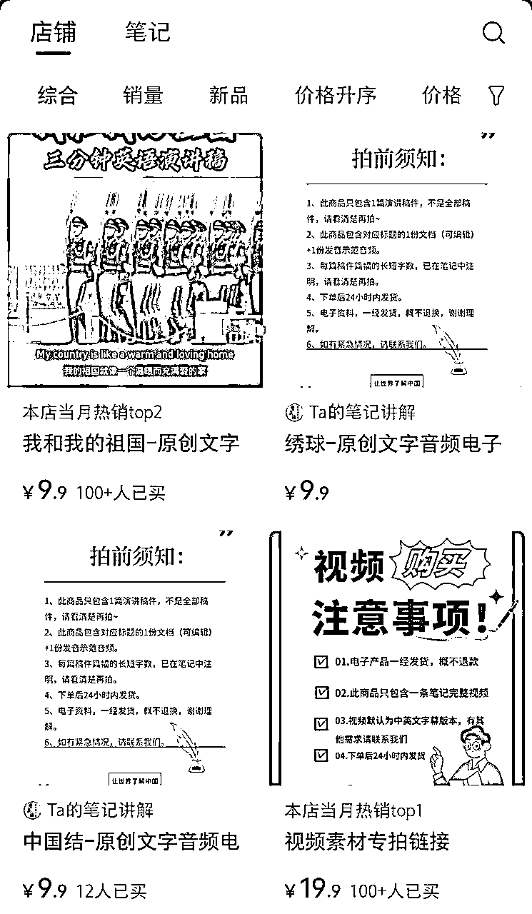

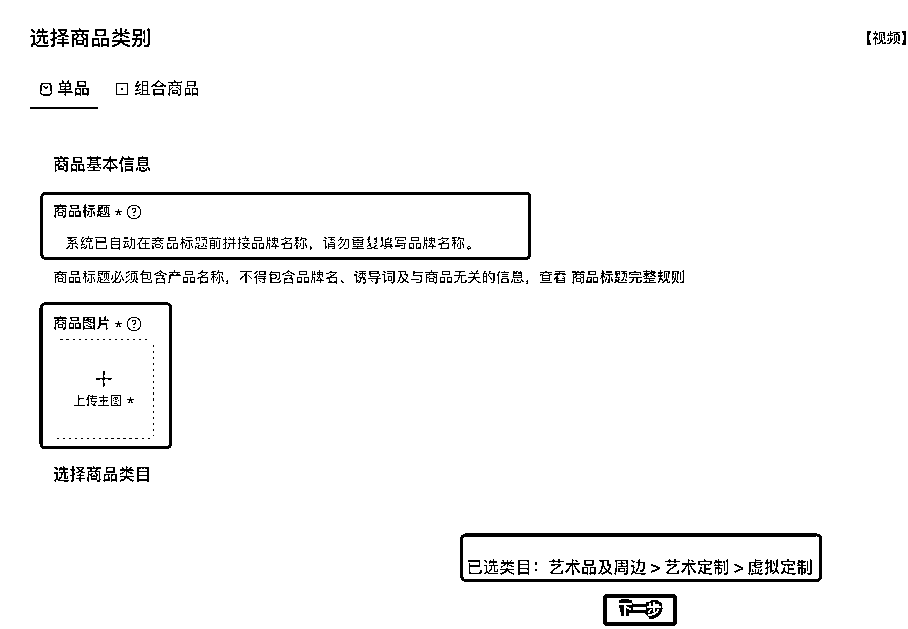

细节设置里就三个地方要特别注意：

*   物流方式选“无物流发货”
*   运费模板选“全国包邮”
*   “七天无理由退货”这个选项千万别勾

电子资料本来就该售出后不退不换，不然容易被那种爱占便宜的人钻空子申请退款。

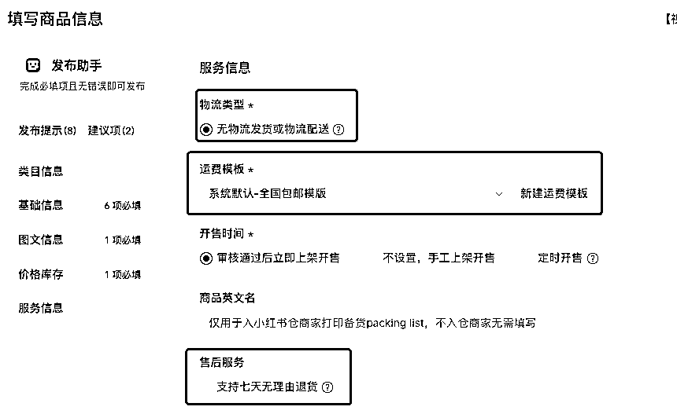

商品创建好以后，下一步就是“发布笔记”，把剪好的视频拖进去。

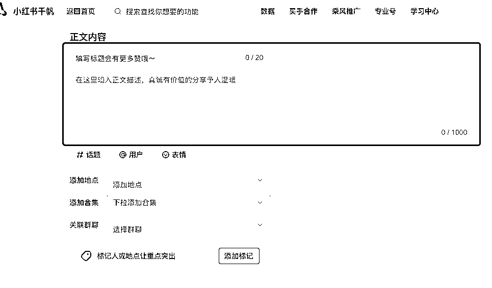

填好标题、正文、话题，再挂上商品链接，点发布就完成了。

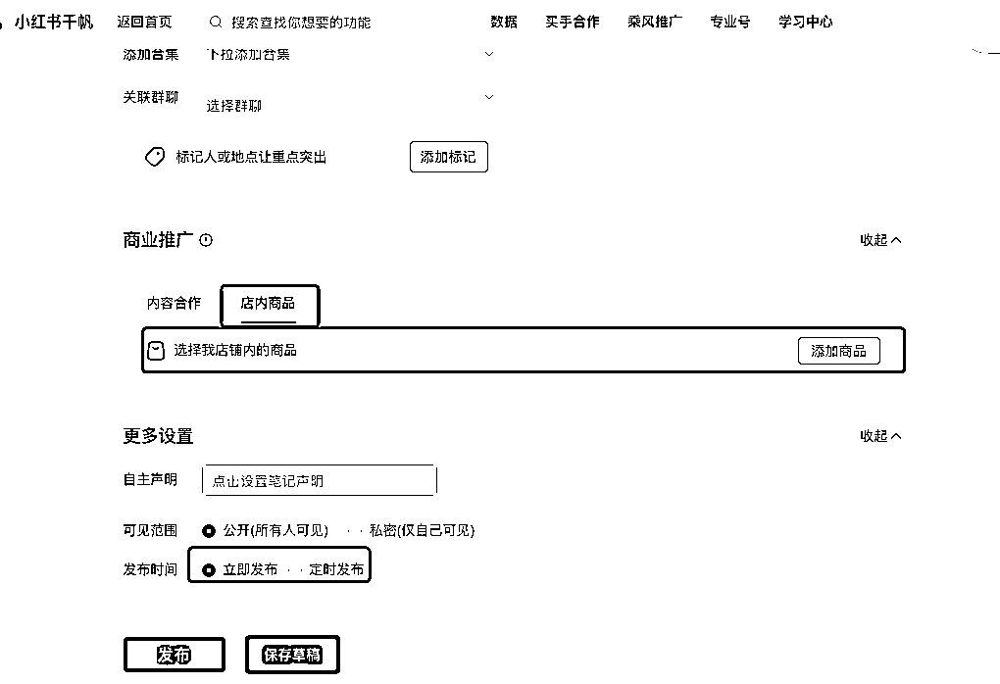

定时发布功能很实用，最多可以提前排两周的内容。也就是说，每个星期集中一天把接下来一两周的素材备好、排好发布时间，接下来坐等顾客上门就行。

### 4、怎么从📕获取流量？

这个领域的用户画像非常清晰——都是带着明确需求来搜索的，搜到就下单。给你看下我的流量构成，搜索带来的订单占了七成。

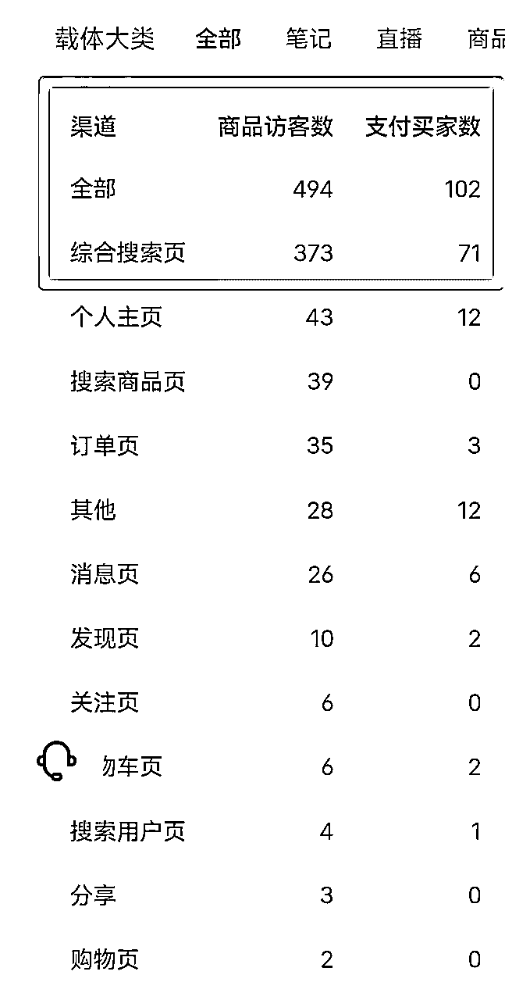

所以，在这个赛道上获取曝光只要做四件事：

1）每篇帖子都要埋好搜索词。比如“英语演讲背景视频”“英语演讲稿”这类字眼，正文里也尽量多带几个关联词，搜索流量就会源源不断。

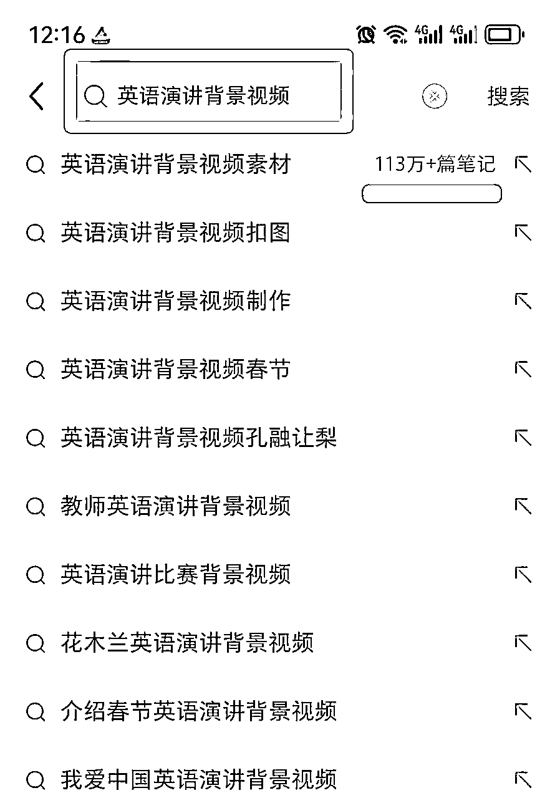

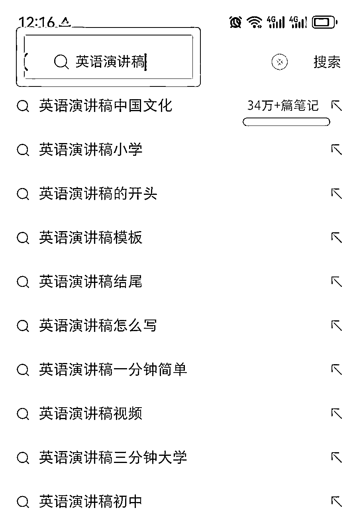

2）拼命发，用数量堆。别人验证过能火的选题，你再发一遍，有很大概率也能跑出来。

3）盯紧各大英文演讲赛事。这类比赛基本都有固定命题，题目网上全都能找到。把对应题目做好稿件和视频，打上比赛名称的标签，赛事的搜索流量就都是你的了。还有不少家长对名次有执念，不会满足于现成的稿子，就会来找你定制。

4）晒客户拿奖的照片、晒好评截图。这是推高定制版转化率最有效的一招。

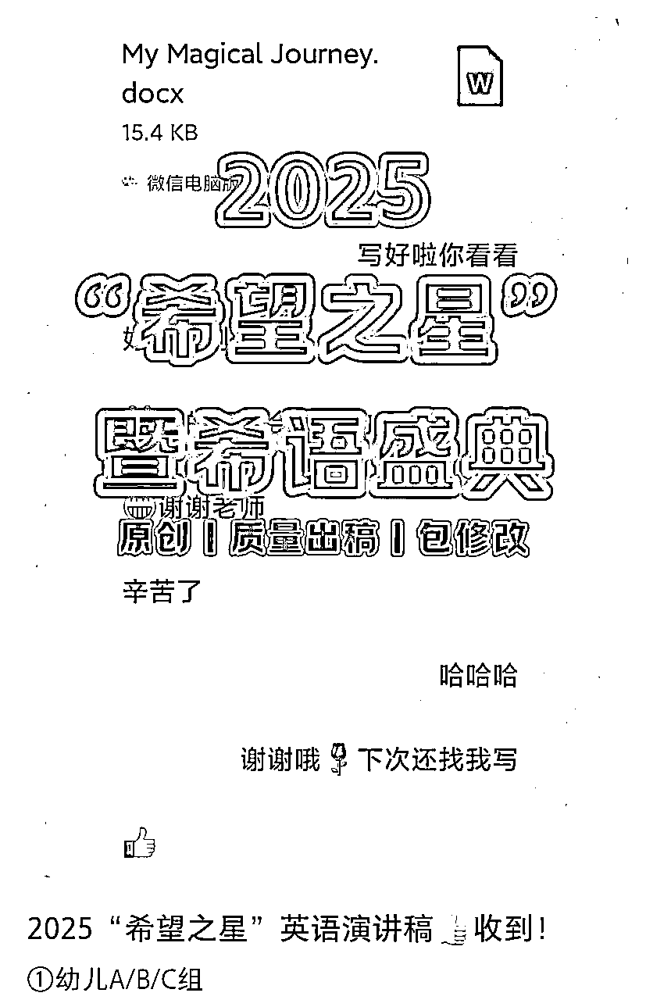

还没有客户评价怎么办？自己开个小号，跟大号聊几句，做一条出来就是了。

以上几招都安排上，账号的浏览基本就不用发愁了。接着看顾客从问价到付款的完整链路。

### 5、怎么把咨询变成订单？

来咨询的人，大致分两类：

#### 1）买成品版的顾客

这类客户动作最快，基本不聊直接拍，就算有对话也多是买完问怎么发货。

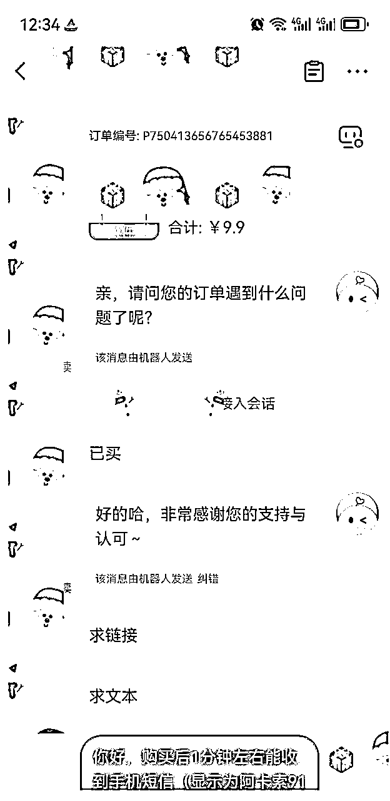

#### 2）要定制款的顾客

定制客户通常会带着自己的需求主动开口。

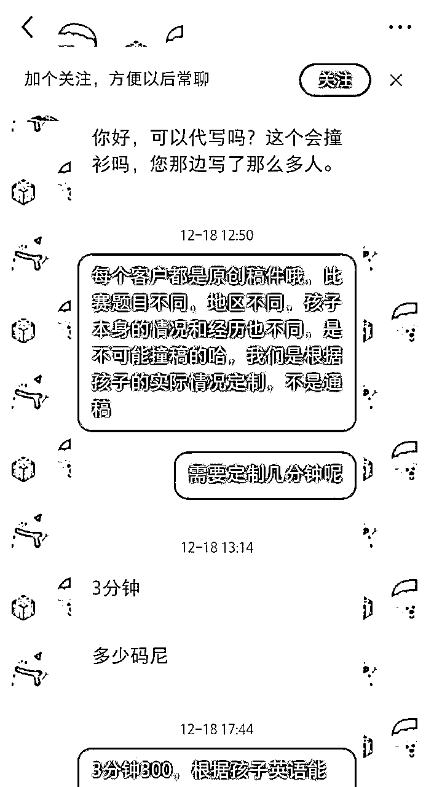

我们需要问明白两个问题：视频要多长？比赛的具体要求是什么？然后就能报价了。3分钟的赛事稿定制，我们一般开价300元。

对方接受的话，直接把商品链接丢过去，让她拍下并付全款；不接受的话，要么砍价要么直接走人。砍价能不能接，看你自己的心理底价。

整单过程完全不需要什么销售技巧，因为买卖直接在📕店铺里完成，根本不用引流到别处。

# 三、几条避坑提醒

1、这个圈子的客户意图很明确，视频不一定有很高的播放量，但订单不会断。搜索入口贡献了我们超过一半的单子，所以千万别因为播放量平平就轻易放弃。

2、有客户会在私信里写🛰️号、或者想方设法套你的🛰️号。只要你在对话里回复任何内容，系统都会判违规，说啥都没用。所以尽量把交易留在店铺里完成。客户拍下商品后会留下手机号，你拿这个号码去添加🛰️就安全了。

3、笔记的选题内容要阳光正面，别触碰平台红线，这是最基本的底线。

4、坚持原创，拒绝搬运。有AI这个工具在，做原创根本不是难事。抄爆款选题没关系，但别抄内容，小心被投诉侵权，得不偿失。

5、英语不好能做吗？只要英语水平到高中程度就够用了，毕竟稿子不是你来写，是AI代劳的。前面说的那位朋友就是例子，只有高中英语水平，上个月靠这个项目也赚了一万二。当然啦，要是连字母都认不全，那还是别碰这行了。

# 四、最后聊几句

做这个项目到现在正好满一年。从当初伸手要钱、完全没有收入的状态，到现在每个月稳稳定定四五位数的进账，它给我的鼓励真的很大。也正因为摸清了这群用户的其他需求，我后来才加码做了视频带货，收获了更大的成绩。

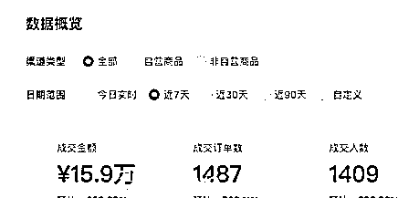

又因为连着做出了好几个百万播放的爆款，我对内容的感觉和线上获客的能力都有了质的提升，所以又开始了IP陪跑孵化的新业务。一路走来跑通了不少案例，也算是完成了新一轮转型。

回过头看，我越来越认可一个道理：商业的内核就是利他。当你能真正帮人解决问题、满足他的需求，匹配的回报自然会找上门来。

就这样，谢谢大家耐心看到这里。只要用心执行，结果一定不会辜负你的努力。有任何想聊的，评论区尽管问，我一定知无不言。